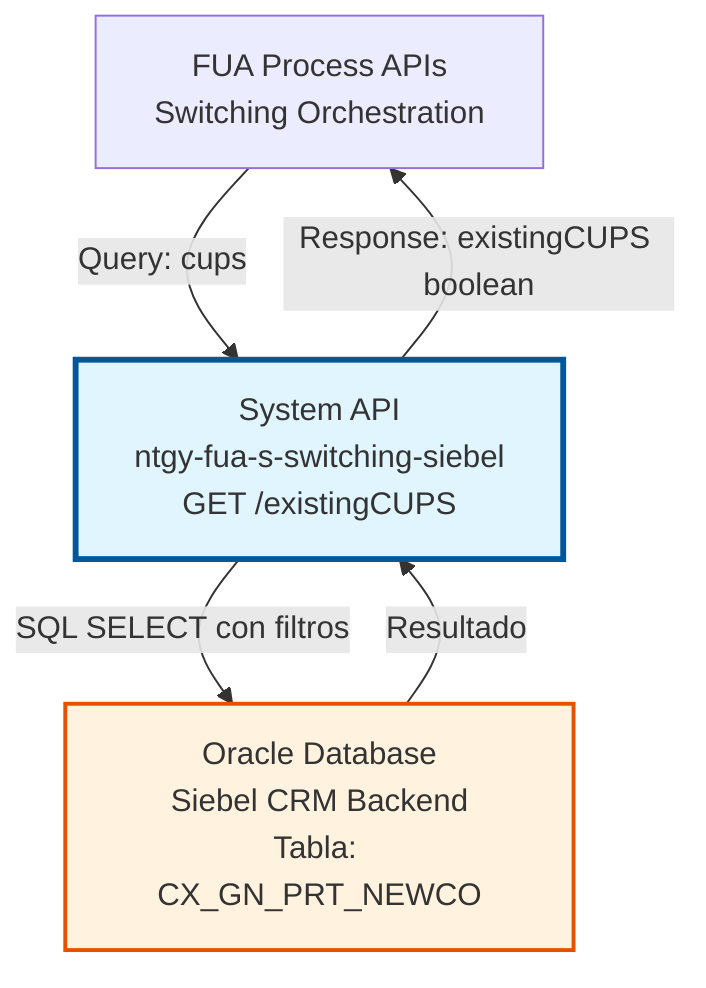
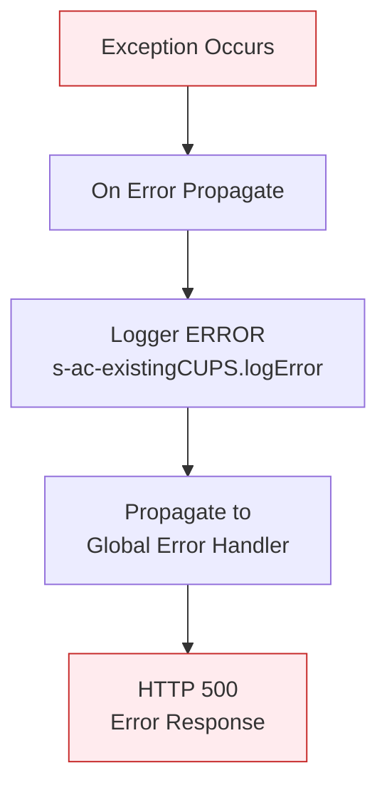
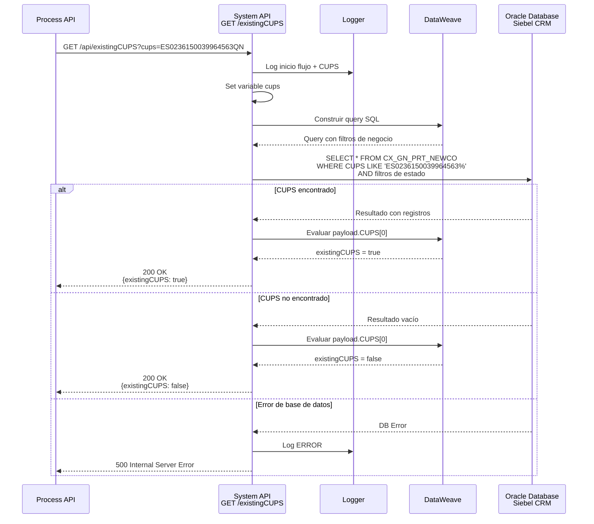

# GET /existingCUPS

## 📌 Descripción General

### Propósito del Endpoint

Este endpoint valida la existencia de un CUPS (Código Universal del Punto de Suministro) en la base de datos de clientes activos de Naturgy Iberia, específicamente en el contexto de procesos de switching (cambio de comercializadora). La validación incluye filtros de negocio para excluir portabilidades rechazadas o en estados específicos que no son válidos para nuevos procesos de cambio.

El endpoint soporta:
- **Validación de CUPS**: Verifica si un CUPS existe en la tabla de portabilidades NewCo
- **Filtrado de Estados**: Excluye portabilidades rechazadas y casos específicos de baja distribuidora
- **Búsqueda por Prefijo**: Utiliza los primeros 20 caracteres del CUPS para la búsqueda
- **Respuesta Booleana**: Retorna un indicador simple de existencia (true/false)

### Tipo de API

**Capa:** System API (API-Led Connectivity)

**Función:** Integración directa con base de datos Oracle (Siebel CRM backend) para validación de CUPS en procesos de switching de comercializadora.

### Patrón de Integración

**Tipo:** Request-Reply Síncrono con SQL Query

**Descripción:** El endpoint recibe un CUPS como query parameter, construye dinámicamente una query SQL con filtros de negocio, ejecuta la consulta contra la base de datos Oracle de Siebel, y retorna un indicador booleano de existencia basado en el resultado.

### Arquitectura API-Led Connectivity



---

## 💼 Propósito del Negocio

### Casos de Uso Principales

1. **Validación de Switching Entrante**
   - Un cliente solicita cambio de comercializadora a Naturgy
   - El sistema necesita verificar si el CUPS ya está en proceso de portabilidad
   - Se valida que no existan procesos activos o rechazados que bloqueen el nuevo switching
   - **Beneficio**: Previene duplicación de procesos y conflictos en switching

2. **Verificación de Estado de Portabilidad**
   - Agentes de call center consultan estado de CUPS durante atención al cliente
   - Se verifica si existe un proceso de portabilidad activo para el CUPS
   - Se filtran estados no válidos (rechazados, con baja distribuidora pendiente)
   - **Beneficio**: Información en tiempo real para toma de decisiones

3. **Prevención de Fraude en Switching**
   - Validación de CUPS antes de iniciar proceso de cambio de comercializadora
   - Verificación de que el CUPS existe en base de clientes de Naturgy
   - Detección de intentos de switching con CUPS inexistentes o en estados inválidos
   - **Beneficio**: Protección contra intentos fraudulentos de cambio de comercializadora

### Contexto Empresarial

- **Dominio:** Switching y Portabilidad de Clientes
- **Sector:** Energía - Utilities
- **División:** Naturgy España - FUA (Facturación Única Avanzada)
- **Proceso de Negocio:** Cambio de Comercializadora (Switching)
- **Sistema Backend:** Siebel CRM - Gestión de Portabilidades NewCo

### Stakeholders

- **Equipo de Switching**: Necesita validación rápida de CUPS para procesar solicitudes de cambio
- **Agentes de Call Center**: Requieren información inmediata sobre estado de CUPS durante atención al cliente
- **Desarrolladores de Process APIs**: Consumen este endpoint para orquestar flujos de switching
- **Administradores de Base de Datos**: Monitorean performance de queries y uso de conexiones

### Valor de Negocio

- **Cumplimiento Regulatorio**: Asegura que los procesos de switching cumplan con normativa CNMC
- **Prevención de Errores**: Evita iniciar procesos de switching con CUPS en estados inválidos
- **Eficiencia Operativa**: Validación en tiempo real (< 2 segundos) mejora experiencia del cliente
- **Integridad de Datos**: Mantiene consistencia en procesos de portabilidad

### Consumidores Potenciales

Este endpoint puede ser consumido por:
- Process APIs de switching y portabilidad
- Flujos de orquestación de cambio de comercializadora
- Sistemas de validación de solicitudes de clientes
- Herramientas de agentes para consulta de estado de CUPS

---

## 🔧 Especificación Técnica

### URLs por Ambiente

| Ambiente | URL Base | URL Completa |
|----------|----------|--------------|
| **Local** | `http://localhost:8083` | `http://localhost:8083/api/existingCUPS?cups={CUPS}` |
| **Development** | `https://ntgy-fua-s-switching-siebel-dev.us-e2.cloudhub.io` | `https://ntgy-fua-s-switching-siebel-dev.us-e2.cloudhub.io/api/existingCUPS?cups={CUPS}` |
| **UAT** | `https://ntgy-fua-s-switching-siebel-uat.us-e2.cloudhub.io` | `https://ntgy-fua-s-switching-siebel-uat.us-e2.cloudhub.io/api/existingCUPS?cups={CUPS}` |
| **Production** | `https://ntgy-fua-s-switching-siebel-pro.us-e2.cloudhub.io` | `https://ntgy-fua-s-switching-siebel-pro.us-e2.cloudhub.io/api/existingCUPS?cups={CUPS}` |

### Método HTTP

```
GET /api/existingCUPS
```

### Parámetros de Entrada

#### Headers HTTP

| Header | Tipo | Requerido | Descripción | Ejemplo |
|--------|------|-----------|-------------|---------|
| `Accept` | string | ❌ No | Tipo de contenido esperado en response | `application/json` |

#### Query Parameters

| Parámetro | Tipo | Requerido | Descripción | Ejemplo |
|-----------|------|-----------|-------------|---------|
| `cups` | string | ✅ Sí | Código Universal del Punto de Suministro (20-22 caracteres). Se utilizan los primeros 20 caracteres para la búsqueda. | `ES0236150039964563QN` |

**Formato del CUPS:**
- Longitud: 20-22 caracteres
- Formato: `ES` + 16 dígitos + 2 letras (formato estándar español)
- Ejemplo válido: `ES0236150039964563QN`

### Respuestas

#### Respuesta Exitosa - CUPS Existe (200 OK)

```json
{
  "result": {
    "codResult": "0000",
    "msgResult": "No hay error"
  },
  "existingCUPS": true
}
```

**Descripción de Campos:**
- `result.codResult`: Código de resultado de la operación (`"0000"` = éxito)
- `result.msgResult`: Mensaje descriptivo del resultado
- `existingCUPS`: Indicador booleano de existencia del CUPS en la tabla de portabilidades

#### Respuesta Exitosa - CUPS No Existe (200 OK)

```json
{
  "result": {
    "codResult": "0000",
    "msgResult": "No hay error"
  },
  "existingCUPS": false
}
```

**Nota:** Un CUPS no existente NO es un error, es un resultado válido del negocio.

#### Respuesta de Error Técnico (400 Bad Request)

```json
{
  "message": "Bad request"
}
```

**Causas comunes:**
- Parámetro `cups` faltante
- Formato de CUPS inválido

#### Respuesta de Error Técnico (500 Internal Server Error)

```json
{
  "result": {
    "codResult": "0001",
    "msgResult": "Error interno del servidor"
  }
}
```

**Causas comunes:**
- Error de conexión a base de datos
- Timeout en query SQL
- Error en transformación de datos

### Autenticación y Autorización

- **Tipo:** Client ID & Client Secret (Anypoint Platform)
- **Autorización Base de Datos:** El usuario de conexión debe tener permisos para:
  - Ejecutar SELECT en tabla `siebel.CX_GN_PRT_NEWCO`
  - Acceso de lectura al schema `siebel`

### Timeouts

| Tipo | Valor | Descripción |
|------|-------|-------------|
| **Query Timeout** | 60 segundos | Tiempo máximo de espera para la query SQL |
| **Connection Timeout** | 30 segundos | Tiempo máximo para establecer conexión con base de datos |

---

## 🏗️ Implementación Técnica

### Arquitectura del Flow

```mermaid
flowchart TD
    Start([HTTP GET Request<br/>cups parameter]) --> LogStart[Log: Entrando en flujo<br/>Consultando CUPS]
    LogStart --> SetVar[Set Variable<br/>vars.cups = attributes.queryParams.cups]
    SetVar --> BuildQuery[Transform Message<br/>Construir Query SQL Dinámica]
    BuildQuery --> LogQuery[Query construida con filtros]
    LogQuery --> DBSelect[Database Select<br/>Tabla: CX_GN_PRT_NEWCO<br/>Timeout: 60s]
    DBSelect --> Transform[Transform Message<br/>Evaluar resultado]
    Transform --> CheckResult{payload.CUPS[0]<br/>!= null?}
    CheckResult -->|Sí| SetTrue[existingCUPS = true]
    CheckResult -->|No| SetFalse[existingCUPS = false]
    SetTrue --> Response[Response JSON]
    SetFalse --> Response
    Response --> End([HTTP 200 OK])
    
    DBSelect -->|Error| ErrorHandler[Error Handler<br/>Log Error]
    ErrorHandler --> ErrorResponse([HTTP 500])
    
    style Start fill:#e8f5e9,stroke:#2e7d32
    style DBSelect fill:#fff3e0,stroke:#e65100,stroke-width:3px
    style End fill:#e8f5e9,stroke:#2e7d32
    style ErrorResponse fill:#ffebee,stroke:#c62828
```

### Componentes del Flow

#### 1. Logger Inicial
```xml
<logger level="INFO" message='#["Entrando en el flujo Consultando CUPS " ++ attributes.queryParams.cups]'/>
```
**Propósito:** Registra el inicio del flujo con el CUPS consultado para trazabilidad.

#### 2. Set Variable - CUPS
```xml
<set-variable value="#[attributes.queryParams.cups]" variableName="cups"/>
```
**Propósito:** Almacena el CUPS en una variable para uso posterior en la query.

#### 3. Transform Message - Construcción de Query
```dataweave
%dw 2.0
import * from dw::core::Strings
output application/json
---
queryStatement: "select * from siebel.CX_GN_PRT_NEWCO where CUPS like '" 
  ++ substring(vars.cups, 0, 20) 
  ++ "%' AND ESTADO_PROCESO != 'Portabilidad Rechazada' AND NOT(ESTADO_PROCESO = 'Portabilidad Realizada' AND BAJA_DISTRIBUIDORA = 'P')"
```

**Lógica de Negocio:**
- Extrae los primeros 20 caracteres del CUPS usando `substring(vars.cups, 0, 20)`
- Aplica búsqueda con `LIKE` para flexibilidad en longitud de CUPS
- **Filtro 1:** Excluye portabilidades rechazadas (`ESTADO_PROCESO != 'Portabilidad Rechazada'`)
- **Filtro 2:** Excluye portabilidades realizadas con baja distribuidora pendiente (`NOT(ESTADO_PROCESO = 'Portabilidad Realizada' AND BAJA_DISTRIBUIDORA = 'P')`)

#### 4. Database Select
```xml
<db:select config-ref="Database_Config" queryTimeout="60">
    <db:sql><![CDATA[#[vars.query.queryStatement]]]></db:sql>
</db:select>
```

**Configuración:**
- **Config:** `Database_Config` (Oracle JDBC connection)
- **Query Timeout:** 60 segundos
- **Query Dinámica:** Construida en paso anterior

**Query SQL Ejecutada:**
```sql
SELECT * FROM siebel.CX_GN_PRT_NEWCO 
WHERE CUPS LIKE 'ES0236150039964563%' 
  AND ESTADO_PROCESO != 'Portabilidad Rechazada' 
  AND NOT(ESTADO_PROCESO = 'Portabilidad Realizada' AND BAJA_DISTRIBUIDORA = 'P')
```

#### 5. Transform Message - Respuesta
```dataweave
%dw 2.0
output application/json
---
{
    "result": {
        "codResult": "0000",
        "msgResult": "No hay error"
    },
    "existingCUPS": 
        if (payload.CUPS[0] != null)
            true
        else 
            false
}
```

**Lógica:**
- Verifica si el primer elemento del array `payload.CUPS` existe
- Si existe al menos un registro → `existingCUPS = true`
- Si no existe ningún registro → `existingCUPS = false`

### Tabla de Base de Datos

#### CX_GN_PRT_NEWCO

**Descripción:** Tabla de portabilidades NewCo que almacena información de procesos de cambio de comercializadora.

**Campos Relevantes:**
- `CUPS`: Código Universal del Punto de Suministro
- `ESTADO_PROCESO`: Estado actual del proceso de portabilidad
  - Valores: `'Portabilidad Rechazada'`, `'Portabilidad Realizada'`, etc.
- `BAJA_DISTRIBUIDORA`: Indicador de baja en distribuidora
  - Valores: `'P'` (Pendiente), etc.

**Índices:** Se asume índice en campo `CUPS` para optimización de búsqueda.

### Manejo de Errores



**Error Handler:**
```xml
<error-handler>
    <on-error-propagate enableNotifications="true" logException="true">
        <logger level="ERROR" message="s-ac-existingCUPS.logError"/>
    </on-error-propagate>
</error-handler>
```

**Tipos de Errores Manejados:**
- **DB:CONNECTIVITY**: Error de conexión a base de datos
- **DB:QUERY_EXECUTION**: Error en ejecución de query
- **DB:TIMEOUT**: Timeout en query (> 60 segundos)

### Configuración de Base de Datos

**Archivo:** `ntgy-fua-switching-s-siebel-local-config.yaml`

```yaml
dbAC:
  scan:
    host: "proteod-scan.intranet.gasnatural.com"
    port: "1521"
    serviceName: "ov_proy_con_odi"
    user: "OV_CON"
    password: "ovcon"
    MaxPoolSize: "10"
```

**Connection Pooling:**
- Max Pool Size: 10 conexiones
- Connection timeout: 30 segundos
- Idle timeout: 10 minutos

### Diagrama de Secuencia Completo



---

## 💻 Ejemplos de Uso

### Ejemplo 1: CUPS Existente

#### Request

```bash
curl -X GET "https://ntgy-fua-s-switching-siebel-dev.us-e2.cloudhub.io/api/existingCUPS?cups=ES0236150039964563QN" \
  -H "Accept: application/json"
```

#### Response (200 OK)

```json
{
  "result": {
    "codResult": "0000",
    "msgResult": "No hay error"
  },
  "existingCUPS": true
}
```

**Interpretación:** El CUPS existe en la tabla de portabilidades y cumple con los filtros de negocio (no está rechazado ni en estado inválido).

---

### Ejemplo 2: CUPS No Existente

#### Request

```bash
curl -X GET "https://ntgy-fua-s-switching-siebel-dev.us-e2.cloudhub.io/api/existingCUPS?cups=ES9999999999999999XX" \
  -H "Accept: application/json"
```

#### Response (200 OK)

```json
{
  "result": {
    "codResult": "0000",
    "msgResult": "No hay error"
  },
  "existingCUPS": false
}
```

**Interpretación:** El CUPS no existe en la tabla de portabilidades o está en un estado que no cumple con los filtros de negocio.

---

### Ejemplo 3: Request sin Parámetro CUPS

#### Request

```bash
curl -X GET "https://ntgy-fua-s-switching-siebel-dev.us-e2.cloudhub.io/api/existingCUPS" \
  -H "Accept: application/json"
```

#### Response (400 Bad Request)

```json
{
  "message": "Bad request"
}
```

**Interpretación:** El parámetro `cups` es obligatorio y no fue proporcionado.

---

### Ejemplo 4: Error de Base de Datos

#### Request

```bash
curl -X GET "https://ntgy-fua-s-switching-siebel-dev.us-e2.cloudhub.io/api/existingCUPS?cups=ES0236150039964563QN" \
  -H "Accept: application/json"
```

#### Response (500 Internal Server Error)

```json
{
  "result": {
    "codResult": "0001",
    "msgResult": "Error interno del servidor"
  }
}
```

**Interpretación:** Ocurrió un error técnico (conexión a base de datos, timeout, etc.).

---

### Ejemplo 5: Integración desde JavaScript

```javascript
async function checkCUPSExists(cups) {
  const baseUrl = 'https://ntgy-fua-s-switching-siebel-dev.us-e2.cloudhub.io';
  const endpoint = `/api/existingCUPS?cups=${encodeURIComponent(cups)}`;
  
  try {
    const response = await fetch(baseUrl + endpoint, {
      method: 'GET',
      headers: {
        'Accept': 'application/json'
      }
    });
    
    if (!response.ok) {
      throw new Error(`HTTP error! status: ${response.status}`);
    }
    
    const data = await response.json();
    
    if (data.result.codResult === '0000') {
      return data.existingCUPS;
    } else {
      throw new Error(`Business error: ${data.result.msgResult}`);
    }
  } catch (error) {
    console.error('Error checking CUPS:', error);
    throw error;
  }
}

// Uso
const cups = 'ES0236150039964563QN';
const exists = await checkCUPSExists(cups);
console.log(`CUPS ${cups} exists: ${exists}`);
```

---

### Ejemplo 6: Integración desde Python

```python
import requests
from typing import Dict, Any

def check_cups_exists(cups: str) -> bool:
    """
    Verifica si un CUPS existe en la tabla de portabilidades.
    
    Args:
        cups: Código Universal del Punto de Suministro
        
    Returns:
        bool: True si el CUPS existe, False en caso contrario
        
    Raises:
        requests.exceptions.RequestException: Si hay error en la petición HTTP
        ValueError: Si la respuesta indica error de negocio
    """
    base_url = 'https://ntgy-fua-s-switching-siebel-dev.us-e2.cloudhub.io'
    endpoint = f'/api/existingCUPS'
    
    params = {'cups': cups}
    headers = {'Accept': 'application/json'}
    
    try:
        response = requests.get(
            f'{base_url}{endpoint}',
            params=params,
            headers=headers,
            timeout=30
        )
        response.raise_for_status()
        
        data = response.json()
        
        if data['result']['codResult'] == '0000':
            return data['existingCUPS']
        else:
            raise ValueError(f"Business error: {data['result']['msgResult']}")
            
    except requests.exceptions.RequestException as e:
        print(f"Error checking CUPS: {e}")
        raise

# Uso
cups = 'ES0236150039964563QN'
exists = check_cups_exists(cups)
print(f"CUPS {cups} exists: {exists}")