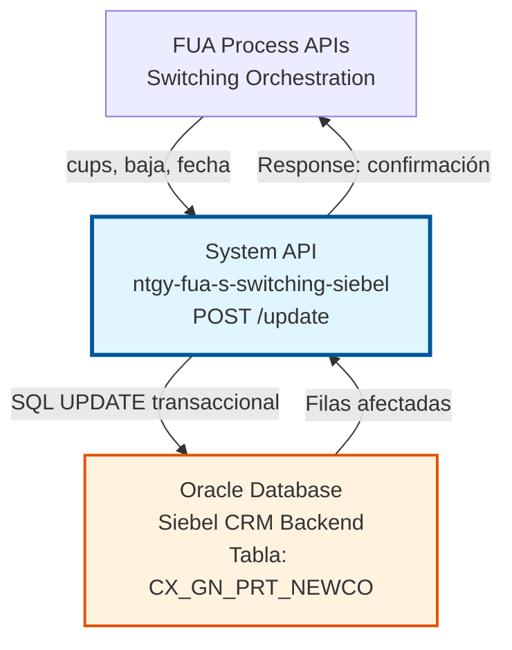
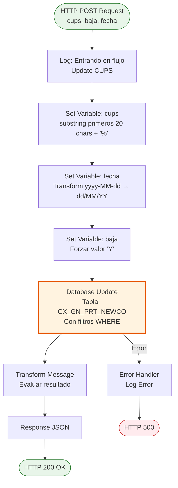
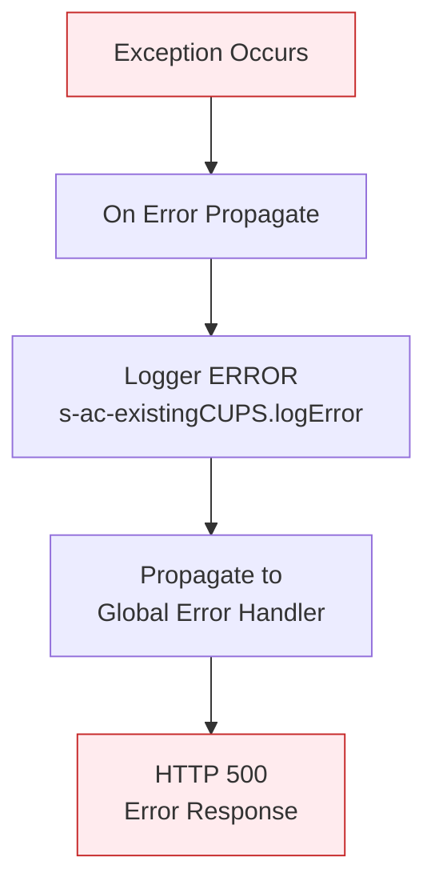
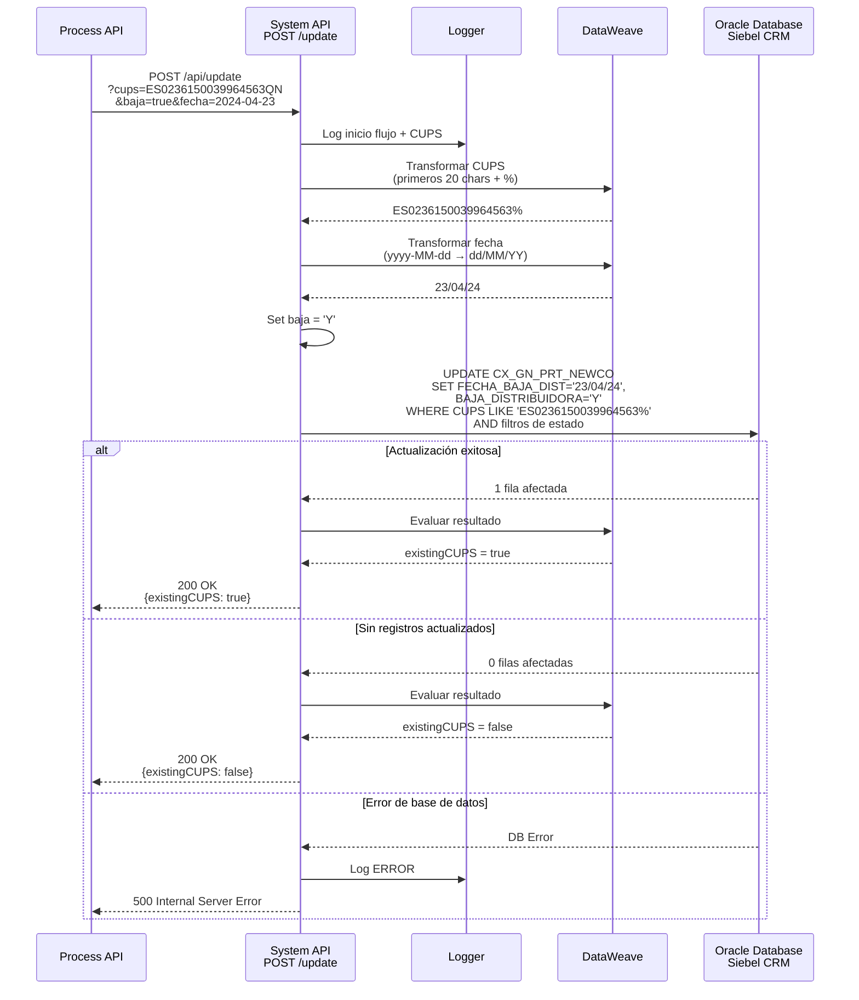
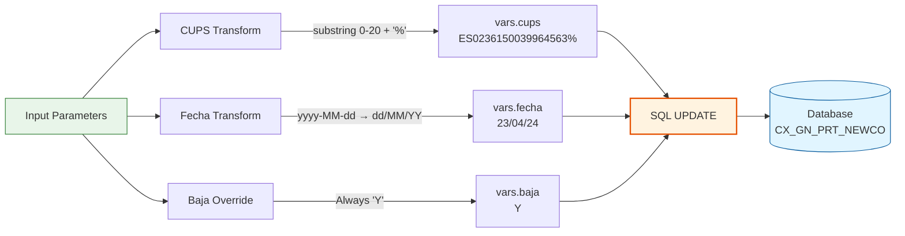

# POST /update

## 📌 Descripción General

### Propósito del Endpoint

Este endpoint actualiza la fecha de baja distribuidora y el estado de baja para un CUPS específico en la tabla de portabilidades de Siebel CRM. Es utilizado en procesos de switching (cambio de comercializadora) para registrar la fecha en que un cliente causa baja en la distribuidora, cumpliendo con requisitos regulatorios de la CNMC (Comisión Nacional de los Mercados y la Competencia).

El endpoint soporta:
- **Actualización de Fecha de Baja**: Registra la fecha de baja distribuidora en formato específico
- **Actualización de Estado**: Marca el indicador de baja distribuidora como 'Y' (Sí)
- **Búsqueda por Prefijo de CUPS**: Utiliza los primeros 20 caracteres del CUPS para la actualización
- **Filtrado Condicional**: Solo actualiza registros que cumplan condiciones específicas de estado

### Tipo de API

**Capa:** System API (API-Led Connectivity)

**Función:** Integración directa con base de datos Oracle (Siebel CRM backend) para actualización transaccional de datos de portabilidad.

### Patrón de Integración

**Tipo:** Request-Reply Síncrono con SQL UPDATE

**Descripción:** El endpoint recibe parámetros de CUPS, fecha y estado de baja, transforma los datos (formato de fecha y prefijo de CUPS), ejecuta una actualización SQL transaccional con filtros de negocio, y retorna confirmación de la operación.

### Arquitectura API-Led Connectivity



---

## 💼 Propósito del Negocio

### Casos de Uso Principales

1. **Registro de Baja Distribuidora en Switching**
   - Cliente completa proceso de cambio de comercializadora
   - Sistema necesita registrar fecha oficial de baja en distribuidora
   - Se actualiza el registro con fecha y estado de baja
   - **Beneficio**: Cumplimiento regulatorio y trazabilidad del proceso

2. **Actualización de Estado de Portabilidad**
   - Proceso de switching alcanza fase de baja distribuidora
   - Se marca el CUPS con indicador de baja ('Y')
   - Se registra fecha exacta para auditoría
   - **Beneficio**: Seguimiento preciso del estado de portabilidad

3. **Cumplimiento Normativo CNMC**
   - Regulación requiere registro de fechas de baja distribuidora
   - Sistema actualiza automáticamente la información
   - Datos disponibles para auditorías y reportes regulatorios
   - **Beneficio**: Cumplimiento con normativa del sector energético español

### Contexto Empresarial

- **Dominio:** Switching y Portabilidad de Clientes
- **Sector:** Energía - Utilities
- **División:** Naturgy España - FUA (Facturación Única Avanzada)
- **Proceso de Negocio:** Cambio de Comercializadora (Switching) - Fase de Baja Distribuidora
- **Sistema Backend:** Siebel CRM - Gestión de Portabilidades NewCo
- **Requisito Regulatorio:** CNMC - Registro de fechas de baja

### Stakeholders

- **Equipo de Switching**: Necesita registrar fechas de baja para completar procesos de cambio
- **Compliance y Auditoría**: Requieren trazabilidad de fechas para cumplimiento regulatorio
- **Desarrolladores de Process APIs**: Consumen este endpoint en flujos de orquestación de switching
- **Administradores de Base de Datos**: Monitorean transacciones y consistencia de datos

### Valor de Negocio

- **Cumplimiento Regulatorio**: Asegura registro de fechas según normativa CNMC
- **Trazabilidad Completa**: Mantiene histórico de cambios para auditoría
- **Integridad Transaccional**: Actualización atómica de datos críticos
- **Automatización**: Elimina necesidad de actualización manual de fechas

### Consumidores Potenciales

Este endpoint puede ser consumido por:
- Process APIs de switching y portabilidad
- Flujos de orquestación de cambio de comercializadora
- Sistemas de gestión de procesos de baja
- Servicios de actualización de estado de clientes

---

## 🔧 Especificación Técnica

### URLs por Ambiente

| Ambiente | URL Base | URL Completa |
|----------|----------|--------------|
| **Local** | `http://localhost:8083` | `http://localhost:8083/api/update?cups={CUPS}&baja={true/false}&fecha={YYYY-MM-DD}` |
| **Development** | `https://ntgy-fua-s-switching-siebel-dev.us-e2.cloudhub.io` | `https://ntgy-fua-s-switching-siebel-dev.us-e2.cloudhub.io/api/update?cups={CUPS}&baja={true/false}&fecha={YYYY-MM-DD}` |
| **UAT** | `https://ntgy-fua-s-switching-siebel-uat.us-e2.cloudhub.io` | `https://ntgy-fua-s-switching-siebel-uat.us-e2.cloudhub.io/api/update?cups={CUPS}&baja={true/false}&fecha={YYYY-MM-DD}` |
| **Production** | `https://ntgy-fua-s-switching-siebel-pro.us-e2.cloudhub.io` | `https://ntgy-fua-s-switching-siebel-pro.us-e2.cloudhub.io/api/update?cups={CUPS}&baja={true/false}&fecha={YYYY-MM-DD}` |

### Método HTTP

```
POST /api/update
```

### Parámetros de Entrada

#### Headers HTTP

| Header | Tipo | Requerido | Descripción | Ejemplo |
|--------|------|-----------|-------------|---------|
| `Content-Type` | string | ❌ No | Tipo de contenido del request (no se usa body) | `application/json` |
| `Accept` | string | ❌ No | Tipo de contenido esperado en response | `application/json` |

#### Query Parameters

| Parámetro | Tipo | Requerido | Descripción | Ejemplo |
|-----------|------|-----------|-------------|---------|
| `cups` | string | ✅ Sí | Código Universal del Punto de Suministro (20-22 caracteres). Se utilizan los primeros 20 caracteres para la búsqueda. | `ES0236150039964563QN` |
| `baja` | string | ✅ Sí | Indicador de baja distribuidora. **Nota:** Aunque es requerido, el valor siempre se fuerza a 'Y' en la implementación. | `true` |
| `fecha` | string | ✅ Sí | Fecha de baja distribuidora en formato ISO 8601 (YYYY-MM-DD). Se transforma internamente a formato dd/MM/YY. | `2024-04-23` |

**Formato de Parámetros:**
- **CUPS:** 20-22 caracteres, formato `ES` + 16 dígitos + 2 letras
- **baja:** String `"true"` o `"false"` (aunque siempre se procesa como 'Y')
- **fecha:** String en formato `YYYY-MM-DD` (ej: `2024-04-23`)

### Respuestas

#### Respuesta Exitosa - Actualización Realizada (200 OK)

```json
{
  "result": {
    "codResult": "0000",
    "msgResult": "No hay error"
  },
  "existingCUPS": true
}
```

**Descripción de Campos:**
- `result.codResult`: Código de resultado de la operación (`"0000"` = éxito)
- `result.msgResult`: Mensaje descriptivo del resultado
- `existingCUPS`: Indicador de éxito de la actualización

**⚠️ Nota Técnica:** La respuesta actual utiliza el campo `existingCUPS` por compatibilidad con el endpoint GET. En una implementación ideal, debería retornar `affectedRows` con el número de registros actualizados.

#### Respuesta Exitosa - Sin Registros Actualizados (200 OK)

```json
{
  "result": {
    "codResult": "0000",
    "msgResult": "No hay error"
  },
  "existingCUPS": false
}
```

**Interpretación:** No se encontraron registros que cumplan con los criterios de actualización (CUPS no existe o no cumple filtros de estado).

#### Respuesta de Error Técnico (400 Bad Request)

```json
{
  "message": "Bad request"
}
```

**Causas comunes:**
- Parámetros requeridos faltantes (`cups`, `baja`, `fecha`)
- Formato de fecha inválido
- Formato de CUPS inválido

#### Respuesta de Error Técnico (500 Internal Server Error)

```json
{
  "result": {
    "codResult": "0001",
    "msgResult": "Error interno del servidor"
  }
}
```

**Causas comunes:**
- Error de conexión a base de datos
- Error en transacción SQL
- Error en transformación de datos

### Autenticación y Autorización

- **Tipo:** Client ID & Client Secret (Anypoint Platform)
- **Autorización Base de Datos:** El usuario de conexión debe tener permisos para:
  - Ejecutar UPDATE en tabla `siebel.CX_GN_PRT_NEWCO`
  - Acceso de escritura al schema `siebel`
  - Permisos transaccionales (COMMIT/ROLLBACK)

### Timeouts

| Tipo | Valor | Descripción |
|------|-------|-------------|
| **Query Timeout** | 60 segundos | Tiempo máximo de espera para la operación UPDATE |
| **Connection Timeout** | 30 segundos | Tiempo máximo para establecer conexión con base de datos |
| **Transaction Timeout** | 60 segundos | Tiempo máximo para completar la transacción |

---

## 🏗️ Implementación Técnica

### Arquitectura del Flow



### Componentes del Flow

#### 1. Logger Inicial
```xml
<logger level="INFO" message='#["Entrando en el flujo Update CUPS " ++ attributes.queryParams.cups]'/>
```
**Propósito:** Registra el inicio del flujo con el CUPS a actualizar para trazabilidad.

#### 2. Set Variable - CUPS (con transformación)
```dataweave
%dw 2.0
import * from dw::core::Strings
output application/json
---
substring(attributes.queryParams.cups, 0, 20) ++ "%"
```

**Transformación:**
- Extrae los primeros 20 caracteres del CUPS
- Añade wildcard '%' para búsqueda con LIKE
- Ejemplo: `ES0236150039964563QN` → `ES0236150039964563%`

**Propósito:** Permite búsqueda flexible por prefijo de CUPS en la base de datos.

#### 3. Set Variable - Fecha (con transformación de formato)
```dataweave
attributes.queryParams.fecha as Date {format: 'yyyy-MM-dd'} 
  as Date {format: 'dd/MM/YY'}
```

**Transformación:**
- Input: `2024-04-23` (formato ISO 8601)
- Output: `23/04/24` (formato dd/MM/YY)

**Propósito:** Adapta el formato de fecha al esperado por la base de datos Siebel.

#### 4. Set Variable - Baja (valor forzado)
```xml
<set-variable value="Y" variableName="baja" />
```

**Comportamiento:**
- Ignora el valor del parámetro `baja` recibido
- Siempre establece el valor como `"Y"` (Sí)

**Propósito:** Garantiza consistencia en el indicador de baja distribuidora.

#### 5. Database Update
```xml
<db:update config-ref="Database_Config">
    <db:sql><![CDATA[
        UPDATE siebel.CX_GN_PRT_NEWCO 
        SET FECHA_BAJA_DIST = :fecha, BAJA_DISTRIBUIDORA = :baja
        WHERE CUPS LIKE :cups 
          AND (BAJA_DISTRIBUIDORA != 'P' 
               OR BAJA_DISTRIBUIDORA IS NULL 
               OR BAJA_DISTRIBUIDORA = 'N')
    ]]></db:sql>
    <db:input-parameters><![CDATA[#[{
        'cups': vars.cups,
        'fecha': vars.fecha,
        'baja': vars.baja	
    }]]]></db:input-parameters>
</db:update>
```

**Query SQL Ejecutada:**
```sql
UPDATE siebel.CX_GN_PRT_NEWCO 
SET FECHA_BAJA_DIST = '23/04/24', 
    BAJA_DISTRIBUIDORA = 'Y'
WHERE CUPS LIKE 'ES0236150039964563%' 
  AND (BAJA_DISTRIBUIDORA != 'P' 
       OR BAJA_DISTRIBUIDORA IS NULL 
       OR BAJA_DISTRIBUIDORA = 'N')
```

**Lógica de Negocio en WHERE:**
- **Condición 1:** `BAJA_DISTRIBUIDORA != 'P'` - No actualiza si está pendiente
- **Condición 2:** `BAJA_DISTRIBUIDORA IS NULL` - Actualiza si no tiene valor
- **Condición 3:** `BAJA_DISTRIBUIDORA = 'N'` - Actualiza si está marcado como No

**Propósito:** Solo actualiza registros que no estén en estado pendiente ('P'), protegiendo procesos en curso.

#### 6. Transform Message - Respuesta
```dataweave
%dw 2.0
output application/json
---
{
    "result": {
        "codResult": "0000",
        "msgResult": "No hay error"
    },
    "existingCUPS": 
        if (payload.CUPS[0] != null)
            true
        else 
            false
}
```

**⚠️ Nota Técnica:** Esta transformación parece heredada del endpoint GET. En un UPDATE, `payload` contiene información sobre filas afectadas, no un array de CUPS. La lógica actual puede no reflejar correctamente el resultado de la actualización.

**Comportamiento Real:**
- Si la actualización afecta registros → `existingCUPS = true`
- Si no afecta registros → `existingCUPS = false`

### Tabla de Base de Datos

#### CX_GN_PRT_NEWCO

**Descripción:** Tabla de portabilidades NewCo que almacena información de procesos de cambio de comercializadora.

**Campos Actualizados:**
- `FECHA_BAJA_DIST`: Fecha de baja distribuidora (formato dd/MM/YY)
- `BAJA_DISTRIBUIDORA`: Indicador de baja ('Y', 'N', 'P')

**Campos en Filtro WHERE:**
- `CUPS`: Código Universal del Punto de Suministro
- `BAJA_DISTRIBUIDORA`: Estado actual de baja

**Índices:** Se asume índice en campo `CUPS` para optimización de búsqueda.

### Manejo de Errores



**Error Handler:**
```xml
<error-handler>
    <on-error-propagate enableNotifications="true" logException="true">
        <logger level="ERROR" message="s-ac-existingCUPS.logError"/>
    </on-error-propagate>
</error-handler>
```

**Tipos de Errores Manejados:**
- **DB:CONNECTIVITY**: Error de conexión a base de datos
- **DB:QUERY_EXECUTION**: Error en ejecución de UPDATE
- **DB:TIMEOUT**: Timeout en operación (> 60 segundos)
- **TRANSFORMATION**: Error en transformación de datos

### Configuración de Base de Datos

**Archivo:** `ntgy-fua-switching-s-siebel-local-config.yaml`

```yaml
dbAC:
  scan:
    host: "proteod-scan.intranet.gasnatural.com"
    port: "1521"
    serviceName: "ov_proy_con_odi"
    user: "OV_CON"
    password: "ovcon"
    MaxPoolSize: "10"
```

**Connection Pooling:**
- Max Pool Size: 10 conexiones
- Connection timeout: 30 segundos
- Idle timeout: 10 minutos
- Transaction isolation: READ_COMMITTED

### Diagrama de Secuencia Completo



### Diagrama de Transformación de Datos



---

## 💻 Ejemplos de Uso

### Ejemplo 1: Actualización Exitosa

#### Request

```bash
curl -X POST "https://ntgy-fua-s-switching-siebel-dev.us-e2.cloudhub.io/api/update?cups=ES0236150039964563QN&baja=true&fecha=2024-04-23" \
  -H "Accept: application/json"
```

#### Response (200 OK)

```json
{
  "result": {
    "codResult": "0000",
    "msgResult": "No hay error"
  },
  "existingCUPS": true
}
```

**Interpretación:** La actualización se realizó exitosamente. El CUPS fue encontrado y cumplía con los filtros de estado, por lo que se actualizó la fecha de baja distribuidora a `23/04/24` y el indicador de baja a `'Y'`.

---

### Ejemplo 2: CUPS No Encontrado o No Cumple Filtros

#### Request

```bash
curl -X POST "https://ntgy-fua-s-switching-siebel-dev.us-e2.cloudhub.io/api/update?cups=ES9999999999999999XX&baja=true&fecha=2024-04-23" \
  -H "Accept: application/json"
```

#### Response (200 OK)

```json
{
  "result": {
    "codResult": "0000",
    "msgResult": "No hay error"
  },
  "existingCUPS": false
}
```

**Interpretación:** No se actualizó ningún registro. Posibles causas:
- El CUPS no existe en la tabla
- El CUPS tiene `BAJA_DISTRIBUIDORA = 'P'` (pendiente), lo cual bloquea la actualización

---

### Ejemplo 3: Request con Parámetros Faltantes

#### Request

```bash
curl -X POST "https://ntgy-fua-s-switching-siebel-dev.us-e2.cloudhub.io/api/update?cups=ES0236150039964563QN" \
  -H "Accept: application/json"
```

#### Response (400 Bad Request)

```json
{
  "message": "Bad request"
}
```

**Interpretación:** Faltan parámetros requeridos (`baja` y/o `fecha`).

---

### Ejemplo 4: Formato de Fecha Inválido

#### Request

```bash
curl -X POST "https://ntgy-fua-s-switching-siebel-dev.us-e2.cloudhub.io/api/update?cups=ES0236150039964563QN&baja=true&fecha=23-04-2024" \
  -H "Accept: application/json"
```

#### Response (500 Internal Server Error)

```json
{
  "result": {
    "codResult": "0001",
    "msgResult": "Error interno del servidor"
  }
}
```

**Interpretación:** El formato de fecha es inválido. Debe ser `YYYY-MM-DD` (ej: `2024-04-23`).

---

### Ejemplo 5: Integración desde JavaScript

```javascript
async function updateCUPSBaja(cups, fecha) {
  const baseUrl = 'https://ntgy-fua-s-switching-siebel-dev.us-e2.cloudhub.io';
  const endpoint = '/api/update';
  
  // Construir query parameters
  const params = new URLSearchParams({
    cups: cups,
    baja: 'true',
    fecha: fecha  // Formato: YYYY-MM-DD
  });
  
  try {
    const response = await fetch(`${baseUrl}${endpoint}?${params}`, {
      method: 'POST',
      headers: {
        'Accept': 'application/json'
      }
    });
    
    if (!response.ok) {
      throw new Error(`HTTP error! status: ${response.status}`);
    }
    
    const data = await response.json();
    
    if (data.result.codResult === '0000') {
      return {
        success: data.existingCUPS,
        message: data.existingCUPS 
          ? 'CUPS actualizado exitosamente' 
          : 'CUPS no encontrado o no cumple filtros'
      };
    } else {
      throw new Error(`Business error: ${data.result.msgResult}`);
    }
  } catch (error) {
    console.error('Error updating CUPS:', error);
    throw error;
  }
}

// Uso
const cups = 'ES0236150039964563QN';
const fecha = '2024-04-23';  // Formato ISO 8601

try {
  const result = await updateCUPSBaja(cups, fecha);
  console.log(result.message);
} catch (error) {
  console.error('Failed to update CUPS:', error);
}
```

---

### Ejemplo 6: Integración desde Python

```python
import requests
from datetime import date
from typing import Dict, Any

def update_cups_baja(cups: str, fecha: date) -> Dict[str, Any]:
    """
    Actualiza la fecha de baja distribuidora para un CUPS.
    
    Args:
        cups: Código Universal del Punto de Suministro
        fecha: Fecha de baja distribuidora (objeto date)
        
    Returns:
        dict: Resultado de la actualización con campos 'success' y 'message'
        
    Raises:
        requests.exceptions.RequestException: Si hay error en la petición HTTP
        ValueError: Si la respuesta indica error de negocio
    """
    base_url = 'https://ntgy-fua-s-switching-siebel-dev.us-e2.cloudhub.io'
    endpoint = '/api/update'
    
    # Formatear fecha a ISO 8601 (YYYY-MM-DD)
    fecha_str = fecha.strftime('%Y-%m-%d')
    
    params = {
        'cups': cups,
        'baja': 'true',
        'fecha': fecha_str
    }
    
    headers = {'Accept': 'application/json'}
    
    try:
        response = requests.post(
            f'{base_url}{endpoint}',
            params=params,
            headers=headers,
            timeout=30
        )
        response.raise_for_status()
        
        data = response.json()
        
        if data['result']['codResult'] == '0000':
            return {
                'success': data['existingCUPS'],
                'message': 'CUPS actualizado exitosamente' if data['existingCUPS'] 
                          else 'CUPS no encontrado o no cumple filtros'
            }
        else:
            raise ValueError(f"Business error: {data['result']['msgResult']}")
            
    except requests.exceptions.RequestException as e:
        print(f"Error updating CUPS: {e}")
        raise

# Uso
from datetime import date

cups = 'ES0236150039964563QN'
fecha_baja = date(2024, 4, 23)

try:
    result = update_cups_baja(cups, fecha_baja)
    print(result['message'])
except Exception as e:
    print(f"Failed to update CUPS: {e}")
```

---

### Ejemplo 7: Validación de Formato de Fecha

```javascript
/**
 * Valida y formatea una fecha para el endpoint de update
 */
function validateAndFormatDate(dateInput) {
  // Aceptar Date object, string ISO, o string dd/MM/yyyy
  let date;
  
  if (dateInput instanceof Date) {
    date = dateInput;
  } else if (typeof dateInput === 'string') {
    // Intentar parsear diferentes formatos
    if (/^\d{4}-\d{2}-\d{2}$/.test(dateInput)) {
      // Ya está en formato ISO (YYYY-MM-DD)
      date = new Date(dateInput);
    } else if