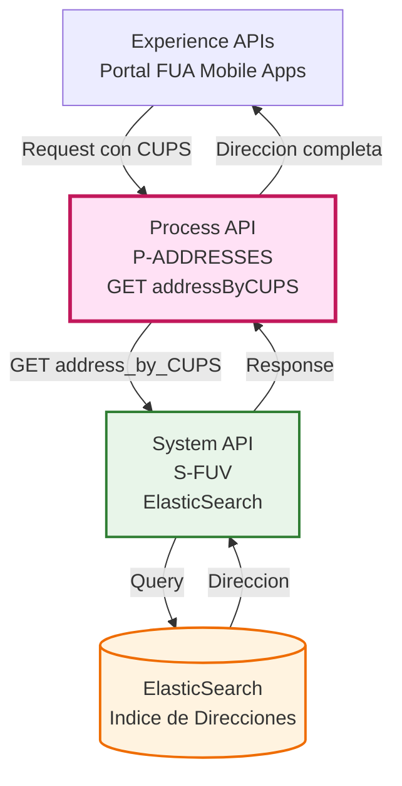
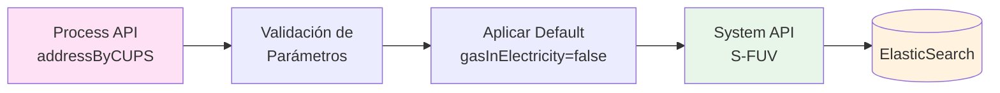
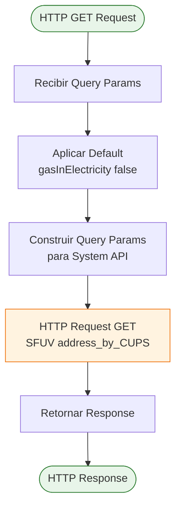
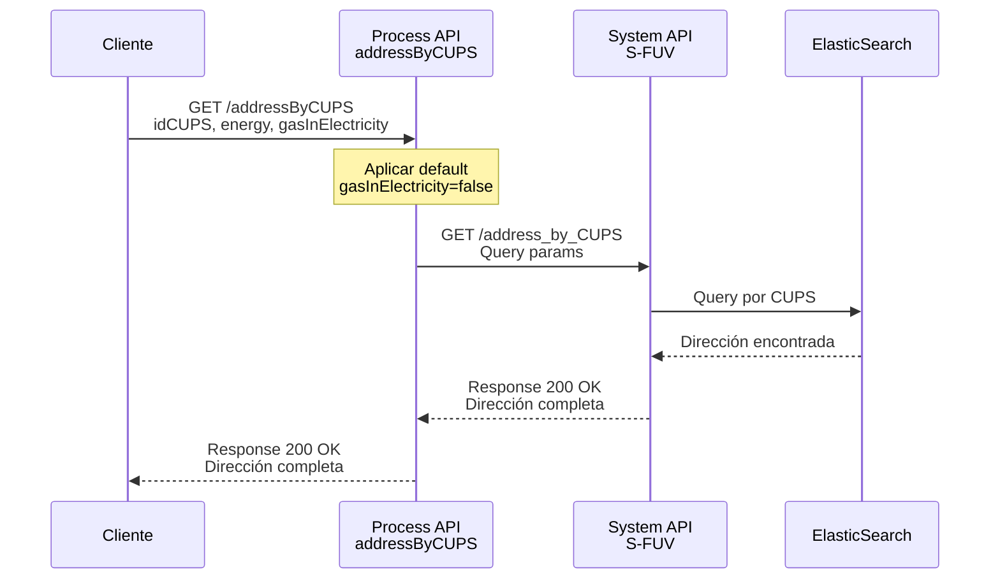
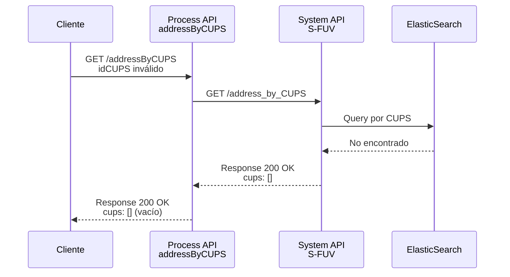
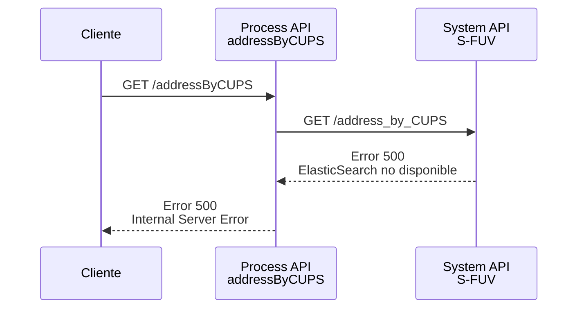

# GET /addressByCUPS

## 📌 Descripción General

### Propósito del Endpoint

Este endpoint permite consultar la dirección completa asociada a un CUPS (Código Universal de Punto de Suministro) específico, ya sea de gas o electricidad. Realiza una búsqueda directa en ElasticSearch y retorna la información de la dirección del punto de suministro.

### Tipo de API

**Capa:** Process API (API-Led Connectivity)

**Función:** Orquestación de consulta de direcciones por CUPS

### Patrón de Integración

**Tipo:** Pass-Through con enriquecimiento de parámetros

**Descripción:** El endpoint recibe los parámetros de consulta, los valida y enriquece (aplicando valores por defecto cuando es necesario), y los reenvía al System API de ElasticSearch para obtener la dirección completa asociada al CUPS.

### Arquitectura API-Led Connectivity



---

## 💼 Propósito del Negocio

### Casos de Uso Principales

1. **Validación de Dirección por CUPS**
   - Verificar la dirección asociada a un punto de suministro conocido
   - Útil en procesos de alta, modificación o consulta de contratos

2. **Búsqueda Inversa de Dirección**
   - Obtener la dirección completa cuando solo se conoce el CUPS
   - Facilita la identificación del punto de suministro en sistemas de gestión

3. **Consulta de CUPS de Gas en Electricidad**
   - Permite buscar direcciones usando CUPS de gas en el índice de electricidad
   - Útil en procesos de unificación de suministros

### 🔗 Endpoints Dependientes

Este Process API consume el siguiente System API:

| System API | Endpoint | Método | Propósito |
|------------|----------|--------|-----------|
| `ntgy-fuv-s-fuv` | `/address_by_CUPS` | GET | Consulta de dirección completa por CUPS en ElasticSearch |

### Lógica de Orquestación



**Pasos del Proceso:**

1. **Recepción de Parámetros**: Recibe idCUPS, energy y opcionalmente gasInElectricity
2. **Aplicación de Defaults**: Si gasInElectricity no se proporciona, se establece en false
3. **Consulta a ElasticSearch**: Reenvía los parámetros al System API s-fuv
4. **Retorno de Respuesta**: Devuelve la dirección completa encontrada

### Transformaciones Aplicadas

⚠️ **Este Process API NO transforma la respuesta del System API.**

**Transformación de Entrada:**
- Aplica valor por defecto `gasInElectricity = false` si no se proporciona

Para el schema completo de respuesta, consultar:
📖 **System API: `ntgy-fuv-s-fuv` endpoint `/address_by_CUPS`**

### Contexto Empresarial

- **Dominio:** Gestión de Puntos de Suministro
- **Sector:** Energía - Utilities
- **División:** Naturgy España - FUV (Facturación Única Virtual)
- **Proceso de Negocio:** Consulta y validación de direcciones de suministro

### Stakeholders

- **Clientes finales**: Consultan la dirección de sus puntos de suministro
- **Agentes de atención al cliente**: Validan direcciones durante gestiones
- **Sistemas de gestión comercial**: Verifican direcciones en procesos de alta/modificación

### Valor de Negocio

- **Validación rápida**: Verificación inmediata de direcciones por CUPS
- **Reducción de errores**: Evita errores en captura manual de direcciones
- **Experiencia de usuario**: Respuestas rápidas (< 1 segundo típicamente)
- **Flexibilidad**: Soporte para búsquedas cruzadas gas/electricidad

### Consumidores Potenciales

Este endpoint puede ser consumido por:
- Portales web de autoservicio (FUA)
- Aplicaciones móviles de clientes
- Sistemas de agentes de call center
- Aplicaciones de gestión comercial
- Integraciones de terceros autorizados

---

## 🔧 Especificación Técnica

### URLs por Ambiente

| Ambiente | URL Base | URL Completa |
|----------|----------|--------------|
| **Local** | `http://localhost:8081` | `http://localhost:8081/api/addressByCUPS` |
| **Development** | `https://mul-com-fuv-p-addresses-dev.us-e2.cloudhub.io` | `https://mul-com-fuv-p-addresses-dev.us-e2.cloudhub.io/api/addressByCUPS` |
| **UAT** | `https://mul-com-fuv-p-addresses-uat.us-e2.cloudhub.io` | `https://mul-com-fuv-p-addresses-uat.us-e2.cloudhub.io/api/addressByCUPS` |
| **Production** | `https://mul-com-fuv-p-addresses-pro.us-e2.cloudhub.io` | `https://mul-com-fuv-p-addresses-pro.us-e2.cloudhub.io/api/addressByCUPS` |

### Método HTTP

```
GET /api/addressByCUPS
```

### Parámetros de Entrada

#### Query Parameters

| Parámetro | Tipo | Requerido | Descripción | Ejemplo |
|-----------|------|-----------|-------------|---------|
| `idCUPS` | string | ✅ Sí | Identificador del CUPS (20-22 caracteres) | `ES0022000006693281TS1P` |
| `energy` | string | ✅ Sí | Tipo de energía: `ELECTRICITY` o `GAS` | `ELECTRICITY` |
| `gasInElectricity` | boolean | ❌ No | Flag para indicar si se provee CUPS de gas para electricidad (default: false) | `false` |

#### Validaciones

- **idCUPS**: Debe ser un CUPS válido de 20-22 caracteres
- **energy**: Solo acepta valores `ELECTRICITY` o `GAS`
- **gasInElectricity**: Si no se proporciona, se establece automáticamente en `false`

### Respuestas

#### 200 OK - Consulta Exitosa

**Estructura de Respuesta:**

```json
{
  "result": {
    "codResult": "string",
    "msgResult": "string"
  },
  "addresses": [
    {
      "idCUPS": "string",
      "idCUPSGas": "string",
      "idPoblacion": "string",
      "idVia": "string",
      "idProvincia": "string",
      "idMunicipio": "string",
      "codEntidadColectiva": "string",
      "codEntidadSingular": "string",
      "codNucleo": "string",
      "nombrePoblacion": "string",
      "nombreProvincia": "string",
      "indResolucionPoblaciones": "number",
      "codigoPostal": "string",
      "tipoVia": "string",
      "nombreVia": "string",
      "numeroVia": "string",
      "piso": "string",
      "escalera": "string",
      "portal": "string",
      "puerta": "string",
      "restoDomicilio": "string",
      "codVia": "string",
      "indResolucionVias": "number",
      "direccionCompleta": "string"
    }
  ]
}
```

**Campos de Respuesta:**

| Campo | Tipo | Descripción |
|-------|------|-------------|
| `result.codResult` | string | Código de resultado de la operación |
| `result.msgResult` | string | Mensaje descriptivo del resultado |
| `addresses` | array | Array de direcciones encontradas |
| `addresses[].idCUPS` | string | Identificador del CUPS de electricidad |
| `addresses[].idCUPSGas` | string | Identificador del CUPS de gas |
| `addresses[].idPoblacion` | string | Identificador de la población |
| `addresses[].idVia` | string | Identificador de la vía |
| `addresses[].idProvincia` | string | Identificador de la provincia |
| `addresses[].idMunicipio` | string | Identificador del municipio |
| `addresses[].codEntidadColectiva` | string | Código de la entidad colectiva (CEC) |
| `addresses[].codEntidadSingular` | string | Código de la entidad singular (CES) |
| `addresses[].codNucleo` | string | Código del núcleo (NUC) |
| `addresses[].nombrePoblacion` | string | Nombre de la población |
| `addresses[].nombreProvincia` | string | Nombre de la provincia |
| `addresses[].indResolucionPoblaciones` | number | Indicador de Resolución de Poblaciones (IRP) |
| `addresses[].codigoPostal` | string | Código postal |
| `addresses[].tipoVia` | string | Tipo de la vía (ej: PS, CL, AV) |
| `addresses[].nombreVia` | string | Nombre de la vía |
| `addresses[].numeroVia` | string | Número de la vía |
| `addresses[].piso` | string | Piso |
| `addresses[].escalera` | string | Escalera |
| `addresses[].portal` | string | Portal |
| `addresses[].puerta` | string | Puerta |
| `addresses[].restoDomicilio` | string | Resto del domicilio |
| `addresses[].codVia` | string | Código de la vía |
| `addresses[].indResolucionVias` | number | Indicador de resolución de Vías (IRV) |
| `addresses[].direccionCompleta` | string | Dirección completa formateada |

#### 500 Internal Server Error

```json
{
  "result": {
    "codResult": "string",
    "msgResult": "string"
  }
}
```

### Autenticación

- **Tipo:** Client ID & Client Secret (Anypoint Platform)
- **Headers requeridos:**
  - `client_id`: ID del cliente proporcionado por Anypoint Platform
  - `client_secret`: Secret del cliente proporcionado por Anypoint Platform

### Timeouts

| Tipo | Valor |
|------|-------|
| **Request Timeout** | Configurable por entorno |
| **Connection Timeout** | 10 segundos (default HTTP connector) |

**Configuración por Ambiente:**
- **Local**: 5000 ms (5 segundos)
- **Development**: 5000 ms (5 segundos)
- **UAT**: 5000 ms (5 segundos)
- **Production**: 5000 ms (5 segundos)

---

## 🏗️ Implementación Técnica

### Arquitectura del Flow



### Código de Implementación

**Archivo:** `p-addresses-addressByCUPS.xml`

```xml
<flow name="p-addresses-addressByCUPSFlow" doc:id="5ce3dac8-470e-4a21-b998-03a6e8b2bed6">
    <!-- Aplicar default a gasInElectricity si no se proporciona -->
    <http:request method="GET" 
                  doc:name="Request" 
                  doc:id="06338435-d001-43b0-ae31-597e1bd0adaf" 
                  config-ref="HTTP_Request_sfuv_configuration"
                  path="/address_by_CUPS">
        <http:query-params><![CDATA[#[output application/java
---
{
    "idCUPS" : attributes.queryParams.idCUPS,
    "gasInElectricity" : attributes.queryParams.gasInElectricity default false,
    "energy" : attributes.queryParams.energy
}]]]></http:query-params>
    </http:request>
</flow>
```

### Configuración HTTP

**Archivo:** `global.xml`

```xml
<http:request-config name="HTTP_Request_sfuv_configuration" 
                     basePath="/api" 
                     responseTimeout="5000">
    <http:request-connection host="mul-com-fuv-s-fuv-dev.us-e2.cloudhub.io" 
                            port="443" />
</http:request-config>
```

**Propiedades de Configuración (dev-config.yaml):**

```yaml
sfuv:
  host: "mul-com-fuv-s-fuv-dev.us-e2.cloudhub.io"
  port: "443"
  timeout: "5000"
```

### Transformaciones DataWeave

**Construcción de Query Parameters:**

```dataweave
%dw 2.0
output application/java
---
{
    "idCUPS" : attributes.queryParams.idCUPS,
    "gasInElectricity" : attributes.queryParams.gasInElectricity default false,
    "energy" : attributes.queryParams.energy
}
```

**Lógica:**
- Extrae `idCUPS` del request original
- Extrae `energy` del request original
- Aplica valor por defecto `false` a `gasInElectricity` si no se proporciona

### Patrones de Diseño

**Patrón:** Pass-Through con Enriquecimiento de Parámetros

**Justificación:** 
- El endpoint actúa como proxy inteligente hacia ElasticSearch
- Simplifica la integración para consumidores aplicando defaults
- Mantiene la lógica de negocio centralizada en el Process API
- Permite evolución independiente del System API

### Diagramas de Secuencia

#### 1. Flujo Normal de Éxito



#### 2. Flujo con CUPS No Encontrado



#### 3. Flujo con Error de Sistema



### Manejo de Errores

**Estrategia:** Propagación de errores del System API

**Tipos de Error:**

1. **Errores de Validación (400 Bad Request)**
   - Parámetros faltantes o inválidos
   - Manejado por APIKit automáticamente

2. **Errores de Sistema (500 Internal Server Error)**
   - ElasticSearch no disponible
   - Timeout en consulta
   - Propagado desde System API

**Error Handler Global:**
- Configurado en `p-addresses.xml`
- Maneja errores APIKIT estándar (400, 404, 405, 406, 415, 501)

---

## 💻 Ejemplos de Uso

### Ejemplo 1: Consulta de CUPS de Electricidad

#### cURL

```bash
curl -X GET "https://mul-com-fuv-p-addresses-dev.us-e2.cloudhub.io/api/addressByCUPS?idCUPS=ES0022000006693281TS1P&energy=ELECTRICITY" \
  -H "Content-Type: application/json" \
  -H "client_id: YOUR_CLIENT_ID" \
  -H "client_secret: YOUR_CLIENT_SECRET"
```

#### Respuesta (200 OK)

```json
{
  "result": {
    "codResult": "0000",
    "msgResult": "OK"
  },
  "addresses": [
    {
      "idCUPS": "ES0022000006693281TS1P",
      "idCUPSGas": "",
      "idPoblacion": "28079000000",
      "idVia": "270001",
      "idProvincia": "28",
      "idMunicipio": "079",
      "codEntidadColectiva": "00",
      "codEntidadSingular": "01",
      "codNucleo": "01",
      "nombrePoblacion": "MADRID",
      "nombreProvincia": "MADRID",
      "indResolucionPoblaciones": 1,
      "codigoPostal": "28013",
      "tipoVia": "CL",
      "nombreVia": "MAYOR",
      "numeroVia": "25",
      "piso": "3",
      "escalera": "A",
      "portal": "",
      "puerta": "B",
      "restoDomicilio": "",
      "codVia": "270001",
      "indResolucionVias": 0,
      "direccionCompleta": "CL MAYOR, 25, 3 A B"
    }
  ]
}
```

### Ejemplo 2: Consulta de CUPS de Gas

#### cURL

```bash
curl -X GET "https://mul-com-fuv-p-addresses-dev.us-e2.cloudhub.io/api/addressByCUPS?idCUPS=ES0234152001353214ML&energy=GAS" \
  -H "Content-Type: application/json" \
  -H "client_id: YOUR_CLIENT_ID" \
  -H "client_secret: YOUR_CLIENT_SECRET"
```

#### Respuesta (200 OK)

```json
{
  "result": {
    "codResult": "0000",
    "msgResult": "OK"
  },
  "addresses": [
    {
      "idCUPS": "",
      "idCUPSGas": "ES0234152001353214ML",
      "idPoblacion": "28131000000",
      "idVia": "270785",
      "idProvincia": "28",
      "idMunicipio": "079",
      "codEntidadColectiva": "00",
      "codEntidadSingular": "01",
      "codNucleo": "01",
      "nombrePoblacion": "MADRID",
      "nombreProvincia": "MADRID",
      "indResolucionPoblaciones": 1,
      "codigoPostal": "28034",
      "tipoVia": "PS",
      "nombreVia": "CASTELLANA",
      "numeroVia": "1",
      "piso": "3º",
      "escalera": "IZQ",
      "portal": "A",
      "puerta": "C",
      "restoDomicilio": "1 B",
      "codVia": "3249",
      "indResolucionVias": 0,
      "direccionCompleta": "PS CASTELLANA, 1, 3º IZQ A C"
    }
  ]
}
```

### Ejemplo 3: Consulta con gasInElectricity=true

#### cURL

```bash
curl -X GET "https://mul-com-fuv-p-addresses-dev.us-e2.cloudhub.io/api/addressByCUPS?idCUPS=ES0234152001353214ML&energy=ELECTRICITY&gasInElectricity=true" \
  -H "Content-Type: application/json" \
  -H "client_id: YOUR_CLIENT_ID" \
  -H "client_secret: YOUR_CLIENT_SECRET"
```

#### Respuesta (200 OK)

```json
{
  "result": {
    "codResult": "0000",
    "msgResult": "OK"
  },
  "addresses": [
    {
      "idCUPS": "",
      "idCUPSGas": "ES0234152001353214ML",
      "idPoblacion": "28131000000",
      "idVia": "270785",
      "idProvincia": "28",
      "idMunicipio": "079",
      "codEntidadColectiva": "00",
      "codEntidadSingular": "01",
      "codNucleo": "01",
      "nombrePoblacion": "MADRID",
      "nombreProvincia": "MADRID",
      "indResolucionPoblaciones": 1,
      "codigoPostal": "28034",
      "tipoVia": "PS",
      "nombreVia": "CASTELLANA",
      "numeroVia": "1",
      "piso": "3º",
      "escalera": "IZQ",
      "portal": "A",
      "puerta": "C",
      "restoDomicilio": "1 B",
      "codVia": "3249",
      "indResolucionVias": 0,
      "direccionCompleta": "PS CASTELLANA, 1, 3º IZQ A C"
    }
  ]
}
```

### Ejemplo 4: JavaScript (Fetch API)

```javascript
const response = await fetch(
  'https://mul-com-fuv-p-addresses-dev.us-e2.cloudhub.io/api/addressByCUPS?idCUPS=ES0022000006693281TS1P&energy=ELECTRICITY',
  {
    method: 'GET',
    headers: {
      'Content-Type': 'application/json',
      'client_id': 'YOUR_CLIENT_ID',
      'client_secret': 'YOUR_CLIENT_SECRET'
    }
  }
);

const data = await response.json();
console.log('Dirección:', data.addresses[0].direccionCompleta);
```

### Ejemplo 5: Python (Requests)

```python
import requests

url = 'https://mul-com-fuv-p-addresses-dev.us-e2.cloudhub.io/api/addressByCUPS'
params = {
    'idCUPS': 'ES0022000006693281TS1P',
    'energy': 'ELECTRICITY'
}
headers = {
    'Content-Type': 'application/json',
    'client_id': 'YOUR_CLIENT_ID',
    'client_secret': 'YOUR_CLIENT_SECRET'
}

response = requests.get(url, params=params, headers=headers)
data = response.json()

if data['addresses']:
    direccion = data['addresses'][0]
    print(f"Dirección completa: {direccion['direccionCompleta']}")
    print(f"Desglose: {direccion['tipoVia']} {direccion['nombreVia']}, {direccion['numeroVia']}")
else:
    print("CUPS no encontrado")
```

### Ejemplo 6: CUPS No Encontrado

#### cURL

```bash
curl -X GET "https://mul-com-fuv-p-addresses-dev.us-e2.cloudhub.io/api/addressByCUPS?idCUPS=ES0000000000000000XX&energy=ELECTRICITY" \
  -H "Content-Type: application/json" \
  -H "client_id: YOUR_CLIENT_ID" \
  -H "client_secret: YOUR_CLIENT_SECRET"
```

#### Respuesta (200 OK - Sin Resultados)

```json
{
  "result": {
    "codResult": "0000",
    "msgResult": "No se encontraron resultados"
  },
  "addresses": []
}
