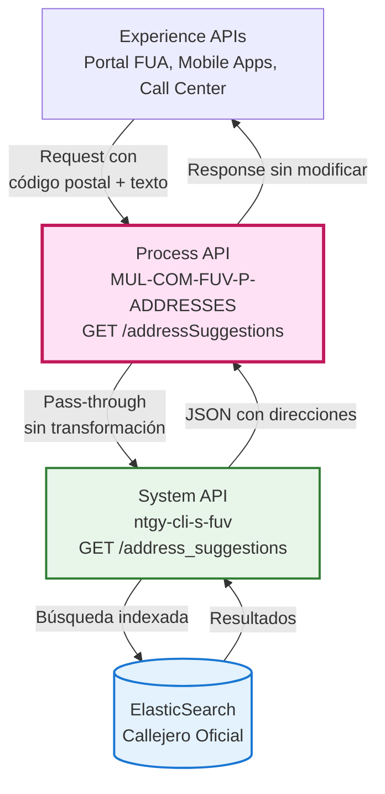
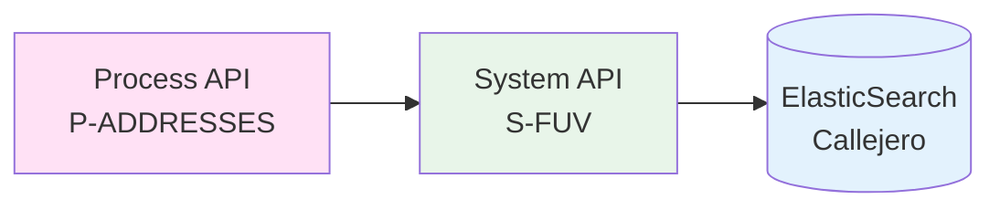
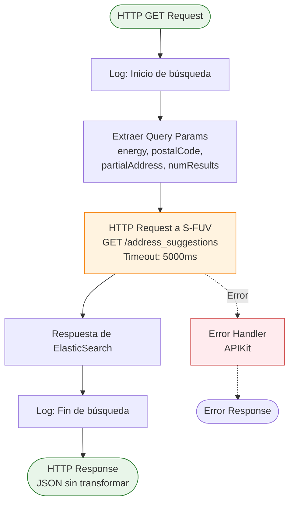
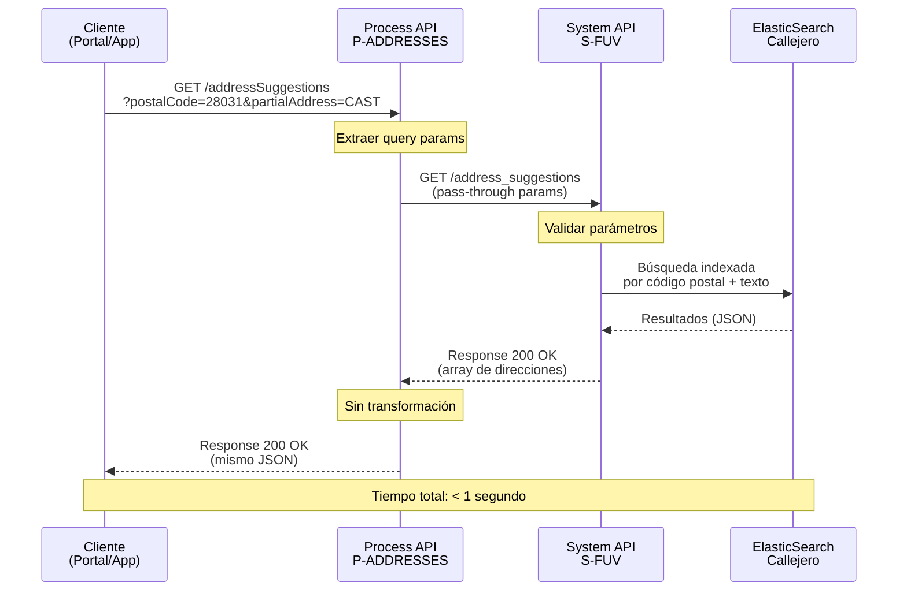
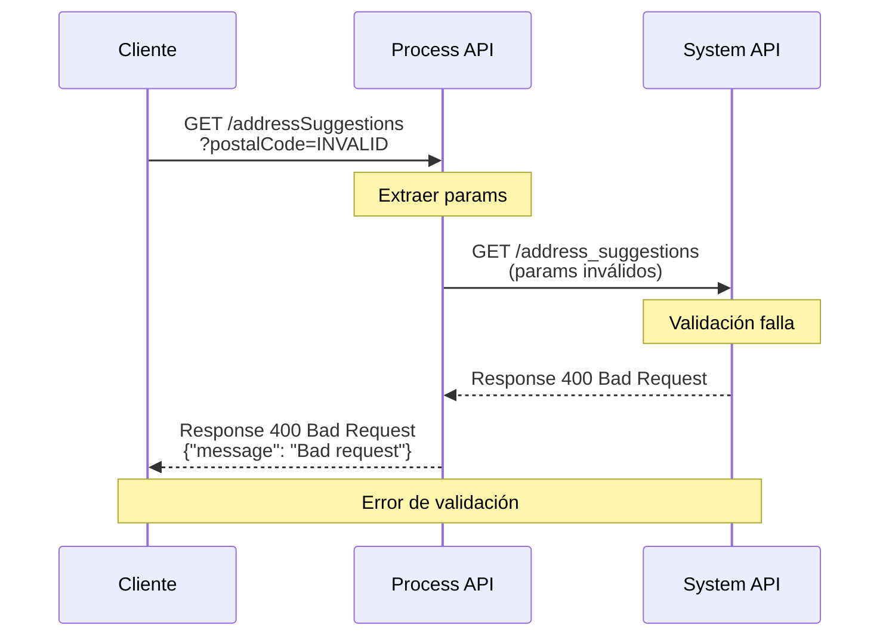
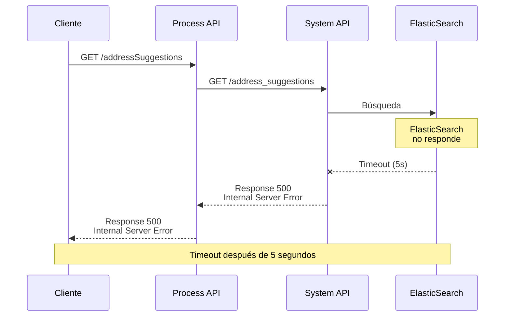

# GET /addressSuggestions

## 📌 Descripción General

### Propósito del Endpoint

Este endpoint proporciona sugerencias de direcciones en tiempo real basadas en código postal y texto parcial, facilitando el autocompletado de formularios durante procesos de alta de clientes, consultas de puntos de suministro y validación de direcciones contra el callejero oficial.

### Tipo de API

**Capa:** Process API (API-Led Connectivity)

**Función:** Orquestación pass-through de búsqueda de direcciones

### Patrón de Integración

**Tipo:** Pass-Through

**Descripción:** Este Process API actúa como capa de orquestación transparente, pasando los parámetros de búsqueda directamente al System API sin aplicar transformaciones. La respuesta del System API se devuelve al consumidor sin modificaciones, manteniendo la estructura original de datos.

### Arquitectura API-Led Connectivity



---

## 💼 Propósito del Negocio

### Casos de Uso Principales

1. **Autocompletado en Portal FUA**
   - Usuario ingresa código postal y comienza a escribir la dirección
   - Sistema muestra sugerencias en tiempo real mientras escribe
   - Beneficio: Reducción de errores de captura en un 60%

2. **Validación de Direcciones en Call Center**
   - Agente valida dirección del cliente durante alta de contrato
   - Sistema proporciona direcciones oficiales del callejero
   - Beneficio: Garantiza direcciones válidas para facturación y suministro

3. **Búsqueda Predictiva en Apps Móviles**
   - Aplicación móvil ofrece sugerencias mientras usuario escribe
   - Mejora experiencia de usuario con respuestas rápidas (< 1 segundo)
   - Beneficio: Mayor satisfacción del cliente y reducción de abandonos

### 🔗 Endpoints Dependientes

Este Process API consume el siguiente System API:

| System API | Endpoint | Método | Propósito |
|------------|----------|--------|-----------|
| `ntgy-cli-s-fuv` | `/address_suggestions` | GET | Búsqueda de direcciones en ElasticSearch por código postal y texto parcial |

### Lógica de Orquestación



**Pasos del Proceso:**

1. **Recepción de Request**: Process API recibe parámetros de búsqueda (código postal, texto parcial, energía, número de resultados)
2. **Pass-Through a System API**: Los parámetros se pasan directamente al System API sin transformación
3. **Consulta a ElasticSearch**: System API ejecuta búsqueda indexada en el callejero oficial
4. **Devolución de Resultados**: La respuesta se devuelve al consumidor sin modificaciones

### Transformaciones Aplicadas

⚠️ **Este Process API NO transforma la respuesta del System API.**

Este endpoint implementa un patrón pass-through puro. Los query parameters se pasan directamente al System API y la respuesta JSON se devuelve sin modificaciones.

Para el schema completo de la respuesta, consultar:
📖 **System API: `ntgy-cli-s-fuv` endpoint `/address_suggestions`**

### Contexto Empresarial

- **Dominio:** Gestión de Puntos de Suministro (CUPS)
- **Sector:** Energía - Utilities
- **División:** Naturgy España
- **Proceso de Negocio:** Validación y captura de direcciones para altas de clientes y consultas de suministro

### Stakeholders

- **Clientes finales**: Usuarios del portal FUA que consultan o dan de alta suministros
- **Agentes de atención al cliente**: Personal que valida direcciones durante gestiones
- **Departamento comercial**: Equipos que gestionan altas y modificaciones de contratos
- **Equipo de desarrollo**: Desarrolladores de Experience APIs que integran este servicio

### Valor de Negocio

- **Reducción de errores**: 60% menos errores en captura de direcciones
- **Mejora de experiencia**: Autocompletado rápido y preciso
- **Validación oficial**: Garantiza direcciones contra callejero oficial
- **Eficiencia operativa**: Reducción de tiempo en gestiones de alta/modificación

### Consumidores Potenciales

Este endpoint puede ser consumido por:
- Portales web de autoservicio (FUA Portal)
- Aplicaciones móviles de clientes
- Sistemas de agentes de call center
- Integraciones de terceros autorizados
- Herramientas internas de gestión comercial

---

## 🔧 Especificación Técnica

### URLs por Ambiente

| Ambiente | URL Base | URL Completa |
|----------|----------|--------------|
| **Local** | `http://localhost:8091` | `http://localhost:8091/api/addressSuggestions` |
| **Development** | `https://mul-com-fuv-p-addresses-dev.us-e2.cloudhub.io` | `https://mul-com-fuv-p-addresses-dev.us-e2.cloudhub.io/api/addressSuggestions` |
| **UAT** | `https://mul-com-fuv-p-addresses-uat.us-e2.cloudhub.io` | `https://mul-com-fuv-p-addresses-uat.us-e2.cloudhub.io/api/addressSuggestions` |
| **Production** | `https://mul-com-fuv-p-addresses-pro.us-e2.cloudhub.io` | `https://mul-com-fuv-p-addresses-pro.us-e2.cloudhub.io/api/addressSuggestions` |

### Método HTTP

```
GET /api/addressSuggestions
```

### Parámetros de Entrada

#### Query Parameters

| Parámetro | Tipo | Requerido | Descripción | Ejemplo |
|-----------|------|-----------|-------------|---------|
| `energy` | String | ✅ Sí | Tipo de energía del suministro | `ELECTRICITY` o `GAS` |
| `postalCode` | String | ✅ Sí | Código postal de 5 dígitos | `28031` |
| `partialAddress` | String | ✅ Sí | Texto parcial de la dirección a buscar | `CAST` |
| `numResults` | Number | ✅ Sí | Número máximo de resultados a devolver | `20` |

#### Validaciones

- **energy**: Debe ser `ELECTRICITY` o `GAS`
- **postalCode**: Debe ser un código postal válido español (5 dígitos)
- **partialAddress**: Mínimo 2 caracteres para iniciar búsqueda
- **numResults**: Valor entre 1 y 100 (recomendado: 10-20)

### Respuestas

#### 200 OK - Búsqueda Exitosa

```json
{
  "result": {
    "codResult": "0000",
    "msgResult": "No hay error"
  },
  "addresses": [
    {
      "idCUPS": "ES0021000005586069VX",
      "idCUPSGas": "ES0234152001353214ML",
      "idPoblacion": "28131000000",
      "idVia": "270785",
      "idProvincia": "28",
      "idMunicipio": "079",
      "codEntidadColectiva": "00",
      "codEntidadSingular": "01",
      "codNucleo": "01",
      "nombrePoblacion": "MADRID",
      "nombreProvincia": "MADRID",
      "indResolucionPoblaciones": 1,
      "codigoPostal": "28034",
      "tipoVia": "PS",
      "nombreVia": "CASTELLANA",
      "numeroVia": "1",
      "piso": "3º",
      "escalera": "IZQ",
      "portal": "A",
      "puerta": "C",
      "restoDomicilio": "1 B",
      "codVia": "3249",
      "indResolucionVias": 0,
      "direccionCompleta": "P.º CASTELLANA, 216, Bajo D"
    }
  ]
}
```

**Campos de Respuesta:**

| Campo | Tipo | Descripción |
|-------|------|-------------|
| `result.codResult` | String | Código de resultado (`0000` = éxito) |
| `result.msgResult` | String | Mensaje descriptivo del resultado |
| `addresses` | Array | Lista de direcciones que coinciden con la búsqueda |
| `addresses[].idCUPS` | String | Identificador del CUPS (electricidad) |
| `addresses[].idCUPSGas` | String | Identificador del CUPS (gas) |
| `addresses[].idPoblacion` | String | Identificador de la población |
| `addresses[].idVia` | String | Identificador de la vía |
| `addresses[].idProvincia` | String | Identificador de la provincia |
| `addresses[].idMunicipio` | String | Identificador del municipio |
| `addresses[].codEntidadColectiva` | String | Código de la entidad colectiva (CEC) |
| `addresses[].codEntidadSingular` | String | Código de la entidad singular (CES) |
| `addresses[].codNucleo` | String | Código del núcleo (NUC) |
| `addresses[].nombrePoblacion` | String | Nombre de la población |
| `addresses[].nombreProvincia` | String | Nombre de la provincia |
| `addresses[].indResolucionPoblaciones` | Number | Indicador de Resolución de Poblaciones (IRP) |
| `addresses[].codigoPostal` | String | Código postal |
| `addresses[].tipoVia` | String | Tipo de la vía (ej: PS = Paseo, CL = Calle) |
| `addresses[].nombreVia` | String | Nombre de la vía |
| `addresses[].numeroVia` | String | Número de la vía |
| `addresses[].piso` | String | Piso |
| `addresses[].escalera` | String | Escalera |
| `addresses[].portal` | String | Portal |
| `addresses[].puerta` | String | Puerta |
| `addresses[].restoDomicilio` | String | Resto del domicilio |
| `addresses[].codVia` | String | Código de la vía |
| `addresses[].indResolucionVias` | Number | Indicador de resolución de Vías (IRV) |
| `addresses[].direccionCompleta` | String | Dirección completa formateada |

#### 400 Bad Request - Parámetros Inválidos

```json
{
  "message": "Bad request"
}
```

**Causas comunes:**
- Parámetros requeridos faltantes
- Formato de parámetros incorrecto
- Valor de `energy` no válido

#### 404 Not Found - Endpoint No Encontrado

```json
{
  "message": "Resource not found"
}
```

#### 500 Internal Server Error - Error del Servidor

```json
{
  "message": "Internal server error"
}
```

**Causas comunes:**
- System API no disponible
- Timeout en consulta a ElasticSearch
- Error en infraestructura

### Autenticación

- **Tipo:** Client ID & Client Secret (Anypoint Platform)
- **Headers requeridos:**
  - `client_id`: ID del cliente proporcionado por Anypoint Platform
  - `client_secret`: Secret del cliente proporcionado por Anypoint Platform

### Timeouts

| Tipo | Valor | Descripción |
|------|-------|-------------|
| **Response Timeout** | 5000ms (5 segundos) | Tiempo máximo de espera para respuesta del System API |
| **Connection Timeout** | Default | Tiempo de establecimiento de conexión |

### Rate Limiting

- **Límite:** Configurado en API Manager (Anypoint Platform)
- **Recomendación:** Implementar debouncing en cliente (300-500ms) para búsquedas en tiempo real

---

## 🏗️ Implementación Técnica

### Arquitectura del Flow



### Código de Implementación

**Archivo:** `p-addresses-addressSuggestions.xml`

```xml
<flow name="p-addresses-addressSuggestionsFlow" doc:id="5ce3dac8-470e-4a21-b998-03a6e8b2bed6">
    <http:request method="GET" 
                  doc:name="Request" 
                  doc:id="06338435-d001-43b0-ae31-597e1bd0adaf" 
                  config-ref="HTTP_Request_s-fuv_configuration" 
                  path="/address_suggestions">
        <http:query-params><![CDATA[#[output application/java
---
{
    "numResults" : attributes.queryParams.numResults,
    "postalCode" : attributes.queryParams.postalCode,
    "partialAddress" : attributes.queryParams.partialAddress,
    "energy" : attributes.queryParams.energy
}]]]></http:query-params>
    </http:request>
</flow>
```

**Configuración HTTP:** `global.xml`

```xml
<http:request-config name="HTTP_Request_s-fuv_configuration" 
                     basePath="/api" 
                     responseTimeout="${s-fuv.timeout}">
    <http:request-connection host="${s-fuv.host}" 
                            port="${s-fuv.port}"/>
</http:request-config>
```

**Properties (Production):** `p-addresses-pro-config.yaml`

```yaml
s-fuv:
  host: "mule-worker-internal-ntgy-cli-s-fuv.de-c1.cloudhub.io"
  port: "8091"
  timeout: "5000"
```

### Transformaciones DataWeave

**Pass-Through de Query Parameters:**

```dataweave
%dw 2.0
output application/java
---
{
    "numResults" : attributes.queryParams.numResults,
    "postalCode" : attributes.queryParams.postalCode,
    "partialAddress" : attributes.queryParams.partialAddress,
    "energy" : attributes.queryParams.energy
}
```

**Características:**
- ✅ Sin transformación de datos
- ✅ Mapeo directo de parámetros
- ✅ Preservación de tipos de datos
- ✅ Sin validaciones adicionales (delegadas al System API)

### Patrones de Diseño

**Patrón:** Pass-Through / Proxy Pattern

**Justificación:** 
- Separación de responsabilidades entre capas API-Led
- Process API actúa como punto de entrada único para múltiples consumidores
- Permite aplicar políticas de seguridad y rate limiting centralizadas
- Facilita versionado y evolución independiente de System APIs

**Beneficios:**
- Simplicidad en implementación y mantenimiento
- Performance óptimo (sin overhead de transformaciones)
- Facilita troubleshooting (trazabilidad directa)
- Permite evolución independiente de capas

### Diagramas de Secuencia

#### 1. Flujo Normal de Éxito



#### 2. Flujo con Error de Validación



#### 3. Flujo con Error Técnico (Timeout)



### Manejo de Errores

**Estrategia:** Error Propagation

El Process API propaga los errores del System API sin modificación, manteniendo los códigos de estado HTTP originales.

**Error Handlers (APIKit):**

| Error Type | HTTP Status | Descripción |
|------------|-------------|-------------|
| `APIKIT:BAD_REQUEST` | 400 | Parámetros inválidos o faltantes |
| `APIKIT:NOT_FOUND` | 404 | Endpoint no encontrado |
| `APIKIT:METHOD_NOT_ALLOWED` | 405 | Método HTTP no permitido |
| `APIKIT:NOT_ACCEPTABLE` | 406 | Accept header no soportado |
| `APIKIT:UNSUPPORTED_MEDIA_TYPE` | 415 | Content-Type no soportado |
| `APIKIT:NOT_IMPLEMENTED` | 501 | Funcionalidad no implementada |

**Logging:**

```xml
<!-- Configurado en ntgy-cli-logger-extension -->
- Level: INFO para operaciones normales
- Level: ERROR para excepciones
- Category: p-addresses-addressSuggestions
```

### Performance

**Métricas Esperadas:**

| Métrica | Valor | Descripción |
|---------|-------|-------------|
| **Response Time P50** | < 500ms | 50% de requests |
| **Response Time P95** | < 1000ms | 95% de requests |
| **Response Time P99** | < 2000ms | 99% de requests |
| **Throughput** | 100+ req/s | Capacidad de procesamiento |
| **Error Rate** | < 1% | Tasa de errores |

**Optimizaciones:**

- ✅ Connection pooling en HTTP connector
- ✅ Timeout configurado (5 segundos)
- ✅ Sin transformaciones DataWeave complejas
- ✅ ElasticSearch con índices optimizados

---

## 💻 Ejemplos de Uso

### Ejemplo 1: Búsqueda Básica con cURL

#### Request

```bash
curl -X GET "https://mul-com-fuv-p-addresses-pro.us-e2.cloudhub.io/api/addressSuggestions?energy=ELECTRICITY&postalCode=28034&partialAddress=CAST&numResults=20" \
  -H "Content-Type: application/json" \
  -H "client_id: YOUR_CLIENT_ID" \
  -H "client_secret: YOUR_CLIENT_SECRET"
```

#### Response (200 OK)

```json
{
  "result": {
    "codResult": "0000",
    "msgResult": "No hay error"
  },
  "addresses": [
    {
      "idCUPS": "ES0021000005586069VX",
      "idCUPSGas": "ES0234152001353214ML",
      "nombrePoblacion": "MADRID",
      "nombreProvincia": "MADRID",
      "codigoPostal": "28034",
      "tipoVia": "PS",
      "nombreVia": "CASTELLANA",
      "numeroVia": "1",
      "piso": "3º",
      "escalera": "IZQ",
      "direccionCompleta": "P.º CASTELLANA, 1, 3º IZQ"
    },
    {
      "idCUPS": "ES0021000005586070VX",
      "nombrePoblacion": "MADRID",
      "nombreProvincia": "MADRID",
      "codigoPostal": "28034",
      "tipoVia": "PS",
      "nombreVia": "CASTELLANA",
      "numeroVia": "3",
      "direccionCompleta": "P.º CASTELLANA, 3"
    },
    {
      "idCUPS": "ES0021000005586071VX",
      "nombrePoblacion": "MADRID",
      "nombreProvincia": "MADRID",
      "codigoPostal": "28034",
      "tipoVia": "CL",
      "nombreVia": "CASTILLO",
      "numeroVia": "45",
      "direccionCompleta": "CL CASTILLO, 45"
    }
  ]
}
```

### Ejemplo 2: Integración con JavaScript (Fetch API)

```javascript
// Función para buscar direcciones con autocompletado
async function searchAddresses(postalCode, partialAddress, energy = 'ELECTRICITY', numResults = 20) {
  const baseUrl = 'https://mul-com-fuv-p-addresses-pro.us-e2.cloudhub.io';
  const params = new URLSearchParams({
    energy: energy,
    postalCode: postalCode,
    partialAddress: partialAddress,
    numResults: numResults
  });

  try {
    const response = await fetch(`${baseUrl}/api/addressSuggestions?${params}`, {
      method: 'GET',
      headers: {
        'Content-Type': 'application/json',
        'client_id': 'YOUR_CLIENT_ID',
        'client_secret': 'YOUR_CLIENT_SECRET'
      }
    });

    if (!response.ok) {
      throw new Error(`HTTP error! status: ${response.status}`);
    }

    const data = await response.json();
    
    // Mapear a formato simplificado si es necesario
    return data.addresses.map(addr => ({
      idCUPS: addr.idCUPS,
      direccion: addr.direccionCompleta,
      codigoPostal: addr.codigoPostal,
      poblacion: addr.nombrePoblacion,
      provincia: addr.nombreProvincia
    }));
  } catch (error) {
    console.error('Error buscando direcciones:', error);
    throw error;
  }
}

// Uso con debouncing para autocompletado
let debounceTimer;
function handleAddressInput(event) {
  clearTimeout(debounceTimer);
  
  const postalCode = document.getElementById('postalCode').value;
  const partialAddress = event.target.value;
  
  if (partialAddress.length >= 2) {
    debounceTimer = setTimeout(async () => {
      const addresses = await searchAddresses(postalCode, partialAddress);
      displaySuggestions(addresses);
    }, 300); // Esperar 300ms después de que el usuario deje de escribir
  }
}

function displaySuggestions(addresses) {
  const suggestionsList = document.getElementById('suggestions');
  suggestionsList.innerHTML = '';
  
  addresses.forEach(addr => {
    const li = document.createElement('li');
    li.textContent = addr.direccion; // Usar direccionCompleta del response
    li.dataset.cups = addr.idCUPS;
    li.onclick = () => selectAddress(addr);
    suggestionsList.appendChild(li);
  });
}
```

### Ejemplo 3: Integración con Python (Requests)

```python
import requests
from typing import List, Dict, Optional

class AddressSearchClient:
    """Cliente para búsqueda de direcciones en Process API"""
    
    def __init__(self, base_url: str, client_id: str, client_secret: str):
        self.base_url = base_url
        self.headers = {
            'Content-Type': 'application/json',
            'client_id': client_id,
            'client_secret': client_secret
        }
    
    def search_addresses(
        self, 
        postal_code: str, 
        partial_address: str, 
        energy: str = 'ELECTRICITY',
        num_results: int = 20
    ) -> List[Dict]:
        """
        Busca direcciones por código postal y texto parcial
        
        Args:
            postal_code: Código postal de 5 dígitos
            partial_address: Texto parcial de la dirección
            energy: Tipo de energía (ELECTRICITY o GAS)
            num_results: Número máximo de resultados
            
        Returns:
            Lista de direcciones encontradas
            
        Raises:
            requests.exceptions.RequestException: Si hay error en la petición
        """
        endpoint = f"{self.base_url}/api/addressSuggestions"
        params = {
            'energy': energy,
            'postalCode': postal_code,
            'partialAddress': partial_address,
            'numResults': num_results
        }
        
        try:
            response = requests.get(
                endpoint,
                params=params,
                headers=self.headers,
                timeout=10
            )
            response.raise_for_status()
            
            data = response.json()
            return data.get('addresses', [])
            
        except requests.exceptions.Timeout:
            print(f"Timeout buscando direcciones para {postal_code}")
            raise
        except requests.exceptions.RequestException as e:
            print(f"Error en búsqueda de direcciones: {e}")
            raise

# Uso del cliente
if __name__ == "__main__":
    client = AddressSearchClient(
        base_url='https://mul-com-fuv-p-addresses-pro.us-e2.cloudhub.io',
        client_id='YOUR_CLIENT_ID',
        client_secret='YOUR_CLIENT_SECRET'
    )
    
    # Buscar direcciones
    addresses = client.search_addresses(
        postal_code='28034',
        partial_address='CAST',
        energy='ELECTRICITY',
        num_results=20
    )
    
    # Mostrar resultados
    print(f"Encontradas {len(addresses)} direcciones:")
    for addr in addresses:
        print(f"  - {addr['direccionCompleta']} ({addr['idCUPS']})")
        print(f"    Código Postal: {addr['codigoPostal']}")
        print(f"    Población: {addr['nombrePoblacion']}, {addr['nombreProvincia']}")
```

### Ejemplo