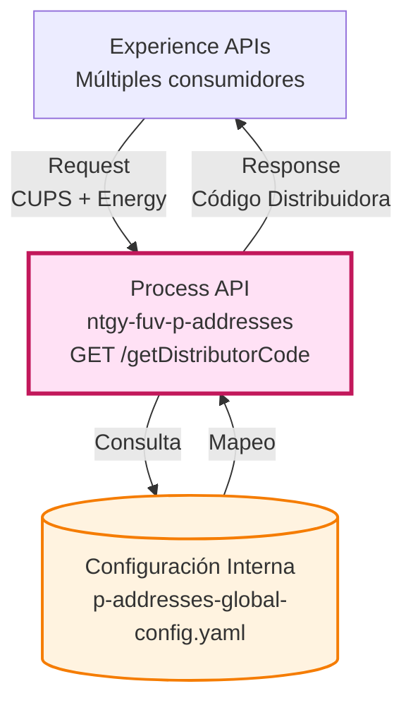
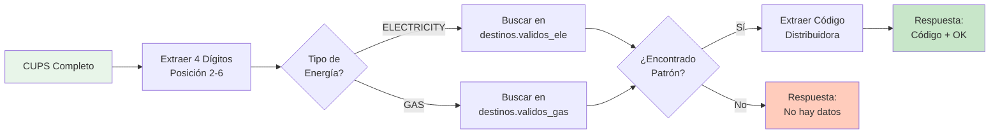
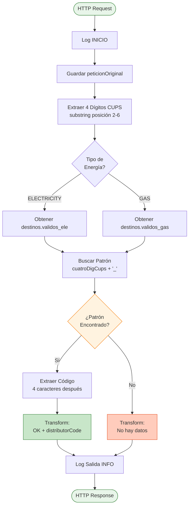
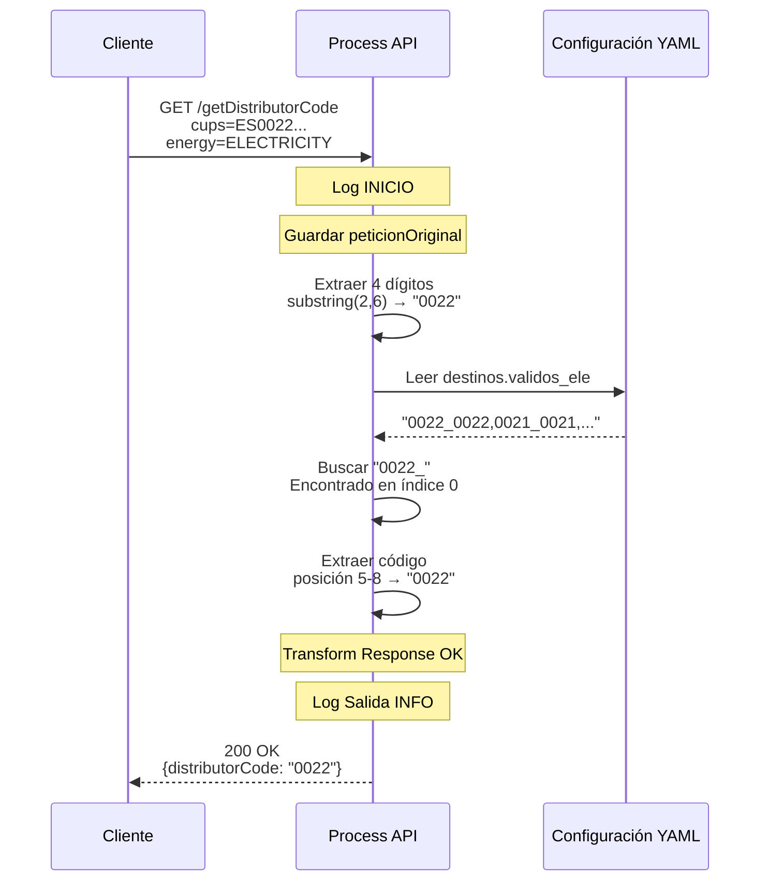
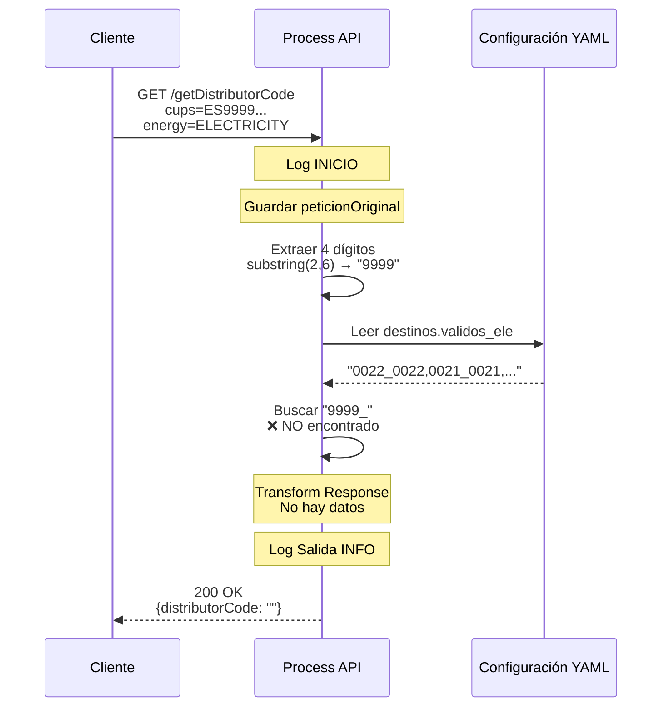
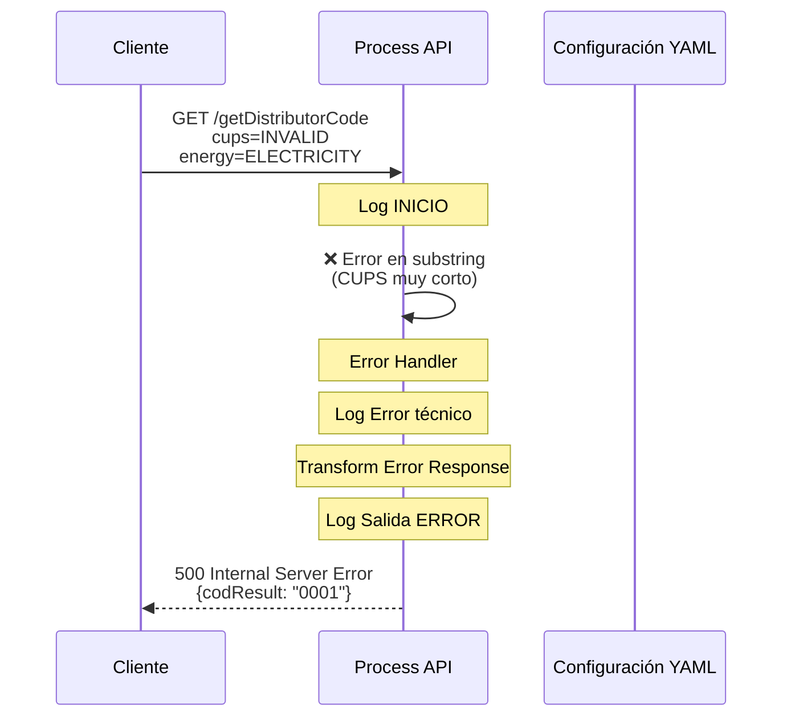

# GET /getDistributorCode

## 📌 Descripción General

### Propósito del Endpoint

Este endpoint identifica y retorna el código de la distribuidora asociada a un CUPS (Código Universal de Punto de Suministro) específico, diferenciando entre electricidad y gas. Utiliza un sistema de mapeo basado en configuración interna que relaciona los primeros 4 dígitos del CUPS con el código de distribuidora correspondiente.

### Tipo de API

**Capa:** Process API (API-Led Connectivity)

**Función:** Consulta de mapeo CUPS → Distribuidora mediante configuración interna

### Patrón de Integración

**Tipo:** Búsqueda en Configuración Interna

**Descripción:** No realiza llamadas a sistemas externos. La lógica se basa completamente en propiedades de configuración que mapean códigos de CUPS a distribuidoras.

### Arquitectura API-Led Connectivity



---

## 💼 Propósito del Negocio

### Casos de Uso Principales

1. **Identificación de Distribuidora en Procesos de Alta**
   - Determinar qué distribuidora gestiona un punto de suministro
   - Validar compatibilidad antes de iniciar procesos comerciales
   - **Beneficio:** Evita errores en asignación de contratos

2. **Enrutamiento de Consultas P0**
   - Identificar distribuidora antes de realizar consultas técnicas
   - Optimizar llamadas a sistemas de distribuidoras
   - **Beneficio:** Reduce tiempos de respuesta en consultas técnicas

3. **Validación de CUPS en Portales**
   - Verificar que el CUPS pertenece a una distribuidora válida
   - Mostrar información de distribuidora al usuario
   - **Beneficio:** Mejora experiencia de usuario con información contextual

4. **Soporte a Agentes de Atención al Cliente**
   - Identificación rápida de distribuidora durante llamadas
   - Facilita derivación de incidencias
   - **Beneficio:** Reduce tiempo de atención y mejora resolución

### Lógica de Negocio



**Pasos del Proceso:**

1. **Extracción de Identificador**: Se extraen los caracteres de posición 2 a 6 del CUPS (4 dígitos)
2. **Selección de Configuración**: Se elige el array de destinos válidos según tipo de energía
3. **Búsqueda de Patrón**: Se busca el patrón `[4dígitos]_` en la cadena de configuración
4. **Extracción de Código**: Si se encuentra, se extraen los 4 caracteres siguientes (código distribuidora)
5. **Respuesta**: Se retorna el código encontrado o mensaje "No hay datos"

### Estructura de Configuración

**Formato de Mapeo:**
```
[4_digitos_CUPS]_[4_digitos_codigo_distribuidora]
```

**Ejemplo:**
```yaml
destinos:
  validos_ele: ["0022_0022", "0021_0021", "0026_0026", ...]
  validos_gas: ["0202_0238", "0225_0225", "0229_0229", ...]
```

**Interpretación:**
- `0022_0022`: CUPS que empiezan con "0022" → Distribuidora "0022" (UFD)
- `0021_0021`: CUPS que empiezan con "0021" → Distribuidora "0021" (Iberdrola)
- `0202_0238`: CUPS que empiezan con "0202" → Distribuidora "0238" (Redexis Gas)

### Contexto Empresarial

- **Dominio:** Gestión de Puntos de Suministro
- **Sector:** Energía - Utilities
- **División:** Naturgy España - FUV (Fuerza de Ventas)
- **Proceso de Negocio:** Identificación y validación de distribuidoras

### Stakeholders

- **Agentes de Atención al Cliente**: Necesitan identificar rápidamente la distribuidora durante llamadas
- **Sistemas de Alta de Contratos**: Requieren validar distribuidora antes de iniciar procesos
- **Portales de Autoservicio**: Muestran información de distribuidora a clientes finales
- **Sistemas de Consultas Técnicas**: Necesitan identificar distribuidora para enrutar consultas P0

### Valor de Negocio

- **Centralización**: Punto único de consulta para mapeo CUPS → Distribuidora
- **Consistencia**: Configuración única compartida por todos los consumidores
- **Mantenibilidad**: Cambios en mapeos se realizan en un solo lugar
- **Performance**: Respuesta instantánea sin llamadas a sistemas externos

### Consumidores Potenciales

Este endpoint puede ser consumido por:
- Portales web de autoservicio (FUA)
- Aplicaciones móviles
- Sistemas de agentes de call center
- APIs de consultas técnicas (technicalInfoE, technicalInfoG)
- Sistemas de gestión de contratos
- Integraciones de terceros autorizados

---

## 🔧 Especificación Técnica

### URLs por Ambiente

| Ambiente | URL Base | URL Completa |
|----------|----------|--------------|
| **Local** | `http://localhost:8081` | `http://localhost:8081/api/getDistributorCode?cups=ES0022000006693281TS1P&energy=ELECTRICITY` |
| **Development** | `https://ntgy-fuv-p-addresses-dev.us-e2.cloudhub.io` | `https://ntgy-fuv-p-addresses-dev.us-e2.cloudhub.io/api/getDistributorCode?cups=ES0022000006693281TS1P&energy=ELECTRICITY` |
| **UAT** | `https://ntgy-fuv-p-addresses-uat.us-e2.cloudhub.io` | `https://ntgy-fuv-p-addresses-uat.us-e2.cloudhub.io/api/getDistributorCode?cups=ES0022000006693281TS1P&energy=ELECTRICITY` |
| **Production** | `https://ntgy-fuv-p-addresses-pro.us-e2.cloudhub.io` | `https://ntgy-fuv-p-addresses-pro.us-e2.cloudhub.io/api/getDistributorCode?cups=ES0022000006693281TS1P&energy=ELECTRICITY` |

### Método HTTP

```
GET /api/getDistributorCode
```

### Parámetros de Entrada

#### Query Parameters

| Parámetro | Tipo | Requerido | Descripción | Ejemplo |
|-----------|------|-----------|-------------|---------|
| `cups` | String | ✅ Sí | Código CUPS completo (20-22 caracteres) | `ES0022000006693281TS1P` |
| `energy` | String (Enum) | ✅ Sí | Tipo de energía: `ELECTRICITY` o `GAS` | `ELECTRICITY` |

**Validaciones:**
- `cups`: Debe ser un CUPS válido con al menos 6 caracteres
- `energy`: Solo acepta valores `ELECTRICITY` o `GAS`

### Respuestas

#### 200 OK - Distribuidora Encontrada

```json
{
  "result": {
    "codResult": "0000",
    "msgResult": "OK"
  },
  "distributorCode": "0022"
}
```

**Campos de Respuesta:**

| Campo | Tipo | Descripción |
|-------|------|-------------|
| `result.codResult` | String | Código de resultado: `"0000"` = Éxito |
| `result.msgResult` | String | Mensaje de resultado: `"OK"` |
| `distributorCode` | String | Código de 4 dígitos de la distribuidora |

#### 200 OK - Distribuidora No Encontrada

```json
{
  "result": {
    "codResult": "0000",
    "msgResult": "No hay datos"
  },
  "distributorCode": ""
}
```

**Interpretación:**
- El CUPS no está en la configuración de destinos válidos
- Puede ser un CUPS inválido o de una distribuidora no soportada

#### 500 Internal Server Error

```json
{
  "result": {
    "codResult": "0001",
    "msgResult": "KO"
  }
}
```

**Causas Posibles:**
- Error en lectura de configuración
- Error interno del servidor
- Parámetros malformados

### Autenticación

- **Tipo:** Client ID & Client Secret (Anypoint Platform)
- **Headers Requeridos:**
  - `client_id`: ID del cliente registrado en Anypoint
  - `client_secret`: Secret del cliente

### Timeouts

| Tipo | Valor |
|------|-------|
| **Request Timeout** | 5 segundos |
| **Connection Timeout** | 2 segundos |

**Nota:** Este endpoint es muy rápido (< 100ms típicamente) ya que no realiza llamadas externas.

---

## 🏗️ Implementación Técnica

### Arquitectura del Flow



### Transformaciones DataWeave

#### 1. Extracción de 4 Dígitos del CUPS

**Ubicación:** Flow `p-addresses-getDistributorCode` (líneas 42-49)

```dataweave
%dw 2.0
import * from dw::core::Strings
output application/json
---
substring(vars.cups, 2, 6)
```

**Propósito:** Extraer caracteres de posición 2 a 6 (4 dígitos identificadores)

**Ejemplo:**
- Input: `ES0022000006693281TS1P`
- Output: `0022`

#### 2. Selección de Destinos Válidos

**Ubicación:** Flow `p-addresses-getDistributorCode` (líneas 50-59)

```dataweave
%dw 2.0
output application/java
---
if (vars.energy == "ELECTRICITY") 
    p('destinos.validos_ele') default "" 
else 
    p('destinos.validos_gas') default ""
```

**Propósito:** Seleccionar el array de configuración según tipo de energía

**Resultado:** String con formato `"0022_0022,0021_0021,0026_0026,..."`

#### 3. Búsqueda de Índice del Patrón

**Ubicación:** Flow `p-addresses-getDistributorCode` (líneas 60-68)

```dataweave
%dw 2.0
output application/json 
---
vars.destinosValidos find (vars.cuatroDigCups ++ "_")
```

**Propósito:** Encontrar la posición del patrón `[4dígitos]_` en la cadena

**Ejemplo:**
- `cuatroDigCups`: `"0022"`
- Buscar: `"0022_"` en `"0022_0022,0021_0021,..."`
- Resultado: `[0]` (array con índice de inicio)

#### 4. Extracción del Código de Distribuidora

**Ubicación:** Flow `p-addresses-getDistributorCode` (líneas 70-82)

```dataweave
%dw 2.0
output application/json
---
vars.destinosValidos[(vars.codConfigIndex[0] + 5) to (vars.codConfigIndex[0] + 8)]
```

**Propósito:** Extraer 4 caracteres después del patrón encontrado

**Lógica:**
- `codConfigIndex[0]`: Posición donde empieza el patrón (ej: 0)
- `+ 5`: Saltar `"0022_"` (5 caracteres)
- `to + 8`: Extraer 4 caracteres (código distribuidora)

**Ejemplo:**
- Cadena: `"0022_0022,0021_0021,..."`
- Índice: `0`
- Extracción: posición 5 a 8 → `"0022"`

#### 5. Respuesta Exitosa

**Ubicación:** Flow `p-addresses-getDistributorCode` (líneas 83-95)

```dataweave
%dw 2.0
output application/json
---
{
    "result": {
        "codResult": "0000",
        "msgResult": "OK"
    },
    "distributorCode": vars.codDistribuidora
}
```

#### 6. Respuesta Sin Datos

**Ubicación:** Flow `p-addresses-getDistributorCode` (líneas 96-108)

```dataweave
%dw 2.0
output application/json
---
{
    "result": {
        "codResult": "0000",
        "msgResult": "No hay datos"
    },
    "distributorCode": ""
}
```

### Patrones de Diseño

**Patrón:** Content-Based Routing + Configuration-Based Lookup

**Justificación:** 
- **Content-Based Routing**: Decisión basada en tipo de energía (ELECTRICITY vs GAS)
- **Configuration-Based Lookup**: Búsqueda en configuración estática sin llamadas externas
- **Fail-Safe**: Respuesta "No hay datos" en lugar de error cuando no se encuentra

**Ventajas:**
- Performance óptimo (sin I/O externo)
- Mantenibilidad (cambios solo en configuración)
- Escalabilidad (sin límite de consultas concurrentes)

### Diagramas de Secuencia

#### 1. Flujo Normal de Éxito



#### 2. Flujo Sin Datos (CUPS No Encontrado)



#### 3. Flujo con Error Técnico



### Manejo de Errores

**Error Handler Global:**

```xml
<error-handler>
    <on-error-propagate enableNotifications="true" 
                        logException="true" 
                        type="ANY">
        <logger level="ERROR" 
                message='p-addresses-getDistributorCode Error técnico: ...'
                category="p-addresses-getDistributorCode"/>
        <ee:transform>
            <!-- Respuesta de error estándar -->
        </ee:transform>
    </on-error-propagate>
</error-handler>
```

**Estrategia:**
- Captura cualquier error (`type="ANY"`)
- Log detallado del error
- Respuesta estandarizada con `codResult: "0001"`
- Propagación del error (HTTP 500)

### Configuración de Propiedades

**Archivo:** `p-addresses-global-config.yaml`

**Estructura:**

```yaml
destinos:
  validos_gas: [
    "0202_0238",  # Redexis Gas
    "0225_0225",  # Gas Murcia
    "0229_0229",  # Nortegas
    # ... más entradas
  ]
  validos_ele: [
    "0022_0022",  # UFD Unión Fenosa
    "0021_0021",  # Iberdrola
    "0026_0026",  # HC Energía
    # ... más entradas
  ]
```

**Mantenimiento:**
- Añadir nuevas distribuidoras: Agregar entrada al array correspondiente
- Modificar mapeos: Cambiar el código de distribuidora en la entrada
- Eliminar distribuidoras: Remover entrada del array

---

## 💻 Ejemplos de Uso

### Ejemplo 1: Consulta Exitosa - Electricidad UFD

#### cURL

```bash
curl -X GET "https://ntgy-fuv-p-addresses-pro.us-e2.cloudhub.io/api/getDistributorCode?cups=ES0022000006693281TS1P&energy=ELECTRICITY" \
  -H "Content-Type: application/json" \
  -H "client_id: YOUR_CLIENT_ID" \
  -H "client_secret: YOUR_CLIENT_SECRET"
```

#### Respuesta (200 OK)

```json
{
  "result": {
    "codResult": "0000",
    "msgResult": "OK"
  },
  "distributorCode": "0022"
}
```

**Interpretación:**
- CUPS `ES0022...` → 4 dígitos: `0022`
- Distribuidora: `0022` (UFD - Unión Fenosa Distribución)

---

### Ejemplo 2: Consulta Exitosa - Gas Redexis

#### cURL

```bash
curl -X GET "https://ntgy-fuv-p-addresses-pro.us-e2.cloudhub.io/api/getDistributorCode?cups=ES0202000012345678AB1F&energy=GAS" \
  -H "Content-Type: application/json" \
  -H "client_id: YOUR_CLIENT_ID" \
  -H "client_secret: YOUR_CLIENT_SECRET"
```

#### Respuesta (200 OK)

```json
{
  "result": {
    "codResult": "0000",
    "msgResult": "OK"
  },
  "distributorCode": "0238"
}
```

**Interpretación:**
- CUPS `ES0202...` → 4 dígitos: `0202`
- Distribuidora: `0238` (Redexis Gas S.A.)

---

### Ejemplo 3: CUPS No Encontrado

#### cURL

```bash
curl -X GET "https://ntgy-fuv-p-addresses-pro.us-e2.cloudhub.io/api/getDistributorCode?cups=ES9999000012345678AB1F&energy=ELECTRICITY" \
  -H "Content-Type: application/json" \
  -H "client_id: YOUR_CLIENT_ID" \
  -H "client_secret: YOUR_CLIENT_SECRET"
```

#### Respuesta (200 OK)

```json
{
  "result": {
    "codResult": "0000",
    "msgResult": "No hay datos"
  },
  "distributorCode": ""
}
```

**Interpretación:**
- CUPS `ES9999...` → 4 dígitos: `9999`
- No existe en configuración de destinos válidos
- Puede ser un CUPS inválido o distribuidora no soportada

---

### Ejemplo 4: Error Técnico

#### cURL

```bash
curl -X GET "https://ntgy-fuv-p-addresses-pro.us-e2.cloudhub.io/api/getDistributorCode?cups=ES00&energy=ELECTRICITY" \
  -H "Content-Type: application/json" \
  -H "client_id: YOUR_CLIENT_ID" \
  -H "client_secret: YOUR_CLIENT_SECRET"
```

#### Respuesta (500 Internal Server Error)

```json
{
  "result": {
    "codResult": "0001",
    "msgResult": "KO"
  }
}
```

**Interpretación:**
- CUPS demasiado corto (< 6 caracteres)
- Error en operación `substring(2,6)`
- Error técnico capturado por error handler

---

### Ejemplo 5: JavaScript (Fetch API)

```javascript
async function getDistributorCode(cups, energy) {
  try {
    const response = await fetch(
      `https://ntgy-fuv-p-addresses-pro.us-e2.cloudhub.io/api/getDistributorCode?cups=${cups}&energy=${energy}`,
      {
        method: 'GET',
        headers: {
          'Content-Type': 'application/json',
          'client_id': 'YOUR_CLIENT_ID',
          'client_secret': 'YOUR_CLIENT_SECRET'
        }
      }
    );

    const data = await response.json();
    
    if (data.result.codResult === '0000' && data.distributorCode) {
      console.log(`Distribuidora encontrada: ${data.distributorCode}`);
      return data.distributorCode;
    } else {
      console.log('Distribuidora no encontrada');
      return null;
    }
  } catch (error) {
    console.error('Error al consultar distribuidora:', error);
    throw error;
  }
}

// Uso
getDistributorCode('ES0022000006693281TS1P', 'ELECTRICITY')
  .then(code => console.log('Código:', code));
```

---

### Ejemplo 6: Python (Requests)

```python
import requests

def get_distributor_code(cups: str, energy: str) -> dict:
    """
    Obtiene el código de distribuidora para un CUPS.
    
    Args:
        cups: Código CUPS completo
        energy: Tipo de energía ('ELECTRICITY' o 'GAS')
    
    Returns:
        dict con el código de distribuidora o None
    """
    url = 'https://ntgy-fuv-p-addresses-pro.us-e2.cloudhub.io/api/getDistributorCode'
    
    params = {
        'cups': cups,
        'energy': energy
    }
    
    headers = {
        'Content-Type': 'application/json',
        'client_id': 'YOUR_CLIENT_ID',
        'client_secret': 'YOUR_CLIENT_SECRET'
    }
    
    try:
        response = requests.get(url, params=params, headers=headers)
        response.raise_for_status()
        
        data = response.json()
        
        if data['result']['codResult'] == '0000' and data['distributorCode']:
            print(f"Distribuidora encontrada: {data['distributorCode']}")
            return data
        else:
            print('Distribuidora no encontrada')
            return None
            
    except requests.exceptions.RequestException as e:
        print(f'Error al consultar distribuidora: {e}')
        raise

# Uso
result = get_distributor_code('ES0022000006693281TS1P', 'ELECTRICITY')
if result:
    print(f"Código: {result['distributorCode']}")
```

---

### Ejemplo 7: Integración en Flow MuleSoft

```xml
<!-- Llamada desde otro flow -->
<flow name="example-flow">
    <http:request 
        method="GET" 
        config-ref="HTTP_Request_p_addresses"
        path="/getDistributorCode">
        <http:query-params>
            <![CDATA[#[{
                cups: vars.cupsValue,
                energy: 'ELECTRICITY'
            }]]]>
        </http:query-params>
    </http:request>
    
    <!-- Procesar respuesta -->
    <choice>
        <when expression="#[payload.distributorCode != '']">
            <logger message="Distribuidora: #[payload.distributorCode]"/>
            <!-- Continuar con lógica -->
        </when>
        <otherwise>
            <logger level="WARN" message="Distribuidora no encontrada"/>
            <!-- Manejo de caso sin datos -->
        </otherwise>
    </choice>
</flow>
```

---

## 📊 Mapeo de Distribuidoras

### Principales Distribuidoras de Electricidad

| Código | Nombre | Grupo | Cobertura |
|--------|--------|-------|-----------|
| `0022` | UFD - Unión Fenosa Distribución | Naturgy | Galicia, Castilla y León, Madrid |
| `0021` | Iberdrola Distribución | Iberdrola | País Vasco, Navarra, Extremadura |
| `0026` | HC Energía | HC | Ceuta, Melilla |
| `0027` | Viesgo Distribución | Viesgo | Cantabria, Asturias |
| `0631` | CIDE (múltiples códigos) | Endesa | Cataluña, Andalucía, Aragón |
| `0275` | ENDE | Endesa | Baleares, Canarias |

### Principales Distribuidoras de Gas

| Código | Nombre | Grupo | Cobertura |
|--------|--------|-------|-----------|
| `0238` | Redexis Gas S.A. | Redexis | Múltiples provincias |
| `0225` | Gas Murcia S.A. | Redexis | Murcia |
| `0229` | Nortegas Energía Distribución | Nortegas | Norte de España |
| `0242` | NED España Distribución Gas | Nortegas | Varias provincias |
| `0237` | Nedgia Madrid | Nedgia (Naturgy) | Madrid |
| `0230` | Nedgia Catalunya | Nedgia (Naturgy) | Cataluña |
| `0218` | Nedgia Andalucía | Nedgia (Naturgy) | Andalucía |
| `0234` | Madrileña Red de Gas | MRG | Madrid |
| `0207` | Gas Extremadura | Gas Extremadura | Extremadura |
| `0243` | Domus Mil Natural | Domus | Varias provincias |

### Notas sobre Configuración

**Actualización de Mapeos:**

Para añadir o modificar distribuidoras, editar el archivo:
```
src/main/resources/p-addresses-global-config.yaml
```

**Formato de entrada:**
```yaml
destinos:
  validos_ele: ["XXXX_YYYY", ...]  # Electricidad
  validos_gas: ["XXXX_YYYY", ...]  # Gas
```

Donde:
- `XXXX`: 4 primeros dígitos del CUPS (posición 2-6)
- `YYYY`: Código de 4 dígitos de la distribuidora

**Ejemplo de adición:**
```yaml
# Añadir nueva distribuidora de electricidad
validos_ele: [
  "0022_0022",  # Existente
  "0099_0099"   # Nueva distribuidora
]
```
