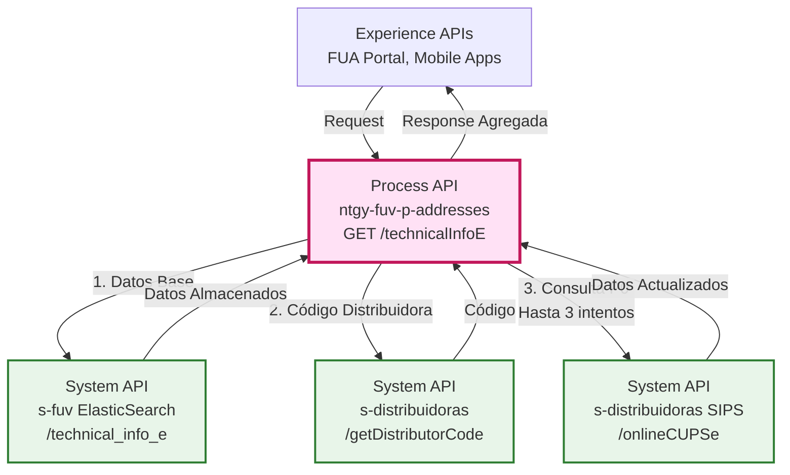
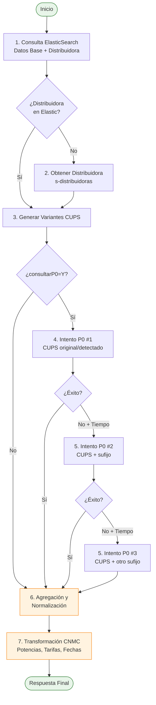
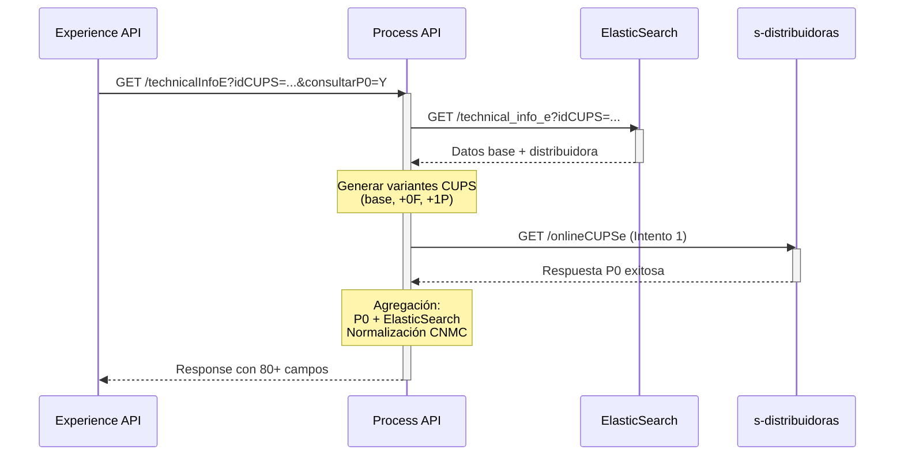
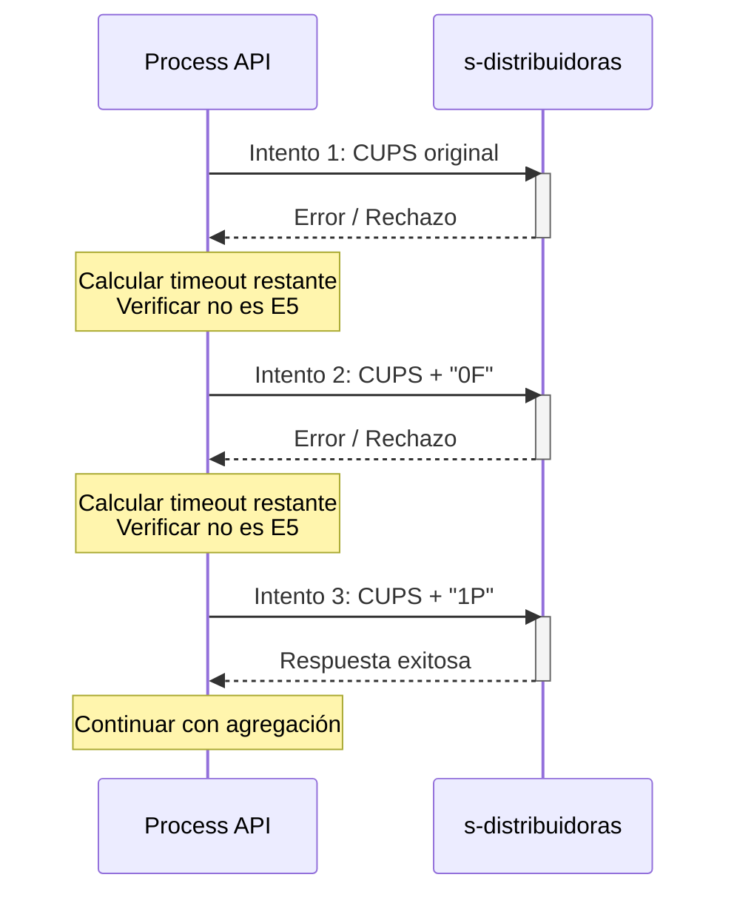
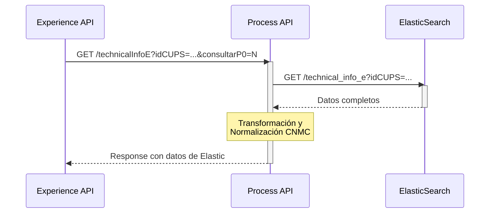
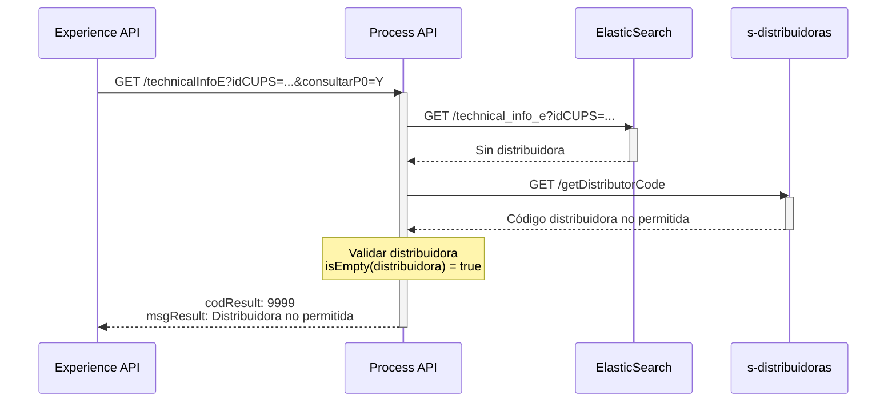

# GET /technicalInfoE

## 📌 Descripción General

### Propósito del Endpoint

Este endpoint proporciona una **consulta integral de información técnica de puntos de suministro eléctricos (CUPS)**, orquestando datos de múltiples fuentes para ofrecer la información más completa y actualizada posible. Combina datos almacenados en ElasticSearch con consultas en tiempo real a distribuidoras eléctricas (P0), aplicando lógica inteligente de reintentos y agregación de datos.

### Tipo de API

**Capa:** Process API (API-Led Connectivity)

**Función:** Orquestación compleja de consultas técnicas de electricidad con agregación de múltiples fuentes de datos

### Patrón de Integración

**Tipo:** Orquestación Compleja con Retry Logic y Agregación Inteligente

**Descripción:** Este endpoint implementa uno de los flujos más complejos del proyecto:
1. Consulta inicial a ElasticSearch para datos base
2. Identificación de distribuidora (ElasticSearch o consulta adicional)
3. Hasta 3 intentos de consulta P0 con variantes de CUPS
4. Agregación y normalización de datos con priorización (P0 > ElasticSearch)
5. Transformación a estándares CNMC

### Arquitectura API-Led Connectivity



---

## 💼 Propósito del Negocio

### Casos de Uso Principales

1. **Validación de Contratos**
   - Verificar datos técnicos antes de alta/modificación de contrato
   - Validar potencias contratadas y disponibles
   - Confirmar estado de contratable del CUPS
   - **Beneficio:** Reducción de errores en procesos comerciales

2. **Consulta de Información Técnica Completa**
   - Obtener todos los datos técnicos del punto de suministro
   - Consultar potencias por periodo (hasta 6 periodos)
   - Ver información de autoconsumo (CAU)
   - **Beneficio:** Información completa en una única llamada

3. **Validación de Cliente en Distribuidora**
   - Verificar titularidad del CUPS mediante consulta P0
   - Validar documento del cliente con distribuidora
   - Obtener datos actualizados directamente de distribuidora
   - **Beneficio:** Mayor seguridad en operaciones comerciales

4. **Soporte a Agentes de Atención al Cliente**
   - Acceso rápido a información técnica durante llamadas
   - Validación de datos en tiempo real
   - Identificación de problemas técnicos
   - **Beneficio:** Mejor experiencia de atención al cliente

### 🔗 Endpoints Dependientes

Este Process API consume los siguientes System APIs:

| System API | Endpoint | Método | Propósito |
|------------|----------|--------|-----------|
| `s-fuv` | `/technical_info_e` | GET | Consulta de datos técnicos almacenados en ElasticSearch |
| `s-distribuidoras` | `/onlineCUPSe` | GET | Consulta P0 en tiempo real a distribuidoras eléctricas |
| `s-distribuidoras` | `/getDistributorCode` | GET | Obtención de código de distribuidora por CUPS |

### Lógica de Orquestación



**Pasos del Proceso:**

1. **Consulta ElasticSearch**: Obtener datos base del CUPS y código de distribuidora si disponible
2. **Identificar Distribuidora**: Si no está en ElasticSearch, consultar a s-distribuidoras
3. **Generar Variantes CUPS**: Crear hasta 3 variantes según distribuidora (base, +0F, +1P)
4. **Consulta P0 (Condicional)**: Si consultarP0=Y, realizar hasta 3 intentos con timeout dinámico
5. **Reintentos Inteligentes**: Continuar intentos si falla, hay tiempo disponible y no es error E5
6. **Agregación de Datos**: Combinar ElasticSearch + P0 con priorización (P0 > Elastic)
7. **Normalización CNMC**: Convertir potencias, mapear tarifas, formatear fechas

### Transformaciones Aplicadas

Este Process API aplica **transformaciones complejas** para normalizar y enriquecer los datos:

| Transformación | Descripción | Ejemplo |
|----------------|-------------|---------|
| **Priorización de Datos** | P0 > ElasticSearch para campos duplicados | `validar2(P0.CUPS, Elastic.idCUPS)` |
| **Conversión de Potencias** | kW → MW si >= 1000 | `1500 kW → 1,500 MW` |
| **Mapeo de Tarifas** | Códigos internos → CNMC | `018 → 2.0TD` |
| **Formato de Fechas** | ISO → dd/MM/yyyy | `2024-01-15 → 15/01/2024` |
| **Limpieza de Valores** | Eliminar "**", null, "" | `"**" → ""` |
| **Formato de Números** | Español con coma decimal | `1500.5 → 1.500,5` |

**Funciones DataWeave Utilizadas:**

```dataweave
// Validación con priorización P0 > Elastic
fun validar2(P0, Elastic) = 
    if (P0 != null and P0 != "" and P0 != "**" and P0 != "0,000") 
        P0 
    else if (Elastic != null and Elastic != "" and Elastic != "**") 
        Elastic 
    else ""

// Conversión inteligente de potencias
fun convertir(valor) = 
    if (isEmpty(valor))
        "0,000" 
    else if (((valor replace "," with ".") as Number) >= 1000) 
        ((valor replace "," with ".") as Number / 1000) as String {format: "0.000"} replace "." with "," 
    else 
        (valor replace "," with ".") as Number as String {format: "0.000"} replace "." with ","
```

### Contexto Empresarial

- **Dominio:** Gestión de Puntos de Suministro Eléctricos
- **Sector:** Energía - Utilities
- **División:** Naturgy España - FUV (Fuerza de Ventas)
- **Proceso de Negocio:** Consulta y validación de datos técnicos para operaciones comerciales

### Stakeholders

- **Clientes Finales**: Consultan sus datos técnicos a través del portal FUA
- **Agentes de Call Center**: Validan información durante atención al cliente
- **Departamento Comercial**: Verifican datos antes de altas/modificaciones de contrato
- **Distribuidoras Eléctricas**: Proveen datos actualizados mediante consultas P0

### Valor de Negocio

- **Centralización**: Punto único de acceso a datos técnicos de múltiples fuentes
- **Actualización**: Datos en tiempo real desde distribuidoras mediante P0
- **Resiliencia**: Hasta 3 intentos automáticos maximizan tasa de éxito (>85%)
- **Consistencia**: Normalización automática según estándares CNMC
- **Eficiencia**: Reduce tiempo de consulta de minutos a segundos

### Consumidores Potenciales

Este endpoint puede ser consumido por:
- Portales web de autoservicio (FUA Portal)
- Aplicaciones móviles de clientes
- Sistemas de agentes de call center
- Herramientas de gestión comercial
- Integraciones de terceros autorizados

---

## 🔧 Especificación Técnica

### URLs por Ambiente

| Ambiente | URL Base | URL Completa |
|----------|----------|--------------|
| **Local** | `http://localhost:8081` | `http://localhost:8081/api/technicalInfoE` |
| **Development** | `https://ntgy-fuv-p-addresses-dev.us-e2.cloudhub.io` | `https://ntgy-fuv-p-addresses-dev.us-e2.cloudhub.io/api/technicalInfoE` |
| **UAT** | `https://ntgy-fuv-p-addresses-uat.us-e2.cloudhub.io` | `https://ntgy-fuv-p-addresses-uat.us-e2.cloudhub.io/api/technicalInfoE` |
| **Production** | `https://ntgy-fuv-p-addresses-pro.us-e2.cloudhub.io` | `https://ntgy-fuv-p-addresses-pro.us-e2.cloudhub.io/api/technicalInfoE` |

### Método HTTP

```
GET /api/technicalInfoE
```

### Parámetros de Entrada

#### Query Parameters

| Parámetro | Tipo | Requerido | Descripción | Ejemplo |
|-----------|------|-----------|-------------|---------|
| `idCUPS` | string | ✅ Sí | Código Universal de Punto de Suministro (20-22 caracteres) | `ES0022000006693281TS1P` |
| `consultarP0` | string | ✅ Sí | Indica si se debe consultar P0 a distribuidora | `Y` o `N` |
| `tipoDoc` | string | ❌ No | Tipo de documento según tabla CNMC | `01` (NIF) |
| `documento` | string | ❌ No | Número de documento del titular | `12345678Z` |
| `origen` | string | ❌ No | Código de comercializadora | `1646` (default) |
| `timeout` | number | ❌ No | Timeout máximo en milisegundos | `7000` (default) |

**Valores de tipoDoc (Tabla CNMC):**
- `01`: NIF (Número de Identificación Fiscal)
- `03`: Pasaporte
- `04`: NIE (Número de Identidad de Extranjero)
- `07`: NIVA (NIF IVA)
- `08`: OTR (Otros)

**Notas Importantes:**
- Si `consultarP0=Y`, los parámetros `tipoDoc` y `documento` son **recomendados** para validación de cliente
- El `timeout` se gestiona dinámicamente en runtime, ajustándose según tiempo consumido
- El CUPS se recorta automáticamente a 20 caracteres para búsquedas en ElasticSearch

### Respuestas

#### 200 OK - Respuesta Exitosa

**Estructura de Respuesta:**

```json
{
  "result": {
    "codResult": "0000",
    "msgResult": "OK"
  },
  "cups": [
    {
      "idCUPS": "ES0022000006693281TS1P",
      "idTarifaAcceso": "2.0TD",
      "idPotenciaPeriodo01": "3,450",
      "idPotenciaPeriodo02": "3,450",
      "idPotenciaPeriodo03": "0,000",
      "idPotenciaPeriodo04": "0,000",
      "idPotenciaPeriodo05": "0,000",
      "idPotenciaPeriodo06": "0,000",
      "idPotenciaMaxima": "5,750",
      "idConsumoAnyoMovilAct": "2500",
      "idConsumoAnyoCerradoAct": "2400",
      "fConsumoAct12MesesAnt": "2300",
      "fConsumoActAnyoCerrAnt": "2200",
      "idTipoTitular": "F",
      "desNombre": "Juan",
      "desTitularRazonSocial": "García Pérez",
      "idPoblacionPto": "Madrid",
      "idCodigoPostalPto": "28001",
      "desProvinciaPto": "Madrid",
      "idFechaUltCambioComerc": "15/01/2024",
      "idFasesEquipoMedida": "M",
      "idPropiedadEquipoMedida": "C",
      "idTipoEnergia": "E",
      "idTensionSuministroCnmc": "01",
      "idPotenciaMaximaBie": "5,750",
      "idPotenciaMaximaActa": "0,000",
      "idDerechosExtension": "0,000",
      "idDerechosAcceso": "0,000",
      "propiedadIcp": "C",
      "idDiscriminacionHoraria": "N",
      "idFechaLimiteExtension": "",
      "idFechaUltimaLectura": "01/01/2024",
      "idFechaUltMovContrato": "15/01/2024",
      "idTipoPerfilConsumo": "1",
      "idTipoPuntoMedida": "5",
      "idPotenciaDisponibleCaja": "0",
      "idAplicacionBS": "N",
      "idEmpresaDistribuidora": "0022",
      "idGrupoDistribuidora": "UFD",
      "desEmpresaDistribuidora": "Unión Fenosa Distribución",
      "contratable": "S",
      "cieElectronico": "S",
      "codigoCie": "ES0022CIE123456",
      "fechaEmisionCie": "01/01/2023",
      "fechaCaducidadCie": "01/01/2028",
      "nifInstaladorCIE": "",
      "tensionSuministroCIE": "230",
      "tipoSuministroCIE": "M",
      "ambitoValidezCIE": "V",
      "resultadoValidacionCliente": "01",
      "cnae": "9820",
      "enVigor": "S",
      "tipoContratoATR": "01",
      "existeSolicitudEnCurso": "N",
      "tipoSolicitudEnCurso": "",
      "motivoNoContratable": "",
      "respuestaDistribuidora": true,
      "motivoRechazo": "",
      "datosCau": [
        {
          "cau": "ES0022CAU123456",
          "idTipoAutoconsumo": "41",
          "idTipoASubseccion": "A",
          "colectivo": "N",
          "DatosInstGen": [
            {
              "tecGenerador": "01",
              "potInstaladaGen": "5,000",
              "idTipoInstalacion": "01",
              "idEsquemaMedida": "A",
              "ssaa": "N",
              "unicoContrato": "S",
              "titularRepresentanteGen": {
                "idTitular": {
                  "tipoIdentificador": "01",
                  "identificador": "12345678Z"
                },
                "nombre": {
                  "nombreDePila": "Juan",
                  "primerApellido": "García",
                  "segundoApellido": "Pérez"
                },
                "telefono": {
                  "prefijoPais": "34",
                  "numero": "600123456"
                }
              },
              "cil": "ES0022CIL123456",
              "refCatastro": "1234567VK1234N",
              "x": "440000",
              "y": "4470000",
              "hunso": "30",
              "banda": "T"
            }
          ]
        }
      ],
      "modoControlPotencia": "1",
      "relacionTransformcionIntensidad": "1",
      "cieDisponible": "S",
      "potenciaInstBT": "5,750",
      "codigoApm": "",
      "potenciaInstAT": "0,000",
      "fechaEmisionApm": "",
      "expedienteAbierto": "N",
      "codigoMotivoExpediente": "",
      "PuntosDeMedidas": [
        {
          "direccionEnlace": "192.168.1.100",
          "telefonoTelemedida": "600123456",
          "claveAcceso": "CLAVE123"
        }
      ],
      "clienteTipoIdentificador": "01",
      "clienteIdentificador": "12345678Z",
      "clienteTipoPersona": "F",
      "clienteNombreDePila": "Juan",
      "clientePrimerApellido": "García",
      "clienteSegundoApellido": "Pérez",
      "clienteRazonSocial": "",
      "clienteCorreoElectronico": "juan.garcia@example.com",
      "clientePrefijoPais": "34",
      "clienteNumeroTelefono": "600123456",
      "clientePais": "ES",
      "clienteIdProvincia": "28",
      "clienteIdMunicipio": "079",
      "clienteIdPoblacion": "Madrid",
      "clienteCodPostal": "28001",
      "clienteCalle": "Calle Mayor",
      "clienteNumeroFinca": "1",
      "clienteDuplicadorFinca": "",
      "clienteEscalera": "",
      "clientePiso": "1",
      "clientePuerta": "A",
      "clienteTipoAlaradorFinca": "",
      "clienteAclaradorFinca": "",
      "refCatastro": "1234567VK1234N",
      "refCatstroFinca": "1234567VK1234N",
      "utmX": "440000",
      "utmY": "4470000",
      "utmHuso": "30",
      "utmBanda": "T",
      "fechaUltimMovTipoAutoConsumo": "01/01/2024",
      "viviendaHabitual": "S",
      "modoFacturacionPotencia": "1",
      "noInterrumpible": "N",
      "potMaxNoInterrumpible": "0,000",
      "vasTrafo": "0",
      "periocidadFacturacion": "M",
      "tipoTelegestion": "1",
      "icpActivadoTelegestion": "S",
      "peajeDirecto": "N",
      "depositoGarantia": "N"
    }
  ]
}
```

**Campos Principales (80+ campos):**

| Campo | Tipo | Descripción |
|-------|------|-------------|
| `result.codResult` | string | Código de resultado (`0000` = éxito) |
| `result.msgResult` | string | Mensaje de resultado |
| `cups[].idCUPS` | string | Código CUPS completo |
| `cups[].idTarifaAcceso` | string | Tarifa de acceso (códigos CNMC: 2.0TD, 3.0TD, 6.xTD) |
| `cups[].idPotenciaPeriodo01-06` | string | Potencias contratadas por periodo en MW |
| `cups[].idPotenciaMaxima` | string | Potencia máxima sin expediente en MW |
| `cups[].idEmpresaDistribuidora` | string | Código de distribuidora (ej: 0022 = UFD) |
| `cups[].contratable` | string | Estado de contratable (S/N) |
| `cups[].respuestaDistribuidora` | boolean | Indica si P0 fue exitoso |
| `cups[].motivoRechazo` | string | Código de motivo de rechazo P0 (si aplica) |
| `cups[].datosCau[]` | array | Datos de autoconsumo (CAU) si aplica |

#### 200 OK - Rechazo Sin Datos

Cuando P0 rechaza pero no hay datos en ElasticSearch:

```json
{
  "result": {
    "codResult": "0000",
    "msgResult": "Rechazo Sin Datos"
  },
  "cups": [
    {
      "idCUPS": "ES0022000006693281TS1P",
      "idEmpresaDistribuidora": "0022",
      "motivoRechazo": "E5"
    }
  ]
}
```

#### 200 OK - No Hay Datos

Cuando no hay datos en ninguna fuente:

```json
{
  "result": {
    "codResult": "0000",
    "msgResult": "No hay datos"
  }
}
```

#### 200 OK - Distribuidora No Permitida

Cuando la distribuidora no está en la lista de permitidas:

```json
{
  "result": {
    "codResult": "9999",
    "msgResult": "Distribuidora no permitida"
  }
}
```

#### 500 Internal Server Error

```json
{
  "result": {
    "codResult": "9999",
    "msgResult": "Error interno del servidor"
  }
}
```

### Autenticación

- **Tipo:** Client ID & Client Secret (Anypoint Platform)
- **Headers Requeridos:**
  - `client_id`: ID del cliente registrado en Anypoint
  - `client_secret`: Secret del cliente

### Timeouts

| Tipo | Valor | Descripción |
|------|-------|-------------|
| **Request Timeout** | 7000ms (default) | Configurable por parámetro `timeout` |
| **Timeout Dinámico P0** | Variable | Se ajusta en runtime según tiempo consumido |
| **Timeout Mínimo** | 100ms | Mínimo para evitar timeouts inmediatos |

**Cálculo de Timeout Dinámico:**

```dataweave
var temps = timeoutProces - tempsCrida - tiempoInternoProcesoE
---
if (temps <= 0) 100 else temps
```

---

## 🏗️ Implementación Técnica

### Arquitectura del Flow

```mermaid
flowchart TD
    Start([HTTP Request]) --> LogStart[Log INICIO]
    LogStart --> SaveReq[Guardar peticionOriginal]
    SaveReq --> SetTimeout[Set timeoutProces]
    SetTimeout --> RecortarCUPS[Recortar CUPS a 20 chars]
    RecortarCUPS --> StartTimer[Iniciar tempsCridaInici]
    
    StartTimer --> TryElastic{Try: Consulta<br/>ElasticSearch}
    TryElastic -->|Success| SaveElastic[Guardar respuestaElastic]
    TryElastic -->|Error| SetNull[respuestaElastic = null]
    SaveElastic --> CalcTime1[Calcular tempsCrida]
    SetNull --> CalcTime1
    
    CalcTime1 --> CheckDist{¿Distribuidora<br/>en Elastic?}
    CheckDist -->|Sí| SetDist[Usar distribuidora Elastic]
    CheckDist -->|No| GetDist[Flow-ref:<br/>getDistributorCode]
    SetDist --> GenCUPS
    GetDist --> GenCUPS
    
    GenCUPS{¿CUPS completo<br/>en Elastic?}
    GenCUPS -->|Sí| SetCUPS1[cupsList.cups1 = CUPS Elastic]
    GenCUPS -->|No| GenVariants[Generar 3 variantes<br/>según distribuidora]
    SetCUPS1 --> CalcTimeoutP0
    GenVariants --> CalcTimeoutP0
    
    CalcTimeoutP0[Calcular timeoutP0] --> CheckP0{¿consultarP0=Y<br/>AND tipoDoc?}
    CheckP0 -->|No| SkipP0[No consultar P0]
    CheckP0 -->|Sí| P0_1[Flow-ref: consultaP0<br/>Intento 1 - cups1]
    
    P0_1 --> UpdateTimeout1[Actualizar timeoutP0]
    UpdateTimeout1 --> DetectE5_1[Detectar motivo E5]
    DetectE5_1 --> CheckRetry1{¿Falló AND<br/>cups2 AND<br/>timeout AND<br/>!E5?}
    CheckRetry1 -->|Sí| P0_2[Flow-ref: consultaP0<br/>Intento 2 - cups2]
    CheckRetry1 -->|No| SkipP0
    
    P0_2 --> UpdateTimeout2[Actualizar timeoutP0]
    UpdateTimeout2 --> CheckRetry2{¿Falló AND<br/>cups3 AND<br/>timeout AND<br/>!E5?}
    CheckRetry2 -->|Sí| P0_3[Flow-ref: consultaP0<br/>Intento 3 - cups3]
    CheckRetry2 -->|No| SkipP0
    
    P0_3 --> SkipP0
    SkipP0 --> CheckData{¿Hay datos<br/>Elastic OR P0?}
    CheckData -->|Sí| Transform[Transform Message<br/>Agregación + Normalización]
    CheckData -->|Solo Rechazo P0| TransformRechazo[Transform:<br/>Rechazo Sin Datos]
    CheckData -->|No| TransformNoData[Transform:<br/>No hay datos]
    
    Transform --> LogEnd
    TransformRechazo --> LogEnd
    TransformNoData --> LogEnd
    
    LogEnd[Log Salida INFO/DEBUG] --> End([HTTP Response])
    
    style Start fill:#e8f5e9,stroke:#2e7d32
    style End fill:#e8f5e9,stroke:#2e7d32
    style Transform fill:#fff3e0,stroke:#f57c00
    style P0_1 fill:#e3f2fd,stroke:#1976d2
    style P0_2 fill:#e3f2fd,stroke:#1976d2
    style P0_3 fill:#e3f2fd,stroke:#1976d2
```



### Sub-flows Utilizados

#### 1. p-addresses-technicalInfoE-consultaP0

**Propósito:** Realizar consulta P0 a distribuidora con timeout dinámico

**Flujo:**
1. Registrar timeout disponible (timeoutP0)
2. Iniciar temporizador
3. Ejecutar HTTP request a s-distribuidoras/onlineCUPSe
4. Calcular tiempo consumido
5. Actualizar timeoutP0 para siguiente intento
6. Detectar motivo de rechazo E5

**Parámetros:**
- `vars.cups`: CUPS a consultar (puede variar en cada intento)
- `vars.distribuidora`: Código de distribuidora
- `vars.peticionOriginal.tipoDoc`: Tipo de documento
- `vars.peticionOriginal.documento`: Número de documento
- `vars.peticionOriginal.origen`: Código de comercializadora
- `vars.timeoutP0`: Timeout dinámico calculado

**Salida:**
- `vars.respuestaP0`: Respuesta de la consulta P0
- `vars.esMotivoRechazoE5`: Boolean indicando si el rechazo es E5

#### 2. p-addresses-technicalInfoE-getDistributorCode

**Propósito:** Obtener código de distribuidora cuando no está disponible en ElasticSearch

**Flujo:**
1. Preparar parámetros (CUPS, energy="ELECTRICITY")
2. Llamar a flow p-addresses-getDistributorCode
3. Extraer código de distribuidora de la respuesta

**Salida:**
- `vars.distribuidora`: Código de distribuidora obtenido

### Transformaciones DataWeave Principales

#### Agregación y Normalización (Transform Message Principal)

**Ubicación:** Inline en el flow principal (líneas 234-523 del XML)

**Funciones Reutilizables:**

```dataweave
// 1. Validación básica
fun validar(campo) = 
    if (campo != null and campo != "" and campo != "**") 
        campo 
    else ""

// 2. Validación con priorización P0 > Elastic
fun validar2(P0, Elastic) = 
    if (P0 != null and P0 != "" and P0 != "**" and P0 != "0,000") 
        P0 
    else if (Elastic != null and Elastic != "" and Elastic != "**") 
        Elastic 
    else ""

// 3. Validación triple (P0 nuevo > P0 antiguo > Elastic)
fun validar3(P0_nuevo, P0_antiguo, Elastic) = 
    if (P0_nuevo != null and P0_nuevo != "" and P0_nuevo != "**" and P0_nuevo != "0,000") 
        P0_nuevo 
    else if (P0_antiguo != null and P0_antiguo != "" and P0_antiguo != "**" and P0_antiguo != "0,000") 
        P0_antiguo 
    else if (Elastic != null and Elastic != "" and Elastic != "**") 
        Elastic 
    else ""

// 4. Conversión inteligente de potencias (kW → MW si >= 1000)
fun convertir(valor) = 
    if (isEmpty(valor))
        "0,000" 
    else if (((valor replace "," with ".") as Number {format: "0.000"}) >= 1000) 
        ((valor replace "," with ".") as Number {format: "0.000"}/1000) as String {format: "0.000"} replace "." with "," 
    else 
        (valor replace "," with ".") as Number as String {format: "0.000"} replace "." with ","

// 5. Conversión siempre a MW (para datos de P0 que vienen en kW)
fun convertirSiempre(valor) = 
    if (isEmpty(valor))
        "0,000" 
    else 
        ((valor replace "," with ".") as Number {format: "0.000"}/1000) as String {format: "0.000"} replace "." with ","

// 6. Formato de número sin decimales innecesarios
fun FormatoNumero(valor) = 
    if (isEmpty(valor))
        "0"  
    else if (valor == "0.000" or valor == "0,000") 
        "0"
    else 
        ((valor replace "," with ".") as Number as String {format: "0.000"} replace "." with ",") replace ",000" with ""
```

**Mapeo de Tarifas CNMC:**

```dataweave
idTarifaAcceso: validar3(P0.TarifaATR_nuevo, P0.TarifaATR_antiguo, Elastic.idTarifaAcceso) match {
    case "018" -> "2.0TD"
    case "019" -> "3.0TD"
    case "020" -> "6.1TD"
    case "021" -> "6.2TD"
    case "022" -> "6.3TD"
    case "023" -> "6.4TD"
    case "024" -> "3.0TDVE"
    case "025" -> "6.1TDVE"
    else -> validar3(P0.TarifaATR_nuevo, P0.TarifaATR_antiguo, Elastic.idTarifaAcceso)
}
```

### Patrones de Diseño

#### 1. Retry Pattern con Backoff Inteligente

**Descripción:** Hasta 3 intentos de consulta P0 con timeout dinámico que se reduce en cada intento

**Implementación:**
- Intento 1: Timeout completo disponible
- Intento 2: Timeout - tiempo consumido - tiempo interno
- Intento 3: Timeout restante después del intento 2

**Condiciones de Retry:**
```dataweave
vars.respuestaP0.result.codResult != "0000" 
and vars.cupsList.cups2 != null 
and vars.timeoutP0 > tiempoInternoConstruirRespuesta
and vars.esMotivoRechazoE5 == false
```

#### 2. Circuit Breaker Pattern

**Descripción:** Detección de errores no recuperables (E5) para evitar reintentos inútiles

**Implementación:**
```dataweave
var MotivoRechazo = vars.respuestaP0.MensajeRechazoP0.RechazosPeticion.Rechazo.CodigoMotivo as String default ""
---
if (MotivoRechazo == 'E5') true else false
```

#### 3. Graceful Degradation Pattern

**Descripción:** Respuestas parciales cuando algún sistema falla

**Escenarios:**
- ElasticSearch falla → Intentar solo P0
- P0 falla → Devolver datos de ElasticSearch
- Ambos fallan → Respuesta "No hay datos" (codResult "0000")

#### 4. Data Aggregation Pattern

**Descripción:** Combinar datos de múltiples fuentes con priorización

**Estrategia:**
1. P0 tiene prioridad sobre ElasticSearch (datos más actualizados)
2. ElasticSearch completa campos faltantes
3. Validación multinivel para cada campo

### Diagramas de Secuencia

#### 1. Flujo Normal de Éxito (con P0)



#### 2. Flujo con Reintentos P0



#### 3. Flujo sin P0 (solo ElasticSearch)



#### 4. Flujo con Error de Distribuidora No Permitida



### Manejo de Errores

#### Estrategia de Error Handling

**Nivel 1: Try-Catch en Consulta ElasticSearch**
```xml
<try>
    <http:request path="/technical_info_e" />
    <error-handler>
        <on-error-continue>
            <set-variable variableName="respuestaElastic" value="#[null]"/>
        </on-error-continue>
    </error-handler>
</try>
```

**Nivel 2: Try-Catch en Consulta P0**
```xml
<try>
    <http:request path="/onlineCUPSe" />
    <error-handler>
        <on-error-continue>
            <logger message="Sin respuesta de P0"/>
        </on-error-continue>
    </error-handler>
</try>
```

**Nivel 3: Error Handler Global del Flow**
```xml
<error-handler>
    <on-error-continue type="ANY">
        <ee:transform>
            <!-- Respuesta genérica "No hay datos" -->
        </ee:transform>
    </on-error-continue>
</error-handler>
```

#### Códigos de Error

| Código | Mensaje | Descripción | Acción |
|--------|---------|-------------|--------|
| `0000` | OK | Operación exitosa | Procesar respuesta |
| `0000` | No hay datos | Sin datos en ninguna fuente | Informar al usuario |
| `0000` | Rechazo Sin Datos | P0 rechazó, sin datos Elastic | Ver motivoRechazo |
| `0001` | Rechazo P0 | Distribuidora rechazó consulta | Ver motivoRechazo |
| `9999` | Distribuidora no permitida | Distribuidora no en lista | Verificar CUPS |
| `9999` | Error interno | Error no controlado | Contactar soporte |

#### Motivos de Rechazo P0 (Ejemplos)

| Código | Descripción | Acción Recomendada |
|--------|-------------|-------------------|
| `E5` | CUPS no encontrado | Verificar CUPS correcto |
| `E6` | Documento no coincide | Verificar documento titular |
| `E7` | Distribuidora incorrecta | Verificar código distribuidora |

---

## 💻 Ejemplos de Uso

### Ejemplo 1: Consulta Completa con P0 y Validación de Cliente

#### cURL

```bash
curl -X GET "https://ntgy-fuv-p-addresses-pro.us-e2.cloudhub.io/api/technicalInfoE?idCUPS=ES0022000006693281TS1P&consultarP0=Y&tipoDoc=01&documento=12345678Z&origen=1646&timeout=7000" \
  -H "Content-Type: application/json" \
  -H "client_id: YOUR_CLIENT_ID" \
  -H "client_secret: YOUR_CLIENT_SECRET"
```

#### Respuesta (200 OK)

```json
{
  "result": {
    "codResult": "0000",
    "msgResult": "OK"
  },
  "cups": [
    {
      "idCUPS": "ES0022000006693281TS1P",
      "idTarifaAcceso": "2.0TD",
      "idPotenciaPeriodo01": "3,450",
      "idPotenciaPeriodo02": "3,450",
      "idEmpresaDistribuidora": "0022",
      "desEmpresaDistribuidora": "Unión Fenosa Distribución",
      "contratable": "S",
      "respuestaDistribuidora": true,
      "motivoRechazo": ""
    }
  ]
}
```

### Ejemplo 2: Consulta Solo ElasticSearch (sin P0)

#### cURL

```bash
curl -X GET "https://ntgy-fuv-p-addresses-pro.us-e2.cloudhub.io/api/technicalInfoE?idCUPS=ES0022000006693281TS1P&consultarP0=N" \
  -H "Content-Type: application/json" \
  -H "client_id: YOUR_CLIENT_ID" \
  -H "client_secret: YOUR_CLIENT_SECRET"
```

#### Respuesta (200 OK)

```json
{
  "result": {
    "codResult": "0000",
    "msgResult": "OK"
  },
  "cups": [
    {
      "idCUPS": "ES0022000006693281TS1P",
      "idTarifaAcceso": "2.0TD",
      "idPotenciaPeriodo01": "3,450",
      "idEmpresaDistribuidora": "0022",
      "respuestaDistribuidora": false
    }
  ]
}
```

### Ejemplo 3: JavaScript (Fetch API)

```javascript
const consultarTechnicalInfoE = async (cups, consultarP0 = 'Y', tipoDoc = '01', documento = '') => {
  const params = new URLSearchParams({
    idCUPS: cups,
    consultarP0: consultarP0,
    ...(tipoDoc && { tipoDoc }),
    ...(documento && { documento }),
    origen: '1646',
    timeout: '7000'
  });

  const response = await fetch(
    `https://ntgy-fuv-p-addresses-pro.us-e2.cloudhub.io/api/technicalInfoE?${params}`,
    {
      method: 'GET',
      headers: {
        'Content-Type': 'application/json',
        'client_id': 'YOUR_CLIENT_ID',
        'client_secret': 'YOUR_CLIENT_SECRET'
      }
    }
  );

  if (!response.ok) {
    throw new Error(`HTTP error! status: ${response.status}`);
  }

  const data = await response.json();
  
  // Verificar resultado
  if (data.result.codResult === '0000' && data.cups && data.cups.length > 0) {
    const cupsData = data.cups[0];
    console.log('CUPS:', cupsData.idCUPS);
    console.log('Tarifa:', cupsData.idTarifaAcceso);
    console.log('Potencia P1:', cupsData.idPotenciaPeriodo01, 'MW');
    console.log('Distribuidora:', cupsData.desEmpresaDistribuidora);
    console.log('Contratable:', cupsData.contratable === 'S' ? 'Sí' : 'No');
    
    if (cupsData.respuestaDistribuidora) {
      console.log('✓ Datos validados con distribuidora (P0)');
    } else {
      console.log('⚠ Datos solo de ElasticSearch');
    }
    
    return cupsData;
  } else {
    console.error('Error:', data.result.msgResult);
    return null;
  }
};

// Uso
consultarTechnicalInfoE('ES0022000006693281TS1P', 'Y', '01', '12345678Z')
  .then(data => console.log('Datos obtenidos:', data))
  .catch(error => console.error('Error:', error));
```

### Ejemplo 4: Python (Requests)

```python
import requests
from typing import Optional, Dict, Any

def consultar_technical_info_e(
    cups: str,
    consultar_p0: str = 'Y',
    tipo_doc: Optional[str] = None,
    documento: Optional[str] = None,
    origen: str = '1646',
    timeout_ms: int = 7000,
    client_id: str = 'YOUR_CLIENT_ID',
    client_secret: str = 'YOUR_CLIENT_SECRET'
) -> Optional[Dict[str, Any]]:
    """
    Consulta información técnica de un CUPS eléctrico.
    
    Args:
        cups: Código CUPS (20-22 caracteres)
        consultar_p0: 'Y' para consultar P0, 'N' solo ElasticSearch
        tipo_doc: Tipo de documento CNMC ('01', '03', '04', '07', '08')
        documento: Número de documento del titular
        origen: Código de comercializadora
        timeout_ms: Timeout en milisegundos
        client_id: Client ID de Anypoint
        client_secret: Client Secret de Anypoint
    
    Returns:
        Dict con datos del CUPS o None si error
    """
    url = 'https://ntgy-fuv-p-addresses-pro.us-e2.cloudhub.io/api/technicalInfoE'
    
    params = {
        'idCUPS': cups,
        'consultarP0': consultar_p0,
        'origen': origen,
        'timeout': timeout_ms
    }
    
    if tipo_doc:
        params['tipoDoc'] = tipo_doc
    if documento:
        params['documento'] = documento
    
    headers = {
        'Content-Type': 'application/json',
        'client_id': client_id,
        'client_secret': client_secret
    }
    
    try:
        response = requests.get(url, params=params, headers=headers, timeout=10)
        response.raise_for_status()
        
        data = response.json()
        
        if data['result']['codResult'] == '0000' and data.get('cups'):
            cups_data = data['cups'][0]
            
            print(f"✓ CUPS: {cups_data.get('idCUPS')}")
            print(f"  Tarifa: {cups_data.get('idTarifaAcceso')}")
            print(f"  Potencia P1: {cups_data.get('idPotenciaPeriodo01')} MW")
            print(f"  Distribuidora: {cups_data.get('desEmpresaDistribuidora')}")
            print(f"  Contratable: {'Sí' if cups_data.get('contratable') == 'S' else 'No'}")
            
            if cups_data.get('respuestaDistribuidora'):
                print("  ✓ Validado con distribuidora (P0)")
            else:
                print("  ⚠ Solo datos de ElasticSearch")
            
            return cups_data
        else:
            print(f"✗ Error: {data['result']['msgResult']}")
            return None
            
    except requests.exceptions.RequestException as e:
        print(f"✗ Error de conexión: {e}")
        return None

# Uso
if __name__ == '__main__':
    datos = consultar_technical_info_e(
        cups='ES0022000006693281TS1P',
        consultar_p0='Y',
        tipo_doc='01',
        documento='12345678Z'
    )
    
    if datos:
        print("\n📊 Datos completos obtenidos correctamente")
        
        # Acceder a datos de autoconsumo si existen
        if datos.get('datosCau'):
            print(f"\n⚡ Autoconsumo detectado:")
            for cau in datos['datosCau']:
                print(f"  CAU: {cau.get('cau')}")
                print(f"  Tipo: {cau.get('idTipoAutoconsumo')}")
```

### Ejemplo 5: Manejo de Errores y Reintentos

#### JavaScript con Retry Logic

```javascript
const consultarConReintentos = async (cups, maxReintentos = 3) => {
  for (let intento = 1; intento <= maxReintentos; intento++) {
    try {
      console.log(`Intento ${intento} de ${maxReintentos}...`);
      
      const response = await fetch(
        `https://ntgy-fuv-p-addresses-pro.us-e2.cloudhub.io/api/technicalInfoE?idCUPS=${cups}&consultarP0=Y`,
        {
          method: 'GET',
          headers: {
            'Content-Type': 'application/json',
            'client_id': 'YOUR_CLIENT_ID',
            'client_secret': 'YOUR_CLIENT_SECRET'
          }
        }
      );

      if (response.ok) {
        const data = await response.json();
        
        if (data.result.codResult === '0000' && data.cups) {
          console.log('✓ Consulta exitosa');
          return data.cups[0];
        } else if (data.result.codResult === '9999') {
          console.error('✗ Error de negocio:', data.result.msgResult);
          return null; // No reintentar errores de negocio
        }
      }
      
      // Esperar antes de reintentar (backoff exponencial)
      if (intento < maxReintentos) {
        const espera = Math.pow(2, intento) * 1000; // 2s, 4s, 8s
        console.log(`Esperando ${espera/1000}s antes de reintentar...`);
        await new Promise(resolve => setTimeout(resolve, espera));
      }
      
    } catch (error) {
      console.error(`Error en intento ${intento}:`, error.message);
      
      if (intento === maxReintentos) {
        throw new Error(`Falló después de ${maxReintentos} intentos`);
      }
    }
  }
  
  return null;
};

// Uso
consultarConReintentos('ES0022000006693281TS1P')
  .then(data => {
    if (data) {
      console.log('Datos obtenidos:', data);
    } else {
      console.log('No se pudieron obtener datos');
    }
  })
  .catch(error => console.error('Error fatal:', error));
```

### Ejemplo 6: Validación de Respuesta

#### TypeScript con Validación de Tipos

```typescript
interface TechnicalInfoResponse {
  result: {
    codResult: string;
    msgResult: string;
  };
  cups?: Array<{
    idCUPS: string;
    idTarifaAcceso: string;
    idPotenciaPeriodo01: string;
    idPotenciaPeriodo02: string;
    idEmpresaDistribuidora: string;
    desEmpresaDistribuidora: string;
    contratable: 'S' | 'N';
    respuestaDistribuidora: boolean;
    motivoRechazo?: string;
    datosCau?: Array<{
      cau: string;
      idTipoAutoconsumo: string;
      idTipoASubseccion: string;
    }>;
  }>;
}

const validarYProcesarRespuesta = (data: TechnicalInfoResponse): boolean => {
  // Validar estructura básica
  if (!data.result || !data.result.codResult) {
    console.error('✗ Respuesta inválida: falta result');
    return false;
  }

  // Validar código de resultado
  if (data.result.codResult !== '0000') {
    console.error(`✗ Error: ${data.result.msgResult}`);
    return false;
  }

  // Validar datos de CUPS
  if (!data.cups || data.cups.length === 0) {
    console.warn('⚠ Sin datos de CUPS');
    return false;
  }

  const cupsData = data.cups[0];

  // Validar campos críticos
  const camposCriticos = [
    'idCUPS',
    'idTarifaAcceso',
    'idEmpresaDistribuidora'
  ];

  for (const campo of camposCriticos) {
    if (!cupsData[campo as keyof typeof cupsData]) {
      console.error(`✗ Campo crítico faltante: ${campo}`);
      return false;
    }
  }

  // Validar potencias
  const potencias = [
    cupsData.idPotenciaPeriodo01,
    cupsData.idPotenciaPeriodo02
  ];

  const potenciasValidas = potencias.every(p => {
    const valor = parseFloat(p.replace(',', '.'));
    return !isNaN(valor) && valor >= 0;
  });

  if (!potenciasValidas) {
    console.error('✗ Potencias inválidas');
    return false;
  }

  // Todo OK
  console.log('✓ Respuesta válida y completa');
  return true;
};
```
