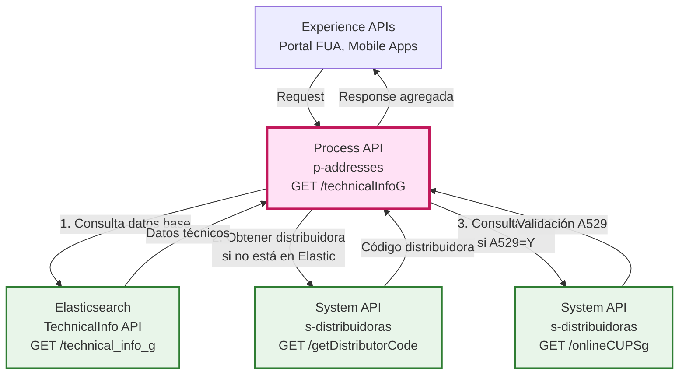
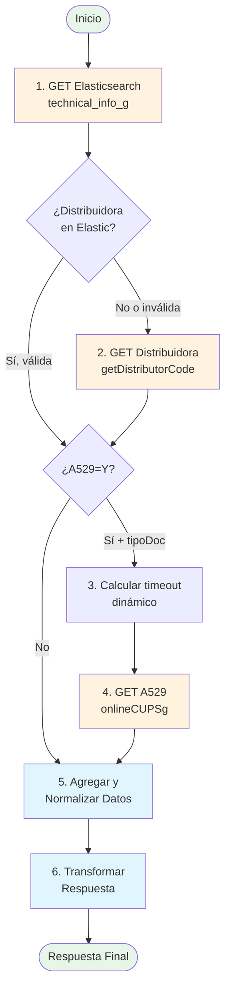
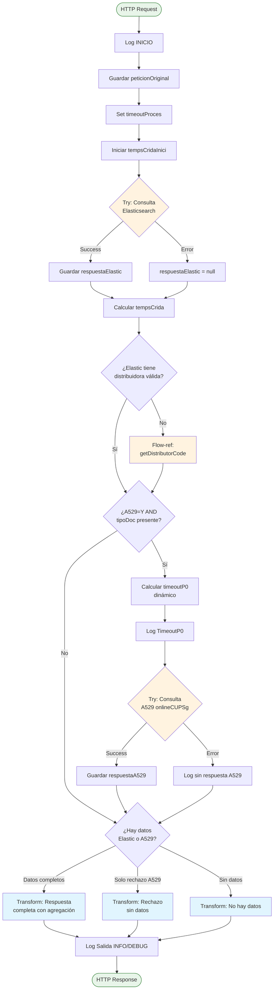
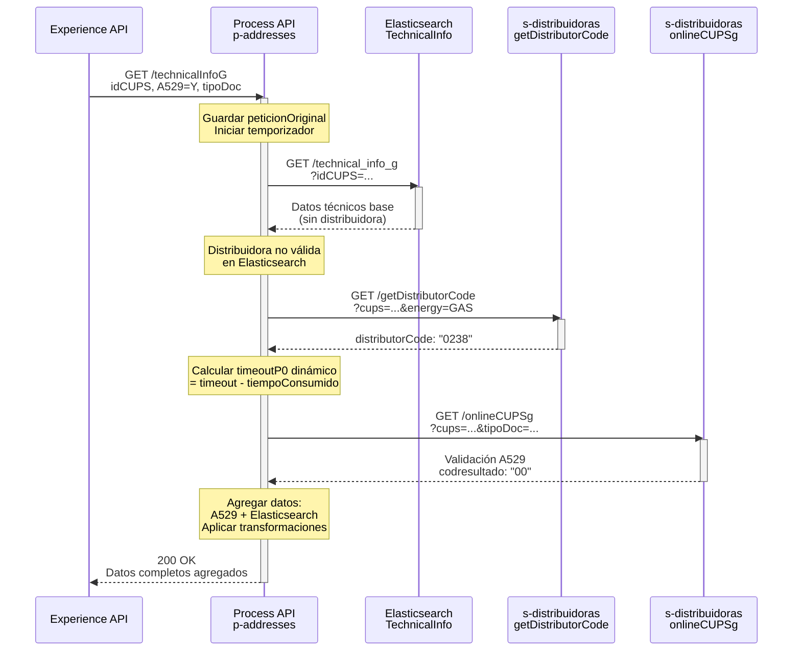
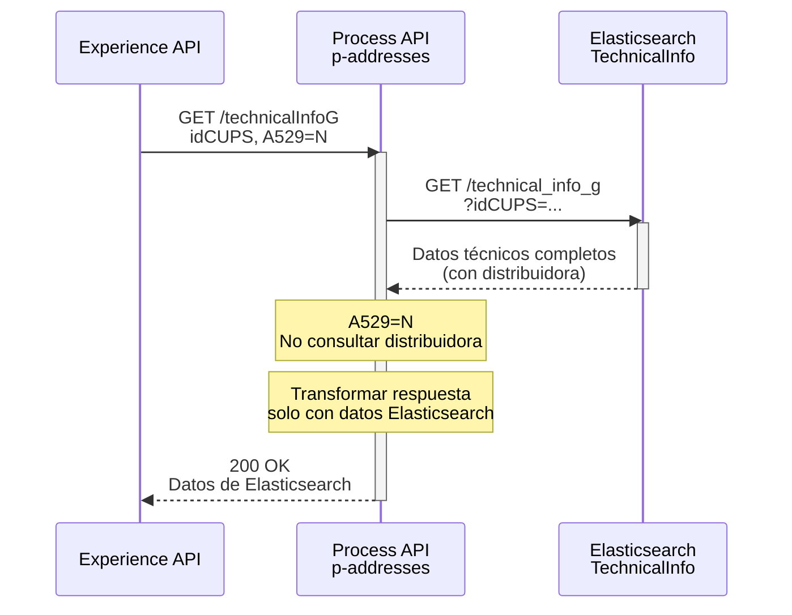
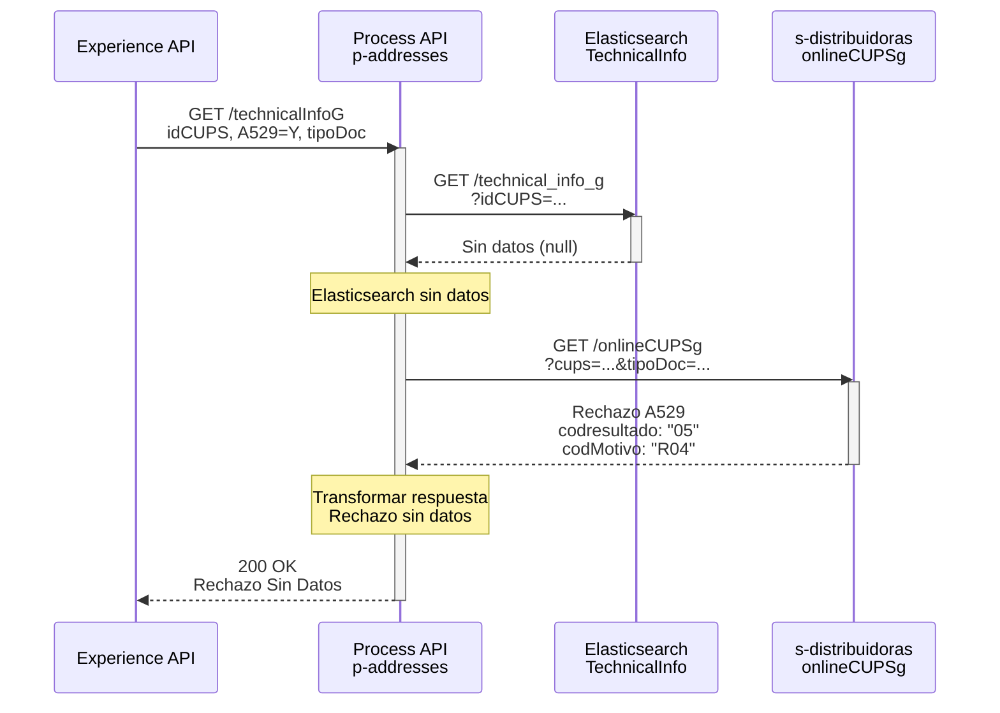

# GET /technicalInfoG

## 📌 Descripción General

### Propósito del Endpoint

Este endpoint consulta la información técnica completa de un CUPS (Código Universal de Punto de Suministro) de **Gas**, orquestando datos desde Elasticsearch y opcionalmente realizando una consulta A529 en tiempo real a la distribuidora correspondiente. Agrega y normaliza la información de múltiples fuentes para proporcionar una vista unificada de los datos técnicos del punto de suministro.

### Tipo de API

**Capa:** Process API (API-Led Connectivity)

**Función:** Orquestación de consultas técnicas de gas con agregación de datos desde múltiples System APIs

### Patrón de Integración

**Tipo:** Orquestación con Agregación de Datos

**Descripción:** 
1. Consulta datos base desde Elasticsearch (TechnicalInfo)
2. Identifica código de distribuidora (desde Elasticsearch o mediante consulta)
3. Opcionalmente ejecuta consulta A529 a la distribuidora
4. Agrega y normaliza datos priorizando información de A529 sobre Elasticsearch
5. Aplica validaciones y transformaciones de formato

### Arquitectura API-Led Connectivity



---

## 💼 Propósito del Negocio

### Casos de Uso Principales

1. **Validación de CUPS para Contratación de Gas**
   - Verificar disponibilidad y estado del punto de suministro
   - Obtener datos técnicos necesarios para alta de contrato
   - Validar que el CUPS es contratable (no rechazado por distribuidora)

2. **Consulta de Información Técnica para Agentes**
   - Proporcionar datos completos del CUPS a agentes de call center
   - Verificar características técnicas del punto de suministro
   - Consultar nivel de presión y tarifa normalizada

3. **Validación de Cliente con A529**
   - Verificar que el cliente es titular del CUPS
   - Validar documento de identidad contra registros de distribuidora
   - Obtener resultado de validación de cliente

### 🔗 Endpoints Dependientes

Este Process API consume los siguientes System APIs:

| System API | Endpoint | Método | Propósito | Condicional |
|------------|----------|--------|-----------|-------------|
| `elastic-technical-info` | `/technical_info_g` | GET | Obtener datos técnicos base del CUPS | ❌ Siempre |
| `s-distribuidoras` | `/getDistributorCode` | GET | Identificar código de distribuidora | ✅ Solo si no está en Elasticsearch |
| `s-distribuidoras` | `/onlineCUPSg` | GET | Consulta A529 online | ✅ Solo si A529=Y, tipoDoc presente y distribuidora válida |

### Lógica de Orquestación



**Pasos del Proceso:**

1. **Consulta a Elasticsearch**: Obtener datos técnicos base del CUPS (idCUPS, tarifa, consumos, distribuidora si disponible)
2. **Identificación de Distribuidora**: Si Elasticsearch no tiene distribuidora válida, consultar a s-distribuidoras
3. **Cálculo de Timeout Dinámico**: Restar tiempo consumido del timeout total para consulta A529
4. **Consulta A529 (Condicional)**: Si se solicita (A529=Y) y hay tipoDoc, consultar a distribuidora
5. **Agregación de Datos**: Combinar respuestas priorizando A529 sobre Elasticsearch
6. **Transformación y Normalización**: Aplicar funciones de validación y formateo

### Transformaciones Aplicadas

| Campo Original | Campo Transformado | Transformación |
|----------------|-------------------|----------------|
| `a629.datosdis.codprovincia` (A529) | `idProvinciaPto` | Prioriza A529, fallback a Elasticsearch |
| `a629.datosdis.codpostal` (A529) | `idCodigoPostalPto` | Prioriza A529, fallback a Elasticsearch |
| `a629.datosdis.codmunicipio` (A529) | `idMunicipioPto` | Prioriza A529, fallback a Elasticsearch |
| `idConsumoAnyoNatural` (Elastic) | `idConsumoAnyoNatural` | FormatoNumero() - elimina decimales innecesarios |
| `idConsumo12MesesAnt` (Elastic) | `idConsumo12MesesAnt` | FormatoNumero() - formato español |
| `a629.codMotivo` (A529) | `contratable` | "N" si motivo es "R04", sino "S" |
| `a629.datosdis.rangopresiondiseno` (A529) | `nivelPresion` | Prioriza A529, fallback a Elasticsearch |

### Contexto Empresarial

- **Dominio:** Gestión de Puntos de Suministro - Gas
- **Sector:** Energía - Utilities
- **División:** Naturgy España - FUV (Fuerza de Ventas)
- **Proceso de Negocio:** Validación y consulta de información técnica de CUPS de gas

### Stakeholders

- **Agentes de Call Center**: Necesitan información técnica completa para atender consultas de clientes
- **Sistemas de Contratación**: Requieren validación de CUPS antes de procesar altas
- **Portales de Autoservicio**: Muestran información técnica a clientes finales
- **Distribuidoras de Gas**: Proporcionan validación A529 y datos actualizados

### Valor de Negocio

- **Centralización**: Punto único de acceso a información técnica de gas
- **Validación en Tiempo Real**: Consulta A529 opcional para verificar datos actualizados
- **Reducción de Errores**: Validación de cliente y CUPS antes de contratación
- **Optimización de Tiempos**: Timeout dinámico maximiza intentos de consulta A529
- **Degradación Elegante**: Responde con datos parciales si algún sistema falla

### Consumidores Potenciales

Este endpoint puede ser consumido por:
- Portales web de autoservicio (FUA)
- Aplicaciones móviles de clientes
- Sistemas de agentes de call center
- Plataformas de contratación online
- Sistemas de gestión comercial

---

## 🔧 Especificación Técnica

### URLs por Ambiente

| Ambiente | URL Base | URL Completa |
|----------|----------|--------------|
| **Local** | `http://localhost:8081` | `http://localhost:8081/api/technicalInfoG` |
| **Development** | `https://p-addresses-dev.us-e2.cloudhub.io` | `https://p-addresses-dev.us-e2.cloudhub.io/api/technicalInfoG` |
| **UAT** | `https://p-addresses-uat.us-e2.cloudhub.io` | `https://p-addresses-uat.us-e2.cloudhub.io/api/technicalInfoG` |
| **Production** | `https://p-addresses-pro.us-e2.cloudhub.io` | `https://p-addresses-pro.us-e2.cloudhub.io/api/technicalInfoG` |

### Método HTTP

```
GET /api/technicalInfoG
```

### Parámetros de Entrada

#### Query Parameters

| Parámetro | Tipo | Requerido | Descripción | Ejemplo | Valores Permitidos |
|-----------|------|-----------|-------------|---------|-------------------|
| `idCUPS` | string | ✅ Sí | Código CUPS del punto de suministro de gas | `ES0022000006693281TS1P` | 20-22 caracteres |
| `A529` | string | ✅ Sí | Indica si se debe consultar A529 a distribuidora | `Y` | `Y`, `N` |
| `tipoDoc` | string | ❌ No | Tipo de documento según tabla CNMC | `01` | `01` (NIF), `03` (Pasaporte), `04` (NIE), `07` (NIVA), `08` (OTR) |
| `documento` | string | ❌ No | Número de documento del titular | `12345678Z` | Alfanumérico |
| `origen` | string | ❌ No | Código de comercializadora desde la que se lanza la consulta | `0762` | Código numérico (default: `0762`) |
| `timeout` | number | ❌ No | Tiempo máximo de respuesta en milisegundos | `7000` | Numérico (default: `7000`) |

#### Validaciones de Parámetros

- **idCUPS**: Debe tener entre 20 y 22 caracteres
- **A529**: Solo acepta valores "Y" o "N"
- **tipoDoc**: Si se proporciona, debe ser uno de los valores permitidos de la tabla CNMC
- **documento**: Requerido si A529=Y y tipoDoc está presente
- **timeout**: Debe ser un número positivo, se usa para calcular timeout dinámico de A529

### Respuestas

#### 200 OK - Respuesta Exitosa con Datos Completos

```json
{
  "result": {
    "codResult": "0000",
    "msgResult": "OK"
  },
  "cups": [
    {
      "idCUPS": "ES0022000006693281TS1P",
      "idProvinciaPto": "28",
      "idCodigoPostalPto": "28031",
      "idMunicipioPto": "079",
      "idTarifaNormalizada": "RL.1",
      "idConsumoAnyoNatural": "1250",
      "idConsumo12MesesAnt": "1180",
      "idFechaUltCambioComerc": "01/01/2024",
      "idPropiedadEquipoMedida": "CLIENTE",
      "idConsumo12Meses": "1200",
      "idTipoEnergia": "GAS",
      "idEmpresaDistribuidora": "0238",
      "idGrupoDistribuidora": "REDEXIS",
      "desEmpresaDistribuidora": "REDEXIS GAS S.A.",
      "fCaudalHorario": "2,5",
      "fCaudalMaxContratado": "3,0",
      "contratable": "S",
      "resultadoValidacionCliente": "01",
      "cnae": "4520",
      "codprovincia": "28",
      "codmunicipio": "079",
      "tipovia": "CL",
      "via": "CASTELLANA",
      "numfinca": "123",
      "codResultado": "00",
      "respuestaDistribuidora": true,
      "motivoRechazo": "",
      "nivelPresion": "MPA<0.4"
    }
  ]
}
```

#### 200 OK - Respuesta con Rechazo (Sin Datos Elasticsearch)

```json
{
  "result": {
    "codResult": "0000",
    "msgResult": "Rechazo Sin Datos"
  },
  "cups": [
    {
      "idCUPS": "ES0022000006693281TS1P",
      "idEmpresaDistribuidora": "0238",
      "motivoRechazo": "R04"
    }
  ]
}
```

#### 200 OK - Sin Datos Disponibles

```json
{
  "result": {
    "codResult": "0000",
    "msgResult": "No hay datos"
  }
}
```

#### 200 OK - Distribuidora No Permitida

```json
{
  "result": {
    "codResult": "9999",
    "msgResult": "Distribuidora no permitida"
  }
}
```

#### 500 Internal Server Error

```json
{
  "result": {
    "codResult": "0001",
    "msgResult": "KO"
  }
}
```

### Códigos de Respuesta

| Código | Descripción | Escenario |
|--------|-------------|-----------|
| `0000` | OK | Operación exitosa (con o sin datos) |
| `9999` | Distribuidora no permitida | La distribuidora del CUPS no está en la lista de permitidas |
| `0001` | Error interno | Error no controlado en el procesamiento |

### Autenticación

- **Tipo:** Client ID & Client Secret (Anypoint Platform)
- **Headers requeridos:**
  - `client_id`: ID de cliente de Anypoint Platform
  - `client_secret`: Secret de cliente de Anypoint Platform

### Timeouts

| Tipo | Valor | Descripción |
|------|-------|-------------|
| **Request Timeout** | Configurable (default: 7000ms) | Timeout total del endpoint |
| **Timeout Dinámico A529** | Calculado en runtime | `timeoutTotal - tiempoConsumido - tiempoInternoProcesoG` |
| **Timeout Mínimo A529** | 100ms | Valor mínimo para evitar timeouts inmediatos |

---

## 🏗️ Implementación Técnica

### Arquitectura del Flow



### Transformaciones DataWeave

#### Funciones de Validación y Formateo

```dataweave
%dw 2.0
output application/json

// Función 1: Validación básica de campos
fun validar(campo) = 
    if (campo != null and campo != "" and campo != "**") 
        campo 
    else ""

// Función 2: Priorización A529 sobre Elasticsearch
fun validar2(A529, Elastic) = 
    if (A529 != null and A529 != "" and A529 != "**") 
        A529 
    else if (Elastic != null and Elastic != "" and Elastic != "**") 
        Elastic 
    else ""

// Función 3: Formateo de números (eliminar decimales innecesarios)
fun FormatoNumero(valor) = 
    if (isEmpty(valor))
        "0"  
    else if (valor == "0.000") "0"
    else if (valor == "0,000") "0"
    else (
        (valor replace "," with ".") as Number as String {format: "0.000"} 
        replace (".") with (",") default "0,000"
    ) replace ",000" with ""
```

#### Transformación Principal (Respuesta Completa)

```dataweave
%dw 2.0
output application/json
---
{
    "result": {
        "codResult": "0000",
        "msgResult": "OK"
    },
    "cups": [{
        "idCUPS": validar(vars.respuestaElastic.idCUPS),
        "idProvinciaPto": validar2(
            vars.respuestaA529.consultaCupsResponse.a629.datosdis.codprovincia,
            vars.respuestaElastic.idProvinciaPto
        ),
        "idCodigoPostalPto": validar2(
            vars.respuestaA529.consultaCupsResponse.a629.datosdis.codpostal,
            vars.respuestaElastic.idCodigoPostalPto
        ),
        "idMunicipioPto": validar2(
            vars.respuestaA529.consultaCupsResponse.a629.datosdis.codmunicipio,
            vars.respuestaElastic.idMunicipioPto
        ),
        "idTarifaNormalizada": validar(vars.respuestaElastic.idTarifaNormalizada),
        "idConsumoAnyoNatural": FormatoNumero(validar(vars.respuestaElastic.idConsumoAnyoNatural)),
        "idConsumo12MesesAnt": FormatoNumero(validar(vars.respuestaElastic.idConsumo12MesesAnt)),
        "idFechaUltCambioComerc": validar(vars.respuestaElastic.idFechaUltCambioComerc),
        "idPropiedadEquipoMedida": validar(vars.respuestaElastic.idPropiedadEquipoMedida),
        "idConsumo12Meses": FormatoNumero(validar(vars.respuestaElastic.idConsumo12Meses)),
        "idTipoEnergia": validar(vars.respuestaElastic.idTipoEnergia),
        "idEmpresaDistribuidora": validar(vars.distribuidora),
        "idGrupoDistribuidora": validar(vars.respuestaElastic.idGrupoDistribuidora),
        "desEmpresaDistribuidora": validar(vars.respuestaElastic.desEmpresaDistribuidora),
        "fCaudalHorario": FormatoNumero(validar(vars.respuestaElastic.fCaudalHorario)),
        "fCaudalMaxContratado": FormatoNumero(validar(vars.respuestaElastic.fCaudalMaxContratado)),
        "contratable": if(validar(vars.respuestaA529.consultaCupsResponse.a629.codMotivo) == "R04") "N" else "S",
        "resultadoValidacionCliente": validar(vars.respuestaA529.consultaCupsResponse.a629.resvalidacioncliente),
        "cnae": validar(vars.respuestaElastic.idCNAE),
        "codprovincia": validar(vars.respuestaA529.consultaCupsResponse.a629.datosdis.codprovincia),
        "codmunicipio": validar(vars.respuestaA529.consultaCupsResponse.a629.datosdis.codmunicipio),
        "tipovia": validar(vars.respuestaA529.consultaCupsResponse.a629.datosdis.tipovia),
        "via": validar(vars.respuestaA529.consultaCupsResponse.a629.datosdis.via),
        "numfinca": validar(vars.respuestaA529.consultaCupsResponse.a629.datosdis.numfinca),
        "codResultado": validar(vars.respuestaA529.consultaCupsResponse.a629.codresultado),
        "respuestaDistribuidora": (vars.respuestaA529.result.codResult == "0000"),
        "motivoRechazo": if (vars.respuestaA529.consultaCupsResponse.a629.codresultado == "05") 
            validar(vars.respuestaA529.consultaCupsResponse.a629.codmotivo) 
            else "",
        "nivelPresion": validar2(
            vars.respuestaA529.consultaCupsResponse.a629.datosdis.rangopresiondiseno,
            vars.respuestaElastic.idRangoPresion
        )
    }]
}
```

### Patrones de Diseño

**Patrón 1: Timeout Dinámico**

**Justificación:** Maximizar el tiempo disponible para la consulta A529 restando el tiempo ya consumido en consultas previas.

```dataweave
%dw 2.0
output application/java
var temps = vars.timeoutProces - vars.tempsCrida - p('s-distribuidoras.tiempoInternoProcesoG') as Number
---
if (temps <= 0) 100 else temps
```

**Patrón 2: Degradación Elegante**

**Justificación:** Proporcionar respuesta parcial cuando algún sistema falla, en lugar de error total.

- Si Elasticsearch falla → Continuar con A529 si está configurado
- Si A529 falla → Devolver datos de Elasticsearch
- Si ambos fallan → Respuesta "No hay datos" con código 0000

**Patrón 3: Priorización de Datos**

**Justificación:** Los datos de A529 son más actualizados que los de Elasticsearch.

Orden de prioridad: **A529 > Elasticsearch > Valor por defecto ("")**

### Diagramas de Secuencia

#### 1. Flujo Normal de Éxito (Con A529)



#### 2. Flujo Sin Consulta A529



#### 3. Flujo con Rechazo A529



### Manejo de Errores

#### Error Handler Global

```xml
<error-handler>
    <on-error-propagate type="ANY">
        <logger level="INFO" message="Error en technicalInfoG"/>
        <ee:transform>
            <ee:set-payload>
                {
                    "result": {
                        "codResult": "0001",
                        "msgResult": "KO"
                    }
                }
            </ee:set-payload>
        </ee:transform>
    </on-error-propagate>
</error-handler>
```

#### Estrategia de Manejo de Errores

| Tipo de Error | Estrategia | Respuesta |
|---------------|-----------|-----------|
| **Elasticsearch falla** | On Error Continue | Continuar con distribuidora y A529 |
| **A529 falla** | On Error Continue | Devolver datos de Elasticsearch |
| **Distribuidora no permitida** | Lógica de negocio | Código 9999 con mensaje específico |
| **Error no controlado** | On Error Propagate | Código 0001 "KO" |

#### Logging

**Niveles de Log:**
- **INFO**: Inicio, fin, decisiones importantes
- **DEBUG**: Payloads completos, respuestas intermedias

**Categoría:** `p-addresses-technicalInfoG`

**Puntos de Log:**
1. Inicio del flow
2. Respuesta de Elasticsearch
3. Timeout calculado para A529
4. Respuesta de A529 (si aplica)
5. Salida INFO (solo result)
6. Salida DEBUG (payload completo)
7. Errores (si ocurren)

---

## 💻 Ejemplos de Uso

### Ejemplo 1: Consulta Completa con A529

#### cURL

```bash
curl -X GET "https://p-addresses-pro.us-e2.cloudhub.io/api/technicalInfoG?idCUPS=ES0022000006693281TS1P&A529=Y&tipoDoc=01&documento=12345678Z&origen=0762&timeout=7000" \
  -H "Content-Type: application/json" \
  -H "client_id: YOUR_CLIENT_ID" \
  -H "client_secret: YOUR_CLIENT_SECRET"
```

#### Respuesta (200 OK)

```json
{
  "result": {
    "codResult": "0000",
    "msgResult": "OK"
  },
  "cups": [
    {
      "idCUPS": "ES0022000006693281TS1P",
      "idProvinciaPto": "28",
      "idCodigoPostalPto": "28031",
      "idMunicipioPto": "079",
      "idTarifaNormalizada": "RL.1",
      "idConsumoAnyoNatural": "1250",
      "idConsumo12MesesAnt": "1180",
      "idFechaUltCambioComerc": "01/01/2024",
      "idPropiedadEquipoMedida": "CLIENTE",
      "idConsumo12Meses": "1200",
      "idTipoEnergia": "GAS",
      "idEmpresaDistribuidora": "0238",
      "idGrupoDistribuidora": "REDEXIS",
      "desEmpresaDistribuidora": "REDEXIS GAS S.A.",
      "fCaudalHorario": "2,5",
      "fCaudalMaxContratado": "3,0",
      "contratable": "S",
      "resultadoValidacionCliente": "01",
      "cnae": "4520",
      "codprovincia": "28",
      "codmunicipio": "079",
      "tipovia": "CL",
      "via": "CASTELLANA",
      "numfinca": "123",
      "codResultado": "00",
      "respuestaDistribuidora": true,
      "motivoRechazo": "",
      "nivelPresion": "MPA<0.4"
    }
  ]
}
```

### Ejemplo 2: Consulta Sin A529

#### cURL

```bash
curl -X GET "https://p-addresses-pro.us-e2.cloudhub.io/api/technicalInfoG?idCUPS=ES0022000006693281TS1P&A529=N" \
  -H "Content-Type: application/json" \
  -H "client_id: YOUR_CLIENT_ID" \
  -H "client_secret: YOUR_CLIENT_SECRET"
```

#### Respuesta (200 OK)

```json
{
  "result": {
    "codResult": "0000",
    "msgResult": "OK"
  },
  "cups": [
    {
      "idCUPS": "ES0022000006693281TS1P",
      "idProvinciaPto": "28",
      "idCodigoPostalPto": "28031",
      "idMunicipioPto": "079",
      "idTarifaNormalizada": "RL.1",
      "idConsumoAnyoNatural": "1250",
      "idConsumo12MesesAnt": "1180",
      "idFechaUltCambioComerc": "01/01/2024",
      "idPropiedadEquipoMedida": "CLIENTE",
      "idConsumo12Meses": "1200",
      "idTipoEnergia": "GAS",
      "idEmpresaDistribuidora": "0238",
      "idGrupoDistribuidora": "REDEXIS",
      "desEmpresaDistribuidora": "REDEXIS GAS S.A.",
      "fCaudalHorario": "2,5",
      "fCaudalMaxContratado": "3,0",
      "contratable": "",
      "resultadoValidacionCliente": "",
      "cnae": "4520",
      "codprovincia": "",
      "codmunicipio": "",
      "tipovia": "",
      "via": "",
      "numfinca": "",
      "codResultado": "",
      "respuestaDistribuidora": false,
      "motivoRechazo": "",
      "nivelPresion": "MPA<0.4"
    }
  ]
}
```

### Ejemplo 3: JavaScript (Fetch API)

```javascript
const consultarTechnicalInfoG = async (idCUPS, consultarA529 = false, tipoDoc = null, documento = null) => {
  const params = new URLSearchParams({
    idCUPS: idCUPS,
    A529: consultarA529 ? 'Y' : 'N',
    origen: '0762',
    timeout: '7000'
  });

  if (consultarA529 && tipoDoc && documento) {
    params.append('tipoDoc', tipoDoc);
    params.append('documento', documento);
  }

  const response = await fetch(
    `https://p-addresses-pro.us-e2.cloudhub.io/api/technicalInfoG?${params}`,
    {
      method: 'GET',
      headers: {
        'Content-Type': 'application/json',
        'client_id': 'YOUR_CLIENT_ID',
        'client_secret': 'YOUR_CLIENT_SECRET'
      }
    }
  );

  if (!response.ok) {
    throw new Error(`HTTP error! status: ${response.status}`);
  }

  const data = await response.json();
  return data;
};

// Uso
try {
  const resultado = await consultarTechnicalInfoG(
    'ES0022000006693281TS1P',
    true,  // Consultar A529
    '01',  // NIF
    '12345678Z'
  );
  console.log('Información técnica:', resultado.cups[0]);
} catch (error) {
  console.error('Error:', error);
}
```

### Ejemplo 4: Python (Requests)

```python
import requests

def consultar_technical_info_g(id_cups, consultar_a529=False, tipo_doc=None, documento=None):
    """
    Consulta información técnica de un CUPS de gas
    
    Args:
        id_cups: Código CUPS del punto de suministro
        consultar_a529: Si se debe consultar A529 a distribuidora
        tipo_doc: Tipo de documento (01, 03, 04, 07, 08)
        documento: Número de documento
    
    Returns:
        dict: Respuesta con información técnica del CUPS
    """
    url = "https://p-addresses-pro.us-e2.cloudhub.io/api/technicalInfoG"
    
    params = {
        'idCUPS': id_cups,
        'A529': 'Y' if consultar_a529 else 'N',
        'origen': '0762',
        'timeout': 7000
    }
    
    if consultar_a529 and tipo_doc and documento:
        params['tipoDoc'] = tipo_doc
        params['documento'] = documento
    
    headers = {
        'Content-Type': 'application/json',
        'client_id': 'YOUR_CLIENT_ID',
        'client_secret': 'YOUR_CLIENT_SECRET'
    }
    
    response = requests.get(url, params=params, headers=headers)
    response.raise_for_status()
    
    return response.json()

# Uso
try:
    resultado = consultar_technical_info_g(
        id_cups='ES0022000006693281TS1P',
        consultar_a529=True,
        tipo_doc='01',
        documento='12345678Z'
    )
    
    if resultado['result']['codResult'] == '0000':
        cups_info = resultado['cups'][0]
        print(f"CUPS: {cups_info['idCUPS']}")
        print(f"Distribuidora: {cups_info['desEmpresaDistribuidora']}")
        print(f"Contratable: {cups_info['contratable']}")
    else:
        print(f"Error: {resultado['result']['msgResult']}")
        
except requests.exceptions.RequestException as e:
    print(f"Error en la petición: {e}")
```

### Ejemplo 5: Respuesta con Rechazo

#### Request

```bash
curl -X GET "https://p-addresses-pro.us-e2.cloudhub.io/api/technicalInfoG?idCUPS=ES0022000006693281TS1P&A529=Y&tipoDoc=01&documento=99999999X" \
  -H "client_id: YOUR_CLIENT_ID" \
  -H "client_secret: YOUR_CLIENT_SECRET"
```

#### Respuesta (200 OK - Rechazo)

```json
{
  "result": {
    "codResult": "0000",
    "msgResult": "Rechazo Sin Datos"
  },
  "cups": [
    {
      "idCUPS": "ES0022000006693281TS1P",
      "idEmpresaDistribuidora": "0238",
      "motivoRechazo": "R04"
    }
  ]
}
```

### Ejemplo 6: Error - Distribuidora No Permitida

#### Respuesta (200 OK - Error de Negocio)

```json
{
  "result": {
    "codResult": "9999",
    "msgResult": "Distribuidora no permitida"
  }
}
```

### Ejemplo 7: Error Interno

#### Respuesta (500 Internal Server Error)

```json
{
  "result": {
    "codResult": "0001",
    "msgResult": "KO"
  }
}
```
