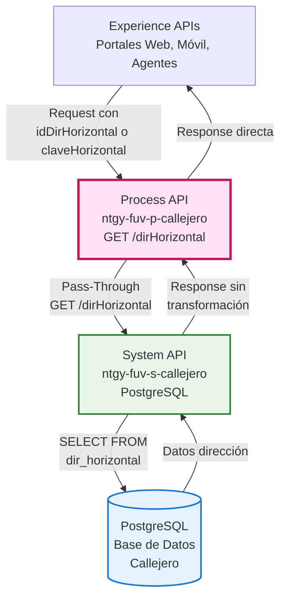
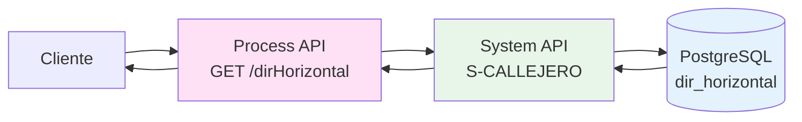
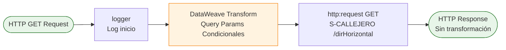
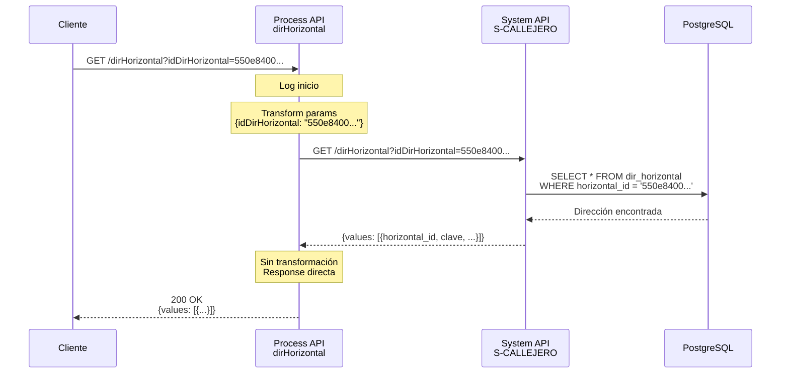
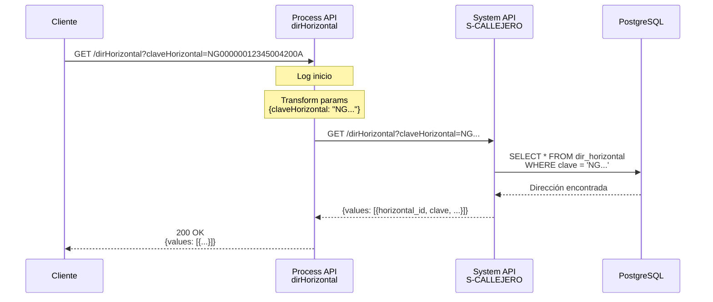
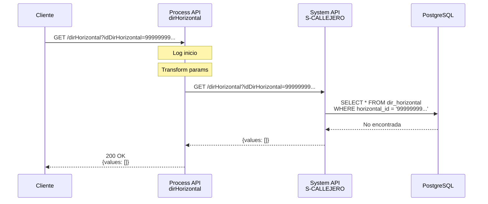

# GET /dirHorizontal

## 📌 Descripción General

### Propósito del Endpoint

Este endpoint recupera información de una dirección horizontal (nivel de calle) desde la base de datos de callejero. Una dirección horizontal incluye datos de vía, número y portal, sin incluir información vertical (escalera, piso, puerta). Permite búsqueda flexible mediante ID único o clave normalizada.

### Tipo de API

**Capa:** Process API (API-Led Connectivity)

**Función:** Pass-Through con transformación mínima de parámetros

### Patrón de Integración

**Tipo:** Pass-Through (Proxy Directo)

**Descripción:** El endpoint actúa como proxy directo al System API S-CALLEJERO, reenviando los query parameters de forma condicional. No aplica transformaciones a la respuesta, delegando completamente al System API.

**Características:**
- Sin lógica de negocio adicional
- Sin transformación de respuesta
- Parámetros opcionales con lógica condicional
- Respuesta directa del System API

### Arquitectura API-Led Connectivity



---

## 💼 Propósito del Negocio

### Casos de Uso Principales

1. **Consulta de Direcciones en Procesos de Alta**
   - Sistemas recuperan direcciones horizontales existentes
   - Validación de direcciones antes de crear contratos
   - Beneficio: Evita duplicación de direcciones en base de datos

2. **Integración con Sistemas de Facturación**
   - SAP ISU y sistemas de facturación consultan direcciones
   - Obtención de datos completos de dirección para correspondencia
   - Beneficio: Garantiza consistencia en datos de envío

3. **Autocompletado en Interfaces de Usuario**
   - Portales web y aplicaciones móviles consultan direcciones
   - Búsqueda por clave normalizada para autocompletado
   - Beneficio: Mejora experiencia de usuario en captura de datos

### 🔗 Endpoints Dependientes

Este Process API consume el siguiente System API:

| System API | Endpoint | Método | Propósito |
|------------|----------|--------|-----------|
| `ntgy-fuv-s-callejero` | `/dirHorizontal` | GET | Consulta de dirección horizontal en PostgreSQL |

### Flujo de Datos



**Flujo Simple:**
1. Cliente envía query parameter (idDirHorizontal o claveHorizontal)
2. Process API transforma parámetros condicionalmente
3. System API consulta base de datos PostgreSQL
4. Respuesta se devuelve sin transformación

### Transformaciones Aplicadas

⚠️ **Este Process API NO transforma la respuesta del System API.**

**Única transformación:** Query parameters condicionales
- Solo incluye parámetros que no son null
- Evita enviar parámetros vacíos al System API

Para el schema completo de respuesta, consultar:
📖 **System API: `ntgy-fuv-s-callejero` endpoint `GET /dirHorizontal`**

### Contexto Empresarial

- **Dominio:** Gestión de Direcciones y Callejero
- **Sector:** Energía - Utilities
- **División:** Naturgy España - FUV (Fuerza de Ventas)
- **Proceso de Negocio:** Consulta de direcciones para validación y referencia

### Stakeholders

- **Sistemas de Facturación**: Requieren direcciones completas para envío de correspondencia
- **Equipos de Ventas**: Consultan direcciones existentes durante alta de contratos
- **Desarrolladores de Interfaces**: Implementan autocompletado de direcciones
- **Sistemas de Integración**: SAP ISU, Salesforce, sistemas legacy

### Valor de Negocio

- **Reutilización de Datos**: Evita duplicación de direcciones en sistemas
- **Consistencia**: Garantiza uso de direcciones normalizadas
- **Eficiencia**: Consulta rápida sin lógica de negocio adicional
- **Flexibilidad**: Búsqueda por ID o clave según necesidad

### Consumidores Potenciales

Este endpoint puede ser consumido por:
- Portales web de autoservicio
- Aplicaciones móviles de agentes
- Sistemas de facturación y correspondencia
- Integraciones con SAP ISU
- Integraciones con Salesforce CRM
- Sistemas de gestión de contratos

---

## 🔧 Especificación Técnica

### URLs por Ambiente

| Ambiente | URL Base | URL Completa |
|----------|----------|--------------|
| **Local** | `http://localhost:8081` | `http://localhost:8081/api/dirHorizontal` |
| **Development** | `https://ntgy-fuv-p-callejero-dev.us-e2.cloudhub.io` | `https://ntgy-fuv-p-callejero-dev.us-e2.cloudhub.io/api/dirHorizontal` |
| **UAT** | `https://ntgy-fuv-p-callejero-uat.us-e2.cloudhub.io` | `https://ntgy-fuv-p-callejero-uat.us-e2.cloudhub.io/api/dirHorizontal` |
| **Production** | `https://ntgy-fuv-p-callejero-pro.us-e2.cloudhub.io` | `https://ntgy-fuv-p-callejero-pro.us-e2.cloudhub.io/api/dirHorizontal` |

### Método HTTP

```
GET /api/dirHorizontal
```

### Parámetros de Entrada

#### Query Parameters

| Parámetro | Tipo | Requerido | Descripción |
|-----------|------|-----------|-------------|
| `idDirHorizontal` | string | ❌ No* | ID único de la dirección horizontal (UUID) |
| `claveHorizontal` | string | ❌ No* | Clave normalizada de 18 caracteres (formato: NG + idVia + numero + portal) |

**\*Nota:** Al menos uno de los dos parámetros debe ser proporcionado.

**Validaciones:**
- Si ambos parámetros son null, el System API retornará error
- Si ambos parámetros se proporcionan, el System API priorizará según su lógica
- Los parámetros null no se envían al System API (transformación condicional)

#### Ejemplos de Query Parameters

**Búsqueda por ID:**
```
?idDirHorizontal=550e8400-e29b-41d4-a716-446655440000
```

**Búsqueda por Clave:**
```
?claveHorizontal=NG00000012345004200A
```

**Formato de Clave Horizontal:**
- Prefijo: `NG` (2 caracteres)
- idVia: 11 caracteres con padding de ceros
- numero: 4 caracteres con padding de ceros
- portal: 3 caracteres (numérico con ceros, alfanumérico con guiones bajos)
- **Total:** 18 caracteres

### Respuestas

#### 200 OK - Dirección Encontrada

**Nota:** El schema de respuesta es delegado completamente al System API S-CALLEJERO.

**Estructura típica de respuesta:**

```json
{
  "values": [
    {
      "horizontal_id": "550e8400-e29b-41d4-a716-446655440000",
      "clave": "NG00000012345004200A",
      "id_via": "12345",
      "numero": "42",
      "portal": "A",
      "siebel_integration_id": "SBL-12345",
      "created_at": "2026-01-15T10:30:00Z",
      "updated_at": "2026-01-15T10:30:00Z"
    }
  ]
}
```

#### 200 OK - Dirección No Encontrada

```json
{
  "values": []
}
```

#### 400 Bad Request - Parámetros Inválidos

```json
{
  "error": "Bad Request",
  "message": "Al menos un parámetro de búsqueda es requerido"
}
```

#### Campos de Respuesta (Típicos)

| Campo | Tipo | Descripción |
|-------|------|-------------|
| `values` | array | Array de direcciones encontradas (típicamente 0 o 1 elemento) |
| `horizontal_id` | string (UUID) | ID único de la dirección horizontal |
| `clave` | string | Clave normalizada de 18 caracteres |
| `id_via` | string | Identificador de la vía |
| `numero` | string | Número de la vía |
| `portal` | string | Portal del edificio |
| `siebel_integration_id` | string | ID de integración con Siebel (opcional) |

**⚠️ Importante:** Para el schema completo y actualizado, consultar la documentación del System API `ntgy-fuv-s-callejero`.

### Autenticación

- **Tipo:** Client ID & Client Secret (Anypoint Platform)
- **Headers requeridos:**
  - `client_id`: ID del cliente registrado en Anypoint Platform
  - `client_secret`: Secret del cliente

### Timeouts

| Tipo | Valor |
|------|-------|
| **Request Timeout** | 30 segundos |
| **Connection Timeout** | 10 segundos |

**Nota:** Los timeouts se configuran por ambiente en archivos properties YAML

---

## 🏗️ Implementación Técnica

### Arquitectura del Flow



**Simplicidad del Flow:**
- Solo 3 pasos: Log → Transform → Request
- Sin lógica de negocio
- Sin manejo de errores personalizado
- Respuesta directa del System API

### Transformación DataWeave

#### Query Parameters Condicionales

```dataweave
%dw 2.0
output application/json
---
{
    ("idDirHorizontal": attributes.queryParams.idDirHorizontal) 
        if (attributes.queryParams.idDirHorizontal != null),
    ("claveHorizontal": attributes.queryParams.claveHorizontal) 
        if (attributes.queryParams.claveHorizontal != null)
}
```

**Lógica:**
- Solo incluye parámetros que no son null
- Usa operador condicional `if` para cada parámetro
- Output: JSON con solo los parámetros proporcionados

**Ejemplos de Transformación:**

**Input:** `?idDirHorizontal=550e8400-e29b-41d4-a716-446655440000`
```json
{
  "idDirHorizontal": "550e8400-e29b-41d4-a716-446655440000"
}
```

**Input:** `?claveHorizontal=NG00000012345004200A`
```json
{
  "claveHorizontal": "NG00000012345004200A"
}
```

**Input:** `?idDirHorizontal=550e8400&claveHorizontal=NG00000012345004200A`
```json
{
  "idDirHorizontal": "550e8400-e29b-41d4-a716-446655440000",
  "claveHorizontal": "NG00000012345004200A"
}
```

### Patrones de Diseño

**Patrón:** Pass-Through / Proxy Pattern

**Justificación:**
- No requiere lógica de negocio adicional
- El System API es la fuente de verdad del schema
- Minimiza latencia al evitar transformaciones innecesarias
- Facilita mantenimiento al centralizar lógica en System API

**Beneficios:**
- Máxima eficiencia: Latencia mínima
- Simplicidad: Fácil de mantener y entender
- Escalabilidad: No añade carga de procesamiento
- Flexibilidad: Cambios en System API no requieren cambios aquí

### Diagramas de Secuencia

#### 1. Flujo Normal - Búsqueda por ID



#### 2. Flujo Normal - Búsqueda por Clave



#### 3. Flujo - Dirección No Encontrada



### Manejo de Errores

#### Estrategia de Manejo de Errores

| Tipo de Error | Código | Acción |
|---------------|--------|--------|
| **Dirección no encontrada** | 200 | Retornar array vacío `{values: []}` |
| **Parámetros inválidos** | 400 | Propagar error del System API |
| **Error de conectividad** | 500 | Propagar error HTTP del System API |
| **Timeout** | 500 | Retornar error después de 30 segundos |

**Nota:** Este endpoint no implementa manejo de errores personalizado. Todos los errores se propagan directamente desde el System API.

#### Logging

**Punto de Logging:**
- Inicio del flow: `"get:\dirHorizontal:ntgy-fuv-p-callejero-config"`

**Nivel de Log:** INFO

### Configuración HTTP

**Archivo:** `global.xml`

```xml
<http:request-config 
    name="S-CALLEJERO" 
    basePath="${s-callejero.basePath}" 
    responseTimeout="${s-callejero.timeout}">
    <http:request-connection 
        host="${s-callejero.host}" 
        port="${s-callejero.port}" />
</http:request-config>
```

**Properties (Development):**
```yaml
s-callejero:
  host: "ntgy-fuv-s-callejero-des.de-c1.cloudhub.io"
  port: "80"
  timeout: "30000"
  basePath: "/api"
```

---

## 💻 Ejemplos de Uso

### Ejemplo 1: Búsqueda por ID (Caso Más Común)

#### Request

```bash
curl -X GET "https://ntgy-fuv-p-callejero-dev.us-e2.cloudhub.io/api/dirHorizontal?idDirHorizontal=550e8400-e29b-41d4-a716-446655440000" \
  -H "client_id: YOUR_CLIENT_ID" \
  -H "client_secret: YOUR_CLIENT_SECRET"
```

#### Response (200 OK)

```json
{
  "values": [
    {
      "horizontal_id": "550e8400-e29b-41d4-a716-446655440000",
      "clave": "NG00000012345004200A",
      "id_via": "12345",
      "numero": "42",
      "portal": "A",
      "siebel_integration_id": "SBL-12345",
      "created_at": "2026-01-15T10:30:00Z",
      "updated_at": "2026-01-15T10:30:00Z"
    }
  ]
}
```

**Interpretación:**
- Dirección encontrada exitosamente
- Retorna datos completos de la dirección horizontal
- Array `values` contiene 1 elemento

### Ejemplo 2: Búsqueda por Clave

#### Request

```bash
curl -X GET "https://ntgy-fuv-p-callejero-dev.us-e2.cloudhub.io/api/dirHorizontal?claveHorizontal=NG00000012345004200A" \
  -H "client_id: YOUR_CLIENT_ID" \
  -H "client_secret: YOUR_CLIENT_SECRET"
```

#### Response (200 OK)

```json
{
  "values": [
    {
      "horizontal_id": "550e8400-e29b-41d4-a716-446655440000",
      "clave": "NG00000012345004200A",
      "id_via": "12345",
      "numero": "42",
      "portal": "A",
      "siebel_integration_id": null,
      "created_at": "2026-01-15T10:30:00Z",
      "updated_at": "2026-01-15T10:30:00Z"
    }
  ]
}
```

**Interpretación:**
- Búsqueda por clave normalizada exitosa
- Retorna la misma dirección que en ejemplo 1
- Útil cuando no se tiene el ID pero sí los componentes de la dirección

### Ejemplo 3: Dirección No Encontrada

#### Request

```bash
curl -X GET "https://ntgy-fuv-p-callejero-dev.us-e2.cloudhub.io/api/dirHorizontal?idDirHorizontal=99999999-9999-9999-9999-999999999999" \
  -H "client_id: YOUR_CLIENT_ID" \
  -H "client_secret: YOUR_CLIENT_SECRET"
```

#### Response (200 OK)

```json
{
  "values": []
}
```

**Interpretación:**
- No se encontró dirección con ese ID
- Array vacío indica ausencia de resultados
- No es un error, es una respuesta válida

### Ejemplo 4: JavaScript (Fetch API)

```javascript
const consultarDireccionHorizontal = async (idDirHorizontal) => {
  try {
    const url = new URL(
      'https://ntgy-fuv-p-callejero-dev.us-e2.cloudhub.io/api/dirHorizontal'
    );
    url.searchParams.append('idDirHorizontal', idDirHorizontal);

    const response = await fetch(url, {
      method: 'GET',
      headers: {
        'client_id': 'YOUR_CLIENT_ID',
        'client_secret': 'YOUR_CLIENT_SECRET'
      }
    });

    const data = await response.json();
    
    if (data.values && data.values.length > 0) {
      console.log('Dirección encontrada:', data.values[0]);
      return {
        success: true,
        direccion: data.values[0]
      };
    } else {
      console.log('Dirección no encontrada');
      return {
        success: false,
        message: 'Dirección no encontrada'
      };
    }
  } catch (error) {
    console.error('Error de conexión:', error);
    return {
      success: false,
      error: 'Error de conexión con el servicio'
    };
  }
};

// Uso
const resultado = await consultarDireccionHorizontal(
  '550e8400-e29b-41d4-a716-446655440000'
);

if (resultado.success) {
  console.log('Clave:', resultado.direccion.clave);
  console.log('Vía:', resultado.direccion.id_via);
  console.log('Número:', resultado.direccion.numero);
}
```

### Ejemplo 5: JavaScript - Búsqueda por Clave

```javascript
const consultarPorClave = async (claveHorizontal) => {
  const url = new URL(
    'https://ntgy-fuv-p-callejero-dev.us-e2.cloudhub.io/api/dirHorizontal'
  );
  url.searchParams.append('claveHorizontal', claveHorizontal);

  const response = await fetch(url, {
    method: 'GET',
    headers: {
      'client_id': 'YOUR_CLIENT_ID',
      'client_secret': 'YOUR_CLIENT_SECRET'
    }
  });

  const data = await response.json();
  return data.values.length > 0 ? data.values[0] : null;
};

// Uso
const direccion = await consultarPorClave('NG00000012345004200A');
if (direccion) {
  console.log('ID:', direccion.horizontal_id);
}
```

### Ejemplo 6: Python (Requests)

```python
import requests

def consultar_direccion_horizontal(id_dir_horizontal=None, clave_horizontal=None):
    """
    Consulta una dirección horizontal por ID o clave
    
    Args:
        id_dir_horizontal (str, optional): UUID de la dirección
        clave_horizontal (str, optional): Clave normalizada de 18 caracteres
        
    Returns:
        dict: Dirección encontrada o None
    """
    url = "https://ntgy-fuv-p-callejero-dev.us-e2.cloudhub.io/api/dirHorizontal"
    
    headers = {
        "client_id": "YOUR_CLIENT_ID",
        "client_secret": "YOUR_CLIENT_SECRET"
    }
    
    params = {}
    if id_dir_horizontal:
        params["idDirHorizontal"] = id_dir_horizontal
    if clave_horizontal:
        params["claveHorizontal"] = clave_horizontal
    
    try:
        response = requests.get(url, headers=headers, params=params, timeout=30)
        response.raise_for_status()
        
        data = response.json()
        
        if data.get("values") and len(data["values"]) > 0:
            print(f"✓ Dirección encontrada")
            return data["values"][0]
        else:
            print("✗ Dirección no encontrada")
            return None
            
    except requests.exceptions.Timeout:
        print("✗ Timeout: El servicio no respondió a tiempo")
        return None
    except requests.exceptions.RequestException as e:
        print(f"✗ Error de conexión: {e}")
        return None

# Uso - Búsqueda por ID
direccion = consultar_direccion_horizontal(
    id_dir_horizontal="550e8400-e29b-41d4-a716-446655440000"
)

if direccion:
    print(f"Clave: {direccion['clave']}")
    print(f"Vía: {direccion['id_via']}")
    print(f"Número: {direccion['numero']}")
    print(f"Portal: {direccion['portal']}")

# Uso - Búsqueda por clave
direccion = consultar_direccion_horizontal(
    clave_horizontal="NG00000012345004200A"
)
```

### Ejemplo 7: Python - Validación de Existencia

```python
def existe_direccion_horizontal(clave_horizontal):
    """
    Verifica si existe una dirección horizontal
    
    Args:
        clave_horizontal (str): Clave normalizada
        
    Returns:
        bool: True si existe, False si no
    """
    direccion = consultar_direccion_horizontal(clave_horizontal=clave_horizontal)
    return direccion is not None

# Uso
if existe_direccion_horizontal("NG00000012345004200A"):
    print("La dirección existe en base de datos")
else:
    print("La dirección no existe, se puede crear")
```

### Ejemplo 8: Postman Collection

```json
{
  "info": {
    "name": "Callejero API - dirHorizontal",
    "schema": "https://schema.getpostman.com/json/collection/v2.1.0/collection.json"
  },
  "item": [
    {
      "name": "Consultar por ID",
      "request": {
        "method": "GET",
        "header": [
          {
            "key": "client_id",
            "value": "{{client_id}}"
          },
          {
            "key": "client_secret",
            "value": "{{client_secret}}"
          }
        ],
        "url": {
          "raw": "{{base_url}}/api/dirHorizontal?idDirHorizontal={{horizontal_id}}",
          "host": ["{{base_url}}"],
          "path": ["api", "dirHorizontal"],
          "query": [
            {
              "key": "idDirHorizontal",
              "value": "{{horizontal_id}}"
            }
          ]
        }
      }
    },
    {
      "name": "Consultar por Clave",
      "request": {
        "method": "GET",
        "header": [
          {
            "key": "client_id",
            "value": "{{client_id}}"
          },
          {
            "key": "client_secret",
            "value": "{{client_secret}}"
          }
        ],
        "url": {
          "raw": "{{base_url}}/api/dirHorizontal?claveHorizontal=NG00000012345004200A",
          "host": ["{{base_url}}"],
          "path": ["api", "dirHorizontal"],
          "query": [
            {
              "key": "claveHorizontal",
              "value": "NG00000012345004200A"
            }
          ]
        }
      }
    }
  ]
}
```

### Consideraciones de Integración

#### Caché
- Considerar implementar caché en el cliente para direcciones consultadas frecuentemente
- TTL recomendado: 1 hora (las direcciones cambian raramente)
- Invalidar caché al crear/actualizar direcciones

#### Manejo de Array Vacío
- `values: []` indica que no se encontró la dirección
- No es un error, es una respuesta válida
- El cliente debe manejar este caso apropiadamente

#### Búsqueda por ID vs Clave
- **Por ID:** Más rápido, usar cuando se tiene el UUID
- **Por Clave:** Útil para validación cuando se tienen los componentes
- Ambos métodos retornan el mismo resultado

#### Performance
- Endpoint muy eficiente (pass-through)
- Latencia típica: < 500ms
- Sin transformaciones que añadan overhead
- Ideal para consultas de alta frecuencia