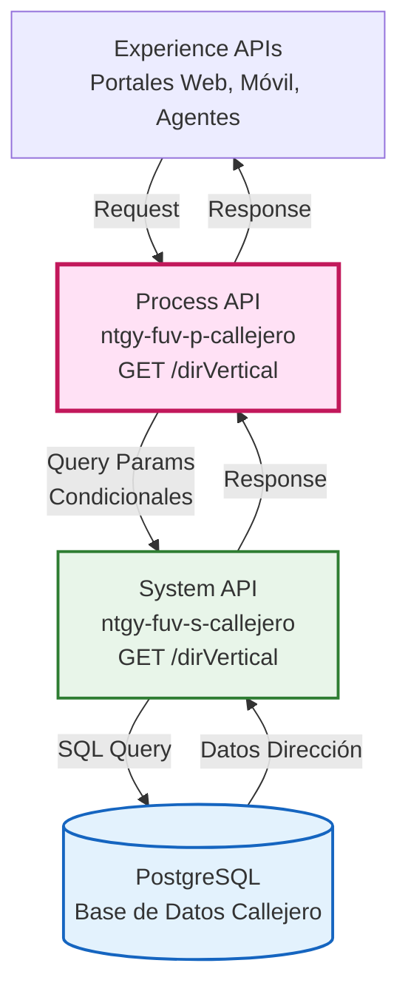
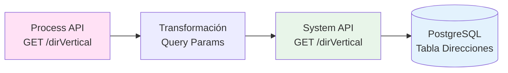
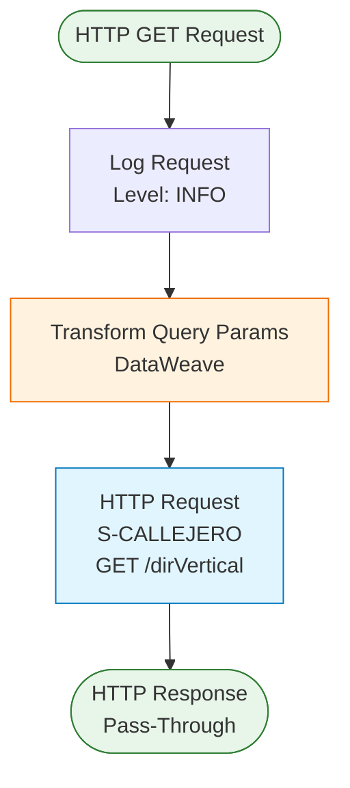
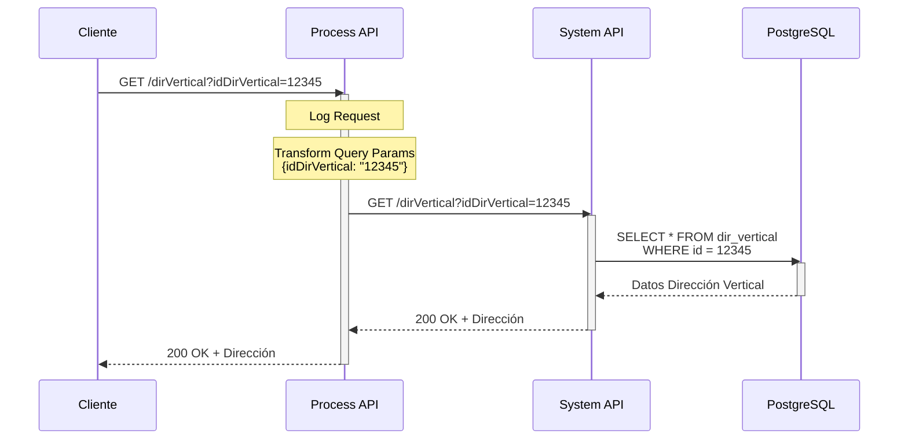
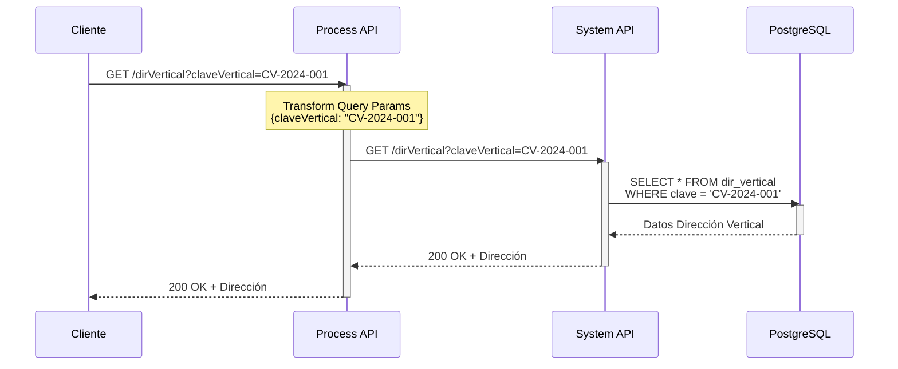
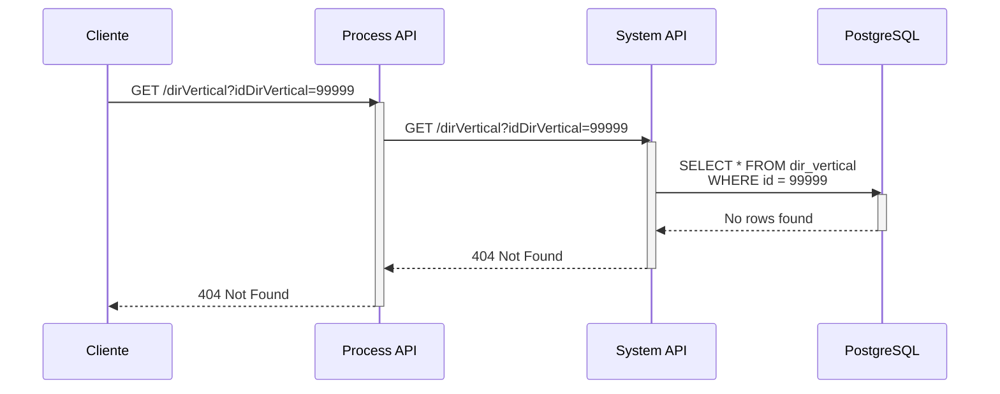
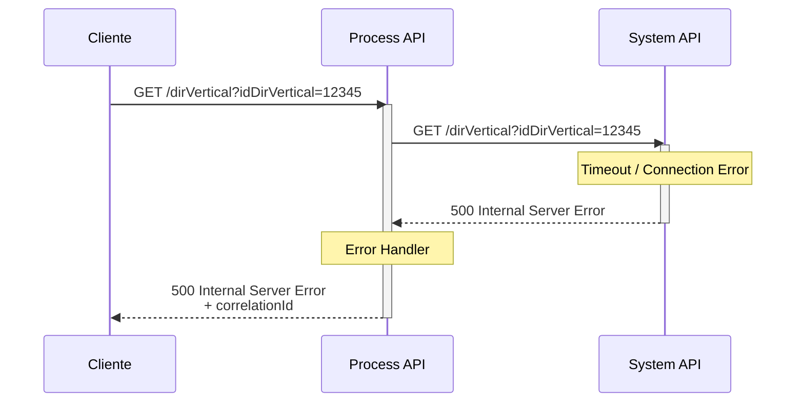

# GET /dirVertical

## 📌 Descripción General

### Propósito del Endpoint

Este endpoint recupera información completa de una dirección vertical (escalera, piso, puerta) desde el sistema de callejero. Permite consultar por identificador único o por clave de dirección vertical, proporcionando datos estructurados del componente vertical de una dirección.

### Tipo de API

**Capa:** Process API (API-Led Connectivity)

**Función:** Pass-Through con transformación condicional de parámetros

### Patrón de Integración

**Tipo:** Pass-Through

**Descripción:** Este Process API actúa como intermediario entre los consumidores (Experience APIs) y el System API de Callejero, aplicando transformación condicional de query parameters para enviar solo los parámetros no nulos al backend.

### Arquitectura API-Led Connectivity



---

## 💼 Propósito del Negocio

### Casos de Uso Principales

1. **Consulta de Dirección Vertical por ID**
   - Recuperar información completa de escalera, piso y puerta usando el identificador único
   - Utilizado cuando se tiene la referencia directa de la dirección vertical
   - Beneficio: Acceso rápido y preciso a datos de dirección vertical

2. **Consulta de Dirección Vertical por Clave**
   - Buscar dirección vertical usando la clave compuesta del sistema
   - Utilizado en procesos de validación y normalización de direcciones
   - Beneficio: Permite búsqueda alternativa cuando no se dispone del ID

3. **Validación de Componentes Verticales**
   - Verificar existencia y validez de escalera, piso, puerta en una dirección
   - Utilizado en formularios de captura de direcciones
   - Beneficio: Garantiza calidad de datos en sistemas downstream

### 🔗 Endpoints Dependientes

Este Process API consume el siguiente System API:

| System API | Endpoint | Método | Propósito |
|------------|----------|--------|-----------|
| `ntgy-fuv-s-callejero` | `/dirVertical` | GET | Consulta de dirección vertical en PostgreSQL |

### Lógica de Orquestación



**Pasos del Proceso:**

1. **Recepción de Request**: Process API recibe query parameters opcionales
2. **Transformación Condicional**: Aplica lógica DataWeave para enviar solo parámetros no nulos
3. **Llamada a System API**: Invoca endpoint del System API con parámetros filtrados
4. **Pass-Through de Response**: Retorna respuesta del System API sin transformación

### Transformaciones Aplicadas

**Transformación de Query Parameters (Request):**

| Parámetro Entrada | Condición | Parámetro Salida |
|-------------------|-----------|------------------|
| `idDirVertical` | Si no es null | `idDirVertical` |
| `claveVertical` | Si no es null | `claveVertical` |

**Transformación de Response:**

⚠️ **Este Process API NO transforma la respuesta del System API.**

Para el schema completo de la respuesta, consultar:
📖 **System API: `ntgy-fuv-s-callejero` endpoint `/dirVertical`**

### Contexto Empresarial

- **Dominio:** Gestión de Direcciones y Callejero
- **Sector:** Energía - Utilities
- **División:** Naturgy España - FUV (Fuerza de Ventas)
- **Proceso de Negocio:** Validación y consulta de direcciones para operaciones comerciales

### Stakeholders

- **Agentes de Servicio al Cliente**: Necesitan validar direcciones completas durante atención telefónica
- **Equipos de Ventas**: Requieren verificar direcciones de clientes potenciales
- **Sistemas de Facturación**: Necesitan direcciones completas y validadas para envío de correspondencia
- **Operaciones de Campo**: Requieren información precisa de ubicación para servicios técnicos

### Valor de Negocio

- **Calidad de Datos**: Garantiza direcciones verticales válidas y normalizadas en todos los sistemas
- **Eficiencia Operativa**: Reduce tiempo de captura y validación de direcciones
- **Experiencia del Cliente**: Mejora precisión en entregas y comunicaciones
- **Reducción de Costos**: Disminuye errores de dirección que causan reenvíos y visitas fallidas

### Consumidores Potenciales

Este endpoint puede ser consumido por:
- Portales web de autoservicio de clientes
- Aplicaciones móviles de agentes comerciales
- Sistemas de agentes de call center
- Aplicaciones de gestión de operaciones de campo
- Integraciones con sistemas de terceros autorizados

---

## 🔧 Especificación Técnica

### URLs por Ambiente

| Ambiente | URL Base | URL Completa |
|----------|----------|--------------|
| **Local** | `http://localhost:${http.callejero.port}` | `http://localhost:${http.callejero.port}/api/dirVertical` |
| **Development** | `https://ntgy-fuv-p-callejero-dev.us-e2.cloudhub.io` | `https://ntgy-fuv-p-callejero-dev.us-e2.cloudhub.io/api/dirVertical` |
| **UAT** | `https://ntgy-fuv-p-callejero-uat.us-e2.cloudhub.io` | `https://ntgy-fuv-p-callejero-uat.us-e2.cloudhub.io/api/dirVertical` |
| **Production** | `https://ntgy-fuv-p-callejero-pro.us-e2.cloudhub.io` | `https://ntgy-fuv-p-callejero-pro.us-e2.cloudhub.io/api/dirVertical` |

### Método HTTP

```
GET /api/dirVertical
```

### Parámetros de Entrada

#### Query Parameters

| Parámetro | Tipo | Requerido | Descripción | Ejemplo |
|-----------|------|-----------|-------------|---------|
| `idDirVertical` | string | No* | Identificador único de la dirección vertical | `"12345"` |
| `claveVertical` | string | No* | Clave compuesta de la dirección vertical | `"CV-2024-001"` |

**Notas:**
- (*) Al menos uno de los dos parámetros debe ser proporcionado
- Si ambos parámetros son proporcionados, se priorizará `idDirVertical`
- Los parámetros nulos no se envían al System API (transformación condicional)

### Respuestas

#### 200 OK - Dirección Vertical Encontrada

**Descripción:** Dirección vertical recuperada exitosamente

**Schema:** Ver documentación del System API `ntgy-fuv-s-callejero` endpoint `/dirVertical`

**Campos Principales:**
- Identificador de dirección vertical
- Escalera
- Piso
- Puerta
- Información adicional de ubicación

#### 404 Not Found - Dirección No Encontrada

```json
{
  "error": {
    "code": "DIRECCION_NO_ENCONTRADA",
    "message": "No se encontró dirección vertical con los parámetros proporcionados",
    "timestamp": "2026-09-09T08:00:00Z"
  }
}
```

#### 400 Bad Request - Parámetros Inválidos

```json
{
  "error": {
    "code": "PARAMETROS_INVALIDOS",
    "message": "Debe proporcionar al menos idDirVertical o claveVertical",
    "timestamp": "2026-09-09T08:00:00Z"
  }
}
```

#### 500 Internal Server Error - Error del Sistema

```json
{
  "error": {
    "code": "ERROR_INTERNO",
    "message": "Error al procesar la solicitud",
    "timestamp": "2026-09-09T08:00:00Z",
    "correlationId": "abc-123-def-456"
  }
}
```

### Autenticación

- **Tipo:** Client ID & Client Secret (Anypoint Platform)
- **Headers Requeridos:**
  - `client_id`: ID del cliente registrado en Anypoint Platform
  - `client_secret`: Secret del cliente

### Timeouts

| Tipo | Valor | Configuración |
|------|-------|---------------|
| **Request Timeout** | Configurable | `${s-callejero.timeout}` |
| **Connection Timeout** | 10 segundos | Por defecto HTTP connector |

---

## 🏗️ Implementación Técnica

### Arquitectura del Flow



### Código del Flow (XML)

**Ubicación:** `src/main/mule/ntgy-fuv-p-callejero.xml` (líneas del flow)

```xml
<flow name="get:\dirVertical:ntgy-fuv-p-callejero-config">
    <logger level="INFO" message="get:\dirVertical:ntgy-fuv-p-callejero-config" />
    <http:request method="GET" 
                  doc:name="Request" 
                  doc:id="cb50f250-095a-4e18-9a0f-633c28981412" 
                  config-ref="S-CALLEJERO" 
                  path="/dirVertical">
        <http:query-params><![CDATA[#[output application/json
---
{
	("idDirVertical" : attributes.queryParams.idDirVertical) 	if (attributes.queryParams.idDirVertical != null),
	("claveVertical" : attributes.queryParams.claveVertical) 	if (attributes.queryParams.claveVertical != null)				
}]]]></http:query-params>
    </http:request>
</flow>
```

### Transformación DataWeave - Query Parameters

**Propósito:** Enviar solo parámetros no nulos al System API

```dataweave
%dw 2.0
output application/json
---
{
	("idDirVertical" : attributes.queryParams.idDirVertical) 
		if (attributes.queryParams.idDirVertical != null),
	("claveVertical" : attributes.queryParams.claveVertical) 
		if (attributes.queryParams.claveVertical != null)				
}
```

**Lógica:**
1. Evalúa cada query parameter de entrada
2. Solo incluye en el objeto de salida los parámetros que no son null
3. Utiliza operador condicional `if` para inclusión selectiva
4. Resultado: objeto JSON con solo los parámetros válidos

### Configuración HTTP

**Config-Ref:** `S-CALLEJERO`

**Propiedades (desde properties YAML):**
- **Host:** `${s-callejero.host}`
- **Port:** `${s-callejero.port}`
- **Base Path:** `${s-callejero.basePath}`
- **Protocol:** HTTP
- **Timeout:** `${s-callejero.timeout}`

### Patrones de Diseño

**Patrón:** Pass-Through con Transformación Condicional

**Justificación:** 
- Desacopla consumidores del System API
- Permite evolución independiente de capas
- Aplica lógica de negocio simple (filtrado de parámetros)
- Mantiene performance óptimo (sin transformaciones pesadas)

### Diagramas de Secuencia

#### 1. Flujo Normal de Éxito (Consulta por ID)



#### 2. Flujo con Consulta por Clave



#### 3. Flujo con Dirección No Encontrada



#### 4. Flujo con Error de Conectividad



### Manejo de Errores

**Estrategia:** Propagación de errores del System API con logging

**Tipos de Errores:**

1. **Errores de Conectividad (500)**
   - Timeout al System API
   - Connection refused
   - **Acción:** Log error con correlationId, retornar 500 al cliente

2. **Errores de Negocio (404)**
   - Dirección vertical no encontrada
   - **Acción:** Pass-through de respuesta del System API

3. **Errores de Validación (400)**
   - Parámetros inválidos o faltantes
   - **Acción:** Validación en APIKit, retornar 400 con detalle

**Logging:**
- Nivel INFO: Request recibido
- Nivel ERROR: Errores de conectividad o sistema
- Incluye correlationId para trazabilidad

---

## 💻 Ejemplos de Uso

### Ejemplo 1: Consulta por ID de Dirección Vertical

#### cURL

```bash
curl -X GET "https://ntgy-fuv-p-callejero-dev.us-e2.cloudhub.io/api/dirVertical?idDirVertical=12345" \
  -H "Content-Type: application/json" \
  -H "client_id: YOUR_CLIENT_ID" \
  -H "client_secret: YOUR_CLIENT_SECRET"
```

#### Respuesta (200 OK)

```json
{
  "idDirVertical": "12345",
  "escalera": "A",
  "piso": "3",
  "puerta": "B",
  "claveVertical": "CV-2024-001",
  "idDirHorizontal": "67890",
  "observaciones": "Edificio principal",
  "fechaAlta": "2024-01-15",
  "fechaModificacion": "2024-03-20"
}
```

### Ejemplo 2: Consulta por Clave Vertical

#### cURL

```bash
curl -X GET "https://ntgy-fuv-p-callejero-dev.us-e2.cloudhub.io/api/dirVertical?claveVertical=CV-2024-001" \
  -H "Content-Type: application/json" \
  -H "client_id: YOUR_CLIENT_ID" \
  -H "client_secret: YOUR_CLIENT_SECRET"
```

#### Respuesta (200 OK)

```json
{
  "idDirVertical": "12345",
  "escalera": "A",
  "piso": "3",
  "puerta": "B",
  "claveVertical": "CV-2024-001",
  "idDirHorizontal": "67890",
  "observaciones": "Edificio principal",
  "fechaAlta": "2024-01-15",
  "fechaModificacion": "2024-03-20"
}
```

### Ejemplo 3: JavaScript (Fetch API)

```javascript
const fetchDirVertical = async (idDirVertical) => {
  try {
    const response = await fetch(
      `https://ntgy-fuv-p-callejero-dev.us-e2.cloudhub.io/api/dirVertical?idDirVertical=${idDirVertical}`,
      {
        method: 'GET',
        headers: {
          'Content-Type': 'application/json',
          'client_id': 'YOUR_CLIENT_ID',
          'client_secret': 'YOUR_CLIENT_SECRET'
        }
      }
    );

    if (!response.ok) {
      throw new Error(`HTTP error! status: ${response.status}`);
    }

    const data = await response.json();
    console.log('Dirección Vertical:', data);
    return data;
  } catch (error) {
    console.error('Error al consultar dirección vertical:', error);
    throw error;
  }
};

// Uso
fetchDirVertical('12345');
```

### Ejemplo 4: Python (Requests)

```python
import requests

def get_direccion_vertical(id_dir_vertical=None, clave_vertical=None):
    """
    Consulta dirección vertical por ID o clave
    
    Args:
        id_dir_vertical (str): ID de la dirección vertical
        clave_vertical (str): Clave de la dirección vertical
    
    Returns:
        dict: Datos de la dirección vertical
    """
    url = "https://ntgy-fuv-p-callejero-dev.us-e2.cloudhub.io/api/dirVertical"
    
    headers = {
        'Content-Type': 'application/json',
        'client_id': 'YOUR_CLIENT_ID',
        'client_secret': 'YOUR_CLIENT_SECRET'
    }
    
    params = {}
    if id_dir_vertical:
        params['idDirVertical'] = id_dir_vertical
    if clave_vertical:
        params['claveVertical'] = clave_vertical
    
    try:
        response = requests.get(url, headers=headers, params=params)
        response.raise_for_status()
        return response.json()
    except requests.exceptions.RequestException as e:
        print(f"Error al consultar dirección vertical: {e}")
        raise

# Uso
direccion = get_direccion_vertical(id_dir_vertical='12345')
print(f"Escalera: {direccion['escalera']}, Piso: {direccion['piso']}, Puerta: {direccion['puerta']}")
```

### Ejemplo 5: Error - Dirección No Encontrada (404)

#### cURL

```bash
curl -X GET "https://ntgy-fuv-p-callejero-dev.us-e2.cloudhub.io/api/dirVertical?idDirVertical=99999" \
  -H "Content-Type: application/json" \
  -H "client_id: YOUR_CLIENT_ID" \
  -H "client_secret: YOUR_CLIENT_SECRET"
```

#### Respuesta (404 Not Found)

```json
{
  "error": {
    "code": "DIRECCION_NO_ENCONTRADA",
    "message": "No se encontró dirección vertical con ID 99999",
    "timestamp": "2026-09-09T08:00:00Z"
  }
}
```

### Ejemplo 6: Error - Parámetros Faltantes (400)

#### cURL

```bash
curl -X GET "https://ntgy-fuv-p-callejero-dev.us-e2.cloudhub.io/api/dirVertical" \
  -H "Content-Type: application/json" \
  -H "client_id: YOUR_CLIENT_ID" \
  -H "client_secret: YOUR_CLIENT_SECRET"
```

#### Respuesta (400 Bad Request)

```json
{
  "error": {
    "code": "PARAMETROS_INVALIDOS",
    "message": "Debe proporcionar al menos idDirVertical o claveVertical",
    "timestamp": "2026-09-09T08:00:00Z"
  }
}