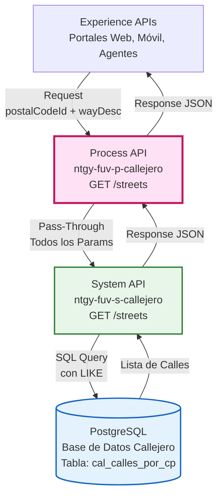
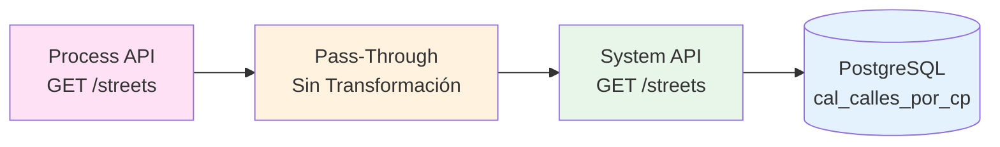
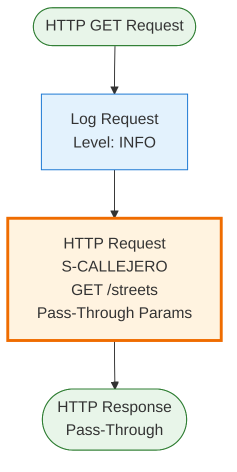
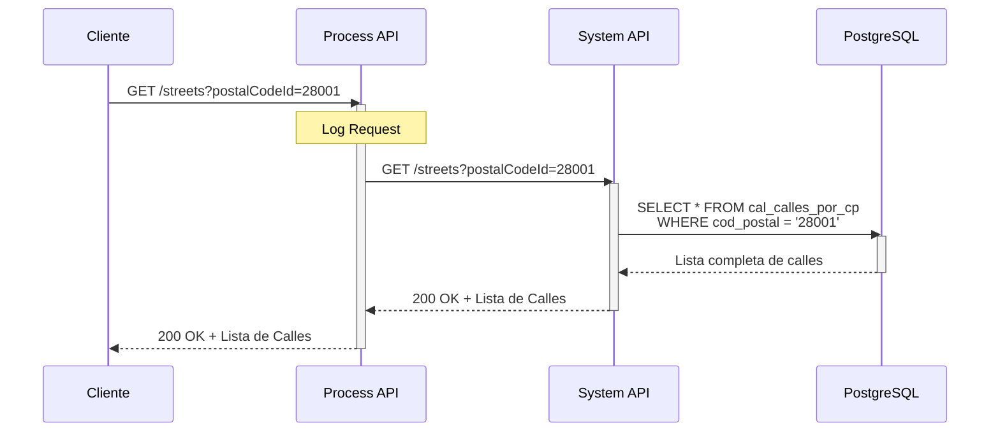
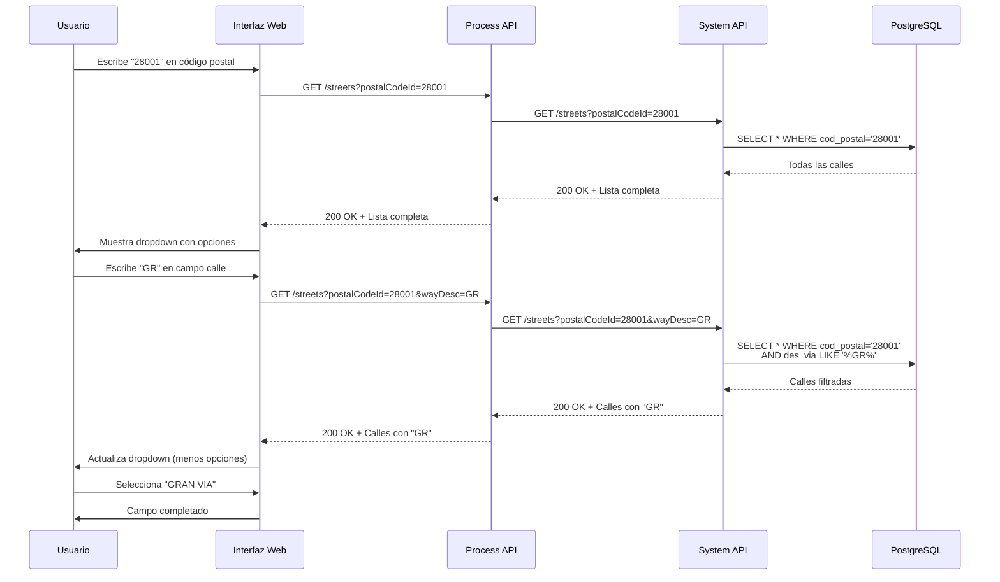
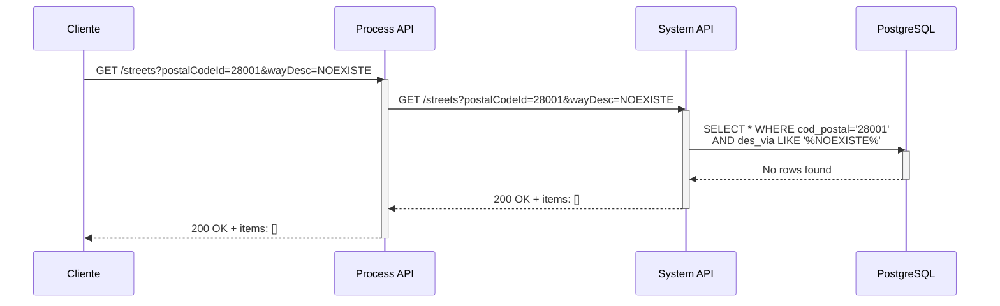
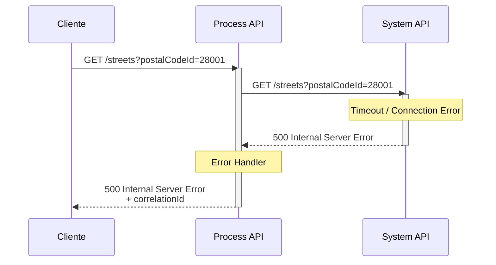
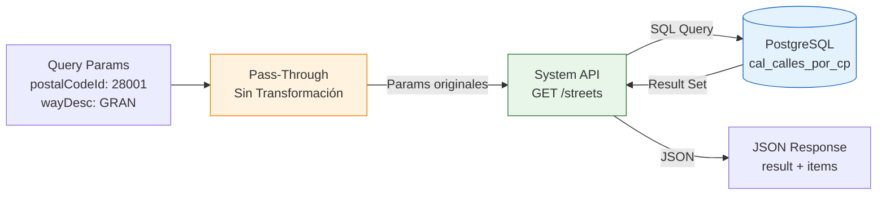

# GET /streets

## 📌 Descripción General

### Propósito del Endpoint

Este endpoint recupera información de calles del callejero español por código postal, con funcionalidad opcional de autocompletado. Es especialmente útil para implementar campos de búsqueda incremental en formularios de direcciones, mejorando significativamente la experiencia del usuario.

El endpoint soporta:
- **Consulta por Código Postal**: Retorna todas las calles de un código postal específico
- **Autocompletado Inteligente**: Filtrado incremental mediante parámetro `wayDesc`
- **Búsqueda en Tiempo Real**: Optimizado para respuestas rápidas en interfaces de usuario
- **Respuesta Estructurada**: Información completa de cada calle (ID, descripción, tipo de vía)

### Tipo de API

**Capa:** Process API (API-Led Connectivity)

**Función:** Pass-Through directo con propagación de parámetros al System API

### Patrón de Integración

**Tipo:** Pass-Through Directo

**Descripción:** Este Process API actúa como intermediario transparente entre los consumidores (Experience APIs) y el System API de Callejero, pasando todos los query parameters directamente sin transformación condicional.

### Arquitectura API-Led Connectivity



---

## 💼 Propósito del Negocio

### Casos de Uso Principales

1. **Autocompletado de Direcciones en Formularios**
   - Usuario escribe código postal y primeras letras de la calle
   - Sistema muestra sugerencias en tiempo real mientras el usuario escribe
   - Mejora experiencia de usuario y reduce errores de entrada
   - Acelera proceso de alta de clientes y captura de direcciones

2. **Validación de Direcciones en Alta de Cliente**
   - Verificar que la calle existe en el código postal especificado
   - Obtener nombre normalizado de la calle desde base de datos oficial
   - Asegurar consistencia de datos en todos los sistemas
   - Prevenir errores de facturación y entregas fallidas

3. **Búsqueda de Calles para Instalaciones**
   - Equipos de field service buscan calles para planificar instalaciones
   - Obtener información completa de tipo de vía (Calle, Avenida, Plaza, etc.)
   - Validar direcciones de puntos de suministro antes de visitas
   - Mantener inventario preciso de ubicaciones de clientes

4. **Integración con Portales de Autoservicio**
   - Portales web y aplicaciones móviles ofrecen autocompletado moderno
   - Mejora conversión en formularios de alta y contratación
   - Reduce abandono por dificultad en entrada de datos
   - Proporciona experiencia fluida similar a Google Maps

### 🔗 Endpoints Dependientes

Este Process API consume el siguiente System API:

| System API | Endpoint | Método | Propósito |
|------------|----------|--------|-----------|
| `ntgy-fuv-s-callejero` | `/streets` | GET | Consulta de calles en PostgreSQL con autocompletado |

### Lógica de Orquestación



**Pasos del Proceso:**

1. **Recepción de Request**: Process API recibe query parameters (postalCodeId + wayDesc opcional)
2. **Pass-Through Directo**: Pasa TODOS los parámetros al System API sin transformación
3. **Llamada a System API**: Invoca endpoint del System API con parámetros originales
4. **Pass-Through de Response**: Retorna respuesta del System API sin modificación

### Transformaciones Aplicadas

**Transformación de Query Parameters:**

⚠️ **Este Process API NO transforma los query parameters.**

Todos los parámetros se pasan directamente al System API:
- `postalCodeId` → Se pasa tal cual
- `wayDesc` → Se pasa tal cual (sin conversión a mayúsculas, sin filtrado)

**Transformación de Response:**

⚠️ **Este Process API NO transforma la respuesta del System API.**

Para el schema completo de la respuesta, consultar:
📖 **System API: `ntgy-fuv-s-callejero` endpoint `/streets`**

### Contexto Empresarial

- **Dominio:** Gestión de Callejero y Direcciones
- **Sector:** Energía - Utilities
- **División:** Naturgy España - FUV (Fuerza de Ventas)
- **Proceso de Negocio:** Búsqueda y autocompletado de calles para validación de direcciones

### Stakeholders

- **Desarrolladores de UX/UI**: Implementan funcionalidad de autocompletado en interfaces
- **Agentes de Servicio al Cliente**: Utilizan búsqueda rápida durante atención telefónica
- **Equipos de Ventas**: Requieren búsqueda eficiente de direcciones en proceso de alta
- **Product Owners de Portales**: Necesitan experiencia de usuario optimizada y moderna

### Valor de Negocio

- **Experiencia del Usuario**: Autocompletado mejora significativamente la UX en formularios
- **Reducción de Errores**: Selección de lista reduce errores tipográficos en direcciones
- **Eficiencia Operativa**: Acelera procesos de alta y consulta de clientes
- **Conversión Mejorada**: Formularios más fáciles aumentan tasa de completitud
- **Calidad de Datos**: Garantiza uso de nombres de calles normalizados y oficiales

### Consumidores Potenciales

Este endpoint puede ser consumido por:
- Portales web de autoservicio de clientes
- Aplicaciones móviles de agentes comerciales
- Sistemas de agentes de call center
- Aplicaciones de gestión de operaciones de campo
- Integraciones con sistemas de terceros autorizados
- Herramientas internas de administración de callejero

---

## 🔧 Especificación Técnica

### URLs por Ambiente

| Ambiente | URL Base | URL Completa |
|----------|----------|--------------|
| **Local** | `http://localhost:${http.callejero.port}` | `http://localhost:${http.callejero.port}/api/streets?postalCodeId=28001` |
| **Development** | `https://ntgy-fuv-p-callejero-dev.us-e2.cloudhub.io` | `https://ntgy-fuv-p-callejero-dev.us-e2.cloudhub.io/api/streets?postalCodeId=28001` |
| **UAT** | `https://ntgy-fuv-p-callejero-uat.us-e2.cloudhub.io` | `https://ntgy-fuv-p-callejero-uat.us-e2.cloudhub.io/api/streets?postalCodeId=28001` |
| **Production** | `https://ntgy-fuv-p-callejero-pro.us-e2.cloudhub.io` | `https://ntgy-fuv-p-callejero-pro.us-e2.cloudhub.io/api/streets?postalCodeId=28001` |

### Método HTTP

```
GET /api/streets
```

### Parámetros de Entrada

#### Query Parameters

| Parámetro | Tipo | Requerido | Descripción | Ejemplo |
|-----------|------|-----------|-------------|---------|
| `postalCodeId` | string | ✅ Sí | Código postal español (5 dígitos) | `"28001"` |
| `wayDesc` | string | ❌ No | Descripción parcial de vía para autocompletado | `"GRAN"` |

**Notas sobre `wayDesc`:**
- Parámetro opcional para filtrado de calles
- Permite búsqueda incremental (autocompletado)
- El System API aplica conversión a mayúsculas y búsqueda con LIKE
- Si se omite, retorna todas las calles del código postal

### Respuestas

#### 200 OK - Calles Encontradas

**Descripción:** Lista de calles recuperada exitosamente

**Schema:** Ver documentación del System API `ntgy-fuv-s-callejero` endpoint `/streets`

**Estructura Principal:**
```json
{
  "result": {
    "codResult": "0000",
    "msgResult": "No hay error"
  },
  "items": [
    {
      "streetId": "string",
      "streetDescription": "string",
      "streetTypeId": "string",
      "streetTypeName": "string",
      "postalCodeId": "string"
    }
  ]
}
```

#### 200 OK - Sin Resultados

```json
{
  "result": {
    "codResult": "0000",
    "msgResult": "No hay error"
  },
  "items": []
}
```

#### 400 Bad Request - Parámetros Inválidos

```json
{
  "result": {
    "codResult": "0002",
    "msgResult": "Parámetro postalCodeId es obligatorio"
  }
}
```

#### 500 Internal Server Error - Error del Sistema

```json
{
  "result": {
    "codResult": "0001",
    "msgResult": "Error interno del servidor"
  },
  "correlationId": "abc-123-def-456"
}
```

### Autenticación

- **Tipo:** Client ID & Client Secret (Anypoint Platform)
- **Headers Requeridos:**
  - `client_id`: ID del cliente registrado en Anypoint Platform
  - `client_secret`: Secret del cliente

### Timeouts

| Tipo | Valor | Configuración |
|------|-------|---------------|
| **Request Timeout** | Configurable | `${s-callejero.timeout}` |
| **Connection Timeout** | 10 segundos | Por defecto HTTP connector |

### Performance y Optimización

- **Crítico para UX**: Este endpoint es usado en autocompletado en tiempo real
- **Respuesta Rápida**: Debe responder en < 1 segundo para buena experiencia
- **Caché Recomendado**: Candidato ideal para caché (datos relativamente estáticos)
- **Rate Limiting**: Considerar límites para prevenir abuso en autocompletado

---

## 🏗️ Implementación Técnica

### Arquitectura del Flow



### Código del Flow (XML)

**Ubicación:** `src/main/mule/ntgy-fuv-p-callejero.xml` (flow del endpoint)

```xml
<flow name="get:\streets:ntgy-fuv-p-callejero-config">
    <logger level="INFO" message="get:\streets:ntgy-fuv-p-callejero-config" />
    <http:request method="GET" 
                  doc:name="Request" 
                  doc:id="47db545b-773e-43ff-b4f1-d15acb48bb91" 
                  config-ref="S-CALLEJERO" 
                  path="/streets">
        <http:query-params><![CDATA[#[output application/java
---
{
	wayDesc : attributes.queryParams.wayDesc,
	postalCodeId : attributes.queryParams.postalCodeId
}]]]></http:query-params>
    </http:request>        
</flow>
```

### Análisis del Código

**Componentes del Flow:**

1. **Logger (Línea 2)**
   ```xml
   <logger level="INFO" message="get:\streets:ntgy-fuv-p-callejero-config" />
   ```
   - Registra inicio del flow
   - Nivel INFO para trazabilidad
   - Mensaje identifica el endpoint específico

2. **HTTP Request (Líneas 3-12)**
   ```xml
   <http:request method="GET" config-ref="S-CALLEJERO" path="/streets">
   ```
   - Método: GET
   - Config: `S-CALLEJERO` (configuración del System API)
   - Path: `/streets` (endpoint del System API)

3. **Query Parameters (Líneas 7-11)**
   ```dataweave
   output application/java
   ---
   {
       wayDesc : attributes.queryParams.wayDesc,
       postalCodeId : attributes.queryParams.postalCodeId
   }
   ```
   - **Output:** `application/java` (no JSON como otros endpoints)
   - **Lógica:** Pass-through directo de ambos parámetros
   - **Sin Transformación:** No hay conversión, filtrado ni validación
   - **Diferencia clave:** A diferencia de `/dirVertical`, NO hay filtrado condicional

### Diferencias con Otros Endpoints

**Comparación con GET /dirVertical:**

| Aspecto | GET /dirVertical | GET /streets |
|---------|------------------|--------------|
| **Output Format** | `application/json` | `application/java` |
| **Transformación** | Condicional (if != null) | Pass-through directo |
| **Parámetros** | Solo envía no-nulos | Envía todos |
| **Lógica** | Filtrado selectivo | Sin filtrado |

**Código de /dirVertical (para comparación):**
```dataweave
output application/json
---
{
    ("idDirVertical" : attributes.queryParams.idDirVertical) 
        if (attributes.queryParams.idDirVertical != null),
    ("claveVertical" : attributes.queryParams.claveVertical) 
        if (attributes.queryParams.claveVertical != null)
}
```

**Código de /streets (actual):**
```dataweave
output application/java
---
{
    wayDesc : attributes.queryParams.wayDesc,
    postalCodeId : attributes.queryParams.postalCodeId
}
```

### Configuración HTTP

**Config-Ref:** `S-CALLEJERO`

**Propiedades (desde properties YAML):**
- **Host:** `${s-callejero.host}`
- **Port:** `${s-callejero.port}`
- **Base Path:** `${s-callejero.basePath}`
- **Protocol:** HTTP
- **Timeout:** `${s-callejero.timeout}`

### Patrones de Diseño

**Patrón:** Pass-Through Puro

**Justificación:** 
- Desacopla consumidores del System API
- Permite evolución independiente de capas
- No añade lógica de negocio (delegada al System API)
- Mantiene performance óptimo (sin transformaciones)
- Simplifica mantenimiento y debugging

**Ventajas:**
- Mínima latencia adicional
- Sin riesgo de errores en transformación
- Fácil de mantener y entender
- Permite que System API maneje toda la lógica

### Diagramas de Secuencia

#### 1. Flujo Normal de Éxito - Todas las Calles



#### 2. Flujo con Autocompletado



#### 3. Flujo con Sin Resultados



#### 4. Flujo con Error de Conectividad



### Manejo de Errores

**Estrategia:** Propagación de errores del System API con logging

**Tipos de Errores:**

1. **Errores de Conectividad (500)**
   - Timeout al System API
   - Connection refused
   - Network issues
   - **Acción:** Log error con correlationId, retornar 500 al cliente

2. **Errores de Validación (400)**
   - Parámetro `postalCodeId` faltante
   - Formato de código postal inválido
   - **Acción:** Validación en APIKit, retornar 400 con detalle

3. **Sin Resultados (200)**
   - No se encontraron calles para el código postal
   - No hay coincidencias con el filtro wayDesc
   - **Acción:** Retornar 200 con items vacío (no es error)

**Logging:**
- Nivel INFO: Request recibido
- Nivel ERROR: Errores de conectividad o sistema
- Incluye correlationId para trazabilidad end-to-end

### Flujo de Datos Simplificado



---

## 💻 Ejemplos de Uso

### Ejemplo 1: Consulta Todas las Calles de un Código Postal

#### cURL

```bash
curl -X GET "https://ntgy-fuv-p-callejero-dev.us-e2.cloudhub.io/api/streets?postalCodeId=28001" \
  -H "Content-Type: application/json" \
  -H "client_id: YOUR_CLIENT_ID" \
  -H "client_secret: YOUR_CLIENT_SECRET"
```

#### Respuesta (200 OK)

```json
{
  "result": {
    "codResult": "0000",
    "msgResult": "No hay error"
  },
  "items": [
    {
      "streetId": "10001",
      "streetDescription": "ALCALA",
      "streetTypeId": "1",
      "streetTypeName": "CALLE",
      "postalCodeId": "28001"
    },
    {
      "streetId": "10002",
      "streetDescription": "GRAN VIA",
      "streetTypeId": "1",
      "streetTypeName": "CALLE",
      "postalCodeId": "28001"
    },
    {
      "streetId": "10003",
      "streetDescription": "MAYOR",
      "streetTypeId": "2",
      "streetTypeName": "PLAZA",
      "postalCodeId": "28001"
    }
  ]
}
```

### Ejemplo 2: Autocompletado con "GRAN"

#### cURL

```bash
curl -X GET "https://ntgy-fuv-p-callejero-dev.us-e2.cloudhub.io/api/streets?postalCodeId=28001&wayDesc=GRAN" \
  -H "Content-Type: application/json" \
  -H "client_id: YOUR_CLIENT_ID" \
  -H "client_secret: YOUR_CLIENT_SECRET"
```

#### Respuesta (200 OK - Filtrado)

```json
{
  "result": {
    "codResult": "0000",
    "msgResult": "No hay error"
  },
  "items": [
    {
      "streetId": "10002",
      "streetDescription": "GRAN VIA",
      "streetTypeId": "1",
      "streetTypeName": "CALLE",
      "postalCodeId": "28001"
    },
    {
      "streetId": "10015",
      "streetDescription": "GRAN VIA DE SAN FRANCISCO",
      "streetTypeId": "1",
      "streetTypeName": "CALLE",
      "postalCodeId": "28001"
    }
  ]
}
```

### Ejemplo 3: JavaScript - Autocompletado en Tiempo Real

```javascript
// Función de autocompletado con debounce
let debounceTimer;

async function searchStreets(postalCode, searchTerm) {
  const url = new URL('https://ntgy-fuv-p-callejero-dev.us-e2.cloudhub.io/api/streets');
  url.searchParams.append('postalCodeId', postalCode);
  
  if (searchTerm && searchTerm.trim() !== '') {
    url.searchParams.append('wayDesc', searchTerm);
  }
  
  try {
    const response = await fetch(url, {
      method: 'GET',
      headers: {
        'Content-Type': 'application/json',
        'client_id': 'YOUR_CLIENT_ID',
        'client_secret': 'YOUR_CLIENT_SECRET'
      }
    });
    
    const data = await response.json();
    
    if (data.result.codResult === "0000") {
      return data.items;
    } else {
      console.error('Error en búsqueda:', data.result.msgResult);
      return [];
    }
  } catch (error) {
    console.error('Error de conexión:', error);
    return [];
  }
}

// Implementación de autocompletado con debounce
function setupAutocomplete(inputElement, postalCodeElement, resultsElement) {
  inputElement.addEventListener('input', function() {
    clearTimeout(debounceTimer);
    
    const postalCode = postalCodeElement.value;
    const searchTerm = this.value;
    
    if (!postalCode) {
      resultsElement.innerHTML = '<div class="error">Ingrese código postal primero</div>';
      return;
    }
    
    // Debounce: esperar 300ms después de que el usuario deje de escribir
    debounceTimer = setTimeout(async () => {
      resultsElement.innerHTML = '<div class="loading">Buscando...</div>';
      
      const streets = await searchStreets(postalCode, searchTerm);
      
      if (streets.length === 0) {
        resultsElement.innerHTML = '<div class="no-results">No se encontraron calles</div>';
      } else {
        resultsElement.innerHTML = streets.map(street => `
          <div class="street-option" data-street-id="${street.streetId}">
            <strong>${street.streetDescription}</strong>
            <span class="street-type">${street.streetTypeName}</span>
          </div>
        `).join('');
        
        // Agregar event listeners a las opciones
        resultsElement.querySelectorAll('.street-option').forEach(option => {
          option.addEventListener('click', function() {
            const streetDesc = this.querySelector('strong').textContent;
            inputElement.value = streetDesc;
            resultsElement.innerHTML = '';
          });
        });
      }
    }, 300);
  });
}

// Uso
const streetInput = document.getElementById('street-input');
const postalCodeInput = document.getElementById('postal-code-input');
const resultsDiv = document.getElementById('autocomplete-results');

setupAutocomplete(streetInput, postalCodeInput, resultsDiv);
```

### Ejemplo 4: Python - Cliente de Búsqueda

```python
import requests
from typing import List, Dict, Optional

class StreetSearchClient:
    """Cliente para búsqueda de calles en el callejero"""
    
    def __init__(self, base_url: str, client_id: str, client_secret: str):
        self.base_url = base_url.rstrip('/')
        self.endpoint = f"{self.base_url}/api/streets"
        self.headers = {
            'Content-Type': 'application/json',
            'client_id': client_id,
            'client_secret': client_secret
        }
    
    def search_streets(self, postal_code: str, search_term: Optional[str] = None) -> List[Dict]:
        """
        Busca calles por código postal con filtro opcional
        
        Args:
            postal_code: Código postal español (5 dígitos)
            search_term: Término de búsqueda para filtrar calles (opcional)
            
        Returns:
            Lista de diccionarios con información de calles
        """
        params = {'postalCodeId': postal_code}
        
        if search_term:
            params['wayDesc'] = search_term
        
        try:
            response = requests.get(self.endpoint, params=params, headers=self.headers)
            response.raise_for_status()
            
            data = response.json()
            
            if data['result']['codResult'] == '0000':
                return data['items']
            else:
                print(f"Error: {data['result']['msgResult']}")
                return []
                
        except requests.exceptions.RequestException as e:
            print(f"Error al buscar calles: {e}")
            raise

# Uso
client = StreetSearchClient(
    'https://ntgy-fuv-p-callejero-dev.us-e2.cloudhub.io',
    'YOUR_CLIENT_ID',
    'YOUR_CLIENT_SECRET'
)

# Buscar todas las calles de un código postal
all_streets = client.search_streets('28001')
print(f"Total de calles en 28001: {len(all_streets)}")

# Buscar con filtro
filtered_streets = client.search_streets('28001', 'GRAN')
print(f"Calles que contienen 'GRAN': {len(filtered_streets)}")

for street in filtered_streets:
    print(f"  - {street['streetDescription']} ({street['streetTypeName']})")
```

### Ejemplo 5: Sin Resultados

#### cURL

```bash
curl -X GET "https://ntgy-fuv-p-callejero-dev.us-e2.cloudhub.io/api/streets?postalCodeId=28001&wayDesc=NOEXISTE" \
  -H "Content-Type: application/json" \
  -H "client_id: YOUR_CLIENT_ID" \
  -H "client_secret: YOUR_CLIENT_SECRET"
```

#### Respuesta (200 OK - Sin Resultados)

```json
{
  "result": {
    "codResult": "0000",
    "msgResult": "No hay error"
  },
  "items": []
}
```

### Ejemplo 6: Error - Parámetro Faltante (400)

#### cURL

```bash
curl -X GET "https://ntgy-fuv-p-callejero-dev.us-e2.cloudhub.io/api/streets" \
  -H "Content-Type: application/json" \
  -H "client_id: YOUR_CLIENT_ID" \
  -H "client_secret: YOUR_CLIENT_SECRET"
```

#### Respuesta (400 Bad Request)

```json
{
  "result": {
    "codResult": "0002",
    "msgResult": "Parámetro postalCodeId es obligatorio"
  }
}
```
