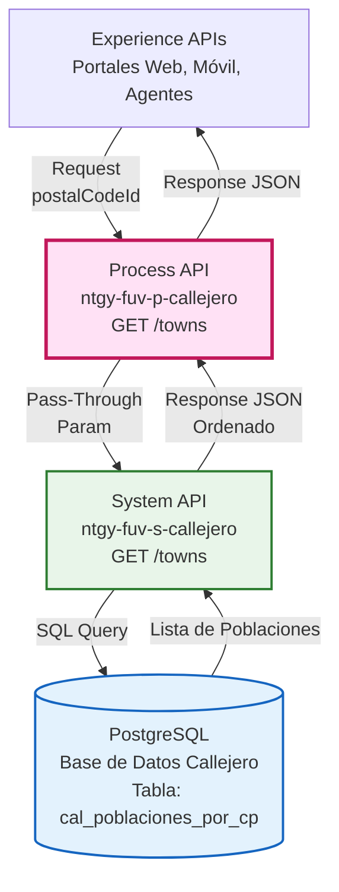
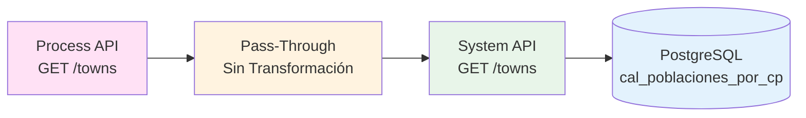
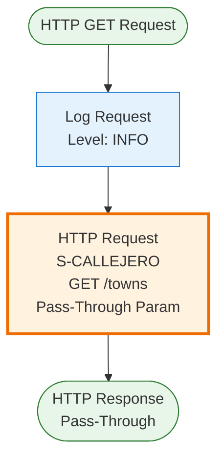
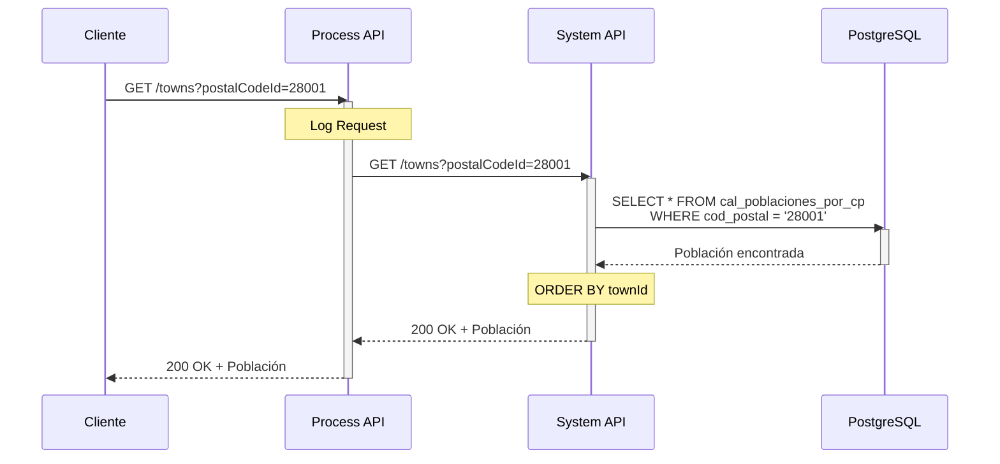
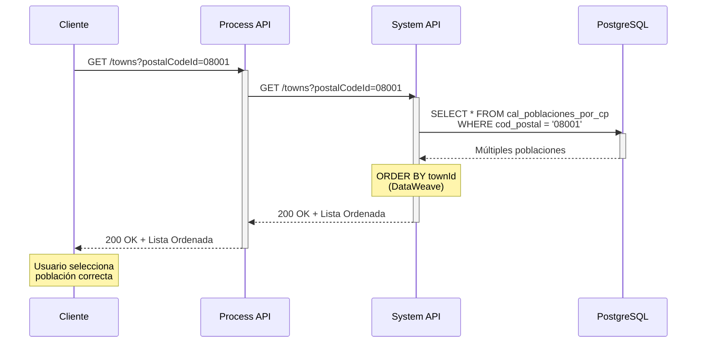
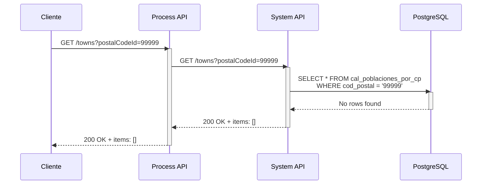
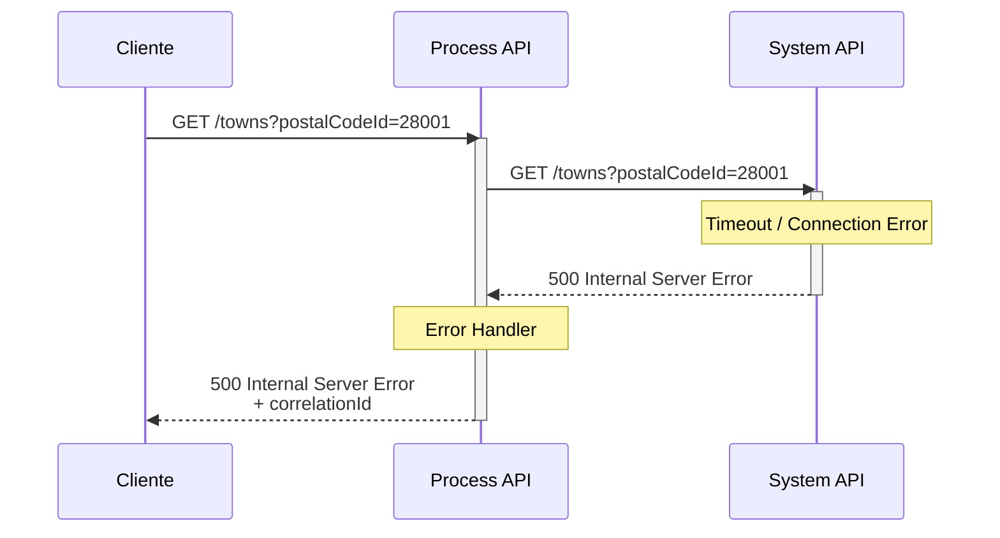
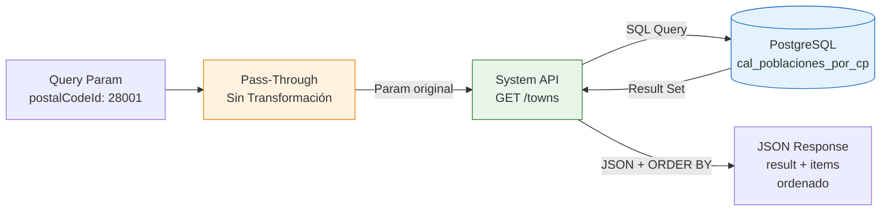

# GET /towns

## 📌 Descripción General

### Propósito del Endpoint

Este endpoint recupera información de poblaciones (municipios) del callejero español por código postal, incluyendo información completa de la provincia a la que pertenecen. Es esencial para la validación completa de direcciones y verificación de cobertura geográfica.

El endpoint soporta:
- **Consulta por Código Postal**: Retorna todas las poblaciones de un código postal específico
- **Información de Provincia**: Incluye ID y nombre de la provincia para cada población
- **Respuesta Ordenada**: Resultados ordenados por ID de población para consistencia
- **Validación Geográfica**: Permite verificar cobertura de servicios por población

### Tipo de API

**Capa:** Process API (API-Led Connectivity)

**Función:** Pass-Through directo con propagación de parámetros al System API

### Patrón de Integración

**Tipo:** Pass-Through Directo

**Descripción:** Este Process API actúa como intermediario transparente entre los consumidores (Experience APIs) y el System API de Callejero, pasando el query parameter directamente sin transformación.

### Arquitectura API-Led Connectivity



---

## 💼 Propósito del Negocio

### Casos de Uso Principales

1. **Validación de Código Postal en Formularios**
   - Usuario ingresa código postal en formulario de dirección
   - Sistema verifica que el código postal existe y retorna poblaciones disponibles
   - Usuario selecciona población correcta de la lista
   - Previene errores de entrada de datos y garantiza direcciones válidas

2. **Selección de Población en Alta de Cliente**
   - Durante proceso de alta, cliente proporciona código postal
   - Sistema muestra poblaciones disponibles para ese código postal
   - Cliente selecciona su población específica con información de provincia
   - Asegura datos de dirección completos y correctos para facturación

3. **Verificación de Cobertura Geográfica**
   - Sistemas de negocio verifican si hay cobertura en una población
   - Consultan poblaciones por código postal
   - Validan contra catálogo de cobertura de servicios
   - Determinan disponibilidad de gas/electricidad por municipio

4. **Normalización de Direcciones**
   - Sistemas legacy tienen direcciones con nombres de población inconsistentes
   - Consultan población oficial por código postal
   - Normalizan datos según callejero oficial (INE)
   - Mantienen consistencia en base de datos corporativa

### 🔗 Endpoints Dependientes

Este Process API consume el siguiente System API:

| System API | Endpoint | Método | Propósito |
|------------|----------|--------|-----------|
| `ntgy-fuv-s-callejero` | `/towns` | GET | Consulta de poblaciones en PostgreSQL con información de provincia |

### Lógica de Orquestación



**Pasos del Proceso:**

1. **Recepción de Request**: Process API recibe query parameter (postalCodeId)
2. **Pass-Through Directo**: Pasa el parámetro al System API sin transformación
3. **Llamada a System API**: Invoca endpoint del System API con parámetro original
4. **Pass-Through de Response**: Retorna respuesta del System API sin modificación

### Transformaciones Aplicadas

**Transformación de Query Parameters:**

⚠️ **Este Process API NO transforma el query parameter.**

El parámetro se pasa directamente al System API:
- `postalCodeId` → Se pasa tal cual

**Transformación de Response:**

⚠️ **Este Process API NO transforma la respuesta del System API.**

Para el schema completo de la respuesta, consultar:
📖 **System API: `ntgy-fuv-s-callejero` endpoint `/towns`**

### Contexto Empresarial

- **Dominio:** Gestión de Callejero y Direcciones
- **Sector:** Energía - Utilities
- **División:** Naturgy España - FUV (Fuerza de Ventas)
- **Proceso de Negocio:** Validación y normalización de direcciones postales españolas

### Stakeholders

- **Equipos de Atención al Cliente**: Validan direcciones durante alta de clientes
- **Sistemas de Cobertura**: Verifican disponibilidad de servicios por población
- **Equipos de Facturación**: Requieren direcciones completas y normalizadas
- **Administradores de Datos**: Mantienen calidad de datos de direcciones

### Valor de Negocio

- **Calidad de Datos**: Garantiza poblaciones correctas y normalizadas en direcciones
- **Prevención de Errores**: Selección de lista reduce errores de entrada manual
- **Eficiencia Operativa**: Acelera procesos de validación de direcciones
- **Cobertura de Servicios**: Facilita verificación de disponibilidad de servicios
- **Cumplimiento Normativo**: Asegura uso de poblaciones según estándares oficiales (INE)

### Consumidores Potenciales

Este endpoint puede ser consumido por:
- Portales web de autoservicio de clientes
- Aplicaciones móviles de agentes comerciales
- Sistemas de agentes de call center
- Aplicaciones de gestión de operaciones de campo
- Sistemas de facturación y cobros
- Herramientas de administración de callejero
- Sistemas de verificación de cobertura

---

## 🔧 Especificación Técnica

### URLs por Ambiente

| Ambiente | URL Base | URL Completa |
|----------|----------|--------------|
| **Local** | `http://localhost:${http.callejero.port}` | `http://localhost:${http.callejero.port}/api/towns?postalCodeId=28001` |
| **Development** | `https://ntgy-fuv-p-callejero-dev.us-e2.cloudhub.io` | `https://ntgy-fuv-p-callejero-dev.us-e2.cloudhub.io/api/towns?postalCodeId=28001` |
| **UAT** | `https://ntgy-fuv-p-callejero-uat.us-e2.cloudhub.io` | `https://ntgy-fuv-p-callejero-uat.us-e2.cloudhub.io/api/towns?postalCodeId=28001` |
| **Production** | `https://ntgy-fuv-p-callejero-pro.us-e2.cloudhub.io` | `https://ntgy-fuv-p-callejero-pro.us-e2.cloudhub.io/api/towns?postalCodeId=28001` |

### Método HTTP

```
GET /api/towns
```

### Parámetros de Entrada

#### Query Parameters

| Parámetro | Tipo | Requerido | Descripción | Ejemplo |
|-----------|------|-----------|-------------|---------|
| `postalCodeId` | string | ✅ Sí | Código postal español (5 dígitos) | `"28001"` |

**Notas:**
- No hay parámetros adicionales de filtrado
- Retorna todas las poblaciones del código postal
- Resultados ordenados automáticamente por townId en el System API

### Respuestas

#### 200 OK - Poblaciones Encontradas

**Descripción:** Lista de poblaciones recuperada exitosamente

**Schema:** Ver documentación del System API `ntgy-fuv-s-callejero` endpoint `/towns`

**Estructura Principal:**
```json
{
  "result": {
    "codResult": "0000",
    "msgResult": "No hay error"
  },
  "items": [
    {
      "townId": "string",
      "townName": "string",
      "provinceId": "string",
      "provinceDesc": "string"
    }
  ]
}
```

#### 200 OK - Sin Resultados

```json
{
  "result": {
    "codResult": "0000",
    "msgResult": "No hay error"
  },
  "items": []
}
```

#### 400 Bad Request - Parámetro Faltante

```json
{
  "result": {
    "codResult": "0002",
    "msgResult": "Parámetro postalCodeId es obligatorio"
  }
}
```

#### 500 Internal Server Error - Error del Sistema

```json
{
  "result": {
    "codResult": "0001",
    "msgResult": "Error interno del servidor"
  },
  "correlationId": "abc-123-def-456"
}
```

### Autenticación

- **Tipo:** Client ID & Client Secret (Anypoint Platform)
- **Headers Requeridos:**
  - `client_id`: ID del cliente registrado en Anypoint Platform
  - `client_secret`: Secret del cliente

### Timeouts

| Tipo | Valor | Configuración |
|------|-------|---------------|
| **Request Timeout** | Configurable | `${s-callejero.timeout}` |
| **Connection Timeout** | 10 segundos | Por defecto HTTP connector |

### Performance y Optimización

- **Volumen Típico**: 1-3 poblaciones por código postal
- **Respuesta Rápida**: Consulta simple, respuesta en < 500ms
- **Caché Recomendado**: Candidato ideal para caché (datos estáticos)
- **Ordenamiento**: Realizado en System API (DataWeave)

---

## 🏗️ Implementación Técnica

### Arquitectura del Flow



### Código del Flow (XML)

**Ubicación:** `src/main/mule/ntgy-fuv-p-callejero.xml` (flow del endpoint)

```xml
<flow name="get:\towns:ntgy-fuv-p-callejero-config">
    <logger level="INFO" message="get:\towns:ntgy-fuv-p-callejero-config" />
    <http:request method="GET" 
                  doc:name="Request" 
                  doc:id="9a35b0b4-7c02-4e04-86ef-f6f49e874f47" 
                  config-ref="S-CALLEJERO" 
                  path="/towns">
        <http:query-params><![CDATA[#[output application/java
---
{
	postalCodeId : attributes.queryParams.postalCodeId
}]]]></http:query-params>
    </http:request>        
</flow>
```

### Análisis del Código

**Componentes del Flow:**

1. **Logger (Línea 2)**
   ```xml
   <logger level="INFO" message="get:\towns:ntgy-fuv-p-callejero-config" />
   ```
   - Registra inicio del flow
   - Nivel INFO para trazabilidad
   - Mensaje identifica el endpoint específico

2. **HTTP Request (Líneas 3-12)**
   ```xml
   <http:request method="GET" config-ref="S-CALLEJERO" path="/towns">
   ```
   - Método: GET
   - Config: `S-CALLEJERO` (configuración del System API)
   - Path: `/towns` (endpoint del System API)

3. **Query Parameters (Líneas 7-11)**
   ```dataweave
   output application/java
   ---
   {
       postalCodeId : attributes.queryParams.postalCodeId
   }
   ```
   - **Output:** `application/java` (igual que /streets)
   - **Lógica:** Pass-through directo del único parámetro
   - **Sin Transformación:** No hay conversión, filtrado ni validación
   - **Patrón simple:** Un solo parámetro requerido

### Comparación con Otros Endpoints

**Tabla Comparativa:**

| Aspecto | GET /towns | GET /streets | GET /dirVertical |
|---------|------------|--------------|------------------|
| **Output Format** | `application/java` | `application/java` | `application/json` |
| **Transformación** | Pass-through directo | Pass-through directo | Condicional (if != null) |
| **Parámetros** | 1 (postalCodeId) | 2 (postalCodeId + wayDesc) | 2 (idDirVertical + claveVertical) |
| **Lógica** | Sin filtrado | Sin filtrado | Filtrado selectivo |
| **Uso Principal** | Selección población | Autocompletado calle | Consulta dirección vertical |

**Código de /towns (actual):**
```dataweave
output application/java
---
{
    postalCodeId : attributes.queryParams.postalCodeId
}
```

**Código de /streets (para comparación):**
```dataweave
output application/java
---
{
    wayDesc : attributes.queryParams.wayDesc,
    postalCodeId : attributes.queryParams.postalCodeId
}
```

### Configuración HTTP

**Config-Ref:** `S-CALLEJERO`

**Propiedades (desde properties YAML):**
- **Host:** `${s-callejero.host}`
- **Port:** `${s-callejero.port}`
- **Base Path:** `${s-callejero.basePath}`
- **Protocol:** HTTP
- **Timeout:** `${s-callejero.timeout}`

### Patrones de Diseño

**Patrón:** Pass-Through Puro

**Justificación:** 
- Desacopla consumidores del System API
- Permite evolución independiente de capas
- No añade lógica de negocio (delegada al System API)
- Mantiene performance óptimo (sin transformaciones)
- Simplifica mantenimiento y debugging

**Ventajas:**
- Mínima latencia adicional
- Sin riesgo de errores en transformación
- Fácil de mantener y entender
- Permite que System API maneje toda la lógica (incluyendo ordenamiento)

### Diagramas de Secuencia

#### 1. Flujo Normal de Éxito - Una Población



#### 2. Flujo con Múltiples Poblaciones



#### 3. Flujo con Código Postal No Encontrado



#### 4. Flujo con Error de Conectividad



### Manejo de Errores

**Estrategia:** Propagación de errores del System API con logging

**Tipos de Errores:**

1. **Errores de Conectividad (500)**
   - Timeout al System API
   - Connection refused
   - Network issues
   - **Acción:** Log error con correlationId, retornar 500 al cliente

2. **Errores de Validación (400)**
   - Parámetro `postalCodeId` faltante
   - Formato de código postal inválido
   - **Acción:** Validación en APIKit, retornar 400 con detalle

3. **Sin Resultados (200)**
   - No se encontraron poblaciones para el código postal
   - Código postal no existe en base de datos
   - **Acción:** Retornar 200 con items vacío (no es error)

**Logging:**
- Nivel INFO: Request recibido
- Nivel ERROR: Errores de conectividad o sistema
- Incluye correlationId para trazabilidad end-to-end

### Flujo de Datos Simplificado



---

## 💻 Ejemplos de Uso

### Ejemplo 1: Consulta Población de Madrid

#### cURL

```bash
curl -X GET "https://ntgy-fuv-p-callejero-dev.us-e2.cloudhub.io/api/towns?postalCodeId=28001" \
  -H "Content-Type: application/json" \
  -H "client_id: YOUR_CLIENT_ID" \
  -H "client_secret: YOUR_CLIENT_SECRET"
```

#### Respuesta (200 OK)

```json
{
  "result": {
    "codResult": "0000",
    "msgResult": "No hay error"
  },
  "items": [
    {
      "townId": "28079",
      "townName": "MADRID",
      "provinceId": "28",
      "provinceDesc": "MADRID"
    }
  ]
}
```

### Ejemplo 2: Código Postal con Múltiples Poblaciones

#### cURL

```bash
curl -X GET "https://ntgy-fuv-p-callejero-dev.us-e2.cloudhub.io/api/towns?postalCodeId=08001" \
  -H "Content-Type: application/json" \
  -H "client_id: YOUR_CLIENT_ID" \
  -H "client_secret: YOUR_CLIENT_SECRET"
```

#### Respuesta (200 OK - Múltiples Poblaciones)

```json
{
  "result": {
    "codResult": "0000",
    "msgResult": "No hay error"
  },
  "items": [
    {
      "townId": "08001",
      "townName": "BARCELONA",
      "provinceId": "08",
      "provinceDesc": "BARCELONA"
    },
    {
      "townId": "08015",
      "townName": "HOSPITALET DE LLOBREGAT",
      "provinceId": "08",
      "provinceDesc": "BARCELONA"
    },
    {
      "townId": "08019",
      "townName": "SANT ADRIA DE BESOS",
      "provinceId": "08",
      "provinceDesc": "BARCELONA"
    }
  ]
}
```

**Nota:** Resultados ordenados por `townId` automáticamente.

### Ejemplo 3: JavaScript - Selector de Población

```javascript
async function getTowns(postalCode) {
  const url = `https://ntgy-fuv-p-callejero-dev.us-e2.cloudhub.io/api/towns?postalCodeId=${postalCode}`;
  
  try {
    const response = await fetch(url, {
      method: 'GET',
      headers: {
        'Content-Type': 'application/json',
        'client_id': 'YOUR_CLIENT_ID',
        'client_secret': 'YOUR_CLIENT_SECRET'
      }
    });
    
    const data = await response.json();
    
    if (data.result.codResult === "0000") {
      return data.items;
    } else {
      console.error('Error al obtener poblaciones:', data.result.msgResult);
      return [];
    }
  } catch (error) {
    console.error('Error de conexión:', error);
    return [];
  }
}

// Función para poblar selector de población
async function populateTownSelector(postalCode, selectElement) {
  // Limpiar opciones existentes
  selectElement.innerHTML = '<option value="">Seleccione población...</option>';
  
  // Mostrar loading
  selectElement.disabled = true;
  
  try {
    const towns = await getTowns(postalCode);
    
    if (towns.length === 0) {
      selectElement.innerHTML = '<option value="">No hay poblaciones para este código postal</option>';
      return;
    }
    
    // Poblar selector con poblaciones
    towns.forEach(town => {
      const option = document.createElement('option');
      option.value = town.townId;
      option.textContent = `${town.townName} (${town.provinceDesc})`;
      option.dataset.townName = town.townName;
      option.dataset.provinceId = town.provinceId;
      option.dataset.provinceDesc = town.provinceDesc;
      selectElement.appendChild(option);
    });
    
    // Si solo hay una población, seleccionarla automáticamente
    if (towns.length === 1) {
      selectElement.selectedIndex = 1;
      selectElement.dispatchEvent(new Event('change'));
    }
  } catch (error) {
    selectElement.innerHTML = '<option value="">Error al cargar poblaciones</option>';
  } finally {
    selectElement.disabled = false;
  }
}

// Uso
const postalCodeInput = document.getElementById('postal-code');
const townSelect = document.getElementById('town-select');

postalCodeInput.addEventListener('blur', function() {
  const postalCode = this.value.trim();
  if (postalCode.length === 5) {
    populateTownSelector(postalCode, townSelect);
  }
});
```

### Ejemplo 4: Python - Validación de Código Postal

```python
import requests
from typing import List, Dict, Optional

class TownSearchClient:
    """Cliente para búsqueda de poblaciones por código postal"""
    
    def __init__(self, base_url: str, client_id: str, client_secret: str):
        self.base_url = base_url.rstrip('/')
        self.endpoint = f"{self.base_url}/api/towns"
        self.headers = {
            'Content-Type': 'application/json',
            'client_id': client_id,
            'client_secret': client_secret
        }
    
    def get_towns(self, postal_code: str) -> List[Dict]:
        """
        Obtiene poblaciones por código postal
        
        Args:
            postal_code: Código postal español (5 dígitos)
            
        Returns:
            Lista de diccionarios con información de poblaciones
        """
        params = {'postalCodeId': postal_code}
        
        try:
            response = requests.get(self.endpoint, params=params, headers=self.headers)
            response.raise_for_status()
            
            data = response.json()
            
            if data['result']['codResult'] == '0000':
                return data['items']
            else:
                print(f"Error: {data['result']['msgResult']}")
                return []
                
        except requests.exceptions.RequestException as e:
            print(f"Error al buscar poblaciones: {e}")
            raise
    
    def validate_postal_code(self, postal_code: str) -> bool:
        """
        Valida si un código postal existe
        
        Args:
            postal_code: Código postal a validar
            
        Returns:
            True si el código postal existe, False en caso contrario
        """
        towns = self.get_towns(postal_code)
        return len(towns) > 0
    
    def get_town_info(self, postal_code: str, town_id: str) -> Optional[Dict]:
        """
        Obtiene información de una población específica
        
        Args:
            postal_code: Código postal
            town_id: ID de la población
            
        Returns:
            Diccionario con información de la población o None si no se encuentra
        """
        towns = self.get_towns(postal_code)
        
        for town in towns:
            if town['townId'] == town_id:
                return town
        
        return None

# Uso
client = TownSearchClient(
    'https://ntgy-fuv-p-callejero-dev.us-e2.cloudhub.io',
    'YOUR_CLIENT_ID',
    'YOUR_CLIENT_SECRET'
)

# Validar código postal
postal_code = '28001'
if client.validate_postal_code(postal_code):
    print(f"Código postal {postal_code} es válido")
    
    # Obtener poblaciones
    towns = client.get_towns(postal_code)
    print(f"Poblaciones encontradas: {len(towns)}")
    
    for town in towns:
        print(f"  - {town['townName']} ({town['provinceDesc']})")
else:
    print(f"Código postal {postal_code} no encontrado")
```

### Ejemplo 5: Sin Resultados

#### cURL

```bash
curl -X GET "https://ntgy-fuv-p-callejero-dev.us-e2.cloudhub.io/api/towns?postalCodeId=99999" \
  -H "Content-Type: application/json" \
  -H "client_id: YOUR_CLIENT_ID" \
  -H "client_secret: YOUR_CLIENT_SECRET"
```

#### Respuesta (200 OK - Sin Resultados)

```json
{
  "result": {
    "codResult": "0000",
    "msgResult": "No hay error"
  },
  "items": []
}
```

### Ejemplo 6: Error - Parámetro Faltante (400)

#### cURL

```bash
curl -X GET "https://ntgy-fuv-p-callejero-dev.us-e2.cloudhub.io/api/towns" \
  -H "Content-Type: application/json" \
  -H "client_id: YOUR_CLIENT_ID" \
  -H "client_secret: YOUR_CLIENT_SECRET"
```

#### Respuesta (400 Bad Request)

```json
{
  "result": {
    "codResult": "0002",
    "msgResult": "Parámetro postalCodeId es obligatorio"
  }
}