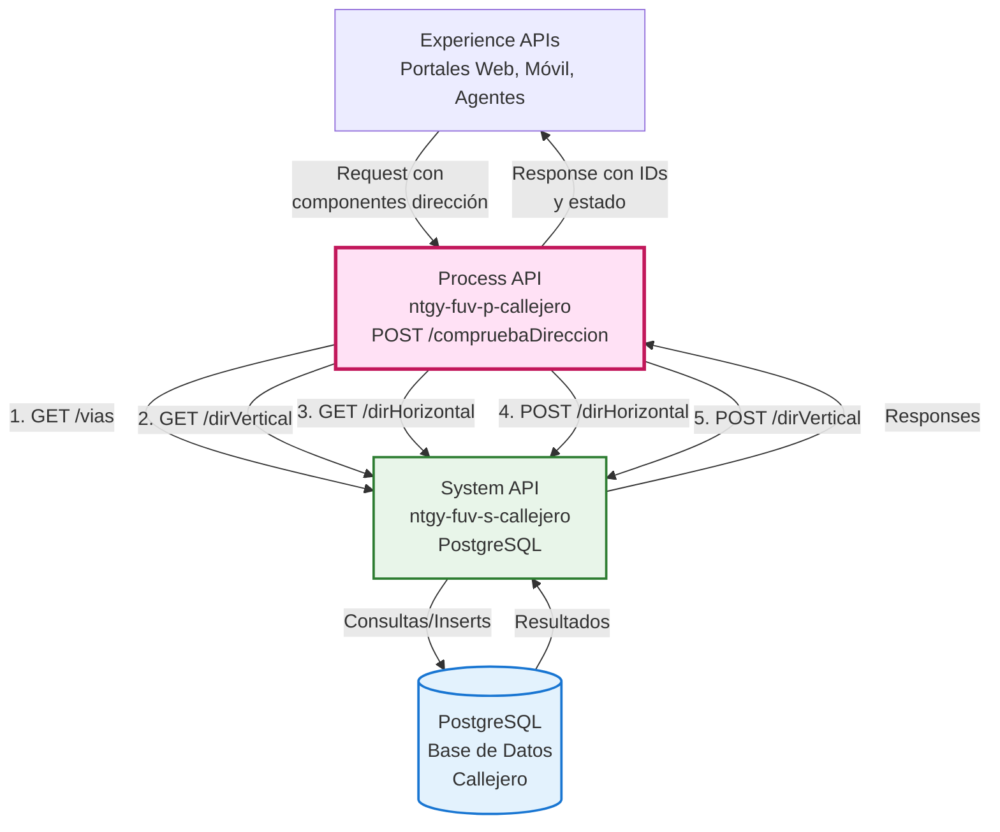
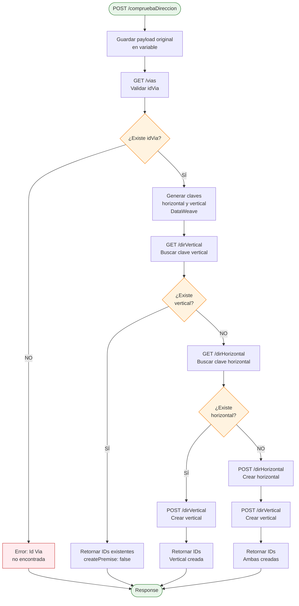
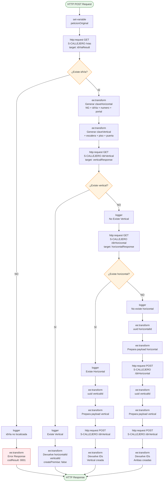
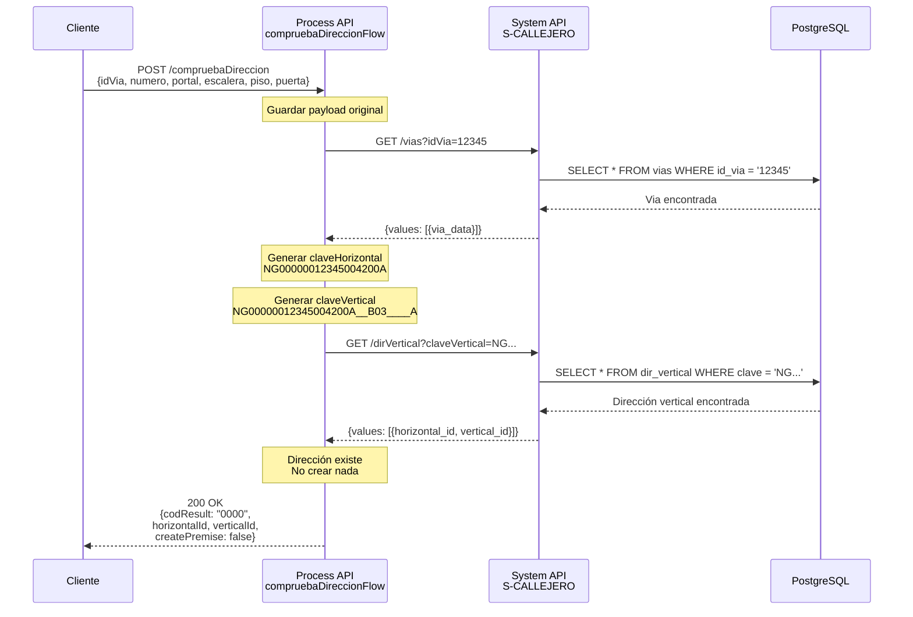
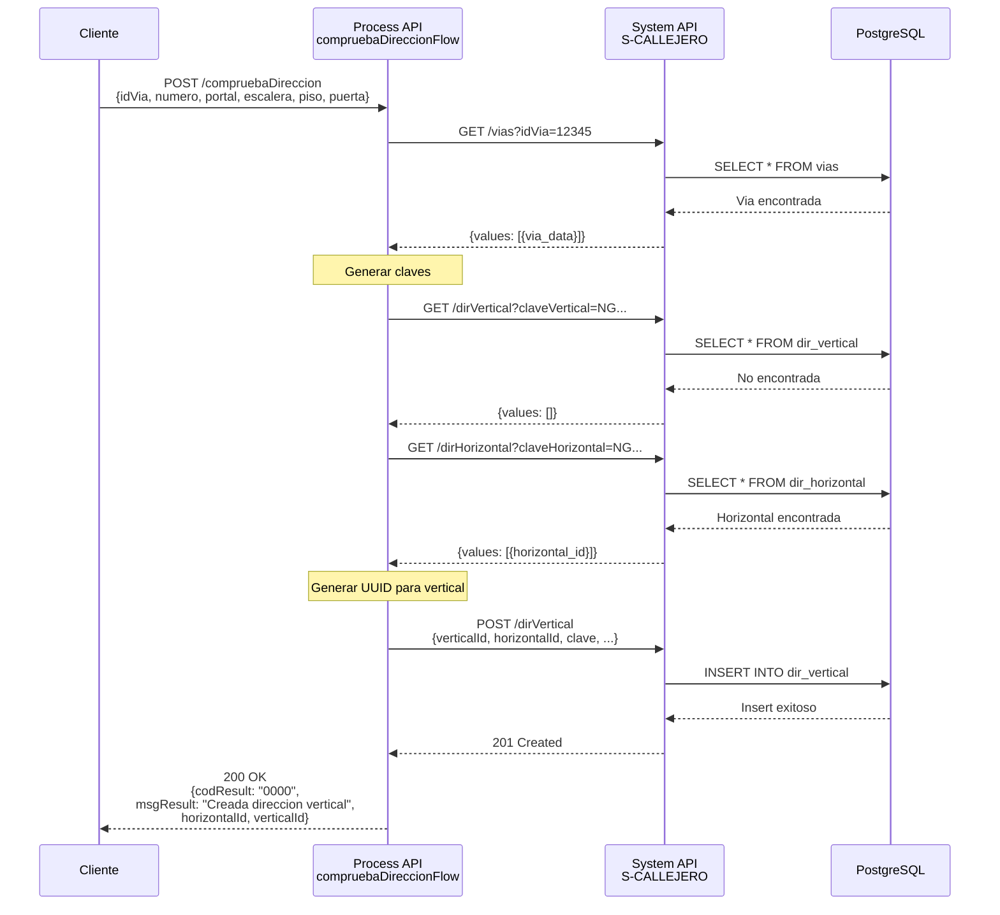
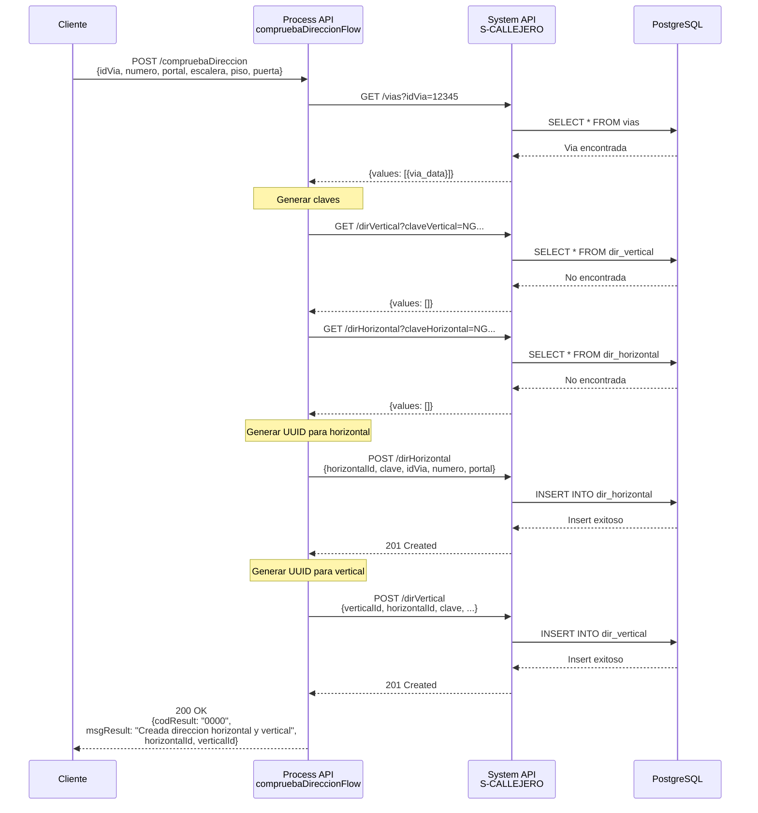
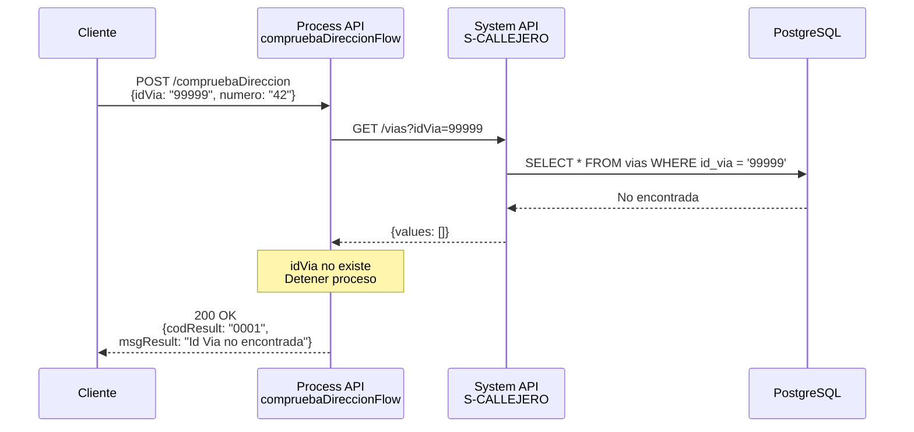

# POST /compruebaDireccion

## 📌 Descripción General

### Propósito del Endpoint

Este endpoint implementa un proceso de validación y gestión inteligente de direcciones mediante una búsqueda jerárquica en tres niveles: validación de vía, búsqueda de dirección vertical completa y, si no existe, búsqueda o creación de dirección horizontal. El proceso garantiza la existencia de direcciones completas en el sistema, creando los registros necesarios cuando no existen.

### Tipo de API

**Capa:** Process API (API-Led Connectivity)

**Función:** Orquestación de validación y gestión de direcciones con lógica de búsqueda en cascada y creación condicional

### Patrón de Integración

**Tipo:** Orquestación con Transformación y Lógica Condicional

**Descripción:** El endpoint orquesta múltiples llamadas al System API S-CALLEJERO siguiendo un patrón de búsqueda jerárquica:
1. Valida existencia de la vía (idVia)
2. Genera claves horizontal y vertical mediante transformaciones DataWeave
3. Busca dirección vertical completa
4. Si no existe vertical, busca horizontal
5. Si no existe horizontal, crea ambas (horizontal + vertical)
6. Si existe horizontal pero no vertical, crea solo vertical

### Arquitectura API-Led Connectivity



---

## 💼 Propósito del Negocio

### Casos de Uso Principales

1. **Validación de Direcciones en Alta de Cliente**
   - Agentes de servicio validan direcciones durante el proceso de alta
   - El sistema crea automáticamente registros de dirección si no existen
   - Beneficio: Reduce tiempo de captura de 5 minutos a menos de 30 segundos

2. **Normalización de Direcciones Existentes**
   - Sistemas legacy envían direcciones para normalización
   - El endpoint genera claves estandarizadas (horizontal y vertical)
   - Beneficio: Garantiza consistencia en formato de direcciones

3. **Integración con CRM y Facturación**
   - Salesforce y SAP ISU validan direcciones antes de crear contratos
   - El endpoint retorna IDs únicos (horizontalId, verticalId) para referencia
   - Beneficio: Evita duplicación de direcciones en sistemas downstream

### 🔗 Endpoints Dependientes

Este Process API consume los siguientes System APIs:

| System API | Endpoint | Método | Propósito |
|------------|----------|--------|-----------|
| `ntgy-fuv-s-callejero` | `/vias` | GET | Validación de existencia de idVia |
| `ntgy-fuv-s-callejero` | `/dirVertical` | GET | Búsqueda de dirección vertical completa |
| `ntgy-fuv-s-callejero` | `/dirHorizontal` | GET | Búsqueda de dirección horizontal |
| `ntgy-fuv-s-callejero` | `/dirHorizontal` | POST | Creación de nueva dirección horizontal |
| `ntgy-fuv-s-callejero` | `/dirVertical` | POST | Creación de nueva dirección vertical |

### Lógica de Orquestación



**Pasos del Proceso:**

1. **Validación de Vía**: Verifica que el idVia existe en la base de datos
2. **Generación de Claves**: Crea claves horizontal (18 caracteres) y vertical (28 caracteres) mediante DataWeave
3. **Búsqueda Vertical**: Intenta localizar dirección vertical completa
4. **Búsqueda Horizontal**: Si no existe vertical, busca horizontal
5. **Creación Condicional**: Crea registros según necesidad (solo vertical, o ambos)

### Transformaciones Aplicadas

#### Generación de Clave Horizontal (18 caracteres)

| Componente | Formato | Longitud | Ejemplo |
|------------|---------|----------|---------|
| Prefijo | "NG" | 2 | NG |
| idVia | Padding izquierdo con "0" | 11 | 00000012345 |
| numero | Padding izquierdo con "0" | 4 | 0042 |
| portal | Numérico: "0", Alfanumérico: "_" | 3 | 00A o __A |

**Ejemplo:** `NG00000012345004200A` (idVia=12345, numero=42, portal=A)

#### Generación de Clave Vertical (28 caracteres)

| Componente | Formato | Longitud | Ejemplo |
|------------|---------|----------|---------|
| Clave Horizontal | Base | 18 | NG00000012345004200A |
| escalera | Numérico: "0", Alfanumérico: "_" | 3 | __B |
| piso | Numérico: "0", Alfanumérico: "_" | 2 | 03 |
| puerta | Numérico: "0", Alfanumérico: "_" | 5 | ____A |

**Ejemplo:** `NG00000012345004200A__B03____A` (escalera=B, piso=3, puerta=A)

**Lógica de Padding:**
- Valores numéricos: Padding con "0" a la izquierda
- Valores alfanuméricos: Padding con "_" a la izquierda
- Función DataWeave: `isNumber(value) = matches(value, /[0-9]+/)`

### Contexto Empresarial

- **Dominio:** Gestión de Direcciones y Callejero
- **Sector:** Energía - Utilities
- **División:** Naturgy España - FUV (Fuerza de Ventas)
- **Proceso de Negocio:** Validación y normalización de direcciones para alta de clientes y contratos

### Stakeholders

- **Agentes de Servicio al Cliente**: Necesitan validar direcciones rápidamente durante llamadas
- **Equipos de Ventas**: Requieren direcciones validadas para alta de contratos
- **Sistemas de Facturación**: Dependen de direcciones correctas para envío de facturas
- **Operaciones de Campo**: Utilizan direcciones para planificación de rutas

### Valor de Negocio

- **Reducción de Errores**: De 15% a menos de 3% en direcciones incorrectas
- **Ahorro de Tiempo**: De 5 minutos a 30 segundos en validación de direcciones
- **Consistencia de Datos**: Formato único de direcciones en todos los sistemas
- **Reducción de Costos**: 40% menos costos de reenvío de correspondencia

### Consumidores Potenciales

Este endpoint puede ser consumido por:
- Portales web de autoservicio de clientes
- Aplicaciones móviles de agentes de campo
- Sistemas de agentes de call center
- Integraciones con Salesforce CRM
- Integraciones con SAP ISU
- Sistemas de facturación y correspondencia

---

## 🔧 Especificación Técnica

### URLs por Ambiente

| Ambiente | URL Base | URL Completa |
|----------|----------|--------------|
| **Local** | `http://localhost:8081` | `http://localhost:8081/api/compruebaDireccion` |
| **Development** | `https://ntgy-fuv-p-callejero-dev.us-e2.cloudhub.io` | `https://ntgy-fuv-p-callejero-dev.us-e2.cloudhub.io/api/compruebaDireccion` |
| **UAT** | `https://ntgy-fuv-p-callejero-uat.us-e2.cloudhub.io` | `https://ntgy-fuv-p-callejero-uat.us-e2.cloudhub.io/api/compruebaDireccion` |
| **Production** | `https://ntgy-fuv-p-callejero-pro.us-e2.cloudhub.io` | `https://ntgy-fuv-p-callejero-pro.us-e2.cloudhub.io/api/compruebaDireccion` |

### Método HTTP

```
POST /api/compruebaDireccion
```

### Parámetros de Entrada

#### Request Body (application/json)

| Campo | Tipo | Requerido | Longitud | Descripción |
|-------|------|-----------|----------|-------------|
| `idVia` | string | ✅ Sí | 1-10 | Identificador único de la vía en base de datos |
| `numero` | string | ✅ Sí | 1-4 | Número de la vía (portal principal) |
| `portal` | string | ❌ No | variable | Portal del edificio (opcional) |
| `escalera` | string | ❌ No | variable | Escalera del edificio (opcional) |
| `piso` | string | ❌ No | variable | Piso o planta (opcional) |
| `puerta` | string | ❌ No | variable | Puerta del piso (opcional) |
| `siebelIntegrationId` | string | ❌ No | variable | ID de integración con Siebel (opcional) |
| `extraData` | string | ❌ No | variable | Datos adicionales (opcional) |

**Validaciones:**
- `idVia` y `numero` son obligatorios
- `idVia` debe existir en la tabla de vías
- Campos opcionales pueden ser null o vacíos
- Todos los valores se convierten a mayúsculas en el procesamiento

#### Ejemplo de Request

```json
{
  "idVia": "12345",
  "numero": "42",
  "portal": "A",
  "escalera": "B",
  "piso": "3",
  "puerta": "A",
  "siebelIntegrationId": "SBL-12345",
  "extraData": "Información adicional"
}
```

### Respuestas

#### 200 OK - Dirección Existente

**Escenario:** La dirección vertical completa ya existe en base de datos

```json
{
  "result": {
    "codResult": "0000",
    "msgResult": "Devuelta direccion existente"
  },
  "horizontalId": "550e8400-e29b-41d4-a716-446655440000",
  "verticalId": "6ba7b810-9dad-11d1-80b4-00c04fd430c8",
  "createPremise": false
}
```

#### 200 OK - Dirección Vertical Creada

**Escenario:** Existía dirección horizontal, se creó la vertical

```json
{
  "result": {
    "codResult": "0000",
    "msgResult": "Creada direccion vertical"
  },
  "horizontalId": "550e8400-e29b-41d4-a716-446655440000",
  "verticalId": "7c9e6679-7425-40de-944b-e07fc1f90ae7"
}
```

#### 200 OK - Ambas Direcciones Creadas

**Escenario:** No existía ninguna dirección, se crearon horizontal y vertical

```json
{
  "result": {
    "codResult": "0000",
    "msgResult": "Creada direccion horizontal y vertical"
  },
  "horizontalId": "8d9e7680-8536-51ef-a55c-f18fc2f01bf8",
  "verticalId": "9e0f8791-9647-62f0-b66d-028fd3012c09"
}
```

#### 200 OK - Error de Negocio (idVia no encontrada)

**Escenario:** El idVia proporcionado no existe en base de datos

```json
{
  "result": {
    "codResult": "0001",
    "msgResult": "Id Via no encontrada"
  }
}
```

#### Campos de Respuesta

| Campo | Tipo | Descripción |
|-------|------|-------------|
| `result.codResult` | string | Código de resultado: "0000" (éxito), "0001" (error) |
| `result.msgResult` | string | Mensaje descriptivo del resultado |
| `horizontalId` | string (UUID) | ID único de la dirección horizontal |
| `verticalId` | string (UUID) | ID único de la dirección vertical |
| `createPremise` | boolean | Indica si se debe crear premise en sistemas downstream (solo en respuesta de dirección existente) |

### Autenticación

- **Tipo:** Client ID & Client Secret (Anypoint Platform)
- **Headers requeridos:**
  - `client_id`: ID del cliente registrado en Anypoint Platform
  - `client_secret`: Secret del cliente

### Timeouts

| Tipo | Valor |
|------|-------|
| **Request Timeout** | 30 segundos |
| **Connection Timeout** | 10 segundos |

**Nota:** Los timeouts se configuran por ambiente en archivos properties YAML

---

## 🏗️ Implementación Técnica

### Arquitectura del Flow



### Transformaciones DataWeave

#### 1. Generación de Clave Horizontal

```dataweave
%dw 2.0
import * from dw::core::Strings
output application/json

var aux = payload mapObject ((value, key, index) -> (key):value default "") 

// Función para detectar valores numéricos
fun isNumber(value) = matches(value, /[0-9]+/)

---
"NG" ++ 
upper(leftPad(trim(aux.idVia), 11, "0")) ++
upper(leftPad(trim(aux.numero), 4, "0")) ++
(
    if (isNumber(aux.portal)) 
        upper(leftPad(trim(aux.portal), 3, "0")) 
    else 
        upper(leftPad(trim(aux.portal), 3, "_"))
)
```

**Resultado:** String de 18 caracteres (ej: `NG00000012345004200A`)

#### 2. Generación de Clave Vertical

```dataweave
%dw 2.0
import * from dw::core::Strings
output application/json

var aux = payload mapObject ((value, key, index) -> (key):value default "") 

fun isNumber(value) = matches(value, /[0-9]+/)

---
"NG" ++ 
upper(leftPad(trim(aux.idVia), 11, "0")) ++
upper(leftPad(trim(aux.numero), 4, "0")) ++
(
    if (isNumber(aux.portal)) 
        upper(leftPad(trim(aux.portal), 3, "0")) 
    else 
        upper(leftPad(trim(aux.portal), 3, "_"))
) ++
(
    if (isNumber(aux.escalera)) 
        upper(leftPad(trim(aux.escalera), 3, "0")) 
    else 
        upper(leftPad(trim(aux.escalera), 3, "_"))
) ++
(
    if (isNumber(aux.piso)) 
        upper(leftPad(trim(aux.piso), 2, "0")) 
    else 
        upper(leftPad(trim(aux.piso), 2, "_"))
) ++
(
    if (isNumber(aux.puerta)) 
        upper(leftPad(trim(aux.puerta), 5, "0")) 
    else 
        upper(leftPad(trim(aux.puerta), 5, "_"))
)
```

**Resultado:** String de 28 caracteres (ej: `NG00000012345004200A__B03____A`)

#### 3. Preparación de Payload para Crear Horizontal

```dataweave
%dw 2.0
output application/json
---
{
    "horizontalId": vars.horizontalId,
    "clave": vars.claveHorizontal,
    "siebelIntegrationId": vars.peticionOriginal.siebelIntegrationId, 
    "idVia": vars.peticionOriginal.idVia,
    "numero": vars.peticionOriginal.numero,
    "portal": upper(vars.peticionOriginal.portal)
}
```

#### 4. Preparación de Payload para Crear Vertical

```dataweave
%dw 2.0
output application/json
---
{
    "verticalId": vars.verticalId,
    "horizontalId": vars.horizontalResponse.values[0].horizontal_id,
    "clave": vars.claveVertical,
    "siebelIntegrationId": vars.peticionOriginal.siebelIntegrationId, 
    "escalera": upper(vars.peticionOriginal.escalera),
    "piso": upper(vars.peticionOriginal.piso),
    "puerta": upper(vars.peticionOriginal.puerta),
    "extraData": upper(vars.peticionOriginal.extraData)
}
```

### Patrones de Diseño

**Patrón:** Búsqueda en Cascada con Creación Condicional (Cascade Search with Conditional Creation)

**Justificación:** 
- Optimiza consultas a base de datos buscando primero el registro más específico (vertical)
- Evita creación innecesaria de registros si ya existen
- Garantiza integridad referencial creando horizontal antes que vertical
- Reduce latencia al retornar inmediatamente si encuentra dirección existente

**Beneficios:**
- Máxima eficiencia: Solo 2 consultas si la dirección existe
- Idempotencia: Múltiples llamadas con mismos datos retornan mismo resultado
- Atomicidad: Crea ambos registros en secuencia garantizando consistencia

### Diagramas de Secuencia

#### 1. Flujo Normal - Dirección Existente



#### 2. Flujo - Crear Solo Vertical



#### 3. Flujo - Crear Horizontal y Vertical



#### 4. Flujo de Error - idVia No Encontrada



### Manejo de Errores

#### Estrategia de Manejo de Errores

| Tipo de Error | Código | Mensaje | Acción |
|---------------|--------|---------|--------|
| **idVia no encontrada** | 0001 | "Id Via no encontrada" | Retornar error de negocio, no crear registros |
| **Error de conectividad** | 500 | Error del sistema | Propagar error HTTP del System API |
| **Timeout** | 500 | Timeout en operación | Retornar error después de 30 segundos |
| **Error de validación** | 400 | Bad Request | Validación de APIKit en campos obligatorios |

#### Logging

**Puntos de Logging:**
1. Inicio del flow: `"post:\compruebaDireccion:application\json:ntgy-fuv-p-callejero-config"`
2. idVia no localizada: `"idVia #[vars.peticionOriginal.idVia] no localizada"`
3. Dirección vertical existe: `"Existe Vertical, devuelve valores"`
4. Dirección vertical no existe: `"No Existe Vertical, busca horizontal"`
5. Dirección horizontal existe: `"Existe Horizontal, devuelve horizontal y crea vertical"`
6. Dirección horizontal no existe: `"No existe horizontal, crea horizontal y vertical"`

**Nivel de Log:** INFO para operaciones normales, ERROR para excepciones

### Variables de Flow

| Variable | Tipo | Propósito |
|----------|------|-----------|
| `peticionOriginal` | Object | Almacena el payload original del request |
| `idViaResult` | Object | Resultado de la búsqueda de vía |
| `claveHorizontal` | String | Clave generada de 18 caracteres |
| `claveVertical` | String | Clave generada de 28 caracteres |
| `verticalResponse` | Object | Resultado de búsqueda de dirección vertical |
| `horizontalResponse` | Object | Resultado de búsqueda de dirección horizontal |
| `horizontalId` | String (UUID) | ID generado para nueva dirección horizontal |
| `verticalId` | String (UUID) | ID generado para nueva dirección vertical |

### Configuración HTTP

**Archivo:** `global.xml`

```xml
<http:request-config 
    name="S-CALLEJERO" 
    basePath="${s-callejero.basePath}" 
    responseTimeout="${s-callejero.timeout}">
    <http:request-connection 
        host="${s-callejero.host}" 
        port="${s-callejero.port}" />
</http:request-config>
```

**Properties (Development):**
```yaml
s-callejero:
  host: "ntgy-fuv-s-callejero-des.de-c1.cloudhub.io"
  port: "80"
  timeout: "30000"
  basePath: "/api"
```

---

## 💻 Ejemplos de Uso

### Ejemplo 1: Dirección Existente (Caso Más Común)

#### Request

```bash
curl -X POST "https://ntgy-fuv-p-callejero-dev.us-e2.cloudhub.io/api/compruebaDireccion" \
  -H "Content-Type: application/json" \
  -H "client_id: YOUR_CLIENT_ID" \
  -H "client_secret: YOUR_CLIENT_SECRET" \
  -d '{
    "idVia": "12345",
    "numero": "42",
    "portal": "A",
    "escalera": "B",
    "piso": "3",
    "puerta": "A"
  }'
```

#### Response (200 OK)

```json
{
  "result": {
    "codResult": "0000",
    "msgResult": "Devuelta direccion existente"
  },
  "horizontalId": "550e8400-e29b-41d4-a716-446655440000",
  "verticalId": "6ba7b810-9dad-11d1-80b4-00c04fd430c8",
  "createPremise": false
}
```

**Interpretación:**
- La dirección completa ya existía en base de datos
- Se retornan los IDs existentes
- `createPremise: false` indica que no se debe crear premise en sistemas downstream

### Ejemplo 2: Crear Solo Dirección Vertical

#### Request

```bash
curl -X POST "https://ntgy-fuv-p-callejero-dev.us-e2.cloudhub.io/api/compruebaDireccion" \
  -H "Content-Type: application/json" \
  -H "client_id: YOUR_CLIENT_ID" \
  -H "client_secret: YOUR_CLIENT_SECRET" \
  -d '{
    "idVia": "12345",
    "numero": "42",
    "portal": "A",
    "escalera": "C",
    "piso": "5",
    "puerta": "B",
    "siebelIntegrationId": "SBL-67890"
  }'
```

#### Response (200 OK)

```json
{
  "result": {
    "codResult": "0000",
    "msgResult": "Creada direccion vertical"
  },
  "horizontalId": "550e8400-e29b-41d4-a716-446655440000",
  "verticalId": "7c9e6679-7425-40de-944b-e07fc1f90ae7"
}
```

**Interpretación:**
- La dirección horizontal ya existía
- Se creó nueva dirección vertical con los datos proporcionados
- El `verticalId` es nuevo, el `horizontalId` es existente

### Ejemplo 3: Crear Ambas Direcciones

#### Request

```bash
curl -X POST "https://ntgy-fuv-p-callejero-dev.us-e2.cloudhub.io/api/compruebaDireccion" \
  -H "Content-Type: application/json" \
  -H "client_id: YOUR_CLIENT_ID" \
  -H "client_secret: YOUR_CLIENT_SECRET" \
  -d '{
    "idVia": "98765",
    "numero": "15",
    "portal": "B",
    "escalera": "1",
    "piso": "2",
    "puerta": "C",
    "siebelIntegrationId": "SBL-11111",
    "extraData": "Nueva construcción"
  }'
```

#### Response (200 OK)

```json
{
  "result": {
    "codResult": "0000",
    "msgResult": "Creada direccion horizontal y vertical"
  },
  "horizontalId": "8d9e7680-8536-51ef-a55c-f18fc2f01bf8",
  "verticalId": "9e0f8791-9647-62f0-b66d-028fd3012c09"
}
```

**Interpretación:**
- Ninguna dirección existía previamente
- Se crearon ambos registros (horizontal y vertical)
- Ambos IDs son nuevos

### Ejemplo 4: Error - idVia No Encontrada

#### Request

```bash
curl -X POST "https://ntgy-fuv-p-callejero-dev.us-e2.cloudhub.io/api/compruebaDireccion" \
  -H "Content-Type: application/json" \
  -H "client_id: YOUR_CLIENT_ID" \
  -H "client_secret: YOUR_CLIENT_SECRET" \
  -d '{
    "idVia": "99999",
    "numero": "1"
  }'
```

#### Response (200 OK)

```json
{
  "result": {
    "codResult": "0001",
    "msgResult": "Id Via no encontrada"
  }
}
```

**Interpretación:**
- El idVia proporcionado no existe en la base de datos
- No se creó ningún registro
- El cliente debe verificar el idVia correcto

### Ejemplo 5: JavaScript (Fetch API)

```javascript
const compruebaDireccion = async (direccion) => {
  try {
    const response = await fetch(
      'https://ntgy-fuv-p-callejero-dev.us-e2.cloudhub.io/api/compruebaDireccion',
      {
        method: 'POST',
        headers: {
          'Content-Type': 'application/json',
          'client_id': 'YOUR_CLIENT_ID',
          'client_secret': 'YOUR_CLIENT_SECRET'
        },
        body: JSON.stringify({
          idVia: direccion.idVia,
          numero: direccion.numero,
          portal: direccion.portal,
          escalera: direccion.escalera,
          piso: direccion.piso,
          puerta: direccion.puerta
        })
      }
    );

    const data = await response.json();
    
    if (data.result.codResult === '0000') {
      console.log('Dirección validada:', data);
      return {
        success: true,
        horizontalId: data.horizontalId,
        verticalId: data.verticalId,
        message: data.result.msgResult
      };
    } else {
      console.error('Error de validación:', data.result.msgResult);
      return {
        success: false,
        error: data.result.msgResult
      };
    }
  } catch (error) {
    console.error('Error de conexión:', error);
    return {
      success: false,
      error: 'Error de conexión con el servicio'
    };
  }
};

// Uso
const resultado = await compruebaDireccion({
  idVia: '12345',
  numero: '42',
  portal: 'A',
  escalera: 'B',
  piso: '3',
  puerta: 'A'
});
```

### Ejemplo 6: Python (Requests)

```python
import requests
import json

def comprobar_direccion(direccion):
    """
    Valida una dirección usando el API de Callejero
    
    Args:
        direccion (dict): Diccionario con componentes de la dirección
        
    Returns:
        dict: Resultado de la validación con IDs
    """
    url = "https://ntgy-fuv-p-callejero-dev.us-e2.cloudhub.io/api/compruebaDireccion"
    
    headers = {
        "Content-Type": "application/json",
        "client_id": "YOUR_CLIENT_ID",
        "client_secret": "YOUR_CLIENT_SECRET"
    }
    
    try:
        response = requests.post(url, headers=headers, json=direccion, timeout=30)
        response.raise_for_status()
        
        data = response.json()
        
        if data["result"]["codResult"] == "0000":
            print(f"✓ Dirección validada: {data['result']['msgResult']}")
            return {
                "success": True,
                "horizontal_id": data.get("horizontalId"),
                "vertical_id": data.get("verticalId"),
                "message": data["result"]["msgResult"]
            }
        else:
            print(f"✗ Error: {data['result']['msgResult']}")
            return {
                "success": False,
                "error": data["result"]["msgResult"]
            }
            
    except requests.exceptions.Timeout:
        print("✗ Timeout: El servicio no respondió a tiempo")
        return {"success": False, "error": "Timeout"}
    except requests.exceptions.RequestException as e:
        print(f"✗ Error de conexión: {e}")
        return {"success": False, "error": str(e)}

# Uso
direccion = {
    "idVia": "12345",
    "numero": "42",
    "portal": "A",
    "escalera": "B",
    "piso": "3",
    "puerta": "A",
    "siebelIntegrationId": "SBL-12345"
}

resultado = comprobar_direccion(direccion)

if resultado["success"]:
    print(f"Horizontal ID: {resultado['horizontal_id']}")
    print(f"Vertical ID: {resultado['vertical_id']}")
```

### Ejemplo 7: Postman Collection

```json
{
  "info": {
    "name": "Callejero API - compruebaDireccion",
    "schema": "https://schema.getpostman.com/json/collection/v2.1.0/collection.json"
  },
  "item": [
    {
      "name": "Comprobar Dirección - Existente",
      "request": {
        "method": "POST",
        "header": [
          {
            "key": "Content-Type",
            "value": "application/json"
          },
          {
            "key": "client_id",
            "value": "{{client_id}}"
          },
          {
            "key": "client_secret",
            "value": "{{client_secret}}"
          }
        ],
        "body": {
          "mode": "raw",
          "raw": "{\n  \"idVia\": \"12345\",\n  \"numero\": \"42\",\n  \"portal\": \"A\",\n  \"escalera\": \"B\",\n  \"piso\": \"3\",\n  \"puerta\": \"A\"\n}"
        },
        "url": {
          "raw": "{{base_url}}/api/compruebaDireccion",
          "host": ["{{base_url}}"],
          "path": ["api", "compruebaDireccion"]
        }
      }
    }
  ]
}
```

### Consideraciones de Integración

#### Idempotencia
- El endpoint es idempotente: múltiples llamadas con los mismos datos retornan el mismo resultado
- Si la dirección existe, siempre retorna los mismos IDs
- Si no existe, la primera llamada crea los registros, las siguientes retornan los IDs creados

#### Manejo de Campos Opcionales
- Los campos opcionales (portal, escalera, piso, puerta) pueden ser:
  - Omitidos del JSON
  - Enviados como `null`
  - Enviados como string vacío `""`
- Todos se tratan como valores vacíos en la generación de claves

#### Conversión a Mayúsculas
- Todos los valores se convierten automáticamente a mayúsculas
- No es necesario enviar los datos en mayúsculas desde el cliente

#### Generación de UUIDs
- Los IDs generados son UUIDs v4 estándar
- Formato: `xxxxxxxx-xxxx-4xxx-yxxx-xxxxxxxxxxxx`
- Son únicos y pueden usarse como claves primarias en sistemas downstream
