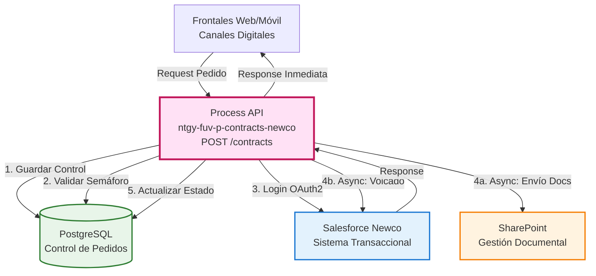
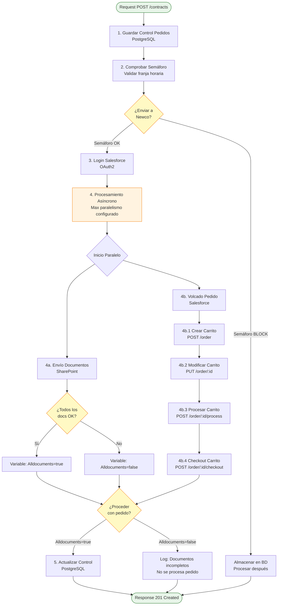
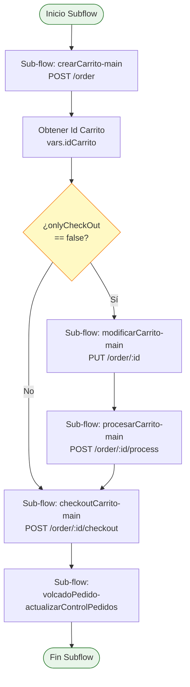
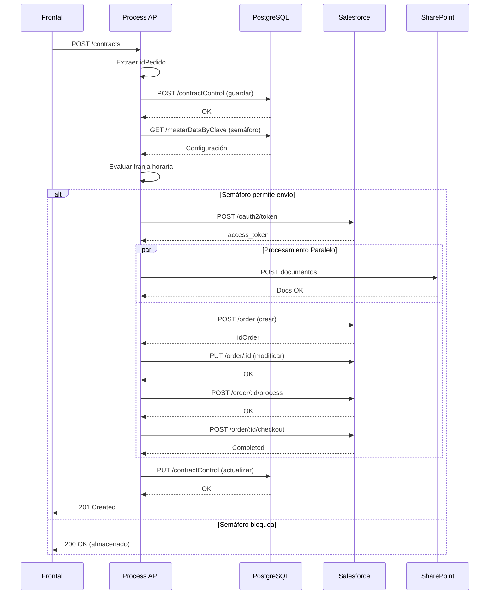

# POST /contracts

## 📌 Descripción General

### Propósito del Endpoint

Este endpoint orquesta el proceso completo de volcado de un pedido de contrato desde el frontal hacia Salesforce (Newco). Gestiona la creación, modificación, procesamiento y checkout de un carrito en Salesforce, además del envío paralelo de documentación a SharePoint y el control de pedidos en PostgreSQL.

### Tipo de API

**Capa:** Process API (API-Led Connectivity)

**Función:** Orquestación del proceso de volcado de pedidos a la comercializadora Newco

### Patrón de Integración

**Tipo:** Orquestación Compleja con Procesamiento Asíncrono

**Descripción:** 
- Flujo principal síncrono para validación y control
- Procesamiento asíncrono del volcado a Salesforce
- Envío paralelo de documentación a SharePoint
- Sistema de semáforo para control de envío basado en franjas horarias

### Arquitectura API-Led Connectivity



---

## 💼 Propósito del Negocio

### Casos de Uso Principales

1. **Volcado de Pedido desde Frontal**
   - Cliente completa pedido en portal web o app móvil
   - Sistema valida y envía pedido a Salesforce Newco
   - Beneficio: Automatización del proceso de alta de contratos

2. **Gestión de Documentación**
   - Envío automático de documentos adjuntos a SharePoint
   - Validación de completitud documental antes de procesar pedido
   - Beneficio: Centralización y trazabilidad de documentación

3. **Control de Carga del Sistema**
   - Sistema de semáforo para controlar envío en franjas horarias
   - Almacenamiento temporal cuando semáforo bloquea
   - Beneficio: Protección del sistema transaccional

### 🔗 Endpoints Dependientes

Este Process API consume los siguientes servicios:

| Sistema | Endpoint | Método | Propósito |
|---------|----------|--------|-----------|
| **Salesforce OAuth** | `/services/oauth2/token` | POST | Autenticación OAuth2 |
| **Salesforce Newco** | `/services/apexrest/v1/order` | POST | Crear carrito |
| **Salesforce Newco** | `/services/apexrest/v1/order/:idOrder` | PUT | Modificar carrito |
| **Salesforce Newco** | `/services/apexrest/v1/order/:idOrder/process` | POST | Procesar carrito |
| **Salesforce Newco** | `/services/apexrest/v1/order/:idOrder/checkout` | POST | Checkout carrito |
| **SharePoint** | `/sites/:site/_api/web/GetFolderByServerRelativeUrl(...)` | POST | Subir documentos |
| **PostgreSQL** | `/contractControl` | POST | Guardar pedido |
| **PostgreSQL** | `/contractControl` | PUT | Actualizar pedido |
| **PostgreSQL** | `/masterDataByClave` | GET | Configuración semáforo |

### Lógica de Orquestación



**Pasos del Proceso:**

1. **Guardar Control de Pedidos**: Registro inicial en PostgreSQL con idPedido único
2. **Validar Semáforo**: Consulta configuración y evalúa franja horaria actual
3. **Login Salesforce**: Autenticación OAuth2 para obtener access token
4. **Procesamiento Asíncrono** (si semáforo permite):
   - **4a. Envío Documentos**: Upload paralelo a SharePoint (excepto canal portabilidad)
   - **4b. Volcado Pedido**: Secuencia de operaciones en Salesforce
     - 4b.1: Crear carrito vacío
     - 4b.2: Modificar carrito con datos del pedido
     - 4b.3: Procesar carrito (validaciones de negocio)
     - 4b.4: Checkout final (confirmación)
5. **Actualizar Control**: Registro del resultado en PostgreSQL

### Sistema de Semáforo

**Configuración Dinámica:**
- Almacenada en PostgreSQL (tabla masterData)
- Formato: `active;horaDesde;horaHasta`
- Ejemplo: `TRUE;23:00:00;01:00:00` (bloquea de 23:00 a 01:00)
- Cache de 10 minutos para optimizar performance

**Lógica de Decisión:**
```
SI active == FALSE → No enviar a Salesforce
SI active == TRUE → Evaluar franja horaria:
  - Fuera de franja → Enviar a Salesforce
  - Dentro de franja → Almacenar en PostgreSQL
```

### Transformaciones Aplicadas

| Origen | Destino | Transformación |
|--------|---------|----------------|
| `payload.pedido.idPedido` | `vars.IdPedido` | Extracción de ID único |
| `payload` | `vars.PeticionOriginal` | Preservación del payload completo |
| `payload.canalDarwin` | Decisión de envío docs | Comparación con canal portabilidad |
| Salesforce response | `idOrder` | Extracción del ID de carrito creado |

### Contexto Empresarial

- **Dominio:** Gestión de Contratos Energéticos
- **Sector:** Energía - Utilities
- **División:** Naturgy España - Comercializadora NewCo
- **Proceso de Negocio:** Alta y gestión de contratos de suministro

### Stakeholders

- **Clientes Finales**: Solicitan contratos a través de canales digitales
- **Equipo de Ventas**: Gestiona pedidos desde call center
- **Equipo de Operaciones**: Monitorea y gestiona excepciones
- **Equipo de Sistemas**: Mantiene integración con Salesforce

### Valor de Negocio

- **Automatización**: Reducción de intervención manual en alta de contratos
- **Trazabilidad**: Control completo del ciclo de vida del pedido
- **Resiliencia**: Sistema de semáforo protege backend sin afectar frontal
- **Escalabilidad**: Procesamiento asíncrono con control de paralelismo

### Consumidores Potenciales

Este endpoint puede ser consumido por:
- Portales web de autoservicio (clientes)
- Aplicaciones móviles (iOS/Android)
- Sistemas de agentes de call center
- Integraciones con partners autorizados

---

## 🔧 Especificación Técnica

### URLs por Ambiente

| Ambiente | URL Base | URL Completa |
|----------|----------|--------------|
| **Local** | `http://localhost:8081` | `http://localhost:8081/api/contracts` |
| **Development** | `https://ntgy-fuv-p-contracts-newco-dev.us-e2.cloudhub.io` | `https://ntgy-fuv-p-contracts-newco-dev.us-e2.cloudhub.io/api/contracts` |
| **UAT** | `https://ntgy-fuv-p-contracts-newco-uat.us-e2.cloudhub.io` | `https://ntgy-fuv-p-contracts-newco-uat.us-e2.cloudhub.io/api/contracts` |
| **Production** | `https://ntgy-fuv-p-contracts-newco-pro.us-e2.cloudhub.io` | `https://ntgy-fuv-p-contracts-newco-pro.us-e2.cloudhub.io/api/contracts` |

### Método HTTP

```
POST /api/contracts
```

### Headers Requeridos

| Header | Tipo | Requerido | Descripción |
|--------|------|-----------|-------------|
| `Content-Type` | string | ✅ | Debe ser `application/json` |
| `client_id` | string | ✅ | Client ID de Anypoint Platform |
| `client_secret` | string | ✅ | Client Secret de Anypoint Platform |

### Request Body

**Estructura del Payload:**

```json
{
  "pedido": {
    "idPedido": "string",
    "tipoPedido": "string",
    "fechaPedido": "string (ISO 8601)",
    "cliente": {
      "nif": "string",
      "nombre": "string",
      "apellidos": "string",
      "email": "string",
      "telefono": "string"
    },
    "contrato": {
      "cups": "string",
      "tarifa": "string",
      "potencia": "number",
      "direccionSuministro": {
        "calle": "string",
        "numero": "string",
        "piso": "string",
        "puerta": "string",
        "codigoPostal": "string",
        "municipio": "string",
        "provincia": "string"
      }
    },
    "productos": [
      {
        "codigo": "string",
        "descripcion": "string",
        "cantidad": "number",
        "precio": "number"
      }
    ]
  },
  "canalDarwin": "string",
  "documentos": [
    {
      "nombre": "string",
      "tipo": "string",
      "contenido": "string (base64)"
    }
  ]
}
```

**Campos Obligatorios:**
- `pedido.idPedido`: Identificador único del pedido
- `pedido.cliente`: Datos del cliente
- `pedido.contrato`: Datos del contrato
- `canalDarwin`: Canal de origen del pedido

### Respuestas

#### 201 Created - Pedido Creado Exitosamente

```json
{
  "result": {
    "codResult": "0000",
    "msgResult": "Pedido procesado correctamente"
  },
  "creationResult": {
    "idOrder": "SF-12345",
    "message": "Carrito creado y procesado en Salesforce"
  }
}
```

#### 200 OK - Pedido Almacenado (Semáforo Bloqueado)

```json
{
  "result": {
    "codResult": "0000",
    "msgResult": "Pedido almacenado para procesamiento posterior"
  },
  "creationResult": {
    "message": "Pedido guardado en base de datos de control"
  }
}
```

#### 400 Bad Request - Payload Inválido

```json
{
  "message": "Bad request",
  "details": "El payload no cumple con la especificación RAML"
}
```

#### 500 Internal Server Error - Error Técnico

```json
{
  "result": {
    "codResult": "-0001",
    "msgResult": "Error técnico en el procesamiento"
  },
  "creationResult": {
    "message": "Error al procesar el pedido"
  }
}
```

### Autenticación

- **Tipo:** Client ID & Client Secret (Anypoint Platform)
- **Ubicación:** Headers HTTP
- **Validación:** Automática por políticas de Anypoint Platform

### Timeouts

| Tipo | Valor | Descripción |
|------|-------|-------------|
| **Request Timeout** | 60 segundos | Timeout para respuesta del frontal |
| **Salesforce Timeout** | Configurable | Timeout para operaciones en Salesforce |
| **SharePoint Timeout** | Configurable | Timeout para upload de documentos |
| **PostgreSQL Timeout** | 15 segundos | Timeout para operaciones de BD |

### Configuración de Paralelismo

| Parámetro | Valor | Descripción |
|-----------|-------|-------------|
| **Max Concurrency** | `${salesforce.max_paralelismo}` | Máximo de pedidos procesados en paralelo |
| **Async Processing** | Habilitado | Procesamiento asíncrono del volcado |

---

## 🏗️ Implementación Técnica

### Arquitectura del Flow Principal

```mermaid
flowchart TD
    Start([HTTP POST /contracts]) --> LogInicio[Log: Inicio Api Contracts]
    LogInicio --> MainFlow[volcadoPedidos-main]
    
    MainFlow --> InitVars[Inicializar Variables<br/>attempts_number=0]
    InitVars --> SaveOriginal[Guardar Petición Original<br/>vars.PeticionOriginal]
    SaveOriginal --> ExtractId[Extraer ID Pedido<br/>vars.IdPedido]
    
    ExtractId --> SaveControl[Sub-flow:<br/>volcadoPedido-guardarControlPedidos]
    SaveControl --> SetSemaforo[Configurar Variables Semáforo<br/>semaforoApp, semaforo]
    SetSemaforo --> CheckConfig[Sub-flow:<br/>comprobarConfiguracionEnvioNewco]
    
    CheckConfig --> SetToken[Set token = "-"]
    SetToken --> Decision{¿envioNewco<br/>== true?}
    
    Decision -->|Sí| Login[Sub-flow: login<br/>OAuth2 Salesforce]
    Decision -->|No| LogFin
    
    Login --> AsyncStart[Async Processing<br/>Max Concurrency]
    
    AsyncStart --> TryBlock[Try Block]
    TryBlock --> LogAsync[Log: Inicio Asincrono]
    LogAsync --> InitDocs[Inicializar ListaDocs = []]
    
    InitDocs --> CheckCanal{¿Canal !=<br/>Portabilidad?}
    CheckCanal -->|Sí| SendDocs[Sub-flow:<br/>envioDocumentos-mainSub_Flow]
    CheckCanal -->|No| LogNoDocs[Log: No envío docs<br/>Alldocuments=true]
    
    SendDocs --> CheckAllDocs{¿Alldocuments<br/>== true?}
    LogNoDocs --> CheckAllDocs
    
    CheckAllDocs -->|Sí| SetPayload[Set Payload<br/>PeticionOriginal]
    CheckAllDocs -->|No| LogNoProcess[Log: Docs incompletos<br/>No se procesa]
    
    SetPayload --> VolcadoSub[Sub-flow:<br/>volcadoPedidos-subflow]
    
    VolcadoSub --> UpdateControl[Sub-flow:<br/>volcadoPedido-actualizarControlPedidos]
    
    UpdateControl --> LogAsyncEnd[Log: Fin Asincrono]
    LogNoProcess --> LogAsyncEnd
    
    LogAsyncEnd --> LogFin[Log: Fin Api Contracts]
    LogFin --> End([HTTP Response])
    
    TryBlock -.->|Error| ErrorHandler[Error Handler:<br/>On Error Continue]
    ErrorHandler --> LogError[Log: Error Asincrono]
    LogError --> LogAsyncEnd
    
    style Start fill:#e8f5e9,stroke:#2e7d32
    style End fill:#e8f5e9,stroke:#2e7d32
    style AsyncStart fill:#fff3e0,stroke:#f57c00
    style Decision fill:#fff9c4,stroke:#f57f17
    style CheckCanal fill:#fff9c4,stroke:#f57f17
    style CheckAllDocs fill:#fff9c4,stroke:#f57f17
```

### Sub-flow: volcadoPedidos-subflow



### Sub-flow: comprobarConfiguracionEnvioNewco

**Propósito:** Validar si el pedido debe enviarse a Salesforce según configuración de semáforo

**Lógica de Validación:**

```dataweave
%dw 2.0
output application/java

// Configuración: "active;horaDesde;horaHasta"
var configuracionEnvio = vars.configuracionEnvio.record.valor splitBy(";")
var propEnvioActivo = configuracionEnvio[0] default "TRUE"
var propDesde = configuracionEnvio[1] default ""
var propHasta = configuracionEnvio[2] default ""

// Conversión de tiempos con timezone
var dateNow = (now() as String)[0 to 10]
var ahora = (now() as LocalDateTime) as Time

var excluirDesde = if (propDesde != "")
  ((((dateNow ++ propDesde) as LocalDateTime ++ "Europe/Madrid" as TimeZone) >> "UTC") as Time)
else ""

var excluirHasta = if (propHasta != "")
  ((((dateNow ++ propHasta) as LocalDateTime ++ "Europe/Madrid" as TimeZone) >> "UTC") as Time)
else ""

---
// Decisión final
if (upper(propEnvioActivo) == "TRUE")
  if ((excluirDesde != null and excluirDesde != "") and (excluirHasta != null and excluirHasta != ""))
    if (excluirDesde < excluirHasta)
      // Franja normal: 00:00:00 - 02:00:00
      (ahora < excluirDesde) or (ahora > excluirHasta)
    else
      // Franja nocturna: 23:00:00 - 01:00:00
      if ((ahora < excluirDesde) and (ahora < excluirHasta))
        false  // Dentro de franja bloqueada
      else if ((ahora > excluirDesde) and (ahora > excluirHasta))
        false  // Dentro de franja bloqueada
      else
        true   // Fuera de franja, enviar
  else
    true  // Sin franja configurada, enviar
else
  false  // Semáforo desactivado, no enviar
```

### Operaciones en Salesforce

#### 1. Login (OAuth2)

**Endpoint:** `POST /services/oauth2/token`

**Request:**
```
grant_type=password
&client_id=${salesforce.clientId}
&client_secret=${salesforce.clientSecret}
&username=${salesforce.username}
&password=${salesforce.password}${salesforce.securityToken}
```

**Response:**
```json
{
  "access_token": "00D...",
  "instance_url": "https://...",
  "token_type": "Bearer"
}
```

**Variable Generada:** `vars.token = "Bearer " ++ payload.access_token`

#### 2. Crear Carrito

**Endpoint:** `POST /services/apexrest/v1/order`

**Headers:**
- `Authorization: ${vars.token}`
- `Content-Type: application/json`

**Request Body:** Payload del pedido transformado

**Response:**
```json
{
  "idOrder": "SF-12345",
  "status": "Created"
}
```

**Variable Generada:** `vars.idCarrito = payload.idOrder`

#### 3. Modificar Carrito

**Endpoint:** `PUT /services/apexrest/v1/order/:idOrder`

**Headers:**
- `Authorization: ${vars.token}`
- `Content-Type: application/json`

**Request Body:** Datos del pedido para modificar el carrito

**Response:**
```json
{
  "idOrder": "SF-12345",
  "status": "Modified"
}
```

#### 4. Procesar Carrito

**Endpoint:** `POST /services/apexrest/v1/order/:idOrder/process`

**Headers:**
- `Authorization: ${vars.token}`
- `Content-Type: application/json`

**Response:**
```json
{
  "idOrder": "SF-12345",
  "status": "Processed"
}
```

#### 5. Checkout Carrito

**Endpoint:** `POST /services/apexrest/v1/order/:idOrder/checkout`

**Headers:**
- `Authorization: ${vars.token}`
- `Content-Type: application/json`

**Response:**
```json
{
  "idOrder": "SF-12345",
  "status": "Completed",
  "contractId": "CNT-67890"
}
```

### Operaciones en PostgreSQL

#### 1. Guardar Control de Pedidos

**Endpoint:** `POST /contractControl`

**Request:**
```json
{
  "orderId": "PED-12345",
  "message": {
    "pedido": { ... },
    "canalDarwin": "WEB"
  }
}
```

#### 2. Actualizar Control de Pedidos

**Endpoint:** `PUT /contractControl`

**Request:**
```json
{
  "orderId": "PED-12345",
  "status": "COMPLETED",
  "salesforceOrderId": "SF-12345"
}
```

#### 3. Obtener Configuración Semáforo

**Endpoint:** `GET /masterDataByClave`

**Query Parameters:**
- `master`: `${semaforo.newco}` (ej: "NEWCO")
- `clave`: `${semaforo.online}` (ej: "ONLINE")

**Response:**
```json
{
  "record": {
    "valor": "TRUE;23:00:00;01:00:00"
  }
}
```

### Diagramas de Secuencia

#### Flujo Completo de Éxito



### Manejo de Errores

**Estrategia Global:**
- Error handler con `on-error-continue` para procesamiento asíncrono
- Logging detallado de errores con idPedido para trazabilidad
- No se propagan errores al frontal si el pedido se almacenó correctamente

**Tipos de Errores:**

| Error | Código | Acción |
|-------|--------|--------|
| Payload inválido | 400 | Rechazo inmediato por APIKit |
| Semáforo bloquea | 200 | Almacenar en BD, responder OK |
| Error en Salesforce | Log | Continuar, no propagar |
| Error en SharePoint | Log | Marcar docs incompletos, no procesar pedido |
| Error en PostgreSQL | 500 | Propagar error al frontal |

### Patrones de Diseño Implementados

1. **Async Processing Pattern**
   - Procesamiento asíncrono con control de concurrencia
   - Respuesta inmediata al frontal
   - Procesamiento en background

2. **Circuit Breaker Pattern (Semáforo)**
   - Protección del sistema transaccional
   - Degradación controlada del servicio
   - Configuración dinámica sin redespliegue

3. **Saga Pattern (Compensating Transactions)**
   - Si documentos fallan, no se procesa el pedido
   - Trazabilidad completa del estado

4. **Cache-Aside Pattern**
   - Cache de configuración de semáforo
   - TTL de 10 minutos
   - Reducción de carga en PostgreSQL

---

## 💻 Ejemplos de Uso

### Ejemplo 1: Llamada Exitosa con Semáforo Activo

#### cURL

```bash
curl -X POST "https://ntgy-fuv-p-contracts-newco-pro.us-e2.cloudhub.io/api/contracts" \
  -H "Content-Type: application/json" \
  -H "client_id: YOUR_CLIENT_ID" \
  -H "client_secret: YOUR_CLIENT_SECRET" \
  -d '{
    "pedido": {
      "idPedido": "PED-2026-001234",
      "tipoPedido": "ALTA",
      "fechaPedido": "2026-01-09T14:30:00Z",
      "cliente": {
        "nif": "12345678A",
        "nombre": "Juan",
        "apellidos": "García López",
        "email": "juan.garcia@example.com",
        "telefono": "+34600123456"
      },
      "contrato": {
        "cups": "ES0021000000000001JN",
        "tarifa": "2.0TD",
        "potencia": 4.6,
        "direccionSuministro": {
          "calle": "Calle Mayor",
          "numero": "123",
          "piso": "3",
          "puerta": "A",
          "codigoPostal": "28013",
          "municipio": "Madrid",
          "provincia": "Madrid"
        }
      },
      "productos": [
        {
          "codigo": "ELEC-2.0TD",
          "descripcion": "Tarifa 2.0TD Electricidad",
          "cantidad": 1,
          "precio": 0.15
        }
      ]
    },
    "canalDarwin": "WEB",
    "documentos": [
      {
        "nombre": "DNI_cliente.pdf",
        "tipo": "DNI",
        "contenido": "JVBERi0xLjQKJeLjz9MK..."
      }
    ]
  }'
```

#### Respuesta (201 Created)

```json
{
  "result": {
    "codResult": "0000",
    "msgResult": "Pedido procesado correctamente"
  },
  "creationResult": {
    "idOrder": "SF-2026-001234",
    "message": "Carrito creado y procesado en Salesforce"
  }
}
```

### Ejemplo 2: Pedido Almacenado (Semáforo Bloqueado)

#### cURL

```bash
curl -X POST "https://ntgy-fuv-p-contracts-newco-pro.us-e2.cloudhub.io/api/contracts" \
  -H "Content-Type: application/json" \
  -H "client_id: YOUR_CLIENT_ID" \
  -H "client_secret: YOUR_CLIENT_SECRET" \
  -d '{
    "pedido": {
      "idPedido": "PED-2026-001235",
      "tipoPedido": "ALTA",
      "cliente": { ... },
      "contrato": { ... }
    },
    "canalDarwin": "MOBILE"
  }'
```

#### Respuesta (200 OK)

```json
{
  "result": {
    "codResult": "0000",
    "msgResult": "Pedido almacenado para procesamiento posterior"
  },
  "creationResult": {
    "message": "Pedido guardado en base de datos de control. Se procesará cuando el sistema esté disponible."
  }
}
```

### Ejemplo 3: JavaScript (Fetch API)

```javascript
const createContract = async (pedidoData) => {
  try {
    const response = await fetch(
      'https://ntgy-fuv-p-contracts-newco-pro.us-e2.cloudhub.io/api/contracts',
      {
        method: 'POST',
        headers: {
          'Content-Type': 'application/json',
          'client_id': process.env.CLIENT_ID,
          'client_secret': process.env.CLIENT_SECRET
        },
        body: JSON.stringify(pedidoData)
      }
    );

    if (!response.ok) {
      throw new Error(`HTTP error! status: ${response.status}`);
    }

    const data = await response.json();
    console.log('Pedido creado:', data);
    return data;
  } catch (error) {
    console.error('Error al crear pedido:', error);
    throw error;
  }
};

// Uso
const pedido = {
  pedido: {
    idPedido: 'PED-2026-001236',
    tipoPedido: 'ALTA',
    fechaPedido: new Date().toISOString(),
    cliente: {
      nif: '12345678A',
      nombre: 'María',
      apellidos: 'Rodríguez Pérez',
      email: 'maria.rodriguez@example.com',
      telefono: '+34600987654'
    },
    contrato: {
      cups: 'ES0021000000000002JN',
      tarifa: '2.0TD',
      potencia: 3.45
    }
  },
  canalDarwin: 'WEB'
};

createContract(pedido);
```

### Ejemplo 4: Python (Requests)

```python
import requests
import json
from datetime import datetime

def create_contract(pedido_data, client_id, client_secret):
    """
    Crea un contrato en Newco
    
    Args:
        pedido_data (dict): Datos del pedido
        client_id (str): Client ID de Anypoint
        client_secret (str): Client Secret de Anypoint
    
    Returns:
        dict: Respuesta del API
    """
    url = 'https://ntgy-fuv-p-contracts-newco-pro.us-e2.cloudhub.io/api/contracts'
    
    headers = {
        'Content-Type': 'application/json',
        'client_id': client_id,
        'client_secret': client_secret
    }
    
    try:
        response = requests.post(
            url,
            headers=headers,
            json=pedido_data,
            timeout=60
        )
        response.raise_for_status()
        return response.json()
    except requests.exceptions.RequestException as e:
        print(f'Error al crear pedido: {e}')
        raise

# Uso
pedido = {
    'pedido': {
        'idPedido': 'PED-2026-001237',
        'tipoPedido': 'ALTA',
        'fechaPedido': datetime.now().isoformat(),
        'cliente': {
            'nif': '87654321B',
            'nombre': 'Carlos',
            'apellidos': 'Martínez Sánchez',
            'email': 'carlos.martinez@example.com',
            'telefono': '+34600111222'
        },
        'contrato': {
            'cups': 'ES0021000000000003JN',
            'tarifa': '3.0TD',
            'potencia': 10.35
        }
    },
    'canalDarwin': 'CALL_CENTER'
}

result = create_contract(
    pedido,
    client_id='YOUR_CLIENT_ID',
    client_secret='YOUR_CLIENT_SECRET'
)
print(json.dumps(result, indent=2))
```

### Ejemplo 5: Error - Payload Inválido

#### Request

```bash
curl -X POST "https://ntgy-fuv-p-contracts-newco-pro.us-e2.cloudhub.io/api/contracts" \
  -H "Content-Type: application/json" \
  -H "client_id: YOUR_CLIENT_ID" \
  -H "client_secret: YOUR_CLIENT_SECRET" \
  -d '{
    "pedido": {
      "idPedido": "PED-2026-001238"
      // Faltan campos obligatorios
    }
  }'
```

#### Respuesta (400 Bad Request)

```json
{
  "message": "Bad request",
  "details": "Missing required field: pedido.cliente"
}
```

### Ejemplo 6: Monitoreo del Estado del Pedido

```javascript
// Función para verificar el estado del pedido
const checkOrderStatus = async (idPedido) => {
  // Nota: Este endpoint de consulta debe implementarse por separado
  const response = await fetch(
    `https://ntgy-fuv-p-contracts-newco-pro.us-e2.cloudhub.io/api/contracts/${idPedido}`,
    {
      method: 'GET',
      headers: {
        'client_id': process.env.CLIENT_ID,
        'client_secret': process.env.CLIENT_SECRET
      }
    }
  );
  
  return await response.json();
};

// Polling para verificar estado
const waitForCompletion = async (idPedido, maxAttempts = 10) => {
  for (let i = 0; i < maxAttempts; i++) {
    const status = await checkOrderStatus(idPedido);
    
    if (status.estado === 'COMPLETED') {
      console.log('Pedido completado:', status);
      return status;
    }
    
    console.log(`Intento ${i + 1}: Estado actual - ${status.estado}`);
    await new Promise(resolve => setTimeout(resolve, 5000)); // Esperar 5 segundos
  }
  
  throw new Error('Timeout esperando completación del pedido');
};
```
