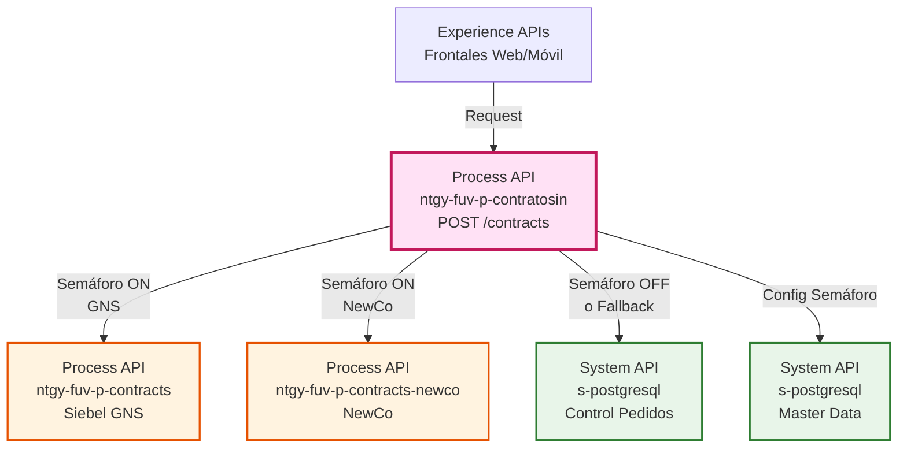
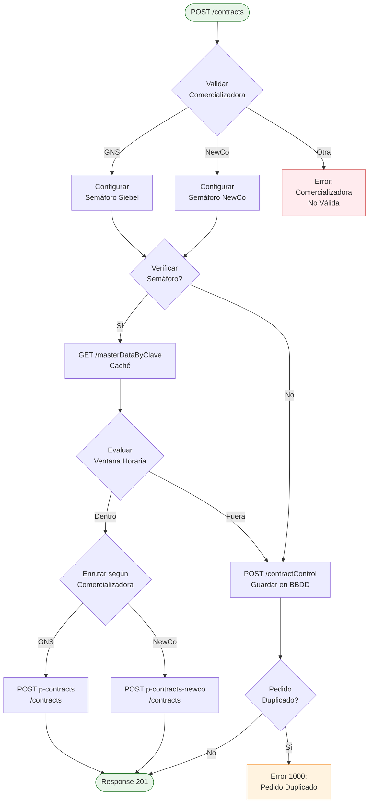
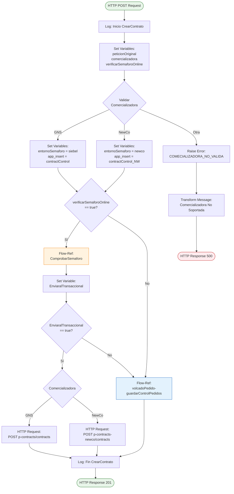
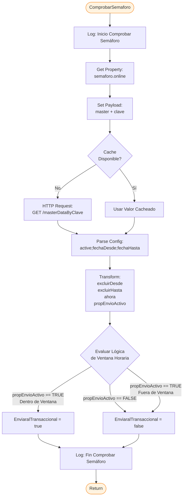
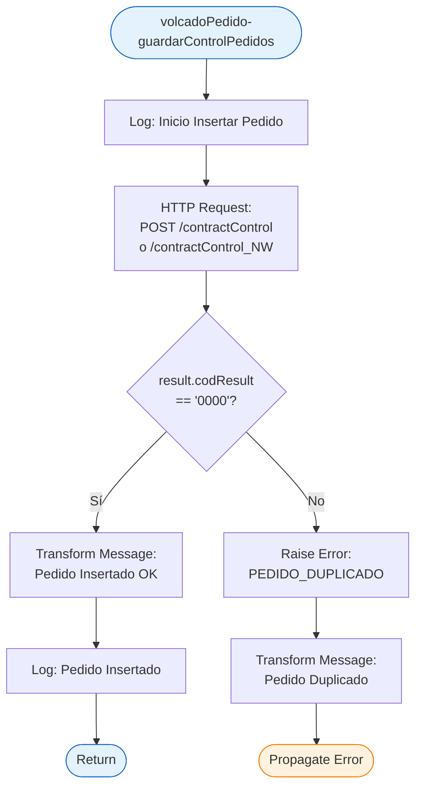
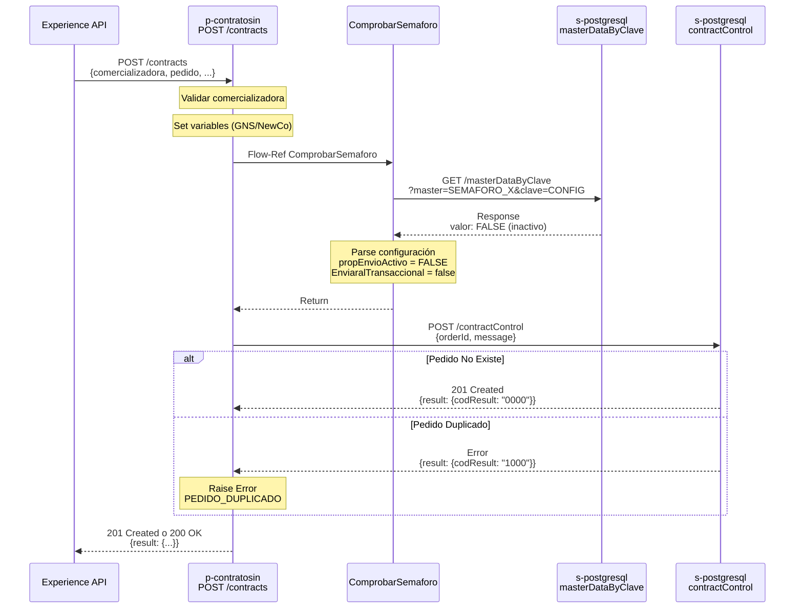
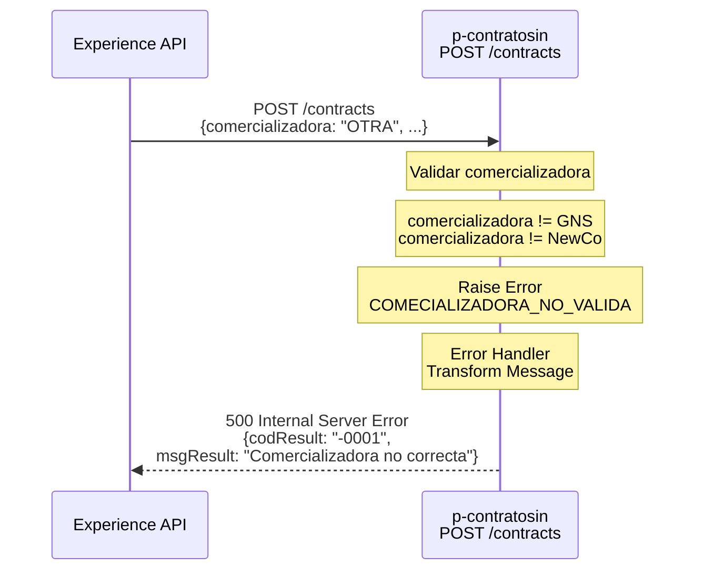

# POST /contracts

## 📌 Descripción General

### Propósito del Endpoint

Este endpoint actúa como **API orquestadora** para la creación de contratos, implementando un patrón de enrutamiento inteligente basado en:
- **Comercializadora** (GNS o NewCo)
- **Estado del semáforo** (online/offline con control horario)
- **Prevención de duplicados** mediante control de pedidos

El endpoint NO crea contratos directamente, sino que **orquesta y enruta** las peticiones hacia las Process APIs transaccionales correspondientes (`p-contracts` o `p-contracts-newco`), o guarda los pedidos en una base de datos de control cuando el semáforo está en modo offline.

### Tipo de API

**Capa:** Process API (API-Led Connectivity)

**Función:** Orquestación de creación de contratos con control de flujo y enrutamiento condicional

### Patrón de Integración

**Tipo:** Orquestación con Enrutamiento Condicional + Control de Semáforo

**Descripción:** 
1. Valida la comercializadora del pedido
2. Consulta configuración de semáforo (con caché)
3. Evalúa ventana horaria de envío
4. Enruta a Process API transaccional o guarda en BBDD según estado del semáforo

### Arquitectura API-Led Connectivity



---

## 💼 Propósito del Negocio

### Casos de Uso Principales

1. **Creación de Contratos en Modo Online (Tiempo Real)**
   - El pedido se enruta inmediatamente a la Process API transaccional correspondiente
   - Beneficio: Procesamiento inmediato en Siebel/NewCo
   - Aplicable cuando el semáforo está activo y dentro de la ventana horaria

2. **Creación de Contratos en Modo Offline (Diferido)**
   - El pedido se guarda en base de datos de control para procesamiento posterior
   - Beneficio: Garantiza la recepción del pedido incluso cuando los sistemas transaccionales no están disponibles
   - Aplicable cuando el semáforo está inactivo o fuera de ventana horaria

3. **Prevención de Pedidos Duplicados**
   - Validación automática de duplicados mediante control de pedidos
   - Beneficio: Evita procesamiento redundante y errores de negocio
   - Aplicable en todos los casos

### 🔗 Endpoints Dependientes

Este Process API consume los siguientes endpoints:

| API | Endpoint | Método | Propósito |
|-----|----------|--------|-----------|
| `ntgy-fuv-p-contracts` | `/contracts` | POST | Creación transaccional de contratos en Siebel (GNS) |
| `ntgy-fuv-p-contracts-newco` | `/contracts` | POST | Creación transaccional de contratos en NewCo |
| `s-postgresql` | `/contractControl` | POST | Control de pedidos GNS y prevención de duplicados |
| `s-postgresql` | `/contractControl_NW` | POST | Control de pedidos NewCo y prevención de duplicados |
| `s-postgresql` | `/masterDataByClave` | GET | Configuración de semáforo (online/offline + ventana horaria) |

### Lógica de Orquestación



**Pasos del Proceso:**

1. **Validación de Comercializadora**: Determina si es GNS o NewCo, configura variables de entorno
2. **Verificación de Semáforo**: Si está habilitado, consulta configuración desde master data (con caché)
3. **Evaluación de Ventana Horaria**: Calcula si la hora actual está dentro de la ventana de envío permitida
4. **Enrutamiento Condicional**: 
   - Si semáforo activo y dentro de ventana → Envía a Process API transaccional
   - Si semáforo inactivo o fuera de ventana → Guarda en BBDD
5. **Control de Duplicados**: Valida que el pedido no exista previamente

### Transformaciones Aplicadas

⚠️ **Este Process API NO transforma la estructura del payload.**

El payload se pasa tal cual a:
- Process APIs transaccionales (`p-contracts` o `p-contracts-newco`)
- System API de control de pedidos (envuelto en estructura `{orderId, message}`)

**Estructura de guardado en BBDD:**
```json
{
  "orderId": "ID_PEDIDO",
  "message": {
    // Payload original completo
  }
}
```

### Contexto Empresarial

- **Dominio:** Gestión de Contratos y Pedidos
- **Sector:** Energía - Utilities
- **División:** Naturgy España - Comercializadoras GNS y NewCo
- **Proceso de Negocio:** Creación de contratos de suministro energético con control de flujo

### Stakeholders

- **Equipos de Ventas**: Necesitan crear contratos desde frontales web/móvil
- **Operaciones IT**: Requieren control de flujo para mantenimientos programados
- **Equipos de Soporte**: Necesitan visibilidad de pedidos en cola (modo offline)

### Valor de Negocio

- **Alta Disponibilidad**: Garantiza recepción de pedidos incluso cuando sistemas transaccionales no están disponibles
- **Control de Flujo**: Permite gestionar ventanas de mantenimiento sin pérdida de pedidos
- **Prevención de Errores**: Evita duplicados automáticamente
- **Flexibilidad**: Soporta múltiples comercializadoras con enrutamiento inteligente

### Consumidores Potenciales

Este endpoint puede ser consumido por:
- Portales web de autoservicio (clientes)
- Aplicaciones móviles de ventas
- Sistemas de agentes de call center
- Plataformas de gestión de pedidos

---

## 🔧 Especificación Técnica

### URLs por Ambiente

| Ambiente | URL Base | URL Completa |
|----------|----------|--------------|
| **Local** | `http://localhost:8081` | `http://localhost:8081/api/contracts` |
| **Development** | `https://ntgy-fuv-p-contratosin-dev.us-e2.cloudhub.io` | `https://ntgy-fuv-p-contratosin-dev.us-e2.cloudhub.io/api/contracts` |
| **UAT** | `https://ntgy-fuv-p-contratosin-uat.us-e2.cloudhub.io` | `https://ntgy-fuv-p-contratosin-uat.us-e2.cloudhub.io/api/contracts` |
| **Production** | `https://ntgy-fuv-p-contratosin-pro.us-e2.cloudhub.io` | `https://ntgy-fuv-p-contratosin-pro.us-e2.cloudhub.io/api/contracts` |

### Método HTTP

```
POST /api/contracts
```

### Headers Requeridos

```http
Content-Type: application/json
client_id: YOUR_CLIENT_ID
client_secret: YOUR_CLIENT_SECRET
```

### Parámetros de Entrada

**Body (application/json):**

```json
{
  "comercializadora": "GNS | NewCo",
  "pedido": {
    "idPedido": "string",
    "tipoPedido": "string",
    "fechaPedido": "string (ISO 8601)",
    // ... otros campos del pedido
  },
  "cliente": {
    "nif": "string",
    "nombre": "string",
    "apellidos": "string",
    // ... otros campos del cliente
  },
  "contrato": {
    "cups": "string",
    "tarifa": "string",
    "potencia": "number",
    // ... otros campos del contrato
  }
}
```

**Campos Obligatorios:**
- `comercializadora`: Debe ser "GNS" o "NewCo"
- `pedido.idPedido`: Identificador único del pedido

### Respuestas

#### ✅ 201 Created - Pedido Creado/Guardado Exitosamente

```json
{
  "result": {
    "codResult": "0000",
    "msgResult": "No hay error"
  },
  "creationResult": {
    "message": "Pedido procesado correctamente"
  }
}
```

#### ⚠️ 200 OK - Pedido Duplicado

```json
{
  "result": {
    "codResult": "1000",
    "msgResult": "Pedido duplicado"
  },
  "creationResult": {
    "message": "Pedido duplicado"
  }
}
```

#### ❌ 500 Internal Server Error - Comercializadora No Válida

```json
{
  "result": {
    "codResult": "-0001",
    "msgResult": "La comercializadora indicada no es correcta"
  },
  "creationResult": {
    "message": "Comercializadora No Soportada"
  }
}
```

#### ❌ 500 Internal Server Error - Error Técnico

```json
{
  "result": {
    "codResult": "-0001",
    "msgResult": "Error técnico"
  },
  "creationResult": {
    "message": "Error técnico"
  }
}
```

### Códigos de Estado HTTP

| Código | Descripción | Escenario |
|--------|-------------|-----------|
| `201` | Created | Pedido procesado correctamente (online u offline) |
| `200` | OK | Pedido duplicado detectado |
| `500` | Internal Server Error | Error técnico o comercializadora no válida |

### Autenticación

- **Tipo:** Client ID & Client Secret (Anypoint Platform)
- **Headers:** `client_id` y `client_secret`

### Timeouts

| Tipo | Valor |
|------|-------|
| **Request Timeout** | 30 segundos |
| **Connection Timeout** | 10 segundos |

---

## 🏗️ Implementación Técnica

### Arquitectura del Flow



### Sub-Flow: ComprobarSemaforo



### Sub-Flow: volcadoPedido-guardarControlPedidos



### Configuración de Semáforo

**Propiedades (p-contratosin-global-config.yaml):**

```yaml
semaforo:
  verificarOnline: true  # Habilita/deshabilita verificación de semáforo
  online: "CONFIGURACION_ENVIO_ONLINE"  # Clave en master data
  siebel: "SEMAFORO_SIEBEL"  # Master para GNS
  newco: "SEMAFORO_NEWCO"    # Master para NewCo
```

**Formato de Configuración en Master Data:**

```
active;HH:mm:ss;HH:mm:ss
```

Ejemplos:
- `TRUE;00:00:00;23:59:59` - Activo todo el día
- `TRUE;08:00:00;20:00:00` - Activo de 8:00 a 20:00
- `FALSE;;` - Inactivo (siempre guarda en BBDD)

**Lógica de Evaluación:**

```dataweave
%dw 2.0
output application/java
---
// Si propEnvioActivo == "FALSE", no enviar al transaccional
if (upper(vars.propEnvioActivo) == "TRUE")(
  // Si hay ventana horaria definida
  if ((vars.excluirDesde != null) and (vars.excluirHasta != null))(
    // Caso 1: Ventana normal (ej: 08:00:00 - 20:00:00)
    if (vars.excluirDesde < vars.excluirHasta)(
      (vars.ahora < vars.excluirDesde) or (vars.ahora > vars.excluirHasta)
    // Caso 2: Ventana que cruza medianoche (ej: 23:00:00 - 01:00:00)
    ) else if ((vars.ahora < vars.excluirDesde) and (vars.ahora < vars.excluirHasta))(
      false
    ) else if ((vars.ahora > vars.excluirDesde) and (vars.ahora > vars.excluirHasta))(
      false
    ) else (
      true
    )
  ) else true  // Sin ventana horaria, siempre enviar
) else false  // Semáforo inactivo, no enviar
```

### Configuración HTTP Requests

**p-contracts (GNS):**
```xml
<http:request-config name="HTTP_Request_ntgy-fuv-p-contracts">
    <http:request-connection 
        host="${p-contracts.host}" 
        port="${p-contracts.port}"
        protocol="HTTPS"/>
</http:request-config>
```

**p-contracts-newco:**
```xml
<http:request-config name="HTTP_Request_ntgy-fuv-p-contracts-newco">
    <http:request-connection 
        host="${p-contracts-newco.host}" 
        port="${p-contracts-newco.port}"
        protocol="HTTPS"/>
</http:request-config>
```

**s-postgresql (BBDD):**
```xml
<http:request-config name="DDBB_HTTP_Request_configuration">
    <http:request-connection 
        host="${ddbb.host}" 
        port="${ddbb.port}"
        protocol="HTTPS"/>
</http:request-config>
```

### Caché de Configuración

```xml
<ee:object-store-caching-strategy 
    name="Caching_Strategy" 
    keyGenerationExpression="#[payload]"
    doc:name="Caching_Strategy">
    <os:private-object-store 
        alias="semaforoCache" 
        maxEntries="100" 
        entryTtl="5" 
        entryTtlUnit="MINUTES"/>
</ee:object-store-caching-strategy>
```

**Características:**
- TTL: 5 minutos
- Max Entries: 100
- Key: `{master: "SEMAFORO_X", clave: "CONFIGURACION_ENVIO_ONLINE"}`

### Manejo de Errores

**Error Handler Principal:**

```xml
<error-handler>
    <!-- Pedido Duplicado -->
    <on-error-continue type="APP:PEDIDO_DUPLICADO">
        <ee:transform>
            <ee:set-payload>
                {
                  "result": {
                    "codResult": "1000",
                    "msgResult": "Pedido duplicado"
                  },
                  "creationResult": {
                    "message": "Pedido duplicado"
                  }
                }
            </ee:set-payload>
        </ee:transform>
    </on-error-continue>
    
    <!-- Comercializadora No Válida -->
    <on-error-propagate type="APP:COMECIALIZADORA_NO_VALIDA">
        <ee:transform>
            <ee:set-payload>
                {
                  "result": {
                    "codResult": "-0001",
                    "msgResult": "La comercializadora indicada no es correcta"
                  },
                  "creationResult": {
                    "message": "Comercializadora No Soportada"
                  }
                }
            </ee:set-payload>
        </ee:transform>
    </on-error-propagate>
    
    <!-- Error Técnico General -->
    <on-error-propagate>
        <ee:transform>
            <ee:set-payload>
                {
                  "result": {
                    "codResult": "-0001",
                    "msgResult": "Error técnico"
                  },
                  "creationResult": {
                    "message": "Error técnico"
                  }
                }
            </ee:set-payload>
        </ee:transform>
    </on-error-propagate>
</error-handler>
```

### Diagramas de Secuencia

#### 1. Flujo Normal - Modo Online (Semáforo Activo)

```mermaid
sequenceDiagram
    participant E as Experience API
    participant P as p-contratosin<br/>POST /contracts
    participant CS as ComprobarSemaforo
    participant MD as s-postgresql<br/>masterDataByClave
    participant PT as p-contracts<br/>o p-contracts-newco
    
    E->>P: POST /contracts<br/>{comercializadora, pedido, ...}
    
    Note over P: Validar comercializadora
    Note over P: Set variables (GNS/NewCo)
    
    P->>CS: Flow-Ref ComprobarSemaforo
    CS->>MD: GET /masterDataByClave<br/>?master=SEMAFORO_X&clave=CONFIG
    MD-->>CS: Response<br/>valor: TRUE;08:00:00;20:00:00
    
    Note over CS: Parse configuración<br/>Evaluar ventana horaria<br/>Hora actual: 10:00:00
    Note over CS: Dentro de ventana<br/>EnviaralTransaccional = true
    
    CS-->>P: Return
    
    alt Comercializadora = GNS
        P->>PT: POST p-contracts/contracts<br/>{payload original}
    else Comercializadora = NewCo
        P->>PT: POST p-contracts-newco/contracts<br/>{payload original}
    end
    
    PT-->>P: 201 Created<br/>{result: {codResult: "0000"}}
    
    P-->>E: 201 Created<br/>{result: {codResult: "0000"}}
```

#### 2. Flujo Modo Offline (Semáforo Inactivo o Fuera de Ventana)



#### 3. Flujo con Error - Comercializadora No Válida



### Código Fuente de Referencia

**Flow Principal (createContract-main.xml, líneas 7-95):**

```xml
<flow name="CrearContratoFlow">
    <logger level="INFO" message='#[payload.pedido.idPedido ++ " - CrearContrato: Inicio"]' />
    <set-variable value="#[payload]" variableName="peticionOriginal" />
    <set-variable value="#[vars.peticionOriginal.comercializadora]" variableName="comercializadora" />
    <set-variable value="${semaforo.verificarOnline}" variableName="verificarSemaforoOnline"/>
    <set-variable value="#[vars.PeticionOriginal.pedido.idPedido]" variableName="idPedido"/>
    
    <choice>
        <when expression="#[(vars.comercializadora == 'GNS')]">
            <set-variable value="${semaforo.siebel}" variableName="entornoSemaforo" />
            <set-variable value='#["contractControl"]' variableName="app_insert" />
        </when>
        <when expression="#[(vars.comercializadora == 'NewCo')]">
            <set-variable value="${semaforo.newco}" variableName="entornoSemaforo" />
            <set-variable value='#["contractControl_NW"]' variableName="app_insert"/>
        </when>
        <otherwise>
            <raise-error type="APP:COMECIALIZADORA_NO_VALIDA"/>
        </otherwise>
    </choice>
    
    <choice>
        <when expression="#[vars.verificarSemaforoOnline as Boolean]">
            <flow-ref name="ComprobarSemaforo" />
        </when>
    </choice>
    
    <choice>
        <when expression="#[(vars.EnviaralTransaccional == true)]">
            <choice>
                <when expression="#[(vars.comercializadora == 'GNS')]">
                    <http:request method="POST" config-ref="HTTP_Request_ntgy-fuv-p-contracts" 
                                  path="/contracts">
                        <http:body>#[vars.peticionOriginal]</http:body>
                    </http:request>
                </when>
                <when expression="#[(vars.comercializadora == 'NewCo')]">
                    <http:request method="POST" config-ref="HTTP_Request_ntgy-fuv-p-contracts-newco" 
                                  path="/contracts">
                        <http:body>#[vars.peticionOriginal]</http:body>
                    </http:request>
                </when>
            </choice>
        </when>
        <otherwise>
            <flow-ref name="volcadoPedido-guardarControlPedidos" />
        </otherwise>
    </choice>
</flow>
```

---

## 💻 Ejemplos de Uso

### Ejemplo 1: Creación Exitosa - Modo Online (GNS)

#### Request

```bash
curl -X POST "https://ntgy-fuv-p-contratosin-pro.us-e2.cloudhub.io/api/contracts" \
  -H "Content-Type: application/json" \
  -H "client_id: YOUR_CLIENT_ID" \
  -H "client_secret: YOUR_CLIENT_SECRET" \
  -d '{
    "comercializadora": "GNS",
    "pedido": {
      "idPedido": "PED-2026-001234",
      "tipoPedido": "ALTA",
      "fechaPedido": "2026-09-10T08:15:00Z"
    },
    "cliente": {
      "nif": "12345678A",
      "nombre": "Juan",
      "apellidos": "García López"
    },
    "contrato": {
      "cups": "ES0021000000000001JN",
      "tarifa": "2.0TD",
      "potencia": 4.6
    }
  }'
```

#### Response (201 Created)

```json
{
  "result": {
    "codResult": "0000",
    "msgResult": "No hay error"
  },
  "creationResult": {
    "message": "Pedido procesado correctamente"
  }
}
```

**Flujo ejecutado:**
1. Validación: comercializadora = GNS ✓
2. Semáforo: Activo, hora 08:15 dentro de ventana (08:00-20:00) ✓
3. Enrutamiento: POST a `p-contracts/contracts` ✓
4. Resultado: Contrato creado en Siebel

---

### Ejemplo 2: Creación Exitosa - Modo Offline (NewCo)

#### Request

```bash
curl -X POST "https://ntgy-fuv-p-contratosin-pro.us-e2.cloudhub.io/api/contracts" \
  -H "Content-Type: application/json" \
  -H "client_id: YOUR_CLIENT_ID" \
  -H "client_secret: YOUR_CLIENT_SECRET" \
  -d '{
    "comercializadora": "NewCo",
    "pedido": {
      "idPedido": "PED-2026-001235",
      "tipoPedido": "CAMBIO_TITULAR",
      "fechaPedido": "2026-09-10T22:30:00Z"
    },
    "cliente": {
      "nif": "87654321B",
      "nombre": "María",
      "apellidos": "Rodríguez Pérez"
    },
    "contrato": {
      "cups": "ES0031000000000002AB",
      "tarifa": "3.0TD",
      "potencia": 10.35
    }
  }'
```

#### Response (201 Created)

```json
{
  "result": {
    "codResult": "0000",
    "msgResult": "No hay error"
  },
  "creationResult": {
    "message": "Pedido procesado correctamente"
  }
}
```

**Flujo ejecutado:**
1. Validación: comercializadora = NewCo ✓
2. Semáforo: Activo, pero hora 22:30 fuera de ventana (08:00-20:00) ✗
3. Guardado: POST a `s-postgresql/contractControl_NW` ✓
4. Resultado: Pedido guardado en BBDD para procesamiento posterior

---

### Ejemplo 3: Error - Pedido Duplicado

#### Request

```bash
curl -X POST "https://ntgy-fuv-p-contratosin-pro.us-e2.cloudhub.io/api/contracts" \
  -H "Content-Type: application/json" \
  -H "client_id: YOUR_CLIENT_ID" \
  -H "client_secret: YOUR_CLIENT_SECRET" \
  -d '{
    "comercializadora": "GNS",
    "pedido": {
      "idPedido": "PED-2026-001234",
      "tipoPedido": "ALTA",
      "fechaPedido": "2026-09-10T08:15:00Z"
    },
    "cliente": {
      "nif": "12345678A",
      "nombre": "Juan",
      "apellidos": "García López"
    }
  }'
```

#### Response (200 OK)

```json
{
  "result": {
    "codResult": "1000",
    "msgResult": "Pedido duplicado"
  },
  "creationResult": {
    "message": "Pedido duplicado"
  }
}
```

**Flujo ejecutado:**
1. Validación: comercializadora = GNS ✓
2. Semáforo: Inactivo o fuera de ventana
3. Guardado: POST a `s-postgresql/contractControl`
4. Validación BBDD: idPedido ya existe ✗
5. Resultado: Error controlado, pedido duplicado

---

### Ejemplo 4: Error - Comercializadora No Válida

#### Request

```bash
curl -X POST "https://ntgy-fuv-p-contratosin-pro.us-e2.cloudhub.io/api/contracts" \
  -H "Content-Type: application/json" \
  -H "client_id: YOUR_CLIENT_ID" \
  -H "client_secret: YOUR_CLIENT_SECRET" \
  -d '{
    "comercializadora": "OTRA_COMERCIALIZADORA",
    "pedido": {
      "idPedido": "PED-2026-001236",
      "tipoPedido": "ALTA",
      "fechaPedido": "2026-09-10T10:00:00Z"
    }
  }'
```

#### Response (500 Internal Server Error)

```json
{
  "result": {
    "codResult": "-0001",
    "msgResult": "La comercializadora indicada no es correcta"
  },
  "creationResult": {
    "message": "Comercializadora No Soportada"
  }
}
```

**Flujo ejecutado:**
1. Validación: comercializadora != GNS && comercializadora != NewCo ✗
2. Error: Raise APP:COMECIALIZADORA_NO_VALIDA
3. Resultado: Error 500 con mensaje descriptivo

---

### Ejemplo 5: JavaScript (Fetch API)

```javascript
const createContract = async (contractData) => {
  try {
    const response = await fetch(
      'https://ntgy-fuv-p-contratosin-pro.us-e2.cloudhub.io/api/contracts',
      {
        method: 'POST',
        headers: {
          'Content-Type': 'application/json',
          'client_id': 'YOUR_CLIENT_ID',
          'client_secret': 'YOUR_CLIENT_SECRET'
        },
        body: JSON.stringify({
          comercializadora: 'NewCo',
          pedido: {
            idPedido: 'PED-2026-001237',
            tipoPedido: 'ALTA',
            fechaPedido: new Date().toISOString()
          },
          cliente: {
            nif: '11223344C',
            nombre: 'Pedro',
            apellidos: 'Martínez Sánchez'
          },
          contrato: {
            cups: 'ES0041000000000003CD',
            tarifa: '2.0TD',
            potencia: 5.75
          }
        })
      }
    );

    const data = await response.json();
    
    if (response.ok) {
      console.log('Contrato creado:', data);
      return data;
    } else {
      console.error('Error al crear contrato:', data);
      throw new Error(data.result.msgResult);
    }
  } catch (error) {
    console.error('Error de red:', error);
    throw error;
  }
};

// Uso
createContract()
  .then(result => console.log('Éxito:', result))
  .catch(error => console.error('Error:', error));
```

---

### Ejemplo 6: Python (Requests)

```python
import requests
from datetime import datetime

def create_contract(comercializadora, pedido_data, cliente_data, contrato_data):
    """
    Crea un contrato a través del API p-contratosin
    
    Args:
        comercializadora: 'GNS' o 'NewCo'
        pedido_data: Diccionario con datos del pedido
        cliente_data: Diccionario con datos del cliente
        contrato_data: Diccionario con datos del contrato
    
    Returns:
        dict: Respuesta del API
    """
    url = 'https://ntgy-fuv-p-contratosin-pro.us-e2.cloudhub.io/api/contracts'
    
    headers = {
        'Content-Type': 'application/json',
        'client_id': 'YOUR_CLIENT_ID',
        'client_secret': 'YOUR_CLIENT_SECRET'
    }
    
    payload = {
        'comercializadora': comercializadora,
        'pedido': pedido_data,
        'cliente': cliente_data,
        'contrato': contrato_data
    }
    
    try:
        response = requests.post(url, json=payload, headers=headers, timeout=30)
        
        if response.status_code in [200, 201]:
            print(f"✓ Contrato creado: {pedido_data['idPedido']}")
            return response.json()
        else:
            print(f"✗ Error: {response.status_code}")
            return response.json()
            
    except requests.exceptions.Timeout:
        print("✗ Timeout: El servidor no respondió en 30 segundos")
        raise
    except requests.exceptions.RequestException as e:
        print(f"✗ Error de red: {e}")
        raise

# Ejemplo de uso
if __name__ == '__main__':
    pedido = {
        'idPedido': 'PED-2026-001238',
        'tipoPedido': 'ALTA',
        'fechaPedido': datetime.now().isoformat()
    }
    
    cliente = {
        'nif': '55667788D',
        'nombre': 'Ana',
        'apellidos': 'López Fernández'
    }
    
    contrato = {
        'cups': 'ES0051000000000004EF',
        'tarifa': '2.0TD',
        'potencia': 3.45
    }
    
    result = create_contract('GNS', pedido, cliente, contrato)
    print(f"Resultado: {result}")
```
