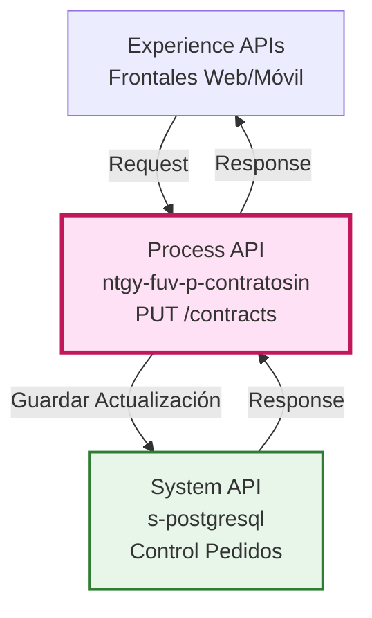
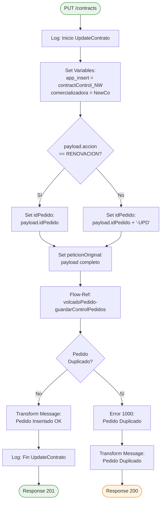
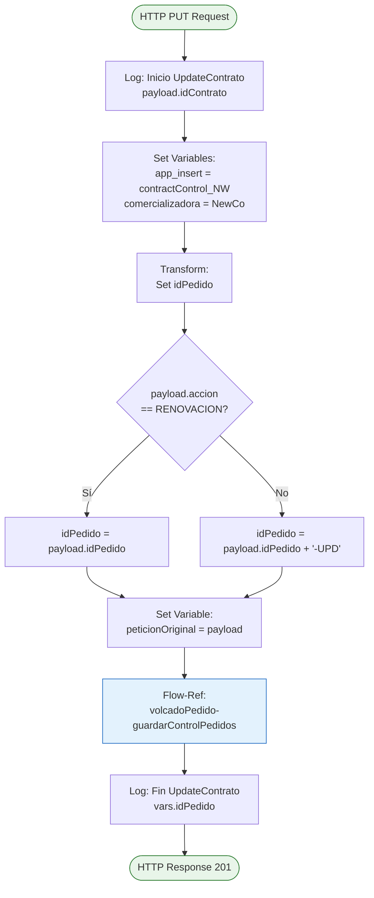
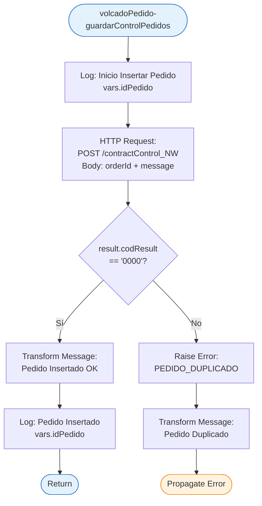
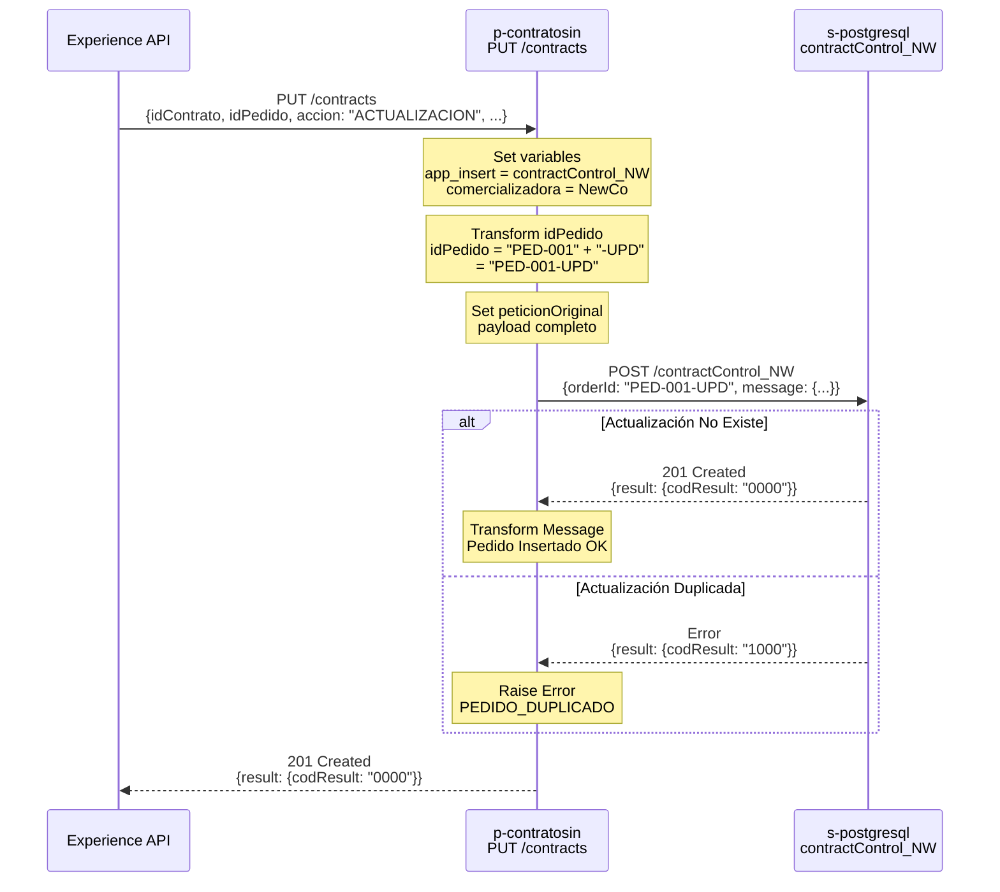
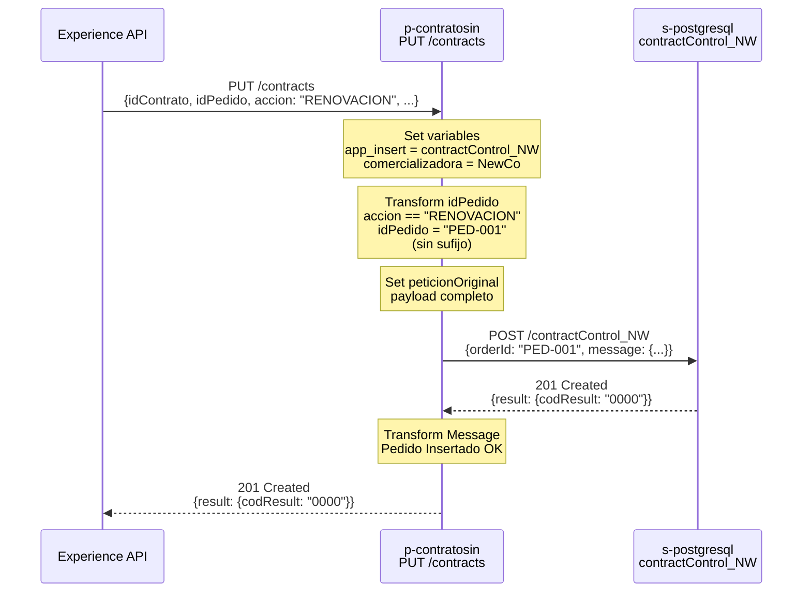
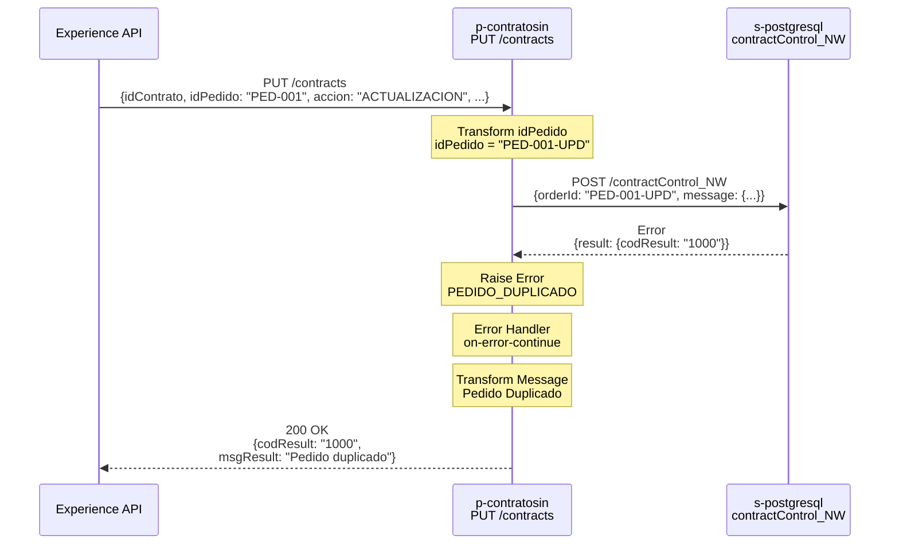

# PUT /contracts

## 📌 Descripción General

### Propósito del Endpoint

Este endpoint gestiona la **actualización de contratos existentes**, implementando un flujo simplificado que:
- Diferencia entre **renovaciones** y **actualizaciones** normales
- Construye identificadores únicos con sufijo `-UPD` para actualizaciones
- Guarda directamente en base de datos de control de pedidos
- **NO enruta** a Process APIs transaccionales (sin lógica de semáforo)

A diferencia del endpoint POST, este endpoint siempre guarda en BBDD y no realiza enrutamiento condicional.

### Tipo de API

**Capa:** Process API (API-Led Connectivity)

**Función:** Orquestación de actualización de contratos con persistencia directa

### Patrón de Integración

**Tipo:** Pass-Through con Transformación de Identificador

**Descripción:** 
1. Recibe payload de actualización de contrato
2. Determina si es renovación o actualización
3. Construye idPedido apropiado (con o sin sufijo `-UPD`)
4. Guarda directamente en control de pedidos (BBDD)

### Arquitectura API-Led Connectivity



---

## 💼 Propósito del Negocio

### Casos de Uso Principales

1. **Actualización de Contratos Existentes**
   - Modificación de datos de un contrato ya creado
   - Beneficio: Permite corregir o actualizar información sin crear nuevo pedido
   - Identificador: `{idPedido}-UPD`

2. **Renovación de Contratos**
   - Renovación de contrato al finalizar periodo
   - Beneficio: Mantiene el mismo identificador para continuidad
   - Identificador: `{idPedido}` (sin sufijo)

3. **Prevención de Actualizaciones Duplicadas**
   - Validación automática de duplicados mediante control de pedidos
   - Beneficio: Evita procesamiento redundante de actualizaciones
   - Aplicable en todos los casos

### 🔗 Endpoints Dependientes

Este Process API consume el siguiente endpoint:

| API | Endpoint | Método | Propósito |
|-----|----------|--------|-----------|
| `s-postgresql` | `/contractControl_NW` | POST | Guardado de actualizaciones en control de pedidos |

### Lógica de Orquestación



**Pasos del Proceso:**

1. **Configuración Inicial**: Establece comercializadora como NewCo y endpoint de BBDD
2. **Construcción de idPedido**: 
   - Si `accion == "RENOVACION"` → Usa idPedido original
   - Si `accion != "RENOVACION"` → Añade sufijo `-UPD`
3. **Guardado en BBDD**: Llama a sub-flow `volcadoPedido-guardarControlPedidos`
4. **Control de Duplicados**: Valida que la actualización no exista previamente

### Transformaciones Aplicadas

**Transformación de idPedido:**

```dataweave
%dw 2.0
output application/java
---
if (payload.accion == "RENOVACION")
  (payload.idPedido as String default "")
else 
  (payload.idPedido as String default "") ++ "-UPD"
```

**Estructura de guardado en BBDD:**

```json
{
  "orderId": "ID_PEDIDO-UPD",  // o "ID_PEDIDO" si es renovación
  "message": {
    // Payload original completo
  }
}
```

⚠️ **Este Process API NO transforma la estructura del payload**, solo modifica el identificador del pedido.

### Contexto Empresarial

- **Dominio:** Gestión de Contratos y Pedidos
- **Sector:** Energía - Utilities
- **División:** Naturgy España - Comercializadora NewCo
- **Proceso de Negocio:** Actualización y renovación de contratos de suministro energético

### Stakeholders

- **Equipos de Atención al Cliente**: Necesitan actualizar datos de contratos existentes
- **Equipos de Renovaciones**: Gestionan renovaciones de contratos al finalizar periodo
- **Equipos de Soporte**: Requieren corregir errores en pedidos ya creados

### Valor de Negocio

- **Flexibilidad**: Permite modificar contratos sin crear nuevos pedidos
- **Trazabilidad**: Diferencia claramente actualizaciones de renovaciones mediante sufijo
- **Prevención de Errores**: Evita actualizaciones duplicadas automáticamente
- **Simplicidad**: Flujo directo sin complejidad de enrutamiento

### Consumidores Potenciales

Este endpoint puede ser consumido por:
- Portales web de autoservicio (clientes)
- Aplicaciones de gestión de contratos
- Sistemas de agentes de call center
- Plataformas de renovaciones automáticas

---

## 🔧 Especificación Técnica

### URLs por Ambiente

| Ambiente | URL Base | URL Completa |
|----------|----------|--------------|
| **Local** | `http://localhost:8081` | `http://localhost:8081/api/contracts` |
| **Development** | `https://ntgy-fuv-p-contratosin-dev.us-e2.cloudhub.io` | `https://ntgy-fuv-p-contratosin-dev.us-e2.cloudhub.io/api/contracts` |
| **UAT** | `https://ntgy-fuv-p-contratosin-uat.us-e2.cloudhub.io` | `https://ntgy-fuv-p-contratosin-uat.us-e2.cloudhub.io/api/contracts` |
| **Production** | `https://ntgy-fuv-p-contratosin-pro.us-e2.cloudhub.io` | `https://ntgy-fuv-p-contratosin-pro.us-e2.cloudhub.io/api/contracts` |

### Método HTTP

```
PUT /api/contracts
```

### Headers Requeridos

```http
Content-Type: application/json
client_id: YOUR_CLIENT_ID
client_secret: YOUR_CLIENT_SECRET
```

### Parámetros de Entrada

**Body (application/json):**

```json
{
  "idContrato": "string",
  "idPedido": "string",
  "accion": "RENOVACION | ACTUALIZACION",
  "comercializadora": "NewCo",
  "pedido": {
    "tipoPedido": "string",
    "fechaPedido": "string (ISO 8601)",
    // ... otros campos del pedido
  },
  "cliente": {
    "nif": "string",
    "nombre": "string",
    "apellidos": "string",
    // ... otros campos del cliente
  },
  "contrato": {
    "cups": "string",
    "tarifa": "string",
    "potencia": "number",
    // ... otros campos del contrato
  }
}
```

**Campos Obligatorios:**
- `idContrato`: Identificador del contrato a actualizar
- `idPedido`: Identificador del pedido original
- `accion`: Tipo de operación ("RENOVACION" o "ACTUALIZACION")

**Lógica de idPedido:**
- Si `accion == "RENOVACION"` → idPedido final = `{idPedido}`
- Si `accion != "RENOVACION"` → idPedido final = `{idPedido}-UPD`

### Respuestas

#### ✅ 201 Created - Actualización Guardada Exitosamente

```json
{
  "result": {
    "codResult": "0000",
    "msgResult": "No hay error"
  }
}
```

#### ⚠️ 200 OK - Actualización Duplicada

```json
{
  "result": {
    "codResult": "1000",
    "msgResult": "Pedido duplicado"
  },
  "creationResult": {
    "message": "Pedido duplicado"
  }
}
```

#### ❌ 500 Internal Server Error - Error Técnico

```json
{
  "result": {
    "codResult": "-0001",
    "msgResult": "Error técnico"
  },
  "creationResult": {
    "message": "Error técnico"
  }
}
```

### Códigos de Estado HTTP

| Código | Descripción | Escenario |
|--------|-------------|-----------|
| `201` | Created | Actualización guardada correctamente |
| `200` | OK | Actualización duplicada detectada |
| `500` | Internal Server Error | Error técnico |

### Autenticación

- **Tipo:** Client ID & Client Secret (Anypoint Platform)
- **Headers:** `client_id` y `client_secret`

### Timeouts

| Tipo | Valor |
|------|-------|
| **Request Timeout** | 30 segundos |
| **Connection Timeout** | 10 segundos |

---

## 🏗️ Implementación Técnica

### Arquitectura del Flow



### Sub-Flow: volcadoPedido-guardarControlPedidos



### Código Fuente de Referencia

**Flow Principal (createContract-main.xml, líneas 1-45):**

```xml
<flow name="UpdateContratoFlow">
    <logger level="INFO" message='#[payload.idContrato ++ " - UpdateContrato: Inicio"]' />
    
    <set-variable value='#["contractControl_NW"]' variableName="app_insert" />
    <set-variable value="NewCo" variableName="comercializadora" />
    
    <ee:transform doc:name="set idPedido">
        <ee:variables>
            <ee:set-variable variableName="idPedido">
                %dw 2.0
                output application/java
                ---
                if (payload.accion == "RENOVACION")
                    (payload.idPedido as String default "")
                else 
                    (payload.idPedido as String default "") ++ "-UPD"
            </ee:set-variable>
        </ee:variables>
    </ee:transform>
    
    <ee:transform doc:name="set peticionOriginal">
        <ee:variables>
            <ee:set-variable variableName="peticionOriginal">
                %dw 2.0
                output application/json
                ---
                payload
            </ee:set-variable>
        </ee:variables>
    </ee:transform>
    
    <flow-ref name="volcadoPedido-guardarControlPedidos" />
    
    <logger level="INFO" message='#[vars.idPedido ++ " - UpdateContrato: Fin"]' />
</flow>
```

### Manejo de Errores

**Error Handler:**

```xml
<error-handler>
    <!-- Pedido Duplicado -->
    <on-error-continue type="APP:PEDIDO_DUPLICADO">
        <ee:transform>
            <ee:set-payload>
                {
                  "result": {
                    "codResult": "1000",
                    "msgResult": "Pedido duplicado"
                  },
                  "creationResult": {
                    "message": "Pedido duplicado"
                  }
                }
            </ee:set-payload>
        </ee:transform>
        <logger level="INFO" message='#[vars.idPedido ++ " - Pedido Duplicado"]' />
    </on-error-continue>
    
    <!-- Error Técnico General -->
    <on-error-propagate>
        <ee:transform>
            <ee:set-payload>
                {
                  "result": {
                    "codResult": "-0001",
                    "msgResult": "Error técnico"
                  },
                  "creationResult": {
                    "message": "Error técnico"
                  }
                }
            </ee:set-payload>
        </ee:transform>
        <logger level="INFO" message='#[vars.idPedido ++ " - Error técnico"]' />
    </on-error-propagate>
</error-handler>
```

### Diagramas de Secuencia

#### 1. Flujo Normal - Actualización Exitosa



#### 2. Flujo Normal - Renovación Exitosa



#### 3. Flujo con Error - Actualización Duplicada



---

## 💻 Ejemplos de Uso

### Ejemplo 1: Actualización Exitosa

#### Request

```bash
curl -X PUT "https://ntgy-fuv-p-contratosin-pro.us-e2.cloudhub.io/api/contracts" \
  -H "Content-Type: application/json" \
  -H "client_id: YOUR_CLIENT_ID" \
  -H "client_secret: YOUR_CLIENT_SECRET" \
  -d '{
    "idContrato": "CTR-2026-5678",
    "idPedido": "PED-2026-001234",
    "accion": "ACTUALIZACION",
    "comercializadora": "NewCo",
    "pedido": {
      "tipoPedido": "MODIFICACION",
      "fechaPedido": "2026-09-10T10:30:00Z"
    },
    "cliente": {
      "nif": "12345678A",
      "nombre": "Juan",
      "apellidos": "García López",
      "telefono": "666777888"
    },
    "contrato": {
      "cups": "ES0021000000000001JN",
      "tarifa": "3.0TD",
      "potencia": 6.9
    }
  }'
```

#### Response (201 Created)

```json
{
  "result": {
    "codResult": "0000",
    "msgResult": "No hay error"
  }
}
```

**Flujo ejecutado:**
1. Configuración: comercializadora = NewCo, app_insert = contractControl_NW ✓
2. Transformación: idPedido = "PED-2026-001234-UPD" ✓
3. Guardado: POST a `s-postgresql/contractControl_NW` ✓
4. Resultado: Actualización guardada en BBDD

---

### Ejemplo 2: Renovación Exitosa

#### Request

```bash
curl -X PUT "https://ntgy-fuv-p-contratosin-pro.us-e2.cloudhub.io/api/contracts" \
  -H "Content-Type: application/json" \
  -H "client_id: YOUR_CLIENT_ID" \
  -H "client_secret: YOUR_CLIENT_SECRET" \
  -d '{
    "idContrato": "CTR-2026-5679",
    "idPedido": "PED-2026-001235",
    "accion": "RENOVACION",
    "comercializadora": "NewCo",
    "pedido": {
      "tipoPedido": "RENOVACION",
      "fechaPedido": "2026-09-10T11:00:00Z"
    },
    "cliente": {
      "nif": "87654321B",
      "nombre": "María",
      "apellidos": "Rodríguez Pérez"
    },
    "contrato": {
      "cups": "ES0031000000000002AB",
      "tarifa": "2.0TD",
      "potencia": 4.6,
      "fechaFinContrato": "2027-09-10"
    }
  }'
```

#### Response (201 Created)

```json
{
  "result": {
    "codResult": "0000",
    "msgResult": "No hay error"
  }
}
```

**Flujo ejecutado:**
1. Configuración: comercializadora = NewCo ✓
2. Transformación: accion = "RENOVACION" → idPedido = "PED-2026-001235" (sin sufijo) ✓
3. Guardado: POST a `s-postgresql/contractControl_NW` ✓
4. Resultado: Renovación guardada con identificador original

---

### Ejemplo 3: Error - Actualización Duplicada

#### Request

```bash
curl -X PUT "https://ntgy-fuv-p-contratosin-pro.us-e2.cloudhub.io/api/contracts" \
  -H "Content-Type: application/json" \
  -H "client_id: YOUR_CLIENT_ID" \
  -H "client_secret: YOUR_CLIENT_SECRET" \
  -d '{
    "idContrato": "CTR-2026-5678",
    "idPedido": "PED-2026-001234",
    "accion": "ACTUALIZACION",
    "comercializadora": "NewCo",
    "pedido": {
      "tipoPedido": "MODIFICACION",
      "fechaPedido": "2026-09-10T10:30:00Z"
    }
  }'
```

#### Response (200 OK)

```json
{
  "result": {
    "codResult": "1000",
    "msgResult": "Pedido duplicado"
  },
  "creationResult": {
    "message": "Pedido duplicado"
  }
}
```

**Flujo ejecutado:**
1. Transformación: idPedido = "PED-2026-001234-UPD" ✓
2. Guardado: POST a `s-postgresql/contractControl_NW`
3. Validación BBDD: idPedido "PED-2026-001234-UPD" ya existe ✗
4. Resultado: Error controlado, actualización duplicada

---

### Ejemplo 4: JavaScript (Fetch API)

```javascript
const updateContract = async (contractData) => {
  try {
    const response = await fetch(
      'https://ntgy-fuv-p-contratosin-pro.us-e2.cloudhub.io/api/contracts',
      {
        method: 'PUT',
        headers: {
          'Content-Type': 'application/json',
          'client_id': 'YOUR_CLIENT_ID',
          'client_secret': 'YOUR_CLIENT_SECRET'
        },
        body: JSON.stringify({
          idContrato: 'CTR-2026-5680',
          idPedido: 'PED-2026-001236',
          accion: 'ACTUALIZACION',
          comercializadora: 'NewCo',
          pedido: {
            tipoPedido: 'MODIFICACION',
            fechaPedido: new Date().toISOString()
          },
          cliente: {
            nif: '11223344C',
            nombre: 'Pedro',
            apellidos: 'Martínez Sánchez',
            email: 'pedro.martinez@example.com'
          },
          contrato: {
            cups: 'ES0041000000000003CD',
            tarifa: '2.0TD',
            potencia: 5.75
          }
        })
      }
    );

    const data = await response.json();
    
    if (response.ok) {
      console.log('Contrato actualizado:', data);
      return data;
    } else {
      console.error('Error al actualizar contrato:', data);
      throw new Error(data.result.msgResult);
    }
  } catch (error) {
    console.error('Error de red:', error);
    throw error;
  }
};

// Uso
updateContract()
  .then(result => console.log('Éxito:', result))
  .catch(error => console.error('Error:', error));
```

---

### Ejemplo 5: Python (Requests)

```python
import requests
from datetime import datetime

def update_contract(id_contrato, id_pedido, accion, updates):
    """
    Actualiza un contrato a través del API p-contratosin
    
    Args:
        id_contrato: Identificador del contrato
        id_pedido: Identificador del pedido original
        accion: 'RENOVACION' o 'ACTUALIZACION'
        updates: Diccionario con los datos a actualizar
    
    Returns:
        dict: Respuesta del API
    """
    url = 'https://ntgy-fuv-p-contratosin-pro.us-e2.cloudhub.io/api/contracts'
    
    headers = {
        'Content-Type': 'application/json',
        'client_id': 'YOUR_CLIENT_ID',
        'client_secret': 'YOUR_CLIENT_SECRET'
    }
    
    payload = {
        'idContrato': id_contrato,
        'idPedido': id_pedido,
        'accion': accion,
        'comercializadora': 'NewCo',
        **updates
    }
    
    try:
        response = requests.put(url, json=payload, headers=headers, timeout=30)
        
        if response.status_code in [200, 201]:
            print(f"✓ Contrato actualizado: {id_contrato}")
            return response.json()
        else:
            print(f"✗ Error: {response.status_code}")
            return response.json()
            
    except requests.exceptions.Timeout:
        print("✗ Timeout: El servidor no respondió en 30 segundos")
        raise
    except requests.exceptions.RequestException as e:
        print(f"✗ Error de red: {e}")
        raise

# Ejemplo de uso - Actualización
if __name__ == '__main__':
    updates = {
        'pedido': {
            'tipoPedido': 'MODIFICACION',
            'fechaPedido': datetime.now().isoformat()
        },
        'cliente': {
            'nif': '55667788D',
            'nombre': 'Ana',
            'apellidos': 'López Fernández',
            'telefono': '611222333'
        },
        'contrato': {
            'cups': 'ES0051000000000004EF',
            'tarifa': '3.0TD',
            'potencia': 8.05
        }
    }
    
    result = update_contract(
        id_contrato='CTR-2026-5681',
        id_pedido='PED-2026-001237',
        accion='ACTUALIZACION',
        updates=updates
    )
    print(f"Resultado: {result}")
```

---

### Ejemplo 6: Python - Renovación

```python
# Ejemplo específico para renovación
def renovar_contrato(id_contrato, id_pedido, nueva_fecha_fin):
    """
    Renueva un contrato existente
    
    Args:
        id_contrato: Identificador del contrato
        id_pedido: Identificador del pedido original
        nueva_fecha_fin: Nueva fecha de finalización del contrato
    
    Returns:
        dict: Respuesta del API
    """
    updates = {
        'pedido': {
            'tipoPedido': 'RENOVACION',
            'fechaPedido': datetime.now().isoformat()
        },
        'contrato': {
            'fechaFinContrato': nueva_fecha_fin
        }
    }
    
    return update_contract(
        id_contrato=id_contrato,
        id_pedido=id_pedido,
        accion='RENOVACION',  # Mantiene el mismo idPedido
        updates=updates
    )

# Uso
resultado_renovacion = renovar_contrato(
    id_contrato='CTR-2026-5682',
    id_pedido='PED-2026-001238',
    nueva_fecha_fin='2027-12-31'
)
print(f"Renovación: {resultado_renovacion}")
```

---

### Comparación: Actualización vs Renovación

| Aspecto | Actualización | Renovación |
|---------|---------------|------------|
| **Campo `accion`** | `"ACTUALIZACION"` | `"RENOVACION"` |
| **idPedido final** | `{idPedido}-UPD` | `{idPedido}` (sin cambios) |
| **Propósito** | Modificar datos del contrato | Extender periodo del contrato |
| **Ejemplo idPedido** | `PED-001` → `PED-001-UPD` | `PED-001` → `PED-001` |
| **Uso típico** | Cambio de tarifa, potencia, datos cliente | Renovación al finalizar periodo |
