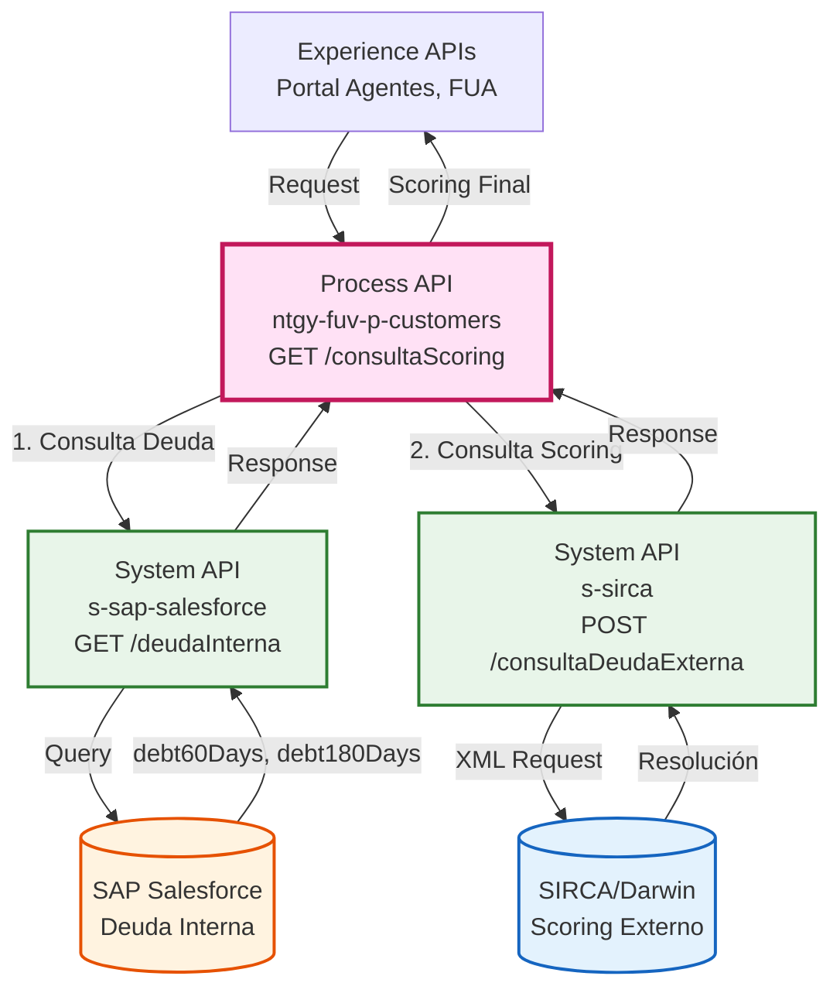
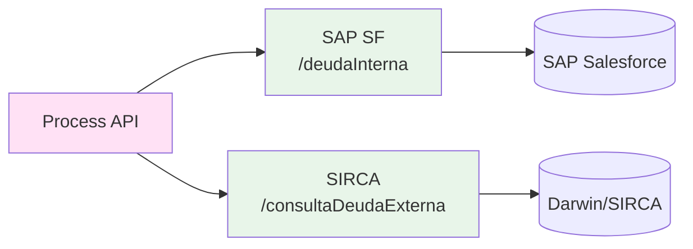
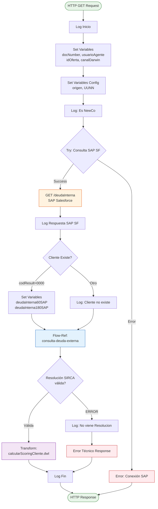
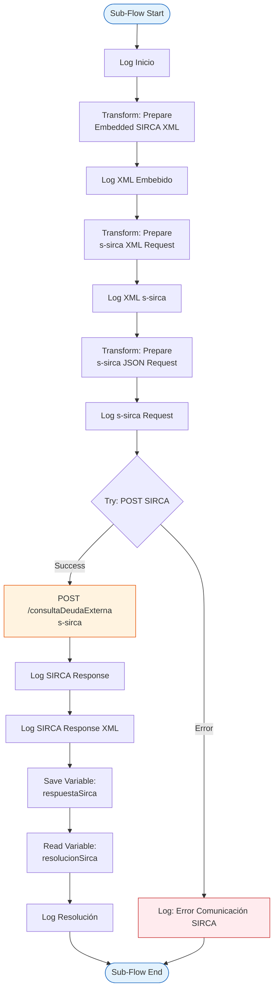
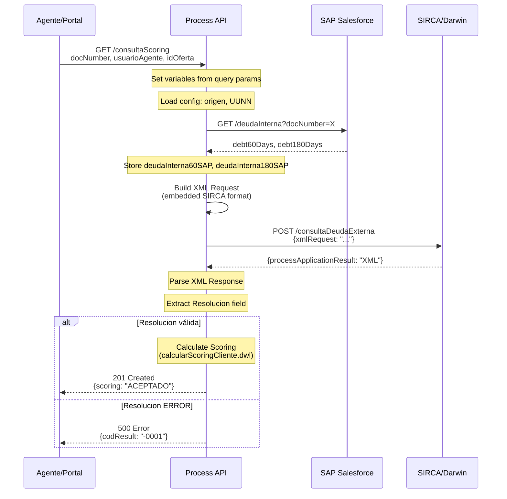
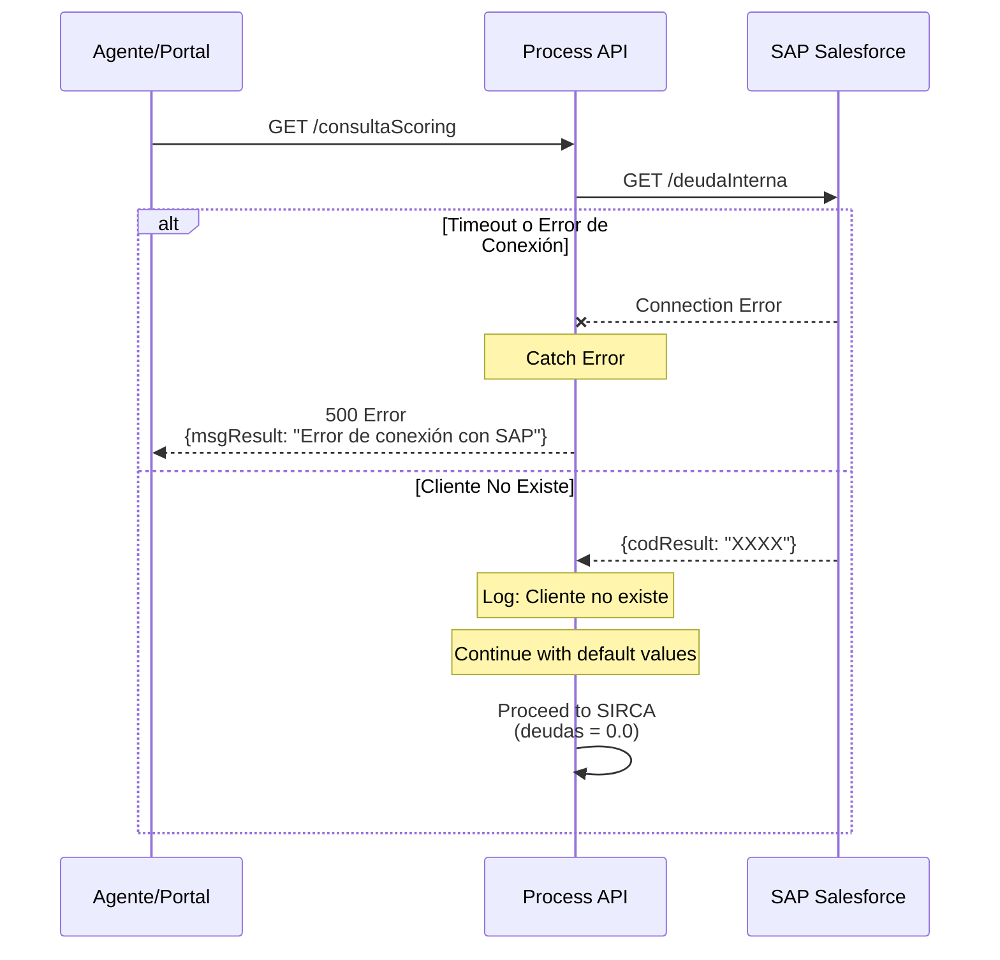
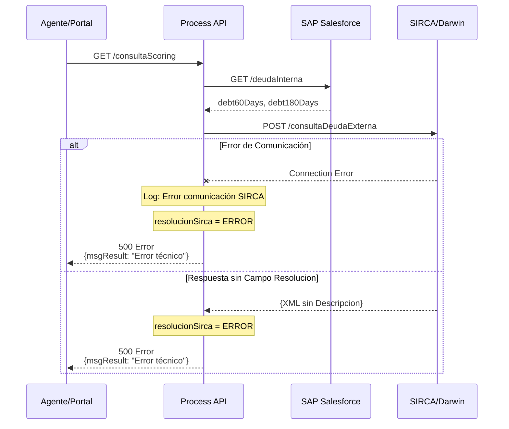

# GET /consultaScoring

## 📌 Descripción General

### Propósito del Endpoint

Este endpoint orquesta la consulta de scoring crediticio de un cliente mediante la integración de dos System APIs: SAP Salesforce (para deuda interna) y SIRCA (para deuda externa y scoring). El proceso evalúa el riesgo crediticio del cliente combinando información de deudas internas de Naturgy con datos externos del sistema de scoring Darwin/SIRCA.

### Tipo de API

**Capa:** Process API (API-Led Connectivity)

**Función:** Orquestación de consulta de scoring crediticio con agregación de datos de múltiples fuentes

### Patrón de Integración

**Tipo:** Orquestación Secuencial con Agregación de Datos

**Descripción:** El endpoint ejecuta un flujo secuencial que primero consulta la deuda interna en SAP Salesforce, luego envía esta información junto con datos del cliente al sistema SIRCA para obtener el scoring final. La respuesta combina la evaluación crediticia con las deudas identificadas.

### Arquitectura API-Led Connectivity



---

## 💼 Propósito del Negocio

### Casos de Uso Principales

1. **Evaluación Crediticia para Nueva Contratación**
   - Agente consulta scoring antes de aprobar nuevo contrato
   - Sistema evalúa riesgo basándose en deudas internas y externas
   - Decisión automática: ACEPTADO, RECHAZADO o ENVIAR A SSCC

2. **Validación de Riesgo en Proceso de Venta**
   - Portal de agentes requiere scoring para ofertas comerciales
   - Identificación de clientes con deudas vencidas
   - Prevención de contrataciones de alto riesgo

3. **Auditoría de Decisiones Crediticias**
   - Registro de consultas de scoring por oferta
   - Trazabilidad de decisiones de aprobación/rechazo
   - Análisis de patrones de riesgo por canal

### 🔗 Endpoints Dependientes

Este Process API consume los siguientes System APIs:

| System API | Endpoint | Método | Propósito |
|------------|----------|--------|-----------|
| `s-sap-salesforce` | `/deudaInterna` | GET | Obtiene deuda interna del cliente (60 y 180 días) desde SAP Salesforce |
| `s-sirca` | `/consultaDeudaExterna` | POST | Consulta scoring crediticio y deuda externa en sistema SIRCA/Darwin |

### Lógica de Orquestación



**Pasos del Proceso:**

1. **Consulta Deuda Interna SAP SF**: Obtiene `debt60Days` y `debt180Days` del cliente
2. **Preparación Request SIRCA**: Construye XML embebido con datos del cliente y deudas
3. **Consulta SIRCA**: Envía request a sistema de scoring externo
4. **Evaluación Scoring**: Analiza campo `Resolucion` de respuesta SIRCA
5. **Cálculo Final**: Aplica lógica de negocio mediante DataWeave para determinar scoring

### Transformaciones Aplicadas

**Transformación de Entrada (Request → SIRCA):**

| Campo Original | Campo SIRCA XML | Transformación |
|----------------|-----------------|----------------|
| `docNumber` | `CIF_NIF` | Directo |
| `idOferta` | `ID_Oferta` | Directo |
| `usuarioAgente` | `Usuario` | Directo |
| `debt60Days` | `DeudaVencida60` | Reemplazo de punto por coma |
| `debt180Days` | `DeudaVencida180` | Reemplazo de punto por coma |
| `canalDarwin` | `Canal` | Normalización de acentos, default "Centros" |
| (config) | `Origen` | Desde properties: `configuracionSirca.NewCo.origen` |
| (config) | `UUNN` | Desde properties: `configuracionSirca.NewCo.UUNN` |

**Transformación de Salida (SIRCA → Response):**

El scoring final se calcula mediante el módulo DataWeave `calcularScoringCliente.dwl` que:
- Extrae el campo `Resolucion` de la respuesta XML de SIRCA
- Mapea a valores: "Aprobar", "Rechazar", "Enviar a SSCC"
- Construye el objeto `sircaInfo` con más de 85 campos incluyendo:
  - Información de resolución y descripción
  - 20 alarmas de riesgo
  - Datos financieros y de balance
  - Información de deuda (vencida, ASNEF, RAI)
  - Métricas de riesgo (PD, LGD, PE, rating)
  - Datos del cliente (segmento, CNAE, SIC)

### Contexto Empresarial

- **Dominio:** Gestión de Riesgo Crediticio
- **Sector:** Energía - Utilities
- **División:** Naturgy España - NewCo
- **Proceso de Negocio:** Evaluación de riesgo para contratación de servicios energéticos

### Stakeholders

- **Agentes de Venta**: Necesitan scoring para aprobar nuevas contrataciones
- **Departamento de Riesgo**: Requiere trazabilidad de decisiones crediticias
- **Sistemas de Gestión Comercial**: Consumen scoring para flujos automatizados

### Valor de Negocio

- **Reducción de Morosidad**: Prevención de contrataciones de alto riesgo
- **Automatización de Decisiones**: Evaluación crediticia en tiempo real
- **Trazabilidad Completa**: Registro de todas las consultas de scoring
- **Integración Multi-Sistema**: Combina datos internos (SAP) y externos (SIRCA)

### Consumidores Potenciales

Este endpoint puede ser consumido por:
- Portales de agentes de venta (900/600)
- Sistemas de gestión comercial (Darwin)
- Aplicaciones de back-office para análisis de riesgo
- Integraciones con CRM para validación de clientes

---

## 🔧 Especificación Técnica

### URLs por Ambiente

| Ambiente | URL Base | URL Completa |
|----------|----------|--------------|
| **Local** | `http://localhost:8081` | `http://localhost:8081/api/consultaScoring` |
| **Development** | `https://ntgy-fuv-p-customers-dev.us-e2.cloudhub.io` | `https://ntgy-fuv-p-customers-dev.us-e2.cloudhub.io/api/consultaScoring` |
| **UAT** | `https://ntgy-fuv-p-customers-uat.us-e2.cloudhub.io` | `https://ntgy-fuv-p-customers-uat.us-e2.cloudhub.io/api/consultaScoring` |
| **Production** | `https://ntgy-fuv-p-customers-pro.us-e2.cloudhub.io` | `https://ntgy-fuv-p-customers-pro.us-e2.cloudhub.io/api/consultaScoring` |

### Método HTTP

```
GET /api/consultaScoring
```

### Parámetros de Entrada

#### Query Parameters

| Parámetro | Tipo | Requerido | Descripción | Ejemplo |
|-----------|------|-----------|-------------|---------|
| `docNumber` | string | ✅ Sí | Documento del cliente (NIF/NIE/CIF) | `00000000T` |
| `usuarioAgente` | string | ✅ Sí | Usuario 900/600 del agente que realiza la consulta | `99999999` |
| `idOferta` | string | ✅ Sí | Identificador único de la oferta comercial | `0123456789` |
| `canalDarwin` | string | ❌ No | Canal de Darwin desde el que se hace la solicitud | `Centros` |

**Validaciones:**
- `docNumber`: Formato válido de documento español
- `usuarioAgente`: Código numérico de agente
- `idOferta`: Identificador alfanumérico
- `canalDarwin`: Si no se proporciona, se usa "Centros" por defecto

### Respuestas

#### 201 Created - Consulta Exitosa

**Nota:** Aunque es un GET, el RAML define código 201 (línea 288 del RAML).

```json
{
  "result": {
    "codResult": "0000",
    "msgResult": "scoring OK"
  },
  "sircaInfo": {
    "resolucion": "Aprobar",
    "descripcion": "Aceptar",
    "alarma1": "Cliente sin CNAE/SIC",
    "alarma2": "Clientes sin información financiera/con información",
    "alarma3": "Cliente sin modelo de PD",
    "alarma4": "SIN ALARMAS",
    "alarma5": "SIN ALARMAS",
    "alarma6": "SIN ALARMAS",
    "alarma7": "SIN ALARMAS",
    "alarma8": "SIN ALARMAS",
    "alarma9": "SIN ALARMAS",
    "alarma10": "SIN ALARMAS",
    "alarma11": "SIN ALARMAS",
    "alarma12": "SIN ALARMAS",
    "alarma13": "SIN ALARMAS",
    "alarma14": "SIN ALARMAS",
    "alarma15": "SIN ALARMAS",
    "alarma16": "SIN ALARMAS",
    "alarma17": "SIN ALARMAS",
    "alarma18": "SIN ALARMAS",
    "alarma19": "SIN ALARMAS",
    "alarma20": "SIN ALARMAS",
    "listaNegra": "0",
    "deudaVencida60": "0,0000",
    "importeRai": "",
    "importeAsnef": "0,00000",
    "pd": "",
    "lgd": "",
    "pe": "",
    "rating": "",
    "excedido": "",
    "importeExcedido": "0,0000",
    "eadValorada": "",
    "idOferta": "07c1798f-46e5-4fcf-811b-82bd7da99ad8",
    "idCluster": "",
    "origenOferta": "",
    "segmento": "Personas fisicas",
    "cnae": "",
    "sic": "",
    "capSocial": "",
    "capDesembolsado": "",
    "fechaConstitucion": "1800-01-01",
    "anoBalance": "",
    "activoNoCorriente": "",
    "deudasGrupoLP": "",
    "gastFinanGastAsimil": "",
    "activoCorriente": "",
    "otrsIngresExplot": "",
    "tesoreria": "",
    "deudasCP": "",
    "impNetoCifraNegocio": "",
    "deudores": "",
    "ingresos": "",
    "deudaEmpresaGrupoCP": "",
    "resultExplot": "",
    "totalPasivo": "",
    "resultActOrdinarias": "",
    "fondosPropios": "",
    "totAmortInmov": "",
    "varProvTrafico": "",
    "resultadoDespuesImpuestos": "",
    "deudaLP": "",
    "otrGastExplot": "",
    "cashFlowOperativo": "",
    "fechaResolucion": "2024-12-30",
    "estadoEmpresa": "",
    "fechaCierreBalance": "",
    "exposicionCartera": "",
    "promedioDeudaVencida30": "",
    "antiguedadGrupo": false,
    "pasivoCorriente": "",
    "deudasACP": "",
    "totalActivo": "",
    "capitalSuscrito": "",
    "resultAntesImp": "",
    "pasivoNoCorriente": "",
    "fondoManiobra": "",
    "ratioLiquidez": "",
    "ratioEndeudamiento": ""
  }
}
```

**Campos de Respuesta Completos:**

#### Objeto `result`

| Campo | Tipo | Descripción |
|-------|------|-------------|
| `codResult` | string | Código de resultado: "0000" (éxito), "-0001" (error) |
| `msgResult` | string | Mensaje descriptivo del resultado |

#### Objeto `sircaInfo` (80 campos)

**1. Resolución y Estado (4 campos)**

| Campo | Tipo | Descripción | Ejemplo |
|-------|------|-------------|---------|
| `resolucion` | string | Resolución del scoring | "Aprobar", "Rechazar", "Enviar a SSCC" |
| `descripcion` | string | Descripción de la resolución | "Aceptar", "Rechazar" |
| `fechaResolucion` | string | Fecha de la resolución | "2024-12-30" |
| `estadoEmpresa` | string | Estado de la empresa | "" |

**2. Alarmas de Riesgo (20 campos)**

| Campo | Tipo | Descripción | Ejemplo |
|-------|------|-------------|---------|
| `alarma1` | string | Alarma 1 | "Cliente sin CNAE/SIC" |
| `alarma2` | string | Alarma 2 | "Clientes sin información financiera" |
| `alarma3` | string | Alarma 3 | "Cliente sin modelo de PD" |
| `alarma4` | string | Alarma 4 | "SIN ALARMAS" |
| `alarma5` | string | Alarma 5 | "SIN ALARMAS" |
| `alarma6` | string | Alarma 6 | "SIN ALARMAS" |
| `alarma7` | string | Alarma 7 | "SIN ALARMAS" |
| `alarma8` | string | Alarma 8 | "SIN ALARMAS" |
| `alarma9` | string | Alarma 9 | "SIN ALARMAS" |
| `alarma10` | string | Alarma 10 | "SIN ALARMAS" |
| `alarma11` | string | Alarma 11 | "SIN ALARMAS" |
| `alarma12` | string | Alarma 12 | "SIN ALARMAS" |
| `alarma13` | string | Alarma 13 | "SIN ALARMAS" |
| `alarma14` | string | Alarma 14 | "SIN ALARMAS" |
| `alarma15` | string | Alarma 15 | "SIN ALARMAS" |
| `alarma16` | string | Alarma 16 | "SIN ALARMAS" |
| `alarma17` | string | Alarma 17 | "SIN ALARMAS" |
| `alarma18` | string | Alarma 18 | "SIN ALARMAS" |
| `alarma19` | string | Alarma 19 | "SIN ALARMAS" |
| `alarma20` | string | Alarma 20 | "SIN ALARMAS" |

**3. Información de Deuda y Riesgo (5 campos)**

| Campo | Tipo | Descripción | Ejemplo |
|-------|------|-------------|---------|
| `listaNegra` | string | Indicador de lista negra | "0" (no), "1" (sí) |
| `deudaVencida60` | string | Deuda vencida > 60 días | "0,0000" |
| `importeRai` | string | Importe RAI | "" |
| `importeAsnef` | string | Importe ASNEF | "0,00000" |
| `promedioDeudaVencida30` | string | Promedio deuda vencida > 30 días | "" |

**4. Métricas de Riesgo Crediticio (8 campos)**

| Campo | Tipo | Descripción | Ejemplo |
|-------|------|-------------|---------|
| `pd` | string | PD (Probability of Default) | "" |
| `lgd` | string | LGD (Loss Given Default) | "" |
| `pe` | string | PE (Pérdida Esperada) | "" |
| `rating` | string | Rating crediticio | "" |
| `excedido` | string | Indicador de excedido | "" |
| `importeExcedido` | string | Importe excedido | "0,0000" |
| `eadValorada` | string | EAD Valorada (Exposure at Default) | "" |
| `exposicionCartera` | string | Exposición en cartera | "" |

**5. Información de la Oferta (4 campos)**

| Campo | Tipo | Descripción | Ejemplo |
|-------|------|-------------|---------|
| `idOferta` | string | Identificador de la oferta | "07c1798f-46e5-4fcf-811b-82bd7da99ad8" |
| `idCluster` | string | ID del cluster | "" |
| `origenOferta` | string | Origen de la oferta | "" |
| `antiguedadGrupo` | boolean | Tiene antigüedad en el grupo | false |

**6. Datos del Cliente (4 campos)**

| Campo | Tipo | Descripción | Ejemplo |
|-------|------|-------------|---------|
| `segmento` | string | Segmento del cliente | "Personas fisicas" |
| `cnae` | string | CNAE (Clasificación Nacional de Actividades Económicas) | "" |
| `sic` | string | SIC (Standard Industrial Classification) | "" |
| `fechaConstitucion` | string | Fecha de constitución | "1800-01-01" |

**7. Información Financiera - Capital y Balance (12 campos)**

| Campo | Tipo | Descripción | Ejemplo |
|-------|------|-------------|---------|
| `capSocial` | string | Capital social | "" |
| `capDesembolsado` | string | Capital desembolsado | "" |
| `capitalSuscrito` | string | Capital suscrito | "" |
| `anoBalance` | string | Año del balance | "" |
| `fechaCierreBalance` | string | Fecha de cierre del balance | "" |
| `activoNoCorriente` | string | Activo no corriente | "" |
| `activoCorriente` | string | Activo corriente | "" |
| `totalActivo` | string | Total activo | "" |
| `pasivoNoCorriente` | string | Pasivo no corriente | "" |
| `pasivoCorriente` | string | Pasivo corriente | "" |
| `totalPasivo` | string | Total pasivo | "" |
| `fondosPropios` | string | Fondos propios | "" |

**8. Información Financiera - Deudas (6 campos)**

| Campo | Tipo | Descripción | Ejemplo |
|-------|------|-------------|---------|
| `deudasGrupoLP` | string | Deuda empresa del grupo a L/P | "" |
| `deudaLP` | string | Deuda a largo plazo | "" |
| `deudasCP` | string | Acreedores comerciales C/P | "" |
| `deudasACP` | string | Deuda a corto plazo | "" |
| `deudaEmpresaGrupoCP` | string | Deuda empresa de grupo C/P | "" |
| `deudores` | string | Deudores | "" |

**9. Información Financiera - Resultados (11 campos)**

| Campo | Tipo | Descripción | Ejemplo |
|-------|------|-------------|---------|
| `impNetoCifraNegocio` | string | Importe neto cifra de negocio | "" |
| `ingresos` | string | Ingresos | "" |
| `otrsIngresExplot` | string | Otros ingresos de explotación | "" |
| `resultExplot` | string | Resultado de explotación | "" |
| `resultActOrdinarias` | string | Resultado de actividades ordinarias | "" |
| `resultAntesImp` | string | Resultado antes de impuestos | "" |
| `resultadoDespuesImpuestos` | string | Resultado después de impuestos | "" |
| `gastFinanGastAsimil` | string | Gastos financieros y asimilados | "" |
| `otrGastExplot` | string | Otros gastos de explotación | "" |
| `totAmortInmov` | string | Total amortizaciones inmovilizado | "" |
| `varProvTrafico` | string | Variaciones provisiones de tráfico | "" |

**10. Información Financiera - Ratios y Otros (6 campos)**

| Campo | Tipo | Descripción | Ejemplo |
|-------|------|-------------|---------|
| `tesoreria` | string | Tesorería | "" |
| `cashFlowOperativo` | string | Cash Flow operativo | "" |
| `fondoManiobra` | string | Fondo de maniobra | "" |
| `ratioLiquidez` | string | Ratio de liquidez | "" |
| `ratioEndeudamiento` | string | Ratio de endeudamiento | "" |

**Nota:** Los campos vacíos (`""`) indican que no hay información disponible para ese campo en el ejemplo. El sistema SIRCA puede poblar estos campos según la información disponible del cliente.

#### 500 Internal Server Error - Error de Comunicación

```json
{
  "result": {
    "codResult": "-0001",
    "msgResult": "Error de conexión con SAP"
  }
}
```

```json
{
  "result": {
    "codResult": "-0001",
    "msgResult": "Error técnico"
  }
}
```

**Códigos de Error:**

| Código | Descripción | Causa |
|--------|-------------|-------|
| `-0001` | Error de conexión con SAP | Timeout o fallo en comunicación con SAP Salesforce |
| `-0001` | Error técnico | Fallo en comunicación con SIRCA o campo Resolucion ausente |

### Autenticación

- **Tipo:** OAuth 2.0 (implícito por ser Process API interno)
- **Nota:** La autenticación se gestiona a nivel de Experience API consumidor

### Timeouts

| Tipo | Valor |
|------|-------|
| **Request Timeout** | 30 segundos |
| **Connection Timeout** | 10 segundos |
| **SAP SF Timeout** | 30 segundos (configurable) |
| **SIRCA Timeout** | 45 segundos (operación más larga) |

---

## 🏗️ Implementación Técnica

### Arquitectura del Flow



### Sub-Flow: consulta-deuda-externa



### Transformaciones DataWeave

#### 1. Preparación de Variables Iniciales

**Ubicación:** Flow principal, líneas 8-21

```dataweave
%dw 2.0
output application/java
---
{
  docNumber: attributes.queryParams.docNumber,
  idOferta: attributes.queryParams.idOferta,
  usuarioAgente: attributes.queryParams.usuarioAgente,
  canalDarwin: attributes.queryParams.canalDarwin
}
```

#### 2. Configuración SIRCA desde Properties

**Ubicación:** Flow principal, líneas 22-32

```dataweave
%dw 2.0
output application/java
---
{
  origen: p('configuracionSirca.NewCo.origen'),
  UUNN: p('configuracionSirca.NewCo.UUNN')
}
```

#### 3. Preparación XML Embebido para SIRCA

**Ubicación:** Sub-flow consulta-deuda-externa, líneas 88-115

```dataweave
%dw 2.0
output application/xml writeDeclaration = false
---
{
  Request: {
    ID_Oferta: vars.idOferta,
    Usuario: vars.usuarioAgente,
    UUNN: vars.UUNN,
    ID_llamada: 1,
    CIF_NIF: vars.docNumber,
    Pais: 1,
    LimiteSol: 0,
    LimiteSolCurs: 0,
    ExpoAct: 0,
    DeudaVencida60: vars.deudaInterna60SAP replace "." with(",") default "0,0",
    TipoCliente: "N",
    DeudaVencida180: vars.deudaInterna180SAP replace "." with(",") default "0,0",
    FacturacionAnual: "0,0",
    Origen: vars.origen,
    Canal: if (vars.canalDarwin != null and vars.canalDarwin != '') 
           java!org::apache::commons::lang3::StringUtils::stripAccents(vars.canalDarwin) 
           else "Centros",
    Renovacion: 0
  }
}
```

**Transformaciones Aplicadas:**
- Reemplazo de punto por coma en deudas (formato europeo)
- Normalización de acentos en canal Darwin
- Valores por defecto: "0,0" para deudas, "Centros" para canal

#### 4. Preparación Request JSON para s-sirca

**Ubicación:** Sub-flow consulta-deuda-externa, líneas 127-133

```dataweave
%dw 2.0
output application/json
---
{
  "xmlRequest": write(payload, "application/xml")
}
```

#### 5. Extracción de Resolución SIRCA

**Ubicación:** Sub-flow consulta-deuda-externa, líneas 145-153

```dataweave
%dw 2.0
output application/json
---
if (vars.respuestaSirca.RESULTADOS.ENVIAR_A_SSCC.Descripcion? 
    and vars.respuestaSirca.RESULTADOS.ENVIAR_A_SSCC.Descripcion != null 
    and vars.respuestaSirca.RESULTADOS.ENVIAR_A_SSCC.Descripcion != '')
  vars.respuestaSirca.RESULTADOS.ENVIAR_A_SSCC.Descripcion
else 'ERROR'
```

#### 6. Cálculo de Scoring Final

**Ubicación:** Flow principal, línea 54 (referencia a módulo externo)

```dataweave
// Archivo: src/main/resources/dw/modules/scoring/calcularScoringCliente.dwl
// Este módulo evalúa:
// - Campo resolucionSirca: "ACEPTADO", "RECHAZADO", "ENVIAR A SSCC"
// - Deudas internas: deudaInterna60SAP, deudaInterna180SAP
// - Retorna: codResult, msgResult, scoring
```

### Patrones de Diseño

**Patrón 1: Sequential Orchestration**

**Justificación:** La consulta de deuda interna en SAP SF debe completarse antes de enviar el request a SIRCA, ya que los valores de deuda son parámetros requeridos para el scoring.

**Patrón 2: Try-Catch con Error Handling**

**Justificación:** Cada llamada a System API está envuelta en un bloque try-catch para manejar errores de comunicación de forma independiente y proporcionar mensajes de error específicos.

**Patrón 3: Sub-Flow Modularization**

**Justificación:** La lógica de consulta a SIRCA está encapsulada en un sub-flow reutilizable (`consulta-deuda-externa`) que puede ser invocado desde otros endpoints si es necesario.

**Patrón 4: Configuration-Driven**

**Justificación:** Valores como `origen` y `UUNN` se obtienen de properties YAML, permitiendo configuración diferente por ambiente sin cambios en el código.

### Diagramas de Secuencia

#### 1. Flujo Normal de Éxito



#### 2. Flujo con Error de SAP Salesforce



#### 3. Flujo con Error de SIRCA



### Manejo de Errores

#### Estrategia de Error Handling

**1. Error de Comunicación con SAP Salesforce**

```xml
<on-error-propagate type="ANY">
  <logger message="Error de comunicación con SAP SF" />
  <set-payload value='{"result": {"codResult": "-0001", "msgResult": "Error de conexión con SAP"}}' />
</on-error-propagate>
```

**Acción:** Retorna error inmediatamente, no continúa el flujo.

**2. Cliente No Existe en SAP SF**

```xml
<choice>
  <when expression='payload.result.codResult == "0000"'>
    <!-- Set deudas -->
  </when>
  <otherwise>
    <logger message="Cliente no existe en SAP SF" />
    <!-- Continúa con valores por defecto -->
  </otherwise>
</choice>
```

**Acción:** Continúa el flujo con deudas en 0.0 (valores por defecto).

**3. Error de Comunicación con SIRCA**

```xml
<on-error-propagate type="ANY">
  <logger message="Error de comunicación con SIRCA" />
  <!-- resolucionSirca se evalúa como ERROR -->
</on-error-propagate>
```

**Acción:** El error se captura, se continúa el flujo pero `resolucionSirca` será "ERROR".

**4. Campo Resolucion Ausente en Respuesta SIRCA**

```dataweave
if (vars.respuestaSirca.RESULTADOS.ENVIAR_A_SSCC.Descripcion? 
    and vars.respuestaSirca.RESULTADOS.ENVIAR_A_SSCC.Descripcion != null 
    and vars.respuestaSirca.RESULTADOS.ENVIAR_A_SSCC.Descripcion != '')
  vars.respuestaSirca.RESULTADOS.ENVIAR_A_SSCC.Descripcion
else 'ERROR'
```

**Acción:** Si el campo no existe o está vacío, se asigna "ERROR" a `resolucionSirca`.

**5. Error General del Flow**

```xml
<error-handler>
  <on-error-continue type="ANY">
    <set-payload value='{"result": {"codResult": "-0001", "msgResult": "Error técnico"}}' />
  </on-error-continue>
</error-handler>
```

**Acción:** Cualquier error no capturado retorna error técnico genérico.

#### Códigos de Error y Recuperación

| Código | Mensaje | Causa | Recuperación |
|--------|---------|-------|--------------|
| `-0001` | Error de conexión con SAP | Timeout o fallo en SAP SF | Reintentar después de verificar conectividad |
| `-0001` | Error técnico | Error en SIRCA o campo Resolucion ausente | Verificar logs de SIRCA, validar formato de respuesta |
| `-0001` | Error técnico | Error general no capturado | Revisar logs del flow completo |

---

## 💻 Ejemplos de Uso

### Ejemplo 1: Consulta Exitosa - Cliente Aprobado

#### cURL

```bash
curl -X GET "https://ntgy-fuv-p-customers-dev.us-e2.cloudhub.io/api/consultaScoring?docNumber=12345678A&usuarioAgente=99999999&idOferta=OF123456789&canalDarwin=Centros" \
  -H "Content-Type: application/json" \
  -H "client_id: YOUR_CLIENT_ID" \
  -H "client_secret: YOUR_CLIENT_SECRET"
```

#### Respuesta (201 Created)

```json
{
  "result": {
    "codResult": "0000",
    "msgResult": "scoring OK"
  },
  "sircaInfo": {
    "resolucion": "Aprobar",
    "descripcion": "Aceptar",
    "alarma1": "Cliente sin CNAE/SIC",
    "alarma2": "Clientes sin información financiera/con información",
    "alarma3": "Cliente sin modelo de PD",
    "alarma4": "SIN ALARMAS",
    "alarma5": "SIN ALARMAS",
    "alarma6": "SIN ALARMAS",
    "alarma7": "SIN ALARMAS",
    "alarma8": "SIN ALARMAS",
    "alarma9": "SIN ALARMAS",
    "alarma10": "SIN ALARMAS",
    "alarma11": "SIN ALARMAS",
    "alarma12": "SIN ALARMAS",
    "alarma13": "SIN ALARMAS",
    "alarma14": "SIN ALARMAS",
    "alarma15": "SIN ALARMAS",
    "alarma16": "SIN ALARMAS",
    "alarma17": "SIN ALARMAS",
    "alarma18": "SIN ALARMAS",
    "alarma19": "SIN ALARMAS",
    "alarma20": "SIN ALARMAS",
    "listaNegra": "0",
    "deudaVencida60": "0,0000",
    "importeRai": "",
    "importeAsnef": "0,00000",
    "pd": "",
    "lgd": "",
    "pe": "",
    "rating": "",
    "excedido": "",
    "importeExcedido": "0,0000",
    "eadValorada": "",
    "idOferta": "07c1798f-46e5-4fcf-811b-82bd7da99ad8",
    "idCluster": "",
    "origenOferta": "",
    "segmento": "Personas fisicas",
    "cnae": "",
    "sic": "",
    "capSocial": "",
    "capDesembolsado": "",
    "fechaConstitucion": "1800-01-01",
    "anoBalance": "",
    "activoNoCorriente": "",
    "deudasGrupoLP": "",
    "gastFinanGastAsimil": "",
    "activoCorriente": "",
    "otrsIngresExplot": "",
    "tesoreria": "",
    "deudasCP": "",
    "impNetoCifraNegocio": "",
    "deudores": "",
    "ingresos": "",
    "deudaEmpresaGrupoCP": "",
    "resultExplot": "",
    "totalPasivo": "",
    "resultActOrdinarias": "",
    "fondosPropios": "",
    "totAmortInmov": "",
    "varProvTrafico": "",
    "resultadoDespuesImpuestos": "",
    "deudaLP": "",
    "otrGastExplot": "",
    "cashFlowOperativo": "",
    "fechaResolucion": "2024-12-30",
    "estadoEmpresa": "",
    "fechaCierreBalance": "",
    "exposicionCartera": "",
    "promedioDeudaVencida30": "",
    "antiguedadGrupo": false,
    "pasivoCorriente": "",
    "deudasACP": "",
    "totalActivo": "",
    "capitalSuscrito": "",
    "resultAntesImp": "",
    "pasivoNoCorriente": "",
    "fondoManiobra": "",
    "ratioLiquidez": "",
    "ratioEndeudamiento": ""
  }
}
```

### Ejemplo 2: Consulta con Cliente Rechazado

#### cURL

```bash
curl -X GET "https://ntgy-fuv-p-customers-dev.us-e2.cloudhub.io/api/consultaScoring?docNumber=87654321B&usuarioAgente=88888888&idOferta=OF987654321" \
  -H "Content-Type: application/json" \
  -H "client_id: YOUR_CLIENT_ID" \
  -H "client_secret: YOUR_CLIENT_SECRET"
```

#### Respuesta (201 Created)

```json
{
  "result": {
    "codResult": "0000",
    "msgResult": "scoring OK"
  },
  "sircaInfo": {
    "resolucion": "Rechazar",
    "descripcion": "Rechazar",
    "alarma1": "Deuda vencida superior a límite",
    "alarma2": "Cliente en ASNEF",
    "alarma3": "SIN ALARMAS",
    "alarma4": "SIN ALARMAS",
    "alarma5": "SIN ALARMAS",
    "alarma6": "SIN ALARMAS",
    "alarma7": "SIN ALARMAS",
    "alarma8": "SIN ALARMAS",
    "alarma9": "SIN ALARMAS",
    "alarma10": "SIN ALARMAS",
    "alarma11": "SIN ALARMAS",
    "alarma12": "SIN ALARMAS",
    "alarma13": "SIN ALARMAS",
    "alarma14": "SIN ALARMAS",
    "alarma15": "SIN ALARMAS",
    "alarma16": "SIN ALARMAS",
    "alarma17": "SIN ALARMAS",
    "alarma18": "SIN ALARMAS",
    "alarma19": "SIN ALARMAS",
    "alarma20": "SIN ALARMAS",
    "listaNegra": "1",
    "deudaVencida60": "150,5000",
    "importeRai": "",
    "importeAsnef": "500,00000",
    "pd": "",
    "lgd": "",
    "pe": "",
    "rating": "",
    "excedido": "",
    "importeExcedido": "150,5000",
    "eadValorada": "",
    "idOferta": "OF987654321",
    "idCluster": "",
    "origenOferta": "",
    "segmento": "Personas fisicas",
    "cnae": "",
    "sic": "",
    "capSocial": "",
    "capDesembolsado": "",
    "fechaConstitucion": "1800-01-01",
    "anoBalance": "",
    "activoNoCorriente": "",
    "deudasGrupoLP": "",
    "gastFinanGastAsimil": "",
    "activoCorriente": "",
    "otrsIngresExplot": "",
    "tesoreria": "",
    "deudasCP": "",
    "impNetoCifraNegocio": "",
    "deudores": "",
    "ingresos": "",
    "deudaEmpresaGrupoCP": "",
    "resultExplot": "",
    "totalPasivo": "",
    "resultActOrdinarias": "",
    "fondosPropios": "",
    "totAmortInmov": "",
    "varProvTrafico": "",
    "resultadoDespuesImpuestos": "",
    "deudaLP": "",
    "otrGastExplot": "",
    "cashFlowOperativo": "",
    "fechaResolucion": "2024-12-30",
    "estadoEmpresa": "",
    "fechaCierreBalance": "",
    "exposicionCartera": "",
    "promedioDeudaVencida30": "",
    "antiguedadGrupo": false,
    "pasivoCorriente": "",
    "deudasACP": "",
    "totalActivo": "",
    "capitalSuscrito": "",
    "resultAntesImp": "",
    "pasivoNoCorriente": "",
    "fondoManiobra": "",
    "ratioLiquidez": "",
    "ratioEndeudamiento": ""
  }
}
```

### Ejemplo 3: Error de Conexión con SAP

#### cURL

```bash
curl -X GET "https://ntgy-fuv-p-customers-dev.us-e2.cloudhub.io/api/consultaScoring?docNumber=11111111C&usuarioAgente=77777777&idOferta=OF111111111" \
  -H "Content-Type: application/json" \
  -H "client_id: YOUR_CLIENT_ID" \
  -H "client_secret: YOUR_CLIENT_SECRET"
```

#### Respuesta (500 Internal Server Error)

```json
{
  "result": {
    "codResult": "-0001",
    "msgResult": "Error de conexión con SAP"
  }
}
```

### Ejemplo 4: JavaScript (Fetch API)

```javascript
const consultarScoring = async (docNumber, usuarioAgente, idOferta, canalDarwin = 'Centros') => {
  const params = new URLSearchParams({
    docNumber,
    usuarioAgente,
    idOferta,
    canalDarwin
  });

  try {
    const response = await fetch(
      `https://ntgy-fuv-p-customers-dev.us-e2.cloudhub.io/api/consultaScoring?${params}`,
      {
        method: 'GET',
        headers: {
          'Content-Type': 'application/json',
          'client_id': 'YOUR_CLIENT_ID',
          'client_secret': 'YOUR_CLIENT_SECRET'
        }
      }
    );

    if (!response.ok) {
      throw new Error(`HTTP error! status: ${response.status}`);
    }

    const data = await response.json();
    
    // Acceder a información del scoring
    console.log('Resolución:', data.sircaInfo.resolucion);
    console.log('Descripción:', data.sircaInfo.descripcion);
    console.log('Deuda vencida 60 días:', data.sircaInfo.deudaVencida60);
    console.log('Lista negra:', data.sircaInfo.listaNegra);
    
    return data;
  } catch (error) {
    console.error('Error consultando scoring:', error);
    throw error;
  }
};

// Uso
consultarScoring('12345678A', '99999999', 'OF123456789', 'Centros')
  .then(result => {
    console.log('Resultado completo:', result);
    console.log('Cliente aprobado:', result.sircaInfo.resolucion === 'Aprobar');
  })
  .catch(error => console.error('Error:', error));
```

### Ejemplo 5: Python (Requests)

```python
import requests

def consultar_scoring(doc_number, usuario_agente, id_oferta, canal_darwin='Centros'):
    """
    Consulta el scoring crediticio de un cliente
    
    Args:
        doc_number (str): Documento del cliente (NIF/NIE/CIF)
        usuario_agente (str): Usuario 900/600 del agente
        id_oferta (str): Identificador de la oferta
        canal_darwin (str): Canal de Darwin (opcional, default: 'Centros')
    
    Returns:
        dict: Respuesta con el scoring del cliente incluyendo sircaInfo
    """
    url = 'https://ntgy-fuv-p-customers-dev.us-e2.cloudhub.io/api/consultaScoring'
    
    params = {
        'docNumber': doc_number,
        'usuarioAgente': usuario_agente,
        'idOferta': id_oferta,
        'canalDarwin': canal_darwin
    }
    
    headers = {
        'Content-Type': 'application/json',
        'client_id': 'YOUR_CLIENT_ID',
        'client_secret': 'YOUR_CLIENT_SECRET'
    }
    
    try:
        response = requests.get(url, params=params, headers=headers, timeout=30)
        response.raise_for_status()
        
        data = response.json()
        
        # Acceder a información del scoring
        sirca_info = data.get('sircaInfo', {})
        print(f"Resolución: {sirca_info.get('resolucion')}")
        print(f"Descripción: {sirca_info.get('descripcion')}")
        print(f"Deuda vencida 60 días: {sirca_info.get('deudaVencida60')}")
        print(f"Lista negra: {sirca_info.get('listaNegra')}")
        print(f"Segmento: {sirca_info.get('segmento')}")
        
        return data
        
    except requests.exceptions.Timeout:
        print("Error: Timeout en la consulta")
        raise
    except requests.exceptions.RequestException as e:
        print(f"Error en la consulta: {e}")
        raise

# Uso
if __name__ == '__main__':
    resultado = consultar_scoring(
        doc_number='12345678A',
        usuario_agente='99999999',
        id_oferta='OF123456789',
        canal_darwin='Centros'
    )
    
    # Verificar si el cliente fue aprobado
    if resultado['sircaInfo']['resolucion'] == 'Aprobar':
        print("✅ Cliente APROBADO")
    else:
        print("❌ Cliente RECHAZADO")
    
    print(f"\nInformación completa de SIRCA:")
    print(f"- ID Oferta: {resultado['sircaInfo']['idOferta']}")
    print(f"- Fecha resolución: {resultado['sircaInfo']['fechaResolucion']}")
```

### Ejemplo 6: Postman Collection

```json
{
  "info": {
    "name": "Consulta Scoring",
    "schema": "https://schema.getpostman.com/json/collection/v2.1.0/collection.json"
  },
  "item": [
    {
      "name": "Consulta Scoring - Cliente Aceptado",
      "request": {
        "method": "GET",
        "header": [
          {
            "key": "Content-Type",
            "value": "application/json"
          },
          {
            "key": "client_id",
            "value": "{{client_id}}"
          },
          {
            "key": "client_secret",
            "value": "{{client_secret}}"
          }
        ],
        "url": {
          "raw": "{{base_url}}/api/consultaScoring?docNumber=12345678A&usuarioAgente=99999999&idOferta=OF123456789&canalDarwin=Centros",
          "host": ["{{base_url}}"],
          "path": ["api", "consultaScoring"],
          "query": [
            {
              "key": "docNumber",
              "value": "12345678A"
            },
            {
              "key": "usuarioAgente",
              "value": "99999999"
            },
            {
              "key": "idOferta",
              "value": "OF123456789"
            },
            {
              "key": "canalDarwin",
              "value": "Centros"
            }
          ]
        }
      }
    }
  ]
}
```
