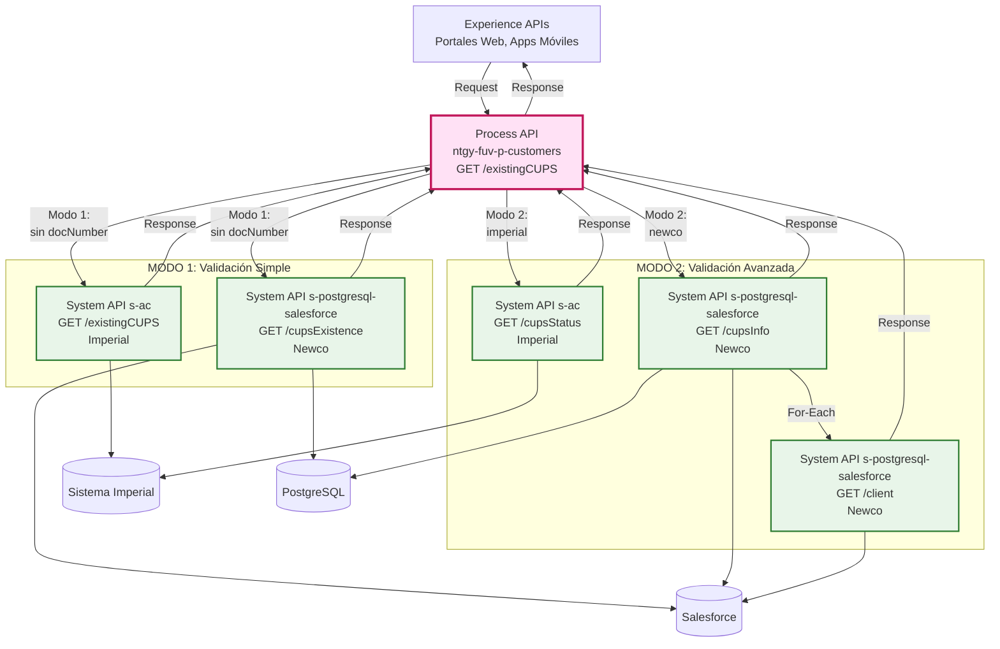
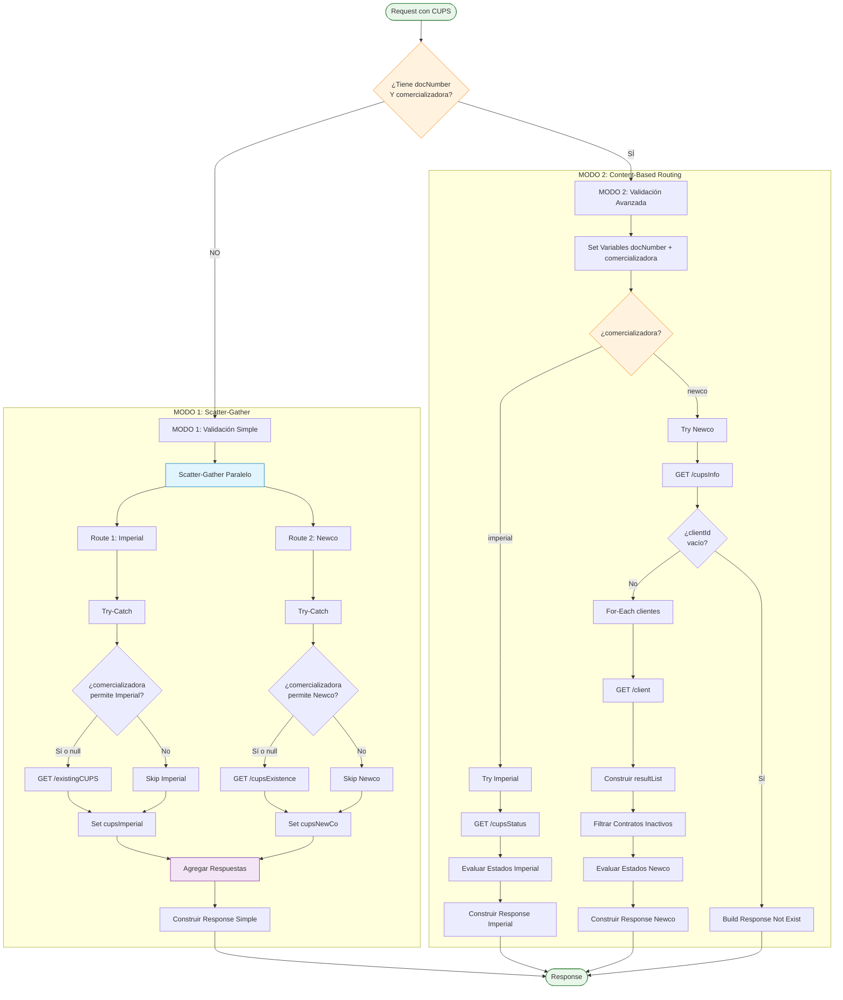
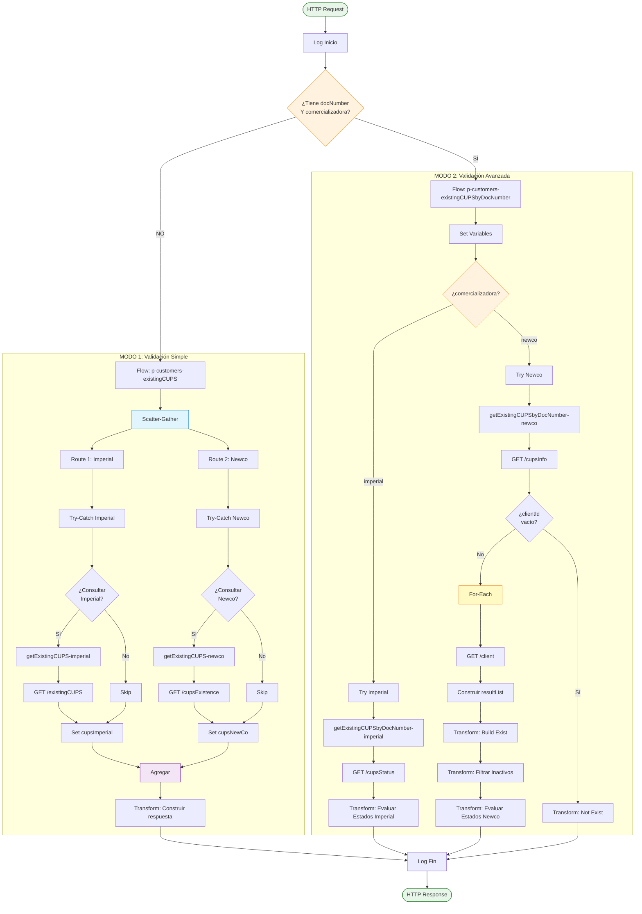
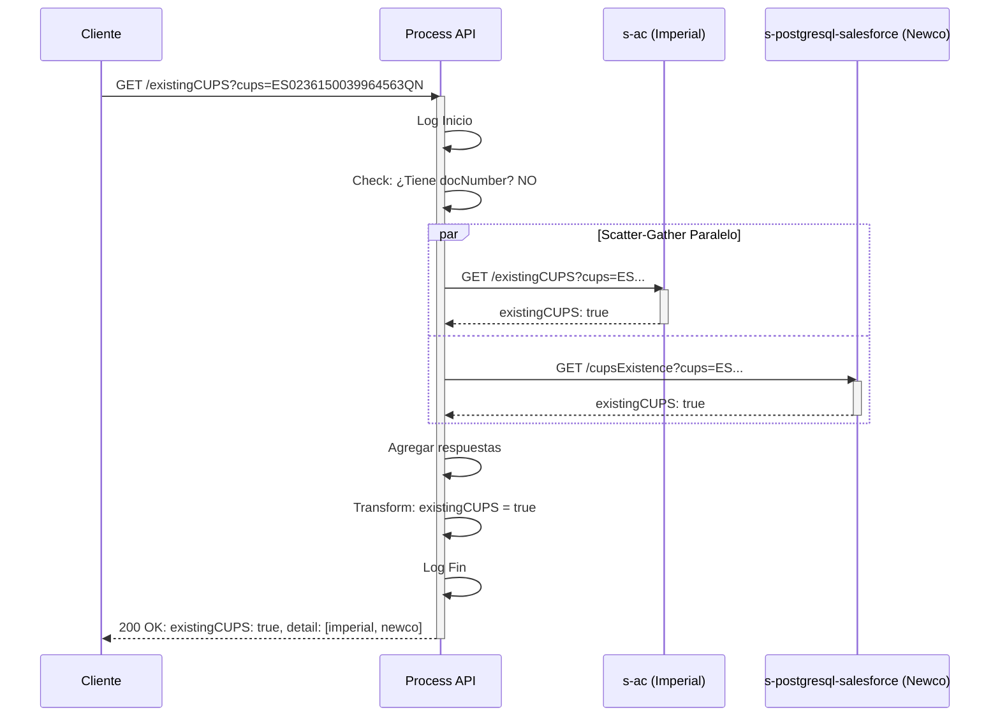
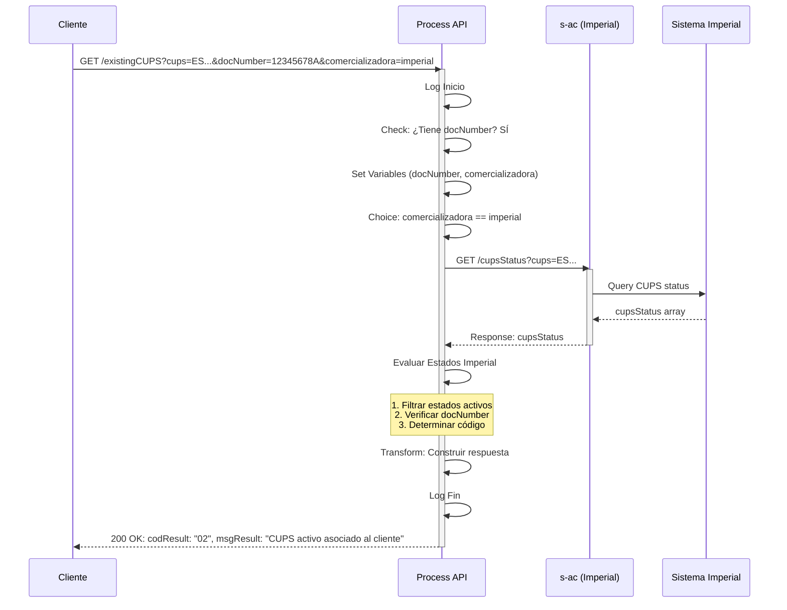
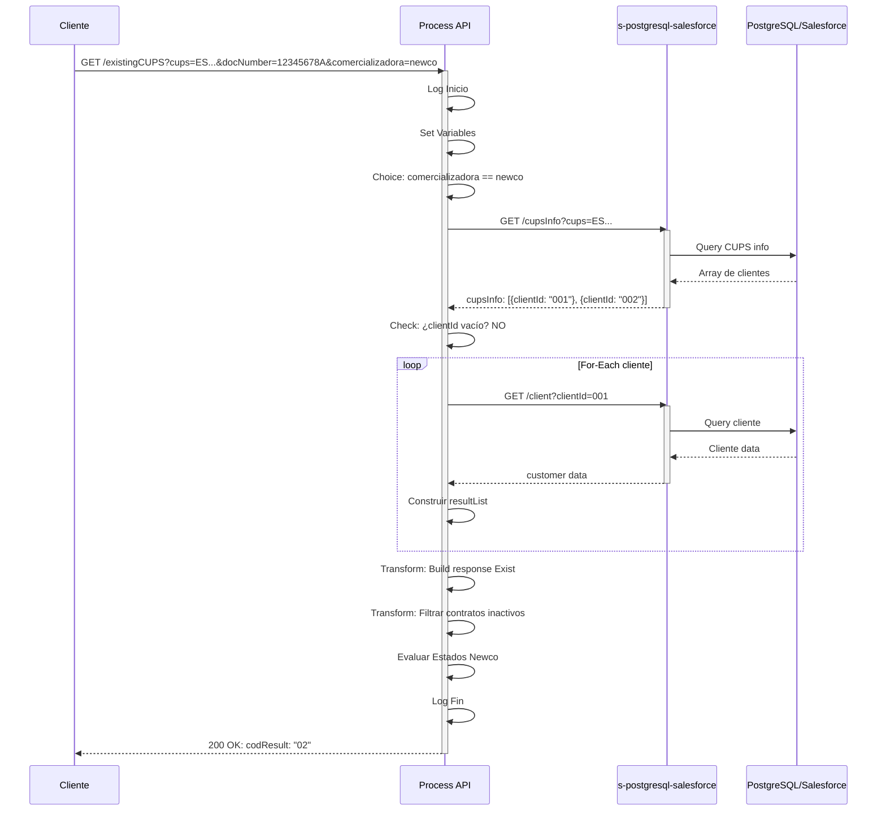
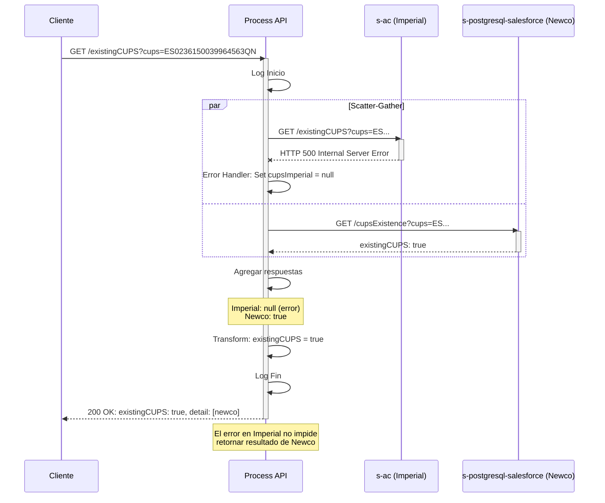

# GET /existingCUPS

## 📌 Descripción General

### Propósito del Endpoint

Este endpoint valida la existencia de un **CUPS** (Código Universal de Punto de Suministro) en los sistemas de Naturgy, implementando **dos modos de operación** distintos según los parámetros proporcionados:

**MODO 1: Validación Simple** (sin `docNumber`)
- Consulta paralela a Imperial y Newco usando **Scatter-Gather**
- Verifica si el CUPS existe en algún sistema
- Respuesta booleana simple con detalle por origen

**MODO 2: Validación Avanzada** (con `docNumber` + `comercializadora`)
- Consulta específica a una comercializadora
- Valida si el CUPS pertenece al cliente especificado
- Lógica de negocio compleja con **6 códigos de estado** diferentes
- Considera estados de contrato (activo, en proceso, asociado a otro cliente)

**Características clave:**
- ✅ Dual-mode operation con lógica diferenciada
- ✅ Scatter-Gather para consultas paralelas (Modo 1)
- ✅ Content-Based Routing por comercializadora (Modo 2)
- ✅ Validación de estados de contrato complejos
- ✅ Manejo robusto de errores con fallback

### Tipo de API

**Capa:** Process API (API-Led Connectivity)

**Función:** Orquestación de validación de CUPS con routing condicional, consultas paralelas y lógica de negocio compleja

### Patrón de Integración

**Tipo:** Dual-Mode (Scatter-Gather + Content-Based Routing) + Agregación Condicional

**Descripción:** 

**MODO 1 (Simple):**
1. **Scatter-Gather** paralelo a Imperial y Newco
2. **Try-Catch** por ruta para resiliencia
3. **Agregación booleana** simple

**MODO 2 (Avanzado):**
1. **Content-Based Routing** por comercializadora
2. **Consultas específicas** con lógica de negocio
3. **Evaluación de estados** de contrato
4. **Proceso iterativo** para Newco (for-each)

### Arquitectura API-Led Connectivity



---

## 💼 Propósito del Negocio

### Casos de Uso Principales

1. **Validación Pre-Contratación (Modo 1)**
   - Verificar si un CUPS ya está registrado en Naturgy
   - Evitar duplicados en procesos de alta
   - Identificar en qué comercializadora existe el CUPS

2. **Validación de Propiedad del CUPS (Modo 2)**
   - Verificar si un CUPS pertenece a un cliente específico
   - Validar elegibilidad para cambios de contrato
   - Identificar si el CUPS está asociado a otro cliente

3. **Gestión de Cambios de Titular**
   - Validar estado del CUPS antes de cambio de titular
   - Identificar contratos activos o en proceso
   - Prevenir conflictos en procesos de switching

4. **Atención al Cliente**
   - Búsqueda rápida de CUPS por código
   - Validación de estado de contrato
   - Identificación de comercializadora asociada

5. **Procesos de Switching**
   - Validar disponibilidad del CUPS para cambio de comercializadora
   - Verificar estado de contratos existentes
   - Identificar bloqueos por contratos en proceso

### 🔗 Endpoints Dependientes

Este Process API consume los siguientes System APIs:

#### MODO 1: Validación Simple

| System API | Endpoint | Método | Propósito |
|------------|----------|--------|-----------|
| `s-ac` | `/existingCUPS` | GET | Verificar existencia simple de CUPS en Imperial |
| `s-postgresql-salesforce` | `/cupsExistence` | GET | Verificar existencia simple de CUPS en Newco |

#### MODO 2: Validación Avanzada

| System API | Endpoint | Método | Propósito |
|------------|----------|--------|-----------|
| `s-ac` | `/cupsStatus` | GET | Obtener estado detallado del CUPS en Imperial |
| `s-postgresql-salesforce` | `/cupsInfo` | GET | Obtener información del CUPS en Newco |
| `s-postgresql-salesforce` | `/client` | GET | Obtener datos del cliente asociado (iterativo) |

### Lógica de Orquestación



**Pasos del Proceso:**

**MODO 1:**
1. **Scatter-Gather**: Consultas paralelas a Imperial y Newco
2. **Try-Catch por ruta**: Manejo de errores independiente
3. **Agregación**: Combinar resultados booleanos
4. **Response**: `existingCUPS: true/false` + detalle por origen

**MODO 2:**
5. **Content-Based Routing**: Seleccionar comercializadora
6. **Consulta específica**: Obtener estado detallado del CUPS
7. **Evaluación de estados**: Aplicar lógica de negocio compleja
8. **Response**: Código específico (00, 01, 02, 03, 04, -1)

### Transformaciones Aplicadas

#### Transformación 1: Agregación Simple (Modo 1)

**Ubicación:** Inline en flow XML (líneas 64-82)

**Propósito:** Combinar respuestas de Imperial y Newco en formato simple

```dataweave
%dw 2.0
output application/json

var existeImperial = vars.cupsImperial != null and vars.cupsImperial.existingCUPS
var existeNewCo = vars.cupsNewCo != null and vars.cupsNewCo.existingCUPS
---
{
    result: {
        codResult: "0000",
        msgResult: "No hay error"
    },
    existingCUPS: existeImperial or existeNewCo,
    detail: [
        ({
            origin: "imperial",
            existingCUPS: vars.cupsImperial.existingCUPS,
        }) if (vars.cupsImperial != null),
        ({
            origin: "newco",
            existingCUPS: vars.cupsNewCo.existingCUPS,
        }) if (vars.cupsNewCo.existingCUPS != null),
    ]
}
```

**Resultado:**
- `existingCUPS`: `true` si existe en Imperial O Newco
- `detail`: Array con resultado por origen

#### Transformación 2: Evaluación de Estados Imperial (Modo 2)

**Ubicación:** Inline en flow XML (líneas 100-122)

**Propósito:** Determinar código de respuesta según estados de contrato

```dataweave
%dw 2.0
output application/json

// Estados considerados como "Activos"
var valoresActivos = ["Activa","Activado", "Activo", "Solicitud modificación", 
    "Solicitud activada", "Solicitud Activada", "Modificación enviada", 
    "Modificacion aceptada", "Modificación aceptada", "Modificación rechazada",
    "Solicitud baja", "Baja aceptada", "Baja rechazada", "Baja activa", 
    "Solicitud corte", "Corte enviado", "Corte Rechazado", "Corte rechazado", 
    "Corte Aceptado", "Suspensión suministro", "Solicitud Anulación corte", 
    "Anulación corte enviada", "Anulación corte rechazada", "Solicitud reenganche", 
    "Reenganche enviado", "Reenganche rechazado", "Reenganche aceptado", 
    "Solicitud anulación", "Anulacion enviada", "Anulación enviada", 
    "Anulación aceptada", "Anulación rechazada", "Pte. Instalación", "REPROCESAR"]

// Estados considerados como "En Proceso de Activación"
var valoresProcesoActivacion = ["Pdte recibir doc", "Documentacion recibida", 
    "Documentación recibida", "Pte fecha solicitud", "Solicitud ATR", 
    "Solicitud enviada","Solicitud aceptada" ,"Solicitud Aceptada", 
    "Solicitud rechazada", "Completar", "Completar2", "Alta Activa", 
    "Alta activa", "Pendiente", "Pte. Validación", "Pdte. Validación"]

// Funciones de decisión
fun contratoActivo (cupsStatus: Array) = 
    if (((cupsStatus..docNumber distinctBy $)[0]) == vars.docNumber) "02" else "04"

fun contratoEnProcesoActivacion (cupsStatus: Array) = 
    if (((cupsStatus..docNumber distinctBy $)[0]) == vars.docNumber) "01" else "03"

fun setImperialCodResult (cupsStatus: Array) = 
    if (sizeOf(cupsStatus.contractStatus filter ((item) -> (valoresActivos contains item))) > 0) 
        contratoActivo(cupsStatus) 
    else if (sizeOf(cupsStatus.contractStatus filter ((item) -> (valoresProcesoActivacion contains item))) > 0) 
        contratoEnProcesoActivacion(cupsStatus) 
    else "-1"

fun setImperialMsgResult (codResult: String) = 
    if (codResult == "01") "CUPS en proceso de activación asociado al cliente" 
    else if (codResult == "02") "CUPS activo asociado al cliente" 
    else if (codResult == "03") "CUPS en proceso de activación asociado a otro cliente" 
    else if (codResult == "04") "CUPS activo asociado a otro cliente" 
    else "Error comunicación"
---
{
    result: {
        codResult: if (vars.cupsImperial != null and !isEmpty(vars.cupsImperial.cupsStatus)) 
                       setImperialCodResult(vars.cupsImperial.cupsStatus) 
                   else if (vars.cupsImperial != null and isEmpty(vars.cupsImperial.cupsStatus)) 
                       "00" 
                   else "-1",
        msgResult: if (vars.cupsImperial != null and !isEmpty(vars.cupsImperial.cupsStatus)) 
                       setImperialMsgResult(setImperialCodResult(vars.cupsImperial.cupsStatus)) 
                   else if (vars.cupsImperial != null and isEmpty(vars.cupsImperial.cupsStatus)) 
                       "CUPS sin contratos activos ni en proceso de activarse" 
                   else "Error comunicación"
    }
}
```

**Lógica:**
1. Verificar si hay contratos con estados activos
2. Si sí → Verificar si docNumber coincide → Código 02 o 04
3. Si no → Verificar si hay contratos en proceso
4. Si sí → Verificar si docNumber coincide → Código 01 o 03
5. Si no → Código -1 (error) o 00 (sin contratos)

#### Transformación 3: Evaluación de Estados Newco (Modo 2)

**Ubicación:** Inline en flow XML (líneas 135-152)

**Propósito:** Determinar código de respuesta para Newco

```dataweave
%dw 2.0
output application/json

var valoresActivos = ["02"]
var valoresProcesoActivacion = ["01"]

fun contratoActivo (cupsStatus: Array) = 
    if (((cupsStatus..docNumber distinctBy $)[0]) == vars.docNumber) "02" else "04"

fun contratoEnProcesoActivacion (cupsStatus: Array) = 
    if (((cupsStatus..docNumber distinctBy $)[0]) == vars.docNumber) "01" else "03"

fun setNewcoCodResult (cupsStatus: Array) = 
    if (sizeOf(cupsStatus.contractLineStatus filter ((item) -> (valoresActivos contains item))) > 0) 
        contratoActivo(cupsStatus) 
    else if (sizeOf(cupsStatus.contractLineStatus filter ((item) -> (valoresProcesoActivacion contains item))) > 0) 
        contratoEnProcesoActivacion(cupsStatus) 
    else "-1"

fun setNewcoMsgResult (codResult: String) = 
    if (codResult == "01") "CUPS en proceso de activación asociado al cliente" 
    else if (codResult == "02") "CUPS activo asociado al cliente" 
    else if (codResult == "03") "CUPS en proceso de activación asociado a otro cliente" 
    else if (codResult == "04") "CUPS activo asociado a otro cliente" 
    else "Error comunicación"
---
{
    result: {
        codResult: if (vars.cupsNewCo != null and !isEmpty(vars.cupsNewCo.infoCups)) 
                       setNewcoCodResult(vars.cupsNewCo.infoCups) 
                   else if (vars.cupsNewCo != null and isEmpty(vars.cupsNewCo.infoCups)) 
                       "00" 
                   else "-1",
        msgResult: if (vars.cupsNewCo != null and !isEmpty(vars.cupsNewCo.infoCups)) 
                       setNewcoMsgResult(setNewcoCodResult(vars.cupsNewCo.infoCups)) 
                   else if (vars.cupsNewCo != null and isEmpty(vars.cupsNewCo.infoCups)) 
                       "CUPS sin contratos activos ni en proceso de activarse" 
                   else "Error comunicación"
    }
}
```

**Diferencia con Imperial:**
- Newco usa códigos numéricos simples: "01" (proceso), "02" (activo)
- Imperial usa strings descriptivos: "Activa", "Solicitud enviada", etc.

#### Transformación 4: Filtrado de Contratos Inactivos (Modo 2 Newco)

**Ubicación:** Inline en flow XML (líneas 174-186)

**Propósito:** Eliminar contratos que no están activos ni en proceso

```dataweave
%dw 2.0
output application/json

var filteredInfoCups = if (payload.result.codResult == "0000") 
    (payload.infoCups) filter ((item) -> item.contractLineStatus == "02" or item.contractLineStatus == "01") 
else []
---
{
  "result": {
    "codResult": payload.result.codResult,
    "msgResult": payload.result.msgResult
  },
  "infoCups": filteredInfoCups
}
```

**Lógica:**
- Solo mantener contratos con estado "01" (proceso) o "02" (activo)
- Eliminar todos los demás estados

### Contexto Empresarial

- **Dominio:** Gestión de Puntos de Suministro (CUPS)
- **Sector:** Energía - Utilities
- **División:** Naturgy España - Dual (Imperial + Newco)
- **Proceso de Negocio:** Validación de CUPS y gestión de contratos

### Stakeholders

- **Equipos de Contratación**: Validan CUPS antes de nuevos contratos
- **Agentes de Atención al Cliente**: Verifican propiedad de CUPS
- **Equipos de Switching**: Gestionan cambios de comercializadora
- **Portales Web/Móvil**: Validan elegibilidad de servicios
- **Equipos de Migración**: Validan CUPS durante consolidación

### Valor de Negocio

- **Prevención de Conflictos**: Evita contratos duplicados en mismo CUPS
- **Validación de Propiedad**: Verifica que el CUPS pertenece al cliente correcto
- **Gestión de Switching**: Facilita cambios de comercializadora
- **Experiencia de Usuario**: Validación rápida y precisa
- **Cumplimiento Regulatorio**: Asegura correcta gestión de puntos de suministro

### Consumidores Potenciales

Este endpoint puede ser consumido por:
- Portales web de contratación (validación de CUPS)
- Aplicaciones móviles (verificación de servicios)
- Sistemas de agentes de call center (consulta de CUPS)
- Procesos de switching y cambio de titular
- Integraciones de terceros autorizados

---

## 🔧 Especificación Técnica

### URLs por Ambiente

| Ambiente | URL Base | URL Completa (Modo 1) | URL Completa (Modo 2) |
|----------|----------|----------------------|----------------------|
| **Local** | `http://localhost:8081` | `http://localhost:8081/api/existingCUPS?cups=ES...` | `http://localhost:8081/api/existingCUPS?cups=ES...&docNumber=X&comercializadora=Y` |
| **Development** | `https://ntgy-fuv-p-customers-dev.us-e2.cloudhub.io` | `https://ntgy-fuv-p-customers-dev.us-e2.cloudhub.io/api/existingCUPS?cups=ES...` | `https://ntgy-fuv-p-customers-dev.us-e2.cloudhub.io/api/existingCUPS?cups=ES...&docNumber=X&comercializadora=Y` |
| **UAT** | `https://ntgy-fuv-p-customers-uat.us-e2.cloudhub.io` | `https://ntgy-fuv-p-customers-uat.us-e2.cloudhub.io/api/existingCUPS?cups=ES...` | `https://ntgy-fuv-p-customers-uat.us-e2.cloudhub.io/api/existingCUPS?cups=ES...&docNumber=X&comercializadora=Y` |
| **Production** | `https://ntgy-fuv-p-customers-pro.us-e2.cloudhub.io` | `https://ntgy-fuv-p-customers-pro.us-e2.cloudhub.io/api/existingCUPS?cups=ES...` | `https://ntgy-fuv-p-customers-pro.us-e2.cloudhub.io/api/existingCUPS?cups=ES...&docNumber=X&comercializadora=Y` |

### Método HTTP

```
GET /api/existingCUPS
```

### Parámetros de Entrada

#### Query Parameters

| Parámetro | Tipo | Requerido | Descripción | Ejemplo |
|-----------|------|-----------|-------------|---------|
| `cups` | String | ✅ Sí | Código Universal de Punto de Suministro | `ES0236150039964563QN` |
| `docNumber` | String | ❌ No | Número de documento del cliente (NIF/NIE/CIF) | `12345678A` |
| `comercializadora` | String | ❌ No | Comercializadora objetivo: `imperial` o `newco` | `imperial` |

**Validaciones:**
- `cups`: Formato válido de CUPS español (20-22 caracteres)
- `docNumber`: Formato válido de documento español (si se proporciona)
- `comercializadora`: Enum con valores permitidos: `imperial`, `newco` (si se proporciona)

**Modos de Operación:**
- **MODO 1**: Solo `cups` → Validación simple (booleano)
- **MODO 2**: `cups` + `docNumber` + `comercializadora` → Validación avanzada (códigos específicos)

### Respuestas

#### MODO 1: Validación Simple

##### 200 OK - CUPS Encontrado en Ambos Sistemas

```json
{
  "result": {
    "codResult": "0000",
    "msgResult": "No hay error"
  },
  "existingCUPS": true,
  "detail": [
    {
      "origin": "imperial",
      "existingCUPS": true
    },
    {
      "origin": "newco",
      "existingCUPS": true
    }
  ]
}
```

##### 200 OK - CUPS Encontrado Solo en Newco

```json
{
  "result": {
    "codResult": "0000",
    "msgResult": "No hay error"
  },
  "existingCUPS": true,
  "detail": [
    {
      "origin": "newco",
      "existingCUPS": true
    }
  ]
}
```

##### 200 OK - CUPS No Encontrado

```json
{
  "result": {
    "codResult": "0000",
    "msgResult": "No hay error"
  },
  "existingCUPS": false,
  "detail": []
}
```

#### MODO 2: Validación Avanzada

##### 200 OK - CUPS Activo Asociado al Cliente (Código 02)

```json
{
  "result": {
    "codResult": "02",
    "msgResult": "CUPS activo asociado al cliente"
  }
}
```

##### 200 OK - CUPS en Proceso Asociado al Cliente (Código 01)

```json
{
  "result": {
    "codResult": "01",
    "msgResult": "CUPS en proceso de activación asociado al cliente"
  }
}
```

##### 200 OK - CUPS Activo Asociado a Otro Cliente (Código 04)

```json
{
  "result": {
    "codResult": "04",
    "msgResult": "CUPS activo asociado a otro cliente"
  }
}
```

##### 200 OK - CUPS en Proceso Asociado a Otro Cliente (Código 03)

```json
{
  "result": {
    "codResult": "03",
    "msgResult": "CUPS en proceso de activación asociado a otro cliente"
  }
}
```

##### 200 OK - CUPS Sin Contratos (Código 00)

```json
{
  "result": {
    "codResult": "00",
    "msgResult": "CUPS sin contratos activos ni en proceso de activarse"
  }
}
```

##### 200 OK - Error Comunicación (Código -1)

```json
{
  "result": {
    "codResult": "-1",
    "msgResult": "Error comunicación"
  }
}
```

### Códigos de Respuesta

#### MODO 1: Validación Simple

| Código | Descripción |
|--------|-------------|
| `0000` | Operación exitosa |

**Campo `existingCUPS`:**
- `true`: CUPS existe en al menos un sistema
- `false`: CUPS no existe en ningún sistema

#### MODO 2: Validación Avanzada

| Código | Descripción | Significado |
|--------|-------------|-------------|
| `00` | CUPS sin contratos | CUPS existe pero no tiene contratos activos ni en proceso |
| `01` | CUPS en proceso - Cliente | CUPS en proceso de activación asociado al cliente especificado |
| `02` | CUPS activo - Cliente | CUPS activo asociado al cliente especificado |
| `03` | CUPS en proceso - Otro | CUPS en proceso de activación asociado a otro cliente |
| `04` | CUPS activo - Otro | CUPS activo asociado a otro cliente |
| `-1` | Error comunicación | Error al consultar backend o sin datos |

### Autenticación

- **Tipo:** Client ID & Client Secret (Anypoint Platform)
- **Headers requeridos:**
  - `client_id`: ID de la aplicación cliente
  - `client_secret`: Secret de la aplicación cliente

### Timeouts

| Tipo | Valor |
|------|-------|
| **Request Timeout** | 30 segundos |
| **Connection Timeout** | 10 segundos |

---

## 🏗️ Implementación Técnica

### Arquitectura del Flow



### Componentes Clave del Flow

#### 1. Bifurcación Inicial

**Ubicación:** Flow principal `p-customers-existingCUPSFlow` (líneas 8-15)

```xml
<choice doc:name="Choice">
    <when expression="#[!isEmpty(attributes.queryParams.docNumber) and !isEmpty(attributes.queryParams.comercializadora)]">
        <flow-ref name="p-customers-existingCUPSbyDocNumber"/>
    </when>
    <otherwise>
        <flow-ref name="p-customers-existingCUPS"/>
    </otherwise>
</choice>
```

**Decisión:** Basada en presencia de `docNumber` Y `comercializadora`

#### 2. MODO 1: Scatter-Gather

**Ubicación:** Flow `p-customers-existingCUPS` (líneas 19-63)

```xml
<scatter-gather doc:name="Scatter-Gather">
    <route>
        <try>
            <choice doc:name="Imperial">
                <when expression='#[["imperial", null] contains attributes.queryParams.comercializadora]'>
                    <flow-ref name="getExistingCUPS-imperial" target="cupsImperial" />
                </when>
                <otherwise>
                    <logger message='#["Saltar Imperial"]' />
                </otherwise>
            </choice>
            <error-handler>
                <on-error-continue type="ANY">
                    <set-variable variableName="cupsImperial" value="#[null]" />
                </on-error-continue>
            </error-handler>
        </try>
    </route>
    <route>
        <!-- Similar para Newco -->
    </route>
</scatter-gather>
```

**Características:**
- Consultas paralelas a Imperial y Newco
- Try-Catch independiente por ruta
- Fallback a `null` en caso de error
- Permite filtrar por comercializadora

#### 3. MODO 2: Content-Based Routing

**Ubicación:** Flow `p-customers-existingCUPSbyDocNumber` (líneas 89-220)

**Paso 3.1:** Set Variables

```xml
<ee:transform doc:name="Set docNumber Variable">
    <ee:variables>
        <ee:set-variable variableName="docNumber">
            attributes.queryParams.docNumber
        </ee:set-variable>
    </ee:variables>
</ee:transform>

<ee:transform doc:name="Set comercializadora Variable">
    <ee:variables>
        <ee:set-variable variableName="comercializadora">
            attributes.queryParams.comercializadora as String
        </ee:set-variable>
    </ee:variables>
</ee:transform>
```

**Paso 3.2:** Choice por Comercializadora

```xml
<choice doc:name="Choice">
    <when expression='#[vars.comercializadora == "imperial"]'>
        <try>
            <flow-ref name="getExistingCUPSbyDocNumber-imperial" target="cupsImperial" />
            <ee:transform doc:name="Construir respuesta Imperial">
                <!-- Lógica de evaluación de estados -->
            </ee:transform>
            <error-handler>
                <on-error-continue type="ANY">
                    <set-variable variableName="cupsImperial" value="#[null]" />
                </on-error-continue>
            </error-handler>
        </try>
    </when>
    <otherwise>
        <try>
            <flow-ref name="getExistingCUPSbyDocNumber-newco" target="cupsNewCo" />
            <ee:transform doc:name="Construir respuesta Newco">
                <!-- Lógica de evaluación de estados -->
            </ee:transform>
            <error-handler>
                <on-error-continue type="ANY">
                    <set-variable variableName="cupsNewCo" value="#[null]" />
                </on-error-continue>
            </error-handler>
        </try>
    </otherwise>
</choice>
```

#### 4. Proceso Iterativo Newco (Modo 2)

**Ubicación:** Subflow `getExistingCUPSbyDocNumber-newco` (líneas 138-188)

```xml
<http:request method="GET" path="/cupsInfo" target="cupsInfo">
    <http:query-params>
        { "cups": attributes.queryParams.cups as String }
    </http:query-params>
</http:request>

<choice doc:name="Choice">
    <when expression="#[vars.cupsInfo dw::core::Arrays::some isEmpty($.clientId)]">
        <ee:transform doc:name="Build response Not Exist">
            <!-- buildResponseCupsNotExist() -->
        </ee:transform>
    </when>
    <otherwise>
        <foreach doc:name="For Each" collection="#[vars.cupsInfo]">
            <http:request method="GET" path="/client" target="customer">
                <http:query-params>
                    { clientId: payload.clientId }
                </http:query-params>
            </http:request>
            
            <ee:transform doc:name="Variable - resultList">
                <ee:variables>
                    <ee:set-variable variableName="resultList">
                        (vars.resultList default []) + {
                            "contractLineStatus": payload.contractStatus,
                            "docNumber": if(!isEmpty(vars.customer.client.docNumber)) 
                                           vars.customer.client.docNumber 
                                         else vars.customer.client.contacts.docNumber[0]
                        }
                    </ee:set-variable>
                </ee:variables>
            </ee:transform>
        </foreach>
        
        <ee:transform doc:name="Build response Exist">
            <!-- Construir respuesta con resultList -->
        </ee:transform>
    </otherwise>
</choice>

<ee:transform doc:name="Filtrar Lineas de contrato inactivas">
    <!-- Filtrar solo estados "01" y "02" -->
</ee:transform>
```

**Lógica:**
1. Obtener lista de clientes asociados al CUPS
2. Si lista vacía → Response "Not Exist"
3. Si lista con datos → For-Each:
   - Por cada cliente, obtener datos completos
   - Construir array `resultList` con estados y docNumbers
4. Filtrar solo contratos activos ("01", "02")
5. Evaluar estados y determinar código

### Patrones de Diseño

#### Patrón 1: Scatter-Gather

**Justificación:** Consultas paralelas para mejor performance

**Implementación:**
- Dos rutas independientes (Imperial y Newco)
- Try-Catch por ruta para resiliencia
- Agregación de resultados al final

**Beneficios:**
- Reduce latencia (consultas en paralelo)
- Resiliencia (error en una ruta no afecta la otra)
- Flexibilidad (puede filtrar por comercializadora)

#### Patrón 2: Dual-Mode Operation

**Justificación:** Diferentes necesidades de negocio requieren diferentes niveles de detalle

**Implementación:**
- Bifurcación inicial basada en parámetros
- Flows separados para cada modo
- Lógica de negocio específica por modo

**Beneficios:**
- Simplicidad para casos básicos (Modo 1)
- Detalle para casos complejos (Modo 2)
- Mantenibilidad (lógica separada)

#### Patrón 3: Try-Catch con Fallback

**Justificación:** Garantiza respuesta incluso si backends fallan

**Implementación:**
```xml
<try>
    <http:request ... />
    <error-handler>
        <on-error-continue type="ANY">
            <set-variable variableName="cups..." value="#[null]" />
        </on-error-continue>
    </error-handler>
</try>
```

**Beneficios:**
- Resiliencia ante fallos de backend
- Experiencia de usuario consistente
- No propaga errores técnicos al cliente

#### Patrón 4: For-Each Iterativo

**Justificación:** Necesidad de consultar datos de múltiples clientes

**Implementación:**
- For-Each sobre lista de clientes
- Acumulación en variable `resultList`
- Transformación final con datos agregados

**Beneficios:**
- Flexibilidad para N clientes
- Datos completos de cada cliente
- Construcción dinámica de respuesta

### Diagramas de Secuencia

#### 1. Flujo MODO 1 - Scatter-Gather Exitoso



#### 2. Flujo MODO 2 Imperial - Validación con Cliente



#### 3. Flujo MODO 2 Newco - Proceso Iterativo



#### 4. Flujo con Error de Backend (Fallback)



### Manejo de Errores

#### Estrategia de Error Handling

**Nivel 1: Try-Catch por Ruta/Comercializadora**

Cada consulta a backend está envuelta en un bloque `<try>` con error handler:

```xml
<try>
    <http:request ... />
    <error-handler>
        <on-error-continue type="ANY">
            <set-variable variableName="cups..." value="#[null]" />
        </on-error-continue>
    </error-handler>
</try>
```

**Comportamiento:**
- ✅ Error de backend NO detiene el flujo
- ✅ Se asigna `null` a la variable correspondiente
- ✅ Permite continuar con agregación/evaluación

**Nivel 2: Evaluación de Null en Transformaciones**

Las transformaciones DataWeave manejan valores `null`:

```dataweave
// Modo 1
var existeImperial = vars.cupsImperial != null and vars.cupsImperial.existingCUPS
var existeNewCo = vars.cupsNewCo != null and vars.cupsNewCo.existingCUPS

// Modo 2
codResult: if (vars.cupsImperial != null and !isEmpty(vars.cupsImperial.cupsStatus)) 
               setImperialCodResult(vars.cupsImperial.cupsStatus) 
           else if (vars.cupsImperial != null and isEmpty(vars.cupsImperial.cupsStatus)) 
               "00" 
           else "-1"
```

#### Matriz de Errores

| Escenario | Modo | Código | Mensaje | HTTP Status |
|-----------|------|--------|---------|-------------|
| CUPS encontrado | 1 | `0000` | "No hay error" | 200 |
| CUPS no encontrado | 1 | `0000` | "No hay error" | 200 |
| Error backend Imperial | 1 | `0000` | "No hay error" | 200 (fallback) |
| Error backend Newco | 1 | `0000` | "No hay error" | 200 (fallback) |
| CUPS activo - cliente | 2 | `02` | "CUPS activo asociado al cliente" | 200 |
| CUPS proceso - cliente | 2 | `01` | "CUPS en proceso..." | 200 |
| CUPS activo - otro | 2 | `04` | "CUPS activo asociado a otro cliente" | 200 |
| CUPS proceso - otro | 2 | `03` | "CUPS en proceso..." | 200 |
| CUPS sin contratos | 2 | `00` | "CUPS sin contratos..." | 200 |
| Error backend | 2 | `-1` | "Error comunicación" | 200 |

---

## 💻 Ejemplos de Uso

### Ejemplo 1: MODO 1 - Validación Simple (CUPS Existe)

#### Request con cURL

```bash
curl -X GET "https://ntgy-fuv-p-customers-dev.us-e2.cloudhub.io/api/existingCUPS?cups=ES0236150039964563QN" \
  -H "Content-Type: application/json" \
  -H "client_id: YOUR_CLIENT_ID" \
  -H "client_secret: YOUR_CLIENT_SECRET"
```

#### Response (200 OK)

```json
{
  "result": {
    "codResult": "0000",
    "msgResult": "No hay error"
  },
  "existingCUPS": true,
  "detail": [
    {
      "origin": "imperial",
      "existingCUPS": true
    },
    {
      "origin": "newco",
      "existingCUPS": true
    }
  ]
}
```

### Ejemplo 2: MODO 1 - Validación Simple (CUPS No Existe)

#### Request con cURL

```bash
curl -X GET "https://ntgy-fuv-p-customers-dev.us-e2.cloudhub.io/api/existingCUPS?cups=ES9999999999999999XX" \
  -H "Content-Type: application/json" \
  -H "client_id: YOUR_CLIENT_ID" \
  -H "client_secret: YOUR_CLIENT_SECRET"
```

#### Response (200 OK)

```json
{
  "result": {
    "codResult": "0000",
    "msgResult": "No hay error"
  },
  "existingCUPS": false,
  "detail": []
}
```

### Ejemplo 3: MODO 2 - CUPS Activo Asociado al Cliente

#### Request con cURL

```bash
curl -X GET "https://ntgy-fuv-p-customers-dev.us-e2.cloudhub.io/api/existingCUPS?cups=ES0236150039964563QN&docNumber=12345678A&comercializadora=imperial" \
  -H "Content-Type: application/json" \
  -H "client_id: YOUR_CLIENT_ID" \
  -H "client_secret: YOUR_CLIENT_SECRET"
```

#### Response (200 OK)

```json
{
  "result": {
    "codResult": "02",
    "msgResult": "CUPS activo asociado al cliente"
  }
}
```

### Ejemplo 4: MODO 2 - CUPS Activo Asociado a Otro Cliente

#### Request con cURL

```bash
curl -X GET "https://ntgy-fuv-p-customers-dev.us-e2.cloudhub.io/api/existingCUPS?cups=ES0236150039964563QN&docNumber=87654321B&comercializadora=newco" \
  -H "Content-Type: application/json" \
  -H "client_id: YOUR_CLIENT_ID" \
  -H "client_secret: YOUR_CLIENT_SECRET"
```

#### Response (200 OK)

```json
{
  "result": {
    "codResult": "04",
    "msgResult": "CUPS activo asociado a otro cliente"
  }
}
```

**Interpretación:** El CUPS existe y está activo, pero pertenece a un cliente diferente al especificado.

### Ejemplo 5: MODO 2 - CUPS en Proceso de Activación

#### Request con cURL

```bash
curl -X GET "https://ntgy-fuv-p-customers-dev.us-e2.cloudhub.io/api/existingCUPS?cups=ES0236150039964563QN&docNumber=11111111C&comercializadora=imperial" \
  -H "Content-Type: application/json" \
  -H "client_id: YOUR_CLIENT_ID" \
  -H "client_secret: YOUR_CLIENT_SECRET"
```

#### Response (200 OK)

```json
{
  "result": {
    "codResult": "01",
    "msgResult": "CUPS en proceso de activación asociado al cliente"
  }
}
```

**Interpretación:** El CUPS está en proceso de activación para el cliente especificado.

### Ejemplo 6: MODO 2 - CUPS Sin Contratos

#### Request con cURL

```bash
curl -X GET "https://ntgy-fuv-p-customers-dev.us-e2.cloudhub.io/api/existingCUPS?cups=ES0236150039964563QN&docNumber=22222222D&comercializadora=newco" \
  -H "Content-Type: application/json" \
  -H "client_id: YOUR_CLIENT_ID" \
  -H "client_secret: YOUR_CLIENT_SECRET"
```

#### Response (200 OK)

```json
{
  "result": {
    "codResult": "00",
    "msgResult": "CUPS sin contratos activos ni en proceso de activarse"
  }
}
```

**Interpretación:** El CUPS existe en el sistema pero no tiene contratos activos ni en proceso.

### Ejemplo 7: JavaScript (Fetch API) - Modo 1

```javascript
const checkCUPSExists = async (cups) => {
  const url = new URL('https://ntgy-fuv-p-customers-dev.us-e2.cloudhub.io/api/existingCUPS');
  url.searchParams.append('cups', cups);

  try {
    const response = await fetch(url, {
      method: 'GET',
      headers: {
        'Content-Type': 'application/json',
        'client_id': 'YOUR_CLIENT_ID',
        'client_secret': 'YOUR_CLIENT_SECRET'
      }
    });

    const data = await response.json();
    
    if (data.existingCUPS) {
      console.log('CUPS existe en:', data.detail.map(d => d.origin).join(', '));
      return {
        exists: true,
        systems: data.detail.map(d => d.origin),
        detail: data.detail
      };
    } else {
      console.log('CUPS no existe en ningún sistema');
      return {
        exists: false,
        systems: [],
        detail: []
      };
    }
  } catch (error) {
    console.error('Error al consultar CUPS:', error);
    throw error;
  }
};

// Uso
checkCUPSExists('ES0236150039964563QN')
  .then(result => {
    if (result.exists) {
      console.log(`CUPS encontrado en: ${result.systems.join(', ')}`);
    }
  });
```

### Ejemplo 8: JavaScript - Modo 2 con Validación de Cliente

```javascript
const validateCUPSOwnership = async (cups, docNumber, comercializadora) => {
  const url = new URL('https://ntgy-fuv-p-customers-dev.us-e2.cloudhub.io/api/existingCUPS');
  url.searchParams.append('cups', cups);
  url.searchParams.append('docNumber', docNumber);
  url.searchParams.append('comercializadora', comercializadora);

  try {
    const response = await fetch(url, {
      method: 'GET',
      headers: {
        'Content-Type': 'application/json',
        'client_id': 'YOUR_CLIENT_ID',
        'client_secret': 'YOUR_CLIENT_SECRET'
      }
    });

    const data = await response.json();
    const code = data.result.codResult;
    
    // Interpretar código
    const interpretations = {
      '00': { canProceed: false, reason: 'CUPS sin contratos activos' },
      '01': { canProceed: true, reason: 'CUPS en proceso - tu cliente' },
      '02': { canProceed: true, reason: 'CUPS activo - tu cliente' },
      '03': { canProceed: false, reason: 'CUPS en proceso - otro cliente' },
      '04': { canProceed: false, reason: 'CUPS activo - otro cliente' },
      '-1': { canProceed: false, reason: 'Error de comunicación' }
    };
    
    const interpretation = interpretations[code] || { canProceed: false, reason: 'Código desconocido' };
    
    return {
      code: code,
      message: data.result.msgResult,
      canProceed: interpretation.canProceed,
      reason: interpretation.reason
    };
  } catch (error) {
    console.error('Error al validar CUPS:', error);
    throw error;
  }
};

// Uso en proceso de contratación
validateCUPSOwnership('ES0236150039964563QN', '12345678A', 'newco')
  .then(result => {
    if (result.canProceed) {
      console.log(`✅ Puede proceder: ${result.reason}`);
      // Continuar con proceso de contratación
    } else {
      console.log(`❌ No puede proceder: ${result.reason}`);
      // Mostrar mensaje al usuario
    }
  });
```

### Ejemplo 9: Python - Modo 1

```python
import requests
from typing import Dict, List

def check_cups_exists(cups: str, client_id: str, client_secret: str) -> Dict:
    """
    Verifica si un CUPS existe en los sistemas de Naturgy (Modo 1).
    
    Args:
        cups: Código Universal de Punto de Suministro
        client_id: Client ID de Anypoint
        client_secret: Client Secret de Anypoint
    
    Returns:
        Dict con información de existencia del CUPS
    """
    url = 'https://ntgy-fuv-p-customers-dev.us-e2.cloudhub.io/api/existingCUPS'
    
    params = {'cups': cups}
    
    headers = {
        'Content-Type': 'application/json',
        'client_id': client_id,
        'client_secret': client_secret
    }
    
    try:
        response = requests.get(url, params=params, headers=headers, timeout=30)
        response.raise_for_status()
        
        data = response.json()
        
        if data['existingCUPS']:
            systems = [item['origin'] for item in data.get('detail', [])]
            return {
                'exists': True,
                'systems': systems,
                'detail': data.get('detail', []),
                'message': f"CUPS encontrado en: {', '.join(systems)}"
            }
        else:
            return {
                'exists': False,
                'systems': [],
                'detail': [],
                'message': 'CUPS no encontrado en ningún sistema'
            }
    
    except requests.exceptions.RequestException as e:
        print(f"Error al consultar CUPS: {e}")
        raise

# Uso
result = check_cups_exists(
    cups='ES0236150039964563QN',
    client_id='YOUR_CLIENT_ID',
    client_secret='YOUR_CLIENT_SECRET'
)

print(result['message'])
```

### Ejemplo 10: Python - Modo 2 con Lógica de Negocio

```python
from enum import Enum
from typing import Dict, Optional

class CUPSStatus(Enum):
    """Estados posibles del CUPS"""
    SIN_CONTRATOS = '00'
    PROCESO_CLIENTE = '01'
    ACTIVO_CLIENTE = '02'
    PROCESO_OTRO = '03'
    ACTIVO_OTRO = '04'
    ERROR = '-1'

def validate_cups_ownership(
    cups: str,
    doc_number: str,
    comercializadora: str,
    client_id: str,
    client_secret: str
) -> Dict:
    """
    Valida propiedad de CUPS para un cliente específico (Modo 2).
    
    Args:
        cups: Código Universal de Punto de Suministro
        doc_number: Número de documento del cliente
        comercializadora: 'imperial' o 'newco'
        client_id: Client ID de Anypoint
        client_secret: Client Secret de Anypoint
    
    Returns:
        Dict con resultado de validación y recomendaciones
    """
    url = 'https://ntgy-fuv-p-customers-dev.us-e2.cloudhub.io/api/existingCUPS'
    
    params = {
        'cups': cups,
        'docNumber': doc_number,
        'comercializadora': comercializadora
    }
    
    headers = {
        'Content-Type': 'application/json',
        'client_id': client_id,
        'client_secret': client_secret
    }
    
    try:
        response = requests.get(url, params=params, headers=headers, timeout=30)
        response.raise_for_status()
        
        data = response.json()
        code = data['result']['codResult']
        
        # Interpretar código y determinar acción
        interpretations = {
            CUPSStatus.SIN_CONTRATOS.value: {
                'can_proceed': False,
                'reason': 'CUPS sin contratos activos',
                'action': 'Verificar estado del CUPS o contactar soporte'
            },
            CUPSStatus.PROCESO_CLIENTE.value: {
                'can_proceed': True,
                'reason': 'CUPS en proceso de activación para este cliente',
                'action': 'Puede proceder con precaución - contrato en proceso'
            },
            CUPSStatus.ACTIVO_CLIENTE.value: {
                'can_proceed': True,
                'reason': 'CUPS activo asociado a este cliente',
                'action': 'Puede proceder con operaciones sobre el CUPS'
            },
            CUPSStatus.PROCESO_OTRO.value: {
                'can_proceed': False,
                'reason': 'CUPS en proceso para otro cliente',
                'action': 'No puede proceder - CUPS reservado para otro cliente'
            },
            CUPSStatus.ACTIVO_OTRO.value: {
                'can_proceed': False,
                'reason': 'CUPS activo asociado a otro cliente',
                'action': 'No puede proceder - CUPS ya tiene titular'
            },
            CUPSStatus.ERROR.value: {
                'can_proceed': False,
                'reason': 'Error de comunicación con backend',
                'action': 'Reintentar o contactar soporte técnico'
            }
        }
        
        interpretation = interpretations.get(code, {
            'can_proceed': False,
            'reason': 'Código desconocido',
            'action': 'Contactar soporte técnico'
        })
        
        return {
            'code': code,
            'message': data['result']['msgResult'],
            'can_proceed': interpretation['can_proceed'],
            'reason': interpretation['reason'],
            'recommended_action': interpretation['action'],
            'raw_response': data
        }
    
    except requests.exceptions.RequestException as e:
        print(f"Error al validar CUPS: {e}")
        raise

# Uso en proceso de switching
result = validate_cups_ownership(
    cups='ES0236150039964563QN',
    doc_number='12345678A',
    comercializadora='newco',
    client_id='YOUR_CLIENT_ID',
    client_secret='YOUR_CLIENT_SECRET'
)

if result['can_proceed']:
    print(f"✅ {result['reason']}")
    print(f"Acción: {result['recommended_action']}")
    # Continuar con proceso
else:
    print(f"❌ {result['reason']}")
    print(f"Acción: {result['recommended_action']}")
    # Detener proceso y notificar usuario
```

### Ejemplo 11: Caso de Uso - Validación Pre-Switching

```javascript
/**
 * Valida si un CUPS puede ser objeto de switching
 * Verifica que no esté asociado a otro cliente
 */
async function validateCUPSForSwitching(cups, newClientDocNumber, targetComercializadora) {
  // Paso 1: Verificar existencia simple
  const existsResult = await checkCUPSExists(cups);
  
  if (!existsResult.exists) {
    return {
      canSwitch: false,
      reason: 'CUPS no existe en ningún sistema',
      step: 'existence_check'
    };
  }
  
  // Paso 2: Validar propiedad con nuevo cliente
  const ownershipResult = await validateCUPSOwnership(
    cups,
    newClientDocNumber,
    targetComercializadora
  );
  
  // Análisis de resultado
  switch (ownershipResult.code) {
    case '02': // CUPS activo - cliente
      return {
        canSwitch: false,
        reason: 'El cliente ya es titular de este CUPS',
        step: 'ownership_check',
        recommendation: 'No es necesario switching'
      };
    
    case '04': // CUPS activo - otro cliente
      return {
        canSwitch: true,
        reason: 'CUPS disponible para switching',
        step: 'ownership_check',
        recommendation: 'Proceder con proceso de switching estándar'
      };
    
    case '01': // CUPS en proceso - cliente
      return {
        canSwitch: false,
        reason: 'CUPS ya en proceso de activación para este cliente',
        step: 'ownership_check',
        recommendation: 'Esperar finalización del proceso actual'
      };
    
    case '03': // CUPS en proceso - otro
      return {
        canSwitch: false,
        reason: 'CUPS en proceso de activación para otro cliente',
        step: 'ownership_check',
        recommendation: 'Esperar o contactar con el otro cliente'
      };
    
    case '00': // Sin contratos
      return {
        canSwitch: true,
        reason: 'CUPS sin contratos activos',
        step: 'ownership_check',
        recommendation: 'Proceder con alta nueva en lugar de switching'
      };
    
    default:
      return {
        canSwitch: false,
        reason: 'Error en validación',
        step: 'ownership_check',
        recommendation: 'Contactar soporte técnico'
      };
  }
}

// Uso
const switchingValidation = await validateCUPSForSwitching(
  'ES0236150039964563QN',
  '12345678A',
  'newco'
);

if (switchingValidation.canSwitch) {
  console.log(`✅ Puede proceder con switching: ${switchingValidation.reason}`);
  console.log(`Recomendación: ${switchingValidation.recommendation}`);
  // Iniciar proceso de switching
} else {
  console.log(`❌ No puede proceder: ${switchingValidation.reason}`);
  console.log(`Recomendación: ${switchingValidation.recommendation}`);
  // Mostrar mensaje al usuario
}
```

### Notas de Implementación

#### Diferencias entre Modos

**MODO 1 (Simple):**
- ✅ Más rápido (consultas paralelas)
- ✅ Respuesta booleana simple
- ✅ Útil para validaciones básicas
- ❌ No valida propiedad del cliente

**MODO 2 (Avanzado):**
- ✅ Validación completa de propiedad
- ✅ Información detallada de estado
- ✅ Útil para procesos de negocio complejos
- ❌ Más lento (consultas secuenciales)

#### Cuándo Usar Cada Modo

**Usar MODO 1 cuando:**
- Solo necesitas saber si el CUPS existe
- No importa a quién pertenece
- Necesitas respuesta rápida
- Estás haciendo validaciones masivas

**Usar MODO 2 cuando:**
- Necesitas validar propiedad del CUPS
- Vas a realizar operaciones sobre el CUPS
- Necesitas conocer el estado del contrato
- Estás en proceso de switching o cambio de titular

#### Manejo de Timeouts

```javascript
const fetchWithTimeout = async (url, options, timeout = 30000) => {
  const controller = new AbortController();
  const id = setTimeout(() => controller.abort(), timeout);
  
  try {
    const response = await fetch(url, {
      ...options,
      signal: controller.signal
    });
    clearTimeout(id);
    return response;
  } catch (error) {
    clearTimeout(id);
    if (error.name === 'AbortError') {
      throw new Error('Request timeout');
    }
    throw error;
  }
};
```

#### Validación de Parámetros

```javascript
function validateCUPSFormat(cups) {
  // CUPS español: 20-22 caracteres alfanuméricos
  const cupsRegex = /^ES[0-9]{16}[A-Z]{2,4}$/;
  if (!cupsRegex.test(cups)) {
    throw new Error('Formato de CUPS inválido');
  }
  return true;
}

function validateDocNumber(docNumber) {
  // NIF/NIE español: 8 dígitos + letra
  const docRegex = /^[0-9]{8}[A-Z]$/;
  if (!docRegex.test(docNumber)) {
    throw new Error('Formato de documento inválido');
  }
  return true;
}

function validateComercializadora(comercializadora) {
  const valid = ['imperial', 'newco'];
  if (!valid.includes(comercializadora)) {
    throw new Error('Comercializadora debe ser "imperial" o "newco"');
  }
  return true;
}
```
