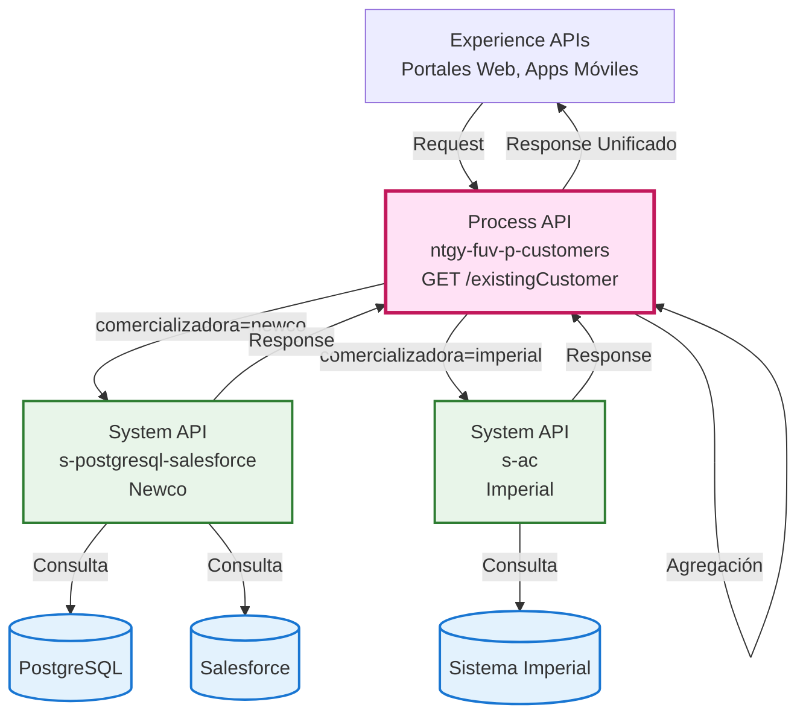
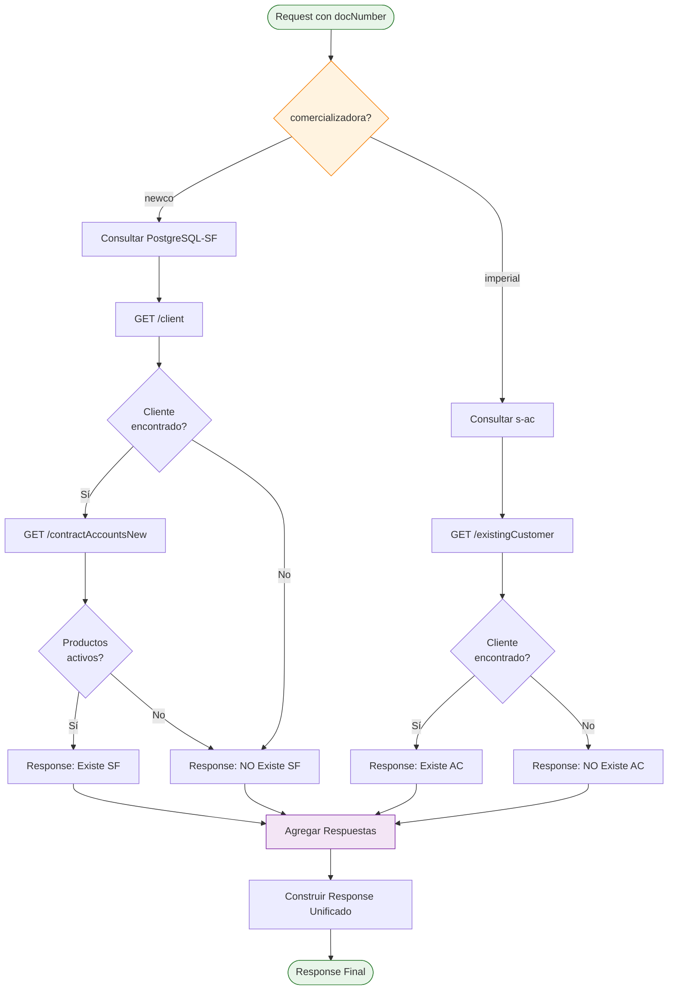
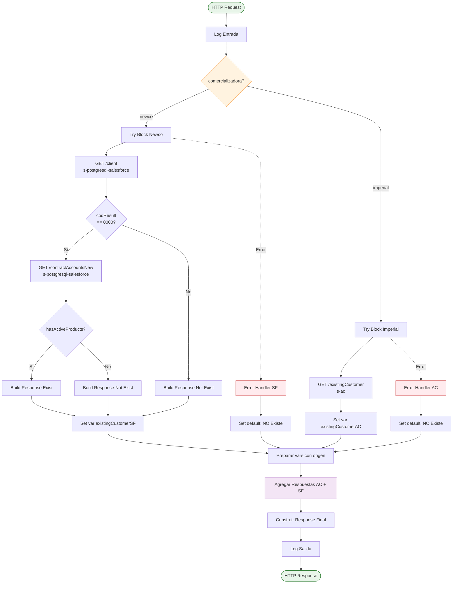
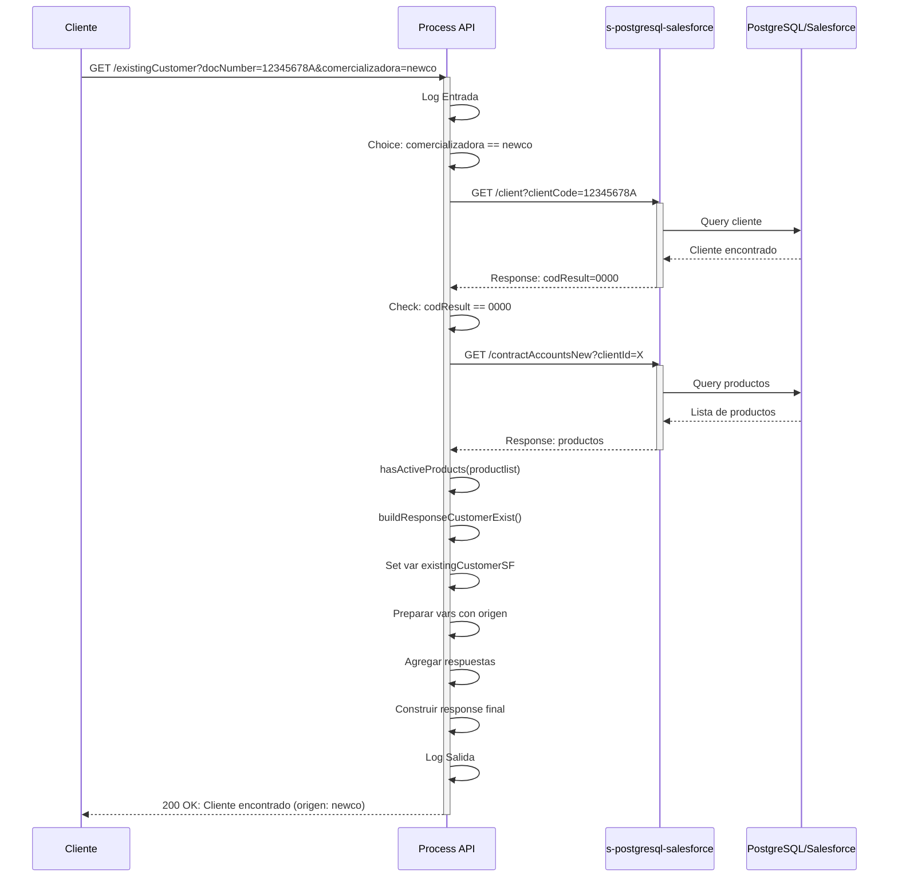
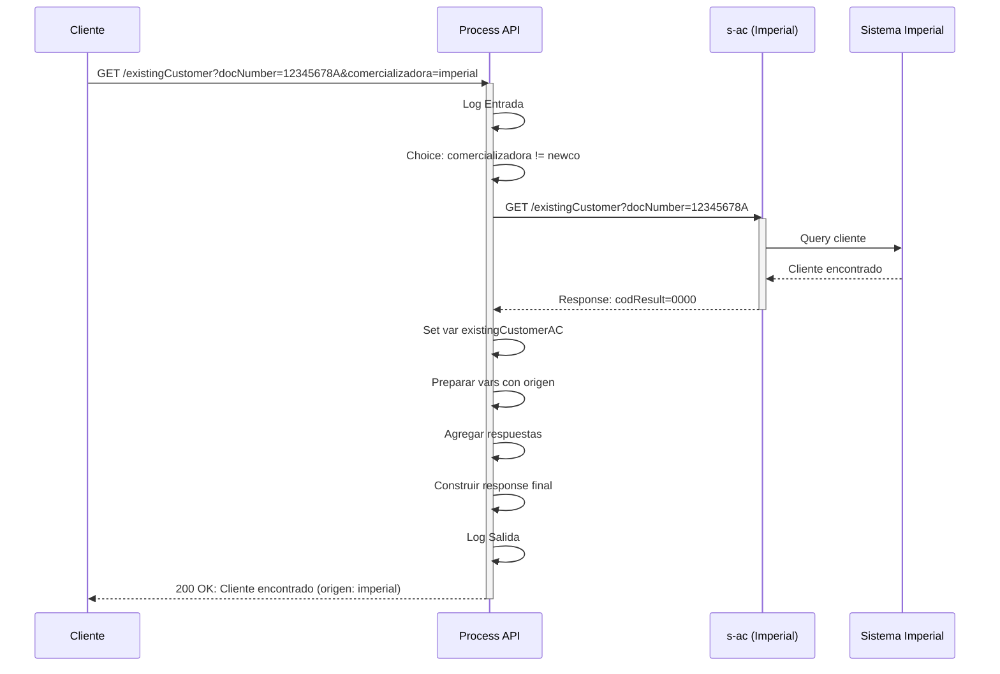
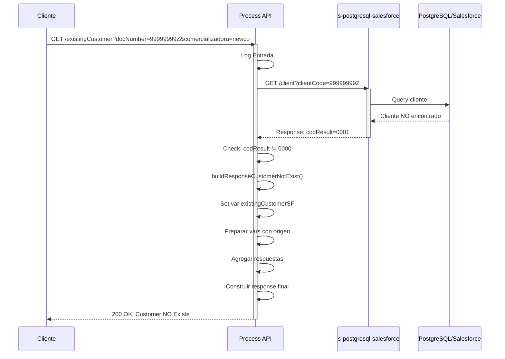
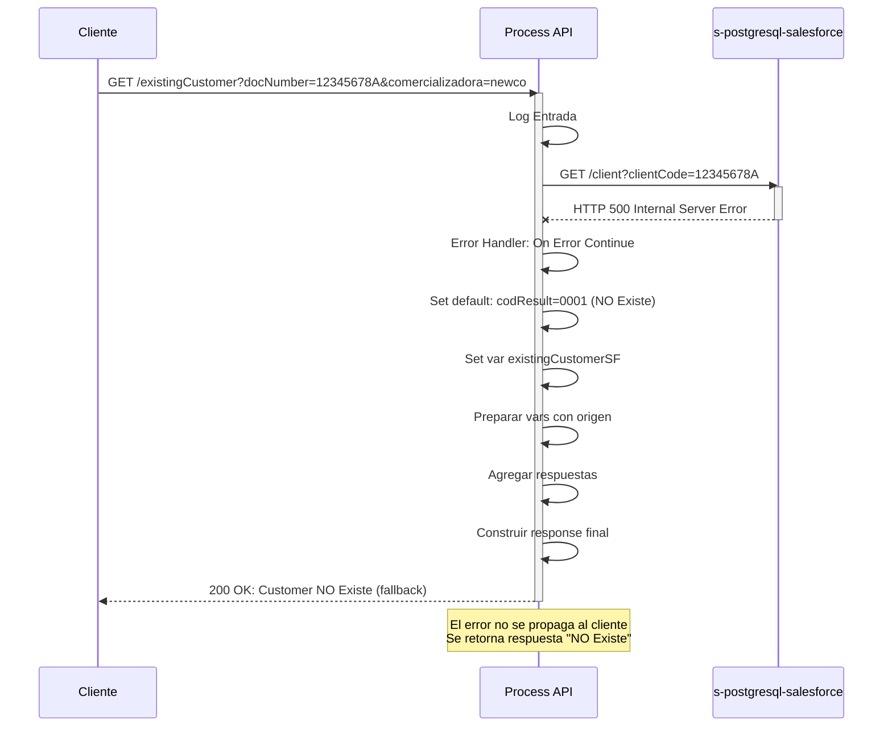

# GET /existingCustomer

## 📌 Descripción General

### Propósito del Endpoint

Este endpoint valida la existencia de un cliente en los sistemas de Naturgy, consultando tanto la comercializadora **Newco** (PostgreSQL/Salesforce) como **Imperial** (sistema legacy). Implementa un patrón de **Content-Based Routing** con **agregación inteligente** de respuestas, permitiendo identificar si un cliente existe en una o ambas comercializadoras.

**Características clave:**
- ✅ Consulta paralela a ambas comercializadoras (Newco e Imperial)
- ✅ Validación de productos activos para Newco
- ✅ Agregación de respuestas con identificación de origen
- ✅ Manejo robusto de errores con fallback
- ✅ Respuesta unificada independiente del backend

### Tipo de API

**Capa:** Process API (API-Led Connectivity)

**Función:** Orquestación de validación de existencia de clientes con routing condicional y agregación de datos

### Patrón de Integración

**Tipo:** Content-Based Routing + Agregación + Pass-Through

**Descripción:** 
1. **Routing condicional** basado en parámetro `comercializadora`
2. **Consulta a System APIs** específicos según comercializadora
3. **Validación de productos activos** para Newco (lógica de negocio)
4. **Agregación de respuestas** de ambos backends
5. **Respuesta unificada** con campo "origen" para identificar fuente

### Arquitectura API-Led Connectivity



---

## 💼 Propósito del Negocio

### Casos de Uso Principales

1. **Validación Pre-Contratación**
   - Verificar si un cliente ya existe antes de iniciar proceso de alta
   - Evitar duplicados en el sistema
   - Identificar en qué comercializadora está registrado

2. **Migración de Clientes**
   - Validar existencia en ambas comercializadoras durante procesos de migración
   - Identificar clientes que existen en ambos sistemas
   - Facilitar consolidación de datos

3. **Atención al Cliente**
   - Búsqueda rápida de cliente por documento
   - Identificación de comercializadora asociada
   - Validación de estado activo (con productos)

4. **Integración de Portales**
   - Validación de acceso a portales web/móvil
   - Verificación de elegibilidad para servicios
   - Routing automático a sistema correcto

### 🔗 Endpoints Dependientes

Este Process API consume los siguientes System APIs:

| System API | Endpoint | Método | Propósito |
|------------|----------|--------|-----------|
| `ntgy-newco-s-postgresql-salesforce` | `/client` | GET | Buscar cliente por código de documento en PostgreSQL/Salesforce |
| `ntgy-newco-s-postgresql-salesforce` | `/contractAccountsNew` | GET | Obtener productos activos del cliente para validar existencia real |
| `s-ac` | `/existingCustomer` | GET | Buscar cliente en sistema Imperial (comercializadora legacy) |

### Lógica de Orquestación



**Pasos del Proceso:**

1. **Routing Condicional**: Determinar comercializadora objetivo
2. **Consulta Newco** (si aplica):
   - Buscar cliente en PostgreSQL/Salesforce
   - Si existe, obtener productos activos
   - Validar que tenga al menos un producto activo
3. **Consulta Imperial** (si aplica):
   - Buscar cliente en sistema Imperial
4. **Agregación**: Combinar respuestas de ambos backends
5. **Response Unificado**: Retornar resultado con campo "origen"

### Transformaciones Aplicadas

#### Transformación 1: Validación de Productos Activos

**Archivo:** `dataweave/customer/Utils.dwl`

**Función:** `hasActiveProducts(productList)`

```dataweave
fun hasActiveProducts(productList: Object): Boolean = do {
  var contractStatusList = (flatten(productList.serviceAccountList.billingAccountList).products..contractStatus)
  ---
  !isEmpty (contractStatusList filter ($ != "03" and $ != "04" and $ != "07" and $ != null)) 
}
```

**Lógica:**
- Extrae todos los estados de contrato de la lista de productos
- Filtra contratos activos (excluye estados: 03=Cancelado, 04=Suspendido, 07=Finalizado)
- Retorna `true` si existe al menos un contrato activo

#### Transformación 2: Construcción de Respuestas

**Archivo:** `dataweave/customer/Mappings.dwl`

**Funciones:**

1. **buildResponseCustomerExist(customer)**
```dataweave
{
    "result": {
        "codResult": "0000",
        "msgResult": "No hay error"
    },
    "customer": [
        {
            "customerId": customer.client.clientId,
            "userId": customer.client.docNumber
        }
    ]	
}
```

2. **buildResponseCustomerNotExist()**
```dataweave
{
    "result": {
        "codResult": "1001",
        "msgResult": "No se encuentra / No existe"
    }
}
```

#### Transformación 3: Agregación Final con Campo "origen"

**Ubicación:** Inline en flow XML

**Propósito:** Combinar respuestas de AC (Imperial) y SF (Newco) añadiendo campo identificador

```dataweave
// Preparar respuesta AC con origen
vars.responseAC = if(vars.existingCustomerAC.result.codResult == "0000")
    ({"origen":"imperial"} ++ vars.existingCustomerAC.items[0])
else({})

// Preparar respuesta SF con origen
vars.responseSF = if(vars.existingCustomerSF.result.codResult == "0000")
    ({"origen":"newco"} ++ vars.existingCustomerSF.customer[0])
else({})

// Construir respuesta final
{
    "result": {
        "codResult": if (existeCienteAC or existeCienteSF) "0000" else "0001",
        "msgResult": if (existeCienteAC or existeCienteSF) 
                     "Customer encontrado" 
                     else "Customer NO Existe"
    },
    ("items": [
        (vars.responseSF) if (existeCienteSF),
        (vars.responseAC) if (existeCienteAC)
    ]) if (existeCienteSF or existeCienteAC)
}
```

**Resultado:** El array `items` puede contener:
- 0 elementos: Cliente no existe en ningún sistema
- 1 elemento: Cliente existe solo en Imperial o solo en Newco
- 2 elementos: Cliente existe en ambos sistemas

### Contexto Empresarial

- **Dominio:** Gestión de Clientes
- **Sector:** Energía - Utilities
- **División:** Naturgy España - Dual (Imperial + Newco)
- **Proceso de Negocio:** Validación de existencia y routing de clientes

### Stakeholders

- **Equipos de Desarrollo Experience APIs**: Necesitan validar clientes antes de operaciones
- **Agentes de Atención al Cliente**: Requieren búsqueda rápida de clientes
- **Equipos de Migración**: Validan existencia durante procesos de consolidación
- **Portales Web/Móvil**: Verifican acceso y elegibilidad de usuarios

### Valor de Negocio

- **Prevención de Duplicados**: Evita crear clientes duplicados en el sistema
- **Routing Automático**: Identifica automáticamente la comercializadora correcta
- **Vista Unificada**: Proporciona visión consolidada de existencia en ambos sistemas
- **Experiencia de Usuario**: Validación rápida sin necesidad de conocer backend
- **Eficiencia Operativa**: Reduce tiempo de búsqueda y validación manual

### Consumidores Potenciales

Este endpoint puede ser consumido por:
- Portales web de autoservicio (validación de registro)
- Aplicaciones móviles (verificación de acceso)
- Sistemas de agentes de call center (búsqueda de clientes)
- Procesos de migración y consolidación
- Integraciones de terceros autorizados

---

## 🔧 Especificación Técnica

### URLs por Ambiente

| Ambiente | URL Base | URL Completa |
|----------|----------|--------------|
| **Local** | `http://localhost:8081` | `http://localhost:8081/api/existingCustomer?docNumber=X&comercializadora=Y` |
| **Development** | `https://ntgy-fuv-p-customers-dev.us-e2.cloudhub.io` | `https://ntgy-fuv-p-customers-dev.us-e2.cloudhub.io/api/existingCustomer?docNumber=X&comercializadora=Y` |
| **UAT** | `https://ntgy-fuv-p-customers-uat.us-e2.cloudhub.io` | `https://ntgy-fuv-p-customers-uat.us-e2.cloudhub.io/api/existingCustomer?docNumber=X&comercializadora=Y` |
| **Production** | `https://ntgy-fuv-p-customers-pro.us-e2.cloudhub.io` | `https://ntgy-fuv-p-customers-pro.us-e2.cloudhub.io/api/existingCustomer?docNumber=X&comercializadora=Y` |

### Método HTTP

```
GET /api/existingCustomer
```

### Parámetros de Entrada

#### Query Parameters

| Parámetro | Tipo | Requerido | Descripción | Ejemplo |
|-----------|------|-----------|-------------|---------|
| `docNumber` | String | ✅ Sí | Número de documento del cliente (NIF/NIE/CIF) | `12345678A` |
| `comercializadora` | String | ✅ Sí | Comercializadora objetivo: `imperial` o `newco` | `newco` |

**Validaciones:**
- `docNumber`: Formato válido de documento español
- `comercializadora`: Enum con valores permitidos: `imperial`, `newco`

### Respuestas

#### 200 OK - Cliente Encontrado en Newco

```json
{
  "result": {
    "codResult": "0000",
    "msgResult": "Customer encontrado"
  },
  "items": [
    {
      "origen": "newco",
      "customerId": "0011t00000AbCdEFGH",
      "userId": "12345678A"
    }
  ]
}
```

#### 200 OK - Cliente Encontrado en Imperial

```json
{
  "result": {
    "codResult": "0000",
    "msgResult": "Customer encontrado"
  },
  "items": [
    {
      "origen": "imperial",
      "customerId": "123456",
      "userId": "12345678A"
    }
  ]
}
```

#### 200 OK - Cliente Encontrado en Ambos Sistemas

```json
{
  "result": {
    "codResult": "0000",
    "msgResult": "Customer encontrado"
  },
  "items": [
    {
      "origen": "newco",
      "customerId": "0011t00000AbCdEFGH",
      "userId": "12345678A"
    },
    {
      "origen": "imperial",
      "customerId": "123456",
      "userId": "12345678A"
    }
  ]
}
```

#### 200 OK - Cliente No Encontrado

```json
{
  "result": {
    "codResult": "0001",
    "msgResult": "Customer NO Existe"
  }
}
```

#### 400 Bad Request - Error Técnico

```json
{
  "result": {
    "codResult": "-0001",
    "msgResult": "Error técnico"
  }
}
```

### Códigos de Respuesta

| Código | Descripción |
|--------|-------------|
| `0000` | Cliente encontrado exitosamente |
| `0001` | Cliente no existe en el sistema |
| `1001` | No se encuentra / No existe (código alternativo) |
| `-0001` | Error técnico en el procesamiento |

### Autenticación

- **Tipo:** Client ID & Client Secret (Anypoint Platform)
- **Headers requeridos:**
  - `client_id`: ID de la aplicación cliente
  - `client_secret`: Secret de la aplicación cliente

### Timeouts

| Tipo | Valor |
|------|-------|
| **Request Timeout** | 30 segundos |
| **Connection Timeout** | 10 segundos |

---

## 🏗️ Implementación Técnica

### Arquitectura del Flow



### Componentes Clave del Flow

#### 1. Content-Based Routing

**Ubicación:** Flow principal, línea 10 del XML

```xml
<choice doc:name="Choice">
    <when expression="#[attributes.queryParams[&quot;comercializadora&quot;] == 'newco']">
        <!-- Lógica para Newco -->
    </when>
    <otherwise>
        <!-- Lógica para Imperial -->
    </otherwise>
</choice>
```

**Decisión:** Basada en query parameter `comercializadora`

#### 2. Consulta a Newco (PostgreSQL-Salesforce)

**Paso 2.1:** Buscar cliente

```xml
<http:request method="GET" path="/client" target="customer">
    <http:query-params>
        { "clientCode": attributes.queryParams["docNumber"] }
    </http:query-params>
</http:request>
```

**Paso 2.2:** Si cliente existe, obtener productos

```xml
<http:request method="GET" path="/contractAccountsNew" target="productlist">
    <http:query-params>
        {
            clientId: vars.customer.client.clientId,
            language: vars.customer.client.preferredLanguage,
            "obfuscate": "false"
        }
    </http:query-params>
</http:request>
```

**Paso 2.3:** Validar productos activos

```dataweave
if (hasActiveProducts(vars.productlist)) 
    buildResponseCustomerExist(vars.customer)
else 
    buildResponseCustomerNotExist()
```

#### 3. Consulta a Imperial (s-ac)

```xml
<http:request method="GET" path="${s-ac.path.existingCustomer}" target="existingCustomerAC">
    <http:query-params>
        { docNumber: attributes.queryParams["docNumber"] }
    </http:query-params>
</http:request>
```

#### 4. Agregación de Respuestas

**Paso 4.1:** Añadir campo "origen"

```dataweave
// Response AC con origen
vars.responseAC = if(vars.existingCustomerAC.result.codResult == "0000")
    ({"origen":"imperial"} ++ vars.existingCustomerAC.items[0])
else({})

// Response SF con origen
vars.responseSF = if(vars.existingCustomerSF.result.codResult == "0000")
    ({"origen":"newco"} ++ vars.existingCustomerSF.customer[0])
else({})
```

**Paso 4.2:** Construir respuesta unificada

```dataweave
{
    "result": {
        "codResult": if (existeCienteAC or existeCienteSF) "0000" else "0001",
        "msgResult": if (existeCienteAC or existeCienteSF) 
                     "Customer encontrado" 
                     else "Customer NO Existe"
    },
    ("items": [
        (vars.responseSF) if (existeCienteSF),
        (vars.responseAC) if (existeCienteAC)
    ]) if (existeCienteSF or existeCienteAC)
}
```

### Patrones de Diseño

#### Patrón 1: Content-Based Routing

**Justificación:** Permite routing dinámico basado en comercializadora sin duplicar lógica

**Beneficios:**
- Flexibilidad para añadir nuevas comercializadoras
- Lógica centralizada de routing
- Mantenimiento simplificado

#### Patrón 2: Try-Catch con Fallback

**Justificación:** Garantiza respuesta incluso si un backend falla

**Implementación:**
```xml
<try>
    <!-- Llamada a backend -->
    <error-handler>
        <on-error-continue>
            <!-- Set default: NO Existe -->
        </on-error-continue>
    </error-handler>
</try>
```

**Beneficios:**
- Resiliencia ante fallos de backend
- Experiencia de usuario consistente
- No propaga errores técnicos al cliente

#### Patrón 3: Aggregator Pattern

**Justificación:** Combina respuestas de múltiples backends en una sola respuesta

**Beneficios:**
- Vista unificada para el consumidor
- Identificación de origen de datos
- Soporte para clientes en múltiples sistemas

### Diagramas de Secuencia

#### 1. Flujo Normal de Éxito - Newco



#### 2. Flujo Normal de Éxito - Imperial



#### 3. Flujo con Cliente No Encontrado



#### 4. Flujo con Error de Backend (Fallback)



### Manejo de Errores

#### Estrategia de Error Handling

**Nivel 1: Try-Catch por Backend**

Cada consulta a backend está envuelta en un bloque `<try>` con error handler:

```xml
<try>
    <http:request ... />
    <error-handler>
        <on-error-continue type="ANY">
            <!-- Set default response: NO Existe -->
            <ee:set-variable variableName="existingCustomerSF">
                {
                    "result": {
                        "codResult": "0001",
                        "msgResult": "Customer NO Existe"
                    }
                }
            </ee:set-variable>
        </on-error-continue>
    </error-handler>
</try>
```

**Comportamiento:**
- ✅ Error de backend NO detiene el flujo
- ✅ Se asume "Cliente NO Existe" como fallback
- ✅ Permite continuar con agregación de respuestas

**Nivel 2: Error Handler Global**

```xml
<error-handler>
    <on-error-propagate type="HTTP:*, EXPRESSION, STREAM_MAXIMUM_SIZE_EXCEEDED">
        <logger level="ERROR" message="logErrorGenerico" />
        <ee:transform>
            {
                "result": {
                    "codResult": "-0001",
                    "msgResult": "Error técnico"
                }
            }
        </ee:transform>
    </on-error-propagate>
</error-handler>
```

**Tipos de Error Manejados:**
- `HTTP:*` - Todos los errores HTTP
- `EXPRESSION` - Errores de expresión DataWeave
- `STREAM_MAXIMUM_SIZE_EXCEEDED` - Payload demasiado grande

#### Matriz de Errores

| Escenario | Código | Mensaje | HTTP Status |
|-----------|--------|---------|-------------|
| Cliente encontrado | `0000` | "Customer encontrado" | 200 |
| Cliente no existe | `0001` | "Customer NO Existe" | 200 |
| Error backend Newco | `0001` | "Customer NO Existe" | 200 (fallback) |
| Error backend Imperial | `0001` | "Customer NO Existe" | 200 (fallback) |
| Error técnico general | `-0001` | "Error técnico" | 400 |

---

## 💻 Ejemplos de Uso

### Ejemplo 1: Búsqueda en Newco - Cliente Encontrado

#### Request con cURL

```bash
curl -X GET "https://ntgy-fuv-p-customers-dev.us-e2.cloudhub.io/api/existingCustomer?docNumber=12345678A&comercializadora=newco" \
  -H "Content-Type: application/json" \
  -H "client_id: YOUR_CLIENT_ID" \
  -H "client_secret: YOUR_CLIENT_SECRET"
```

#### Response (200 OK)

```json
{
  "result": {
    "codResult": "0000",
    "msgResult": "Customer encontrado"
  },
  "items": [
    {
      "origen": "newco",
      "customerId": "0011t00000AbCdEFGH",
      "userId": "12345678A"
    }
  ]
}
```

### Ejemplo 2: Búsqueda en Imperial - Cliente Encontrado

#### Request con cURL

```bash
curl -X GET "https://ntgy-fuv-p-customers-dev.us-e2.cloudhub.io/api/existingCustomer?docNumber=87654321B&comercializadora=imperial" \
  -H "Content-Type: application/json" \
  -H "client_id: YOUR_CLIENT_ID" \
  -H "client_secret: YOUR_CLIENT_SECRET"
```

#### Response (200 OK)

```json
{
  "result": {
    "codResult": "0000",
    "msgResult": "Customer encontrado"
  },
  "items": [
    {
      "origen": "imperial",
      "customerId": "123456",
      "userId": "87654321B"
    }
  ]
}
```

### Ejemplo 3: Cliente Existe en Ambos Sistemas

#### Request con cURL

```bash
curl -X GET "https://ntgy-fuv-p-customers-dev.us-e2.cloudhub.io/api/existingCustomer?docNumber=11111111C&comercializadora=newco" \
  -H "Content-Type: application/json" \
  -H "client_id: YOUR_CLIENT_ID" \
  -H "client_secret: YOUR_CLIENT_SECRET"
```

#### Response (200 OK)

```json
{
  "result": {
    "codResult": "0000",
    "msgResult": "Customer encontrado"
  },
  "items": [
    {
      "origen": "newco",
      "customerId": "0011t00000XyZaBcD",
      "userId": "11111111C"
    },
    {
      "origen": "imperial",
      "customerId": "789012",
      "userId": "11111111C"
    }
  ]
}
```

**Nota:** Este escenario ocurre cuando el cliente existe en ambas comercializadoras, típico en procesos de migración.

### Ejemplo 4: Cliente No Encontrado

#### Request con cURL

```bash
curl -X GET "https://ntgy-fuv-p-customers-dev.us-e2.cloudhub.io/api/existingCustomer?docNumber=99999999Z&comercializadora=newco" \
  -H "Content-Type: application/json" \
  -H "client_id: YOUR_CLIENT_ID" \
  -H "client_secret: YOUR_CLIENT_SECRET"
```

#### Response (200 OK)

```json
{
  "result": {
    "codResult": "0001",
    "msgResult": "Customer NO Existe"
  }
}
```

### Ejemplo 5: JavaScript (Fetch API)

```javascript
const checkCustomerExists = async (docNumber, comercializadora) => {
  const url = new URL('https://ntgy-fuv-p-customers-dev.us-e2.cloudhub.io/api/existingCustomer');
  url.searchParams.append('docNumber', docNumber);
  url.searchParams.append('comercializadora', comercializadora);

  try {
    const response = await fetch(url, {
      method: 'GET',
      headers: {
        'Content-Type': 'application/json',
        'client_id': 'YOUR_CLIENT_ID',
        'client_secret': 'YOUR_CLIENT_SECRET'
      }
    });

    const data = await response.json();
    
    if (data.result.codResult === '0000') {
      console.log('Cliente encontrado:', data.items);
      
      // Identificar en qué sistema(s) existe
      data.items.forEach(item => {
        console.log(`Encontrado en ${item.origen}: ${item.customerId}`);
      });
      
      return {
        exists: true,
        systems: data.items.map(item => item.origen),
        data: data.items
      };
    } else {
      console.log('Cliente no existe');
      return {
        exists: false,
        systems: [],
        data: null
      };
    }
  } catch (error) {
    console.error('Error al consultar cliente:', error);
    throw error;
  }
};

// Uso
checkCustomerExists('12345678A', 'newco')
  .then(result => {
    if (result.exists) {
      console.log(`Cliente existe en: ${result.systems.join(', ')}`);
    }
  });
```

### Ejemplo 6: Python (Requests)

```python
import requests
from typing import Dict, List, Optional

def check_customer_exists(
    doc_number: str, 
    comercializadora: str,
    client_id: str,
    client_secret: str
) -> Dict:
    """
    Verifica si un cliente existe en los sistemas de Naturgy.
    
    Args:
        doc_number: Número de documento del cliente
        comercializadora: 'newco' o 'imperial'
        client_id: Client ID de Anypoint
        client_secret: Client Secret de Anypoint
    
    Returns:
        Dict con información de existencia del cliente
    """
    url = 'https://ntgy-fuv-p-customers-dev.us-e2.cloudhub.io/api/existingCustomer'
    
    params = {
        'docNumber': doc_number,
        'comercializadora': comercializadora
    }
    
    headers = {
        'Content-Type': 'application/json',
        'client_id': client_id,
        'client_secret': client_secret
    }
    
    try:
        response = requests.get(url, params=params, headers=headers, timeout=30)
        response.raise_for_status()
        
        data = response.json()
        
        if data['result']['codResult'] == '0000':
            systems = [item['origen'] for item in data.get('items', [])]
            return {
                'exists': True,
                'systems': systems,
                'data': data.get('items', []),
                'message': data['result']['msgResult']
            }
        else:
            return {
                'exists': False,
                'systems': [],
                'data': None,
                'message': data['result']['msgResult']
            }
    
    except requests.exceptions.RequestException as e:
        print(f"Error al consultar cliente: {e}")
        raise

# Uso
result = check_customer_exists(
    doc_number='12345678A',
    comercializadora='newco',
    client_id='YOUR_CLIENT_ID',
    client_secret='YOUR_CLIENT_SECRET'
)

if result['exists']:
    print(f"Cliente encontrado en: {', '.join(result['systems'])}")
    for item in result['data']:
        print(f"  - {item['origen']}: {item['customerId']}")
else:
    print("Cliente no encontrado")
```

### Ejemplo 7: Caso de Uso - Validación Pre-Registro

```javascript
/**
 * Valida si un cliente puede registrarse en el portal
 * Verifica que NO exista en ningún sistema
 */
async function validateNewCustomerRegistration(docNumber) {
  // Verificar en ambas comercializadoras
  const checkNewco = await checkCustomerExists(docNumber, 'newco');
  const checkImperial = await checkCustomerExists(docNumber, 'imperial');
  
  if (checkNewco.exists || checkImperial.exists) {
    const systems = [
      ...(checkNewco.exists ? ['Newco'] : []),
      ...(checkImperial.exists ? ['Imperial'] : [])
    ];
    
    return {
      canRegister: false,
      reason: `El cliente ya existe en: ${systems.join(', ')}`,
      existingSystems: systems
    };
  }
  
  return {
    canRegister: true,
    reason: 'Cliente nuevo, puede proceder con registro',
    existingSystems: []
  };
}

// Uso en formulario de registro
const validationResult = await validateNewCustomerRegistration('12345678A');

if (!validationResult.canRegister) {
  alert(`No puede registrarse: ${validationResult.reason}`);
  // Redirigir a login o recuperación de cuenta
} else {
  // Continuar con proceso de registro
  proceedWithRegistration();
}
```

### Ejemplo 8: Error Técnico

#### Request con cURL

```bash
curl -X GET "https://ntgy-fuv-p-customers-dev.us-e2.cloudhub.io/api/existingCustomer?docNumber=12345678A&comercializadora=invalid" \
  -H "Content-Type: application/json" \
  -H "client_id: YOUR_CLIENT_ID" \
  -H "client_secret: YOUR_CLIENT_SECRET"
```

#### Response (400 Bad Request)

```json
{
  "result": {
    "codResult": "-0001",
    "msgResult": "Error técnico"
  }
}
```

### Notas de Implementación

#### Manejo de Respuestas Múltiples

Cuando el cliente existe en ambos sistemas, el array `items` contendrá 2 elementos:

```javascript
// Ejemplo de procesamiento
if (data.result.codResult === '0000' && data.items) {
  const hasNewco = data.items.some(item => item.origen === 'newco');
  const hasImperial = data.items.some(item => item.origen === 'imperial');
  
  if (hasNewco && hasImperial) {
    console.log('Cliente existe en AMBOS sistemas - Caso de migración');
  } else if (hasNewco) {
    console.log('Cliente solo en Newco');
  } else if (hasImperial) {
    console.log('Cliente solo en Imperial');
  }
}
```

#### Timeouts y Reintentos

```javascript
const fetchWithRetry = async (url, options, retries = 3) => {
  for (let i = 0; i < retries; i++) {
    try {
      const response = await fetch(url, {
        ...options,
        signal: AbortSignal.timeout(30000) // 30 segundos
      });
      return response;
    } catch (error) {
      if (i === retries - 1) throw error;
      await new Promise(resolve => setTimeout(resolve, 1000 * (i + 1)));
    }
  }
};
```

#### Validación de Parámetros

```javascript
function validateParams(docNumber, comercializadora) {
  // Validar formato de documento
  const docRegex = /^[0-9]{8}[A-Z]$/;
  if (!docRegex.test(docNumber)) {
    throw new Error('Formato de documento inválido');
  }
  
  // Validar comercializadora
  const validComercializadoras = ['newco', 'imperial'];
  if (!validComercializadoras.includes(comercializadora)) {
    throw new Error('Comercializadora debe ser "newco" o "imperial"');
  }
  
  return true;
}
```
