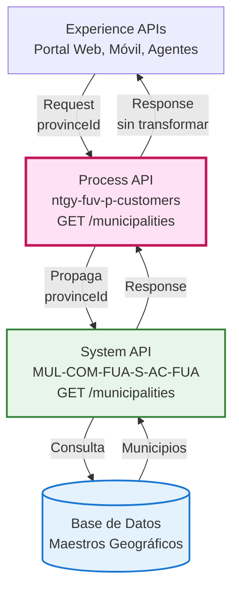
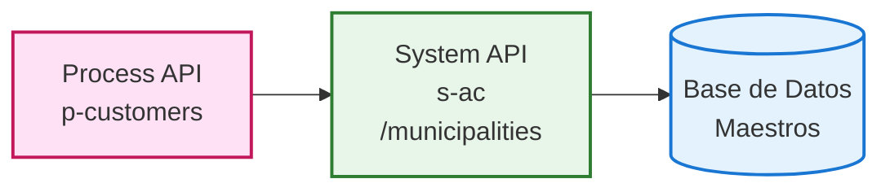
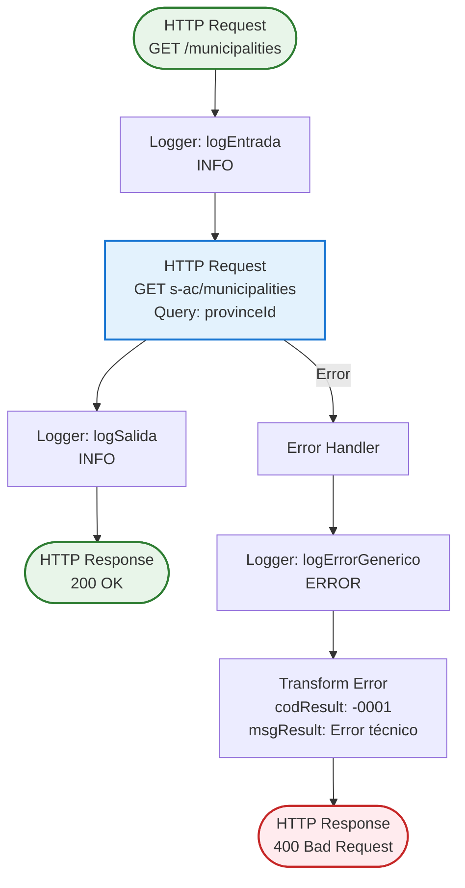
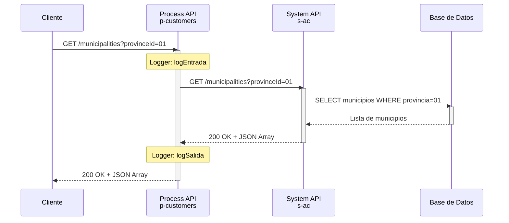
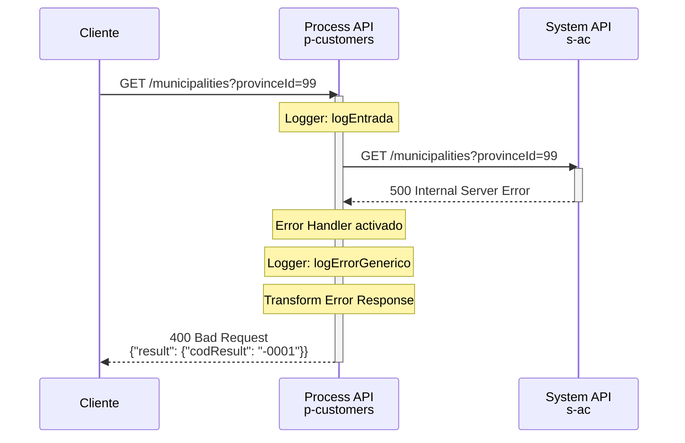
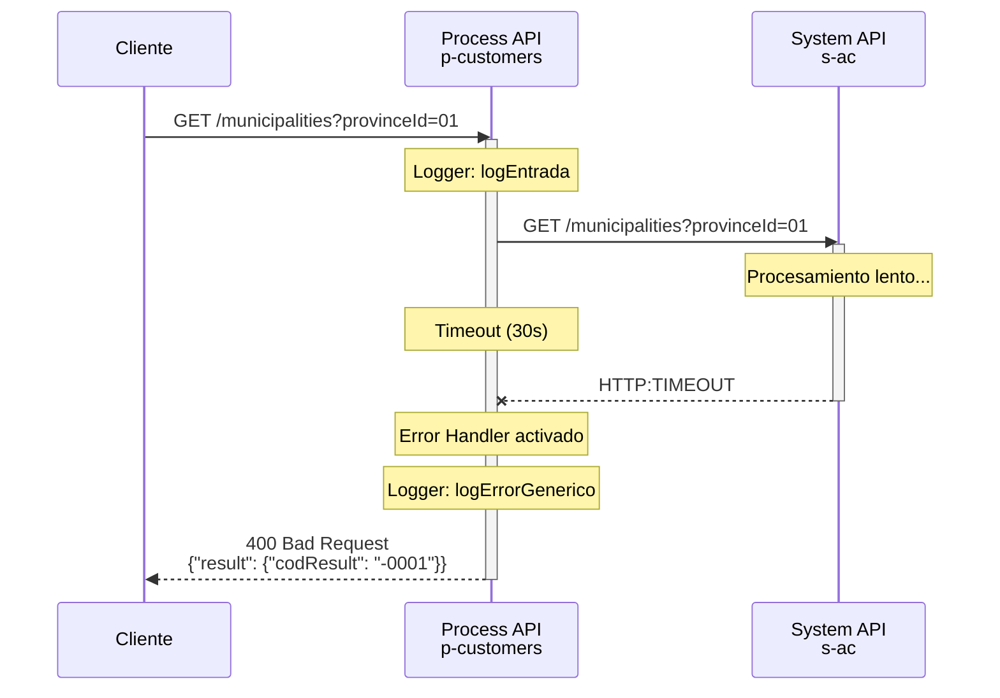

# GET /municipalities

## 📌 Descripción General

### Propósito del Endpoint

Este endpoint proporciona un listado de municipios españoles filtrado por provincia, actuando como orquestador entre las aplicaciones cliente y el System API de Administración y Configuración (s-ac). Implementa un patrón pass-through que delega la lógica de consulta al System API subyacente, manteniendo la separación de responsabilidades en la arquitectura API-Led Connectivity.

### Tipo de API

**Capa:** Process API (API-Led Connectivity)

**Función:** Orquestación de datos maestros geográficos para gestión de clientes FUV

### Patrón de Integración

**Tipo:** Pass-Through con propagación de parámetros

**Descripción:** El endpoint recibe el parámetro `provinceId` del cliente y lo propaga directamente al System API s-ac sin transformaciones. La respuesta del System API se devuelve al cliente sin modificaciones, manteniendo la estructura original de datos.

### Arquitectura API-Led Connectivity



---

## 💼 Propósito del Negocio

### Casos de Uso Principales

1. **Formularios de Alta de Cliente**
   - Permite seleccionar el municipio durante el proceso de registro
   - Facilita la captura correcta de direcciones
   - Mejora la experiencia de usuario con listas desplegables

2. **Validación de Direcciones**
   - Verifica que el municipio pertenece a la provincia seleccionada
   - Asegura la consistencia de datos geográficos
   - Previene errores en la captura de información

3. **Búsqueda y Filtrado de Clientes**
   - Permite filtrar clientes por ubicación geográfica
   - Facilita análisis territoriales
   - Soporta estrategias de segmentación por zona

### 🔗 Endpoints Dependientes

Este Process API consume el siguiente System API:

| System API | Endpoint | Método | Propósito |
|------------|----------|--------|-----------|
| `MUL-COM-FUA-S-AC-FUA` | `/municipalities` | GET | Obtiene listado de municipios filtrado por provincia desde base de datos de maestros |

### Lógica de Orquestación



**Pasos del Proceso:**

1. **Recepción de Request**: Process API recibe query parameter `provinceId`
2. **Logging de Entrada**: Registra inicio de operación
3. **Propagación a System API**: Llama a s-ac GET /municipalities con `provinceId`
4. **Logging de Salida**: Registra fin de operación
5. **Respuesta al Cliente**: Devuelve lista de municipios sin transformación

### Transformaciones Aplicadas

⚠️ **Este Process API NO transforma la respuesta del System API.**

**Patrón:** Pass-Through puro

Para el schema completo de la respuesta, consultar:
📖 **System API: `MUL-COM-FUA-S-AC-FUA` endpoint `GET /municipalities`**

### Contexto Empresarial

- **Dominio:** Gestión de Clientes y Datos Maestros
- **Sector:** Energía - Utilities
- **División:** Naturgy España - FUV (Fuerza de Ventas)
- **Proceso de Negocio:** Captura y validación de información geográfica de clientes

### Stakeholders

- **Agentes de Servicio al Cliente**: Necesitan datos precisos para registro de clientes
- **Desarrolladores de Portales Web/Móvil**: Requieren endpoints confiables para formularios
- **Equipos de Calidad de Datos**: Dependen de datos maestros consistentes

### Valor de Negocio

- **Consistencia de Datos**: Garantiza uso de municipios oficiales y actualizados
- **Experiencia de Usuario**: Facilita selección mediante listas desplegables
- **Reducción de Errores**: Previene errores de captura manual de direcciones
- **Eficiencia Operativa**: Centraliza acceso a datos maestros geográficos

### Consumidores Potenciales

Este endpoint puede ser consumido por:
- Portales web de autoservicio (FUA Portal)
- Aplicaciones móviles de clientes
- Sistemas de agentes de call center
- Aplicaciones de gestión comercial
- Integraciones de terceros autorizados

---

## 🔧 Especificación Técnica

### URLs por Ambiente

| Ambiente | URL Base | URL Completa |
|----------|----------|--------------|
| **Local** | `http://localhost:8081` | `http://localhost:8081/api/municipalities?provinceId=01` |
| **Development** | `https://ntgy-fuv-p-customers-dev.us-e2.cloudhub.io` | `https://ntgy-fuv-p-customers-dev.us-e2.cloudhub.io/api/municipalities?provinceId=01` |
| **UAT** | `https://ntgy-fuv-p-customers-uat.us-e2.cloudhub.io` | `https://ntgy-fuv-p-customers-uat.us-e2.cloudhub.io/api/municipalities?provinceId=01` |
| **Production** | `https://ntgy-fuv-p-customers-pro.us-e2.cloudhub.io` | `https://ntgy-fuv-p-customers-pro.us-e2.cloudhub.io/api/municipalities?provinceId=01` |

### Método HTTP

```
GET /api/municipalities
```

### Parámetros de Entrada

#### Query Parameters

| Parámetro | Tipo | Requerido | Descripción | Ejemplo |
|-----------|------|-----------|-------------|---------|
| `provinceId` | string | ✅ Sí | Código de provincia (2 dígitos) | `"01"` (Álava) |

**Validaciones:**
- Formato: String de 2 dígitos
- Rango: Códigos oficiales de provincias españolas (01-52)

### Respuestas

#### 200 OK - Éxito

**Descripción:** Lista de municipios obtenida correctamente

**Content-Type:** `application/json`

**Estructura:**
```json
{
  "items": [
    {
      "municipalityId": "string",
      "municipalityName": "string"
    }
  ]
}
```

**Ejemplo:**
```json
{
  "items": [
    {
      "municipalityId": "01001",
      "municipalityName": "ALEGRIA-DULANTZI"
    },
    {
      "municipalityId": "01002",
      "municipalityName": "AMURRIO"
    },
    {
      "municipalityId": "01003",
      "municipalityName": "ANANA"
    }
  ]
}
```

#### 400 Bad Request - Error de Cliente

**Descripción:** Error en parámetros de entrada o error técnico del System API

**Content-Type:** `application/json`

**Estructura:**
```json
{
  "result": {
    "codResult": "string",
    "msgResult": "string"
  }
}
```

**Ejemplo:**
```json
{
  "result": {
    "codResult": "-0001",
    "msgResult": "Error técnico"
  }
}
```

#### 404 Not Found - Recurso No Encontrado

**Descripción:** Endpoint no existe o provincia no encontrada

**Content-Type:** `application/json`

**Ejemplo:**
```json
{
  "message": "Resource not found"
}
```

### Autenticación

**Tipo:** No requiere autenticación

**Rationale:** Endpoint de datos maestros públicos, sin información sensible

### Timeouts

| Tipo | Valor |
|------|-------|
| **Request Timeout** | 30 segundos |
| **Connection Timeout** | 10 segundos |

---

## 🏗️ Implementación Técnica

### Arquitectura del Flow



### Código del Flow Principal

**Archivo:** `p-customers-municipalities.xml`

**Flow:** `p-customers-municipalitiesFlow`

```xml
<flow name="p-customers-municipalitiesFlow">
    <!-- Logging de entrada -->
    <logger level="INFO" message="logEntrada"/>
    
    <!-- Llamada al System API s-ac -->
    <http:request method="GET" 
                  path="${s-ac.path.municipalities}" 
                  config-ref="HTTP_Request_s-ac_configuration">
        <http:query-params>
            <![CDATA[#[output application/java
            ---
            {
                provinceId : attributes.queryParams["provinceId"]
            }]]]>
        </http:query-params>
    </http:request>
    
    <!-- Logging de salida -->
    <logger level="INFO" message="logSalida"/>
    
    <!-- Manejo de errores -->
    <error-handler>
        <on-error-propagate type="HTTP:*, EXPRESSION, STREAM_MAXIMUM_SIZE_EXCEEDED">
            <logger level="ERROR" message="logErrorGenerico"/>
            <ee:transform>
                <ee:message>
                    <ee:set-payload><![CDATA[%dw 2.0
                    output application/json
                    ---
                    {
                        "result": {
                            "codResult": "-0001",
                            "msgResult": "Error técnico"
                        }
                    }]]></ee:set-payload>
                </ee:message>
                <ee:variables>
                    <ee:set-variable variableName="httpStatus">400</ee:set-variable>
                </ee:variables>
            </ee:transform>
        </on-error-propagate>
    </error-handler>
</flow>
```

### Configuración

**Archivo:** `p-customers-global-config.yaml`

```yaml
s-ac:
  path:
    municipalities: "/municipalities"
```

**HTTP Request Configuration:**
- **Config Reference:** `HTTP_Request_s-ac_configuration`
- **Target System:** MUL-COM-FUA-S-AC-FUA (System API)
- **Protocol:** HTTPS
- **Connection Pooling:** Habilitado

### Propagación de Parámetros

**DataWeave Expression:**
```dataweave
%dw 2.0
output application/java
---
{
    provinceId : attributes.queryParams["provinceId"]
}
```

**Descripción:** Extrae el query parameter `provinceId` del request HTTP y lo propaga al System API sin modificaciones.

### Patrones de Diseño

**Patrón:** Pass-Through (Proxy Pattern)

**Justificación:** 
- No requiere transformación de datos
- Mantiene separación de responsabilidades
- Facilita cambios en System API sin afectar clientes
- Permite agregar lógica de negocio futura (caching, validaciones)

### Diagramas de Secuencia

#### 1. Flujo Normal de Éxito



#### 2. Flujo con Error Técnico



#### 3. Flujo con Timeout



### Manejo de Errores

#### Tipos de Errores Capturados

El error handler captura los siguientes tipos de errores:

| Tipo de Error | Descripción | HTTP Status |
|---------------|-------------|-------------|
| `HTTP:BAD_GATEWAY` | Error de gateway en System API | 400 |
| `HTTP:BAD_REQUEST` | Request inválido al System API | 400 |
| `HTTP:CONNECTIVITY` | Error de conectividad con System API | 400 |
| `HTTP:TIMEOUT` | Timeout en llamada a System API | 400 |
| `HTTP:INTERNAL_SERVER_ERROR` | Error interno del System API | 400 |
| `HTTP:NOT_FOUND` | Endpoint no encontrado en System API | 400 |
| `EXPRESSION` | Error en expresión DataWeave | 400 |
| `STREAM_MAXIMUM_SIZE_EXCEEDED` | Payload excede tamaño máximo | 400 |

#### Estrategia de Recuperación

1. **Logging**: Registra error con nivel ERROR
2. **Transformación**: Convierte error a formato estándar
3. **Propagación**: Devuelve error al cliente con HTTP 400

**Formato de Error Estándar:**
```json
{
  "result": {
    "codResult": "-0001",
    "msgResult": "Error técnico"
  }
}
```

---

## 💻 Ejemplos de Uso

### Ejemplo 1: Consulta de Municipios de Álava

#### cURL

```bash
curl -X GET "https://ntgy-fuv-p-customers-dev.us-e2.cloudhub.io/api/municipalities?provinceId=01" \
  -H "Content-Type: application/json"
```

#### Respuesta (200 OK)

```json
{
  "items": [
    {
      "municipalityId": "01001",
      "municipalityName": "ALEGRIA-DULANTZI"
    },
    {
      "municipalityId": "01002",
      "municipalityName": "AMURRIO"
    },
    {
      "municipalityId": "01003",
      "municipalityName": "ANANA"
    },
    {
      "municipalityId": "01004",
      "municipalityName": "ARAMAIO"
    },
    {
      "municipalityId": "01006",
      "municipalityName": "ARMINON"
    }
  ]
}
```

### Ejemplo 2: Consulta de Municipios de Madrid

#### cURL

```bash
curl -X GET "https://ntgy-fuv-p-customers-dev.us-e2.cloudhub.io/api/municipalities?provinceId=28" \
  -H "Content-Type: application/json"
```

#### Respuesta (200 OK)

```json
{
  "items": [
    {
      "municipalityId": "28001",
      "municipalityName": "ACEBEDA, LA"
    },
    {
      "municipalityId": "28002",
      "municipalityName": "AJALVIR"
    },
    {
      "municipalityId": "28003",
      "municipalityName": "ALAMEDA DEL VALLE"
    },
    {
      "municipalityId": "28079",
      "municipalityName": "MADRID"
    }
  ]
}
```

### Ejemplo 3: JavaScript (Fetch API)

```javascript
// Función para obtener municipios por provincia
async function getMunicipalities(provinceId) {
  try {
    const response = await fetch(
      `https://ntgy-fuv-p-customers-dev.us-e2.cloudhub.io/api/municipalities?provinceId=${provinceId}`,
      {
        method: 'GET',
        headers: {
          'Content-Type': 'application/json'
        }
      }
    );

    if (!response.ok) {
      throw new Error(`HTTP error! status: ${response.status}`);
    }

    const data = await response.json();
    const municipalities = data.items || [];
    console.log(`Municipios de provincia ${provinceId}:`, municipalities.length);
    return municipalities;
  } catch (error) {
    console.error('Error al obtener municipios:', error);
    throw error;
  }
}

// Uso
getMunicipalities('08') // Barcelona
  .then(municipalities => {
    // Procesar lista de municipios
    municipalities.forEach(mun => {
      console.log(`${mun.municipalityId}: ${mun.municipalityName}`);
    });
  });
```

### Ejemplo 4: Python (Requests)

```python
import requests

def get_municipalities(province_id):
    """
    Obtiene lista de municipios para una provincia
    
    Args:
        province_id (str): Código de provincia (2 dígitos)
    
    Returns:
        list: Lista de municipios
    """
    url = "https://ntgy-fuv-p-customers-dev.us-e2.cloudhub.io/api/municipalities"
    params = {"provinceId": province_id}
    headers = {"Content-Type": "application/json"}
    
    try:
        response = requests.get(url, params=params, headers=headers)
        response.raise_for_status()
        
        data = response.json()
        municipalities = data.get('items', [])
        print(f"Municipios de provincia {province_id}: {len(municipalities)}")
        
        return municipalities
    
    except requests.exceptions.RequestException as e:
        print(f"Error al obtener municipios: {e}")
        raise

# Uso
municipalities = get_municipalities("41")  # Sevilla
for mun in municipalities:
    print(f"{mun['municipalityId']}: {mun['municipalityName']}")
```

### Ejemplo 5: Error - Provincia Inválida

#### cURL

```bash
curl -X GET "https://ntgy-fuv-p-customers-dev.us-e2.cloudhub.io/api/municipalities?provinceId=99" \
  -H "Content-Type: application/json"
```

#### Respuesta (400 Bad Request)

```json
{
  "result": {
    "codResult": "-0001",
    "msgResult": "Error técnico"
  }
}
```

### Ejemplo 6: Integración en Formulario React

```jsx
import React, { useState, useEffect } from 'react';

function MunicipalitySelector({ provinceId }) {
  const [municipalities, setMunicipalities] = useState([]);
  const [loading, setLoading] = useState(false);
  const [error, setError] = useState(null);

  useEffect(() => {
    if (!provinceId) return;

    const fetchMunicipalities = async () => {
      setLoading(true);
      setError(null);

      try {
        const response = await fetch(
          `https://ntgy-fuv-p-customers-dev.us-e2.cloudhub.io/api/municipalities?provinceId=${provinceId}`
        );

        if (!response.ok) {
          throw new Error('Error al cargar municipios');
        }

        const data = await response.json();
        setMunicipalities(data);
      } catch (err) {
        setError(err.message);
      } finally {
        setLoading(false);
      }
    };

    fetchMunicipalities();
  }, [provinceId]);

  if (loading) return <div>Cargando municipios...</div>;
  if (error) return <div>Error: {error}</div>;

  return (
    <select>
      <option value="">Seleccione un municipio</option>
      {municipalities.map(mun => (
        <option key={mun.id} value={mun.id}>
          {mun.name}
        </option>
      ))}
    </select>
  );
}

export default MunicipalitySelector;