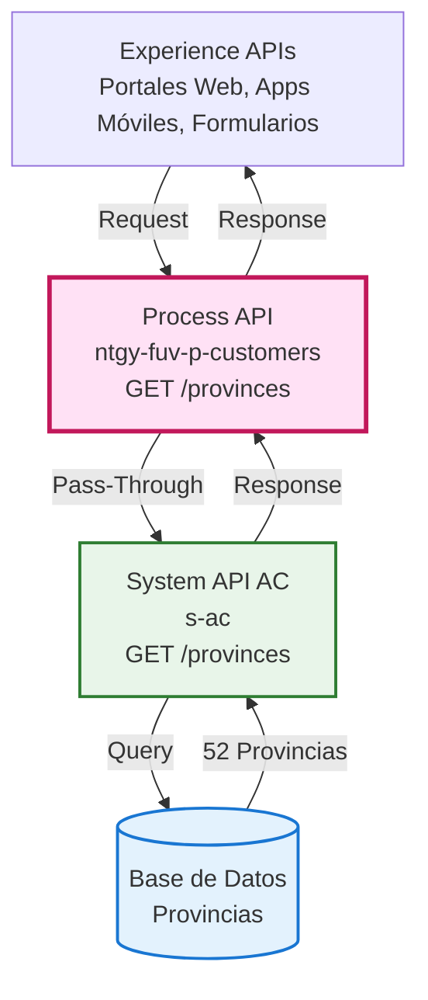
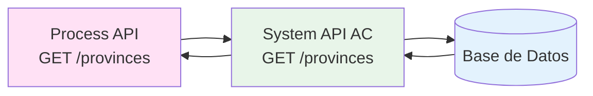
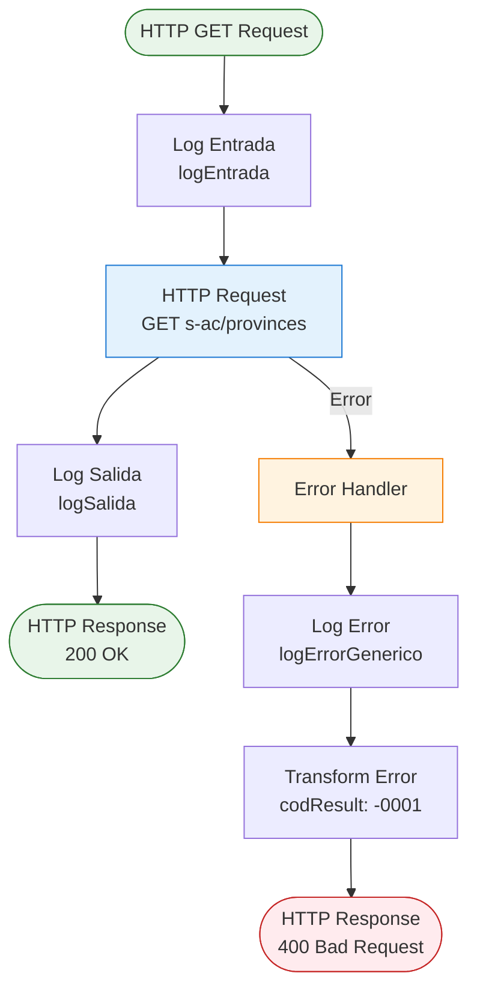
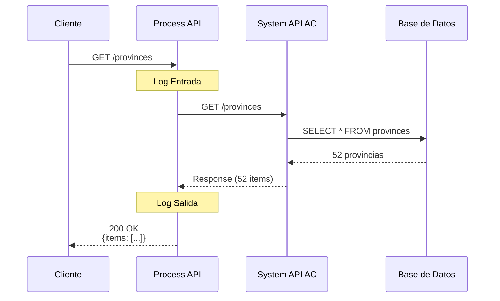
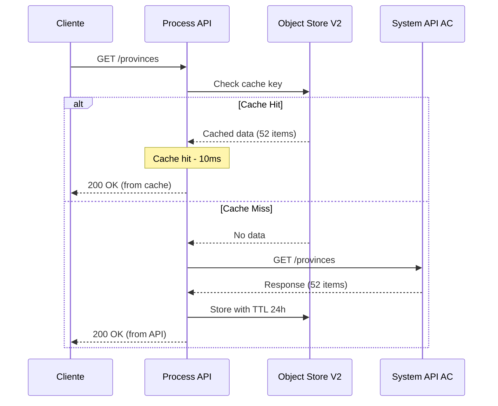
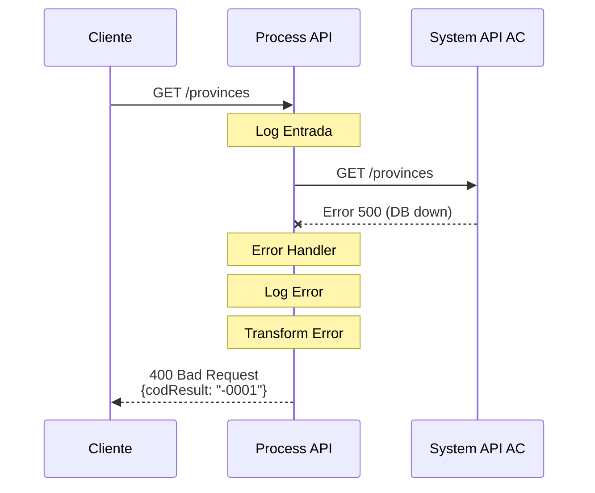

# GET /provinces

## 📌 Descripción General

### Propósito del Endpoint

Este endpoint proporciona el listado completo de las provincias españolas para su uso en formularios, validaciones de direcciones y selección de ubicaciones geográficas. Implementa un patrón pass-through directo sin transformaciones, delegando la obtención de datos al System API AC.

### Tipo de API

**Capa:** Process API (API-Led Connectivity)

**Función:** Pass-through de datos geográficos de referencia

### Patrón de Integración

**Tipo:** Pass-Through Simple (sin transformación)

**Descripción:** 
- Delega directamente al System API AC
- No aplica transformaciones de datos
- No requiere autenticación
- Respuesta idéntica del System API
- **Candidato ideal para caching** (datos estáticos)

### Arquitectura API-Led Connectivity



---

## 💼 Propósito del Negocio

### Casos de Uso Principales

1. **Formularios de Alta de Cliente**
   - Usuario selecciona provincia en formulario de registro
   - Dropdown poblado con listado completo de provincias
   - Beneficio: Datos estandarizados y validados

2. **Validación de Direcciones**
   - Sistema valida que la provincia ingresada existe
   - Normalización de nombres de provincias
   - Beneficio: Consistencia en datos de direcciones

3. **Filtros de Búsqueda Geográfica**
   - Agente filtra clientes por provincia
   - Reportes y analytics por ubicación geográfica
   - Beneficio: Segmentación territorial precisa

4. **Integración con Servicios de Geolocalización**
   - APIs de terceros requieren código de provincia
   - Mapeo entre nombres y códigos provinciales
   - Beneficio: Interoperabilidad con sistemas externos

### 🔗 Endpoints Dependientes

Este Process API consume el siguiente System API:

| System API | Endpoint | Método | Propósito |
|------------|----------|--------|-----------|
| `s-ac` | `/provinces` | GET | Obtención del listado completo de provincias españolas |

### Lógica de Orquestación



**Pasos del Proceso:**

1. **Request Recibido**: Process API recibe solicitud sin parámetros
2. **Pass-Through Directo**: Llama a System API AC sin modificaciones
3. **Response Directa**: Devuelve respuesta del System API tal cual

### Transformaciones Aplicadas

⚠️ **Este Process API NO transforma la respuesta del System API.**

**Patrón:** Pass-Through Puro

Para el schema completo, consultar:
📖 **System API: `s-ac` endpoint `/provinces`**

### Contexto Empresarial

- **Dominio:** Datos Geográficos de Referencia
- **Sector:** Energía - Utilities
- **División:** Naturgy España - Clientes
- **Proceso de Negocio:** Gestión de Direcciones y Ubicaciones

### Stakeholders

- **Usuarios Finales**: Clientes completando formularios de alta
- **Agentes de Servicio**: Personal que gestiona datos de clientes
- **Desarrolladores de Experience APIs**: Consumen este endpoint para dropdowns
- **Equipo de Datos**: Mantiene consistencia en datos geográficos

### Valor de Negocio

- **Estandarización**: Datos de provincias consistentes en toda la plataforma
- **Performance**: Datos estáticos ideales para caching (alta velocidad)
- **Simplicidad**: Sin lógica de negocio compleja, fácil mantenimiento
- **Reutilización**: Un solo endpoint para múltiples canales

### Consumidores Potenciales

Este endpoint puede ser consumido por:
- Portales web de autoservicio (formularios de registro)
- Aplicaciones móviles (selección de ubicación)
- Sistemas de agentes de call center (validación de direcciones)
- Servicios de geolocalización y mapas
- Sistemas de reporting y analytics

---

## 🔧 Especificación Técnica

### URLs por Ambiente

| Ambiente | URL Base | URL Completa |
|----------|----------|--------------|
| **Local** | `http://localhost:8081` | `http://localhost:8081/api/provinces` |
| **Development** | `https://ntgy-fuv-p-customers-dev.us-e2.cloudhub.io` | `https://ntgy-fuv-p-customers-dev.us-e2.cloudhub.io/api/provinces` |
| **UAT** | `https://ntgy-fuv-p-customers-uat.us-e2.cloudhub.io` | `https://ntgy-fuv-p-customers-uat.us-e2.cloudhub.io/api/provinces` |
| **Production** | `https://ntgy-fuv-p-customers-pro.us-e2.cloudhub.io` | `https://ntgy-fuv-p-customers-pro.us-e2.cloudhub.io/api/provinces` |

### Método HTTP

```
GET /api/provinces
```

### Parámetros de Entrada

**Este endpoint NO requiere parámetros.**

- Sin query parameters
- Sin path parameters
- Sin body
- Sin headers obligatorios

### Respuestas

#### 200 OK - Listado de Provincias

**Estructura de Respuesta:**

```json
{
  "items": [
    {
      "provinceId": "01",
      "provinceName": "ALAVA"
    },
    {
      "provinceId": "02",
      "provinceName": "ALBACETE"
    },
    {
      "provinceId": "03",
      "provinceName": "ALICANTE"
    }
    // ... 49 provincias más (52 total)
  ]
}
```

**Campos de Respuesta:**

| Campo | Tipo | Descripción | Ejemplo |
|-------|------|-------------|---------|
| `items` | array | Array de objetos provincia | `[{...}, {...}]` |
| `items[].provinceId` | string | Código de provincia (2 dígitos) | `"01"`, `"28"`, `"52"` |
| `items[].provinceName` | string | Nombre de la provincia en mayúsculas | `"MADRID"`, `"BARCELONA"` |

**Características de los Datos:**
- Total de provincias: 52 (50 provincias + Ceuta + Melilla)
- Códigos: Del "01" al "52"
- Nombres: En mayúsculas, sin acentos
- Orden: Alfabético por código de provincia

#### 400 Bad Request - Error Técnico

```json
{
  "result": {
    "codResult": "-0001",
    "msgResult": "Error técnico"
  }
}
```

**Causas Comunes:**
- Error de conectividad con System API AC
- Timeout en la llamada al backend
- System API AC no disponible

#### 500 Internal Server Error - Error del Sistema

```json
{
  "result": {
    "codResult": "-0001",
    "msgResult": "Error técnico"
  }
}
```

**Causas Comunes:**
- Error interno del System API
- Base de datos no disponible
- Error de configuración

### Autenticación

- **Tipo:** No requiere autenticación
- **Razón:** Datos públicos de referencia geográfica
- **Acceso:** Abierto para todos los consumidores

### Timeouts

| Tipo | Valor |
|------|-------|
| **Request Timeout** | 30 segundos |
| **Connection Timeout** | 10 segundos |

### Estrategia de Caching Recomendada

⚠️ **IMPORTANTE: Este endpoint es candidato ideal para caching**

**Características que lo hacen ideal para cache:**
- ✅ Datos estáticos (provincias españolas no cambian)
- ✅ Sin parámetros de entrada
- ✅ Respuesta idéntica para todos los usuarios
- ✅ Alta frecuencia de consulta
- ✅ Baja frecuencia de actualización

**Configuración Recomendada (Object Store V2):**
```yaml
cache:
  key: "provinces_list"
  ttl: 86400  # 24 horas
  strategy: "cache-aside"
```

**Beneficios Esperados:**
- 🚀 Reducción de latencia: ~95% (de ~200ms a ~10ms)
- 📉 Reducción de carga en System API: ~99%
- 💰 Reducción de costos de infraestructura

**Estado Actual:** No implementado (ver Memory Bank - progress.md línea 232)

---

## 🏗️ Implementación Técnica

### Arquitectura del Flow



### Código del Flow (Líneas 9-35)

**Flow Principal:**
```xml
<flow name="p-customers-provincesFlow">
    <!-- Log de entrada -->
    <logger level="INFO" doc:name="logEntrada" message="logEntrada"/>
    
    <!-- Llamada pass-through a System API AC -->
    <http:request 
        method="GET" 
        doc:name="Request" 
        path="${s-ac.path.provinces}" 
        config-ref="HTTP_Request_s-ac_configuration">
    </http:request>
    
    <!-- Log de salida -->
    <logger level="INFO" doc:name="logSalida" message="logSalida"/>
    
    <!-- Error handler global -->
    <error-handler>
        <on-error-propagate type="HTTP:*, EXPRESSION, STREAM_MAXIMUM_SIZE_EXCEEDED">
            <logger level="ERROR" doc:name="logErrorGenerico" message="logErrorGenerico" />
            <ee:transform doc:name="Error generico">
                <ee:set-payload>
                    {
                        "result": {
                            "codResult": "-0001",
                            "msgResult": "Error técnico"
                        }
                    }
                </ee:set-payload>
                <ee:set-variable variableName="httpStatus">400</ee:set-variable>
            </ee:transform>
        </on-error-propagate>
    </error-handler>
</flow>
```

### Transformaciones DataWeave

**Este endpoint NO utiliza transformaciones DataWeave.**

- ✅ Request: Pass-through directo (sin body)
- ✅ Response: Pass-through directo del System API
- ✅ Error: Transformación estándar de error (línea 23-34)

### Patrones de Diseño

**Patrón:** Pass-Through Simple

**Justificación:** 
- **Simplicidad**: Datos de referencia sin lógica de negocio
- **Performance**: Sin overhead de transformaciones
- **Mantenibilidad**: Cambios en estructura se propagan automáticamente
- **Caching**: Ideal para implementar cache en capa de Process API

### Diagramas de Secuencia

#### 1. Flujo Normal de Éxito



#### 2. Flujo con Caching (Futuro)



#### 3. Flujo con Error



### Manejo de Errores

#### Error Handler Global (Línea 14-35)

```xml
<on-error-propagate type="HTTP:*, EXPRESSION, STREAM_MAXIMUM_SIZE_EXCEEDED">
    <logger level="ERROR" message="logErrorGenerico" />
    <ee:transform doc:name="Error generico">
        <ee:set-payload>
            {
                "result": {
                    "codResult": "-0001",
                    "msgResult": "Error técnico"
                }
            }
        </ee:set-payload>
        <ee:set-variable variableName="httpStatus">400</ee:set-variable>
    </ee:transform>
</on-error-propagate>
```

**Tipos de Error Capturados:**
- `HTTP:BAD_GATEWAY`, `HTTP:CONNECTIVITY`, `HTTP:TIMEOUT`
- `HTTP:SERVICE_UNAVAILABLE`, `HTTP:INTERNAL_SERVER_ERROR`
- `EXPRESSION`, `STREAM_MAXIMUM_SIZE_EXCEEDED`

**Estrategia:**
- Captura todos los errores HTTP del System API
- Normaliza a formato estándar de error
- Retorna HTTP 400 con mensaje genérico
- Log de error para troubleshooting

### Configuración de Propiedades

**Propiedades Requeridas:**

```yaml
# System API AC Configuration
s-ac:
  path:
    provinces: "/provinces"
  host: "s-ac-host.cloudhub.io"
  port: 443
  protocol: "HTTPS"

# HTTP Request Configuration
http:
  request:
    timeout: 30000
    connectionTimeout: 10000
```

### Oportunidades de Mejora

#### 1. Implementar Caching con Object Store V2

**Código Propuesto:**
```xml
<flow name="p-customers-provincesFlow-with-cache">
    <logger level="INFO" message="logEntrada"/>
    
    <!-- Check cache first -->
    <os:retrieve key="provinces_list" objectStore="Object_store" target="cachedProvinces">
        <os:default-value>#[null]</os:default-value>
    </os:retrieve>
    
    <choice>
        <when expression="#[vars.cachedProvinces != null]">
            <!-- Cache hit -->
            <logger level="INFO" message="Cache hit - returning cached provinces"/>
            <set-payload value="#[vars.cachedProvinces]"/>
        </when>
        <otherwise>
            <!-- Cache miss - call System API -->
            <logger level="INFO" message="Cache miss - calling System API"/>
            <http:request method="GET" path="${s-ac.path.provinces}" 
                         config-ref="HTTP_Request_s-ac_configuration"/>
            
            <!-- Store in cache -->
            <os:store key="provinces_list" objectStore="Object_store">
                <os:value>#[payload]</os:value>
            </os:store>
        </otherwise>
    </choice>
    
    <logger level="INFO" message="logSalida"/>
</flow>
```

**Beneficios:**
- Reducción de latencia: 95%
- Reducción de carga en System API: 99%
- Mejor experiencia de usuario

#### 2. Añadir Métricas de Performance

**Código Propuesto:**
```xml
<flow name="p-customers-provincesFlow-with-metrics">
    <set-variable variableName="startTime" value="#[now()]"/>
    
    <!-- Existing flow logic -->
    
    <set-variable variableName="endTime" value="#[now()]"/>
    <set-variable variableName="duration" 
                  value="#[(vars.endTime - vars.startTime) as Number]"/>
    
    <logger level="INFO" 
            message="#['Request completed in ' ++ vars.duration ++ 'ms']"/>
</flow>
```

---

## 💻 Ejemplos de Uso

### Ejemplo 1: Llamada Exitosa con cURL

#### Request

```bash
curl -X GET "https://ntgy-fuv-p-customers-dev.us-e2.cloudhub.io/api/provinces" \
  -H "Content-Type: application/json"
```

#### Respuesta (200 OK)

```json
{
  "items": [
    {
      "provinceId": "01",
      "provinceName": "ALAVA"
    },
    {
      "provinceId": "02",
      "provinceName": "ALBACETE"
    },
    {
      "provinceId": "03",
      "provinceName": "ALICANTE"
    },
    {
      "provinceId": "04",
      "provinceName": "ALMERIA"
    },
    {
      "provinceId": "05",
      "provinceName": "AVILA"
    },
    {
      "provinceId": "06",
      "provinceName": "BADAJOZ"
    },
    {
      "provinceId": "07",
      "provinceName": "BALEARES"
    },
    {
      "provinceId": "08",
      "provinceName": "BARCELONA"
    },
    {
      "provinceId": "09",
      "provinceName": "BURGOS"
    },
    {
      "provinceId": "10",
      "provinceName": "CACERES"
    },
    {
      "provinceId": "28",
      "provinceName": "MADRID"
    },
    {
      "provinceId": "46",
      "provinceName": "VALENCIA"
    },
    {
      "provinceId": "51",
      "provinceName": "CEUTA"
    },
    {
      "provinceId": "52",
      "provinceName": "MELILLA"
    }
    // ... total 52 provincias
  ]
}
```

### Ejemplo 2: JavaScript (Fetch API) - Dropdown de Provincias

```javascript
/**
 * Carga el listado de provincias y puebla un dropdown
 */
const loadProvinces = async () => {
  const selectElement = document.getElementById('province-select');
  
  try {
    const response = await fetch(
      'https://ntgy-fuv-p-customers-dev.us-e2.cloudhub.io/api/provinces',
      {
        method: 'GET',
        headers: {
          'Content-Type': 'application/json'
        }
      }
    );

    if (!response.ok) {
      throw new Error(`HTTP error! status: ${response.status}`);
    }

    const data = await response.json();
    
    // Limpiar dropdown
    selectElement.innerHTML = '<option value="">Seleccione una provincia</option>';
    
    // Poblar dropdown con provincias
    data.items.forEach(province => {
      const option = document.createElement('option');
      option.value = province.provinceId;
      option.textContent = province.provinceName;
      selectElement.appendChild(option);
    });
    
    console.log(`✓ Cargadas ${data.items.length} provincias`);
    
  } catch (error) {
    console.error('Error cargando provincias:', error);
    selectElement.innerHTML = '<option value="">Error al cargar provincias</option>';
  }
};

// Cargar provincias al iniciar la página
document.addEventListener('DOMContentLoaded', loadProvinces);

// Manejar selección de provincia
document.getElementById('province-select').addEventListener('change', (event) => {
  const selectedId = event.target.value;
  const selectedName = event.target.options[event.target.selectedIndex].text;
  console.log(`Provincia seleccionada: ${selectedName} (${selectedId})`);
});
```

### Ejemplo 3: Python (Requests) - Validación de Provincia

```python
import requests
from typing import List, Dict, Optional

class ProvinceService:
    """Servicio para gestión de provincias españolas"""
    
    def __init__(self, base_url: str = "https://ntgy-fuv-p-customers-dev.us-e2.cloudhub.io"):
        self.base_url = base_url
        self._provinces_cache = None
    
    def get_provinces(self, use_cache: bool = True) -> Optional[List[Dict]]:
        """
        Obtiene el listado de provincias
        
        Args:
            use_cache: Si True, usa cache local (recomendado)
            
        Returns:
            Lista de provincias o None si falla
        """
        # Usar cache si está disponible
        if use_cache and self._provinces_cache:
            print("✓ Usando cache local")
            return self._provinces_cache
        
        try:
            response = requests.get(
                f'{self.base_url}/api/provinces',
                headers={'Content-Type': 'application/json'},
                timeout=30
            )
            
            response.raise_for_status()
            data = response.json()
            
            provinces = data.get('items', [])
            
            # Guardar en cache
            self._provinces_cache = provinces
            
            print(f"✓ Cargadas {len(provinces)} provincias desde API")
            return provinces
            
        except requests.exceptions.RequestException as e:
            print(f"✗ Error obteniendo provincias: {e}")
            return None
    
    def validate_province_id(self, province_id: str) -> bool:
        """
        Valida si un código de provincia existe
        
        Args:
            province_id: Código de provincia (ej: "28")
            
        Returns:
            True si la provincia existe, False en caso contrario
        """
        provinces = self.get_provinces()
        
        if not provinces:
            return False
        
        return any(p['provinceId'] == province_id for p in provinces)
    
    def get_province_name(self, province_id: str) -> Optional[str]:
        """
        Obtiene el nombre de una provincia por su código
        
        Args:
            province_id: Código de provincia (ej: "28")
            
        Returns:
            Nombre de la provincia o None si no existe
        """
        provinces = self.get_provinces()
        
        if not provinces:
            return None
        
        for province in provinces:
            if province['provinceId'] == province_id:
                return province['provinceName']
        
        return None
    
    def search_provinces(self, query: str) -> List[Dict]:
        """
        Busca provincias por nombre (búsqueda parcial)
        
        Args:
            query: Texto a buscar en el nombre
            
        Returns:
            Lista de provincias que coinciden
        """
        provinces = self.get_provinces()
        
        if not provinces:
            return []
        
        query_upper = query.upper()
        return [
            p for p in provinces 
            if query_upper in p['provinceName']
        ]

# Uso del servicio
if __name__ == "__main__":
    service = ProvinceService()
    
    # Ejemplo 1: Obtener todas las provincias
    print("\n=== Ejemplo 1: Listar todas las provincias ===")
    provinces = service.get_provinces()
    if provinces:
        print(f"Total: {len(provinces)} provincias")
        print("Primeras 5:")
        for p in provinces[:5]:
            print(f"  {p['provinceId']} - {p['provinceName']}")
    
    # Ejemplo 2: Validar código de provincia
    print("\n=== Ejemplo 2: Validar provincia ===")
    test_ids = ["28", "99", "08"]
    for pid in test_ids:
        is_valid = service.validate_province_id(pid)
        status = "✓ Válida" if is_valid else "✗ Inválida"
        print(f"Provincia {pid}: {status}")
    
    # Ejemplo 3: Obtener nombre de provincia
    print("\n=== Ejemplo 3: Obtener nombre ===")
    province_name = service.get_province_name("28")
    print(f"Provincia 28: {province_name}")
    
    # Ejemplo 4: Buscar provincias
    print("\n=== Ejemplo 4: Buscar provincias ===")
    results = service.search_provinces("VAL")
    print(f"Provincias que contienen 'VAL': {len(results)}")
    for p in results:
        print(f"  {p['provinceId']} - {p['provinceName']}")
```

### Ejemplo 4: React Component - Selector de Provincia

```javascript
import React, { useState, useEffect } from 'react';

const ProvinceSelector = ({ onProvinceChange, selectedProvinceId }) => {
  const [provinces, setProvinces] = useState([]);
  const [loading, setLoading] = useState(true);
  const [error, setError] = useState(null);

  useEffect(() => {
    const fetchProvinces = async () => {
      try {
        const response = await fetch(
          'https://ntgy-fuv-p-customers-dev.us-e2.cloudhub.io/api/provinces'
        );
        
        if (!response.ok) {
          throw new Error('Error al cargar provincias');
        }
        
        const data = await response.json();
        setProvinces(data.items);
        setLoading(false);
      } catch (err) {
        setError(err.message);
        setLoading(false);
      }
    };

    fetchProvinces();
  }, []);

  const handleChange = (event) => {
    const provinceId = event.target.value;
    const province = provinces.find(p => p.provinceId === provinceId);
    onProvinceChange(province);
  };

  if (loading) {
    return <div className="loading">Cargando provincias...</div>;
  }

  if (error) {
    return <div className="error">Error: {error}</div>;
  }

  return (
    <div className="province-selector">
      <label htmlFor="province">Provincia:</label>
      <select
        id="province"
        value={selectedProvinceId || ''}
        onChange={handleChange}
        className="form-control"
      >
        <option value="">Seleccione una provincia</option>
        {provinces.map(province => (
          <key={province.provinceId}
            value={province.provinceId}
          >
            {province.provinceName}
          </option>
        ))}
      </select>
      <small className="form-text text-muted">
        {provinces.length} provincias disponibles
      </small>
    </div>
  );
};

export default ProvinceSelector;
```

### Ejemplo 5: Error de Conectividad

#### Request

```bash
curl -X GET "https://ntgy-fuv-p-customers-dev.us-e2.cloudhub.io/api/provinces" \
  -H "Content-Type: application/json"
```

#### Respuesta (400 Bad Request)

```json
{
  "result": {
    "codResult": "-0001",
    "msgResult": "Error técnico"
  }
}
```

**Interpretación:** El System API AC no está disponible o hay un error de conectividad. El cliente debe reintentar la operación o usar datos cacheados localmente si están disponibles.