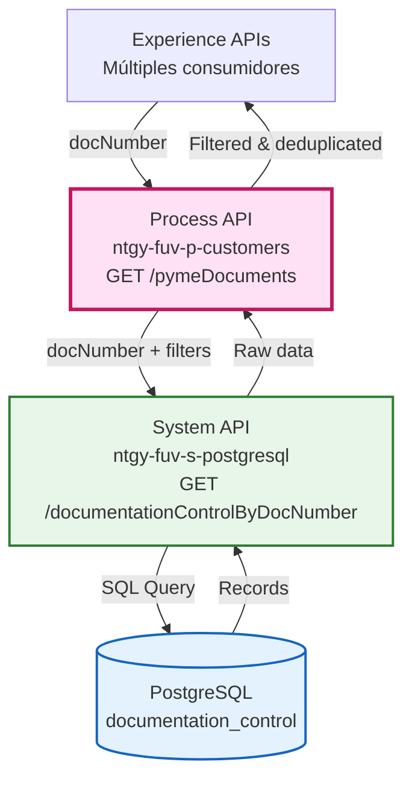
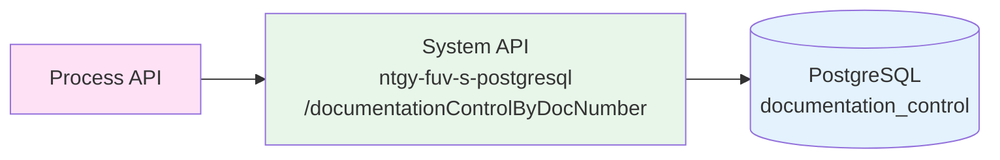
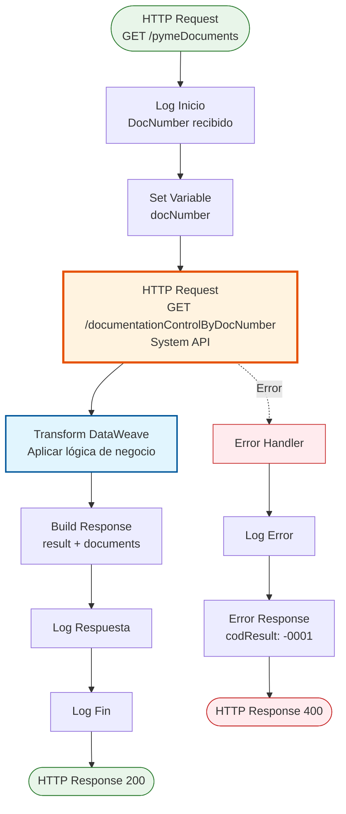
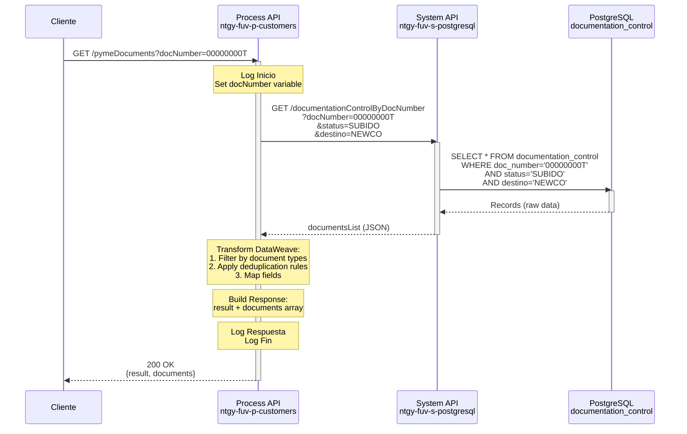
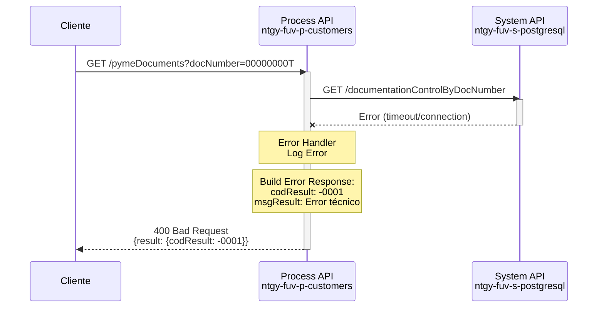
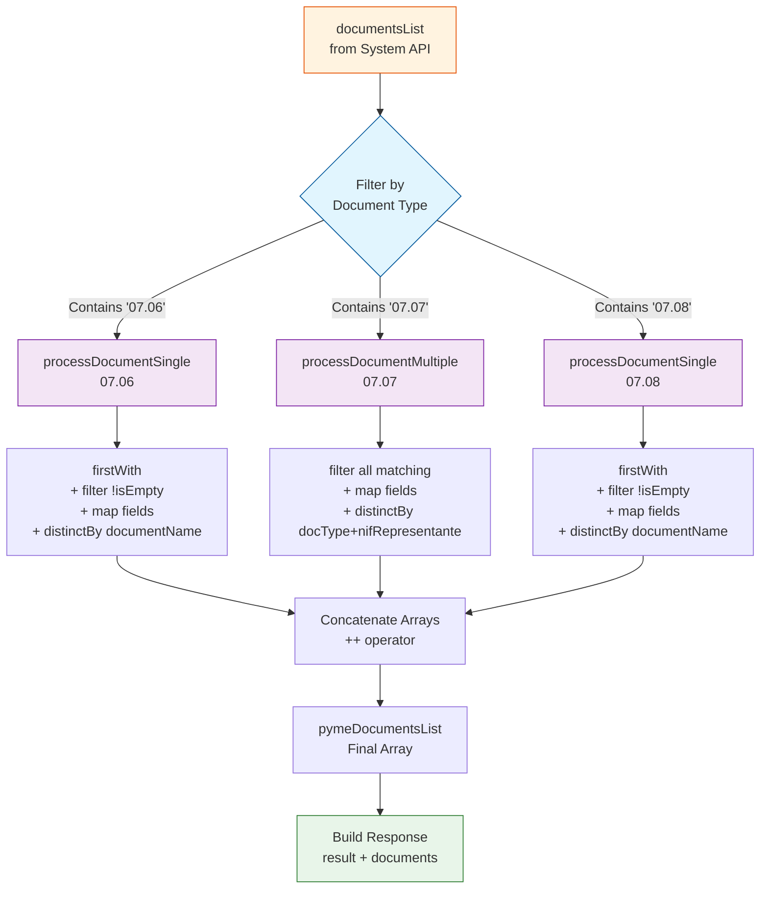

# GET /pymeDocuments

## 📌 Descripción General

### Propósito del Endpoint

Este endpoint consulta documentos PYME que han sido previamente subidos al sistema, identificándolos por el NIF/CIF del cliente. Aplica filtros específicos de estado y destino, y ejecuta lógica de negocio para deduplicar y clasificar los documentos según su tipo.

El endpoint soporta:
- **Consulta por NIF/CIF**: Recupera documentos asociados a un número de documento específico
- **Filtrado automático**: Aplica filtros de estado "SUBIDO" y destino "NEWCO"
- **Clasificación por tipo**: Procesa documentos de tipos específicos (07.06, 07.07, 07.08)
- **Deduplicación inteligente**: Aplica reglas de negocio diferentes según el tipo de documento

### Tipo de API

**Capa:** Process API (API-Led Connectivity)

**Función:** Orquestación de consulta de documentación PYME con lógica de negocio para filtrado y deduplicación.

### Patrón de Integración

**Tipo:** Orquestación con Transformación

**Descripción:** El endpoint recibe un NIF/CIF, consulta el System API de PostgreSQL con filtros predefinidos, y aplica transformaciones DataWeave complejas para filtrar, deduplicar y estructurar los documentos según reglas de negocio específicas por tipo de documento.

### Arquitectura API-Led Connectivity



---

## 💼 Propósito del Negocio

### Casos de Uso Principales

1. **Validación de Documentación PYME**
   - Verificar qué documentos ha subido un cliente PYME
   - Validar completitud de documentación requerida
   - Identificar documentos pendientes

2. **Gestión de Onboarding**
   - Consultar estado de documentación durante proceso de alta
   - Verificar documentos de representantes legales
   - Validar documentación por contrato

3. **Auditoría y Cumplimiento**
   - Revisar documentación histórica de clientes PYME
   - Verificar documentos asociados a contratos específicos
   - Consultar documentación de representantes

### 🔗 Endpoints Dependientes

Este Process API consume el siguiente System API:

| System API | Endpoint | Método | Propósito |
|------------|----------|--------|-----------|
| `ntgy-fuv-s-postgresql` | `/documentationControlByDocNumber` | GET | Recupera documentos desde PostgreSQL con filtros de estado y destino |

### Lógica de Orquestación



**Pasos del Proceso:**

1. **Paso 1**: Recepción del NIF/CIF del cliente
2. **Paso 2**: Llamada al System API con filtros predefinidos (status="SUBIDO", destino="NEWCO")
3. **Paso 3**: Aplicación de lógica de negocio DataWeave:
   - Filtrado por tipos de documento (07.06, 07.07, 07.08)
   - Deduplicación según reglas específicas por tipo
   - Estructuración de respuesta

### Transformaciones Aplicadas

**Lógica de Negocio Compleja:**

Este endpoint aplica transformaciones DataWeave con reglas de negocio específicas:

| Tipo de Documento | Regla de Procesamiento | Criterio de Deduplicación |
|-------------------|------------------------|---------------------------|
| `07.06` | Retorna solo el primer documento encontrado | `distinctBy $.documentName` |
| `07.07` | Retorna TODOS los documentos únicos | `distinctBy (docType ++ $.nifRepresentante)` |
| `07.08` | Retorna solo el primer documento encontrado | `distinctBy $.documentName` |

**Funciones Helper DataWeave:**

```dataweave
// Mapeo de campos de documento
fun mapDocument(doc, docType) = {
    documentName: doc.DOCUMENT_NAME,
    documentType: docType,
    contractId: doc.CONTRACT_ID,
    numDocumento: doc.NUM_DOCUMENTO,
    documentId: doc.DOCUMENT_ID,
    nifRepresentante: doc.NIF_REPRESENTANTE
}

// Procesamiento de documento único (07.06, 07.08)
fun processDocumentSingle(docType: String) = 
    [(vars.documentsList.records firstWith ((item) -> item.DOCUMENT_NAME contains docType))]
    filter !isEmpty($)
    map mapDocument($, docType)
    distinctBy $.documentName

// Procesamiento de múltiples documentos (07.07)
fun processDocumentMultiple(docType: String) = 
    (vars.documentsList.records filter ((item) -> item.DOCUMENT_NAME contains docType))
    map mapDocument($, docType)
    distinctBy (docType ++ $.nifRepresentante)
```

### Contexto Empresarial

- **Dominio:** Gestión de Clientes PYME
- **Sector:** Energía - Utilities
- **División:** Naturgy España - FUV
- **Proceso de Negocio:** Validación y gestión de documentación de clientes PYME

### Stakeholders

- **Equipos de Onboarding**: Necesitan verificar documentación durante proceso de alta
- **Equipos de Atención al Cliente**: Consultan documentación para resolver incidencias
- **Equipos de Cumplimiento**: Auditan documentación para verificar normativa

### Valor de Negocio

- **Eficiencia Operativa**: Consulta rápida de documentación sin acceso directo a base de datos
- **Calidad de Datos**: Deduplicación automática evita documentos duplicados
- **Trazabilidad**: Identificación clara de documentos por tipo y representante
- **Flexibilidad**: Lógica de negocio centralizada facilita cambios en reglas de procesamiento

### Consumidores Potenciales

Este endpoint puede ser consumido por:
- Portales web de autoservicio PYME
- Aplicaciones móviles de gestión
- Sistemas de agentes de call center
- Herramientas de backoffice para gestión de documentación
- Sistemas de auditoría y cumplimiento

---

## 🔧 Especificación Técnica

### URLs por Ambiente

| Ambiente | URL Base | URL Completa |
|----------|----------|--------------|
| **Local** | `http://localhost:8081` | `http://localhost:8081/api/pymeDocuments?docNumber=00000000T` |
| **Development** | `https://ntgy-fuv-p-customers-dev.us-e2.cloudhub.io` | `https://ntgy-fuv-p-customers-dev.us-e2.cloudhub.io/api/pymeDocuments?docNumber=00000000T` |
| **UAT** | `https://ntgy-fuv-p-customers-uat.us-e2.cloudhub.io` | `https://ntgy-fuv-p-customers-uat.us-e2.cloudhub.io/api/pymeDocuments?docNumber=00000000T` |
| **Production** | `https://ntgy-fuv-p-customers-pro.us-e2.cloudhub.io` | `https://ntgy-fuv-p-customers-pro.us-e2.cloudhub.io/api/pymeDocuments?docNumber=00000000T` |

### Método HTTP

```
GET /api/pymeDocuments
```

### Parámetros de Entrada

#### Headers HTTP

| Header | Tipo | Requerido | Descripción | Ejemplo |
|--------|------|-----------|-------------|---------|
| `Content-Type` | string | ✅ Sí | Tipo de contenido del request | `application/json` |
| `client_id` | string | ✅ Sí | Client ID de Anypoint Platform | `abc123...` |
| `client_secret` | string | ✅ Sí | Client Secret de Anypoint Platform | `xyz789...` |

#### Query Parameters

| Parámetro | Tipo | Requerido | Descripción | Ejemplo |
|-----------|------|-----------|-------------|---------|
| `docNumber` | string | ✅ Sí | Número de documento del cliente (NIF/CIF) | `"00000000T"` |

**Validaciones:**
- `docNumber` debe ser un NIF o CIF válido
- El formato debe cumplir con estándares españoles de identificación fiscal

### Respuestas

#### Respuesta Exitosa (200 OK)

```json
{
  "result": {
    "codResult": "0000",
    "msgResult": "No hay error"
  },
  "documents": [
    {
      "documentName": "07.06_DOCUMENTO_EJEMPLO.pdf",
      "documentType": "07.06",
      "contractId": "123456",
      "numDocumento": "00000000T",
      "documentId": "doc-001",
      "nifRepresentante": null
    },
    {
      "documentName": "07.07_REPRESENTANTE_12345678A.pdf",
      "documentType": "07.07",
      "contractId": "123456",
      "numDocumento": "00000000T",
      "documentId": "doc-002",
      "nifRepresentante": "12345678A"
    },
    {
      "documentName": "07.08_OTRO_DOCUMENTO.pdf",
      "documentType": "07.08",
      "contractId": "123456",
      "numDocumento": "00000000T",
      "documentId": "doc-003",
      "nifRepresentante": null
    }
  ]
}
```

**Estructura de Campos:**

| Campo | Tipo | Descripción |
|-------|------|-------------|
| `result.codResult` | string | Código de resultado ("0000" = éxito) |
| `result.msgResult` | string | Mensaje descriptivo del resultado |
| `documents` | array | Lista de documentos procesados |
| `documents[].documentName` | string | Nombre del archivo del documento |
| `documents[].documentType` | string | Tipo de documento (07.06, 07.07, 07.08) |
| `documents[].contractId` | string | ID del contrato asociado |
| `documents[].numDocumento` | string | NIF/CIF del cliente |
| `documents[].documentId` | string | ID único del documento |
| `documents[].nifRepresentante` | string \| null | NIF del representante legal (solo para tipo 07.07) |

#### Respuesta Sin Documentos (200 OK)

```json
{
  "result": {
    "codResult": "0000",
    "msgResult": "No hay error"
  },
  "documents": []
}
```

#### Respuesta de Error Técnico (400 Bad Request)

```json
{
  "result": {
    "codResult": "-0001",
    "msgResult": "Error técnico"
  }
}
```

### Autenticación y Autorización

- **Tipo:** Client ID & Client Secret (Anypoint Platform)
- **Scope:** Acceso a endpoints de Process API de clientes
- **Autorización Backend:** El System API debe tener permisos para consultar la tabla `documentation_control` en PostgreSQL

### Timeouts

| Tipo | Valor | Descripción |
|------|-------|-------------|
| **Request Timeout** | 60 segundos | Configurado en `${s-postgresql.timeout}` |
| **Connection Timeout** | 10 segundos | Timeout de conexión HTTP al System API |

---

## 🏗️ Implementación Técnica

### Arquitectura del Flow



### Transformaciones DataWeave

#### Transformación 1: Set docNumber Variable

**Ubicación:** Línea 9-17 del archivo XML

```dataweave
%dw 2.0
output application/java
---
attributes.queryParams.docNumber
```

**Propósito:** Extraer el parámetro `docNumber` del query string y almacenarlo en una variable para uso posterior.

#### Transformación 2: Lógica de Negocio Principal

**Ubicación:** Línea 28-56 del archivo XML

```dataweave
%dw 2.0
output application/json
import firstWith from dw::core::Arrays

// Función helper para mapear documentos
fun mapDocument(doc, docType) = {
    documentName: doc.DOCUMENT_NAME,
    documentType: docType,
    contractId: doc.CONTRACT_ID,
    numDocumento: doc.NUM_DOCUMENTO,
    documentId: doc.DOCUMENT_ID,
    nifRepresentante: doc.NIF_REPRESENTANTE
}

// Para documentos que retornan solo el primer resultado (07.06, 07.08)
fun processDocumentSingle(docType: String) = 
    [(vars.documentsList.records firstWith ((item) -> item.DOCUMENT_NAME contains docType))]
    filter !isEmpty($)
    map mapDocument($, docType)
    distinctBy $.documentName

// Para documento 07.07: retorna todos los registros únicos por combinación de docType + nifRepresentante
fun processDocumentMultiple(docType: String) = 
    (vars.documentsList.records filter ((item) -> item.DOCUMENT_NAME contains docType))
    map mapDocument($, docType)
    distinctBy (docType ++ $.nifRepresentante)
---
processDocumentSingle("07.06") 
++ processDocumentMultiple("07.07") 
++ processDocumentSingle("07.08")
```

**Propósito:** Aplicar lógica de negocio compleja para:
1. Filtrar documentos por tipo (07.06, 07.07, 07.08)
2. Aplicar reglas de deduplicación específicas por tipo
3. Mapear campos de base de datos a estructura de respuesta
4. Concatenar resultados en un solo array

**Reglas de Negocio:**
- **Tipo 07.06**: Solo el primer documento encontrado (deduplicado por nombre)
- **Tipo 07.07**: Todos los documentos únicos por combinación de tipo + NIF representante
- **Tipo 07.08**: Solo el primer documento encontrado (deduplicado por nombre)

#### Transformación 3: Build Response

**Ubicación:** Línea 58-68 del archivo XML

```dataweave
%dw 2.0
output application/json
---
{
	"result": {
		"codResult": "0000",
		"msgResult": "No hay error"
	},
	"documents": vars.pymeDocumentsList
}
```

**Propósito:** Construir la respuesta final con estructura estandarizada que incluye el objeto `result` y el array de `documents` procesados.

### Llamada al System API

**Configuración HTTP:**

```xml
<http:request 
    method="GET" 
    doc:name="RecuperarDocumentos" 
    config-ref="DDBB_HTTP_Request_configuration" 
    path="/documentationControlByDocNumber" 
    outputMimeType="application/json" 
    responseTimeout="${s-postgresql.timeout}" 
    target="documentsList">
```

**Query Parameters Enviados:**

```dataweave
{
	"docNumber" : vars.docNumber,
	"status" : "SUBIDO",
	"destino" : "NEWCO"
}
```

**Configuración del System API:**
- **Host:** `ntgy-fuv-s-postgresql-dev.us-e2.cloudhub.io`
- **Port:** `443`
- **Protocol:** HTTPS
- **Timeout:** 60000ms (60 segundos)
- **Base Path:** `/api`

### Patrones de Diseño

**Patrón:** Orquestación con Transformación y Filtrado

**Justificación:** 
- El endpoint necesita aplicar lógica de negocio compleja que no pertenece al System API
- La deduplicación y filtrado son reglas específicas del proceso de negocio
- Permite reutilizar el System API genérico para otros casos de uso
- Centraliza la lógica de negocio en el Process API

### Diagramas de Secuencia

#### 1. Flujo Normal de Éxito



#### 2. Flujo con Error Técnico



#### 3. Diagrama de Transformación de Datos



### Manejo de Errores

**Estrategia:** Error Handler Global con Logging

**Implementación:**

```xml
<error-handler>
    <on-error-propagate enableNotifications="true" logException="true" type="ANY">
        <logger level="ERROR" 
                message='#["Error técnico pymeDocuments: " ++ error.description as String replace /\"/ with("")]' 
                category="com.naturgy.mulesoft.p-customers-pymeDocuments-main" />
        
        <ee:transform doc:name="Error generico">
            <ee:message>
                <ee:set-payload><![CDATA[%dw 2.0
output application/json
---
{
    "result": {
        "codResult": "-0001",
        "msgResult": "Error técnico"
    }
}]]></ee:set-payload>
            </ee:message>
            <ee:variables>
                <ee:set-variable variableName="httpStatus"><![CDATA[400]]></ee:set-variable>
            </ee:variables>
        </ee:transform>
        
        <logger level="INFO" 
                message='"Error pymeDocuments. Devolvemos a Darwin: #[payload]"' 
                category="com.naturgy.mulesoft.p-customers-pymeDocuments-main" />
    </on-error-propagate>
</error-handler>
```

**Tipos de Errores Manejados:**
- **Timeout del System API**: Cuando la consulta a PostgreSQL excede 60 segundos
- **Error de Conexión**: Cuando no se puede conectar al System API
- **Error de Transformación**: Cuando falla el procesamiento DataWeave
- **Cualquier Error Técnico**: Capturado por `type="ANY"`

**Respuesta de Error:**
- HTTP Status: `400 Bad Request`
- Body: `{"result": {"codResult": "-0001", "msgResult": "Error técnico"}}`
- Logging: Error completo en categoría `com.naturgy.mulesoft.p-customers-pymeDocuments-main`

### Logging

**Categoría:** `com.naturgy.mulesoft.p-customers-pymeDocuments-main`

**Puntos de Logging:**

1. **Log Inicio** (INFO):
   ```
   Inicio Flujo pymeDocuments. DocNumber: [docNumber]
   ```

2. **Log Respuesta** (INFO):
   ```
   Respuesta pymeDocuments: [payload]
   ```

3. **Log Fin** (INFO):
   ```
   Fin Flujo pymeDocuments. DocNumber: [docNumber]
   ```

4. **Log Error** (ERROR):
   ```
   Error técnico pymeDocuments: [error.description]
   ```

---

## 💻 Ejemplos de Uso

### Ejemplo 1: Consulta Exitosa con Documentos

#### cURL

```bash
curl -X GET "https://ntgy-fuv-p-customers-dev.us-e2.cloudhub.io/api/pymeDocuments?docNumber=00000000T" \
  -H "Content-Type: application/json" \
  -H "client_id: YOUR_CLIENT_ID" \
  -H "client_secret: YOUR_CLIENT_SECRET"
```

#### Respuesta (200 OK)

```json
{
  "result": {
    "codResult": "0000",
    "msgResult": "No hay error"
  },
  "documents": [
    {
      "documentName": "07.06_ESCRITURA_CONSTITUCION.pdf",
      "documentType": "07.06",
      "contractId": "500123456",
      "numDocumento": "00000000T",
      "documentId": "doc-2024-001",
      "nifRepresentante": null
    },
    {
      "documentName": "07.07_PODER_REPRESENTANTE_12345678A.pdf",
      "documentType": "07.07",
      "contractId": "500123456",
      "numDocumento": "00000000T",
      "documentId": "doc-2024-002",
      "nifRepresentante": "12345678A"
    },
    {
      "documentName": "07.07_PODER_REPRESENTANTE_87654321B.pdf",
      "documentType": "07.07",
      "contractId": "500123456",
      "numDocumento": "00000000T",
      "documentId": "doc-2024-003",
      "nifRepresentante": "87654321B"
    },
    {
      "documentName": "07.08_CERTIFICADO_BANCARIO.pdf",
      "documentType": "07.08",
      "contractId": "500123456",
      "numDocumento": "00000000T",
      "documentId": "doc-2024-004",
      "nifRepresentante": null
    }
  ]
}
```

### Ejemplo 2: Consulta Sin Documentos

#### cURL

```bash
curl -X GET "https://ntgy-fuv-p-customers-dev.us-e2.cloudhub.io/api/pymeDocuments?docNumber=99999999Z" \
  -H "Content-Type: application/json" \
  -H "client_id: YOUR_CLIENT_ID" \
  -H "client_secret: YOUR_CLIENT_SECRET"
```

#### Respuesta (200 OK)

```json
{
  "result": {
    "codResult": "0000",
    "msgResult": "No hay error"
  },
  "documents": []
}
```

### Ejemplo 3: JavaScript (Frontend)

```javascript
async function getPymeDocuments(docNumber) {
  try {
    const response = await fetch(
      `https://ntgy-fuv-p-customers-dev.us-e2.cloudhub.io/api/pymeDocuments?docNumber=${docNumber}`,
      {
        method: 'GET',
        headers: {
          'Content-Type': 'application/json',
          'client_id': 'YOUR_CLIENT_ID',
          'client_secret': 'YOUR_CLIENT_SECRET'
        }
      }
    );

    if (!response.ok) {
      throw new Error(`HTTP error! status: ${response.status}`);
    }

    const data = await response.json();
    
    // Procesar documentos por tipo
    const documentos = {
      escritura: data.documents.filter(doc => doc.documentType === '07.06'),
      poderes: data.documents.filter(doc => doc.documentType === '07.07'),
      certificado: data.documents.filter(doc => doc.documentType === '07.08')
    };
    
    return documentos;
  } catch (error) {
    console.error('Error al obtener documentos PYME:', error);
    throw error;
  }
}

// Uso
getPymeDocuments('00000000T')
  .then(docs => {
    console.log('Escritura de constitución:', docs.escritura);
    console.log('Poderes de representantes:', docs.poderes);
    console.log('Certificado bancario:', docs.certificado);
  })
  .catch(error => console.error('Error:', error));
```

### Ejemplo 4: Python

```python
import requests
from typing import Dict, List, Optional

def get_pyme_documents(doc_number: str, client_id: str, client_secret: str) -> Dict:
    """
    Consulta documentos PYME por NIF/CIF
    
    Args:
        doc_number: NIF o CIF del cliente
        client_id: Client ID de Anypoint Platform
        client_secret: Client Secret de Anypoint Platform
    
    Returns:
        Dict con result y documents
    """
    url = "https://ntgy-fuv-p-customers-dev.us-e2.cloudhub.io/api/pymeDocuments"
    
    headers = {
        'Content-Type': 'application/json',
        'client_id': client_id,
        'client_secret': client_secret
    }
    
    params = {
        'docNumber': doc_number
    }
    
    try:
        response = requests.get(url, headers=headers, params=params, timeout=30)
        response.raise_for_status()
        
        data = response.json()
        
        # Validar respuesta exitosa
        if data.get('result', {}).get('codResult') == '0000':
            print(f"✅ Documentos recuperados: {len(data.get('documents', []))}")
            
            # Agrupar por tipo
            docs_by_type = {
                '07.06': [],
                '07.07': [],
                '07.08': []
            }
            
            for doc in data.get('documents', []):
                doc_type = doc.get('documentType')
                if doc_type in docs_by_type:
                    docs_by_type[doc_type].append(doc)
            
            print(f"  - Escrituras (07.06): {len(docs_by_type['07.06'])}")
            print(f"  - Poderes (07.07): {len(docs_by_type['07.07'])}")
            print(f"  - Certificados (07.08): {len(docs_by_type['07.08'])}")
            
            return data
        else:
            print(f"⚠️ Error de negocio: {data.get('result', {}).get('msgResult')}")
            return data
            
    except requests.exceptions.Timeout:
        print("❌ Error: Timeout al consultar documentos")
        raise
    except requests.exceptions.RequestException as e:
        print(f"❌ Error de conexión: {e}")
        raise
    except Exception as e:
        print(f"❌ Error inesperado: {e}")
        raise

# Uso
if __name__ == "__main__":
    CLIENT_ID = "your_client_id"
    CLIENT_SECRET = "your_client_secret"
    
    try:
        result = get_pyme_documents("00000000T", CLIENT_ID, CLIENT_SECRET)
        
        # Mostrar documentos
        for doc in result.get('documents', []):
            print(f"\n📄 {doc['documentName']}")
            print(f"   Tipo: {doc['documentType']}")
            print(f"   Contrato: {doc['contractId']}")
            if doc.get('nifRepresentante'):
                print(f"   Representante: {doc['nifRepresentante']}")
                
    except Exception as e:
        print(f"Error al procesar: {e}")
```

### Ejemplo 5: Error Técnico

#### Request

```bash
curl -X GET "https://ntgy-fuv-p-customers-dev.us-e2.cloudhub.io/api/pymeDocuments?docNumber=00000000T" \
  -H "Content-Type: application/json" \
  -H "client_id: INVALID_CLIENT_ID" \
  -H "client_secret: INVALID_SECRET"
```

#### Respuesta (400 Bad Request)

```json
{
  "result": {
    "codResult": "-0001",
    "msgResult": "Error técnico"
  }
}
```

### Notas de Implementación

**Consideraciones Importantes:**

1. **Deduplicación de Documentos 07.07:**
   - Los documentos de tipo 07.07 (poderes de representantes) se deduplicán por la combinación de tipo + NIF del representante
   - Esto permite tener múltiples poderes de diferentes representantes para el mismo cliente

2. **Documentos Únicos 07.06 y 07.08:**
   - Solo se retorna el primer documento encontrado de estos tipos
   - Si existen múltiples versiones, solo se devuelve la primera

3. **Filtros Automáticos:**
   - El endpoint siempre filtra por `status="SUBIDO"` y `destino="NEWCO"`
   - Estos filtros no son configurables desde el request

4. **Performance:**
   - El timeout está configurado en 60 segundos
   - La transformación DataWeave es eficiente incluso con grandes volúmenes de documentos

5. **Manejo de Casos Especiales:**
   - Si no hay documentos, se retorna un array vacío (no un error)
   - Los campos `nifRepresentante` pueden ser `null` para documentos que no lo requieren
