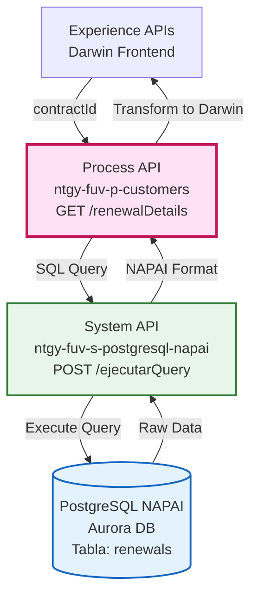
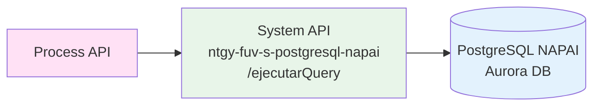
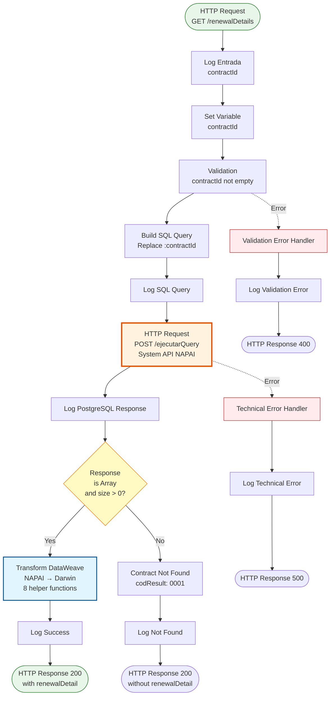
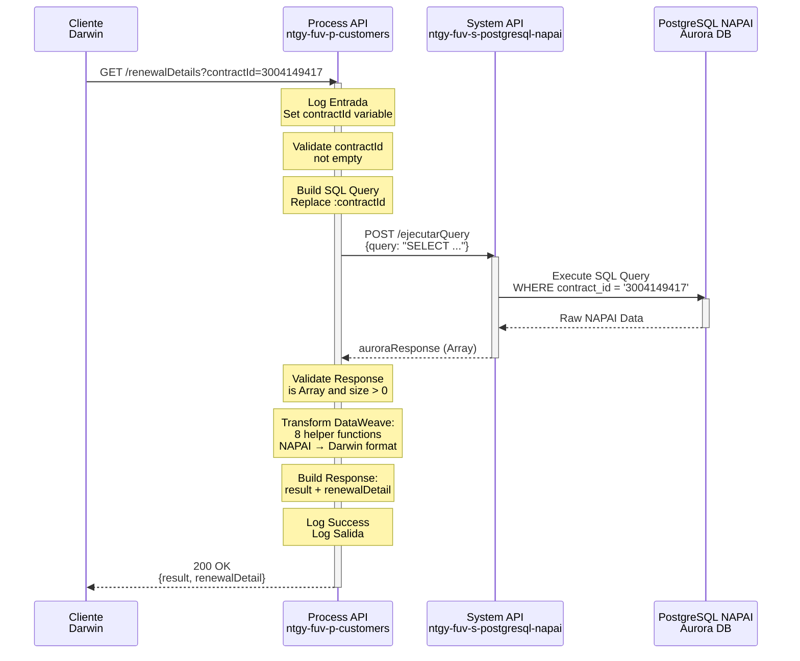
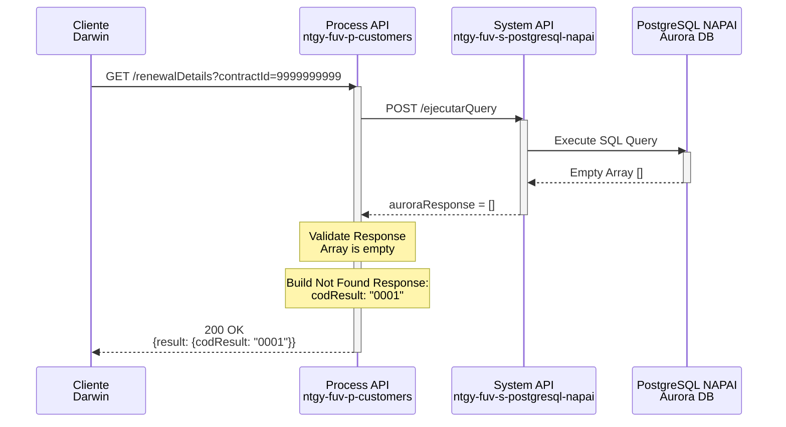
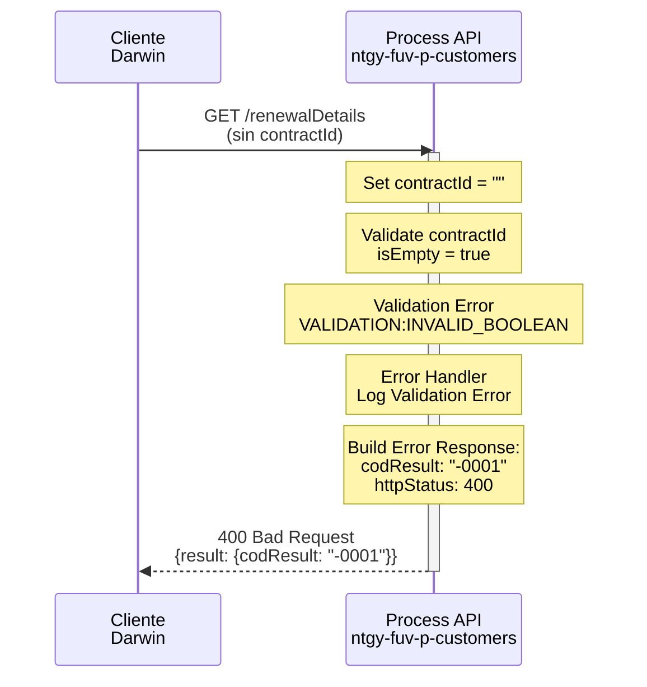
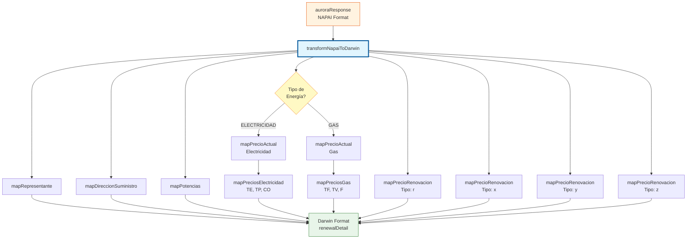

# GET /renewalDetails

## 📌 Descripción General

### Propósito del Endpoint

Este endpoint consulta el detalle completo de una renovación de contrato PYME desde la base de datos Aurora (PostgreSQL NAPAI). Recupera información exhaustiva incluyendo datos del cliente, representante, dirección de suministro, producto contratado, potencias, consumos, precios actuales y ofertas de renovación (tácita y alternativas X, Y, Z).

El endpoint soporta:
- **Consulta por Contract ID**: Recupera datos de renovación por ID de contrato de Salesforce
- **Transformación compleja**: Mapea datos de PostgreSQL NAPAI al formato Darwin (frontend)
- **Precios diferenciados**: Maneja precios de electricidad (TE, TP, CO) y gas (TF, TV, F)
- **Múltiples ofertas**: Incluye renovación tácita y 3 ofertas alternativas (X, Y, Z)
- **Validación estricta**: Valida que el contractId sea obligatorio

### Tipo de API

**Capa:** Process API (API-Led Connectivity)

**Función:** Orquestación de consulta de renovaciones PYME con transformación compleja de datos desde Aurora DB.

### Patrón de Integración

**Tipo:** Request-Reply con Transformación Compleja

**Descripción:** El endpoint recibe un contractId, construye una query SQL parametrizada, consulta el System API de PostgreSQL NAPAI (Aurora DB), y aplica una transformación DataWeave compleja con múltiples funciones helper para mapear los datos al formato esperado por Darwin (frontend).

### Arquitectura API-Led Connectivity



---

## 💼 Propósito del Negocio

### Casos de Uso Principales

1. **Gestión de Renovaciones PYME**
   - Consultar detalle completo de renovación de contrato
   - Visualizar precios actuales vs ofertas de renovación
   - Comparar renovación tácita con ofertas alternativas

2. **Soporte a Ventas**
   - Proporcionar información completa para proceso de renovación
   - Mostrar ofertas personalizadas (X, Y, Z) al cliente
   - Facilitar toma de decisión del cliente

3. **Análisis de Precios**
   - Comparar precios actuales con ofertas de renovación
   - Evaluar impacto de cambio de tarifa
   - Calcular ahorro potencial por oferta

### 🔗 Endpoints Dependientes

Este Process API consume el siguiente System API:

| System API | Endpoint | Método | Propósito |
|------------|----------|--------|-----------|
| `ntgy-fuv-s-postgresql-napai` | `/ejecutarQuery` | POST | Ejecuta query SQL parametrizada en Aurora DB |

### Lógica de Orquestación



**Pasos del Proceso:**

1. **Paso 1**: Validación de contractId (obligatorio)
2. **Paso 2**: Construcción de query SQL parametrizada (reemplazo de `:contractId`)
3. **Paso 3**: Llamada al System API PostgreSQL NAPAI
4. **Paso 4**: Validación de respuesta (array con datos o vacío)
5. **Paso 5**: Transformación compleja NAPAI → Darwin con 8 funciones helper
6. **Paso 6**: Construcción de respuesta estructurada

### Transformaciones Aplicadas

**Transformación Compleja con 8 Funciones Helper:**

Este endpoint aplica una de las transformaciones más complejas del proyecto:

| Función Helper | Propósito | Complejidad |
|----------------|-----------|-------------|
| `getJsonField` | Parsea campos JSON que vienen como strings | Baja |
| `mapRepresentante` | Mapea datos del representante/contacto | Baja |
| `mapDireccionSuministro` | Mapea dirección completa de suministro | Media |
| `mapPotencias` | Transforma potencias P1-P6 a formato Darwin | Media |
| `mapPreciosElectricidad` | Mapea TE, TP y CO con 6 periodos cada uno | Alta |
| `mapPreciosGas` | Mapea TF, TV y F | Baja |
| `mapPrecioActual` | Selecciona mapeo según tipo de energía | Media |
| `mapPrecioRenovacion` | Mapea precios de renovación (R, X, Y, Z) | Alta |

**Estructura de Datos Transformada:**

```dataweave
{
  representante: { documento, nombre, apellido1, apellido2 },
  direccionSuministro: { tipoVia, nombreVia, numero, ... },
  telefonoMovil, email, idioma,
  energia: "ELECTRICIDAD" | "GAS",
  productoContratadoIdSF, nombreProducto,
  tipoOfertaContratado, tarifaATR,
  consumoFacturadoAnual,
  potencias: { p1, p2, p3, p4, p5, p6 },
  fechaContrato, fechaReservaPrecios,
  precioActual: { terminoPotencia, terminoEnergia, costesOperacion } | { precioTerminoFijo, precioTerminoVariable, f },
  precioRenovacionTacita: { ... },
  preciosOferta: {
    x: { ... },
    y: { ... },
    z: { ... }
  }
}
```

### Contexto Empresarial

- **Dominio:** Renovaciones de Contratos PYME
- **Sector:** Energía - Utilities
- **División:** Naturgy España - FUV
- **Proceso de Negocio:** Gestión de renovaciones y ofertas comerciales para clientes PYME
- **Base de Datos:** Aurora DB (PostgreSQL NAPAI) - Repositorio de datos de renovaciones

### Stakeholders

- **Equipos Comerciales**: Necesitan información completa para gestionar renovaciones
- **Clientes PYME**: Consultan sus opciones de renovación y precios
- **Equipos de Pricing**: Analizan ofertas y precios de renovación
- **Equipos de Atención al Cliente**: Proporcionan información sobre renovaciones

### Valor de Negocio

- **Transparencia**: Cliente visualiza todas sus opciones de renovación
- **Eficiencia Comercial**: Información completa en una sola consulta
- **Personalización**: Ofertas específicas (X, Y, Z) por cliente
- **Toma de Decisión**: Comparación clara entre opciones disponibles
- **Retención**: Facilita proceso de renovación y reduce churn

### Consumidores Potenciales

Este endpoint puede ser consumido por:
- Portal web Darwin (frontend principal)
- Aplicaciones móviles de gestión PYME
- Sistemas de agentes de call center
- Herramientas de backoffice comercial
- Sistemas de análisis y reporting

---

## 🔧 Especificación Técnica

### URLs por Ambiente

| Ambiente | URL Base | URL Completa |
|----------|----------|--------------|
| **Local** | `http://localhost:8081` | `http://localhost:8081/api/renewalDetails?contractId=3004149417` |
| **Development** | `https://ntgy-fuv-p-customers-dev.us-e2.cloudhub.io` | `https://ntgy-fuv-p-customers-dev.us-e2.cloudhub.io/api/renewalDetails?contractId=3004149417` |
| **UAT** | `https://ntgy-fuv-p-customers-uat.us-e2.cloudhub.io` | `https://ntgy-fuv-p-customers-uat.us-e2.cloudhub.io/api/renewalDetails?contractId=3004149417` |
| **Production** | `https://ntgy-fuv-p-customers-pro.us-e2.cloudhub.io` | `https://ntgy-fuv-p-customers-pro.us-e2.cloudhub.io/api/renewalDetails?contractId=3004149417` |

### Método HTTP

```
GET /api/renewalDetails
```

### Parámetros de Entrada

#### Headers HTTP

| Header | Tipo | Requerido | Descripción | Ejemplo |
|--------|------|-----------|-------------|---------|
| `Content-Type` | string | ✅ Sí | Tipo de contenido del request | `application/json` |
| `client_id` | string | ✅ Sí | Client ID de Anypoint Platform | `abc123...` |
| `client_secret` | string | ✅ Sí | Client Secret de Anypoint Platform | `xyz789...` |

#### Query Parameters

| Parámetro | Tipo | Requerido | Descripción | Ejemplo |
|-----------|------|-----------|-------------|---------|
| `contractId` | string | ✅ Sí | ID del contrato en Salesforce | `"3004149417"` |

**Validaciones:**
- `contractId` es obligatorio (validación con `validation:is-true`)
- No puede ser vacío o null
- Error 400 si no se proporciona

### Respuestas

#### Respuesta Exitosa (200 OK)

```json
{
  "result": {
    "codResult": "0000",
    "msgResult": "No hay error"
  },
  "renewalDetail": {
    "representante": {
      "documento": "12345678A",
      "nombre": "Juan",
      "apellido1": "García",
      "apellido2": "López"
    },
    "direccionSuministro": {
      "tipoVia": "CALLE",
      "nombreVia": "MAYOR",
      "numero": "123",
      "portal": "A",
      "escalera": "1",
      "piso": "3",
      "puerta": "B",
      "codigoPostal": "28001",
      "poblacion": "MADRID",
      "provincia": "MADRID"
    },
    "telefonoMovil": "600123456",
    "email": "cliente@example.com",
    "idioma": "ES",
    "energia": "ELECTRICIDAD",
    "productoContratadoIdSF": "PROD-001",
    "nombreProducto": "Tarifa Estable 12 Meses",
    "tipoOfertaContratado": "FIJO",
    "tarifaATR": "2.0TD",
    "consumoFacturadoAnual": "3500",
    "potencias": {
      "p1": "4.6",
      "p2": "4.6",
      "p3": "0",
      "p4": "0",
      "p5": "0",
      "p6": "0"
    },
    "fechaContrato": "2023-01-15",
    "fechaReservaPrecios": "2024-01-10",
    "precioActual": {
      "terminoPotencia": {
        "precioP1": "0.105",
        "precioP2": "0.105",
        "precioP3": "0",
        "precioP4": "0",
        "precioP5": "0",
        "precioP6": "0"
      },
      "terminoEnergia": {
        "precioP1": "0.145",
        "precioP2": "0.125",
        "precioP3": "0.110",
        "precioP4": "0",
        "precioP5": "0",
        "precioP6": "0"
      },
      "costesOperacion": {
        "precioP1": "0.015",
        "precioP2": "0.015",
        "precioP3": "0.015",
        "precioP4": "0",
        "precioP5": "0",
        "precioP6": "0"
      }
    },
    "precioRenovacionTacita": {
      "terminoPotencia": {
        "precioP1": "0.110",
        "precioP2": "0.110",
        "precioP3": "0",
        "precioP4": "0",
        "precioP5": "0",
        "precioP6": "0"
      },
      "terminoEnergia": {
        "precioP1": "0.150",
        "precioP2": "0.130",
        "precioP3": "0.115",
        "precioP4": "0",
        "precioP5": "0",
        "precioP6": "0"
      },
      "costesOperacion": {
        "precioP1": "0.016",
        "precioP2": "0.016",
        "precioP3": "0.016",
        "precioP4": "0",
        "precioP5": "0",
        "precioP6": "0"
      }
    },
    "preciosOferta": {
      "x": {
        "terminoPotencia": {
          "precioP1": "0.108",
          "precioP2": "0.108",
          "precioP3": "0",
          "precioP4": "0",
          "precioP5": "0",
          "precioP6": "0"
        },
        "terminoEnergia": {
          "precioP1": "0.148",
          "precioP2": "0.128",
          "precioP3": "0.113",
          "precioP4": "0",
          "precioP5": "0",
          "precioP6": "0"
        },
        "costesOperacion": {
          "precioP1": "0.015",
          "precioP2": "0.015",
          "precioP3": "0.015",
          "precioP4": "0",
          "precioP5": "0",
          "precioP6": "0"
        }
      },
      "y": {
        "terminoPotencia": {
          "precioP1": "0.106",
          "precioP2": "0.106",
          "precioP3": "0",
          "precioP4": "0",
          "precioP5": "0",
          "precioP6": "0"
        },
        "terminoEnergia": {
          "precioP1": "0.146",
          "precioP2": "0.126",
          "precioP3": "0.111",
          "precioP4": "0",
          "precioP5": "0",
          "precioP6": "0"
        },
        "costesOperacion": {
          "precioP1": "0.015",
          "precioP2": "0.015",
          "precioP3": "0.015",
          "precioP4": "0",
          "precioP5": "0",
          "precioP6": "0"
        }
      },
      "z": {
        "terminoPotencia": {
          "precioP1": "0.104",
          "precioP2": "0.104",
          "precioP3": "0",
          "precioP4": "0",
          "precioP5": "0",
          "precioP6": "0"
        },
        "terminoEnergia": {
          "precioP1": "0.144",
          "precioP2": "0.124",
          "precioP3": "0.109",
          "precioP4": "0",
          "precioP5": "0",
          "precioP6": "0"
        },
        "costesOperacion": {
          "precioP1": "0.014",
          "precioP2": "0.014",
          "precioP3": "0.014",
          "precioP4": "0",
          "precioP5": "0",
          "precioP6": "0"
        }
      }
    }
  }
}
```

**Estructura de Campos:**

| Campo | Tipo | Descripción |
|-------|------|-------------|
| `result.codResult` | string | Código de resultado ("0000" = éxito, "0001" = no encontrado, "-0001" = error) |
| `result.msgResult` | string | Mensaje descriptivo del resultado |
| `renewalDetail` | object | Objeto con detalle completo de renovación |
| `renewalDetail.representante` | object | Datos del representante legal/contacto |
| `renewalDetail.direccionSuministro` | object | Dirección completa del punto de suministro |
| `renewalDetail.energia` | string | Tipo de energía: "ELECTRICIDAD" o "GAS" |
| `renewalDetail.potencias` | object | Potencias contratadas por periodo (p1-p6) |
| `renewalDetail.precioActual` | object | Precios actuales del contrato |
| `renewalDetail.precioRenovacionTacita` | object | Precios de renovación tácita (R) |
| `renewalDetail.preciosOferta` | object | Ofertas alternativas (X, Y, Z) |

#### Respuesta Contrato No Encontrado (200 OK)

```json
{
  "result": {
    "codResult": "0001",
    "msgResult": "Contrato no encontrado"
  }
}
```

#### Respuesta Error de Validación (400 Bad Request)

```json
{
  "result": {
    "codResult": "-0001",
    "msgResult": "El parámetro contractId es obligatorio"
  }
}
```

#### Respuesta Error Técnico (500 Internal Server Error)

```json
{
  "result": {
    "codResult": "-0001",
    "msgResult": "Error técnico"
  }
}
```

### Autenticación y Autorización

- **Tipo:** Client ID & Client Secret (Anypoint Platform)
- **Scope:** Acceso a endpoints de Process API de clientes
- **Autorización Backend:** El System API debe tener permisos para consultar Aurora DB (PostgreSQL NAPAI)

### Timeouts

| Tipo | Valor | Descripción |
|------|-------|-------------|
| **Request Timeout** | 30 segundos | Configurado en el http:request al System API |
| **Connection Timeout** | 10 segundos | Timeout de conexión HTTP al System API |

---

## 🏗️ Implementación Técnica

### Arquitectura del Flow



### Transformaciones DataWeave

#### Transformación 1: Set contractId Variable

**Ubicación:** Línea 20-24 del archivo XML

```dataweave
%dw 2.0
output application/java
---
attributes.queryParams.contractId default ""
```

**Propósito:** Extraer el parámetro `contractId` del query string y almacenarlo en una variable.

#### Transformación 2: Build SQL Query

**Ubicación:** Línea 32-41 del archivo XML

```dataweave
%dw 2.0
output application/json
var query = p('renewals.contractDetail.query') replace ':contractId' with vars.contractId
---
{
	query: query
}
```

**Propósito:** Construir el payload JSON con la query SQL parametrizada, reemplazando el placeholder `:contractId` con el valor real.

**Nota:** La query SQL está externalizada en archivo de propiedades (`renewals.contractDetail.query`).

#### Transformación 3: Transform NAPAI to Darwin (Compleja)

**Ubicación:** Línea 70-85 del archivo XML  
**Archivo Externo:** `src/main/resources/dataweave/renewalDetails/napaiResponseMapping.dwl`

```dataweave
%dw 2.0
output application/json
import transformNapaiToDarwin from dataweave::renewalDetails::napaiResponseMapping
---
{
	"result": {
		"codResult": "0000",
		"msgResult": "No hay error"
	},
	"renewalDetail": transformNapaiToDarwin(vars.auroraResponse[0])
}
```

**Propósito:** Transformar el primer registro de la respuesta de PostgreSQL NAPAI al formato Darwin usando la función `transformNapaiToDarwin`.

**Funciones Helper (8 funciones en napaiResponseMapping.dwl):**

1. **`getJsonField(field)`** - Parsea campos JSON que vienen como strings
2. **`mapRepresentante(record)`** - Mapea datos del representante
3. **`mapDireccionSuministro(record)`** - Mapea dirección completa
4. **`mapPotencias(potenciasField)`** - Transforma potencias P1-P6 → p1-p6
5. **`mapPreciosElectricidad(te, tp, co)`** - Mapea precios de electricidad con 6 periodos
6. **`mapPreciosGas(tf, tv, f)`** - Mapea precios de gas
7. **`mapPrecioActual(record)`** - Selecciona mapeo según tipo de energía
8. **`transformNapaiToDarwin(napaiRecord)`** - Función principal que orquesta todas las anteriores

**Lógica de Transformación Compleja:**

```dataweave
// Ejemplo de mapPreciosElectricidad
fun mapPreciosElectricidad(teField, tpField, coField) = do {
	var te = getJsonField(teField)  // Parse JSON
	var tp = getJsonField(tpField)
	var co = getJsonField(coField)
	---
	{
		(terminoPotencia: {
			precioP1: (tp.TP1 default 0) as String,
			precioP2: (tp.TP2 default 0) as String,
			// ... p3-p6
		}) if (tp != null),
		(terminoEnergia: {
			precioP1: (te.TE1 default 0) as String,
			// ... p2-p6
		}) if (te != null),
		(costesOperacion: {
			precioP1: (co.TE1 default 0) as String,
			// ... p2-p6
		}) if (co != null)
	}
}
```

**Mapeo de Precios de Renovación:**

La función `mapPrecioRenovacion` maneja 4 tipos de renovación:
- **"r"**: Renovación tácita
- **"x"**: Oferta bajo
- **"y"**: Oferta medio
- **"z"**: Oferta alto

Cada tipo selecciona los campos correspondientes del registro NAPAI y aplica el mapeo según el tipo de energía (electricidad o gas).

### Llamada al System API

**Configuración HTTP:**

```xml
<http:request 
    method="POST" 
    config-ref="s-postgresql-napai"
    path="/ejecutarQuery"
    responseTimeout="30000" 
    target="auroraResponse">
</http:request>
```

**Payload Enviado:**

```json
{
  "query": "SELECT * FROM renewals WHERE contract_id = '3004149417' ..."
}
```

**Configuración del System API:**
- **Config:** `s-postgresql-napai`
- **Method:** POST
- **Path:** `/ejecutarQuery`
- **Timeout:** 30000ms (30 segundos)
- **Target:** `auroraResponse` (guarda respuesta en variable)

### Validación de contractId

**Implementación:**

```xml
<validation:is-true 
    config-ref="Validation_Config_renewalDetails"
    expression='#[!isEmpty(vars.contractId)]' 
    message="El parámetro contractId es obligatorio">
</validation:is-true>
```

**Comportamiento:**
- Si `contractId` está vacío o es null → Lanza `VALIDATION:INVALID_BOOLEAN`
- El error handler captura y retorna 400 Bad Request

### Lógica Condicional (Choice)

**Condición:**

```xml
<choice>
    <when expression="#[vars.auroraResponse is Array and sizeOf(vars.auroraResponse) > 0]">
        <!-- Transformación NAPAI → Darwin -->
    </when>
    <otherwise>
        <!-- Contrato no encontrado -->
    </otherwise>
</choice>
```

**Flujo:**
1. **When (datos encontrados):** Aplica transformación completa y retorna `renewalDetail`
2. **Otherwise (sin datos):** Retorna `codResult: "0001"` sin `renewalDetail`

### Patrones de Diseño

**Patrón:** Request-Reply con Transformación Compleja y Validación

**Justificación:** 
- El endpoint necesita validar entrada antes de consultar
- La transformación es compleja y requiere múltiples funciones helper
- Los datos de NAPAI tienen estructura diferente a Darwin
- Se necesita manejar múltiples tipos de precios (electricidad vs gas)
- Las ofertas de renovación requieren lógica condicional

### Diagramas de Secuencia

#### 1. Flujo Normal de Éxito



#### 2. Flujo Contrato No Encontrado



#### 3. Flujo Error de Validación



#### 4. Diagrama de Transformación de Datos



### Manejo de Errores

**Estrategia:** Error Handlers Específicos por Tipo de Error

**Implementación:**

#### Error Handler 1: Validación

```xml
<on-error-propagate type="VALIDATION:INVALID_BOOLEAN">
    <logger level="ERROR" 
            message="p-customers-renewalDetails.validationError ## contractId: #[vars.contractId default 'null'] - Error de validación: El parámetro contractId es obligatorio"
            category="com.naturgy.mulesoft.p-customers-renewalDetails"/>
    
    <ee:transform>
        <ee:set-payload><![CDATA[%dw 2.0
output application/json
---
{
    result: {
        codResult: "-0001",
        msgResult: "El parámetro contractId es obligatorio"
    }
}]]></ee:set-payload>
        <ee:set-variable variableName="httpStatus"><![CDATA[400]]></ee:set-variable>
    </ee:transform>
</on-error-propagate>
```

#### Error Handler 2: Errores HTTP

```xml
<on-error-propagate type="HTTP:BAD_GATEWAY, HTTP:TIMEOUT, HTTP:CONNECTIVITY, ...">
    <logger level="ERROR" 
            message="p-customers-renewalDetails.error ## contractId: #[vars.contractId default 'null'] - Error: #[error.description]"
            category="com.naturgy.mulesoft.p-customers-renewalDetails"/>
    
    <ee:transform>
        <ee:set-payload><![CDATA[%dw 2.0
output application/json
---
{
    result: {
        codResult: "-0001",
        msgResult: "Error técnico"
    }
}]]></ee:set-payload>
        <ee:set-variable variableName="httpStatus"><![CDATA[500]]></ee:set-variable>
    </ee:transform>
</on-error-propagate>
```

**Tipos de Errores Manejados:**
- **VALIDATION:INVALID_BOOLEAN**: contractId vacío o null → 400 Bad Request
- **HTTP:TIMEOUT**: Timeout al consultar System API → 500 Internal Server Error
- **HTTP:CONNECTIVITY**: Error de conexión → 500 Internal Server Error
- **HTTP:BAD_GATEWAY**: Error del System API → 500 Internal Server Error
- **Otros errores HTTP**: Diversos errores de comunicación → 500 Internal Server Error

### Logging

**Categoría:** `com.naturgy.mulesoft.p-customers-renewalDetails` y `com.naturgy.mulesoft.p-customers-renewalDetails-main`

**Puntos de Logging:**

1. **Log Entrada** (INFO):
   ```
   p-customers-renewalDetails.logEntrada ## contractId: [contractId]
   ```

2. **Log Query Info** (INFO):
   ```
   p-customers-renewalDetails. Query consulta renewalDetails. contractId: [contractId]
   ```

3. **Log SQL Query** (DEBUG):
   ```
   p-customers-renewalDetails.sqlQuery ## Query generada: [query]
   ```

4. **Log PostgreSQL Response** (DEBUG):
   ```
   p-customers-renewalDetails.postgresqlResponse ## Respuesta: [auroraResponse]
   ```

5. **Log Success** (INFO):
   ```
   p-customers-renewalDetails.success ## contractId: [contractId] - Datos completos de renovación obtenidos de NAPAI
   ```

6. **Log Not Found** (INFO):
   ```
   p-customers-renewalDetails.notFound ## contractId: [contractId] no encontrado en NAPAI
   ```

7. **Log Salida** (INFO):
   ```
   p-customers-renewalDetails.logSalida ## result: [payload]
   ```

8. **Log Validation Error** (ERROR):
   ```
   p-customers-renewalDetails.validationError ## contractId: [contractId] - Error de validación
   ```

9. **Log Technical Error** (ERROR):
   ```
   p-customers-renewalDetails.error ## contractId: [contractId] - Error: [error.description]
   ```

---

## 💻 Ejemplos de Uso

### Ejemplo 1: Consulta Exitosa - Electricidad

#### cURL

```bash
curl -X GET "https://ntgy-fuv-p-customers-dev.us-e2.cloudhub.io/api/renewalDetails?contractId=3004149417" \
  -H "Content-Type: application/json" \
  -H "client_id: YOUR_CLIENT_ID" \
  -H "client_secret: YOUR_CLIENT_SECRET"
```

#### Respuesta (200 OK)

```json
{
  "result": {
    "codResult": "0000",
    "msgResult": "No hay error"
  },
  "renewalDetail": {
    "representante": {
      "documento": "12345678A",
      "nombre": "Juan",
      "apellido1": "García",
      "apellido2": "López"
    },
    "direccionSuministro": {
      "tipoVia": "CALLE",
      "nombreVia": "MAYOR",
      "numero": "123",
      "portal": "A",
      "escalera": "1",
      "piso": "3",
      "puerta": "B",
      "codigoPostal": "28001",
      "poblacion": "MADRID",
      "provincia": "MADRID"
    },
    "telefonoMovil": "600123456",
    "email": "cliente@example.com",
    "idioma": "ES",
    "energia": "ELECTRICIDAD",
    "productoContratadoIdSF": "PROD-001",
    "nombreProducto": "Tarifa Estable 12 Meses",
    "tarifaATR": "2.0TD",
    "consumoFacturadoAnual": "3500",
    "potencias": {
      "p1": "4.6",
      "p2": "4.6",
      "p3": "0",
      "p4": "0",
      "p5": "0",
      "p6": "0"
    },
    "precioActual": {
      "terminoPotencia": {
        "precioP1": "0.105",
        "precioP2": "0.105"
      },
      "terminoEnergia": {
        "precioP1": "0.145",
        "precioP2": "0.125",
        "precioP3": "0.110"
      }
    },
    "preciosOferta": {
      "x": { "terminoPotencia": {...}, "terminoEnergia": {...} },
      "y": { "terminoPotencia": {...}, "terminoEnergia": {...} },
      "z": { "terminoPotencia": {...}, "terminoEnergia": {...} }
    }
  }
}
```

### Ejemplo 2: Consulta Exitosa - Gas

#### cURL

```bash
curl -X GET "https://ntgy-fuv-p-customers-dev.us-e2.cloudhub.io/api/renewalDetails?contractId=3004149418" \
  -H "Content-Type: application/json" \
  -H "client_id: YOUR_CLIENT_ID" \
  -H "client_secret: YOUR_CLIENT_SECRET"
```

#### Respuesta (200 OK)

```json
{
  "result": {
    "codResult": "0000",
    "msgResult": "No hay error"
  },
  "renewalDetail": {
    "representante": {
      "documento": "87654321B",
      "nombre": "María",
      "apellido1": "Fernández",
      "apellido2": "Ruiz"
    },
    "energia": "GAS",
    "nombreProducto": "Gas Fijo 24 Meses",
    "consumoFacturadoAnual": "12500",
    "potencias": {
      "p1": null,
      "p2": null,
      "p3": null,
      "p4": null,
      "p5": null,
      "p6": null
    },
    "precioActual": {
      "precioTerminoFijo": "0.085",
      "precioTerminoVariable": "0.045",
      "f": "0.012"
    },
    "precioRenovacionTacita": {
      "precioTerminoFijo": "0.090",
      "precioTerminoVariable": "0.048",
      "f": "0.013"
    },
    "preciosOferta": {
      "x": {
        "precioTerminoFijo": "0.088",
        "precioTerminoVariable": "0.047",
        "f": "0.012"
      },
      "y": {
        "precioTerminoFijo": "0.086",
        "precioTerminoVariable": "0.046",
        "f": "0.012"
      },
      "z": {
        "precioTerminoFijo": "0.084",
        "precioTerminoVariable": "0.045",
        "f": "0.011"
      }
    }
  }
}
```

### Ejemplo 3: Contrato No Encontrado

#### cURL

```bash
curl -X GET "https://ntgy-fuv-p-customers-dev.us-e2.cloudhub.io/api/renewalDetails?contractId=9999999999" \
  -H "Content-Type: application/json" \
  -H "client_id: YOUR_CLIENT_ID" \
  -H "client_secret: YOUR_CLIENT_SECRET"
```

#### Respuesta (200 OK)

```json
{
  "result": {
    "codResult": "0001",
    "msgResult": "Contrato no encontrado"
  }
}
```

### Ejemplo 4: Error de Validación

#### cURL

```bash
curl -X GET "https://ntgy-fuv-p-customers-dev.us-e2.cloudhub.io/api/renewalDetails" \
  -H "Content-Type: application/json" \
  -H "client_id: YOUR_CLIENT_ID" \
  -H "client_secret: YOUR_CLIENT_SECRET"
```

#### Respuesta (400 Bad Request)

```json
{
  "result": {
    "codResult": "-0001",
    "msgResult": "El parámetro contractId es obligatorio"
  }
}
```

### Ejemplo 5: JavaScript (Frontend Darwin)

```javascript
async function getRenewalDetails(contractId) {
  try {
    const response = await fetch(
      `https://ntgy-fuv-p-customers-dev.us-e2.cloudhub.io/api/renewalDetails?contractId=${contractId}`,
      {
        method: 'GET',
        headers: {
          'Content-Type': 'application/json',
          'client_id': 'YOUR_CLIENT_ID',
          'client_secret': 'YOUR_CLIENT_SECRET'
        }
      }
    );

    if (!response.ok) {
      throw new Error(`HTTP error! status: ${response.status}`);
    }

    const data = await response.json();
    
    // Validar respuesta exitosa
    if (data.result.codResult === '0000' && data.renewalDetail) {
      console.log('✅ Detalle de renovación obtenido');
      
      // Procesar según tipo de energía
      if (data.renewalDetail.energia === 'ELECTRICIDAD') {
        console.log('⚡ Contrato de Electricidad');
        console.log('Potencias:', data.renewalDetail.potencias);
        console.log('Precio Actual TE:', data.renewalDetail.precioActual.terminoEnergia);
      } else if (data.renewalDetail.energia === 'GAS') {
        console.log('🔥 Contrato de Gas');
        console.log('Precio Actual TF:', data.renewalDetail.precioActual.precioTerminoFijo);
      }
      
      // Comparar ofertas
      console.log('Ofertas disponibles:', Object.keys(data.renewalDetail.preciosOferta));
      
      return data.renewalDetail;
    } else if (data.result.codResult === '0001') {
      console.warn('⚠️ Contrato no encontrado');
      return null;
    } else {
      console.error('❌ Error:', data.result.msgResult);
      throw new Error(data.result.msgResult);
    }
  } catch (error) {
    console.error('Error al obtener detalle de renovación:', error);
    throw error;
  }
}

// Uso
getRenewalDetails('3004149417')
  .then(detail => {
    if (detail) {
      console.log('Representante:', detail.representante.nombre);
      console.log('Producto:', detail.nombreProducto);
      console.log('Consumo Anual:', detail.consumoFacturadoAnual, 'kWh');
    }
  })
  .catch(error => console.error('Error:', error));
```

### Ejemplo 6: Python

```python
import requests
from typing import Dict, Optional

def get_renewal_details(contract_id: str, client_id: str, client_secret: str) -> Optional[Dict]:
    """
    Consulta detalle de renovación de contrato PYME
    
    Args:
        contract_id: ID del contrato en Salesforce
        client_id: Client ID de Anypoint Platform
        client_secret: Client Secret de Anypoint Platform
    
    Returns:
        Dict con renewalDetail o None si no se encuentra
    """
    url = "https://ntgy-fuv-p-customers-dev.us-e2.cloudhub.io/api/renewalDetails"
    
    headers = {
        'Content-Type': 'application/json',
        'client_id': client_id,
        'client_secret': client_secret
    }
    
    params = {
        'contractId': contract_id
    }
    
    try:
        response = requests.get(url, headers=headers, params=params, timeout=30)
        response.raise_for_status()
        
        data = response.json()
        
        # Validar respuesta
        if data.get('result', {}).get('codResult') == '0000':
            if 'renewalDetail' in data:
                detail = data['renewalDetail']
                print(f"✅ Renovación encontrada para contrato {contract_id}")
                print(f"   Cliente: {detail['representante']['nombre']} {detail['representante']['apellido1']}")
                print(f"   Energía: {detail['energia']}")
                print(f"   Producto: {detail['nombreProducto']}")
                print(f"   Consumo Anual: {detail['consumoFacturadoAnual']} kWh")
                
                # Mostrar ofertas disponibles
                print(f"\n📊 Ofertas de Renovación:")
                print(f"   - Renovación Tácita (R): Disponible")
                print(f"   - Oferta X (Bajo): Disponible")
                print(f"   - Oferta Y (Medio): Disponible")
                print(f"   - Oferta Z (Alto): Disponible")
                
                return detail
            else:
                print(f"⚠️ Contrato {contract_id} no encontrado")
                return None
        elif data.get('result', {}).get('codResult') == '0001':
            print(f"⚠️ Contrato {contract_id} no encontrado en NAPAI")
            return None
        else:
            print(f"❌ Error: {data.get('result', {}).get('msgResult')}")
            return None
            
    except requests.exceptions.Timeout:
        print("❌ Error: Timeout al consultar renovación")
        raise
    except requests.exceptions.RequestException as e:
        print(f"❌ Error de conexión: {e}")
        raise
    except Exception as e:
        print(f"❌ Error inesperado: {e}")
        raise

# Uso
if __name__ == "__main__":
    CLIENT_ID = "your_client_id"
    CLIENT_SECRET = "your_client_secret"
    
    try:
        detail = get_renewal_details("3004149417", CLIENT_ID, CLIENT_SECRET)
        
        if detail:
            # Comparar precio actual vs renovación tácita
            if detail['energia'] == 'ELECTRICIDAD':
                print("\n💰 Comparación de Precios (Electricidad):")
                actual_te_p1 = detail['precioActual']['terminoEnergia']['precioP1']
                renov_te_p1 = detail['precioRenovacionTacita']['terminoEnergia']['precioP1']
                print(f"   TE P1 Actual: {actual_te_p1} €/kWh")
                print(f"   TE P1 Renovación: {renov_te_p1} €/kWh")
            elif detail['energia'] == 'GAS':
                print("\n💰 Comparación de Precios (Gas):")
                actual_tv = detail['precioActual']['precioTerminoVariable']
                renov_tv = detail['precioRenovacionTacita']['precioTerminoVariable']
                print(f"   TV Actual: {actual_tv} €/kWh")
                print(f"   TV Renovación: {renov_tv} €/kWh")
                
    except Exception as e:
        print(f"Error al procesar: {e}")
```

### Notas de Implementación

**Consideraciones Importantes:**

1. **Transformación Compleja:**
   - La transformación usa 8 funciones helper para mapear datos
   - Los campos JSON de NAPAI se parsean automáticamente
   - Los precios se convierten a strings en la salida

2. **Diferenciación por Tipo de Energía:**
   - **Electricidad**: Usa TE (término energía), TP (término potencia), CO (costes operación)
   - **Gas**: Usa TF (término fijo), TV (término variable), F (factor)
   - Las potencias solo aplican para electricidad (null para gas)

3. **Ofertas de Renovación:**
   - **R (Renovación Tácita)**: Precio por defecto si no se elige oferta
   - **X (Oferta Bajo)**: Primera alternativa
   - **Y (Oferta Medio)**: Segunda alternativa
   - **Z (Oferta Alto)**: Tercera alternativa

4. **Validación Estricta:**
   - El contractId es obligatorio (validación con `validation:is-true`)
   - Error 400 si no se proporciona

5. **Performance:**
   - Timeout configurado en 30 segundos
   - La transformación DataWeave es eficiente incluso con datos complejos
   - Se guarda la respuesta en variable `auroraResponse` para evitar múltiples llamadas

6. **Manejo de Casos Especiales:**
   - Si no hay datos, se retorna `codResult: "0001"` (no es un error técnico)
   - Los campos opcionales pueden ser null
   - Los precios siempre se retornan como strings para evitar problemas de precisión
