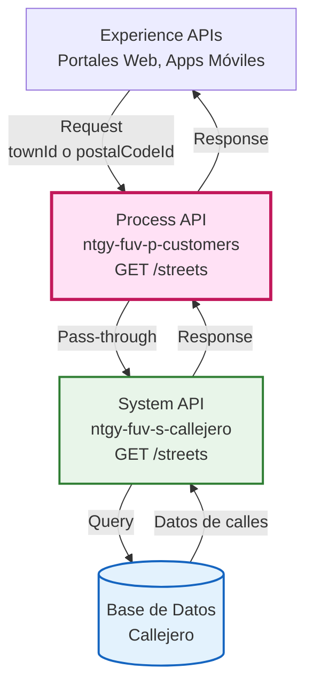
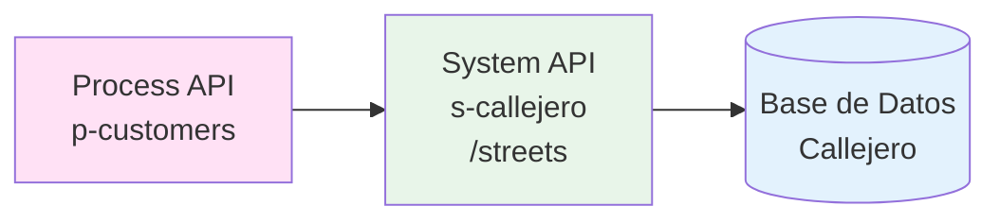
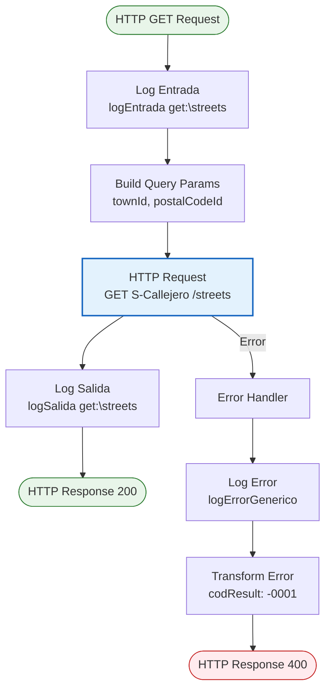
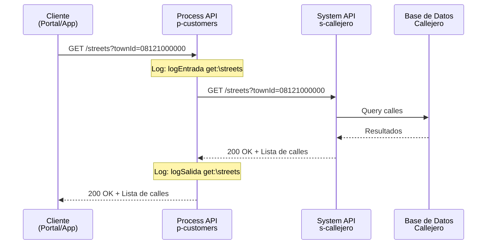
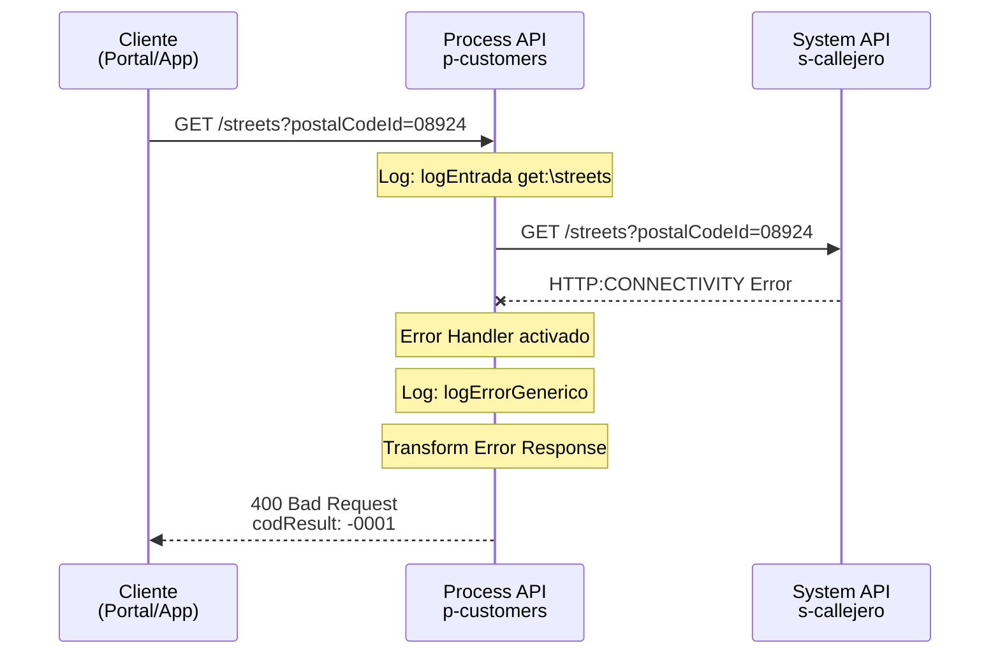
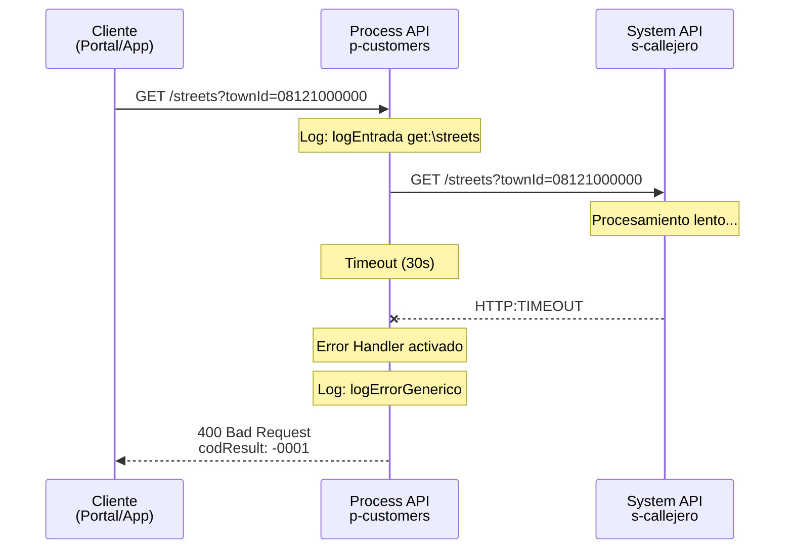

# GET /streets

## 📌 Descripción General

### Propósito del Endpoint

Este endpoint proporciona un servicio de consulta de calles que permite obtener un listado filtrado por ID de municipio o código postal. Actúa como capa de orquestación que delega la consulta al System API de Callejero, facilitando el acceso a datos geográficos detallados para formularios de direcciones completas y validaciones de ubicación.

### Tipo de API

**Capa:** Process API (API-Led Connectivity)

**Función:** Orquestación de consulta de datos geográficos - Calles

### Patrón de Integración

**Tipo:** Pass-Through con Orquestación Simple

**Descripción:** El Process API recibe la petición, valida los parámetros de entrada y los reenvía directamente al System API S-Callejero sin transformación de datos. La respuesta del System API se devuelve tal cual al consumidor.

### Arquitectura API-Led Connectivity



---

## 💼 Propósito del Negocio

### Casos de Uso Principales

1. **Formularios de Direcciones Completas en Portales Web**
   - Los usuarios seleccionan provincia, municipalidad, municipio y finalmente la calle específica
   - Facilita la captura precisa y completa de direcciones en procesos de alta de clientes
   - Mejora la experiencia de usuario con listas desplegables dinámicas y autocompletado

2. **Validación de Direcciones Completas en Aplicaciones Móviles**
   - Las apps móviles validan que la calle ingresada existe y corresponde al municipio/código postal
   - Previene errores en la captura de datos de ubicación completos
   - Asegura consistencia en la información geográfica detallada

3. **Autocompletado Inteligente de Direcciones**
   - Sistemas de autocompletado utilizan este servicio para sugerir calles válidas mientras el usuario escribe
   - Reduce significativamente el tiempo de captura de datos
   - Minimiza errores tipográficos en nombres de calles
   - Proporciona información adicional como tipo de vía (Calle, Plaza, Avenida, etc.)

### 🔗 Endpoints Dependientes

Este Process API consume el siguiente System API:

| System API | Endpoint | Método | Propósito |
|------------|----------|--------|-----------|
| `ntgy-fuv-s-callejero` | `/streets` | GET | Consulta de calles desde base de datos de callejero |

### Lógica de Orquestación



**Pasos del Proceso:**

1. **Recepción de Request**: Process API recibe petición con `townId` o `postalCodeId`
2. **Validación de Parámetros**: Verifica que al menos uno de los parámetros opcionales esté presente
3. **Delegación a System API**: Reenvía los query parameters al System API S-Callejero
4. **Respuesta Directa**: Devuelve la respuesta del System API sin transformación

### Transformaciones Aplicadas

⚠️ **Este Process API NO transforma la respuesta del System API.**

Los query parameters se pasan directamente mediante mapeo 1:1:
- `townId` → `townId`
- `postalCodeId` → `postalCodeId`

Para el schema completo de la respuesta, consultar:
📖 **System API: `ntgy-fuv-s-callejero` endpoint `/streets`**

### Contexto Empresarial

- **Dominio:** Gestión de Datos Geográficos
- **Sector:** Energía - Utilities
- **División:** Naturgy España - FUV (Fuerza de Ventas)
- **Proceso de Negocio:** Captura y validación de direcciones completas de clientes

### Stakeholders

- **Desarrolladores de Portales Web**: Necesitan datos de calles para formularios de direcciones completas
- **Equipos de Aplicaciones Móviles**: Requieren validación de direcciones detalladas en apps
- **Agentes de Call Center**: Utilizan sistemas que consultan calles para registrar direcciones exactas
- **Usuarios Finales**: Clientes que ingresan sus direcciones completas en portales de autoservicio

### Valor de Negocio

- **Calidad de Datos**: Asegura que las direcciones capturadas sean válidas, completas y consistentes
- **Experiencia de Usuario**: Facilita la captura de direcciones con autocompletado inteligente
- **Eficiencia Operativa**: Reduce errores en direcciones que requieren corrección posterior
- **Cumplimiento Normativo**: Mantiene datos de ubicación precisos para cumplimiento regulatorio
- **Reducción de Costos**: Minimiza visitas fallidas por direcciones incorrectas

### Consumidores Potenciales

Este endpoint puede ser consumido por:
- Portales web de autoservicio (alta de clientes, cambio de dirección)
- Aplicaciones móviles de Naturgy
- Sistemas de agentes de call center
- Herramientas internas de validación de datos
- Sistemas de logística y distribución
- Integraciones con sistemas de terceros autorizados

---

## 🔧 Especificación Técnica

### URLs por Ambiente

| Ambiente | URL Base | URL Completa |
|----------|----------|--------------|
| **Local** | `http://localhost:8081` | `http://localhost:8081/api/streets` |
| **Development** | `https://ntgy-fuv-p-customers-dev.us-e2.cloudhub.io` | `https://ntgy-fuv-p-customers-dev.us-e2.cloudhub.io/api/streets` |
| **UAT** | `https://ntgy-fuv-p-customers-uat.us-e2.cloudhub.io` | `https://ntgy-fuv-p-customers-uat.us-e2.cloudhub.io/api/streets` |
| **Production** | `https://ntgy-fuv-p-customers-pro.us-e2.cloudhub.io` | `https://ntgy-fuv-p-customers-pro.us-e2.cloudhub.io/api/streets` |

### Método HTTP

```
GET /api/streets
```

### Parámetros de Entrada

#### Query Parameters

| Parámetro | Tipo | Requerido | Descripción | Ejemplo |
|-----------|------|-----------|-------------|---------|
| `townId` | string | No* | Identificador del municipio para filtrar calles | `08121000000` |
| `postalCodeId` | string | No* | Código postal para filtrar calles | `08924` |

**Nota:** Al menos uno de los dos parámetros debe ser proporcionado.

#### Headers

| Header | Tipo | Requerido | Descripción |
|--------|------|-----------|-------------|
| `Content-Type` | string | Sí | Debe ser `application/json` |

**⚠️ Autenticación:** Este es un servicio **NO protegido** - no requiere autenticación.

### Respuestas

#### 200 OK - Consulta Exitosa

**Descripción:** Listado de calles obtenido correctamente.

**Estructura de Respuesta:**

```json
{
  "items": [
    {
      "streetId": "string",
      "streetDescription": "string",
      "streetTypeId": "string",
      "streetTypeName": "string",
      "postalCodeId": "string"
    }
  ]
}
```

**Campos de Respuesta:**

| Campo | Tipo | Descripción |
|-------|------|-------------|
| `items` | array | Array de objetos con información de calles |
| `items[].streetId` | string | Identificador único de la calle |
| `items[].streetDescription` | string | Nombre descriptivo de la calle |
| `items[].streetTypeId` | string | Identificador del tipo de vía (C=Calle, AV=Avenida, PZ=Plaza, etc.) |
| `items[].streetTypeName` | string | Nombre completo del tipo de vía (CALLE, AVENIDA, PLAZA, etc.) |
| `items[].postalCodeId` | string | Código postal asociado a la calle |

#### 400 Bad Request - Error en Parámetros

**Descripción:** Parámetros de entrada inválidos o faltantes.

```json
{
  "result": {
    "codResult": "-0001",
    "msgResult": "Error técnico"
  }
}
```

#### 500 Internal Server Error - Error del Sistema

**Descripción:** Error interno del servidor o del System API.

```json
{
  "result": {
    "codResult": "-0001",
    "msgResult": "Error técnico"
  }
}
```

### Códigos de Estado HTTP

| Código | Descripción | Escenario |
|--------|-------------|-----------|
| `200` | OK | Consulta exitosa, calles encontradas |
| `400` | Bad Request | Parámetros inválidos o faltantes |
| `500` | Internal Server Error | Error en System API o error técnico |
| `503` | Service Unavailable | System API no disponible |

### Timeouts

| Tipo | Valor |
|------|-------|
| **Request Timeout** | 30 segundos |
| **Connection Timeout** | 10 segundos |

---

## 🏗️ Implementación Técnica

### Arquitectura del Flow



### Código de Implementación

**Flow Principal:** `p-customers-streetsFlow`

**Ubicación:** `src/main/mule/implementation/p-customers-streetsFlow.xml`

**Componentes Clave:**

1. **Logger de Entrada** (línea 8):
   ```xml
   <logger level="INFO" doc:name="logEntrada" 
           message="logEntrada get:\streets"/>
   ```

2. **HTTP Request a System API** (línea 9-17):
   ```xml
   <http:request method="GET" doc:name="Request" 
                 path="${s-callejero.path.streets}" 
                 config-ref="S-Callejero_HTTP_Request_configuration">
       <http:query-params><![CDATA[#[output application/java
       ---
       {
           postalCodeId : attributes.queryParams["postalCodeId"],
           townId : attributes.queryParams["townId"]
       }]]]></http:query-params>
   </http:request>
   ```

3. **Logger de Salida** (línea 18):
   ```xml
   <logger level="INFO" doc:name="logSalida" 
           message="logSalida get:\streets"/>
   ```

### Transformaciones DataWeave

**Transformación de Query Parameters:**

```dataweave
%dw 2.0
output application/java
---
{
    postalCodeId : attributes.queryParams["postalCodeId"],
    townId : attributes.queryParams["townId"]
}
```

**Descripción:** Extrae los query parameters del request HTTP y los mapea 1:1 para el System API.

### Configuración HTTP

**Config Reference:** `S-Callejero_HTTP_Request_configuration`

**Path Dinámico:** `${s-callejero.path.streets}`

**Valor del Path:** `/streets` (configurado en properties)

### Patrones de Diseño

**Patrón:** Pass-Through con Logging

**Justificación:** 
- Los datos geográficos no requieren transformación
- El System API ya proporciona el formato correcto con información detallada
- Se mantiene trazabilidad con logs de entrada/salida
- Minimiza latencia al evitar transformaciones innecesarias

### Diagramas de Secuencia

#### 1. Flujo Normal de Éxito



#### 2. Flujo con Error de Conectividad



#### 3. Flujo con Timeout



### Manejo de Errores

**Error Handler Global** (líneas 19-36):

**Tipos de Errores Capturados:**
- `HTTP:BAD_GATEWAY`
- `HTTP:BAD_REQUEST`
- `HTTP:CLIENT_SECURITY`
- `HTTP:CONNECTIVITY`
- `HTTP:FORBIDDEN`
- `HTTP:INTERNAL_SERVER_ERROR`
- `HTTP:METHOD_NOT_ALLOWED`
- `HTTP:NOT_ACCEPTABLE`
- `HTTP:NOT_FOUND`
- `HTTP:PARSING`
- `HTTP:RETRY_EXHAUSTED`
- `HTTP:SECURITY`
- `HTTP:SERVICE_UNAVAILABLE`
- `HTTP:TIMEOUT`
- `HTTP:TOO_MANY_REQUESTS`
- `HTTP:UNAUTHORIZED`
- `HTTP:UNSUPPORTED_MEDIA_TYPE`
- `EXPRESSION`
- `STREAM_MAXIMUM_SIZE_EXCEEDED`

**Estrategia de Manejo:**

1. **Logging del Error:**
   ```xml
   <logger level="ERROR" doc:name="logErrorGenerico" 
           message="#['logErrorGenerico get:\streets Error Description: ' ++ 
                     (error.description default 'null' as String) ++ 
                     'Error Response: ' ++ 
                     if (!isEmpty(error.errorMessage.payload)) 
                       (write(error.errorMessage.payload, 'application/json') as String) 
                     else 'null']" />
   ```

2. **Transformación de Error Estándar:**
   ```dataweave
   %dw 2.0
   output application/json
   ---
   {
       "result": {
           "codResult": "-0001",
           "msgResult": "Error técnico"
       }
   }
   ```

3. **HTTP Status Code:** 400 (Bad Request)

**Política de Reintentos:** No implementada (delegada al System API)

---

## 💻 Ejemplos de Uso

### Ejemplo 1: Consulta por Town ID

#### cURL

```bash
curl -X GET "https://ntgy-fuv-p-customers-dev.us-e2.cloudhub.io/api/streets?townId=08121000000" \
  -H "Content-Type: application/json"
```

#### Respuesta (200 OK)

```json
{
  "items": [
    {
      "streetId": "1016859",
      "streetDescription": "MALAVA",
      "streetTypeId": "C",
      "streetTypeName": "CALLE",
      "postalCodeId": "06430"
    },
    {
      "streetId": "1058443",
      "streetDescription": "CANCHO ROANO",
      "streetTypeId": "C",
      "streetTypeName": "CALLE",
      "postalCodeId": "06430"
    }
  ]
}
```

### Ejemplo 2: Consulta por Código Postal

#### cURL

```bash
curl -X GET "https://ntgy-fuv-p-customers-dev.us-e2.cloudhub.io/api/streets?postalCodeId=08924" \
  -H "Content-Type: application/json"
```

#### Respuesta (200 OK)

```json
{
  "items": [
    {
      "streetId": "1016859",
      "streetDescription": "MALAVA",
      "streetTypeId": "C",
      "streetTypeName": "CALLE",
      "postalCodeId": "08924"
    },
    {
      "streetId": "1058443",
      "streetDescription": "CANCHO ROANO",
      "streetTypeId": "C",
      "streetTypeName": "CALLE",
      "postalCodeId": "08924"
    }
  ]
}
```

### Ejemplo 3: JavaScript (Fetch API)

```javascript
// Consulta por town ID
const getStreetsByTown = async (townId) => {
  try {
    const response = await fetch(
      `https://ntgy-fuv-p-customers-dev.us-e2.cloudhub.io/api/streets?townId=${townId}`,
      {
        method: 'GET',
        headers: {
          'Content-Type': 'application/json'
        }
      }
    );
    
    if (!response.ok) {
      throw new Error(`HTTP error! status: ${response.status}`);
    }
    
    const data = await response.json();
    console.log('Streets:', data.items);
    
    // Procesar calles con información detallada
    data.items.forEach(street => {
      console.log(`${street.streetTypeName} ${street.streetDescription} (${street.postalCodeId})`);
    });
    
    return data.items;
  } catch (error) {
    console.error('Error fetching streets:', error);
    throw error;
  }
};

// Uso
getStreetsByTown('08121000000');
```

### Ejemplo 4: Python (Requests)

```python
import requests

def get_streets_by_postal_code(postal_code_id):
    """
    Obtiene calles por código postal
    
    Args:
        postal_code_id (str): Código postal
        
    Returns:
        list: Lista de calles con información detallada
    """
    url = "https://ntgy-fuv-p-customers-dev.us-e2.cloudhub.io/api/streets"
    
    params = {
        'postalCodeId': postal_code_id
    }
    
    headers = {
        'Content-Type': 'application/json'
    }
    
    try:
        response = requests.get(url, params=params, headers=headers, timeout=30)
        response.raise_for_status()
        
        data = response.json()
        streets = data.get('items', [])
        
        # Procesar y mostrar información detallada
        for street in streets:
            print(f"ID: {street['streetId']}")
            print(f"Dirección: {street['streetTypeName']} {street['streetDescription']}")
            print(f"CP: {street['postalCodeId']}")
            print("---")
        
        return streets
        
    except requests.exceptions.RequestException as e:
        print(f"Error al consultar calles: {e}")
        raise

# Uso
streets = get_streets_by_postal_code('08924')
print(f"Total de calles encontradas: {len(streets)}")
```

### Ejemplo 5: Error - Parámetros Faltantes

#### cURL

```bash
curl -X GET "https://ntgy-fuv-p-customers-dev.us-e2.cloudhub.io/api/streets" \
  -H "Content-Type: application/json"
```

#### Respuesta (400 Bad Request)

```json
{
  "result": {
    "codResult": "-0001",
    "msgResult": "Error técnico"
  }
}
```

### Ejemplo 6: Error - System API No Disponible

#### cURL

```bash
curl -X GET "https://ntgy-fuv-p-customers-dev.us-e2.cloudhub.io/api/streets?townId=08121000000" \
  -H "Content-Type: application/json"
```

#### Respuesta (400 Bad Request)

```json
{
  "result": {
    "codResult": "-0001",
    "msgResult": "Error técnico"
  }
}
```

**Nota:** En caso de error de conectividad con el System API, el Process API devuelve un error genérico para no exponer detalles internos de la arquitectura.

---

## 📊 Información Adicional

### Tipos de Vía Comunes

El campo `streetTypeId` puede contener los siguientes valores comunes:

| Código | Nombre Completo | Descripción |
|--------|-----------------|-------------|
| `C` | CALLE | Vía urbana estándar |
| `AV` | AVENIDA | Vía principal amplia |
| `PZ` | PLAZA | Espacio público abierto |
| `PS` | PASEO | Vía para peatones |
| `CM` | CAMINO | Vía rural o secundaria |
| `CR` | CARRETERA | Vía interurbana |
| `TR` | TRAVESIA | Vía que cruza otra |
| `CL` | CALLEJA | Calle estrecha |

### Casos de Uso Avanzados

**Autocompletado Inteligente:**
```javascript
// Implementación de autocompletado con debounce
let debounceTimer;
const searchStreets = (townId, searchTerm) => {
  clearTimeout(debounceTimer);
  debounceTimer = setTimeout(async () => {
    const streets = await getStreetsByTown(townId);
    const filtered = streets.filter(street => 
      street.streetDescription.toLowerCase().includes(searchTerm.toLowerCase())
    );
    displaySuggestions(filtered);
  }, 300);
};
```

**Validación de Dirección Completa:**
```python
def validate_complete_address(town_id, street_description):
    """Valida que una dirección completa existe"""
    streets = get_streets_by_town(town_id)
    return any(
        street['streetDescription'].upper() == street_description.upper()
        for street in streets
    )