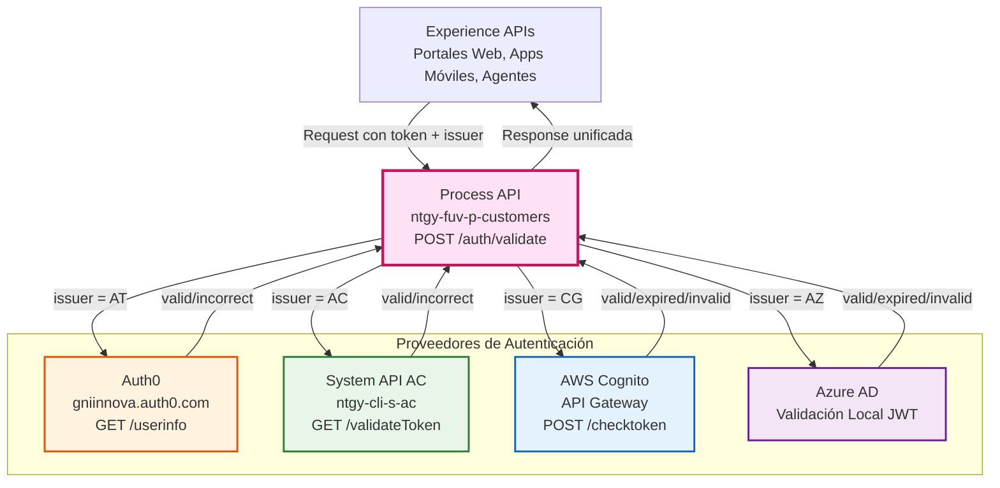
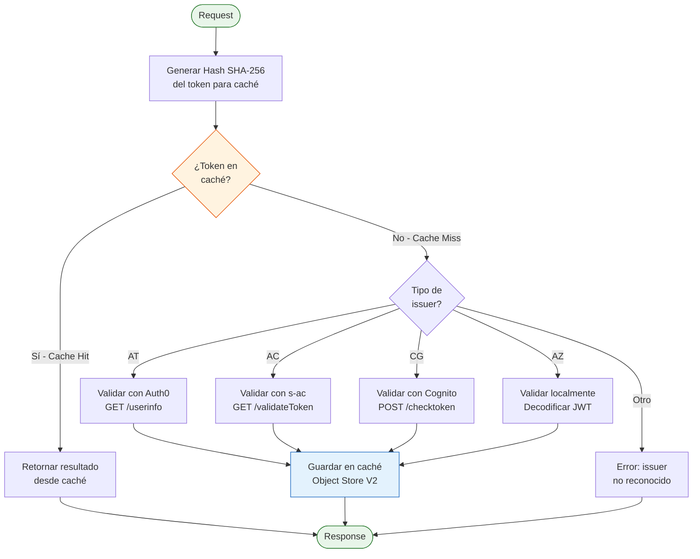
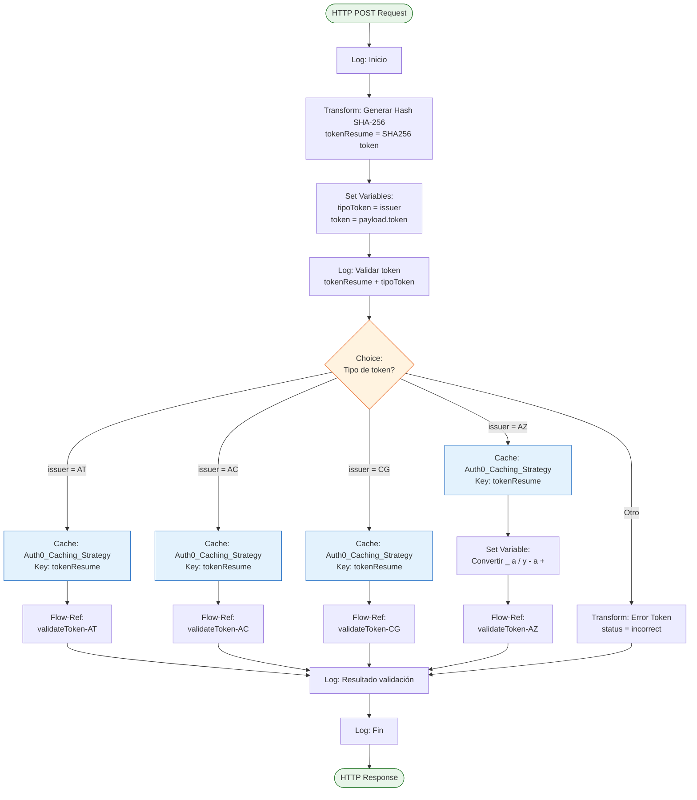
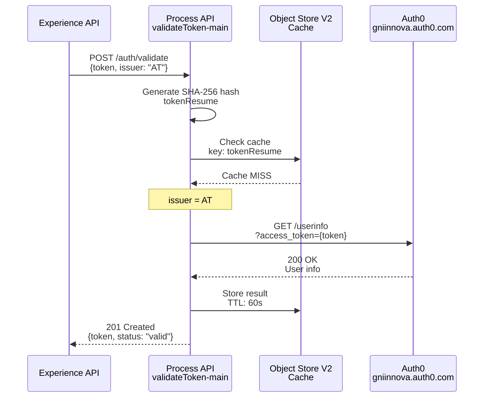
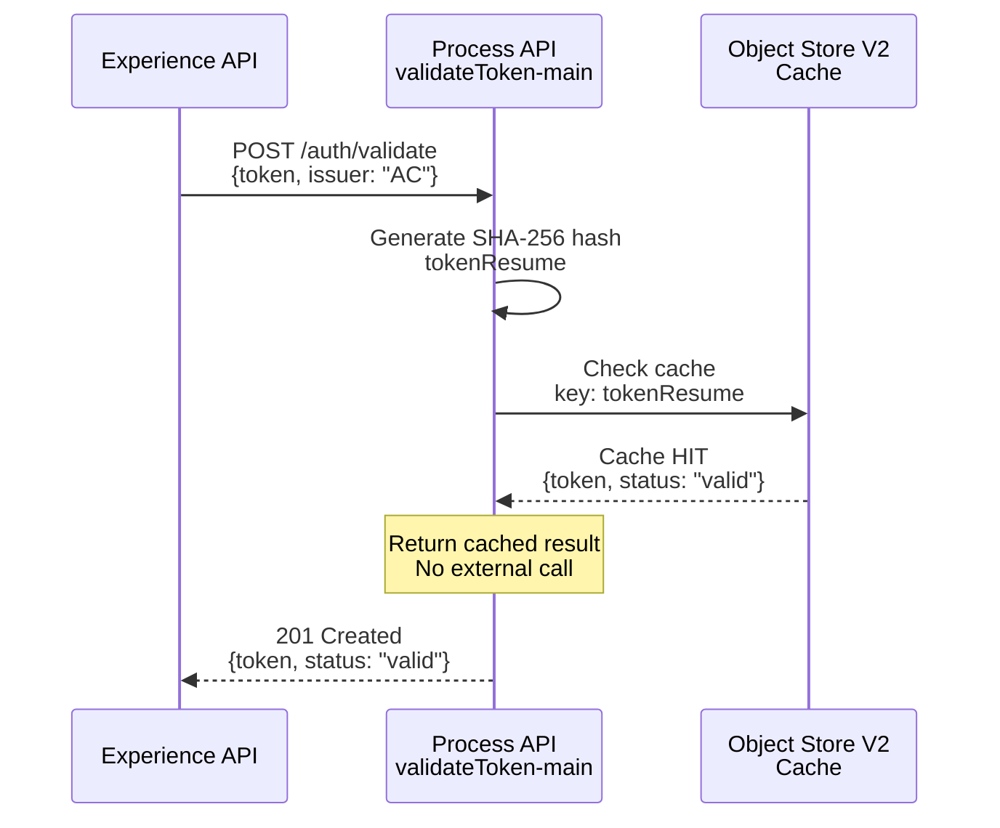
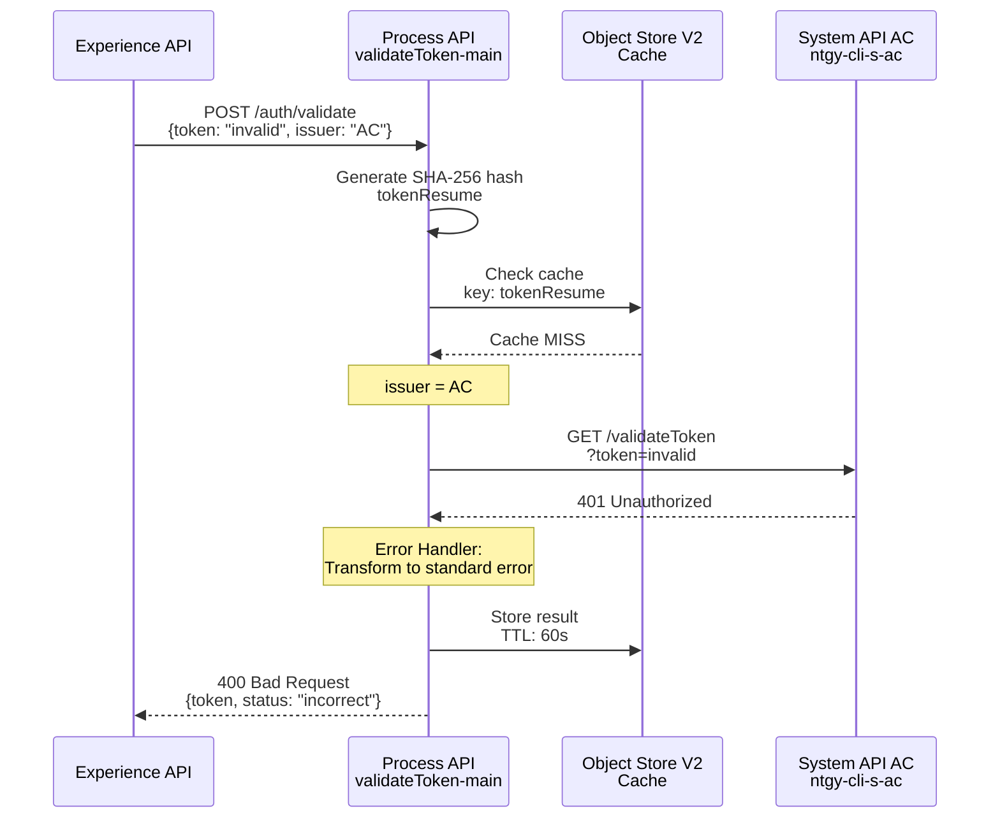

# POST /auth/validate

## 📌 Descripción General

### Propósito del Endpoint

Servicio de validación centralizada de tokens de autenticación que soporta múltiples proveedores de identidad. Este endpoint orquesta la validación de tokens según su origen (issuer), proporcionando una interfaz unificada para verificar la autenticidad y vigencia de tokens de diferentes sistemas de autenticación.

### Tipo de API

**Capa:** Process API (API-Led Connectivity)

**Función:** Orquestación de validación multi-proveedor con caché distribuida

### Patrón de Integración

**Tipo:** Orquestación Condicional con Caché

**Descripción:** Implementa un patrón de routing condicional basado en el tipo de token (issuer), donde cada tipo de token se valida contra su proveedor correspondiente. Incluye una estrategia de caché distribuida usando Object Store V2 para optimizar validaciones repetidas.

### Arquitectura API-Led Connectivity



---

## 💼 Propósito del Negocio

### Casos de Uso Principales

1. **Validación de Tokens de Portal Web (Auth0)**
   - Usuarios que acceden a través del portal web de autoservicio
   - Tokens generados por Auth0 (issuer: AT)
   - Validación mediante consulta a Auth0 UserInfo API

2. **Validación de Tokens de Area de Cliente (AC)**
   - Usuarios del sistema legacy Area de Cliente
   - Tokens generados por el sistema AC interno
   - Validación mediante System API ntgy-cli-s-ac

3. **Validación de Tokens de AWS Cognito (CG)**
   - Usuarios autenticados mediante AWS Cognito
   - Tokens JWT de Cognito
   - Validación mediante API Gateway de AWS

4. **Validación de Tokens de Azure AD (AZ)**
   - Usuarios corporativos autenticados con Azure AD
   - Tokens JWT de Azure Active Directory
   - Validación local mediante decodificación y verificación de claims

### 🔗 Endpoints Dependientes

Este Process API consume los siguientes servicios de autenticación:

| Servicio | Endpoint | Método | Propósito |
|----------|----------|--------|-----------|
| `gniinnova.auth0.com` | `/userinfo` | GET | Validación de tokens Auth0 (AT) |
| `ntgy-cli-s-ac` | `/validateToken` | GET | Validación de tokens Area Cliente (AC) |
| `cognito-api-gateway` | `/NaturgyCognitoAPI_stage/checktoken` | POST | Validación de tokens AWS Cognito (CG) |

**Nota:** Azure AD (AZ) no requiere llamada externa, se valida localmente.

### Lógica de Orquestación



**Pasos del Proceso:**

1. **Recepción y Hash**: Recibe token + issuer, genera hash SHA-256 para key de caché
2. **Verificación de Caché**: Consulta Object Store V2 por token previamente validado
3. **Routing Condicional**: Si no está en caché, enruta según issuer (AT/AC/CG/AZ)
4. **Validación Específica**: Cada tipo de token se valida con su proveedor
5. **Almacenamiento en Caché**: Resultado se guarda en Object Store V2
6. **Respuesta Unificada**: Retorna formato estándar independiente del proveedor

### Transformaciones Aplicadas

**Transformación de Entrada:**

| Campo Request | Transformación | Propósito |
|---------------|----------------|-----------|
| `token` | Hash SHA-256 → `tokenResume` | Key para caché distribuida |
| `issuer` | Validación enum → `tipoToken` | Routing condicional |
| `token` | Almacenamiento → `vars.token` | Disponible en todos los sub-flows |

**Transformación de Salida:**

⚠️ **Este endpoint NO transforma la estructura de respuesta**, retorna formato estándar:

```json
{
  "token": "string",
  "status": "valid|incorrect|expired|invalid"
}
```

### Contexto Empresarial

- **Dominio:** Seguridad y Autenticación
- **Sector:** Energía - Utilities
- **División:** Naturgy España - Clientes FUV
- **Proceso de Negocio:** Validación centralizada de identidad multi-canal

### Stakeholders

- **Desarrolladores de Experience APIs**: Necesitan validar tokens de usuarios sin conocer detalles de cada proveedor
- **Equipos de Seguridad**: Requieren auditoría centralizada de validaciones de tokens
- **Usuarios Finales**: Experimentan autenticación transparente independiente del canal de acceso

### Valor de Negocio

- **Centralización**: Un único endpoint para validar tokens de 4 proveedores diferentes
- **Performance**: Caché distribuida reduce latencia y carga en proveedores de autenticación
- **Flexibilidad**: Fácil adición de nuevos proveedores sin impactar consumidores
- **Auditoría**: Punto único de logging y monitoreo de validaciones

### Consumidores Potenciales

Este endpoint puede ser consumido por:
- Portales web de autoservicio (FUA Portal)
- Aplicaciones móviles (iOS, Android)
- Sistemas de agentes de call center
- APIs de terceros autorizados
- Servicios internos que requieren validación de tokens

---

## 🔧 Especificación Técnica

### URLs por Ambiente

| Ambiente | URL Base | URL Completa |
|----------|----------|--------------|
| **Local** | `http://localhost:8077` | `http://localhost:8077/api/auth/validate` |
| **Development** | `https://ntgy-fuv-p-customers-dev.us-e2.cloudhub.io` | `https://ntgy-fuv-p-customers-dev.us-e2.cloudhub.io/api/auth/validate` |
| **UAT** | `https://ntgy-fuv-p-customers-uat.us-e2.cloudhub.io` | `https://ntgy-fuv-p-customers-uat.us-e2.cloudhub.io/api/auth/validate` |
| **Production** | `https://ntgy-fuv-p-customers-pro.us-e2.cloudhub.io` | `https://ntgy-fuv-p-customers-pro.us-e2.cloudhub.io/api/auth/validate` |

### Método HTTP

```
POST /api/auth/validate
```

### Request Body

```json
{
  "token": "string",
  "issuer": "string"
}
```

| Campo | Tipo | Requerido | Valores Válidos |
|-------|------|-----------|-----------------|
| `token` | string | ✅ Sí | JWT o token opaco |
| `issuer` | string | ✅ Sí | `AT`, `AC`, `CG`, `AZ` |

### Respuestas

#### 201 Created - Token Válido

```json
{
  "token": "token_example",
  "status": "valid"
}
```

#### 400 Bad Request - Token Incorrecto

```json
{
  "token": "invalid_token",
  "status": "incorrect"
}
```

#### Estados Adicionales

- `"status": "expired"` - Token expirado (CG, AZ)
- `"status": "invalid"` - Error decodificando JWT (CG, AZ)

### Autenticación

- **Tipo:** Client ID & Client Secret (Anypoint Platform)
- **Headers requeridos:**
  - `client_id`: ID de la aplicación cliente
  - `client_secret`: Secret de la aplicación cliente

### Timeouts

| Tipo | Valor |
|------|-------|
| **Request Timeout** | 30 segundos |
| **Connection Timeout** | 10 segundos |
| **Cache TTL** | 60 segundos (configurable) |

### Caché

**Estrategia:** Object Store V2 con key basada en hash SHA-256 del token

| Configuración | Valor |
|---------------|-------|
| **Entry TTL** | 60 segundos |
| **Expiration Interval** | 10 segundos |
| **Key Generation** | SHA-256 hash del token |
| **Storage** | Object Store V2 (CloudHub) |

---

## 🏗️ Implementación Técnica

### Arquitectura del Flow



El endpoint implementa un patrón de Choice Router con caché:

1. **Recepción**: Genera hash SHA-256 del token para key de caché
2. **Verificación de Caché**: Consulta Object Store V2
3. **Routing Condicional**: Enruta según issuer (AT/AC/CG/AZ)
4. **Validación Específica**: Cada tipo se valida con su proveedor
5. **Almacenamiento**: Resultado se guarda en caché (TTL: 60s)
6. **Respuesta Unificada**: Formato estándar independiente del proveedor

### Sub-Flows por Proveedor

**validateToken-AT (Auth0):**
- HTTP GET a `gniinnova.auth0.com/userinfo`
- Query param: `access_token`
- Respuesta: `{token, status: "valid"}` o `"incorrect"`

**validateToken-AC (Area Cliente):**
- HTTP GET a `ntgy-cli-s-ac/validateToken`
- Query param: `token`
- Respuesta: `{token, status: "valid"}` o `"incorrect"`

**validateToken-CG (AWS Cognito):**
- Decodifica JWT (Base64)
- HTTP POST a API Gateway `/checktoken`
- Body: `{AccessToken, UserPoolId, Username}`
- Respuesta: `"valid"`, `"expired"` o `"invalid"`

**validateToken-AZ (Azure AD):**
- Validación local (sin llamada externa)
- Decodifica JWT y valida claims: `appid`, `tid`, `exp`
- Respuesta: `"valid"`, `"expired"` o `"invalid"`

### Transformaciones DataWeave

**1. Hash SHA-256 para Caché:**

**Propósito:** Generar key única para caché basada en el token, evitando almacenar tokens completos.

```dataweave
%dw 2.0
import dw::Crypto
import * from dw::core::Binaries

var token = payload.token as String default ""

output application/java
---
toHex(Crypto::hashWith(token as Binary, "SHA-256"))
```

**2. Decodificación JWT:**

**Propósito:** Decodificar JWT para validación local de claims y expiración.

```dataweave
%dw 2.0
import fromBase64 from dw::core::Binaries

var token = vars.token as String default "x.x.x"
var splitPayload = (token splitBy ".")

var header = read(fromBase64(splitPayload[0]),"application/json") as Object
var body = read(fromBase64(splitPayload[1]),"application/json") as Object

output application/java
---
{
    token: token,
    header: header,
    body: body,
    username: body.username,
    expired: body.exp as Number < (now() as Number)
}
```

**3. Validación de Claims Azure AD:**

**Propósito:** Validar que el token de Azure AD pertenece a la aplicación correcta y no ha expirado.

```dataweave
%dw 2.0
output application/java
---
{
    token: token,
    header: header,
    body: body,
    username: body.unique_name,
    exp: body.exp as Number,
    expired: body.exp as Number < (now() as Number),
    appid: body.appid,
    appid_valid: body.appid == p('AzureAD.client_id'),
    tid: body.tid,
    tid_valid: body.tid == p('AzureAD.tenant_id'),
    valid_token: (
        body.tid == p('AzureAD.tenant_id') and 
        body.appid == p('AzureAD.client_id') and 
        body.exp as Number > (now() as Number)
    )
}
```

### Patrones de Diseño

**Patrón 1: Choice Router (Content-Based Routing)**

**Justificación:** Permite enrutar la validación al proveedor correcto basándose en el campo `issuer`, manteniendo una interfaz unificada para los consumidores.

**Patrón 2: Cache-Aside**

**Justificación:** Reduce latencia y carga en proveedores de autenticación al cachear resultados de validaciones recientes. El hash SHA-256 garantiza privacidad del token en caché.

**Patrón 3: Try-Catch con Error Handler**

**Justificación:** Cada sub-flow maneja sus propios errores específicos, transformándolos en respuestas estándar para mantener consistencia.

### Diagramas de Secuencia

#### 1. Flujo Normal de Éxito (Auth0 - AT)



#### 2. Flujo con Cache Hit



#### 3. Flujo con Error de Validación (Token Inválido)



### Manejo de Errores

#### Estrategia por Tipo de Token

**Auth0 (AT):**
- **Errores capturados:** `HTTP:INTERNAL_SERVER_ERROR`, `HTTP:UNAUTHORIZED`, `EXPRESSION`
- **Respuesta:** `{token, status: "incorrect"}`
- **Logging:** "Token no Valido"

**Area Cliente (AC):**
- **Errores capturados:** `HTTP:BAD_REQUEST`, `HTTP:INTERNAL_SERVER_ERROR`, `HTTP:UNAUTHORIZED`, `EXPRESSION`
- **Respuesta:** `{token, status: "incorrect"}`
- **Logging:** "Token no Valido"

**AWS Cognito (CG):**
- **Errores capturados:** `EXPRESSION` (error de decodificación)
- **Respuesta:** `{token, status: "invalid"}`
- **Logging:** "Error decodificando el token"

**Azure AD (AZ):**
- **Errores capturados:** `EXPRESSION` (error de decodificación)
- **Respuesta:** `{token, status: "invalid"}`
- **Logging:** "Error decodificando el token"

#### Tabla de Códigos de Error

| Código HTTP | Status | Causa | Acción |
|-------------|--------|-------|--------|
| 201 | `valid` | Token válido y vigente | Permitir acceso |
| 400 | `incorrect` | Token malformado o no válido | Rechazar, solicitar re-autenticación |
| 400 | `expired` | Token expirado (CG, AZ) | Rechazar, solicitar refresh token |
| 400 | `invalid` | Error decodificando JWT (CG, AZ) | Rechazar, verificar formato |
| 500 | Error | Servicio de validación no disponible | Reintentar o usar fallback |

---

## 💻 Ejemplos de Uso

### Ejemplo 1: Validación Auth0 (AT) - Exitosa

```bash
curl -X POST "https://ntgy-fuv-p-customers-dev.us-e2.cloudhub.io/api/auth/validate" \
  -H "Content-Type: application/json" \
  -H "client_id: YOUR_CLIENT_ID" \
  -H "client_secret: YOUR_CLIENT_SECRET" \
  -d '{
    "token": "auth0_token_abc123",
    "issuer": "AT"
  }'
```

**Response (201):**
```json
{
  "token": "auth0_token_abc123",
  "status": "valid"
}
```

---

### Ejemplo 2: Validación Area Cliente (AC) - Exitosa

```bash
curl -X POST "https://ntgy-fuv-p-customers-dev.us-e2.cloudhub.io/api/auth/validate" \
  -H "Content-Type: application/json" \
  -H "client_id: YOUR_CLIENT_ID" \
  -H "client_secret: YOUR_CLIENT_SECRET" \
  -d '{
    "token": "ac_token_xyz789",
    "issuer": "AC"
  }'
```

**Response (201):**
```json
{
  "token": "ac_token_xyz789",
  "status": "valid"
}
```

---

### Ejemplo 3: Validación AWS Cognito (CG) - Token Expirado

```bash
curl -X POST "https://ntgy-fuv-p-customers-dev.us-e2.cloudhub.io/api/auth/validate" \
  -H "Content-Type: application/json" \
  -H "client_id: YOUR_CLIENT_ID" \
  -H "client_secret: YOUR_CLIENT_SECRET" \
  -d '{
    "token": "cognito_token_expired_456",
    "issuer": "CG"
  }'
```

**Response (400):**
```json
{
  "token": "invalid_malformed_token",
  "status": "incorrect"
}
```

---

### Ejemplo 6: JavaScript - Validación con Fetch API

```javascript
async function validateToken(token, issuer) {
  try {
    const response = await fetch(
      'https://ntgy-fuv-p-customers-dev.us-e2.cloudhub.io/api/auth/validate',
      {
        method: 'POST',
        headers: {
          'Content-Type': 'application/json',
          'client_id': 'YOUR_CLIENT_ID',
          'client_secret': 'YOUR_CLIENT_SECRET'
        },
        body: JSON.stringify({ token, issuer })
      }
    );
    
    const data = await response.json();
    return data;
  } catch (error) {
    console.error('Error validando token:', error);
    throw error;
  }
}

// Uso
validateToken('auth0_token_abc123', 'AT')
  .then(result => console.log('Token válido:', result))
  .catch(error => console.error('Error:', error));
```
