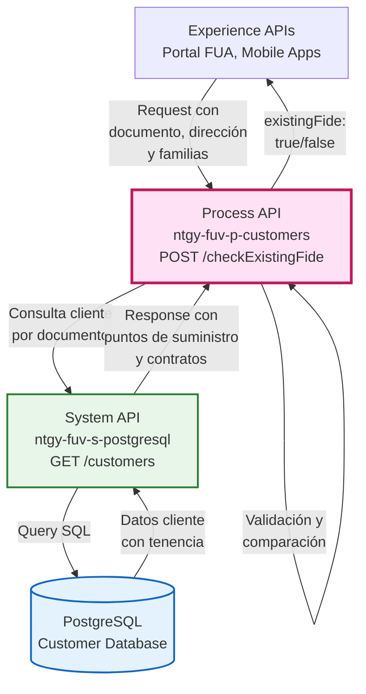
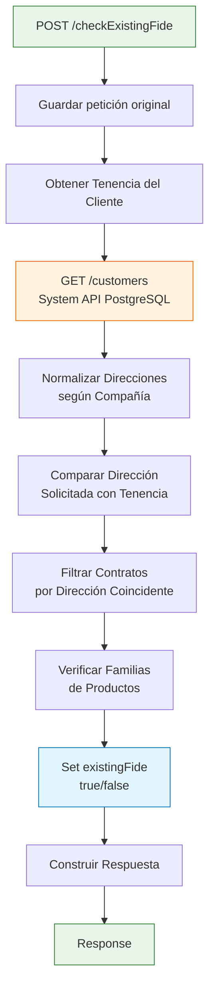
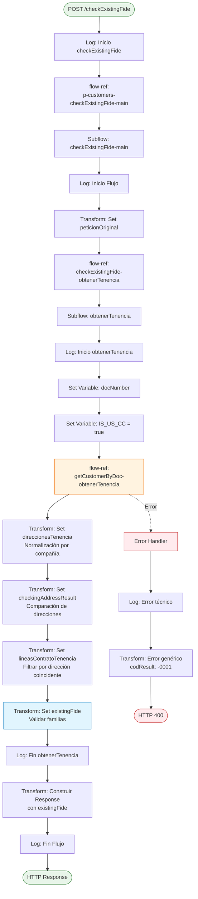
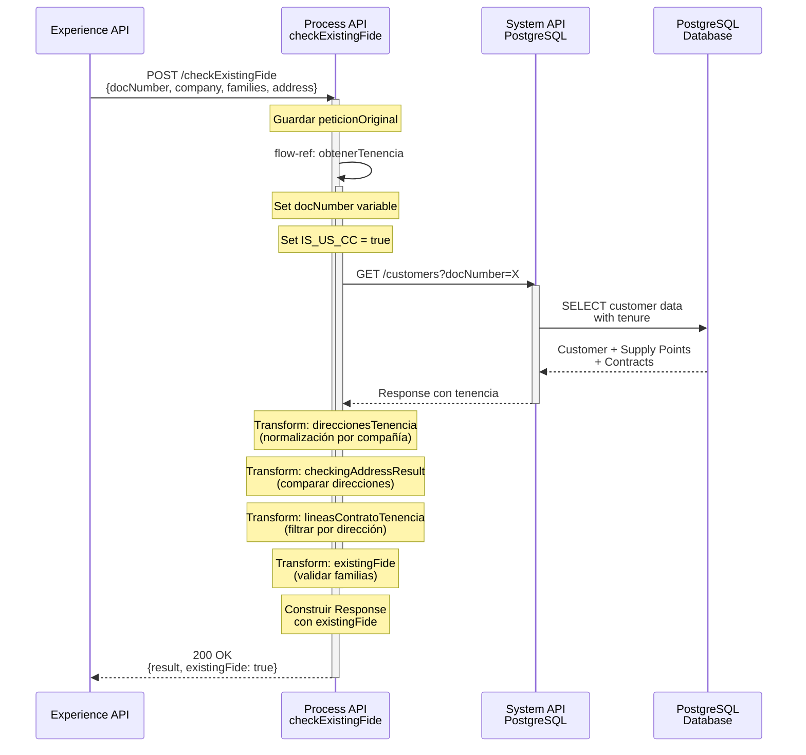
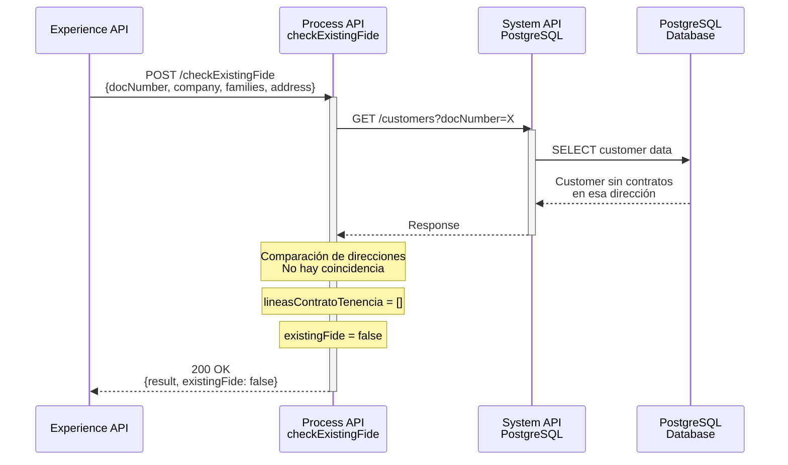
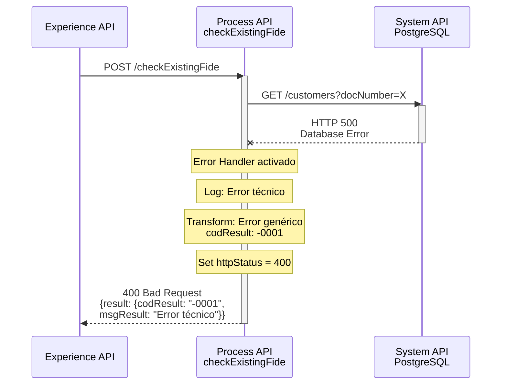

# POST /checkExistingFide

## 📌 Descripción General

### Propósito del Endpoint

Este endpoint verifica si un cliente tiene tenencia activa (contratos existentes) en una dirección específica para las familias de productos solicitadas. Es utilizado principalmente para validar si existe un cambio de servicio pendiente o si el cliente ya tiene contratos activos en la dirección proporcionada.

### Tipo de API

**Capa:** Process API (API-Led Connectivity)

**Función:** Orquestación de validación de tenencia y contratos del cliente

### Patrón de Integración

**Tipo:** Orquestación con Transformación

**Descripción:** El endpoint orquesta la obtención de datos del cliente desde el System API de PostgreSQL, realiza comparaciones complejas de direcciones (con normalización diferenciada por compañía), filtra contratos por dirección coincidente y valida la existencia de contratos para las familias de productos solicitadas.

### Arquitectura API-Led Connectivity



---

## 💼 Propósito del Negocio

### Casos de Uso Principales

1. **Validación de Cambio de Servicio**
   - Verifica si el cliente ya tiene contratos activos en la dirección para las familias solicitadas
   - Previene duplicados de contratación en la misma dirección
   - Beneficio: Evita errores en el proceso de alta de servicios

2. **Verificación de Tenencia Antes de Alta**
   - Valida la tenencia del cliente antes de procesar una nueva contratación
   - Identifica si existe un cambio de servicio pendiente
   - Beneficio: Mejora la experiencia del cliente al detectar situaciones especiales

3. **Prevención de Duplicados**
   - Detecta si ya existe un contrato activo para las familias solicitadas en la dirección
   - Aplica lógica de negocio diferenciada por compañía (GNS vs NEWCO)
   - Beneficio: Mantiene la integridad de los datos de contratación

### 🔗 Endpoints Dependientes

Este Process API consume el siguiente System API:

| System API | Endpoint | Método | Propósito |
|------------|----------|--------|-----------|
| `ntgy-fuv-s-postgresql` | `/customers` | GET | Obtiene información completa del cliente incluyendo puntos de suministro, contratos y líneas de contrato para validar tenencia |

### Lógica de Orquestación



**Pasos del Proceso:**

1. **Guardar Petición Original**: Se almacena el payload completo en variable `peticionOriginal`
2. **Obtener Tenencia**: Se invoca el subflow `getCustomerByDoc-obtenerTenencia` que consulta el System API
3. **Normalizar Direcciones**: Se normalizan las direcciones de tenencia según la compañía:
   - **GNS (Imperial)**: Se aplica `trim` y `replace` de ceros iniciales en todos los campos
   - **NEWCO**: Se mantienen los valores sin normalización adicional
4. **Comparar Direcciones**: Se compara campo por campo la dirección solicitada con las direcciones de tenencia
5. **Filtrar Contratos**: Se extraen las líneas de contrato de la dirección que coincide
6. **Verificar Familias**: Se valida si hay contratos activos para las familias de productos solicitadas
7. **Construir Respuesta**: Se retorna `existingFide: true` si hay contratos, `false` en caso contrario

### Transformaciones Aplicadas

Este Process API aplica múltiples transformaciones DataWeave:

| Transformación | Propósito | Lógica Aplicada |
|----------------|-----------|-----------------|
| **Set peticionOriginal** | Preservar request original | Guarda payload completo en variable |
| **Set direccionesTenencia** | Normalizar direcciones | Aplica lógica diferenciada por compañía (GNS con trim/replace, NEWCO sin normalización) |
| **Set checkingAddressResult** | Comparar direcciones | Compara 9 campos de dirección (codigoPostal, provincia, municipio, via, numero, portal, escalera, piso, puerta) |
| **Set lineasContratoTenencia** | Filtrar contratos | Extrae líneas de contrato de la dirección coincidente |
| **Set existingFide** | Determinar resultado | Verifica si hay contratos para las familias solicitadas |

**Diferencias por Compañía:**

**GNS (Imperial):**
```dataweave
// Normalización con trim y replace de ceros iniciales
portal: trim(item.addressPortal replace /^0+/ with "")
numero: trim(item.addressNumber replace /^0+/ with "")
escalera: trim(item.addressStaircase replace /^0+/ with "")
piso: trim(item.addressFloor replace /^0+/ with "")
puerta: trim(item.addressDoor replace /^0+/ with "")
```

**NEWCO:**
```dataweave
// Sin normalización adicional
portal: item.addressPortal
numero: item.addressNumber
escalera: item.addressStaircase
piso: item.addressFloor
puerta: item.addressDoor
```

### Contexto Empresarial

- **Dominio:** Gestión de Clientes y Contratos
- **Sector:** Energía - Utilities
- **División:** Naturgy España - FUV (Fuerza de Ventas)
- **Proceso de Negocio:** Validación de tenencia para cambio de servicio y prevención de duplicados

### Stakeholders

- **Agentes de Ventas**: Necesitan validar si el cliente tiene contratos activos antes de procesar una nueva contratación
- **Sistemas de Alta de Servicios**: Requieren verificar la tenencia para determinar el flujo correcto (alta nueva vs cambio de servicio)
- **Portales de Autoservicio**: Deben informar al cliente sobre su situación de tenencia actual

### Valor de Negocio

- **Prevención de Errores**: Evita duplicados de contratación en la misma dirección
- **Mejora de Experiencia**: Detecta situaciones especiales (cambio de servicio) para aplicar el flujo correcto
- **Integridad de Datos**: Mantiene la consistencia de la información de contratos y tenencia
- **Eficiencia Operativa**: Reduce rechazos y reprocesos en el alta de servicios

### Consumidores Potenciales

Este endpoint puede ser consumido por:
- Portales web de autoservicio (FUA Portal)
- Aplicaciones móviles de ventas
- Sistemas de agentes de call center
- Plataformas de gestión de contratos
- Sistemas de alta de servicios

---

## 🔧 Especificación Técnica

### URLs por Ambiente

| Ambiente | URL Base | URL Completa |
|----------|----------|--------------|
| **Local** | `http://localhost:8081` | `http://localhost:8081/api/checkExistingFide` |
| **Development** | `https://ntgy-fuv-p-customers-dev.us-e2.cloudhub.io` | `https://ntgy-fuv-p-customers-dev.us-e2.cloudhub.io/api/checkExistingFide` |
| **UAT** | `https://ntgy-fuv-p-customers-uat.us-e2.cloudhub.io` | `https://ntgy-fuv-p-customers-uat.us-e2.cloudhub.io/api/checkExistingFide` |
| **Production** | `https://ntgy-fuv-p-customers-pro.us-e2.cloudhub.io` | `https://ntgy-fuv-p-customers-pro.us-e2.cloudhub.io/api/checkExistingFide` |

### Método HTTP

```
POST /api/checkExistingFide
```

### Parámetros de Entrada

#### Request Body (application/json)

```json
{
  "docNumber": "string",
  "company": "string",
  "families": ["string"],
  "address": {
    "idVia": "string",
    "codigoPostal": "string",
    "provincia": "string",
    "municipio": "string",
    "localidad": "string",
    "tipoVia": "string",
    "via": "string",
    "numero": "string",
    "portal": "string",
    "escalera": "string",
    "piso": "string",
    "puerta": "string"
  }
}
```

#### Descripción de Campos

| Campo | Tipo | Requerido | Descripción |
|-------|------|-----------|-------------|
| `docNumber` | string | Sí | Número de documento del cliente (NIF/NIE/CIF) |
| `company` | string | Sí | Compañía: "GNS" (Imperial) o "NEWCO" |
| `families` | array[string] | Sí | Familias de productos a validar (ej: ["SVG", "SVE", "SHD", "SOLAR"]) |
| `address.idVia` | string | No | Identificador único de la vía |
| `address.codigoPostal` | string | Sí | Código postal de la dirección |
| `address.provincia` | string | Sí | Nombre de la provincia |
| `address.municipio` | string | Sí | Nombre del municipio |
| `address.localidad` | string | No | Nombre de la localidad |
| `address.tipoVia` | string | No | Tipo de vía (Calle, Avenida, Plaza, Paseo, etc.) |
| `address.via` | string | Sí | Nombre de la vía (calle, avenida, etc.) |
| `address.numero` | string | Sí | Número de la dirección |
| `address.portal` | string | No | Portal de la dirección |
| `address.escalera` | string | No | Escalera de la dirección |
| `address.piso` | string | No | Piso de la dirección |
| `address.puerta` | string | No | Puerta de la dirección |

### Respuestas

#### 200 OK - Validación Exitosa

```json
{
  "result": {
    "codResult": "0000",
    "msgResult": "No hay error"
  },
  "existingFide": true
}
```

**Descripción de Campos de Respuesta:**

| Campo | Tipo | Descripción |
|-------|------|-------------|
| `result.codResult` | string | Código de resultado: "0000" = éxito |
| `result.msgResult` | string | Mensaje descriptivo del resultado |
| `existingFide` | boolean | `true` si hay contratos activos para las familias solicitadas en la dirección, `false` en caso contrario |

#### 400 Bad Request - Error de Validación

```json
{
  "result": {
    "codResult": "-0001",
    "msgResult": "Error técnico"
  }
}
```

#### 500 Internal Server Error - Error del Sistema

```json
{
  "result": {
    "codResult": "-0001",
    "msgResult": "Error técnico"
  }
}
```

### Autenticación

- **Tipo:** Client ID & Client Secret (Anypoint Platform)
- **Headers Requeridos:**
  - `client_id`: Client ID de la aplicación
  - `client_secret`: Client Secret de la aplicación

### Timeouts

| Tipo | Valor |
|------|-------|
| **Request Timeout** | 30 segundos |
| **Connection Timeout** | 10 segundos |

### Validaciones

1. **Validación de Documento**: El `docNumber` debe ser un documento válido
2. **Validación de Compañía**: El campo `company` debe ser "GNS" o "NEWCO"
3. **Validación de Familias**: El array `families` no debe estar vacío
4. **Validación de Dirección**: Todos los campos obligatorios de dirección deben estar presentes

---

## 🏗️ Implementación Técnica

### Arquitectura del Flow



### Transformaciones DataWeave

#### 1. Set peticionOriginal Variable

**Ubicación:** Flow `p-customers-checkExistingFide-main`

```dataweave
%dw 2.0
output application/json
---
payload
```

**Propósito:** Preservar el payload original para uso posterior en las transformaciones.

---

#### 2. Set direccionesTenencia Variable

**Ubicación:** Flow `p-customers-checkExistingFide-obtenerTenencia`

**Lógica Diferenciada por Compañía:**

```dataweave
%dw 2.0
output application/json
---
if (vars.peticionOriginal.company == "GNS")
  // Lógica para GNS (Imperial) - Con normalización
  (vars.respuestaTenencia.customer filter (item,index) -> (item.origin == "imperial"))[0]
    .tenure.supplyPoints.items map (item,index) -> {
      "addressId": item.addressId,
      "codigoPostal": item.postalCode,
      "provincia": item.provinceName,
      "municipio": item.townName,
      "via": trim(item.addressDescription replace (([item.addressNumber default "", 
                                                      item.addressPortal default "", 
                                                      item.addressFloor default "", 
                                                      item.addressStaircase default "", 
                                                      item.addressDoor default ""]) joinBy " ") with("")),
      "portal": trim(item.addressPortal replace /^0+/ with ""),
      "numero": trim(item.addressNumber replace /^0+/ with ""),
      "escalera": trim(item.addressStaircase replace /^0+/ with ""),
      "piso": trim(item.addressFloor replace /^0+/ with ""),
      "puerta": trim(item.addressDoor replace /^0+/ with "")
    }
else
  // Lógica para NEWCO - Sin normalización adicional
  (vars.respuestaTenencia.customer filter (item,index) -> (item.origin == "newco"))[0]
    .tenure.supplyPoints.items map (item,index) -> {
      "addressId": item.addressId,
      "codigoPostal": item.postalCode,
      "provincia": item.provinceName,
      "municipio": item.townName,
      "via": trim(item.addressDescription replace (([item.addressNumber default "", 
                                                      item.addressPortal default "", 
                                                      item.addressStaircase default "", 
                                                      item.addressFloor default "", 
                                                      item.addressDoor default ""]) joinBy " ") with("")),
      "portal": item.addressPortal,
      "numero": item.addressNumber,
      "escalera": item.addressStaircase,
      "piso": item.addressFloor,
      "puerta": item.addressDoor
    }
```

**Propósito:** Normalizar las direcciones de tenencia según la compañía para facilitar la comparación.

---

#### 3. Set checkingAddressResult Variable

**Ubicación:** Flow `p-customers-checkExistingFide-obtenerTenencia`

```dataweave
%dw 2.0
output application/json
---
if (vars.peticionOriginal.company == "GNS")
  (vars.direccionesTenencia map (item,index) -> {
    "coincidence": (
      if (
        (item.codigoPostal == vars.peticionOriginal.address.codigoPostal) and 
        (item.provincia == vars.peticionOriginal.address.provincia) and 
        (item.municipio == vars.peticionOriginal.address.municipio) and 
        (item.via == vars.peticionOriginal.address.via) and 
        (item.numero == trim(vars.peticionOriginal.address.numero replace /^0+/ with "")) and 
        (item.portal == trim(vars.peticionOriginal.address.portal replace /^0+/ with "")) and 
        (item.escalera == trim(vars.peticionOriginal.address.escalera replace /^0+/ with "")) and 
        (item.piso == trim(vars.peticionOriginal.address.piso replace /^0+/ with "")) and 
        (item.puerta == trim(vars.peticionOriginal.address.puerta replace /^0+/ with ""))
      ) 
      true 
      else false
    ),
    "addressId": item.addressId
  })
else
  (vars.direccionesTenencia map (item,index) -> {
    "coincidence": (
      if (
        (item.codigoPostal == vars.peticionOriginal.address.codigoPostal) and 
        (item.provincia == vars.peticionOriginal.address.provincia) and 
        (item.municipio == vars.peticionOriginal.address.municipio) and 
        (item.via == vars.peticionOriginal.address.via) and 
        (item.numero == vars.peticionOriginal.address.numero) and 
        (item.portal == vars.peticionOriginal.address.portal) and 
        (item.escalera == vars.peticionOriginal.address.escalera) and 
        (item.piso == vars.peticionOriginal.address.piso) and 
        (item.puerta == vars.peticionOriginal.address.puerta)
      )
      true
      else false
    ),
    "addressId": item.addressId
  })
```

**Propósito:** Comparar la dirección solicitada con cada dirección de tenencia, aplicando la misma normalización que se usó en las direcciones de tenencia.

---

#### 4. Set lineasContratoTenencia Variable

**Ubicación:** Flow `p-customers-checkExistingFide-obtenerTenencia`

```dataweave
%dw 2.0
output application/json
var addresId = (vars.checkingAddressResult filter (item, index) -> (item.coincidence == true)).addressId[0]
---
if (addresId != null)
  (if (vars.peticionOriginal.company == "GNS")
    (((vars.respuestaTenencia.customer filter (item,index) -> (item.origin == "imperial"))[0]
      .tenure.supplyPoints.items) filter (item, index) -> (item.addressId == addresId))[0]
      .contracts.items[0].contractLines.items
  else
    (((vars.respuestaTenencia.customer filter (item,index) -> (item.origin == "newco"))[0]
      .tenure.supplyPoints.items) filter (item, index) -> (item.addressId == addresId))[0]
      .contracts.items[0].contractLines.items
  )
else
  []
```

**Propósito:** Extraer las líneas de contrato del punto de suministro que coincide con la dirección solicitada.

---

#### 5. Set existingFide Variable

**Ubicación:** Flow `p-customers-checkExistingFide-obtenerTenencia`

```dataweave
%dw 2.0
output application/java
---
if (sizeOf(vars.lineasContratoTenencia filter (item,index) -> 
    (vars.peticionOriginal.families contains item.productCategory)) > 0)
  true
else
  false
```

**Propósito:** Determinar si existen contratos activos para alguna de las familias de productos solicitadas.

---

#### 6. Construir Response Final

**Ubicación:** Flow `p-customers-checkExistingFide-main`

```dataweave
%dw 2.0
output application/json
---
{
  result: {
    codResult: "0000",
    msgResult: "No hay error"
  },
  existingFide: vars.existingFide
}
```

**Propósito:** Construir la respuesta final con el resultado de la validación.

---

### Patrones de Diseño

**Patrón:** Subflow Composition + Content-Based Routing

**Justificación:** 
- **Subflow Composition**: Permite reutilizar la lógica de obtención de tenencia en otros endpoints
- **Content-Based Routing**: Aplica lógica diferenciada según la compañía (GNS vs NEWCO)
- **Variable Scoping**: Usa variables para mantener estado entre transformaciones
- **Filter & Map Pattern**: Aplica filtros y mapeos para procesar colecciones de datos

### Diagramas de Secuencia

#### 1. Flujo Normal de Éxito - Cliente con Tenencia



#### 2. Flujo Normal - Cliente sin Tenencia



#### 3. Flujo con Error Técnico



### Manejo de Errores

**Error Handler Global:**

```xml
<error-handler>
  <on-error-propagate 
    enableNotifications="true" 
    logException="true" 
    type="HTTP:BAD_GATEWAY, HTTP:BAD_REQUEST, HTTP:CLIENT_SECURITY, 
          HTTP:CONNECTIVITY, HTTP:FORBIDDEN, HTTP:INTERNAL_SERVER_ERROR, 
          HTTP:METHOD_NOT_ALLOWED, HTTP:NOT_ACCEPTABLE, HTTP:NOT_FOUND, 
          HTTP:PARSING, HTTP:RETRY_EXHAUSTED, HTTP:SECURITY, 
          HTTP:SERVICE_UNAVAILABLE, HTTP:TIMEOUT, HTTP:TOO_MANY_REQUESTS, 
          HTTP:UNAUTHORIZED, HTTP:UNSUPPORTED_MEDIA_TYPE, EXPRESSION, 
          STREAM_MAXIMUM_SIZE_EXCEEDED">
    
    <logger level="ERROR" message='#["Error técnico checkExistingFide: " ++ error.description as String replace /\"/ with("")]' />
    
    <ee:transform>
      <ee:message>
        <ee:set-payload><![CDATA[%dw 2.0
output application/json
---
{
  "result": {
    "codResult": "-0001",
    "msgResult": "Error técnico"
  }
}]]></ee:set-payload>
      </ee:message>
      <ee:variables>
        <ee:set-variable variableName="httpStatus"><![CDATA[400]]></ee:set-variable>
      </ee:variables>
    </ee:transform>
  </on-error-propagate>
</error-handler>
```

**Tipos de Errores Manejados:**

| Tipo de Error | Código | Mensaje | HTTP Status |
|---------------|--------|---------|-------------|
| HTTP Connectivity | -0001 | Error técnico | 400 |
| HTTP Timeout | -0001 | Error técnico | 400 |
| Expression Error | -0001 | Error técnico | 400 |
| Stream Max Size | -0001 | Error técnico | 400 |
| Otros HTTP Errors | -0001 | Error técnico | 400 |

**Estrategia de Logging:**

- **Nivel ERROR**: Se registra el error completo con descripción
- **Categoría**: `com.naturgy.mulesoft.p-customers-checkExistingFide-main`
- **Formato**: Mensaje descriptivo + error.description sanitizado (sin comillas)

---

## 💻 Ejemplos de Uso

### Ejemplo 1: Cliente con Tenencia Existente (GNS)

#### Request

```bash
curl -X POST "https://ntgy-fuv-p-customers-dev.us-e2.cloudhub.io/api/checkExistingFide" \
  -H "Content-Type: application/json" \
  -H "client_id: YOUR_CLIENT_ID" \
  -H "client_secret: YOUR_CLIENT_SECRET" \
  -d '{
    "docNumber": "12345678A",
    "company": "GNS",
    "families": ["SVG", "SVE"],
    "address": {
      "idVia": "280790001234",
      "codigoPostal": "28001",
      "provincia": "Madrid",
      "municipio": "Madrid",
      "localidad": "Madrid",
      "tipoVia": "Calle",
      "via": "Calle Mayor",
      "numero": "1",
      "portal": "A",
      "escalera": "1",
      "piso": "2",
      "puerta": "B"
    }
  }'
```

#### Response (200 OK)

```json
{
  "result": {
    "codResult": "0000",
    "msgResult": "No hay error"
  },
  "existingFide": true
}
```

**Interpretación:** El cliente tiene contratos activos para las familias SVG (Gas) o SVE (Electricidad) en la dirección especificada.

---

### Ejemplo 2: Cliente sin Tenencia (NEWCO)

#### Request

```bash
curl -X POST "https://ntgy-fuv-p-customers-dev.us-e2.cloudhub.io/api/checkExistingFide" \
  -H "Content-Type: application/json" \
  -H "client_id: YOUR_CLIENT_ID" \
  -H "client_secret: YOUR_CLIENT_SECRET" \
  -d '{
    "docNumber": "87654321B",
    "company": "NEWCO",
    "families": ["SVG"],
    "address": {
      "idVia": "080193005678",
      "codigoPostal": "08001",
      "provincia": "Barcelona",
      "municipio": "Barcelona",
      "localidad": "Barcelona",
      "tipoVia": "Paseo",
      "via": "Paseo de Gracia",
      "numero": "100",
      "portal": "",
      "escalera": "",
      "piso": "3",
      "puerta": "A"
    }
  }'
```

#### Response (200 OK)

```json
{
  "result": {
    "codResult": "0000",
    "msgResult": "No hay error"
  },
  "existingFide": false
}
```

**Interpretación:** El cliente NO tiene contratos activos para SVG (Gas) en la dirección especificada. Se puede proceder con el alta.

---

### Ejemplo 3: JavaScript (Fetch API)

```javascript
const checkExistingFide = async (docNumber, company, families, address) => {
  try {
    const response = await fetch(
      'https://ntgy-fuv-p-customers-dev.us-e2.cloudhub.io/api/checkExistingFide',
      {
        method: 'POST',
        headers: {
          'Content-Type': 'application/json',
          'client_id': 'YOUR_CLIENT_ID',
          'client_secret': 'YOUR_CLIENT_SECRET'
        },
        body: JSON.stringify({
          docNumber,
          company,
          families,
          address
        })
      }
    );

    const data = await response.json();
    
    if (data.result.codResult === "0000") {
      if (data.existingFide) {
        console.log('Cliente tiene tenencia activa - Aplicar flujo de cambio de servicio');
      } else {
        console.log('Cliente sin tenencia - Proceder con alta nueva');
      }
    } else {
      console.error('Error en validación:', data.result.msgResult);
    }
    
    return data;
  } catch (error) {
    console.error('Error de conexión:', error);
    throw error;
  }
};

// Uso
checkExistingFide(
  '12345678A',
  'GNS',
  ['ELECTRICITY', 'GAS'],
  {
    idVia: '280790001234',
    codigoPostal: '28001',
    provincia: 'Madrid',
    municipio: 'Madrid',
    localidad: 'Madrid',
    tipoVia: 'Calle',
    via: 'Calle Mayor',
    numero: '1',
    portal: 'A',
    escalera: '1',
    piso: '2',
    puerta: 'B'
  }
);
```

---

### Ejemplo 4: Python (Requests)

```python
import requests
import json

def check_existing_fide(doc_number, company, families, address):
    """
    Verifica si un cliente tiene tenencia activa en una dirección.
    
    Args:
        doc_number (str): Número de documento del cliente
        company (str): Compañía ('GNS' o 'NEWCO')
        families (list): Lista de familias de productos
        address (dict): Diccionario con datos de la dirección
    
    Returns:
        dict: Respuesta del API con existingFide
    """
    url = 'https://ntgy-fuv-p-customers-dev.us-e2.cloudhub.io/api/checkExistingFide'
    
    headers = {
        'Content-Type': 'application/json',
        'client_id': 'YOUR_CLIENT_ID',
        'client_secret': 'YOUR_CLIENT_SECRET'
    }
    
    payload = {
        'docNumber': doc_number,
        'company': company,
        'families': families,
        'address': address
    }
    
    try:
        response = requests.post(url, headers=headers, json=payload, timeout=30)
        response.raise_for_status()
        
        data = response.json()
        
        if data['result']['codResult'] == '0000':
            if data['existingFide']:
                print('✓ Cliente tiene tenencia activa')
                print('  → Aplicar flujo de cambio de servicio')
            else:
                print('✓ Cliente sin tenencia')
                print('  → Proceder con alta nueva')
        else:
            print(f'✗ Error: {data["result"]["msgResult"]}')
        
        return data
        
    except requests.exceptions.Timeout:
        print('✗ Error: Timeout en la petición')
        raise
    except requests.exceptions.RequestException as e:
        print(f'✗ Error de conexión: {e}')
        raise

# Uso
address = {
    'idVia': '280790001234',
    'codigoPostal': '28001',
    'provincia': 'Madrid',
    'municipio': 'Madrid',
    'localidad': 'Madrid',
    'tipoVia': 'Calle',
    'via': 'Calle Mayor',
    'numero': '1',
    'portal': 'A',
    'escalera': '1',
    'piso': '2',
    'puerta': 'B'
}

result = check_existing_fide(
    doc_number='12345678A',
    company='GNS',
    families=['SVG', 'SVE'],
    address=address
)

print(json.dumps(result, indent=2))
```

---

### Ejemplo 5: Error - Documento Inválido

#### Request

```bash
curl -X POST "https://ntgy-fuv-p-customers-dev.us-e2.cloudhub.io/api/checkExistingFide" \
  -H "Content-Type: application/json" \
  -H "client_id: YOUR_CLIENT_ID" \
  -H "client_secret: YOUR_CLIENT_SECRET" \
  -d '{
    "docNumber": "INVALID",
    "company": "GNS",
    "families": ["ELECTRICITY"],
    "address": {
      "codigoPostal": "28001",
      "provincia": "Madrid",
      "municipio": "Madrid",
      "via": "Calle Mayor",
      "numero": "1"
    }
  }'
```

#### Response (400 Bad Request)

```json
{
  "result": {
    "codResult": "-0001",
    "msgResult": "Error técnico"
  }
}
```

---

### Ejemplo 6: Caso Real - Validación en Flujo de Alta

```javascript
/**
 * Flujo completo de validación de tenencia en proceso de alta
 */
async function procesarAltaServicio(clienteData) {
  // 1. Validar tenencia existente
  const tenenciaResult = await checkExistingFide(
    clienteData.docNumber,
    clienteData.company,
    clienteData.families,
    clienteData.address
  );
  
  // 2. Determinar flujo según resultado
  if (tenenciaResult.existingFide) {
    // Cliente tiene tenencia - Flujo de cambio de servicio
    console.log('🔄 Iniciando flujo de CAMBIO DE SERVICIO');
    
    return {
      flujo: 'CAMBIO_SERVICIO',
      mensaje: 'El cliente ya tiene contratos activos en esta dirección',
      accion: 'Aplicar proceso de cambio de comercializadora',
      existingFide: true
    };
    
  } else {
    // Cliente sin tenencia - Flujo de alta nueva
    console.log('✨ Iniciando flujo de ALTA NUEVA');
    
    return {
      flujo: 'ALTA_NUEVA',
      mensaje: 'Cliente sin contratos previos en esta dirección',
      accion: 'Proceder con alta de nuevo servicio',
      existingFide: false
    };
  }
}

// Ejemplo de uso
const clienteData = {
  docNumber: '12345678A',
  company: 'GNS',
  families: ['SVG', 'SVE'],
  address: {
    idVia: '280790001234',
    codigoPostal: '28001',
    provincia: 'Madrid',
    municipio: 'Madrid',
    localidad: 'Madrid',
    tipoVia: 'Calle',
    via: 'Calle Mayor',
    numero: '1',
    portal: 'A',
    escalera: '1',
    piso: '2',
    puerta: 'B'
  }
};

procesarAltaServicio(clienteData)
  .then(resultado => {
    console.log('Resultado:', resultado);
  })
  .catch(error => {
    console.error('Error en proceso:', error);
  });
```

**Output Esperado:**

```
🔄 Iniciando flujo de CAMBIO DE SERVICIO
Resultado: {
  flujo: 'CAMBIO_SERVICIO',
  mensaje: 'El cliente ya tiene contratos activos en esta dirección',
  accion: 'Aplicar proceso de cambio de comercializadora',
  existingFide: true
}
```
