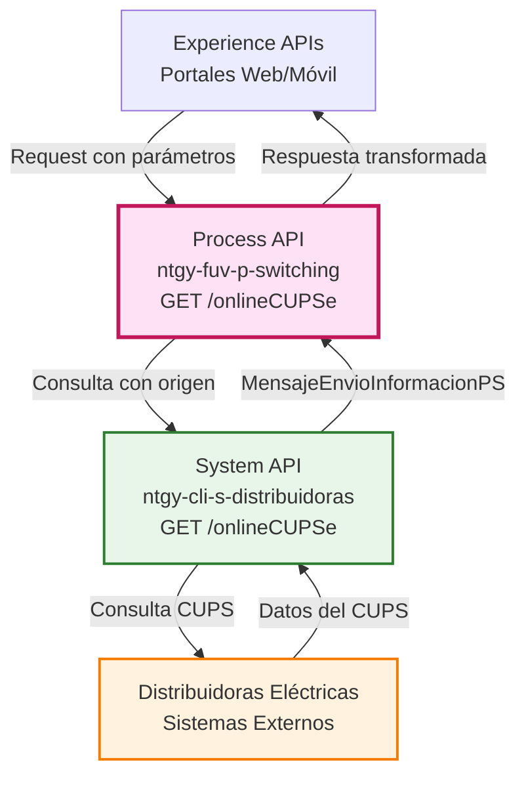
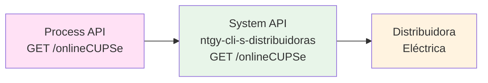
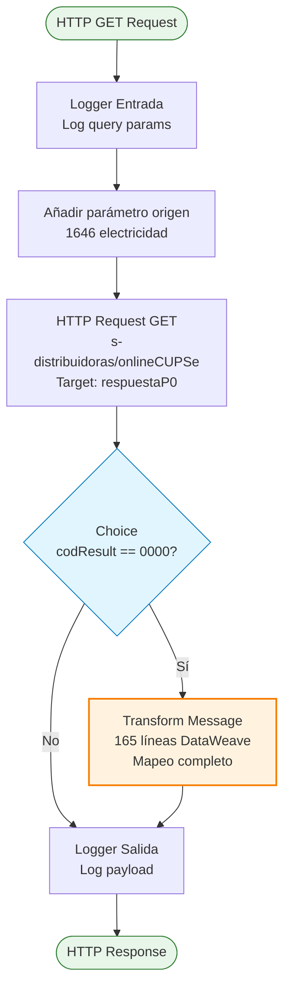
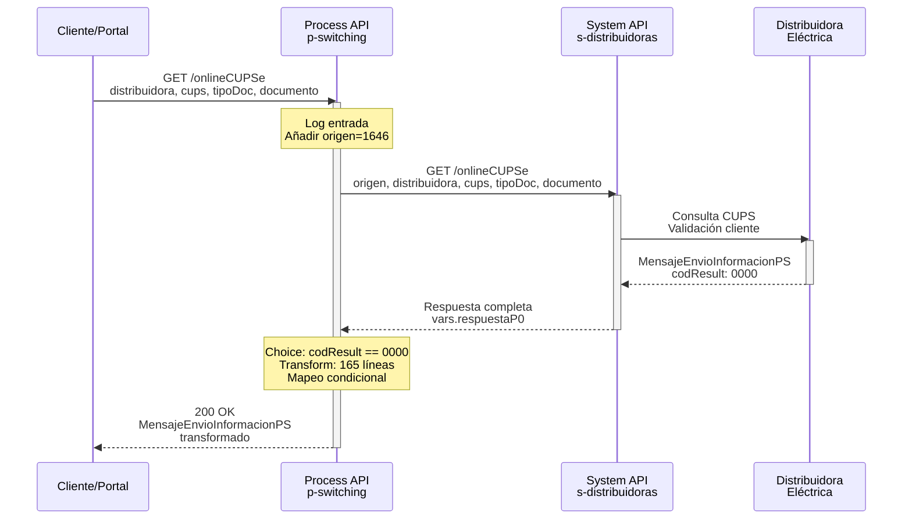
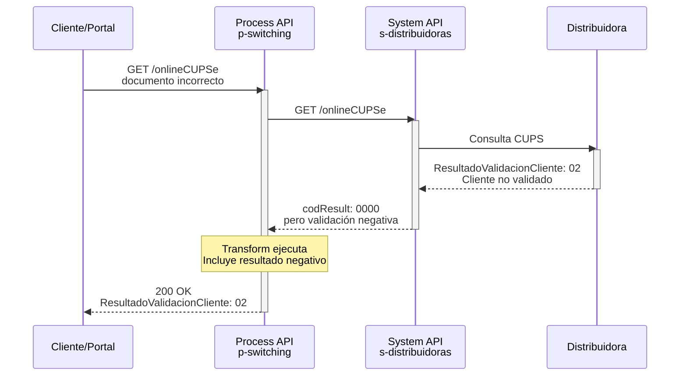
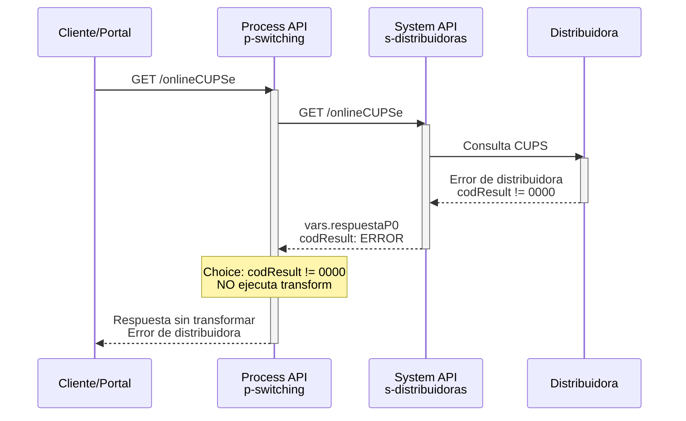

# GET /onlineCUPSe

## 📌 Descripción General

### Propósito del Endpoint

Este endpoint permite realizar consultas online de información de CUPS (Código Universal de Punto de Suministro) eléctricos, validando la identidad del cliente y obteniendo datos completos del contrato, punto de suministro y características técnicas desde la distribuidora correspondiente.

### Tipo de API

**Capa:** Process API (API-Led Connectivity)

**Función:** Orquestación de consulta de CUPS eléctrico entre cliente y distribuidora

### Patrón de Integración

**Tipo:** Orquestación con Transformación

**Descripción:** El endpoint recibe parámetros de consulta (distribuidora, CUPS, tipo de documento y número de documento), los valida, realiza la consulta al System API de distribuidoras y transforma la respuesta a un formato estandarizado con 165 líneas de mapeo DataWeave.

### Arquitectura API-Led Connectivity



---

## 💼 Propósito del Negocio

### Casos de Uso Principales

1. **Validación de Cliente en CUPS**
   - Verificar que un cliente específico está asociado a un CUPS eléctrico
   - Validar identidad mediante tipo y número de documento
   - Confirmar relación cliente-punto de suministro

2. **Consulta de Información Contractual**
   - Obtener datos del contrato actual (tarifa, potencias, periodicidad)
   - Consultar estado del contrato (en vigor, contratable)
   - Verificar existencia de solicitudes en curso

3. **Obtención de Datos Técnicos**
   - Características del punto de medida (tipo de equipo, fases)
   - Información de instalación (CIE, APM)
   - Derechos reconocidos y potencia máxima autorizada

4. **Preparación para Switching**
   - Validar viabilidad de cambio de comercializadora
   - Obtener información necesaria para proceso de switching
   - Verificar estado contratable del punto de suministro

### 🔗 Endpoints Dependientes

Este Process API consume el siguiente System API:

| System API | Endpoint | Método | Propósito |
|------------|----------|--------|-----------|
| `ntgy-cli-s-distribuidoras` | `/onlineCUPSe` | GET | Consulta de información del CUPS eléctrico en la distribuidora correspondiente |

### Lógica de Orquestación



**Pasos del Proceso:**

1. **Validación de Entrada**: Recibe y valida parámetros (distribuidora, CUPS, tipoDoc, documento)
2. **Enriquecimiento**: Añade parámetro `origen` con valor "1646" para electricidad
3. **Consulta a Distribuidora**: Invoca System API que consulta la distribuidora correspondiente
4. **Validación de Respuesta**: Verifica código de resultado "0000" (éxito)
5. **Transformación Compleja**: Mapea 165 líneas de DataWeave con manejo de campos opcionales
6. **Respuesta Estandarizada**: Retorna estructura MensajeEnvioInformacionPS completa

### Contexto Empresarial

- **Dominio:** Gestión de Switching Eléctrico
- **Sector:** Energía - Utilities
- **División:** Naturgy España - FUV (Facturación Única Virtual)
- **Proceso de Negocio:** Consulta y validación de CUPS para procesos de switching

### Stakeholders

- **Equipos de Operaciones FUV**: Necesitan validar CUPS antes de iniciar switching
- **Distribuidoras Eléctricas**: Proveen información oficial del punto de suministro
- **Clientes Finales**: Beneficiarios de procesos de switching automatizados
- **Sistemas de Gestión**: Consumen información para procesos downstream

### Valor de Negocio

- **Automatización**: Reduce tiempo de validación de CUPS de horas a segundos
- **Precisión**: Obtiene información directa de distribuidora (fuente oficial)
- **Cumplimiento**: Asegura validación según normativa CNMC
- **Experiencia de Usuario**: Permite validaciones en tiempo real en portales web/móvil

### Consumidores Potenciales

Este endpoint puede ser consumido por:
- Portales web de autoservicio para clientes
- Aplicaciones móviles de Naturgy
- Sistemas de agentes de call center
- Procesos automatizados de switching
- Sistemas de validación de contratos

---

## 🔧 Especificación Técnica

### URLs por Ambiente

| Ambiente | URL Base | URL Completa |
|----------|----------|--------------|
| **Local** | `http://localhost:8091` | `http://localhost:8091/api/onlineCUPSe` |
| **Development** | `https://ntgy-fuv-p-switching-dev.cloudhub.io` | `https://ntgy-fuv-p-switching-dev.cloudhub.io/api/onlineCUPSe` |
| **UAT** | `https://ntgy-fuv-p-switching-uat.cloudhub.io` | `https://ntgy-fuv-p-switching-uat.cloudhub.io/api/onlineCUPSe` |
| **UAT01** | `https://ntgy-fuv-p-switching-uat01.cloudhub.io` | `https://ntgy-fuv-p-switching-uat01.cloudhub.io/api/onlineCUPSe` |
| **Production** | `https://ntgy-fuv-p-switching-pro.cloudhub.io` | `https://ntgy-fuv-p-switching-pro.cloudhub.io/api/onlineCUPSe` |

### Método HTTP

```
GET /api/onlineCUPSe
```

### Parámetros de Entrada

#### Query Parameters (Obligatorios)

| Parámetro | Tipo | Longitud | Descripción | Ejemplo |
|-----------|------|----------|-------------|---------|
| `distribuidora` | String | Min: 2 | Código de la distribuidora eléctrica | `0236` |
| `cups` | String | Min: 20 | CUPS eléctrico (20-22 caracteres) | `ES0236150039964563QN` |
| `tipoDoc` | String | Min: 2 | Tipo de documento según CNMC | `01` |
| `documento` | String | Min: 8 | Número de documento del titular | `00000000T` |

#### Valores Válidos para tipoDoc

| Código | Descripción |
|--------|-------------|
| `01` | NIF (Número de Identificación Fiscal) |
| `03` | Pasaporte |
| `04` | NIE (Número de Identidad de Extranjero) |
| `07` | NIVA (NIF IVA) |
| `08` | OTR (Otros) |

#### Parámetro Interno Añadido

| Parámetro | Valor | Descripción |
|-----------|-------|-------------|
| `origen` | `1646` | Código de comercializadora de origen para electricidad (añadido automáticamente) |

### Respuestas

#### 200 OK - Consulta Exitosa

**Condición:** `result.codResult == "0000"`

La respuesta contiene la estructura completa `MensajeEnvioInformacionPS` con información del CUPS, contrato, cliente, equipo y documentación técnica.

**Campos Principales:**
- **Cabecera**: Información de la solicitud (códigos REE, proceso, CUPS)
- **ResultadoValidacionCliente**: "01" (validado) o "02" (no validado)
- **EstadoContratable**: Indica si el CUPS es contratable
- **Contrato**: Tarifa, potencias, condiciones contractuales
- **Cliente**: Datos del titular (condicional)
- **Equipo**: Características del punto de medida
- **DocTecnica**: CIE/APM (condicional)
- **Historia**: Fechas de movimientos y cambios

**Ejemplo de Respuesta Completa:**

```json
{
  "MensajeEnvioInformacionPS": {
    "Cabecera": {
      "CodigoREEEmpresaEmisora": "0236",
      "CodigoREEEmpresaDestino": "1646",
      "CodigoDelProceso": "C1",
      "CodigoDePaso": "01",
      "CodigoDeSolicitud": "202609160001",
      "SecuencialDeSolicitud": "01",
      "FechaSolicitud": "2026-09-16",
      "CUPS": "ES0236150039964563QN"
    },
    "EnvioInformacionPS": {
      "ResultadoValidacionCliente": "01",
      "EnVigor": "S",
      "EstadoContratable": {
        "Contratable": "S",
        "PotenciaMaxSinExpediente": 15
      },
      "ExisteSolicitudEnCurso": "N",
      "Contrato": {
        "TipoContratoATR": "01"
      },
      "IndBonoSocial": "N",
      "ViviendaHabitual": "S",
      "CNAE": "9820",
      "CondicionesContractuales": {
        "TarifaATR": "003",
        "PotenciasContratadas": {
          "Potencia": {
            "PotenciaP1": 5.75,
            "PotenciaP2": 5.75,
            "PotenciaP3": 5.75,
            "PotenciaP4": 5.75,
            "PotenciaP5": 5.75,
            "PotenciaP6": 5.75
          }
        },
        "ModoControlPotencia": "1"
      },
      "ModoFacturacionPotencia": "1",
      "NoInterrumpible": "N",
      "PeriodicidadFacturacion": "01",
      "TipodeTelegestion": "5",
      "ICPActivadoTelegestion": "S",
      "PeajeDirecto": "N",
      "DepositoGarantia": "N",
      "PotenciaMaxAutorizada": 15,
      "TensionDelSuministro": "1",
      "DerechosReconocidos": {
        "DerechoAcceso": "S",
        "DerechosExtension": "N",
        "FechaLimiteDerechosExtension": ""
      },
      "CaracteristicasPM": {
        "TipoPM": "5"
      },
      "Historia": {
        "FechaUltimoMovimientoContratacion": "2025-03-15",
        "FechaCambioComercializador": "2024-06-20",
        "FechaUltimaLectura": "2026-09-01",
        "FechaUltimaVerificacion": "2023-11-10",
        "ResultadoUltimaVerificacion": "01"
      },
      "Cliente": {
        "IdCliente": {
          "TipoIdentificador": "NI",
          "Identificador": "12345678A",
          "TipoPersona": "F"
        },
        "Nombre": {
          "NombreDePila": "Juan",
          "PrimerApellido": "García",
          "SegundoApellido": "López"
        },
        "IndicadorTipoDireccion": "S",
        "DireccionSuministro": {
          "Pais": "ES",
          "Provincia": "28",
          "Municipio": "079",
          "Poblacion": "Madrid",
          "CodPostal": "28001",
          "Via": {
            "TipoVia": "CL",
            "Calle": "Gran Vía",
            "NumeroFinca": "25",
            "Piso": "3",
            "Puerta": "B"
          }
        },
        "Telefono": {
          "PrefijoPais": "34",
          "Numero": "912345678"
        },
        "CorreoElectronico": "juan.garcia@example.com"
      },
      "Equipo": {
        "TipoAparato": "CG",
        "TipoEquipo": "E",
        "TipoPropiedad": "A",
        "CodigoFasesEquipoMedida": "M",
        "TipoDHEdM": "5"
      },
      "DocTecnica": {
        "CIEDisponible": "S",
        "DatosCie": {
          "PotenciaInstBT": 5.75,
          "CIEPapel": {
            "CodigoCie": "ES0236150039964563QN0F",
            "FechaEmisionCie": "2020-05-15",
            "TensionSuministroCIE": "400",
            "TipoSuministro": "TF"
          }
        },
        "DatosAPM": {
          "CodigoApm": "APM123456",
          "PotenciaInstAT": 0,
          "FechaEmisionApm": "2020-05-15"
        }
      }
    }
  },
  "result": {
    "codResult": "0000",
    "msgResult": "Cups Existente"
  }
}
```

**Descripción de Campos Clave:**

| Campo | Valor Ejemplo | Descripción |
|-------|---------------|-------------|
| `ResultadoValidacionCliente` | `"01"` | "01" = Cliente validado, "02" = No validado |
| `Contratable` | `"S"` | "S" = CUPS contratable para switching, "N" = No contratable |
| `TarifaATR` | `"003"` | Código de tarifa (003 = 3.0TD con 6 periodos) |
| `PotenciasContratadas` | `5.75` kW | Potencias por periodo (P1-P6 según tarifa) |
| `TipodeTelegestion` | `"5"` | Tipo de telegestion (5 = Telemedida horaria) |
| `TipoPM` | `"5"` | Tipo de punto de medida |

**Campos Opcionales:**

⚠️ Los siguientes campos solo aparecen bajo ciertas condiciones:

- **`Cliente`**: Solo presente si `ResultadoValidacionCliente = "01"` (validación exitosa)
- **`IndEsencial`**: Solo si el suministro tiene la característica de esencial
- **`DocTecnica.DatosAPM`**: Solo para instalaciones de alta tensión
- **`PotenciaP3` a `PotenciaP6`**: Según número de periodos de la tarifa (2.0TD tiene solo P1-P2, 3.0TD tiene P1-P6)
- **`ResultadoUltimaVerificacion`**: Solo si existe verificación previa

#### 500 Internal Server Error

**Condición:** Error en el procesamiento o en la consulta a distribuidora

```json
{
  "result": {
    "codResult": "ERROR",
    "msgResult": "Descripción del error"
  }
}
```

### Autenticación

- **Tipo:** Client ID & Client Secret (Anypoint Platform)
- **Headers requeridos:**
  - `client_id`: Identificador del cliente
  - `client_secret`: Secreto del cliente

### Timeouts

| Tipo | Valor |
|------|-------|
| **Request Timeout** | 600 segundos (10 minutos) |
| **Connection Timeout** | 10 segundos |

---

## 🏗️ Implementación Técnica

### Arquitectura del Flow



### Componentes del Flow

#### 1. Logger de Entrada (Línea 8)
```xml
<logger level="INFO" 
        message="ntgy-cli-p-switching-onlineCUPSe.logEntrada ## payload: #[attributes.queryParams]"/>
```
**Propósito:** Registrar parámetros de entrada para trazabilidad

#### 2. HTTP Request a System API (Líneas 9-19)
```xml
<http:request method="GET" 
              path="${s-distribuidoras.path.onlineCUPSe}" 
              config-ref="HTTP_Request_ntgy-cli-s-distribuidoras" 
              target="respuestaP0">
    <http:query-params>
        origen: attributes.queryParams["origen"] default Mule::p('origenes.electrico'),
        distribuidora: attributes.queryParams["distribuidora"],
        tipoDoc: attributes.queryParams["tipoDoc"],
        documento: attributes.queryParams["documento"],
        cups: attributes.queryParams["cups"]
    </http:query-params>
</http:request>
```
**Propósito:** Consultar System API de distribuidoras con parámetros enriquecidos

**Configuración:**
- Path: `/onlineCUPSe` (desde properties)
- Timeout: 600 segundos
- Target variable: `respuestaP0` (preserva respuesta original)

#### 3. Choice - Validación de Respuesta (Línea 20)
```xml
<choice>
    <when expression='vars.respuestaP0.result.codResult == "0000"'>
```
**Propósito:** Validar que la consulta fue exitosa antes de transformar

#### 4. Transform Message - Mapeo Complejo (Líneas 21-165)

**Características de la Transformación:**
- **165 líneas** de código DataWeave inline
- **Mapeo condicional** de campos opcionales
- **Manejo de null** para campos no obligatorios
- **Estructura jerárquica** compleja (8 secciones principales)

**Campos con Lógica Condicional:**
```dataweave
("IndEsencial": vars.respuestaP0...IndEsencial) 
    if (vars.respuestaP0...IndEsencial != null),

("PotenciaP3": vars.respuestaP0...PotenciaP3) 
    if vars.respuestaP0...PotenciaP3 != null,

("Cliente": { ... }) 
    if (vars.respuestaP0...Cliente != null),

("DocTecnica": { ... }) 
    if (vars.respuestaP0...DocTecnica != null)
```

#### 5. Logger de Salida (Línea 166)
```xml
<logger level="INFO" 
        message="ntgy-cli-p-switching-onlineCUPSe.logSalida ## payload: #[payload]"/>
```
**Propósito:** Registrar respuesta final para auditoría

### Patrones de Diseño

**Patrón:** Request-Reply con Transformación Condicional

**Justificación:** 
- Permite consulta síncrona con respuesta inmediata
- Transformación condicional maneja variabilidad de respuestas de distribuidoras
- Target variable (`respuestaP0`) preserva respuesta original para validación
- Choice evita transformar respuestas con error

### Diagramas de Secuencia

#### 1. Flujo Normal de Éxito



#### 2. Flujo con Cliente No Validado



#### 3. Flujo con Error de Distribuidora



### Manejo de Errores

#### Estrategia de Validación

1. **Validación de Código de Resultado**
   - Solo transforma si `codResult == "0000"`
   - Otros códigos pasan sin transformación

2. **Manejo de Campos Opcionales**
   - Uso de condicionales `if (campo != null)`
   - Evita errores por campos ausentes en respuesta

3. **Preservación de Errores**
   - Variable `respuestaP0` mantiene respuesta original
   - Errores de distribuidora se propagan al cliente

---

## 💻 Ejemplos de Uso

### Ejemplo 1: Consulta Exitosa

#### cURL

```bash
curl -X GET "https://ntgy-fuv-p-switching-dev.cloudhub.io/api/onlineCUPSe?distribuidora=0236&cups=ES0236150039964563QN&tipoDoc=01&documento=12345678A" \
  -H "Content-Type: application/json" \
  -H "client_id: YOUR_CLIENT_ID" \
  -H "client_secret: YOUR_CLIENT_SECRET"
```

#### Respuesta (200 OK)

```json
{
  "MensajeEnvioInformacionPS": {
    "Cabecera": {
      "CodigoREEEmpresaEmisora": "0236",
      "CodigoREEEmpresaDestino": "1646",
      "CodigoDelProceso": "C1",
      "CodigoDePaso": "01",
      "CodigoDeSolicitud": "202609160001",
      "SecuencialDeSolicitud": "01",
      "FechaSolicitud": "2026-09-16",
      "CUPS": "ES0236150039964563QN"
    },
    "EnvioInformacionPS": {
      "ResultadoValidacionCliente": "01",
      "EnVigor": "S",
      "EstadoContratable": {
        "Contratable": "S",
        "PotenciaMaxSinExpediente": 15
      },
      "ExisteSolicitudEnCurso": "N",
      "Contrato": {
        "TipoContratoATR": "01"
      },
      "IndBonoSocial": "N",
      "ViviendaHabitual": "S",
      "CNAE": "9820",
      "CondicionesContractuales": {
        "TarifaATR": "003",
        "PotenciasContratadas": {
          "Potencia": {
            "PotenciaP1": 5.75,
            "PotenciaP2": 5.75,
            "PotenciaP3": 5.75,
            "PotenciaP4": 5.75,
            "PotenciaP5": 5.75,
            "PotenciaP6": 5.75
          }
        },
        "ModoControlPotencia": "1"
      },
      "ModoFacturacionPotencia": "1",
      "NoInterrumpible": "N",
      "PeriodicidadFacturacion": "01",
      "TipodeTelegestion": "5",
      "ICPActivadoTelegestion": "S",
      "PeajeDirecto": "N",
      "DepositoGarantia": "N",
      "PotenciaMaxAutorizada": 15,
      "TensionDelSuministro": "1",
      "DerechosReconocidos": {
        "DerechoAcceso": "S",
        "DerechosExtension": "N",
        "FechaLimiteDerechosExtension": ""
      },
      "CaracteristicasPM": {
        "TipoPM": "5"
      },
      "Historia": {
        "FechaUltimoMovimientoContratacion": "2025-03-15",
        "FechaCambioComercializador": "2024-06-20",
        "FechaUltimaLectura": "2026-09-01",
        "FechaUltimaVerificacion": "2023-11-10",
        "ResultadoUltimaVerificacion": "01"
      },
      "Cliente": {
        "IdCliente": {
          "TipoIdentificador": "NI",
          "Identificador": "12345678A",
          "TipoPersona": "F"
        },
        "Nombre": {
          "NombreDePila": "Juan",
          "PrimerApellido": "García",
          "SegundoApellido": "López"
        },
        "IndicadorTipoDireccion": "S",
        "DireccionSuministro": {
          "Pais": "ES",
          "Provincia": "28",
          "Municipio": "079",
          "Poblacion": "Madrid",
          "CodPostal": "28001",
          "Via": {
            "TipoVia": "CL",
            "Calle": "Gran Vía",
            "NumeroFinca": "25",
            "Piso": "3",
            "Puerta": "B"
          }
        },
        "Telefono": {
          "PrefijoPais": "34",
          "Numero": "912345678"
        },
        "CorreoElectronico": "juan.garcia@example.com"
      },
      "Equipo": {
        "TipoAparato": "CG",
        "TipoEquipo": "E",
        "TipoPropiedad": "A",
        "CodigoFasesEquipoMedida": "M",
        "TipoDHEdM": "5"
      },
      "DocTecnica": {
        "CIEDisponible": "S",
        "DatosCie": {
          "PotenciaInstBT": 5.75,
          "CIEPapel": {
            "CodigoCie": "ES0236150039964563QN0F",
            "FechaEmisionCie": "2020-05-15",
            "TensionSuministroCIE": "400",
            "TipoSuministro": "TF"
          }
        },
        "DatosAPM": {
          "CodigoApm": "APM123456",
          "PotenciaInstAT": 0,
          "FechaEmisionApm": "2020-05-15"
        }
      }
    }
  },
  "result": {
    "codResult": "0000",
    "msgResult": "Cups Existente"
  }
}
```

**Campos Destacados en la Respuesta:**

- **ResultadoValidacionCliente**: `"01"` = Cliente validado correctamente
- **Contratable**: `"S"` = El CUPS es contratable para switching
- **TarifaATR**: `"003"` = Tarifa 3.0TD (6 periodos de potencia)
- **PotenciasContratadas**: 5.75 kW en todos los periodos (P1-P6)
- **TipodeTelegestion**: `"5"` = Telegestión con telemedida horaria
- **Cliente**: Información completa del titular (solo si validación exitosa)
- **DocTecnica**: Incluye CIE y APM (campos opcionales según instalación)

### Ejemplo 2: JavaScript

```javascript
const response = await fetch(
  'https://ntgy-fuv-p-switching-dev.cloudhub.io/api/onlineCUPSe?' +
  'distribuidora=0236&cups=ES0236150039964563QN&tipoDoc=01&documento=12345678A',
  {
    method: 'GET',
    headers: {
      'Content-Type': 'application/json',
      'client_id': 'YOUR_CLIENT_ID',
      'client_secret': 'YOUR_CLIENT_SECRET'
    }
  }
);

const data = await response.json();
console.log('Resultado validación:', data.MensajeEnvioInformacionPS.EnvioInformacionPS.ResultadoValidacionCliente);
```

### Ejemplo 3: Python

```python
import requests

url = "https://ntgy-fuv-p-switching-dev.cloudhub.io/api/onlineCUPSe"
params = {
    "distribuidora": "0236",
    "cups": "ES0236150039964563QN",
    "tipoDoc": "01",
    "documento": "12345678A"
}
headers = {
    "Content-Type": "application/json",
    "client_id": "YOUR_CLIENT_ID",
    "client_secret": "YOUR_CLIENT_SECRET"
}

response = requests.get(url, params=params, headers=headers)
data = response.json()

print(f"Código resultado: {data['result']['codResult']}")
print(f"Validación cliente: {data['MensajeEnvioInformacionPS']['EnvioInformacionPS']['ResultadoValidacionCliente']}")
```

### Ejemplo 4: Cliente No Validado

#### Respuesta (200 OK - Validación Negativa)

```json
{
  "MensajeEnvioInformacionPS": {
    "Cabecera": {
      "CUPS": "ES0236150039964563QN"
    },
    "EnvioInformacionPS": {
      "ResultadoValidacionCliente": "02"
    }
  },
  "result": {
    "codResult": "0000",
    "msgResult": "Cliente no validado"
  }
}