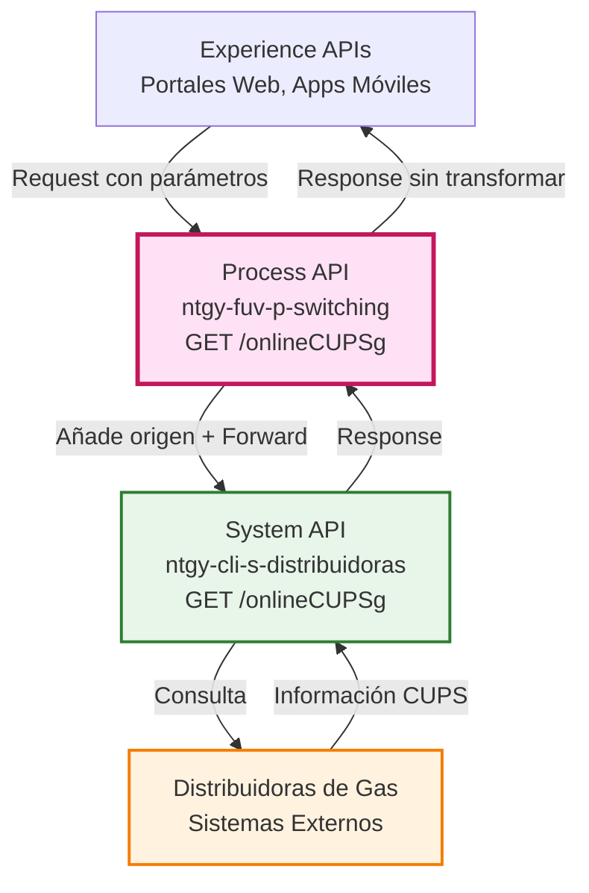
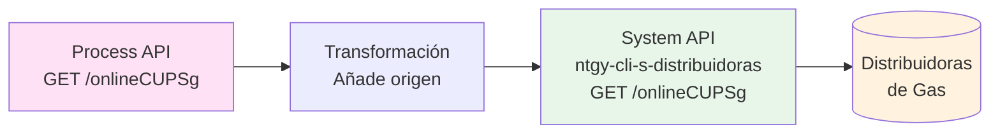
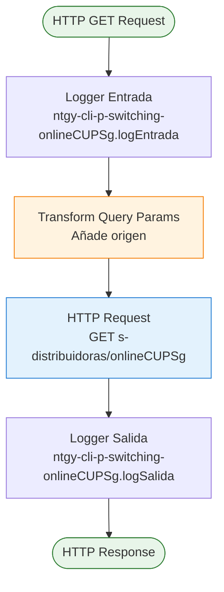
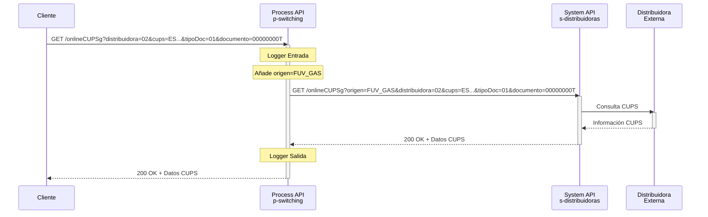
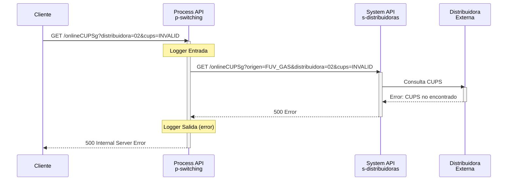
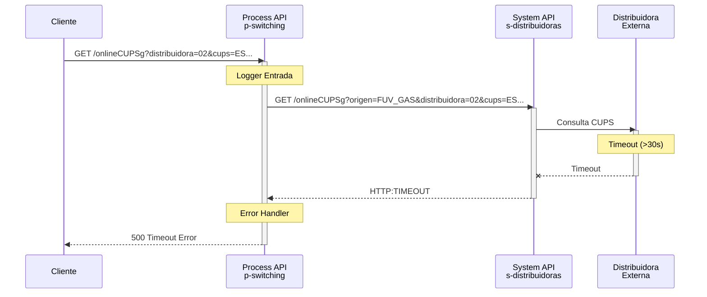

# GET /onlineCUPSg

## 📌 Descripción General

### Propósito del Endpoint

Este endpoint permite realizar consultas online de información de CUPS (Código Universal de Punto de Suministro) de gas directamente en la distribuidora correspondiente. Actúa como capa de orquestación entre las Experience APIs y el System API de distribuidoras, añadiendo automáticamente el parámetro de origen para identificar el canal de la consulta.

### Tipo de API

**Capa:** Process API (API-Led Connectivity)

**Función:** Orquestación de consultas de CUPS de gas con distribuidoras

### Patrón de Integración

**Tipo:** Pass-Through con Enriquecimiento de Parámetros

**Descripción:** El endpoint recibe los parámetros de consulta del cliente, añade automáticamente el parámetro `origen` (identificador del canal) y delega la consulta al System API `ntgy-cli-s-distribuidoras`. La respuesta se retorna sin transformación adicional.

### Arquitectura API-Led Connectivity



---

## 💼 Propósito del Negocio

### Casos de Uso Principales

1. **Validación de CUPS de Gas**
   - Verificar la existencia y validez de un CUPS de gas
   - Obtener información actualizada del punto de suministro
   - Beneficio: Validación en tiempo real antes de procesos de switching

2. **Consulta de Información de Distribuidora**
   - Obtener datos de la distribuidora asociada al CUPS
   - Verificar el estado del punto de suministro
   - Beneficio: Información precisa para gestión de contratos

3. **Proceso de Switching de Gas**
   - Validar CUPS como parte del proceso de cambio de comercializadora
   - Verificar disponibilidad para switching
   - Beneficio: Reducción de errores en procesos de alta

### 🔗 Endpoints Dependientes

Este Process API consume el siguiente System API:

| System API | Endpoint | Método | Propósito |
|------------|----------|--------|-----------|
| `ntgy-cli-s-distribuidoras` | `/onlineCUPSg` | GET | Consulta online de información de CUPS de gas en distribuidoras |

### Lógica de Orquestación



**Pasos del Proceso:**

1. **Recepción de Parámetros**: El endpoint recibe distribuidora, CUPS, tipo de documento y número de documento
2. **Enriquecimiento**: Añade el parámetro `origen` (por defecto desde configuración `origenes.gas`)
3. **Delegación**: Reenvía la petición completa al System API de distribuidoras
4. **Respuesta**: Retorna la respuesta del System API sin transformación adicional

### Transformaciones Aplicadas

**Enriquecimiento de Parámetros:**

| Parámetro Original | Parámetro Añadido | Transformación |
|-------------------|-------------------|----------------|
| N/A | `origen` | Se obtiene del query param o por defecto de `origenes.gas` |

**⚠️ Este Process API NO transforma la respuesta del System API.**

Para el schema completo de la respuesta, consultar:
📖 **System API: `ntgy-cli-s-distribuidoras` endpoint `/onlineCUPSg`**

### Contexto Empresarial

- **Dominio:** Gestión de Switching de Distribuidoras
- **Sector:** Energía - Utilities (Gas)
- **División:** Naturgy España - FUV (Facturación Única Virtual)
- **Proceso de Negocio:** Consulta y validación de CUPS de gas para procesos de switching

### Stakeholders

- **Equipos de Operaciones FUV**: Necesitan validar CUPS de gas en tiempo real
- **Sistemas de Gestión de Contratos**: Requieren información actualizada de puntos de suministro
- **Portales de Autoservicio**: Permiten a clientes consultar información de sus CUPS

### Valor de Negocio

- **Validación en Tiempo Real**: Consulta directa a distribuidoras sin intermediarios
- **Reducción de Errores**: Validación temprana de CUPS antes de procesos de alta
- **Trazabilidad**: Registro completo de consultas realizadas
- **Cumplimiento Normativo**: Alineado con regulaciones CNMC para el sector gas

### Consumidores Potenciales

Este endpoint puede ser consumido por:
- Portales web de autoservicio de clientes
- Aplicaciones móviles de gestión de contratos
- Sistemas de agentes de call center
- Herramientas internas de operaciones FUV
- Integraciones con sistemas de terceros autorizados

---

## 🔧 Especificación Técnica

### URLs por Ambiente

| Ambiente | URL Base | URL Completa |
|----------|----------|--------------|
| **Local** | `http://localhost:8081` | `http://localhost:8081/api/onlineCUPSg` |
| **Development** | `https://ntgy-fuv-p-switching-dev.us-e2.cloudhub.io` | `https://ntgy-fuv-p-switching-dev.us-e2.cloudhub.io/api/onlineCUPSg` |
| **UAT** | `https://ntgy-fuv-p-switching-uat.us-e2.cloudhub.io` | `https://ntgy-fuv-p-switching-uat.us-e2.cloudhub.io/api/onlineCUPSg` |
| **UAT01** | `https://ntgy-fuv-p-switching-uat01.us-e2.cloudhub.io` | `https://ntgy-fuv-p-switching-uat01.us-e2.cloudhub.io/api/onlineCUPSg` |
| **Production** | `https://ntgy-fuv-p-switching-pro.us-e2.cloudhub.io` | `https://ntgy-fuv-p-switching-pro.us-e2.cloudhub.io/api/onlineCUPSg` |

### Método HTTP

```
GET /api/onlineCUPSg
```

### Parámetros de Entrada

#### Query Parameters

| Parámetro | Tipo | Requerido | Descripción | Ejemplo |
|-----------|------|-----------|-------------|---------|
| `distribuidora` | string | ✅ Sí | Código de la distribuidora a la que se lanza la consulta (mínimo 2 caracteres) | `"02"` |
| `cups` | string | ✅ Sí | CUPS de gas a consultar (20 caracteres) | `"ES0236150039964563QN"` |
| `tipoDoc` | string | ✅ Sí | Tipo de documento según tabla CNMC: `01` (NIF), `03` (Pasaporte), `04` (NIE), `07` (NIVA), `08` (Otros) | `"01"` |
| `documento` | string | ✅ Sí | Número de documento a consultar (mínimo 8 caracteres) | `"00000000T"` |
| `origen` | string | ❌ No | Identificador del canal de origen (si no se proporciona, se usa valor por defecto de configuración) | `"WEB"` |

**Validaciones:**
- `distribuidora`: Longitud mínima 2 caracteres
- `cups`: Longitud mínima 20 caracteres (formato CUPS gas español)
- `tipoDoc`: Debe ser uno de los valores permitidos (01, 03, 04, 07, 08)
- `documento`: Longitud mínima 8 caracteres

### Respuestas

#### 200 OK - Consulta Exitosa

**Estructura de Respuesta:**

La respuesta contiene dos objetos principales:
- `consultaCupsResponse`: Información completa del CUPS de gas según formato CNMC
- `result`: Código y mensaje de resultado de la operación

```json
{
  "consultaCupsResponse": {
    "cabecera": {
      "codenvio": "GML",
      "empresaemisora": "0762",
      "empresadestino": "0229",
      "fechacomunicacion": "2021-06-17",
      "horacomunicacion": "05:54:40",
      "codproceso": "29",
      "tipomensaje": "A6"
    },
    "a629": {
      "codrpds": "REQ123456",
      "fechacreacion": "2021-06-17",
      "horacreacion": "05:54:40",
      "codresultado": "00",
      "descresultado": "Consulta realizada correctamente",
      "codmotivo": "000",
      "descmotresultado": "Sin observaciones",
      "resvalidacioncliente": "S",
      "datosdis": {
        "cups": "ES0236150039964563QN",
        "distribuidor": "0229",
        "razonsocial": "DISTRIBUIDORA DE GAS EJEMPLO S.A.",
        "codprovincia": "28",
        "descprovincia": "MADRID",
        "codpostal": "28001",
        "codmunicipio": "28079",
        "descmunicipio": "MADRID",
        "tipovia": "CL",
        "via": "CALLE EJEMPLO",
        "numfinca": "123",
        "restodireccion": "PORTAL 1, PISO 3, PUERTA A",
        "viviendahabitual": "S",
        "fechaalta": "2020-01-15",
        "fechaultimalectura": "2021-06-01",
        "puntocortado": "N",
        "rangopresiondiseno": "04",
        "qh": "2.5",
        "qmax": "10",
        "derechotur": "S",
        "tarifapeaje": "31",
        "fechaultimainspeccion": "2020-12-15",
        "resultimainspeccion": "01",
        "fechaultimarevision": "2021-01-20",
        "resultimarevision": "01",
        "historicoConsumo": [
          {
            "fecinicioperiodo1": "2020-06-01",
            "fecfinperiodo1": "2021-06-01",
            "consumoperiodo1": "1250",
            "caudalminperiodo1": "1.5",
            "caudalmedperiodo1": "2.0",
            "caudalmaxperiodo1": "3.5"
          }
        ],
        "pctjeconsumonoct": "15",
        "codequipo": "EQ12345",
        "contelemedida": "N",
        "marcamodelocont": "MARCA CONTADOR MODELO X",
        "marcamodelocorr": "MARCA CORRECTOR MODELO Y",
        "propiedad": "D",
        "tipocorrector": "02",
        "fecultcambiotarifa": "2020-01-15",
        "fecultcontrato": "2020-01-15",
        "fecultcambiocom": "2020-01-15",
        "perfil": "01",
        "indconectadoplantasatelite": "N",
        "fecactdist": "2021-06-17",
        "listaproductos": [
          {
            "producto": {
              "codigoproducto": "PROD001",
              "tipoproducto": "01",
              "tarifaproducto": "31",
              "qdproducto": "2.5",
              "qaproducto": "900",
              "fechainicioproducto": "2020-01-15",
              "horainicioproducto": "00:00:00",
              "fechafinproducto": ""
            }
          }
        ]
      },
      "datoscom": {
        "nombre": "JUAN",
        "apellido1": "PEREZ",
        "apellido2": "GARCIA",
        "codprovincia": "28",
        "descprovincia": "MADRID",
        "codpostal": "28001",
        "codmunicipio": "28079",
        "descmunicipio": "MADRID",
        "tipovia": "CL",
        "via": "CALLE EJEMPLO",
        "numfinca": "123",
        "portal": "1",
        "escalera": "A",
        "piso": "3",
        "puerta": "A",
        "tipopersona": "F",
        "viviendahabitual": "S",
        "impagos": "N",
        "fecimpagos": "",
        "catimpagos": "",
        "usuimpagos": "",
        "prohibpublicdatcli": "N",
        "fecactprohibpublic": "",
        "catactprohibpublic": "",
        "usuactprohibpublic": ""
      }
    }
  },
  "result": {
    "codResult": "0000",
    "msgResult": "Operación exitosa"
  }
}
```

**Campos Principales:**

**consultaCupsResponse.cabecera:**
- Información de la comunicación entre empresas (emisora/destino)
- Fecha y hora de la comunicación
- Código de proceso y tipo de mensaje CNMC

**consultaCupsResponse.a629.datosdis:**
- Información completa del punto de suministro de gas
- Datos de la distribuidora
- Dirección del punto de suministro
- Características técnicas (caudales, presión, tarifa)
- Histórico de consumo
- Información de equipos de medida
- Productos activos

**consultaCupsResponse.a629.datoscom:**
- Datos del titular/comercializadora
- Dirección de contacto
- Información de impagos y LOPD

**result:**
- `codResult`: Código de resultado de la operación
- `msgResult`: Mensaje descriptivo del resultado

#### 500 Internal Server Error

```json
{
  "result": {
    "codResult": "5000",
    "msgResult": "Error interno del servidor al procesar la consulta"
  }
}
```

**Códigos de Error Comunes:**

| Código | Descripción |
|--------|-------------|
| `0001` | Petición rechazada |
| `0002` | CUPS no encontrado |
| `0003` | Distribuidora no válida |
| `0004` | Documento no coincide con titular |
| `5000` | Error interno del servidor |

### Autenticación

- **Tipo:** Client ID & Client Secret (Anypoint Platform)
- **Headers Requeridos:**
  - `client_id`: Identificador del cliente
  - `client_secret`: Secreto del cliente

### Timeouts

| Tipo | Valor |
|------|-------|
| **Request Timeout** | 30 segundos |
| **Connection Timeout** | 10 segundos |
| **Connection Idle Timeout** | Configurado por ambiente en `s-distribuidoras.timeout` |

---

## 🏗️ Implementación Técnica

### Arquitectura del Flow



### Componentes del Flow

**Archivo:** `p-switching-onlineCUPSg.xml`

**Flow Principal:** `p-switching-onlineCUPSgFlow`

#### 1. Logger de Entrada
```xml
<logger level="INFO" 
    message="ntgy-cli-p-switching-onlineCUPSg.logEntrada ## payload: #[payload]" />
```
- Registra la entrada al flow con el payload recibido

#### 2. Transformación de Query Parameters
```dataweave
%dw 2.0
output application/java
---
{
    origen: attributes.queryParams["origen"] default Mule::p('origenes.gas'),
    distribuidora: attributes.queryParams["distribuidora"],
    tipoDoc: attributes.queryParams["tipoDoc"],
    documento: attributes.queryParams["documento"],
    cups: attributes.queryParams["cups"]
}
```

**Lógica:**
- Toma todos los query parameters del request original
- Añade el parámetro `origen`:
  - Si viene en el request, usa ese valor
  - Si no viene, usa el valor por defecto de la propiedad `origenes.gas`

#### 3. HTTP Request a System API
```xml
<http:request 
    method="GET" 
    path="${s-distribuidoras.path.onlineCUPSg}" 
    config-ref="HTTP_Request_ntgy-cli-s-distribuidoras">
    <http:query-params>
        <!-- Query params transformados -->
    </http:query-params>
</http:request>
```

**Configuración:**
- **Config:** `HTTP_Request_ntgy-cli-s-distribuidoras` (definido en `global.xml`)
- **Host:** `${s-distribuidoras.host}`
- **Port:** `${s-distribuidoras.port}`
- **Base Path:** `/api`
- **Path:** `${s-distribuidoras.path.onlineCUPSg}` → `/onlineCUPSg`
- **Timeout:** `${s-distribuidoras.timeout}`

#### 4. Logger de Salida
```xml
<logger level="INFO" 
    message="ntgy-cli-p-switching-onlineCUPSg.logSalida ## payload: #[payload]" />
```
- Registra la salida del flow con la respuesta recibida

### Configuración por Ambiente

**Archivo:** `p-switching-{env}-config.yaml`

```yaml
s-distribuidoras:
  host: "ntgy-cli-s-distribuidoras-{env}.us-e2.cloudhub.io"
  port: "443"
  path:
    onlineCUPSg: "/onlineCUPSg"
  timeout: "30000"

origenes:
  gas: "FUV_GAS"
```

### Patrones de Diseño

**Patrón:** Pass-Through con Enriquecimiento de Parámetros

**Justificación:** 
- Mantiene la separación de responsabilidades entre capas
- Permite añadir contexto (origen) sin modificar la lógica del System API
- Facilita el logging y trazabilidad centralizada
- Simplifica el mantenimiento al delegar la lógica de negocio al System API

### Diagramas de Secuencia

#### 1. Flujo Normal de Éxito



#### 2. Flujo con Error de Distribuidora



#### 3. Flujo con Timeout



### Manejo de Errores

**Estrategia:** Propagación de errores del System API

**Tipos de Error:**

1. **HTTP:TIMEOUT**
   - Causa: El System API no responde en el tiempo configurado
   - Respuesta: 500 Internal Server Error
   - Acción: Revisar disponibilidad del System API y distribuidoras

2. **HTTP:CONNECTIVITY**
   - Causa: No se puede establecer conexión con el System API
   - Respuesta: 500 Internal Server Error
   - Acción: Verificar configuración de red y disponibilidad del servicio

3. **Errores de Negocio (del System API)**
   - Causa: CUPS no encontrado, distribuidora inválida, etc.
   - Respuesta: Se propaga la respuesta del System API (típicamente 500)
   - Acción: Revisar parámetros de entrada

**Logging:**
- Todos los errores se registran con nivel ERROR
- Se incluye el payload de entrada y el error recibido
- Formato: `ntgy-cli-p-switching-onlineCUPSg.error ## error: [detalles]`

---

## 💻 Ejemplos de Uso

### Ejemplo 1: Consulta Exitosa de CUPS de Gas

#### cURL

```bash
curl -X GET "https://ntgy-fuv-p-switching-dev.us-e2.cloudhub.io/api/onlineCUPSg?distribuidora=02&cups=ES0236150039964563QN&tipoDoc=01&documento=00000000T" \
  -H "Content-Type: application/json" \
  -H "client_id: YOUR_CLIENT_ID" \
  -H "client_secret: YOUR_CLIENT_SECRET"
```

#### Respuesta (200 OK)

```json
{
  "consultaCupsResponse": {
    "cabecera": {
      "codenvio": "GML",
      "empresaemisora": "0762",
      "empresadestino": "0229",
      "fechacomunicacion": "2021-06-17",
      "horacomunicacion": "05:54:40",
      "codproceso": "29",
      "tipomensaje": "A6"
    },
    "a629": {
      "codrpds": "REQ123456",
      "fechacreacion": "2021-06-17",
      "horacreacion": "05:54:40",
      "codresultado": "00",
      "descresultado": "Consulta realizada correctamente",
      "resvalidacioncliente": "S",
      "datosdis": {
        "cups": "ES0236150039964563QN",
        "distribuidor": "0229",
        "razonsocial": "DISTRIBUIDORA DE GAS EJEMPLO S.A.",
        "codprovincia": "28",
        "descprovincia": "MADRID",
        "codpostal": "28001",
        "codmunicipio": "28079",
        "descmunicipio": "MADRID",
        "tipovia": "CL",
        "via": "CALLE EJEMPLO",
        "numfinca": "123",
        "viviendahabitual": "S",
        "fechaalta": "2020-01-15",
        "tarifapeaje": "31",
        "qh": "2.5",
        "qmax": "10"
      },
      "datoscom": {
        "nombre": "JUAN",
        "apellido1": "PEREZ",
        "apellido2": "GARCIA",
        "tipopersona": "F",
        "viviendahabitual": "S"
      }
    }
  },
  "result": {
    "codResult": "0000",
    "msgResult": "Operación exitosa"
  }
}
```

### Ejemplo 2: Consulta con Origen Personalizado

#### cURL

```bash
curl -X GET "https://ntgy-fuv-p-switching-dev.us-e2.cloudhub.io/api/onlineCUPSg?origen=MOBILE_APP&distribuidora=02&cups=ES0236150039964563QN&tipoDoc=01&documento=00000000T" \
  -H "Content-Type: application/json" \
  -H "client_id: YOUR_CLIENT_ID" \
  -H "client_secret: YOUR_CLIENT_SECRET"
```

**Nota:** El parámetro `origen` es opcional. Si se proporciona, se usa ese valor; si no, se usa el valor por defecto `FUV_GAS` de la configuración.

### Ejemplo 3: JavaScript (Fetch API)

```javascript
const consultarCUPSGas = async (distribuidora, cups, tipoDoc, documento) => {
  const params = new URLSearchParams({
    distribuidora,
    cups,
    tipoDoc,
    documento
  });

  const response = await fetch(
    `https://ntgy-fuv-p-switching-dev.us-e2.cloudhub.io/api/onlineCUPSg?${params}`,
    {
      method: 'GET',
      headers: {
        'Content-Type': 'application/json',
        'client_id': 'YOUR_CLIENT_ID',
        'client_secret': 'YOUR_CLIENT_SECRET'
      }
    }
  );

  if (!response.ok) {
    throw new Error(`Error ${response.status}: ${response.statusText}`);
  }

  const data = await response.json();
  return data;
};

// Uso
try {
  const resultado = await consultarCUPSGas(
    '02',
    'ES0236150039964563QN',
    '01',
    '00000000T'
  );
  console.log('CUPS:', resultado.consultaCupsResponse.a629.datosdis.cups);
  console.log('Distribuidora:', resultado.consultaCupsResponse.a629.datosdis.razonsocial);
  console.log('Resultado:', resultado.result.msgResult);
} catch (error) {
  console.error('Error al consultar CUPS:', error);
}
```

### Ejemplo 4: Python (Requests)

```python
import requests

def consultar_cups_gas(distribuidora, cups, tipo_doc, documento, origen=None):
    """
    Consulta información de un CUPS de gas en la distribuidora.
    
    Args:
        distribuidora: Código de la distribuidora
        cups: CUPS de gas a consultar
        tipo_doc: Tipo de documento (01, 03, 04, 07, 08)
        documento: Número de documento
        origen: Canal de origen (opcional)
    
    Returns:
        dict: Información del CUPS
    """
    url = "https://ntgy-fuv-p-switching-dev.us-e2.cloudhub.io/api/onlineCUPSg"
    
    params = {
        'distribuidora': distribuidora,
        'cups': cups,
        'tipoDoc': tipo_doc,
        'documento': documento
    }
    
    if origen:
        params['origen'] = origen
    
    headers = {
        'Content-Type': 'application/json',
        'client_id': 'YOUR_CLIENT_ID',
        'client_secret': 'YOUR_CLIENT_SECRET'
    }
    
    response = requests.get(url, params=params, headers=headers)
    response.raise_for_status()
    
    return response.json()

# Uso
try:
    resultado = consultar_cups_gas(
        distribuidora='02',
        cups='ES0236150039964563QN',
        tipo_doc='01',
        documento='00000000T'
    )
    datos_cups = resultado['consultaCupsResponse']['a629']['datosdis']
    print(f"CUPS: {datos_cups['cups']}")
    print(f"Distribuidora: {datos_cups['razonsocial']}")
    print(f"Dirección: {datos_cups['via']} {datos_cups['numfinca']}")
    print(f"Resultado: {resultado['result']['msgResult']}")
except requests.exceptions.HTTPError as e:
    print(f"Error HTTP: {e}")
except Exception as e:
    print(f"Error: {e}")
```

### Ejemplo 5: Error - CUPS No Encontrado

#### Request

```bash
curl -X GET "https://ntgy-fuv-p-switching-dev.us-e2.cloudhub.io/api/onlineCUPSg?distribuidora=02&cups=ES0000000000000000XX&tipoDoc=01&documento=00000000T" \
  -H "Content-Type: application/json" \
  -H "client_id: YOUR_CLIENT_ID" \
  -H "client_secret: YOUR_CLIENT_SECRET"
```

#### Respuesta (500 Internal Server Error)

```json
{
  "consultaCupsResponse": {
    "cabecera": {
      "codenvio": "GML",
      "empresaemisora": "0762",
      "empresadestino": "0229",
      "fechacomunicacion": "2021-06-17",
      "horacomunicacion": "05:54:40",
      "codproceso": "29",
      "tipomensaje": "A6"
    },
    "a629": {
      "fechacreacion": "2021-06-17",
      "horacreacion": "05:54:40",
      "codresultado": "02",
      "descresultado": "CUPS no encontrado en la distribuidora",
      "codmotivo": "002",
      "descmotresultado": "El CUPS especificado no existe"
    }
  },
  "result": {
    "codResult": "0002",
    "msgResult": "CUPS no encontrado"
  }
}
```

### Ejemplo 6: Error - Parámetros Inválidos

#### Request

```bash
curl -X GET "https://ntgy-fuv-p-switching-dev.us-e2.cloudhub.io/api/onlineCUPSg?distribuidora=02&cups=INVALID&tipoDoc=99&documento=123" \
  -H "Content-Type: application/json" \
  -H "client_id: YOUR_CLIENT_ID" \
  -H "client_secret: YOUR_CLIENT_SECRET"
```

#### Respuesta (400 Bad Request)

```json
{
  "error": {
    "code": "VALIDATION_ERROR",
    "message": "Parámetros de entrada inválidos",
    "details": [
      {
        "field": "cups",
        "message": "El CUPS debe tener al menos 20 caracteres"
      },
      {
        "field": "tipoDoc",
        "message": "El tipo de documento debe ser uno de: 01, 03, 04, 07, 08"
      },
      {
        "field": "documento",
        "message": "El documento debe tener al menos 8 caracteres"
      }
    ]
  }
}