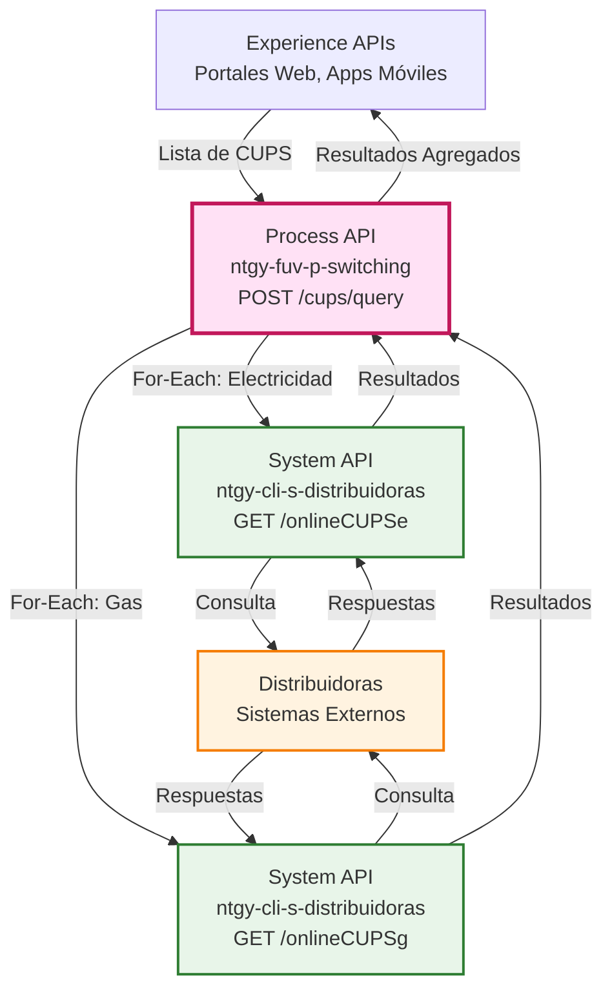
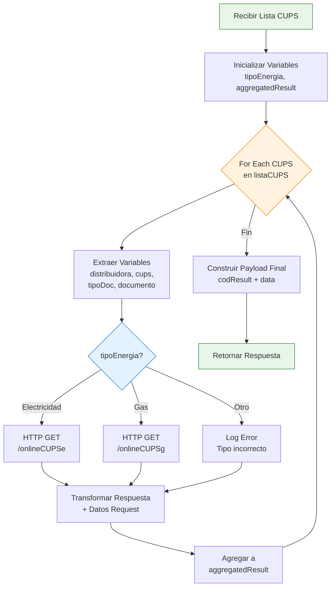
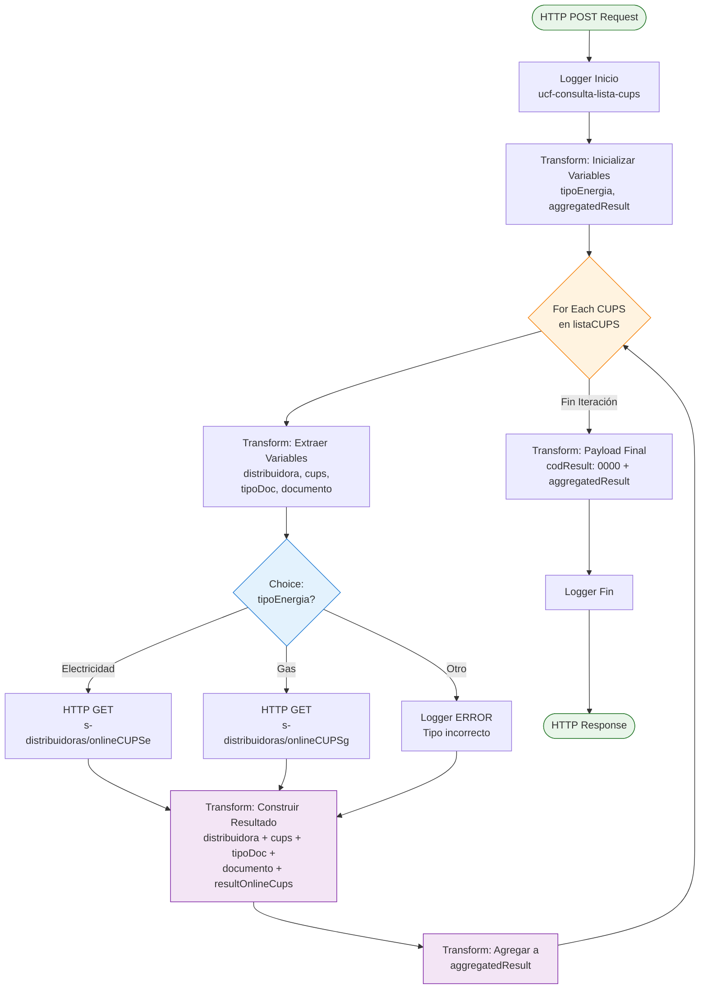
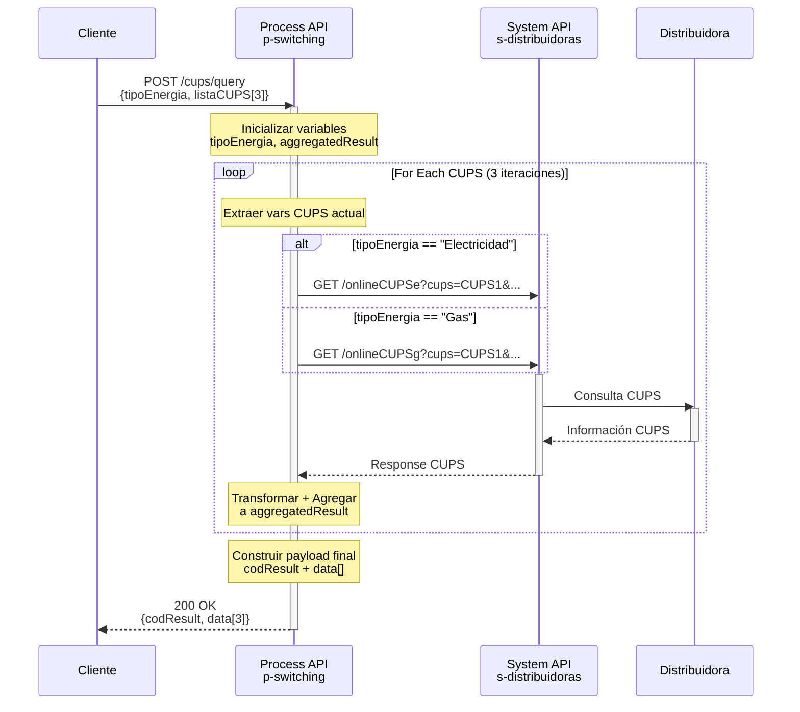
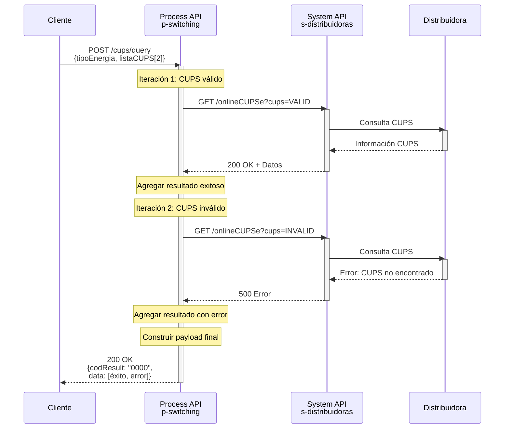
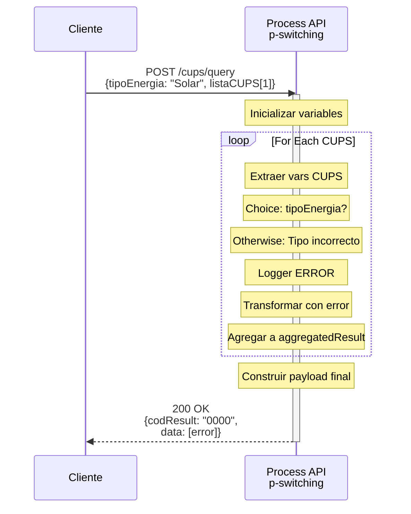

# POST /cups/query

## 📌 Descripción General

### Propósito del Endpoint

Este endpoint permite realizar consultas online de múltiples CUPS (Código Universal de Punto de Suministro) en una sola petición, procesándolos de forma iterativa y agregando los resultados. Actúa como capa de orquestación que optimiza las consultas batch a distribuidoras, evitando múltiples llamadas individuales desde el cliente.

### Tipo de API

**Capa:** Process API (API-Led Connectivity)

**Función:** Orquestación batch con iteración y agregación de resultados

### Patrón de Integración

**Tipo:** Scatter-Gather Secuencial con Agregación

**Descripción:** El endpoint recibe una lista de CUPS, itera sobre cada uno realizando consultas individuales al System API correspondiente (electricidad o gas según el tipo especificado), y agrega todos los resultados en una única respuesta estructurada.

### Arquitectura API-Led Connectivity



---

## 💼 Propósito del Negocio

### Casos de Uso Principales

1. **Consulta Batch de CUPS**
   - Validar múltiples CUPS en una sola operación
   - Reducir número de llamadas desde el cliente
   - Beneficio: Optimización de rendimiento y reducción de latencia

2. **Validación Masiva para Procesos de Switching**
   - Verificar disponibilidad de múltiples puntos de suministro
   - Obtener información actualizada de varios CUPS simultáneamente
   - Beneficio: Agilización de procesos de alta masiva

3. **Auditoría y Reconciliación**
   - Consultar estado de múltiples CUPS para auditorías
   - Verificar consistencia de datos en lote
   - Beneficio: Facilita procesos de control y calidad

### 🔗 Endpoints Dependientes

Este Process API consume los siguientes System APIs de forma iterativa:

| System API | Endpoint | Método | Propósito | Condición |
|------------|----------|--------|-----------|-----------|
| `ntgy-cli-s-distribuidoras` | `/onlineCUPSe` | GET | Consulta online de CUPS de electricidad | Si `tipoEnergia == "Electricidad"` |
| `ntgy-cli-s-distribuidoras` | `/onlineCUPSg` | GET | Consulta online de CUPS de gas | Si `tipoEnergia == "Gas"` |

### Lógica de Orquestación



**Pasos del Proceso:**

1. **Inicialización**: Se extraen `tipoEnergia` y se inicializa `aggregatedResult` como array vacío
2. **Iteración For-Each**: Por cada CUPS en la lista:
   - Se extraen las variables del CUPS actual (distribuidora, cups, tipoDoc, documento)
   - Se evalúa el tipo de energía mediante Choice
   - Se llama al endpoint correspondiente (electricidad o gas)
   - Se transforma la respuesta añadiendo los datos del request
   - Se agrega el resultado al array `aggregatedResult`
3. **Agregación Final**: Se construye el payload final con `codResult: "0000"` y el array de resultados
4. **Respuesta**: Se retorna la respuesta agregada con todos los resultados

### Transformaciones Aplicadas

**Enriquecimiento de Cada Resultado:**

| Campo Original (Request) | Campo en Respuesta | Transformación |
|--------------------------|-------------------|----------------|
| `distribuidora` | `data[].distribuidora` | Se mantiene del request |
| `cups` | `data[].cups` | Se mantiene del request |
| `tipoDoc` | `data[].tipoDoc` | Se mantiene del request |
| `documento` | `data[].documento` | Se mantiene del request |
| Response del System API | `data[].resultOnlineCups` | Se añade la respuesta completa del System API |

**Agregación:**
- Cada iteración añade un objeto al array `data`
- Al final se añade `codResult: "0000"` al payload

### Contexto Empresarial

- **Dominio:** Gestión de Switching de Distribuidoras
- **Sector:** Energía - Utilities (Electricidad y Gas)
- **División:** Naturgy España - FUV (Facturación Única Virtual)
- **Proceso de Negocio:** Consulta batch de CUPS para procesos de switching y validación masiva

### Stakeholders

- **Equipos de Operaciones FUV**: Necesitan validar múltiples CUPS en procesos batch
- **Sistemas de Migración**: Requieren validación masiva de CUPS en procesos de alta
- **Herramientas de Auditoría**: Consultan múltiples CUPS para verificación de datos

### Valor de Negocio

- **Optimización de Rendimiento**: Reduce múltiples llamadas individuales a una sola petición batch
- **Reducción de Latencia**: Procesa múltiples CUPS en una sola transacción
- **Simplificación de Integración**: Los clientes no necesitan gestionar múltiples llamadas
- **Trazabilidad Centralizada**: Todos los resultados en una sola respuesta estructurada

### Consumidores Potenciales

Este endpoint puede ser consumido por:
- Herramientas de migración masiva de contratos
- Sistemas de auditoría y reconciliación
- Portales de gestión interna de operaciones
- Procesos batch de validación nocturna
- Integraciones con sistemas de terceros para validación masiva

---

## 🔧 Especificación Técnica

### URLs por Ambiente

| Ambiente | URL Base | URL Completa |
|----------|----------|--------------|
| **Local** | `http://localhost:8081` | `http://localhost:8081/api/cups/query` |
| **Development** | `https://ntgy-fuv-p-switching-dev.us-e2.cloudhub.io` | `https://ntgy-fuv-p-switching-dev.us-e2.cloudhub.io/api/cups/query` |
| **UAT** | `https://ntgy-fuv-p-switching-uat.us-e2.cloudhub.io` | `https://ntgy-fuv-p-switching-uat.us-e2.cloudhub.io/api/cups/query` |
| **UAT01** | `https://ntgy-fuv-p-switching-uat01.us-e2.cloudhub.io` | `https://ntgy-fuv-p-switching-uat01.us-e2.cloudhub.io/api/cups/query` |
| **Production** | `https://ntgy-fuv-p-switching-pro.us-e2.cloudhub.io` | `https://ntgy-fuv-p-switching-pro.us-e2.cloudhub.io/api/cups/query` |

### Método HTTP

```
POST /api/cups/query
```

### Parámetros de Entrada

#### Request Body (application/json)

**Estructura Principal:**

| Campo | Tipo | Requerido | Descripción |
|-------|------|-----------|-------------|
| `tipoEnergia` | string | ✅ Sí | Tipo de energía de los CUPS a consultar. Valores: `"Electricidad"` o `"Gas"` |
| `listaCUPS` | array | ✅ Sí | Lista de CUPS a consultar (mínimo 1, recomendado máximo 50 por rendimiento) |

**Estructura de cada elemento en listaCUPS:**

| Campo | Tipo | Requerido | Descripción | Ejemplo |
|-------|------|-----------|-------------|---------|
| `distribuidora` | string | ✅ Sí | Código de la distribuidora (mínimo 2 caracteres) | `"0021"` |
| `cups` | string | ✅ Sí | CUPS a consultar (mínimo 20 caracteres) | `"ES0021000010859021NM"` |
| `tipoDoc` | string | ✅ Sí | Tipo de documento según tabla CNMC | `"01"` |
| `documento` | string | ✅ Sí | Número de documento (mínimo 8 caracteres) | `"00000000T"` |
| `origen` | string | ❌ No | Código de origen de la consulta (opcional) | `"WEB"` |

**Ejemplo de Request:**

```json
{
  "tipoEnergia": "Electricidad",
  "listaCUPS": [
    {
      "distribuidora": "0021",
      "cups": "ES0021000010859021NM",
      "tipoDoc": "01",
      "documento": "00000000T"
    },
    {
      "distribuidora": "0021",
      "cups": "ES0021000008562567DD",
      "tipoDoc": "01",
      "documento": "12345678A"
    },
    {
      "distribuidora": "0229",
      "cups": "ES0236150039964563QN",
      "tipoDoc": "03",
      "documento": "X1234567Z"
    }
  ]
}
```

**Validaciones:**
- `tipoEnergia`: Debe ser exactamente `"Electricidad"` o `"Gas"` (case-sensitive)
- `listaCUPS`: Debe contener al menos 1 elemento
- Cada CUPS debe cumplir las validaciones individuales de los endpoints `/onlineCUPSe` o `/onlineCUPSg`

### Respuestas

#### 200 OK - Consulta Exitosa

**Estructura de Respuesta:**

La respuesta contiene:
- `codResult`: Código de resultado de la operación batch (siempre `"0000"` si se procesó)
- `data`: Array con los resultados de cada CUPS consultado

```json
{
  "codResult": "0000",
  "data": [
    {
      "distribuidora": "0237",
      "tipoDoc": "03",
      "documento": "29494450D",
      "cups": "ES0217020084274624GA",
      "resultOnlineCups": {
        "consultaCupsResponse": {
          "cabecera": {
            "codenvio": "GML",
            "empresaemisora": "0762",
            "empresadestino": "0237",
            "fechacomunicacion": "2021-11-15",
            "horacomunicacion": "10:18:15",
            "codproceso": "29",
            "tipomensaje": "A6"
          },
          "a629": {
            "codrpds": "0001344522",
            "fechacreacion": "2021-11-15",
            "horacreacion": "10:18:22",
            "codresultado": "01",
            "descresultado": "Aceptada",
            "resvalidacioncliente": "N",
            "datosdis": {
              "cups": "ES0217020084274624GA",
              "distribuidor": "0237",
              "razonsocial": "NEDGIA MADRID, S.A.",
              "codprovincia": "28",
              "descprovincia": "MADRID",
              "codpostal": "28018",
              "codmunicipio": "28079",
              "descmunicipio": "MADRID",
              "tipovia": "AVDA",
              "via": "MIGUEL HERNANDEZ",
              "numfinca": "0118",
              "viviendahabitual": "N",
              "fechaalta": "1990-04-03",
              "tarifapeaje": "R1"
            },
            "datoscom": {
              "nombre": "INES MARIA",
              "apellido1": "SIERRA",
              "apellido2": "SOJO",
              "viviendahabitual": "N"
            }
          }
        },
        "result": {
          "codResult": "0000",
          "msgResult": "Cups Existente"
        }
      }
    },
    {
      "distribuidora": "01",
      "tipoDoc": "03",
      "documento": "00000000T",
      "cups": "ES0236150039964563QN",
      "resultOnlineCups": {
        "result": {
          "codResult": "9999",
          "msgResult": "Distribuidora (01) no permitida"
        }
      }
    }
  ]
}
```

**Campos de Respuesta:**

- **codResult**: `"0000"` indica que el proceso batch se completó (no indica éxito de cada CUPS individual)
- **data[]**: Array con un elemento por cada CUPS consultado
  - **distribuidora**: Código de distribuidora del request
  - **tipoDoc**: Tipo de documento del request
  - **documento**: Número de documento del request
  - **cups**: CUPS consultado del request
  - **resultOnlineCups**: Respuesta completa del System API para ese CUPS
    - Si fue exitoso: Contiene `consultaCupsResponse` con toda la información
    - Si hubo error: Contiene solo `result` con código y mensaje de error

**⚠️ Importante:** Cada elemento del array `data` puede tener un resultado diferente. Algunos CUPS pueden ser exitosos y otros con error. El `codResult` principal solo indica que el proceso batch se completó.

#### 500 Internal Server Error

```json
{
  "result": {
    "codResult": "5000",
    "msgResult": "Error interno del servidor al procesar la consulta batch"
  }
}
```

### Autenticación

- **Tipo:** Client ID & Client Secret (Anypoint Platform)
- **Headers Requeridos:**
  - `client_id`: Identificador del cliente
  - `client_secret`: Secreto del cliente

### Timeouts

| Tipo | Valor | Observaciones |
|------|-------|---------------|
| **Request Timeout** | Variable según cantidad de CUPS | Aproximadamente 5s por CUPS |
| **Connection Timeout** | 10 segundos | Por cada llamada al System API |
| **Recomendación** | Máximo 50 CUPS por request | Para evitar timeouts |

---

## 🏗️ Implementación Técnica

### Arquitectura del Flow



### Componentes del Flow

**Archivo:** `consultaListaCUPS/consulta-lista-cups.xml`

**Flow Principal:** `consulta-lista-cups`

#### 1. Logger de Inicio
```xml
<logger level="INFO" 
    message="Inicio ucf-consulta-lista-cups-flowFlow. Payload: #[payload]" />
```

#### 2. Inicialización de Variables
```dataweave
%dw 2.0
output application/java
---
// Variable tipoEnergia
payload.tipoEnergia

// Variable aggregatedResult (array vacío inicial)
"data": []
```

**Variables creadas:**
- `tipoEnergia`: Tipo de energía para determinar qué endpoint llamar
- `aggregatedResult`: Array que acumulará los resultados de cada iteración

#### 3. For-Each: Iteración sobre listaCUPS

**Por cada CUPS en la lista:**

##### 3.1. Extracción de Variables del CUPS Actual
```dataweave
%dw 2.0
output application/java
---
// Se extraen las variables del CUPS actual
vars.distribuidora = payload.distribuidora
vars.tipoDoc = payload.tipoDoc
vars.documento = payload.documento
vars.cups = payload.cups
```

##### 3.2. Choice: Selección de Endpoint según Tipo de Energía

**Condición 1: tipoEnergia == "Electricidad"**
```xml
<http:request method="GET" 
    path="${s-distribuidoras.path.onlineCUPSe}" 
    config-ref="HTTP_Request_ntgy-cli-s-distribuidoras">
    <http:query-params>
        origen: payload.origen default Mule::p('origenes.electrico'),
        distribuidora: payload.distribuidora,
        tipoDoc: payload.tipoDoc,
        documento: payload.documento,
        cups: payload.cups
    </http:query-params>
</http:request>
```

**Condición 2: tipoEnergia == "Gas"**
```xml
<http:request method="GET" 
    path="${s-distribuidoras.path.onlineCUPSg}" 
    config-ref="HTTP_Request_ntgy-cli-s-distribuidoras">
    <http:query-params>
        origen: payload.origen default Mule::p('origenes.gas'),
        distribuidora: payload.distribuidora,
        tipoDoc: payload.tipoDoc,
        documento: payload.documento,
        cups: payload.cups
    </http:query-params>
</http:request>
```

**Otherwise:**
```xml
<logger level="ERROR" message="Tipo de energía incorrecto" />
```

##### 3.3. Transformación del Resultado Individual
```dataweave
%dw 2.0
output application/json
---
{
    "data": [
        {
            "distribuidora": vars.distribuidora,
            "tipoDoc": vars.tipoDoc,
            "documento": vars.documento,
            "cups": vars.cups,
            "resultOnlineCups": payload
        }
    ]
}
```

**Propósito:** Construir un objeto que combine los datos del request con la respuesta del System API.

##### 3.4. Agregación al Array de Resultados
```dataweave
%dw 2.0
output application/json
---
// Añadimos al array aggregatedResult la response obtenida
// con las previamente recibidas en anteriores iteraciones
"data": (vars.aggregatedResult.data default []) << (payload.data[0] default {})
```

**Operador `<<`:** Append - añade el nuevo elemento al final del array.

#### 4. Transformación Final del Payload
```dataweave
%dw 2.0
output application/json
---
{"codResult": "0000"} ++ vars.aggregatedResult
```

**Operador `++`:** Merge - combina el objeto `codResult` con el array `aggregatedResult`.

#### 5. Logger de Fin
```xml
<logger level="INFO" 
    message="Fin ucf-consulta-lista-cups-flowFlow. Payload: #[payload]" />
```

### Configuración por Ambiente

**Archivo:** `p-switching-{env}-config.yaml`

```yaml
s-distribuidoras:
  host: "ntgy-cli-s-distribuidoras-{env}.us-e2.cloudhub.io"
  port: "443"
  path:
    onlineCUPSe: "/onlineCUPSe"
    onlineCUPSg: "/onlineCUPSg"
  timeout: "30000"

origenes:
  electrico: "FUV_ELECTRICO"
  gas: "FUV_GAS"
```

### Patrones de Diseño

**Patrón:** Scatter-Gather Secuencial con Agregación

**Justificación:**
- **Scatter:** Cada CUPS se procesa individualmente
- **Secuencial:** Se procesan uno tras otro (for-each) en lugar de paralelo
- **Agregación:** Los resultados se acumulan en un array
- **Beneficios:**
  - Control de errores individual por CUPS
  - Trazabilidad completa de cada operación
  - Respuesta estructurada y consistente
  - Facilita debugging y troubleshooting

**Alternativa Considerada:** Scatter-Gather Paralelo
- **No implementado** porque:
  - Mayor complejidad en manejo de errores
  - Posible sobrecarga del System API
  - Dificultad para mantener orden de resultados

### Diagramas de Secuencia

#### 1. Flujo Normal de Éxito (Múltiples CUPS)



#### 2. Flujo con Resultados Mixtos (Éxito y Error)



**⚠️ Importante:** El endpoint retorna 200 OK aunque algunos CUPS individuales fallen. Cada resultado en el array `data` tiene su propio `codResult`.

#### 3. Flujo con Tipo de Energía Incorrecto



### Manejo de Errores

**Estrategia:** Tolerancia a Fallos Individual

**Características:**
- El proceso batch continúa aunque fallen CUPS individuales
- Cada resultado en el array tiene su propio código de resultado
- El `codResult` principal (`"0000"`) indica que el proceso batch se completó
- Los errores individuales se reflejan en `data[].resultOnlineCups.result.codResult`

**Tipos de Error:**

1. **Error en CUPS Individual**
   - Causa: CUPS no encontrado, distribuidora inválida, etc.
   - Comportamiento: Se agrega el error al array, el proceso continúa
   - Respuesta: 200 OK con error en ese elemento del array

2. **Error de Tipo de Energía**
   - Causa: `tipoEnergia` no es "Electricidad" ni "Gas"
   - Comportamiento: Se registra error en log, se agrega resultado vacío
   - Respuesta: 200 OK con array de resultados (posiblemente vacíos)

3. **Error de Sistema**
   - Causa: Fallo en el Process API o System API no disponible
   - Comportamiento: Fallo completo del proceso
   - Respuesta: 500 Internal Server Error

**Logging:**
- Inicio del proceso: INFO con payload completo
- Error de tipo de energía: ERROR
- Fin del proceso: INFO con payload de respuesta

---

## 💻 Ejemplos de Uso

### Ejemplo 1: Consulta Batch de CUPS de Electricidad

#### cURL

```bash
curl -X POST "https://ntgy-fuv-p-switching-dev.us-e2.cloudhub.io/api/cups/query" \
  -H "Content-Type: application/json" \
  -H "client_id: YOUR_CLIENT_ID" \
  -H "client_secret: YOUR_CLIENT_SECRET" \
  -d '{
    "tipoEnergia": "Electricidad",
    "listaCUPS": [
      {
        "distribuidora": "0021",
        "cups": "ES0021000010859021NM",
        "tipoDoc": "01",
        "documento": "00000000T"
      },
      {
        "distribuidora": "0021",
        "cups": "ES0021000008562567DD",
        "tipoDoc": "01",
        "documento": "12345678A"
      }
    ]
  }'
```

#### Respuesta (200 OK)

```json
{
  "codResult": "0000",
  "data": [
    {
      "distribuidora": "0021",
      "tipoDoc": "01",
      "documento": "00000000T",
      "cups": "ES0021000010859021NM",
      "resultOnlineCups": {
        "consultaCupsResponse": {
          "cabecera": {
            "codenvio": "GML",
            "empresaemisora": "0762",
            "empresadestino": "0021",
            "fechacomunicacion": "2021-11-15",
            "horacomunicacion": "10:18:15",
            "codproceso": "29",
            "tipomensaje": "A6"
          },
          "a629": {
            "codresultado": "01",
            "descresultado": "Aceptada",
            "datosdis": {
              "cups": "ES0021000010859021NM",
              "distribuidor": "0021",
              "razonsocial": "DISTRIBUIDORA EJEMPLO S.A."
            }
          }
        },
        "result": {
          "codResult": "0000",
          "msgResult": "Cups Existente"
        }
      }
    },
    {
      "distribuidora": "0021",
      "tipoDoc": "01",
      "documento": "12345678A",
      "cups": "ES0021000008562567DD",
      "resultOnlineCups": {
        "consultaCupsResponse": {
          "cabecera": {
            "codenvio": "GML",
            "empresaemisora": "0762",
            "empresadestino": "0021",
            "fechacomunicacion": "2021-11-15",
            "horacomunicacion": "10:18:20",
            "codproceso": "29",
            "tipomensaje": "A6"
          },
          "a629": {
            "codresultado": "01",
            "descresultado": "Aceptada",
            "datosdis": {
              "cups": "ES0021000008562567DD",
              "distribuidor": "0021",
              "razonsocial": "DISTRIBUIDORA EJEMPLO S.A."
            }
          }
        },
        "result": {
          "codResult": "0000",
          "msgResult": "Cups Existente"
        }
      }
    }
  ]
}
```

### Ejemplo 2: Consulta Batch de CUPS de Gas

#### cURL

```bash
curl -X POST "https://ntgy-fuv-p-switching-dev.us-e2.cloudhub.io/api/cups/query" \
  -H "Content-Type: application/json" \
  -H "client_id: YOUR_CLIENT_ID" \
  -H "client_secret: YOUR_CLIENT_SECRET" \
  -d '{
    "tipoEnergia": "Gas",
    "listaCUPS": [
      {
        "distribuidora": "0237",
        "cups": "ES0217020084274624GA",
        "tipoDoc": "03",
        "documento": "29494450D"
      }
    ]
  }'
```

#### Respuesta (200 OK)

```json
{
  "codResult": "0000",
  "data": [
    {
      "distribuidora": "0237",
      "tipoDoc": "03",
      "documento": "29494450D",
      "cups": "ES0217020084274624GA",
      "resultOnlineCups": {
        "consultaCupsResponse": {
          "cabecera": {
            "codenvio": "GML",
            "empresaemisora": "0762",
            "empresadestino": "0237",
            "fechacomunicacion": "2021-11-15",
            "horacomunicacion": "10:18:15",
            "codproceso": "29",
            "tipomensaje": "A6"
          },
          "a629": {
            "codrpds": "0001344522",
            "fechacreacion": "2021-11-15",
            "horacreacion": "10:18:22",
            "codresultado": "01",
            "descresultado": "Aceptada",
            "resvalidacioncliente": "N",
            "datosdis": {
              "cups": "ES0217020084274624GA",
              "distribuidor": "0237",
              "razonsocial": "NEDGIA MADRID, S.A.",
              "codprovincia": "28",
              "descprovincia": "MADRID",
              "codpostal": "28018",
              "codmunicipio": "28079",
              "descmunicipio": "MADRID",
              "tipovia": "AVDA",
              "via": "MIGUEL HERNANDEZ",
              "numfinca": "0118",
              "viviendahabitual": "N",
              "fechaalta": "1990-04-03",
              "tarifapeaje": "R1"
            },
            "datoscom": {
              "nombre": "INES MARIA",
              "apellido1": "SIERRA",
              "apellido2": "SOJO",
              "viviendahabitual": "N"
            }
          }
        },
        "result": {
          "codResult": "0000",
          "msgResult": "Cups Existente"
        }
      }
    }
  ]
}
```

### Ejemplo 3: JavaScript (Fetch API)

```javascript
const consultarCUPSBatch = async (tipoEnergia, listaCUPS) => {
  const response = await fetch(
    'https://ntgy-fuv-p-switching-dev.us-e2.cloudhub.io/api/cups/query',
    {
      method: 'POST',
      headers: {
        'Content-Type': 'application/json',
        'client_id': 'YOUR_CLIENT_ID',
        'client_secret': 'YOUR_CLIENT_SECRET'
      },
      body: JSON.stringify({
        tipoEnergia,
        listaCUPS
      })
    }
  );

  if (!response.ok) {
    throw new Error(`Error ${response.status}: ${response.statusText}`);
  }

  const data = await response.json();
  return data;
};

// Uso
try {
  const resultado = await consultarCUPSBatch('Electricidad', [
    {
      distribuidora: '0021',
      cups: 'ES0021000010859021NM',
      tipoDoc: '01',
      documento: '00000000T'
    },
    {
      distribuidora: '0021',
      cups: 'ES0021000008562567DD',
      tipoDoc: '01',
      documento: '12345678A'
    }
  ]);

  console.log(`Proceso batch completado: ${resultado.codResult}`);
  console.log(`Total CUPS procesados: ${resultado.data.length}`);
  
  // Procesar cada resultado
  resultado.data.forEach((item, index) => {
    console.log(`\nCUPS ${index + 1}: ${item.cups}`);
    const resultCups = item.resultOnlineCups.result;
    console.log(`  Estado: ${resultCups.msgResult}`);
    
    if (resultCups.codResult === '0000') {
      const datosdis = item.resultOnlineCups.consultaCupsResponse.a629.datosdis;
      console.log(`  Distribuidora: ${datosdis.razonsocial}`);
      console.log(`  Dirección: ${datosdis.via} ${datosdis.numfinca}`);
    }
  });
} catch (error) {
  console.error('Error al consultar CUPS batch:', error);
}
```

### Ejemplo 4: Python (Requests)

```python
import requests

def consultar_cups_batch(tipo_energia, lista_cups):
    """
    Consulta múltiples CUPS en una sola petición batch.
    
    Args:
        tipo_energia: "Electricidad" o "Gas"
        lista_cups: Lista de diccionarios con datos de cada CUPS
    
    Returns:
        dict: Respuesta con resultados agregados
    """
    url = "https://ntgy-fuv-p-switching-dev.us-e2.cloudhub.io/api/cups/query"
    
    payload = {
        'tipoEnergia': tipo_energia,
        'listaCUPS': lista_cups
    }
    
    headers = {
        'Content-Type': 'application/json',
        'client_id': 'YOUR_CLIENT_ID',
        'client_secret': 'YOUR_CLIENT_SECRET'
    }
    
    response = requests.post(url, json=payload, headers=headers)
    response.raise_for_status()
    
    return response.json()

# Uso
try:
    lista_cups = [
        {
            'distribuidora': '0021',
            'cups': 'ES0021000010859021NM',
            'tipoDoc': '01',
            'documento': '00000000T'
        },
        {
            'distribuidora': '0021',
            'cups': 'ES0021000008562567DD',
            'tipoDoc': '01',
            'documento': '12345678A'
        },
        {
            'distribuidora': '0237',
            'cups': 'ES0217020084274624GA',
            'tipoDoc': '03',
            'documento': '29494450D'
        }
    ]
    
    resultado = consultar_cups_batch('Electricidad', lista_cups)
    
    print(f"Proceso batch: {resultado['codResult']}")
    print(f"Total CUPS procesados: {len(resultado['data'])}")
    
    # Analizar resultados
    exitosos = 0
    errores = 0
    
    for item in resultado['data']:
        cups = item['cups']
        result_cups = item['resultOnlineCups']['result']
        
        if result_cups['codResult'] == '0000':
            exitosos += 1
            print(f"✓ {cups}: {result_cups['msgResult']}")
        else:
            errores += 1
            print(f"✗ {cups}: {result_cups['msgResult']}")
    
    print(f"\nResumen: {exitosos} exitosos, {errores} con error")
    
except requests.exceptions.HTTPError as e:
    print(f"Error HTTP: {e}")
except Exception as e:
    print(f"Error: {e}")
```

### Ejemplo 5: Resultados Mixtos (Éxito y Error)

#### Request

```bash
curl -X POST "https://ntgy-fuv-p-switching-dev.us-e2.cloudhub.io/api/cups/query" \
  -H "Content-Type: application/json" \
  -H "client_id: YOUR_CLIENT_ID" \
  -H "client_secret: YOUR_CLIENT_SECRET" \
  -d '{
    "tipoEnergia": "Electricidad",
    "listaCUPS": [
      {
        "distribuidora": "0237",
        "cups": "ES0217020084274624GA",
        "tipoDoc": "03",
        "documento": "29494450D"
      },
      {
        "distribuidora": "01",
        "cups": "ES0236150039964563QN",
        "tipoDoc": "03",
        "documento": "00000000T"
      }
    ]
  }'
```

#### Respuesta (200 OK - Con Resultados Mixtos)

```json
{
  "codResult": "0000",
  "data": [
    {
      "distribuidora": "0237",
      "tipoDoc": "03",
      "documento": "29494450D",
      "cups": "ES0217020084274624GA",
      "resultOnlineCups": {
        "consultaCupsResponse": {
          "cabecera": { "..." },
          "a629": {
            "codresultado": "01",
            "descresultado": "Aceptada",
            "datosdis": {
              "cups": "ES0217020084274624GA",
              "distribuidor": "0237",
              "razonsocial": "NEDGIA MADRID, S.A."
            }
          }
        },
        "result": {
          "codResult": "0000",
          "msgResult": "Cups Existente"
        }
      }
    },
    {
      "distribuidora": "01",
      "tipoDoc": "03",
      "documento": "00000000T",
      "cups": "ES0236150039964563QN",
      "resultOnlineCups": {
        "result": {
          "codResult": "9999",
          "msgResult": "Distribuidora (01) no permitida"
        }
      }
    }
  ]
}
```

**Nota:** El `codResult` principal es `"0000"` indicando que el proceso batch se completó. Sin embargo, el segundo CUPS tiene un error individual (`codResult: "9999"`).

### Ejemplo 6: Error - Tipo de Energía Inválido

#### Request

```bash
curl -X POST "https://ntgy-fuv-p-switching-dev.us-e2.cloudhub.io/api/cups/query" \
  -H "Content-Type: application/json" \
  -H "client_id: YOUR_CLIENT_ID" \
  -H "client_secret: YOUR_CLIENT_SECRET" \
  -d '{
    "tipoEnergia": "Solar",
    "listaCUPS": [
      {
        "distribuidora": "0021",
        "cups": "ES0021000010859021NM",
        "tipoDoc": "01",
        "documento": "00000000T"
      }
    ]
  }'
```

#### Respuesta (400 Bad Request)

```json
{
  "error": {
    "code": "VALIDATION_ERROR",
    "message": "Parámetros de entrada inválidos",
    "details": [
      {
        "field": "tipoEnergia",
        "message": "El tipo de energía debe ser 'Electricidad' o 'Gas'"
      }
    ]
  }
}
```
