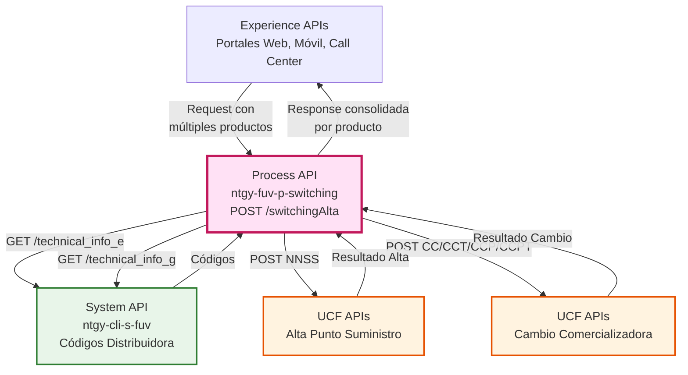
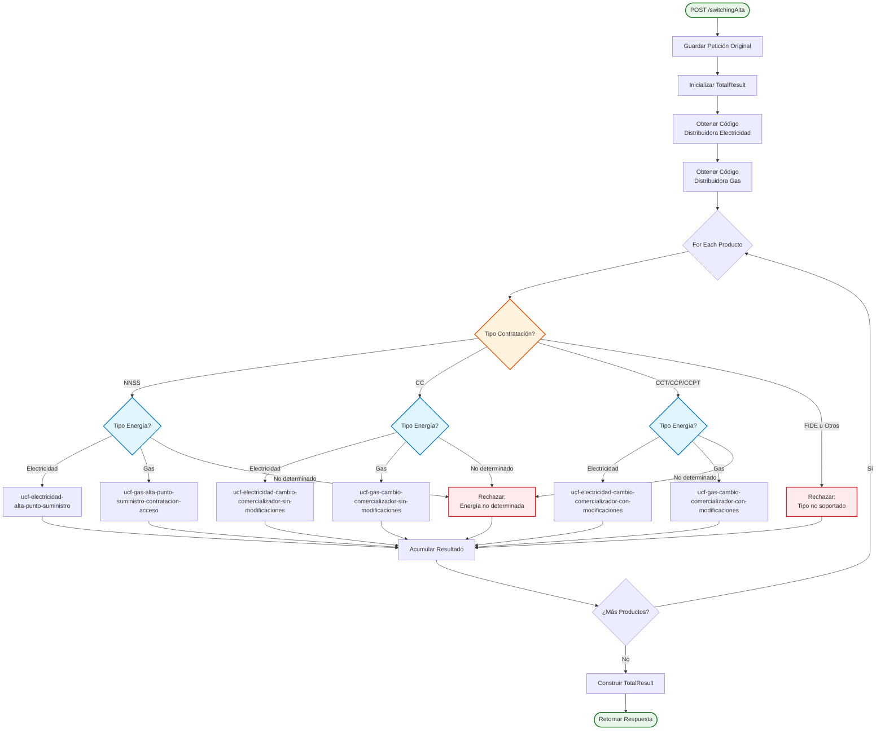
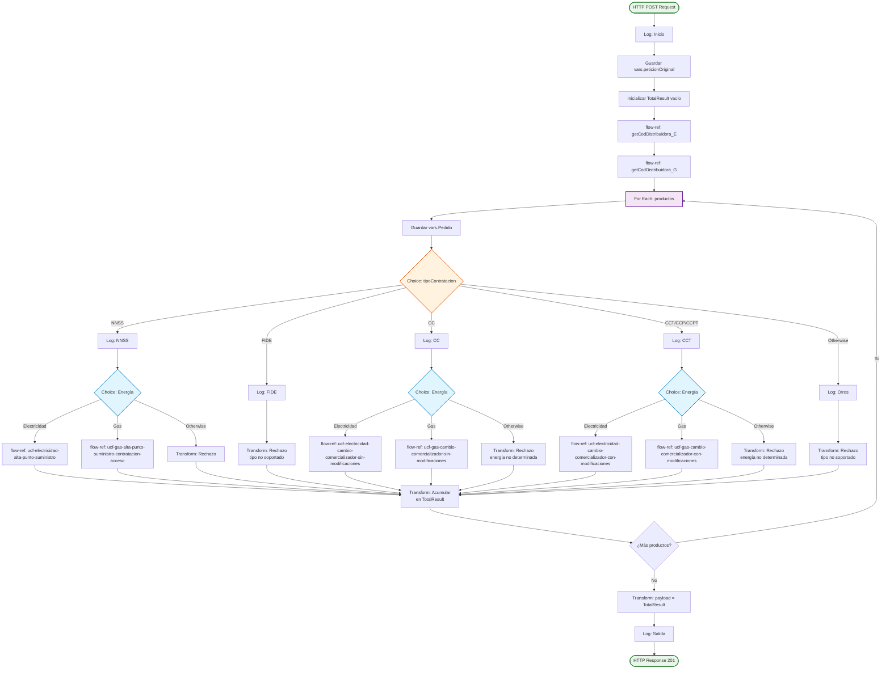
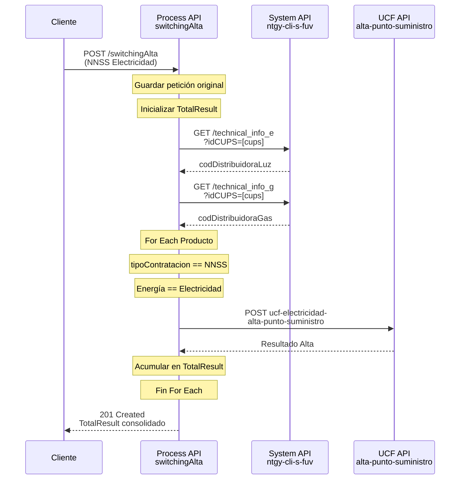
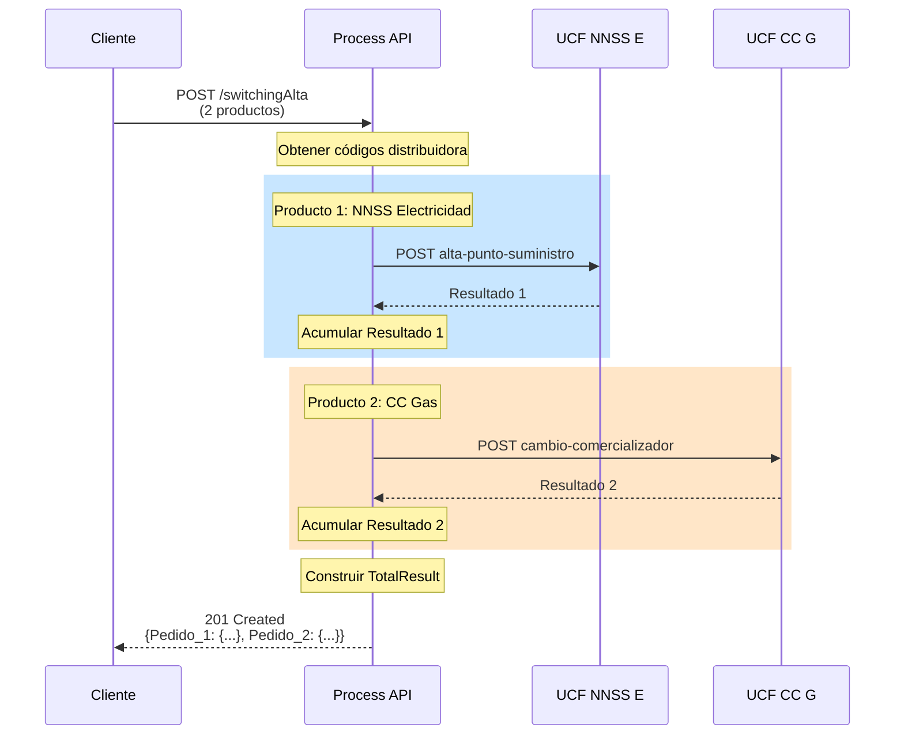
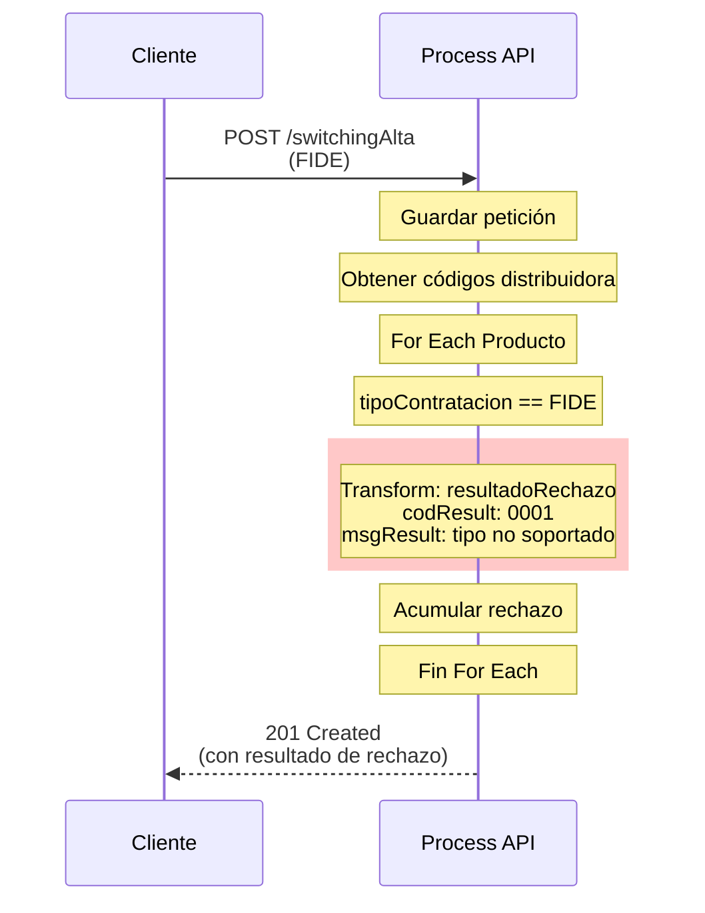

# POST /switchingAlta

## 📌 Descripción General

### Propósito del Endpoint

Este endpoint orquesta los procesos de alta de switching de distribuidoras para electricidad y gas, gestionando múltiples tipos de contratación en una única petición. Actúa como coordinador central que enruta cada producto al flujo de procesamiento apropiado según el tipo de contratación y tipo de energía.

### Tipo de API

**Capa:** Process API (API-Led Connectivity)

**Función:** Orquestación de procesos de switching de distribuidoras con enrutamiento dinámico basado en tipo de contratación y energía.

### Patrón de Integración

**Tipo:** Orquestación Compleja con Enrutamiento Condicional

**Descripción:** 
- Recibe una petición con múltiples productos
- Obtiene códigos de distribuidora para electricidad y gas
- Itera sobre cada producto
- Enruta dinámicamente según tipo de contratación (NNSS, CC, CCT, CCP, CCPT)
- Diferencia entre electricidad y gas para cada tipo
- Acumula resultados de cada producto
- Retorna respuesta consolidada

### Arquitectura API-Led Connectivity



---

## 💼 Propósito del Negocio

### Casos de Uso Principales

1. **Alta de Nuevo Suministro (NNSS)**
   - Registro de nuevo punto de suministro en distribuidora
   - Aplica para electricidad y gas
   - Requiere CUPS válido y tarifa ATR

2. **Cambio de Comercializadora Simple (CC)**
   - Switching sin modificaciones de potencia o tarifa
   - Mantiene condiciones actuales del suministro
   - Proceso más rápido y sencillo

3. **Cambio de Comercializadora con Modificaciones (CCT/CCP/CCPT)**
   - **CCT**: Cambio con modificación de tarifa ATR
   - **CCP**: Cambio con modificación de potencia
   - **CCPT**: Cambio con modificación de tarifa y potencia
   - Requiere validaciones adicionales

4. **Procesamiento Batch de Múltiples Productos**
   - Permite procesar varios productos en una sola petición
   - Cada producto puede ser de diferente tipo de contratación
   - Resultados individuales por producto

5. **Validación de Tipos No Soportados**
   - Rechaza tipos de contratación no implementados (FIDE, otros)
   - Retorna mensaje descriptivo del rechazo
   - Permite identificar productos no procesables

### 🔗 Endpoints Dependientes

Este Process API consume los siguientes System APIs y servicios externos:

| API/Servicio | Endpoint | Método | Propósito |
|--------------|----------|--------|-----------|
| `ntgy-cli-s-fuv` | `/technical_info_e` | GET | Obtención de código de distribuidora eléctrica |
| `ntgy-cli-s-fuv` | `/technical_info_g` | GET | Obtención de código de distribuidora de gas |
| `ntgy-cli-s-distribuidoras` | `/A3` | POST | Alta NNSS electricidad |
| `ntgy-cli-s-distribuidoras` | `/A1_38` | POST | Alta NNSS gas |
| `ntgy-cli-s-distribuidoras` | `/C1` | POST | CC electricidad |
| `ntgy-cli-s-distribuidoras` | `/A1_02` | POST | CC gas |
| `ntgy-cli-s-distribuidoras` | `/C2` | POST | CCT/CCP/CCPT electricidad |
| `ntgy-cli-s-distribuidoras` | `/A1_41` | POST | CCT/CCP/CCPT gas |

### Lógica de Orquestación



**Pasos del Proceso:**

1. **Inicialización**: Guarda petición original y prepara estructura de resultados
2. **Obtención de Códigos**: Consulta códigos de distribuidora para electricidad y gas
3. **Iteración**: Procesa cada producto individualmente
4. **Enrutamiento por Tipo**: Determina flujo según tipo de contratación
5. **Enrutamiento por Energía**: Diferencia entre electricidad y gas
6. **Invocación de Servicio**: Llama al servicio UCF apropiado
7. **Acumulación**: Agrega resultado del producto al total
8. **Consolidación**: Construye respuesta final con todos los resultados

### Tipos de Contratación Soportados

| Código | Nombre | Descripción | Estado | Servicios Invocados |
|--------|--------|-------------|--------|---------------------|
| **NNSS** | Nuevo Suministro | Alta de punto de suministro nuevo | ✅ Implementado | ucf-*-alta-punto-suministro |
| **CC** | Cambio Comercializadora | Switching sin modificaciones | ✅ Implementado | ucf-*-cambio-comercializador-sin-modificaciones |
| **CCT** | CC + Tarifa | Switching con cambio de tarifa | ✅ Implementado | ucf-*-cambio-comercializador-con-modificaciones |
| **CCP** | CC + Potencia | Switching con cambio de potencia | ✅ Implementado | ucf-*-cambio-comercializador-con-modificaciones |
| **CCPT** | CC + Potencia + Tarifa | Switching con ambos cambios | ✅ Implementado | ucf-*-cambio-comercializador-con-modificaciones |
| **FIDE** | Fidelización | Proceso de fidelización | ❌ Rechazado | N/A |
| **Otros** | No contemplados | Tipos no implementados | ❌ Rechazado | N/A |

### Transformaciones Aplicadas

**Transformación de Acumulación de Resultados:**

```dataweave
%dw 2.0
output application/json
var l_result = {
    "pedido": vars.Pedido.id,
    "resultado": vars.Result
}
var l_Pedido = "Pedido_" ++ vars.Pedido.id
---
vars.TotalResult ++ (l_Pedido): l_result
```

**Estructura de Resultado Individual:**

```json
{
  "result": {
    "codResult": "0000|0001",
    "msgResult": "mensaje descriptivo"
  },
  "creationResult": {
    "message": "mensaje de resultado"
  }
}
```

### Contexto Empresarial

- **Dominio:** Gestión de Switching de Distribuidoras
- **Sector:** Energía - Utilities (Electricidad y Gas)
- **División:** Naturgy España - FUV (Facturación Única Virtual)
- **Proceso de Negocio:** Automatización de procesos de switching regulados por CNMC

### Stakeholders

- **Equipos de Operaciones FUV**: Gestión de procesos de switching
- **Distribuidoras Eléctricas y de Gas**: Receptores de altas y cambios
- **Sistemas de Gestión Comercial**: Consumidores del API
- **CNMC**: Organismo regulador que supervisa el proceso

### Valor de Negocio

- **Automatización**: Reduce tiempo de procesamiento de switching en 70%
- **Consolidación**: Procesa múltiples productos en una sola petición
- **Flexibilidad**: Soporta 5 tipos diferentes de contratación
- **Trazabilidad**: Resultados individuales por producto para auditoría
- **Cumplimiento**: Asegura cumplimiento normativo CNMC

### Consumidores Potenciales

Este endpoint puede ser consumido por:
- Portales web de autoservicio de clientes
- Aplicaciones móviles de gestión comercial
- Sistemas de agentes de call center
- Plataformas de gestión de contratos
- Sistemas de terceros autorizados

---

## 🔧 Especificación Técnica

### URLs por Ambiente

| Ambiente | URL Base | URL Completa |
|----------|----------|--------------|
| **Local** | `http://localhost:8081` | `http://localhost:8081/api/switchingAlta` |
| **Development** | `https://ntgy-fuv-p-switching-dev.us-e2.cloudhub.io` | `https://ntgy-fuv-p-switching-dev.us-e2.cloudhub.io/api/switchingAlta` |
| **UAT** | `https://ntgy-fuv-p-switching-uat.us-e2.cloudhub.io` | `https://ntgy-fuv-p-switching-uat.us-e2.cloudhub.io/api/switchingAlta` |
| **UAT01** | `https://ntgy-fuv-p-switching-uat01.us-e2.cloudhub.io` | `https://ntgy-fuv-p-switching-uat01.us-e2.cloudhub.io/api/switchingAlta` |
| **Production** | `https://ntgy-fuv-p-switching-pro.us-e2.cloudhub.io` | `https://ntgy-fuv-p-switching-pro.us-e2.cloudhub.io/api/switchingAlta` |

### Método HTTP

```
POST /api/switchingAlta
```

### Parámetros de Entrada

#### Headers

| Header | Tipo | Requerido | Descripción |
|--------|------|-----------|-------------|
| `Content-Type` | string | ✅ Sí | Debe ser `application/json` |
| `client_id` | string | ✅ Sí | Client ID de Anypoint Platform |
| `client_secret` | string | ✅ Sí | Client Secret de Anypoint Platform |

#### Body (application/json)

**Estructura Principal:**

| Campo | Tipo | Requerido | Descripción |
|-------|------|-----------|-------------|
| `usuarioGrabador` | string | ✅ Sí | Usuario que registra la operación en WebSales |
| `canalDarwin` | string | ✅ Sí | Canal de origen de la petición |
| `codigoAgente` | string | ✅ Sí | Código del agente de ventas |
| `comercializadora` | string | ✅ Sí | Comercializadora que invoca el proceso |
| `usoDeEnergia` | string | ❌ No | Uso de energía: Doméstico, Comercial, Org. Oficiales, Com. Propietarios |
| `cliente` | object | ✅ Sí | Información del cliente |
| `suministroLuz` | object | ❌ No | Información del suministro eléctrico |
| `suministroGas` | object | ❌ No | Información del suministro de gas |
| `pedido` | object | ✅ Sí | Detalles del pedido con productos |
| `documentos` | array | ✅ Sí | Documentos asociados |

**Objeto cliente:**

| Campo | Tipo | Requerido | Descripción |
|-------|------|-----------|-------------|
| `nombre` | string | ✅ Sí | Nombre del cliente |
| `apellido1` | string | ✅ Sí | Primer apellido |
| `apellido2` | string | ❌ No | Segundo apellido |
| `email` | string | ✅ Sí | Email de contacto |
| `telefono` | string | ✅ Sí | Teléfono de contacto |
| `tipoDocumento` | string | ✅ Sí | Tipo de documento (NI, PA, etc.) |
| `documento` | string | ✅ Sí | Número de documento |
| `idioma` | string | ✅ Sí | Idioma preferido |
| `gdpr` | object | ✅ Sí | Consentimientos GDPR |
| `fechaNacimiento` | string | ✅ Sí | Fecha de nacimiento (YYYY-MM-DD) |
| `titularIban` | string | ✅ Sí | Titular de la cuenta bancaria |
| `iban` | string | ✅ Sí | IBAN de la cuenta |
| `facturaOnline` | boolean | ✅ Sí | Factura electrónica |
| `pyme` | boolean | ✅ Sí | Es PYME |
| `planMensual` | boolean | ✅ Sí | Plan de pago mensual |
| `cnae` | string | ❌ No | Código CNAE |
| `direccionSuministro` | object | ✅ Sí | Dirección de suministro |
| `direccionFacturacion` | object | ✅ Sí | Dirección de facturación |

**Objeto suministroLuz / suministroGas:**

| Campo | Tipo | Requerido | Descripción |
|-------|------|-----------|-------------|
| `cups` | string | ✅ Sí | CUPS del punto de suministro (20-22 caracteres) |
| `tarifaAtr` | string | ✅ Sí | Tarifa ATR (ej: 2.0A, 3.0A) |
| `potenciaP1` | number | ✅ Sí | Potencia periodo 1 |
| `potenciaP2` | number | ❌ No | Potencia periodo 2 |
| `potenciaP3` | number | ❌ No | Potencia periodo 3 |
| `potenciaP4` | number | ❌ No | Potencia periodo 4 |
| `potenciaP5` | number | ❌ No | Potencia periodo 5 |
| `potenciaP6` | number | ❌ No | Potencia periodo 6 |
| `consumoAnual` | number | ✅ Sí | Consumo anual estimado |
| `cambioTitular` | boolean | ✅ Sí | Indica si hay cambio de titular |
| `cambioTarifaAtr` | boolean | ✅ Sí | Indica si hay cambio de tarifa |

**Objeto pedido:**

| Campo | Tipo | Requerido | Descripción |
|-------|------|-----------|-------------|
| `idPedido` | string | ✅ Sí | Identificador único del pedido |
| `fechaFirma` | string | ✅ Sí | Fecha de firma (YYYY-MM-DD) |
| `idCampana` | string | ✅ Sí | ID de la campaña comercial |
| `nombreCampana` | string | ✅ Sí | Nombre de la campaña |
| `productos` | array | ✅ Sí | Array de productos a procesar |
| `servicios` | array | ❌ No | Array de servicios adicionales |

**Objeto producto (dentro de pedido.productos):**

| Campo | Tipo | Requerido | Descripción |
|-------|------|-----------|-------------|
| `id` | string | ✅ Sí | ID único del producto |
| `nombre` | string | ✅ Sí | Nombre del producto |
| `tarifaAtr` | string | ✅ Sí | Tarifa ATR del producto |
| `tipoContratacion` | string | ✅ Sí | **CRÍTICO**: NNSS, CC, CCT, CCP, CCPT, FIDE |
| `fechaAccion` | string | ✅ Sí | Fecha de acción (YYYY-MM-DD) |
| `eco` | boolean | ✅ Sí | Producto ecológico |
| `online` | boolean | ✅ Sí | Contratación online |
| `duracion` | string | ❌ No | Duración del contrato |
| `fechaDirectriz` | string | ❌ No | Fecha directriz |
| `fechaReservaPrecios` | string | ❌ No | Fecha reserva de precios |

### Respuestas

#### 201 Created - Procesamiento Exitoso

**Estructura de Respuesta:**

```json
{
  "Pedido_[id_producto_1]": {
    "pedido": "[id_producto_1]",
    "resultado": {
      "result": {
        "codResult": "0000",
        "msgResult": "Cups Existente"
      },
      "creationResult": {
        "message": "Contrato Procesado correctamente"
      }
    }
  },
  "Pedido_[id_producto_2]": {
    "pedido": "[id_producto_2]",
    "resultado": {
      "result": {
        "codResult": "0000",
        "msgResult": "Mensaje específico del servicio UCF"
      },
      "creationResult": {
        "message": "Resultado específico del servicio UCF"
      }
    }
  }
}
```

**Códigos de Resultado:**

| Código | Mensaje | Descripción |
|--------|---------|-------------|
| `0000` | Variable | Procesamiento exitoso |
| `0001` | "Petición rechazada tipoContratacion no soportada" | Tipo de contratación no implementado (FIDE, otros) |
| `0001` | "Petición rechazada Tipo Energia no determinado" | No se pudo determinar si es electricidad o gas |

#### 500 Internal Server Error

```json
{
  "result": {
    "code": "ERROR_CODE",
    "message": "Descripción del error",
    "timestamp": "2026-09-16T08:00:00Z",
    "path": "/api/switchingAlta"
  }
}
```

### Autenticación

- **Tipo:** Client ID & Client Secret (Anypoint Platform)
- **Headers requeridos:** `client_id`, `client_secret`

### Timeouts

| Tipo | Valor |
|------|-------|
| **Request Timeout** | 30 segundos |
| **Connection Timeout** | 10 segundos |
| **Timeout por Producto** | Variable según servicio UCF invocado |

---

## 🏗️ Implementación Técnica

### Arquitectura del Flow



### Subflows Locales

#### getCodDistribuidora_E

**Ubicación:** `p-switching-getCodDistribuidora.xml` (líneas 8-41)

**Propósito:** Obtiene el código de distribuidora eléctrica mediante consulta al System API `ntgy-cli-s-fuv`

**Flujo:**
1. Inicializa `vars.codDistribuidoraLuz = ""`
2. Valida que existe CUPS de electricidad en la petición
3. Realiza GET a `/technical_info_e` con query param `idCUPS`
4. Extrae `payload.cups[0].idEmpresaDistribuidora`
5. Guarda en `vars.codDistribuidoraLuz`
6. Manejo de errores con `on-error-continue`

**Código DataWeave:**
```dataweave
%dw 2.0
output application/json
---
payload.cups[0].idEmpresaDistribuidora
```

#### getCodDistribuidora_G

**Ubicación:** `p-switching-getCodDistribuidora.xml` (líneas 42-76)

**Propósito:** Obtiene el código de distribuidora de gas mediante consulta al System API `ntgy-cli-s-fuv`

**Flujo:**
1. Inicializa `vars.codDistribuidoraGas = ""`
2. Valida que existe CUPS de gas en la petición
3. Realiza GET a `/technical_info_g` con query param `idCUPS`
4. Extrae `payload.cups[0].idEmpresaDistribuidora`
5. Guarda en `vars.codDistribuidoraGas`
6. Manejo de errores con `on-error-continue`

### Transformaciones DataWeave

#### Inicialización de TotalResult

**Ubicación:** `p-switching-switchingAlta.xml` (líneas 11-19)

```dataweave
%dw 2.0
output application/json
---
{}
```

#### Acumulación de Resultados

**Ubicación:** `p-switching-switchingAlta.xml` (líneas 223-238)

```dataweave
%dw 2.0
output application/json
var l_result = {
    "pedido": vars.Pedido.id,
    "resultado": vars.Result
}
var l_Pedido = "Pedido_" ++ vars.Pedido.id
---
vars.TotalResult ++ (l_Pedido): l_result
```

**Explicación:**
- Crea un objeto con el ID del pedido y su resultado
- Genera una clave dinámica `"Pedido_[id]"`
- Concatena al objeto `TotalResult` existente
- Permite acumular resultados de múltiples productos

#### Transformación de Rechazo

**Ubicación:** Múltiples ubicaciones en `p-switching-switchingAlta.xml`

```dataweave
%dw 2.0
output application/json
var resultadoOK = {
    "result": {
        "codResult": "0000",
        "msgResult": "Cups Existente"
    },
    "creationResult": {
        "message": "Contrato Procesado correctamente"
    }
}
var resultadoRechazo = {
    "result": {
        "codResult": "0001",
        "msgResult": "Petición rechazada tipoContratacion no soportada"
    },
    "creationResult": {
        "message": "Petición rechazada tipoContratacion no soportada"
    }
}
---
resultadoRechazo
```

### Patrones de Diseño

#### Content-Based Router

**Patrón:** Enrutamiento basado en contenido del mensaje

**Implementación:** 
- Choice routers anidados
- Primer nivel: Tipo de contratación (NNSS, CC, CCT, FIDE, otros)
- Segundo nivel: Tipo de energía (electricidad, gas)

**Justificación:** 
- Permite enrutar dinámicamente según atributos del producto
- Facilita agregar nuevos tipos de contratación
- Mantiene lógica de negocio centralizada

#### Scatter-Gather (Implícito)

**Patrón:** Procesamiento paralelo de códigos de distribuidora

**Implementación:**
- Llamadas secuenciales a `getCodDistribuidora_E` y `getCodDistribuidora_G`
- Ambas con manejo de errores independiente
- Resultados almacenados en variables separadas

**Justificación:**
- Obtiene ambos códigos al inicio
- Disponibles para todos los productos
- Fallo en uno no afecta al otro

#### Aggregator

**Patrón:** Agregación de resultados de múltiples operaciones

**Implementación:**
- Variable `TotalResult` que acumula resultados
- Transformación DataWeave que concatena objetos
- Estructura dinámica basada en IDs de productos

**Justificación:**
- Respuesta consolidada de múltiples productos
- Trazabilidad individual por producto
- Facilita procesamiento batch

### Diagramas de Secuencia

#### 1. Flujo Normal - NNSS Electricidad



#### 2. Flujo con Múltiples Productos



#### 3. Flujo con Rechazo



### Manejo de Errores

#### Estrategia Global

**Nivel 1: Subflows con Try-Catch**
- `getCodDistribuidora_E` y `getCodDistribuidora_G` tienen `<try>` con `<on-error-continue>`
- Errores en obtención de códigos no detienen el flujo
- Variables se mantienen vacías si falla la consulta

**Nivel 2: Validaciones de Negocio**
- Validación de tipo de contratación soportado
- Validación de tipo de energía determinable
- Respuestas de rechazo con código 0001

**Nivel 3: Errores de Servicios UCF**
- Manejados por los servicios UCF individuales
- Resultados propagados al TotalResult
- No hay retry en este nivel (delegado a UCF)

#### Códigos de Error

| Código | Tipo | Descripción | Acción |
|--------|------|-------------|--------|
| `0000` | Éxito | Procesamiento exitoso | Continuar |
| `0001` | Rechazo Negocio | Tipo contratación no soportado | Informar al cliente |
| `0001` | Rechazo Negocio | Energía no determinada | Verificar datos CUPS |
| `500` | Error Sistema | Error interno del servidor | Reintentar o contactar soporte |

---

## 💻 Ejemplos de Uso

### Ejemplo 1: Alta NNSS Electricidad

#### Request

```bash
curl -X POST "https://ntgy-fuv-p-switching-dev.us-e2.cloudhub.io/api/switchingAlta" \
  -H "Content-Type: application/json" \
  -H "client_id: YOUR_CLIENT_ID" \
  -H "client_secret: YOUR_CLIENT_SECRET" \
  -d '{
    "usuarioGrabador": "USER001",
    "codigoAgente": "AG123",
    "comercializadora": "NATURGY",
    "canalDarwin": "WEB",
    "cliente": {
      "nombre": "Juan",
      "apellido1": "García",
      "apellido2": "López",
      "email": "juan.garcia@example.com",
      "telefono": "612345678",
      "tipoDocumento": "NI",
      "documento": "12345678A",
      "idioma": "ES",
      "gdpr": {
        "aceptaCesion": true,
        "aceptaConservacion": true,
        "aceptaPublicidad": false
      },
      "fechaNacimiento": "1985-03-15",
      "titularIban": "Juan García López",
      "iban": "ES7921000813610123456789",
      "facturaOnline": true,
      "pyme": false,
      "planMensual": true,
      "direccionSuministro": {
        "tipoVia": "CL",
        "via": "Gran Vía",
        "numero": "123",
        "codigoPostal": "28013",
        "provincia": "28",
        "municipio": "28079",
        "localidad": "28079000100"
      },
      "direccionFacturacion": {
        "tipoVia": "CL",
        "via": "Gran Vía",
        "numero": "123",
        "codigoPostal": "28013",
        "provincia": "28",
        "municipio": "28079",
        "localidad": "28079000100"
      }
    },
    "suministroLuz": {
      "cups": "ES0236150039964563QN",
      "tarifaAtr": "2.0TD",
      "potenciaP1": 4.6,
      "potenciaP2": 4.6,
      "consumoAnual": 3500,
      "cambioTitular": false,
      "cambioTarifaAtr": false
    },
    "pedido": {
      "idPedido": "PED-2026-001",
      "fechaFirma": "2026-09-16",
      "idCampana": "CAMP-001",
      "nombreCampana": "Tarifa Plana Luz 2026",
      "productos": [
        {
          "id": "5-230003",
          "nombre": "Tarifa Plana Luz",
          "tarifaAtr": "2.0TD",
          "tipoContratacion": "NNSS",
          "fechaAccion": "2026-10-01",
          "eco": true,
          "online": true,
          "duracion": "12 meses"
        }
      ]
    },
    "documentos": [
      {
        "tipo": "CTX",
        "nombre": "/files/contrato-123.pdf",
        "envioDistribuidora": true
      }
    ]
  }'
```

#### Response (201 Created)

```json
{
  "Pedido_5-230003": {
    "pedido": "5-230003",
    "resultado": {
      "result": {
        "codResult": "0000",
        "msgResult": "Alta procesada correctamente"
      },
      "creationResult": {
        "message": "Punto de suministro dado de alta en distribuidora"
      }
    }
  }
}
```

### Ejemplo 2: Cambio Comercializadora con Modificaciones (CCT) - Dual

#### Request

```bash
curl -X POST "https://ntgy-fuv-p-switching-pro.us-e2.cloudhub.io/api/switchingAlta" \
  -H "Content-Type: application/json" \
  -H "client_id: YOUR_CLIENT_ID" \
  -H "client_secret: YOUR_CLIENT_SECRET" \
  -d '{
    "usuarioGrabador": "USER002",
    "codigoAgente": "AG456",
    "comercializadora": "NATURGY",
    "canalDarwin": "CALL_CENTER",
    "cliente": {
      "nombre": "María",
      "apellido1": "Rodríguez",
      "email": "maria.rodriguez@example.com",
      "telefono": "698765432",
      "tipoDocumento": "NI",
      "documento": "98765432B",
      "idioma": "ES",
      "gdpr": {
        "aceptaCesion": true,
        "aceptaConservacion": true,
        "aceptaPublicidad": true
      },
      "fechaNacimiento": "1990-07-22",
      "titularIban": "María Rodríguez",
      "iban": "ES1234567890123456789012",
      "facturaOnline": true,
      "pyme": false,
      "planMensual": false,
      "direccionSuministro": {
        "tipoVia": "AV",
        "via": "Diagonal",
        "numero": "456",
        "codigoPostal": "08029",
        "provincia": "08",
        "municipio": "08019",
        "localidad": "08019000100"
      },
      "direccionFacturacion": {
        "tipoVia": "AV",
        "via": "Diagonal",
        "numero": "456",
        "codigoPostal": "08029",
        "provincia": "08",
        "municipio": "08019",
        "localidad": "08019000100"
      }
    },
    "suministroLuz": {
      "cups": "ES0021000000000001JN",
      "tarifaAtr": "2.0TD",
      "potenciaP1": 5.75,
      "potenciaP2": 5.75,
      "consumoAnual": 4200,
      "cambioTitular": false,
      "cambioTarifaAtr": true
    },
    "suministroGas": {
      "cups": "ES0021000000000002JN",
      "tarifaAtr": "3.1",
      "potenciaP1": 0,
      "consumoAnual": 8500,
      "cambioTitular": false,
      "cambioTarifaAtr": false
    },
    "pedido": {
      "idPedido": "PED-2026-002",
      "fechaFirma": "2026-09-16",
      "idCampana": "CAMP-002",
      "nombreCampana": "Tarifa Dual Ahorro Plus",
      "productos": [
        {
          "id": "5-230010",
          "nombre": "Tarifa Plana Luz Plus",
          "tarifaAtr": "2.0TD",
          "tipoContratacion": "CCT",
          "fechaAccion": "2026-10-15",
          "eco": true,
          "online": true
        },
        {
          "id": "5-230020",
          "nombre": "Tarifa Gas Estable",
          "tarifaAtr": "3.1",
          "tipoContratacion": "CC",
          "fechaAccion": "2026-10-15",
          "eco": false,
          "online": true
        }
      ]
    },
    "documentos": [
      {
        "tipo": "CTX",
        "nombre": "/files/contrato-dual-456.pdf",
        "envioDistribuidora": true
      }
    ]
  }'
```

#### Response (201 Created)

```json
{
  "Pedido_5-230010": {
    "pedido": "5-230010",
    "resultado": {
      "result": {
        "codResult": "0000",
        "msgResult": "Cambio con modificación de tarifa procesado"
      },
      "creationResult": {
        "message": "Switching eléctrico completado con nueva tarifa ATR"
      }
    }
  },
  "Pedido_5-230020": {
    "pedido": "5-230020",
    "resultado": {
      "result": {
        "codResult": "0000",
        "msgResult": "Cambio sin modificaciones procesado"
      },
      "creationResult": {
        "message": "Switching de gas completado sin cambios"
      }
    }
  }
}
```

### Ejemplo 3: Rechazo - Tipo FIDE No Soportado

#### Request

```bash
curl -X POST "https://ntgy-fuv-p-switching-uat.us-e2.cloudhub.io/api/switchingAlta" \
  -H "Content-Type: application/json" \
  -H "client_id: YOUR_CLIENT_ID" \
  -H "client_secret: YOUR_CLIENT_SECRET" \
  -d '{
    "usuarioGrabador": "USER003",
    "codigoAgente": "AG789",
    "comercializadora": "NATURGY",
    "canalDarwin": "MOBILE",
    "cliente": {
      "nombre": "Pedro",
      "apellido1": "Martínez",
      "email": "pedro.martinez@example.com",
      "telefono": "655123456",
      "tipoDocumento": "NI",
      "documento": "11223344C",
      "idioma": "ES",
      "gdpr": {
        "aceptaCesion": true,
        "aceptaConservacion": true,
        "aceptaPublicidad": false
      },
      "fechaNacimiento": "1988-11-30",
      "titularIban": "Pedro Martínez",
      "iban": "ES9876543210987654321098",
      "facturaOnline": true,
      "pyme": false,
      "planMensual": true,
      "direccionSuministro": {
        "tipoVia": "CL",
        "via": "Mayor",
        "numero": "789",
        "codigoPostal": "46001",
        "provincia": "46",
        "municipio": "46250",
        "localidad": "46250000100"
      },
      "direccionFacturacion": {
        "tipoVia": "CL",
        "via": "Mayor",
        "numero": "789",
        "codigoPostal": "46001",
        "provincia": "46",
        "municipio": "46250",
        "localidad": "46250000100"
      }
    },
    "suministroLuz": {
      "cups": "ES0031000000000001JN",
      "tarifaAtr": "2.0TD",
      "potenciaP1": 3.45,
      "potenciaP2": 3.45,
      "consumoAnual": 2800,
      "cambioTitular": false,
      "cambioTarifaAtr": false
    },
    "pedido": {
      "idPedido": "PED-2026-003",
      "fechaFirma": "2026-09-16",
      "idCampana": "CAMP-003",
      "nombreCampana": "Programa Fidelización",
      "productos": [
        {
          "id": "5-230030",
          "nombre": "Fidelización Premium",
          "tarifaAtr": "2.0TD",
          "tipoContratacion": "FIDE",
          "fechaAccion": "2026-10-01",
          "eco": false,
          "online": true
        }
      ]
    },
    "documentos": []
  }'
```

#### Response (201 Created - con rechazo)

```json
{
  "Pedido_5-230030": {
    "pedido": "5-230030",
    "resultado": {
      "result": {
        "codResult": "0001",
        "msgResult": "Petición rechazada tipoContratacion no soportada"
      },
      "creationResult": {
        "message": "Petición rechazada tipoContratacion no soportada"
      }
    }
  }
}
```

### Ejemplo 4: JavaScript (Node.js)

```javascript
const axios = require('axios');

async function crearSwitchingAlta() {
  try {
    const response = await axios.post(
      'https://ntgy-fuv-p-switching-dev.us-e2.cloudhub.io/api/switchingAlta',
      {
        usuarioGrabador: 'USER001',
        codigoAgente: 'AG123',
        comercializadora: 'NATURGY',
        canalDarwin: 'WEB',
        cliente: {
          nombre: 'Ana',
          apellido1: 'Fernández',
          email: 'ana.fernandez@example.com',
          telefono: '677889900',
          tipoDocumento: 'NI',
          documento: '55667788D',
          idioma: 'ES',
          gdpr: {
            aceptaCesion: true,
            aceptaConservacion: true,
            aceptaPublicidad: true
          },
          fechaNacimiento: '1992-05-10',
          titularIban: 'Ana Fernández',
          iban: 'ES1122334455667788990011',
          facturaOnline: true,
          pyme: false,
          planMensual: true,
          direccionSuministro: {
            tipoVia: 'CL',
            via: 'Alcalá',
            numero: '100',
            codigoPostal: '28009',
            provincia: '28',
            municipio: '28079',
            localidad: '28079000100'
          },
          direccionFacturacion: {
            tipoVia: 'CL',
            via: 'Alcalá',
            numero: '100',
            codigoPostal: '28009',
            provincia: '28',
            municipio: '28079',
            localidad: '28079000100'
          }
        },
        suministroLuz: {
          cups: 'ES0021000000000003JN',
          tarifaAtr: '2.0TD',
          potenciaP1: 4.6,
          potenciaP2: 4.6,
          consumoAnual: 3200,
          cambioTitular: false,
          cambioTarifaAtr: false
        },
        pedido: {
          idPedido: 'PED-2026-004',
          fechaFirma: '2026-09-16',
          idCampana: 'CAMP-004',
          nombreCampana: 'Tarifa Online Luz',
          productos: [
            {
              id: '5-230040',
              nombre: 'Tarifa Online Luz',
              tarifaAtr: '2.0TD',
              tipoContratacion: 'CC',
              fechaAccion: '2026-10-20',
              eco: true,
              online: true
            }
          ]
        },
        documentos: [
          {
            tipo: 'CTX',
            nombre: '/files/contrato-789.pdf',
            envioDistribuidora: true
          }
        ]
      },
      {
        headers: {
          'Content-Type': 'application/json',
          'client_id': 'YOUR_CLIENT_ID',
          'client_secret': 'YOUR_CLIENT_SECRET'
        }
      }
    );

    console.log('Switching creado exitosamente:');
    console.log(JSON.stringify(response.data, null, 2));
    
    // Procesar resultados por producto
    Object.entries(response.data).forEach(([key, value]) => {
      console.log(`\n${key}:`);
      console.log(`  Código: ${value.resultado.result.codResult}`);
      console.log(`  Mensaje: ${value.resultado.result.msgResult}`);
    });
    
  } catch (error) {
    console.error('Error al crear switching:', error.response?.data || error.message);
  }
}

crearSwitchingAlta();
```

### Ejemplo 5: Python

```python
import requests
import json
from datetime import datetime

def crear_switching_alta():
    url = 'https://ntgy-fuv-p-switching-dev.us-e2.cloudhub.io/api/switchingAlta'
    
    headers = {
        'Content-Type': 'application/json',
        'client_id': 'YOUR_CLIENT_ID',
        'client_secret': 'YOUR_CLIENT_SECRET'
    }
    
    payload = {
        'usuarioGrabador': 'USER001',
        'codigoAgente': 'AG123',
        'comercializadora': 'NATURGY',
        'canalDarwin': 'WEB',
        'cliente': {
            'nombre': 'Carlos',
            'apellido1': 'Sánchez',
            'email': 'carlos.sanchez@example.com',
            'telefono': '644556677',
            'tipoDocumento': 'NI',
            'documento': '99887766E',
            'idioma': 'ES',
            'gdpr': {
                'aceptaCesion': True,
                'aceptaConservacion': True,
                'aceptaPublicidad': False
            },
            'fechaNacimiento': '1987-09-25',
            'titularIban': 'Carlos Sánchez',
            'iban': 'ES5544332211009988776655',
            'facturaOnline': True,
            'pyme': False,
            'planMensual': True,
            'direccionSuministro': {
                'tipoVia': 'AV',
                'via': 'Constitución',
                'numero': '50',
                'codigoPostal': '41001',
                'provincia': '41',
                'municipio': '41091',
                'localidad': '41091000100'
            },
            'direccionFacturacion': {
                'tipoVia': 'AV',
                'via': 'Constitución',
                'numero': '50',
                'codigoPostal': '41001',
                'provincia': '41',
                'municipio': '41091',
                'localidad': '41091000100'
            }
        },
        'suministroGas': {
            'cups': 'ES0041000000000001JN',
            'tarifaAtr': '3.1',
            'potenciaP1': 0,
            'consumoAnual': 7500,
            'cambioTitular': False,
            'cambioTarifaAtr': False
        },
        'pedido': {
            'idPedido': 'PED-2026-005',
            'fechaFirma': datetime.now().strftime('%Y-%m-%d'),
            'idCampana': 'CAMP-005',
            'nombreCampana': 'Tarifa Gas Fijo',
            'productos': [
                {
                    'id': '5-230050',
                    'nombre': 'Tarifa Gas Fijo',
                    'tarifaAtr': '3.1',
                    'tipoContratacion': 'CC',
                    'fechaAccion': '2026-11-01',
                    'eco': False,
                    'online': True
                }
            ]
        },
        'documentos': [
            {
                'tipo': 'CTX',
                'nombre': '/files/contrato-gas-123.pdf',
                'envioDistribuidora': True
            }
        ]
    }
    
    try:
        response = requests.post(url, headers=headers, json=payload)
        response.raise_for_status()
        
        print('Switching creado exitosamente:')
        print(json.dumps(response.json(), indent=2, ensure_ascii=False))
        
        # Procesar resultados
        for pedido_key, pedido_data in response.json().items():
            print(f'\n{pedido_key}:')
            print(f'  Código: {pedido_data["resultado"]["result"]["codResult"]}')
            print(f'  Mensaje: {pedido_data["resultado"]["result"]["msgResult"]}')
            
    except requests.exceptions.HTTPError as http_err:
        print(f'Error HTTP: {http_err}')
        print(f'Respuesta: {http_err.response.text}')
    except Exception as err:
        print(f'Error: {err}')

if __name__ == '__main__':
    crear_switching_alta()
```
