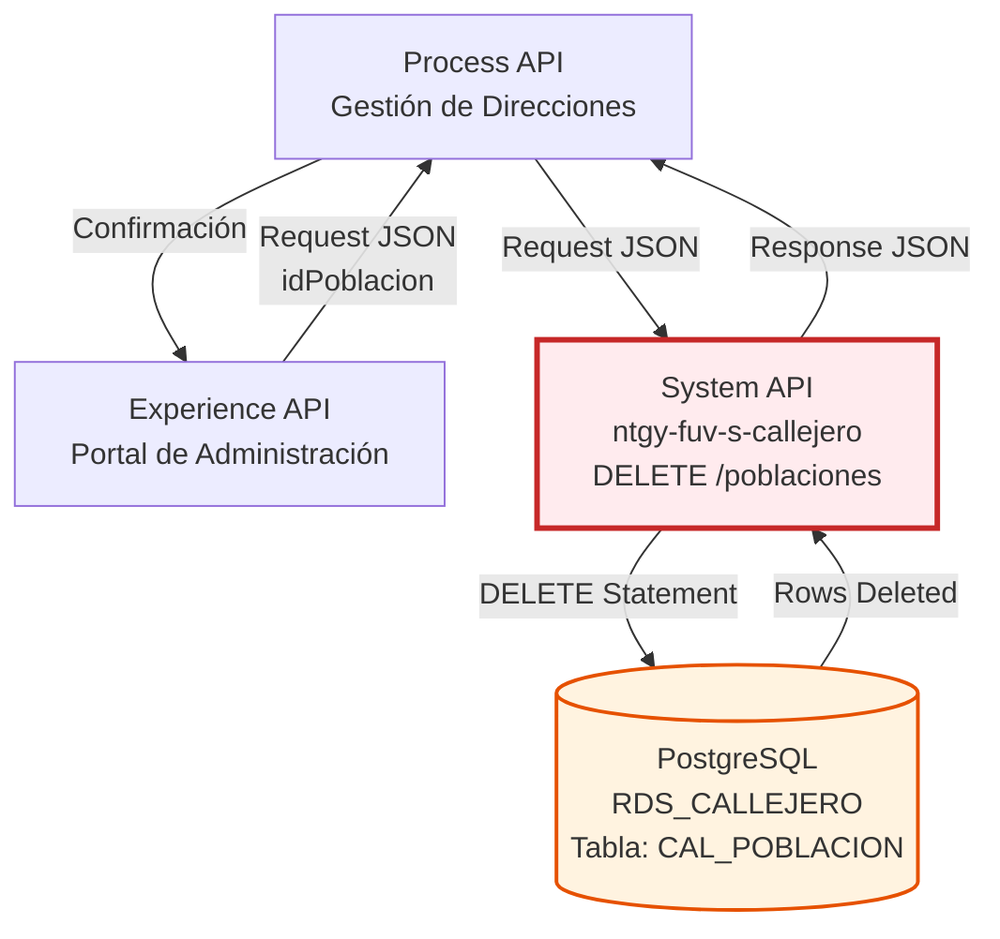

# DELETE /poblaciones

## ⚠️ ADVERTENCIAS IMPORTANTES

### 🚨 Operación Irreversible
Esta operación **elimina permanentemente** una población de la base de datos. Una vez ejecutada, **no puede deshacerse** sin restaurar desde backup. Use con extrema precaución.

### ⚠️ Discrepancia RAML vs Código Real
**IMPORTANTE:** Existe una discrepancia entre la especificación RAML y el código real:
- **RAML especifica**: Campo `codigoGN` (línea 42 del RAML)
- **Código real usa**: Campo `idPoblacion` (verificado en implementación)
- **Esta documentación se basa en**: Código real (fuente de verdad)

### ⚠️ Inconsistencia en Nombre de Columna
El WHERE clause usa `idPoblacion` en lugar de `id_poblacion_gn` (usado en otros endpoints). Esto podría indicar un error en el código o una columna diferente en la tabla.

---

## 📌 Descripción General

### Propósito del Endpoint

Este endpoint permite eliminar una población existente del sistema de callejero de Naturgy mediante su identificador. Ejecuta una sentencia DELETE en la tabla `CAL_POBLACION` de PostgreSQL, eliminando permanentemente el registro.

El endpoint soporta:
- **Eliminación por identificador**: Elimina población específica por su ID
- **Operación atómica**: DELETE transaccional en PostgreSQL
- **Confirmación de eliminación**: Retorna mensaje de éxito
- **Sin validación de dependencias**: No verifica referencias en otras tablas

### Tipo de API

**Capa:** System API (API-Led Connectivity)

**Función:** Integración directa con PostgreSQL para eliminación de datos maestros de poblaciones del callejero español.

### Patrón de Integración

**Tipo:** Request-Reply Síncrono con SQL DELETE

**Descripción:** El endpoint recibe el identificador de la población en formato JSON, construye una sentencia SQL DELETE mediante DataWeave, ejecuta la eliminación en PostgreSQL y retorna una respuesta de confirmación.

### Arquitectura API-Led Connectivity



---

## 💼 Propósito del Negocio

### Casos de Uso Principales

1. **Eliminación de Poblaciones Duplicadas**
   - Remover registros duplicados detectados en auditorías
   - Limpiar datos redundantes de migraciones
   - Consolidar poblaciones con múltiples entradas

2. **Limpieza de Datos Obsoletos**
   - Eliminar poblaciones que ya no existen administrativamente
   - Remover datos de prueba o desarrollo
   - Limpiar registros creados por error

3. **Corrección de Errores de Carga**
   - Eliminar poblaciones cargadas incorrectamente
   - Remover datos de cargas fallidas
   - Corregir errores de importación masiva

4. **Mantenimiento de Catálogo**
   - Gestión de ciclo de vida de poblaciones
   - Eliminación controlada de datos históricos
   - Mantenimiento de integridad del catálogo

### Contexto Empresarial

- **Dominio:** Gestión de Direcciones y Callejero
- **Sector:** Energía - Utilities
- **División:** Naturgy España
- **Proceso de Negocio:** Mantenimiento y limpieza de datos maestros geográficos
- **Criticidad:** Alta - Operación irreversible que afecta integridad de datos

### Stakeholders

- **Equipos de Datos Maestros**: Responsables de mantener calidad y limpieza de datos
- **Administradores de Sistema**: Gestionan eliminación de datos obsoletos
- **Equipos de Calidad de Datos**: Detectan y eliminan duplicados e inconsistencias
- **Auditores de Datos**: Supervisan operaciones de eliminación

### Valor de Negocio

- **Integridad de Datos**: Mantiene catálogo limpio sin duplicados
- **Calidad de Datos**: Elimina información obsoleta o incorrecta
- **Eficiencia**: Reduce tamaño de base de datos y mejora performance
- **Cumplimiento**: Permite eliminar datos según políticas de retención

### Consumidores Potenciales

Este endpoint puede ser consumido por:
- Process APIs de gestión de datos maestros
- Herramientas de administración de callejero
- Procesos batch de limpieza de datos
- Interfaces de administración web con permisos especiales
- Scripts de mantenimiento de base de datos

---

## 🔧 Especificación Técnica

### URLs por Ambiente

| Ambiente | URL Base | URL Completa |
|----------|----------|--------------|
| **Local** | `http://localhost:8081` | `http://localhost:8081/api/poblaciones` |
| **Development** | `https://ntgy-fuv-s-callejero-dev.us-e2.cloudhub.io` | `https://ntgy-fuv-s-callejero-dev.us-e2.cloudhub.io/api/poblaciones` |
| **UAT** | `https://ntgy-fuv-s-callejero-uat.us-e2.cloudhub.io` | `https://ntgy-fuv-s-callejero-uat.us-e2.cloudhub.io/api/poblaciones` |
| **Production** | `https://ntgy-fuv-s-callejero-pro.us-e2.cloudhub.io` | `https://ntgy-fuv-s-callejero-pro.us-e2.cloudhub.io/api/poblaciones` |

### Método HTTP

```
DELETE /api/poblaciones
```

### Parámetros de Entrada

#### Headers HTTP

| Header | Tipo | Requerido | Descripción | Ejemplo |
|--------|------|-----------|-------------|---------|
| `Content-Type` | string | ✅ Sí | Tipo de contenido del request | `application/json` |
| `Accept` | string | ❌ No | Tipo de contenido esperado en response | `application/json` |

#### Body Parameters

**⚠️ IMPORTANTE - Discrepancia Detectada:**

| Fuente | Campo Especificado | Estado |
|--------|-------------------|--------|
| **RAML** | `codigoGN` | ❌ Desactualizado |
| **Código Real** | `idPoblacion` | ✅ Implementado |
| **Esta Documentación** | `idPoblacion` | ✅ Basado en código |

**Estructura del Request Body (según código real):**

| Campo | Tipo | Requerido | Descripción | Ejemplo |
|-------|------|-----------|-------------|---------|
| `idPoblacion` | string | ✅ Sí | Identificador de la población a eliminar | `"28001"` |

**Nota Técnica:**
- El código usa `payload.idPoblacion` para construir el WHERE clause
- El RAML especifica `codigoGN` pero el código real no lo usa
- Esta documentación refleja la implementación real

### Respuestas

#### Respuesta Exitosa (200 OK)

```json
{
  "result": {
    "codResult": "0000",
    "msgResult": "Registro Borrado Correctamente"
  }
}
```

**Descripción de Campos:**
- `codResult`: Código de resultado (`"0000"` indica éxito)
- `msgResult`: Mensaje descriptivo de la operación

**⚠️ Nota Importante:** La respuesta es la misma independientemente de si la población existía o no. El endpoint retorna éxito incluso si no se eliminó ningún registro (0 filas afectadas).

#### Respuesta de Error de Validación (400 Bad Request)

```json
{
  "message": "Bad request"
}
```

**Causas comunes:**
- Campo `idPoblacion` faltante
- Formato JSON inválido
- Content-Type incorrecto

#### Respuesta de Error de Base de Datos (500 Internal Server Error)

```json
{
  "result": {
    "codResult": "0001",
    "msgResult": "Error al eliminar registro en base de datos"
  }
}
```

**Causas comunes:**
- Violación de foreign key (población referenciada en otras tablas)
- Error de conexión a base de datos
- Timeout de base de datos
- Permisos insuficientes

### Autenticación y Autorización

- **Tipo:** Client ID & Client Secret (Anypoint Platform)
- **Autorización PostgreSQL:** El usuario de base de datos debe tener permisos para:
  - Ejecutar DELETE en tabla `CAL_POBLACION`
  - Acceso al schema `public`
  - Conexión a base de datos `RDS_CALLEJERO`
- **Recomendación:** Restringir este endpoint a usuarios con permisos administrativos

### Timeouts

| Tipo | Valor | Descripción |
|------|-------|-------------|
| **Request Timeout** | 30 segundos | Tiempo máximo de espera para la respuesta |
| **Connection Timeout** | 10 segundos | Tiempo máximo para establecer conexión con PostgreSQL |
| **Query Timeout** | 20 segundos | Tiempo máximo de ejecución del DELETE |

---

## 🏗️ Implementación Técnica

### Arquitectura del Flow

```mermaid
flowchart TD
    Start([HTTP DELETE Request<br/>Body JSON]) --> LogInit[Log: Flow Init<br/>poblaciones flow init delete]
    LogInit --> LogInput[Log: Input Payload<br/>Input payload: #[payload]]
    LogInput --> Transform[Transform Message<br/>Construir DELETE Statement]
    Transform --> Delete[Database Delete<br/>db:delete en CAL_POBLACION]
    Delete --> TransformResp[Transform Response<br/>Construir JSON de éxito]
    TransformResp --> End([HTTP 200 Response])
    
    Delete -.->|Error| ErrorHandler[Error Handler]
    ErrorHandler --> ErrorResp[Error Response<br/>500 Internal Server Error]
    ErrorResp --> ErrorEnd([HTTP 500 Response])
    
    style Start fill:#ffebee,stroke:#c62828
    style Transform fill:#fff9c4,stroke:#f57f17,stroke-width:2px
    style Delete fill:#ffebee,stroke:#c62828,stroke-width:3px
    style End fill:#e8f5e9,stroke:#2e7d32
    style ErrorResp fill:#ffebee,stroke:#c62828
```

### Componentes del Flow

#### 1. Logger Inicial
```xml
<logger level="INFO" message="poblaciones flow init delete" />
```
- **Propósito**: Registrar inicio de ejecución del flow
- **Nivel**: INFO

#### 2. Logger de Input Payload
```xml
<logger level="INFO" message="Input payload: #[payload]" />
```
- **Propósito**: Registrar el payload JSON recibido
- **Nivel**: INFO
- **Contenido**: Body completo del request con `idPoblacion`

#### 3. Transformación DataWeave - Construcción del DELETE

**Variable:** `query`

```dataweave
%dw 2.0
output application/json
---
{
    "deleteStatement": "DELETE from CAL_POBLACION where idPoblacion = '" 
                       ++ payload.idPoblacion ++ "'"
}
```

**Análisis de la Transformación:**

1. **Extracción del Identificador**:
   - Lee `idPoblacion` desde `payload.idPoblacion`
   - Este valor viene del body JSON del request

2. **Construcción del DELETE SQL**:
   - Concatena el valor en la cláusula WHERE
   - Formato: `DELETE FROM CAL_POBLACION WHERE idPoblacion = '[valor]'`
   - El valor se envuelve en comillas simples

3. **Resultado**:
   - Variable `vars.query.deleteStatement` contiene el SQL completo
   - Ejemplo: `"DELETE from CAL_POBLACION where idPoblacion = '28001'"`

**⚠️ Inconsistencia Detectada:**

El WHERE clause usa `idPoblacion` (sin prefijo `id_` ni sufijo `_gn`), lo cual es **diferente** de otros endpoints:
- POST usa: `ID_POBLACION_GN`
- GET usa: `id_poblacion_gn`
- PUT usa: `id_poblacion_gn`
- DELETE usa: `idPoblacion` ← **Inconsistente**

Esto podría indicar:
- Error en el código (debería ser `id_poblacion_gn`)
- Columna diferente en la tabla
- Alias o vista con nombre diferente

**⚠️ Nota de Seguridad:**
Este query utiliza concatenación directa de strings, lo que podría ser vulnerable a SQL injection. Sin embargo, dado que es un System API interno con validación en capas superiores, el riesgo es mitigado.

#### 4. Database Delete

**Configuración:**
```xml
<db:delete config-ref="RDS_CALLEJERO">
    <db:sql><![CDATA[#[vars.query.deleteStatement]]]></db:sql>
</db:delete>
```

**Detalles:**
- **Connector**: Database Connector v1.14.12
- **Config**: `RDS_CALLEJERO`
- **Driver**: PostgreSQL 42.3.3
- **Operación**: DELETE
- **Tabla**: `CAL_POBLACION`

**SQL Ejecutado:**
```sql
DELETE FROM CAL_POBLACION 
WHERE idPoblacion = '[idPoblacion]'
```

**Ejemplo Concreto:**
```sql
DELETE FROM CAL_POBLACION 
WHERE idPoblacion = '28001'
```

**Resultado del DELETE:**
- **Si encuentra**: Elimina el registro y retorna número de filas afectadas (1)
- **Si no encuentra**: No elimina nada, retorna 0 filas afectadas (pero no es error)
- **Transaccionalidad**: Operación atómica e irreversible

**⚠️ Sin Validación de Dependencias:**
El endpoint NO verifica si la población está referenciada en otras tablas. Si existen foreign keys, el DELETE fallará con error 500.

#### 5. Transformación de Respuesta

```dataweave
%dw 2.0
output application/json
---
{
    "result": {
        "codResult": "0000",
        "msgResult": "Registro Borrado Correctamente"
    }
}
```

**Respuesta Estándar:**
- Código de éxito: `"0000"`
- Mensaje fijo de confirmación
- Formato JSON consistente
- No indica si realmente se eliminó algo

### Configuración de Base de Datos

**Database Config (RDS_CALLEJERO):**

```xml
<db:config name="RDS_CALLEJERO">
    <db:generic-connection 
        url="jdbc:postgresql://${bbdd.host}:${bbdd.port}/${bbdd.database}" 
        driverClassName="org.postgresql.Driver" 
        user="${bbdd.user}" 
        password="${secure::bbdd.password}">
        <db:pooling-profile />
    </db:generic-connection>
</db:config>
```

**Propiedades de Conexión:**
- **Host**: `${bbdd.host}` (configurable por ambiente)
- **Puerto**: `${bbdd.port}` (típicamente 5432)
- **Base de datos**: `${bbdd.database}` (RDS_CALLEJERO)
- **Usuario**: `${bbdd.user}` (debe tener permisos DELETE)
- **Password**: `${secure::bbdd.password}` (encriptado)
- **Connection Pooling**: Habilitado

### Manejo de Errores

**Errores Potenciales:**

1. **Campo Identificador Faltante**
   - **Causa**: Request sin `idPoblacion`
   - **Manejo**: APIKit valida y retorna 400 Bad Request
   - **Respuesta**: `{"message": "Bad request"}`

2. **Foreign Key Violation**
   - **Causa**: Población referenciada en otras tablas (vías, direcciones, etc.)
   - **Respuesta**: 500 Internal Server Error
   - **Solución**: Eliminar primero las referencias o usar CASCADE

3. **Población No Existe**
   - **Causa**: `idPoblacion` especificado no existe en la tabla
   - **Comportamiento**: DELETE ejecuta pero afecta 0 filas
   - **Respuesta**: 200 OK (no se detecta como error)
   - **Nota**: El consumidor debe validar existencia previamente con GET

4. **Connection Timeout**
   - **Causa**: Base de datos no disponible o sobrecargada
   - **Respuesta**: 500 Internal Server Error

5. **Permisos Insuficientes**
   - **Causa**: Usuario de BD sin permisos DELETE
   - **Respuesta**: 500 Internal Server Error

### Consideraciones de Performance

- **Tiempo de Ejecución Esperado**: < 100ms
- **Índice en idPoblacion**: Debe existir para búsqueda rápida en WHERE
- **Connection Pooling**: Reutilización de conexiones reduce latencia
- **Transaccionalidad**: Cada DELETE es una transacción atómica
- **Sin Rollback**: Una vez ejecutado, no puede deshacerse

### Comparación CRUD Completa

| Aspecto | POST | GET | PUT | DELETE |
|---------|------|-----|-----|--------|
| **Operación SQL** | INSERT | SELECT | UPDATE | DELETE |
| **Parámetros** | Body JSON | Query param | Body JSON | Body JSON |
| **Campo clave** | codigoGN | idPoblacion | codigoGN | **idPoblacion** |
| **Idempotencia** | ❌ No | ✅ Sí | ✅ Sí | ✅ Sí |
| **Reversible** | ✅ Sí (DELETE) | N/A | ✅ Sí (UPDATE) | ❌ **NO** |
| **Validación dependencias** | No | N/A | No | No |
| **Complejidad** | Media | Baja | Alta | Baja |

**⚠️ Nota sobre Inconsistencia:**
- POST, PUT usan: `codigoGN` → `id_poblacion_gn`
- GET, DELETE usan: `idPoblacion` (GET en query, DELETE en body)
- Esta inconsistencia sugiere posible error o evolución del código

---

## 💻 Ejemplos de Uso

### Ejemplo 1: Eliminación Exitosa

**Request:**

```bash
curl -X DELETE "https://ntgy-fuv-s-callejero-dev.us-e2.cloudhub.io/api/poblaciones" \
  -H "Content-Type: application/json" \
  -H "Accept: application/json" \
  -d '{
    "idPoblacion": "28001"
  }'
```

**SQL Generado:**
```sql
DELETE FROM CAL_POBLACION 
WHERE idPoblacion = '28001'
```

**Response (200 OK):**

```json
{
  "result": {
    "codResult": "0000",
    "msgResult": "Registro Borrado Correctamente"
  }
}
```

### Ejemplo 2: Población No Existe (Sin Error)

**Request:**

```bash
curl -X DELETE "https://ntgy-fuv-s-callejero-dev.us-e2.cloudhub.io/api/poblaciones" \
  -H "Content-Type: application/json" \
  -d '{
    "idPoblacion": "99999"
  }'
```

**Response (200 OK):**

```json
{
  "result": {
    "codResult": "0000",
    "msgResult": "Registro Borrado Correctamente"
  }
}
```

**⚠️ Nota Importante:** El endpoint retorna éxito aunque la población no exista (0 filas eliminadas). Es responsabilidad del consumidor validar existencia previamente.

### Ejemplo 3: Error - Campo Faltante

**Request:**

```bash
curl -X DELETE "https://ntgy-fuv-s-callejero-dev.us-e2.cloudhub.io/api/poblaciones" \
  -H "Content-Type: application/json" \
  -d '{}'
```

**Response (400 Bad Request):**

```json
{
  "message": "Bad request"
}
```

**Causa**: El campo obligatorio `idPoblacion` no fue proporcionado.

### Ejemplo 4: Error - Foreign Key Violation

**Request:**

```bash
curl -X DELETE "https://ntgy-fuv-s-callejero-dev.us-e2.cloudhub.io/api/poblaciones" \
  -H "Content-Type: application/json" \
  -d '{
    "idPoblacion": "28001"
  }'
```

**Response (500 Internal Server Error):**

```json
{
  "result": {
    "codResult": "0001",
    "msgResult": "Error al eliminar registro en base de datos"
  }
}
```

**Causa**: La población está referenciada en otras tablas (vías, direcciones, etc.) y no puede eliminarse sin violar integridad referencial.

### Ejemplo 5: Eliminación con Validación Previa (Recomendado)

```javascript
/**
 * Elimina una población con validación previa
 * @param {string} idPoblacion - ID de la población a eliminar
 * @returns {Promise<Object>} - Resultado de la operación
 */
const eliminarPoblacionSeguro = async (idPoblacion) => {
  const baseUrl = 'https://ntgy-fuv-s-callejero-dev.us-e2.cloudhub.io/api/poblaciones';
  
  try {
    // 1. Verificar que existe
    const getResponse = await fetch(`${baseUrl}?idPoblacion=${idPoblacion}`);
    const getData = await getResponse.json();
    
    if (!getData.values || getData.values.length === 0) {
      return {
        success: false,
        error: 'POBLACION_NO_EXISTE',
        mensaje: 'La población no existe en el sistema'
      };
    }

    // 2. Confirmar con el usuario (en aplicación real)
    const poblacion = getData.values[0];
    console.log(`⚠️ Se eliminará: ${poblacion.des_poblacion}`);
    console.log('Esta operación es IRREVERSIBLE');
    
    // 3. Eliminar
    const deleteResponse = await fetch(baseUrl, {
      method: 'DELETE',
      headers: {
        'Content-Type': 'application/json',
        'Accept': 'application/json'
      },
      body: JSON.stringify({ idPoblacion })
    });

    const deleteData = await deleteResponse.json();
    
    if (deleteResponse.ok && deleteData.result.codResult === '0000') {
      return {
        success: true,
        mensaje: 'Población eliminada exitosamente',
        poblacionEliminada: poblacion
      };
    } else {
      return {
        success: false,
        error: 'ERROR_ELIMINACION',
        mensaje: deleteData.result.msgResult
      };
    }
  } catch (error) {
    return {
      success: false,
      error: 'ERROR_CONEXION',
      mensaje: error.message
    };
  }
};

// Ejemplo de uso
const resultado = await eliminarPoblacionSeguro('28001');
if (resultado.success) {
  console.log('✅', resultado.mensaje);
} else {
  console.error('❌', resultado.error, '-', resultado.mensaje);
}
```

### Ejemplo 6: Uso desde Python con Validación

```python
import requests

def eliminar_poblacion_seguro(id_poblacion):
    """
    Elimina una población con validación previa.
    
    Args:
        id_poblacion (str): ID de la población a eliminar
        
    Returns:
        dict: Resultado de la operación
    """
    base_url = 'https://ntgy-fuv-s-callejero-dev.us-e2.cloudhub.io/api/poblaciones'
    
    try:
        # 1. Verificar que existe
        get_response = requests.get(base_url, params={'idPoblacion': id_poblacion})
        get_data = get_response.json()
        
        if not get_data.get('values') or len(get_data['values']) == 0:
            return {
                'success': False,
                'error': 'POBLACION_NO_EXISTE',
                'mensaje': 'La población no existe en el sistema'
            }
        
        # 2. Mostrar información
        poblacion = get_data['values'][0]
        print(f"⚠️ Se eliminará: {poblacion['des_poblacion']}")
        print('Esta operación es IRREVERSIBLE')
        
        # 3. Eliminar
        delete_response = requests.delete(
            base_url,
            json={'idPoblacion': id_poblacion},
            headers={'Content-Type': 'application/json'}
        )
        
        delete_data = delete_response.json()
        
        if delete_response.status_code == 200 and delete_data['result']['codResult'] == '0000':
            return {
                'success': True,
                'mensaje': 'Población eliminada exitosamente',
                'poblacion_eliminada': poblacion
            }
        else:
            return {
                'success': False,
                'error': 'ERROR_ELIMINACION',
                'mensaje': delete_data['result']['msgResult']
            }
            
    except requests.exceptions.RequestException as e:
        return {
            'success': False,
            'error': 'ERROR_CONEXION',
            'mensaje': str(e)
        }

# Ejemplo de uso
resultado = eliminar_poblacion_seguro('28001')
if resultado['success']:
    print(f"✅ {resultado['mensaje']}")
else:
    print(f"❌ {resultado['error']} - {resultado['mensaje']}")
```

### Ejemplo 7: Eliminación Batch con Manejo de Errores

```javascript
/**
 * Elimina múltiples poblaciones con manejo robusto de errores
 * @param {Array<string>} idsPoblaciones - Array de IDs a eliminar
 * @returns {Promise<Object>} - Resumen de operaciones
 */
const eliminarPoblacionesBatch = async (idsPoblaciones) => {
  const resultados = {
    exitosos: 0,
    fallidos: 0,
    noExisten: 0,
    conReferencias: 0,
    detalles: []
  };

  for (const idPoblacion of idsPoblaciones) {
    try {
      const resultado = await eliminarPoblacionSeguro(idPoblacion);
      
      if (resultado.success) {
        resultados.exitosos++;
        resultados.detalles.push({
          idPoblacion,
          estado: 'ELIMINADO',
          poblacion: resultado.poblacionEliminada.des_poblacion
        });
      } else if (resultado.error === 'POBLACION_NO_EXISTE') {
        resultados.noExisten++;
        resultados.detalles.push({
          idPoblacion,
          estado: 'NO_EXISTE'
        });
      } else if (resultado.error === 'ERROR_ELIMINACION') {
        resultados.conReferencias++;
        resultados.detalles.push({
          idPoblacion,
          estado: 'CON_REFERENCIAS',
          mensaje: resultado.mensaje
        });
      } else {
        resultados.fallidos++;
        resultados.detalles.push({
          idPoblacion,
          estado: 'ERROR',
          error: resultado.error
        });
      }
    } catch (error) {
      resultados.fallidos++;
      resultados.detalles.push({
        idPoblacion,
        estado: 'EXCEPCION',
        error: error.message
      });
    }
  }

  return resultados;
};

// Ejemplo de uso
const ids = ['28001', '08101', '50001', '99999'];
const resumen = await eliminarPoblacionesBatch(ids);

console.log(`✅ Eliminados: ${resumen.exitosos}`);
console.log(`❌ Fallidos: ${resumen.fallidos}`);
console.log(`⚠️ No existen: ${resumen.noExisten}`);
console.log(`🔗 Con referencias: ${resumen.conReferencias}`);
console.log('\nDetalles:', resumen.detalles);
```

### Ejemplo 8: Comparación Completa CRUD

```javascript
// CRUD Completo de Poblaciones

// CREATE - POST
await fetch(url, {
  method: 'POST',
  body: JSON.stringify({
    codigoGN: '28001',
    identificadorProvincia: '28',
    codigoINE: '280796',
    descripcionPoblacion: 'Madrid',
    codigoPostal: '28001'
  })
});

// READ - GET
await fetch(`${url}?idPoblacion=28001`, {
  method: 'GET'
});

// UPDATE - PUT
await fetch(url, {
  method: 'PUT',
  body: JSON.stringify({
    codigoGN: '28001',
    codigoPostal: '28003'  // Solo actualiza código postal
  })
});

// DELETE
await fetch(url, {
  method: 'DELETE',
  body: JSON.stringify({
    idPoblacion: '28001'  // ⚠️ Nota: usa idPoblacion, no codigoGN
  })
});
```

**⚠️ Nota sobre Inconsistencia de Campos:**
- POST y PUT usan `codigoGN` como identificador
- GET y DELETE usan `idPoblacion` como identificador
- Esta inconsistencia debe tenerse en cuenta al implementar clientes
