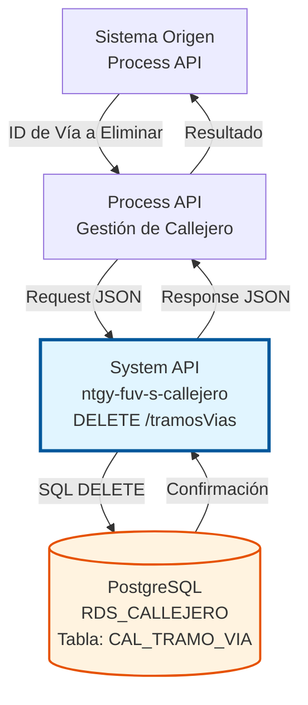
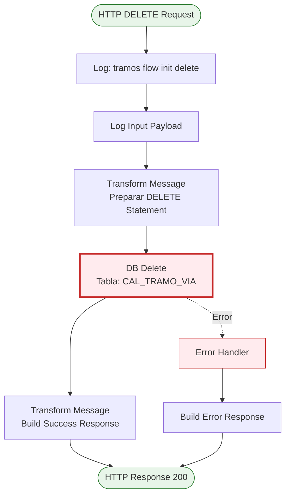
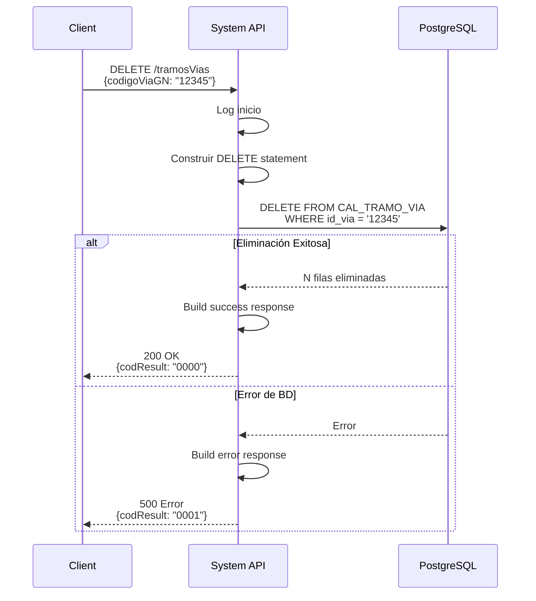

# DELETE /tramosVias

## 📌 Descripción General

### Propósito del Endpoint

Este endpoint permite eliminar un tramo de vía de la base de datos PostgreSQL del callejero español. La eliminación se realiza filtrando por el identificador de vía (`codigoViaGN`), lo que elimina todos los tramos asociados a esa vía.

El endpoint soporta:
- **Eliminación por ID de Vía**: Borra todos los tramos de una vía específica
- **Operación Permanente**: La eliminación es definitiva (no es soft delete)
- **Confirmación de Eliminación**: Retorna mensaje de éxito tras la operación
- **Validación de Integridad**: Respeta constraints de base de datos

### Tipo de API

**Capa:** System API (API-Led Connectivity)

**Función:** Integración directa con PostgreSQL para eliminación de tramos de vías del callejero español.

### Patrón de Integración

**Tipo:** Request-Reply Síncrono con SQL DELETE

**Descripción:** Recibe el identificador de vía en el body del request, construye un DELETE statement, ejecuta la eliminación en la tabla CAL_TRAMO_VIA y retorna confirmación.

### Arquitectura API-Led Connectivity



---

## 💼 Propósito del Negocio

### Casos de Uso Principales

1. **Eliminación de Vías Obsoletas**
   - Cuando una vía desaparece por cambios urbanísticos
   - Limpieza de datos duplicados o erróneos
   - Mantenimiento de la base de datos del callejero

2. **Corrección de Errores**
   - Eliminar tramos creados por error
   - Limpiar datos de prueba o migraciones fallidas
   - Corregir inconsistencias en el callejero

3. **Reorganización Territorial**
   - Eliminar tramos tras fusiones de municipios
   - Actualizar tras cambios en códigos postales
   - Preparar para recarga completa de datos

### Contexto Empresarial

- **Dominio:** Gestión de Callejero y Direcciones
- **Sector:** Energía - Utilities
- **División:** Naturgy España
- **Proceso de Negocio:** Mantenimiento y limpieza del callejero español
- **Criticidad:** Alta - Operación irreversible que afecta integridad de datos

### Stakeholders

- **Administradores de Datos**: Mantienen la calidad del callejero
- **Equipos de Migración**: Limpian datos tras migraciones
- **Departamento de TI**: Gestionan integridad referencial
- **Auditores de Datos**: Verifican consistencia del callejero

### Valor de Negocio

- **Calidad de Datos**: Elimina información obsoleta o incorrecta
- **Integridad**: Mantiene el callejero limpio y actualizado
- **Eficiencia**: Reduce ruido en consultas y validaciones
- **Cumplimiento**: Facilita auditorías y verificaciones de datos

### Consumidores Potenciales

Este endpoint puede ser consumido por:
- Process APIs de administración de datos maestros
- Herramientas de limpieza de datos
- Procesos de migración y sincronización
- Aplicaciones de mantenimiento del callejero

---

## 🔧 Especificación Técnica

### URLs por Ambiente

| Ambiente | URL Base | URL Completa |
|----------|----------|--------------|
| **Local** | `http://localhost:8081` | `http://localhost:8081/api/tramosVias` |
| **Development** | `https://ntgy-fuv-s-callejero-dev.us-e2.cloudhub.io` | `https://ntgy-fuv-s-callejero-dev.us-e2.cloudhub.io/api/tramosVias` |
| **UAT** | `https://ntgy-fuv-s-callejero-uat.us-e2.cloudhub.io` | `https://ntgy-fuv-s-callejero-uat.us-e2.cloudhub.io/api/tramosVias` |
| **Production** | `https://ntgy-fuv-s-callejero-pro.us-e2.cloudhub.io` | `https://ntgy-fuv-s-callejero-pro.us-e2.cloudhub.io/api/tramosVias` |

### Método HTTP

```
DELETE /api/tramosVias
```

### Parámetros de Entrada

#### Headers HTTP

| Header | Tipo | Requerido | Descripción | Ejemplo |
|--------|------|-----------|-------------|---------|
| `Content-Type` | string | ✅ Sí | Tipo de contenido del request | `application/json` |
| `Accept` | string | ❌ No | Tipo de contenido esperado en response | `application/json` |

#### Body Parameters

| Campo | Tipo | Requerido | Descripción | Ejemplo |
|-------|------|-----------|-------------|---------|
| `codigoViaGN` | string | ✅ Sí | Identificador de la vía a eliminar | `"12345"` |

**Nota:** Aunque el RAML menciona `userId`, el código real utiliza `codigoViaGN` como parámetro de eliminación.

**Estructura JSON del Body:**

```json
{
  "codigoViaGN": "12345"
}
```

### Respuestas

#### Respuesta Exitosa (200 OK)

```json
{
  "result": {
    "codResult": "0000",
    "msgResult": "Registro Borrado Correctamente"
  }
}
```

#### Respuesta Sin Registros Afectados (200 OK)

```json
{
  "result": {
    "codResult": "0000",
    "msgResult": "Registro Borrado Correctamente"
  }
}
```

**Nota:** Aunque no se encuentren registros, retorna éxito (operación idempotente).

#### Respuesta de Error Técnico (500)

```json
{
  "result": {
    "codResult": "0001",
    "msgResult": "Error al eliminar el registro de la base de datos"
  }
}
```

### Autenticación y Autorización

- **Tipo:** Client ID & Client Secret (Anypoint Platform)
- **Autorización PostgreSQL:** El usuario de base de datos debe tener permisos para:
  - Ejecutar DELETE en tabla `CAL_TRAMO_VIA`
  - Acceso al schema `public`
- **⚠️ Advertencia:** Esta operación es irreversible y requiere permisos elevados

### Timeouts

| Tipo | Valor | Descripción |
|------|-------|-------------|
| **Request Timeout** | 30 segundos | Tiempo máximo de espera para la respuesta |
| **Connection Timeout** | 10 segundos | Tiempo máximo para establecer conexión con PostgreSQL |

---

## 🏗️ Implementación Técnica

### Arquitectura del Flow



### Componentes del Flow

#### 1. Logger Inicial (Flow Init)
```xml
<logger level="INFO" message="tramos flow init delete" />
```
- Registra el inicio del flow de eliminación
- Facilita auditoría de operaciones de borrado

#### 2. Logger de Input
```xml
<logger level="INFO" message="Input payload: #[payload]" />
```
- Registra el payload con el ID de vía a eliminar
- Crítico para trazabilidad de eliminaciones

#### 3. Transformación DataWeave (Preparación DELETE)

**Ubicación en código:** Líneas 145-154 del archivo XML

```dataweave
%dw 2.0
output application/json
---
{
  "deleteStatement": "DELETE from CAL_TRAMO_VIA where id_via = '" ++ payload.codigoViaGN ++ "'"
}
```

**Lógica:**
- Extrae `codigoViaGN` del payload
- Construye dinámicamente el DELETE statement
- Filtra por `id_via` en la tabla
- **⚠️ Importante:** Elimina TODOS los tramos de la vía especificada

#### 4. Database Delete

**Ubicación en código:** Líneas 155-157 del archivo XML

```xml
<db:delete config-ref="RDS_CALLEJERO">
    <db:sql><![CDATA[#[vars.query.deleteStatement]]]></db:sql>
</db:delete>
```

**Configuración:**
- **Config:** `RDS_CALLEJERO`
- **Operación:** DELETE
- **Tabla:** `CAL_TRAMO_VIA`

**Query SQL Generado (ejemplo):**
```sql
DELETE FROM CAL_TRAMO_VIA WHERE id_via = '12345'
```

**⚠️ Advertencia:** Esta query elimina TODOS los tramos asociados a la vía.

#### 5. Transformación de Respuesta

**Ubicación en código:** Líneas 158-168 del archivo XML

```dataweave
%dw 2.0
output application/json
---
{
  "result": {
    "codResult": "0000",
    "msgResult": "Registro Borrado Correctamente"
  }	
}
```

### Flujo de Eliminación



### Tabla de Base de Datos

**Tabla:** `public.CAL_TRAMO_VIA`

| Columna | Tipo | Descripción |
|---------|------|-------------|
| `id_via` | INTEGER | Identificador de la vía (criterio de eliminación) |
| `id_tramo` | INTEGER | Identificador del tramo |
| `cod_postal` | VARCHAR | Código postal del tramo |
| `num_imp_desde` | VARCHAR | Número inicial lado impar |
| `num_par_desde` | VARCHAR | Número inicial lado par |
| `num_imp_hasta` | VARCHAR | Número final lado impar |
| `num_par_hasta` | VARCHAR | Número final lado par |
| `id_tipo_tramo` | VARCHAR | Tipo de tramo |
| `fecha_baja` | DATE | Fecha de baja del tramo |

**Clave Primaria:** (`id_via`, `id_tramo`)

**⚠️ Impacto de Eliminación:**
- Se eliminan TODOS los tramos con el `id_via` especificado
- La operación es permanente (no hay soft delete)
- Puede afectar múltiples registros en una sola operación

### Manejo de Errores

**Errores Comunes:**

1. **Vía No Existe**
   - El `codigoViaGN` no existe en la tabla
   - DELETE afecta 0 filas
   - Retorna 200 OK (operación idempotente)

2. **Violación de Integridad Referencial**
   - Existen referencias a estos tramos en otras tablas
   - PostgreSQL retorna error de foreign key constraint
   - Retorna 500 Internal Server Error

3. **Error de Conexión a Base de Datos**
   - Timeout o base de datos no disponible
   - Retorna 503 Service Unavailable

---

## 💻 Ejemplos de Uso

### Ejemplo 1: Eliminar Tramos de una Vía

**Request:**

```bash
curl -X DELETE "http://localhost:8081/api/tramosVias" \
  -H "Content-Type: application/json" \
  -d '{
    "codigoViaGN": "12345"
  }'
```

**Response (200 OK):**

```json
{
  "result": {
    "codResult": "0000",
    "msgResult": "Registro Borrado Correctamente"
  }
}
```

### Ejemplo 2: Eliminar Vía Inexistente (Idempotente)

**Request:**

```bash
curl -X DELETE "http://localhost:8081/api/tramosVias" \
  -H "Content-Type: application/json" \
  -d '{
    "codigoViaGN": "99999"
  }'
```

**Response (200 OK):**

```json
{
  "result": {
    "codResult": "0000",
    "msgResult": "Registro Borrado Correctamente"
  }
}
```

**Nota:** La operación es idempotente - retorna éxito aunque no existan registros.

### Ejemplo 3: Error - Violación de Integridad Referencial

**Request:**

```bash
curl -X DELETE "http://localhost:8081/api/tramosVias" \
  -H "Content-Type: application/json" \
  -d '{
    "codigoViaGN": "12345"
  }'
```

**Response (500 Internal Server Error):**

```json
{
  "result": {
    "codResult": "0001",
    "msgResult": "Error al eliminar: violación de constraint de foreign key"
  }
}
```

### Ejemplo 4: Uso desde JavaScript

```javascript
const deleteTramoVia = async (codigoViaGN) => {
  try {
    const response = await fetch('http://localhost:8081/api/tramosVias', {
      method: 'DELETE',
      headers: {
        'Content-Type': 'application/json'
      },
      body: JSON.stringify({
        codigoViaGN: codigoViaGN
      })
    });

    const result = await response.json();
    
    if (result.result.codResult === "0000") {
      console.log('Tramos eliminados exitosamente');
      return true;
    } else {
      console.error('Error al eliminar tramos:', result.result.msgResult);
      throw new Error(result.result.msgResult);
    }
  } catch (error) {
    console.error('Error en la petición:', error);
    throw error;
  }
};

// Uso
deleteTramoVia("12345").then(() => {
  console.log('Operación completada');
}).catch(error => {
  console.error('Falló la eliminación:', error);
});
```

### Ejemplo 5: Eliminación con Confirmación

```javascript
const deleteTramoViaConConfirmacion = async (codigoViaGN) => {
  // Primero, obtener información de los tramos
  const tramos = await getTramosVia(codigoViaGN);
  
  if (tramos.length === 0) {
    console.log('No hay tramos para eliminar');
    return false;
  }
  
  // Mostrar información y solicitar confirmación
  console.log(`Se eliminarán ${tramos.length} tramos de la vía ${codigoViaGN}:`);
  tramos.forEach(tramo => {
    console.log(`  - Tramo ${tramo.id_tramo}: CP ${tramo.cod_postal}`);
  });
  
  const confirmacion = confirm('¿Está seguro de eliminar estos tramos?');
  
  if (!confirmacion) {
    console.log('Eliminación cancelada por el usuario');
    return false;
  }
  
  // Proceder con la eliminación
  try {
    await deleteTramoVia(codigoViaGN);
    console.log(`${tramos.length} tramos eliminados correctamente`);
    return true;
  } catch (error) {
    console.error('Error al eliminar:', error);
    return false;
  }
};

// Uso
deleteTramoViaConConfirmacion("12345");
```

### Ejemplo 6: Eliminación Masiva con Validación

```javascript
const eliminarTramosMasivo = async (codigosVia) => {
  const resultados = {
    exitosos: [],
    fallidos: []
  };

  for (const codigoVia of codigosVia) {
    try {
      await deleteTramoVia(codigoVia);
      resultados.exitosos.push(codigoVia);
      console.log(`✓ Vía ${codigoVia} eliminada`);
    } catch (error) {
      resultados.fallidos.push({
        codigoVia,
        error: error.message
      });
      console.error(`✗ Error al eliminar vía ${codigoVia}:`, error.message);
    }
    
    // Pausa entre eliminaciones para no sobrecargar la BD
    await new Promise(resolve => setTimeout(resolve, 100));
  }

  return resultados;
};

// Uso
const viasAEliminar = ["12345", "12346", "12347"];
eliminarTramosMasivo(viasAEliminar).then(resultados => {
  console.log(`\nResumen:`);
  console.log(`  Exitosos: ${resultados.exitosos.length}`);
  console.log(`  Fallidos: ${resultados.fallidos.length}`);
  
  if (resultados.fallidos.length > 0) {
    console.log(`\nErrores:`);
    resultados.fallidos.forEach(f => {
      console.log(`  - Vía ${f.codigoVia}: ${f.error}`);
    });
  }
});
```

## ⚠️ Consideraciones Importantes

### Seguridad y Permisos

- **Operación Irreversible**: No hay forma de recuperar datos eliminados sin backup
- **Permisos Elevados**: Requiere permisos de DELETE en la base de datos
- **Auditoría**: Todas las eliminaciones deben ser registradas en logs
- **Validación Previa**: Recomendado verificar impacto antes de eliminar

### Mejores Prácticas

1. **Verificar Antes de Eliminar**: Consultar los tramos con GET antes de DELETE
2. **Confirmación del Usuario**: Implementar confirmación en interfaces de usuario
3. **Backup**: Asegurar que existen backups recientes de la base de datos
4. **Soft Delete Alternativo**: Considerar usar `fechaBaja` en lugar de DELETE físico
5. **Logging**: Registrar todas las eliminaciones para auditoría

### Alternativa: Soft Delete

En lugar de eliminar físicamente, considerar marcar como dado de baja:

```javascript
// Alternativa más segura: marcar como dado de baja
const darDeBajaTramos = async (codigoVia) => {
  const tramos = await getTramosVia(codigoVia);
  
  for (const tramo of tramos) {
    await updateTramoVia(tramo.id_via, tramo.id_tramo, {
      fechaBaja: new Date().toISOString().split('T')[0].replace(/-/g, '')
    });
  }
  
  console.log(`${tramos.length} tramos marcados como dados de baja`);
};