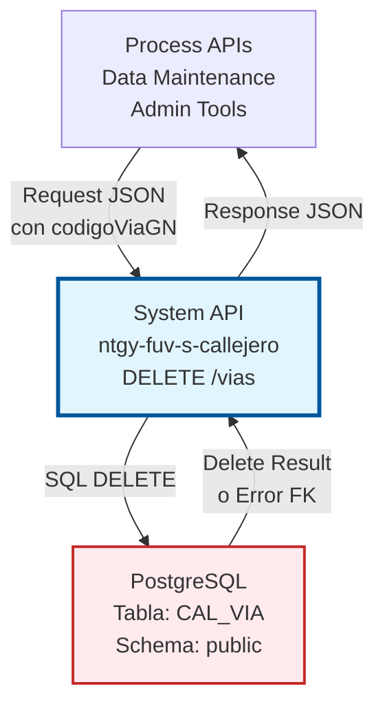
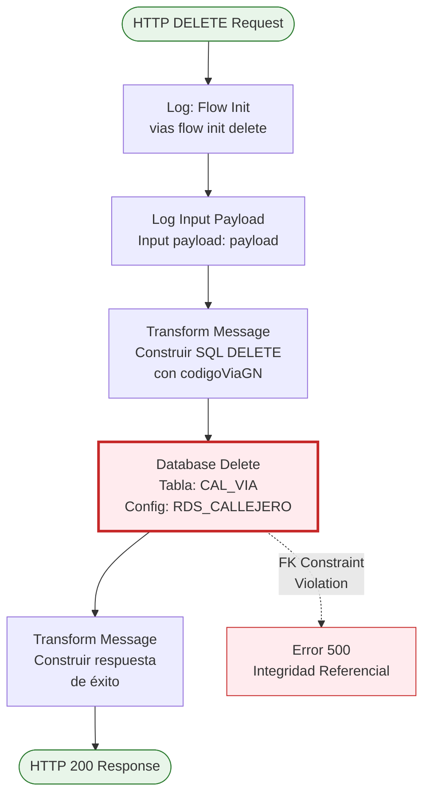
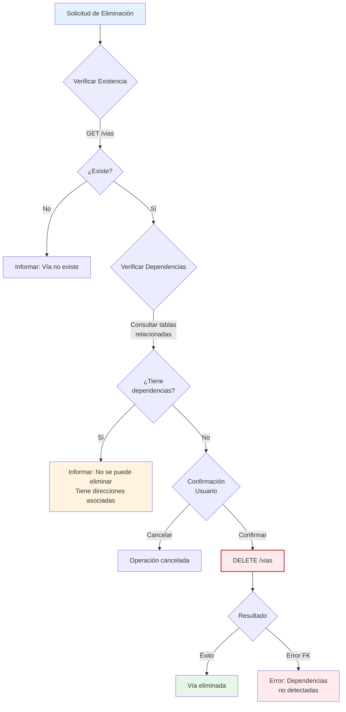

# DELETE /vias

## 📌 Descripción General

### Propósito del Endpoint

Este endpoint permite eliminar **físicamente** una vía del sistema de callejero español. Realiza una eliminación permanente del registro en la base de datos PostgreSQL, sin posibilidad de recuperación.

⚠️ **ADVERTENCIA CRÍTICA:** Este endpoint realiza una eliminación física (hard delete), no una eliminación lógica. Los datos se borran permanentemente de la base de datos y no pueden ser recuperados.

El endpoint soporta:
- **Eliminación Física**: Borra permanentemente el registro de la base de datos
- **Operación Irreversible**: No hay forma de deshacer la eliminación
- **Validación de Integridad**: PostgreSQL valida constraints de foreign key
- **Respuesta Estandarizada**: Formato JSON consistente con otros endpoints

### Tipo de API

**Capa:** System API (API-Led Connectivity)

**Función:** Integración directa con PostgreSQL para eliminación de datos de callejero español.

### Patrón de Integración

**Tipo:** Request-Reply Síncrono con SQL DELETE

**Descripción:** Recibe el identificador de la vía en formato JSON, construye la sentencia SQL DELETE, ejecuta la eliminación en PostgreSQL y retorna una respuesta estandarizada. Si existen registros dependientes (direcciones asociadas), PostgreSQL rechazará la operación por violación de integridad referencial.

### Arquitectura API-Led Connectivity



---

## 💼 Propósito del Negocio

### Casos de Uso Principales

1. **Limpieza de Datos Obsoletos**
   - Eliminar vías duplicadas o erróneas
   - Limpiar datos de prueba o migraciones fallidas
   - Mantener la base de datos libre de registros inválidos

2. **Mantenimiento de Datos Maestros**
   - Eliminar vías que nunca debieron existir
   - Corregir errores de carga masiva de datos
   - Gestionar ciclo de vida de datos maestros

3. **Cumplimiento de Normativas**
   - Eliminar datos según políticas de retención
   - Cumplir con solicitudes de eliminación de datos
   - Mantener solo datos válidos y actuales

### Contexto Empresarial

- **Dominio:** Gestión de Callejero y Direcciones
- **Sector:** Energía - Utilities
- **División:** Naturgy España - FUV (Fuerza de Ventas)
- **Proceso de Negocio:** Mantenimiento de Datos Maestros de Direcciones
- **Criticidad:** Alta - Operación destructiva que requiere precauciones

### Stakeholders

- **Administradores de Datos Maestros**: Responsables de limpieza de datos
- **Equipos de Calidad de Datos**: Eliminan registros duplicados o erróneos
- **Administradores de Base de Datos**: Supervisan operaciones destructivas
- **Auditores**: Requieren trazabilidad de eliminaciones

### Valor de Negocio

- **Calidad de Datos**: Mantiene solo datos válidos en el sistema
- **Eficiencia**: Elimina registros obsoletos que afectan performance
- **Cumplimiento**: Permite cumplir con políticas de retención de datos
- **Mantenimiento**: Facilita limpieza de errores de carga

### Consumidores Potenciales

Este endpoint puede ser consumido por:
- Herramientas de administración de datos maestros
- Procesos de limpieza y mantenimiento
- Scripts de corrección de datos
- Interfaces de administración con permisos especiales

⚠️ **IMPORTANTE:** Este endpoint NO debe ser expuesto a usuarios finales ni aplicaciones de negocio estándar.

---

## 🔧 Especificación Técnica

### URLs por Ambiente

| Ambiente | URL Base | URL Completa |
|----------|----------|--------------|
| **Local** | `http://localhost:8081` | `http://localhost:8081/vias` |
| **Development** | `https://ntgy-fuv-s-callejero-dev.cloudhub.io` | `https://ntgy-fuv-s-callejero-dev.cloudhub.io/vias` |
| **UAT** | `https://ntgy-fuv-s-callejero-uat.cloudhub.io` | `https://ntgy-fuv-s-callejero-uat.cloudhub.io/vias` |
| **Production** | `https://ntgy-fuv-s-callejero.cloudhub.io` | `https://ntgy-fuv-s-callejero.cloudhub.io/vias` |

### Método HTTP

```
DELETE /vias
```

### Parámetros de Entrada

#### Headers HTTP

| Header | Tipo | Requerido | Descripción | Ejemplo |
|--------|------|-----------|-------------|---------|
| `Content-Type` | string | ✅ Sí | Tipo de contenido del request | `application/json` |
| `Accept` | string | ❌ No | Tipo de contenido esperado en response | `application/json` |

#### Body Parameters

| Campo | Tipo | Requerido | Descripción | Ejemplo |
|-------|------|-----------|-------------|---------|
| `codigoViaGN` | string | ✅ Sí | Código único de la vía a eliminar | `"280790001"` |

**Estructura del Request:**

```json
{
  "codigoViaGN": "280790001"
}
```

**Notas Importantes:**
- Solo se requiere el campo `codigoViaGN` para identificar la vía a eliminar
- La eliminación es física y permanente
- No se puede deshacer la operación
- Se recomienda verificar con GET antes de eliminar

### Respuestas

#### Respuesta Exitosa (200 OK)

```json
{
  "result": {
    "codResult": "0000",
    "msgResult": "Registro Borrado Correctamente"
  }
}
```

**Nota:** El endpoint retorna éxito incluso si la vía no existe (0 filas eliminadas).

#### Respuesta de Error - Violación de Integridad Referencial (500)

```json
{
  "result": {
    "codResult": "0001",
    "msgResult": "Error al eliminar registro: violación de constraint de foreign key"
  }
}
```

**Causa:** Existen registros dependientes (direcciones, tramos, etc.) que referencian esta vía.

#### Respuesta de Error de Validación (400)

```json
{
  "result": {
    "codResult": "0002",
    "msgResult": "Campo codigoViaGN requerido"
  }
}
```

#### Respuesta de Error de Base de Datos (500)

```json
{
  "result": {
    "codResult": "0001",
    "msgResult": "Error al eliminar registro en base de datos"
  }
}
```

### Autenticación y Autorización

- **Tipo:** Client ID & Client Secret (Anypoint Platform)
- **Autorización PostgreSQL:** El usuario de base de datos debe tener permisos para:
  - Ejecutar DELETE en tabla `CAL_VIA`
  - Acceso de escritura al schema `public`
- **Recomendación:** Restringir acceso a este endpoint solo a usuarios administradores

### Timeouts

| Tipo | Valor | Descripción |
|------|-------|-------------|
| **Request Timeout** | 30 segundos | Tiempo máximo de espera para la respuesta |
| **Connection Timeout** | 10 segundos | Tiempo máximo para establecer conexión con PostgreSQL |
| **Database Query Timeout** | 20 segundos | Tiempo máximo de ejecución del DELETE |

---

## 🏗️ Implementación Técnica

### Arquitectura del Flow



### Componentes del Flow

#### 1. Logger - Flow Init
```xml
<logger level="INFO" doc:name="Logger" 
        message="vias flow init delete"/>
```
- **Propósito:** Registra el inicio del flow
- **Nivel:** INFO
- **Ubicación:** Línea 2 del flow `viasDeleteFlow`

#### 2. Logger - Input Payload
```xml
<logger level="INFO" doc:name="Log input payload" 
        message="Input payload: #[payload]"/>
```
- **Propósito:** Registra el payload de entrada para auditoría
- **Nivel:** INFO
- **Ubicación:** Línea 3 del flow
- **Importancia:** Crítico para auditoría de eliminaciones

#### 3. Transform Message - Construcción de SQL DELETE

**Ubicación:** Líneas 4-12 del flow

**Lógica de Transformación:**

```dataweave
%dw 2.0
output application/json
---
{
    "deleteStatement": "DELETE from CAL_VIA where id_via = '" ++ payload.codigoViaGN ++ "'"
}
```

**Proceso:**
1. Extrae el campo `codigoViaGN` del payload
2. Construye la sentencia SQL DELETE
3. Concatena el valor en la cláusula WHERE
4. Almacena el query en la variable `vars.query.deleteStatement`

**SQL Generado:**
```sql
DELETE FROM CAL_VIA WHERE id_via = '{codigoViaGN}'
```

**Ejemplo:**
- Input: `{"codigoViaGN": "280790001"}`
- SQL: `DELETE FROM CAL_VIA WHERE id_via = '280790001'`

#### 4. Database Delete

```xml
<db:delete doc:name="Delete" config-ref="RDS_CALLEJERO">
    <db:sql><![CDATA[#[vars.query.deleteStatement]]]></db:sql>
</db:delete>
```

**Configuración:**
- **Connector:** Database Connector v1.14.12
- **Config:** RDS_CALLEJERO (PostgreSQL)
- **Operación:** DELETE
- **Tabla:** `CAL_VIA`
- **SQL:** Dinámico (generado por DataWeave)

**Resultado:**
- Retorna número de filas eliminadas
- 0 si no se encuentra la vía
- 1 si se elimina correctamente
- Error si hay violación de foreign key constraint

**Validaciones de PostgreSQL:**
- Verifica constraints de foreign key
- Verifica constraints de integridad
- Rechaza eliminación si hay dependencias

#### 5. Transform Message - Respuesta de Éxito

**Ubicación:** Líneas 16-24 del flow

```dataweave
%dw 2.0
output application/json
---
{
    "result": {
        "codResult": "0000",
        "msgResult": "Registro Borrado Correctamente"
    }
}
```

**Propósito:** Construye respuesta estandarizada de éxito.

### Diagrama de Precauciones Recomendadas



### Manejo de Errores

El flow implementa manejo de errores a través de:

1. **Validación de Entrada:** APIKit valida el schema del request
2. **Errores de Base de Datos:** Capturados por el Database Connector
3. **Violación de Integridad:** PostgreSQL rechaza DELETE si hay dependencias
4. **Logging:** Todos los pasos registran información para auditoría

**Códigos de Error:**

| Código | Descripción | Causa |
|--------|-------------|-------|
| `0000` | Éxito | Registro eliminado correctamente (o no encontrado) |
| `0001` | Error de BD | Violación de foreign key, conexión perdida, etc. |
| `0002` | Error de Validación | Campo codigoViaGN faltante o inválido |

### Configuración de Base de Datos

**Connection String:**
```
jdbc:postgresql://${bbdd.host}:${bbdd.port}/${bbdd.database}
```

**Propiedades:**
- `bbdd.host`: Host del servidor PostgreSQL
- `bbdd.port`: Puerto (default: 5432)
- `bbdd.database`: Nombre de la base de datos (callejero)
- `bbdd.user`: Usuario de conexión
- `bbdd.password`: Password encriptado (secure properties)

**Connection Pooling:** Habilitado para optimizar performance

### Consideraciones de Seguridad

⚠️ **Advertencias Importantes:**

1. **Eliminación Física:**
   - Los datos se borran permanentemente
   - No hay papelera de reciclaje
   - No se puede deshacer la operación

2. **Integridad Referencial:**
   - PostgreSQL valida foreign keys
   - Si hay direcciones asociadas, el DELETE falla
   - Responsabilidad del consumidor verificar dependencias

3. **Auditoría:**
   - Todos los DELETE se registran en logs
   - Mantener trazabilidad de quién eliminó qué
   - Considerar tabla de auditoría separada

4. **Alternativa Recomendada:**
   - Considerar usar PUT para marcar `fecha_baja` en lugar de DELETE
   - Eliminación lógica es más segura
   - Permite mantener histórico

---

## 💻 Ejemplos de Uso

### Ejemplo 1: Eliminación Exitosa de Vía

**Request:**

```bash
curl -X DELETE "https://ntgy-fuv-s-callejero-dev.cloudhub.io/vias" \
  -H "Content-Type: application/json" \
  -H "client_id: your-client-id" \
  -H "client_secret: your-client-secret" \
  -d '{
    "codigoViaGN": "280790001"
  }'
```

**Response (200 OK):**

```json
{
  "result": {
    "codResult": "0000",
    "msgResult": "Registro Borrado Correctamente"
  }
}
```

### Ejemplo 2: Error - Vía con Dependencias

**Request:**

```bash
curl -X DELETE "https://ntgy-fuv-s-callejero-dev.cloudhub.io/vias" \
  -H "Content-Type: application/json" \
  -H "client_id: your-client-id" \
  -H "client_secret: your-client-secret" \
  -d '{
    "codigoViaGN": "280790002"
  }'
```

**Response (500 Internal Server Error):**

```json
{
  "result": {
    "codResult": "0001",
    "msgResult": "Error al eliminar registro: violación de constraint de foreign key - existen direcciones asociadas a esta vía"
  }
}
```

### Ejemplo 3: Eliminación de Vía No Existente

**Request:**

```bash
curl -X DELETE "https://ntgy-fuv-s-callejero-dev.cloudhub.io/vias" \
  -H "Content-Type: application/json" \
  -H "client_id: your-client-id" \
  -H "client_secret: your-client-secret" \
  -d '{
    "codigoViaGN": "999999999"
  }'
```

**Response (200 OK):**

```json
{
  "result": {
    "codResult": "0000",
    "msgResult": "Registro Borrado Correctamente"
  }
}
```

**Nota:** El endpoint retorna éxito incluso si la vía no existe (0 filas eliminadas).

### Ejemplo 4: Código JavaScript con Verificación Previa

```javascript
const axios = require('axios');

async function deleteViaSeguro(codigoViaGN) {
  const baseURL = 'https://ntgy-fuv-s-callejero-dev.cloudhub.io';
  const headers = {
    'Content-Type': 'application/json',
    'client_id': 'your-client-id',
    'client_secret': 'your-client-secret'
  };
  
  try {
    // PASO 1: Verificar que la vía existe
    console.log('Verificando existencia de la vía...');
    const getResponse = await axios.get(
      `${baseURL}/vias?idVia=${codigoViaGN}`,
      { headers }
    );
    
    if (getResponse.data.values.length === 0) {
      console.log('La vía no existe');
      return { success: false, reason: 'not_found' };
    }
    
    const via = getResponse.data.values[0];
    console.log('Vía encontrada:', via.des_via);
    
    // PASO 2: Verificar dependencias (simulado - en producción consultar tablas relacionadas)
    // En un caso real, deberías consultar tablas de direcciones, tramos, etc.
    console.log('Verificando dependencias...');
    // const hasDependencies = await checkDependencies(codigoViaGN);
    // if (hasDependencies) {
    //   return { success: false, reason: 'has_dependencies' };
    // }
    
    // PASO 3: Solicitar confirmación
    console.log('⚠️  ADVERTENCIA: Esta operación es irreversible');
    console.log(`¿Está seguro de eliminar la vía "${via.des_via}"?`);
    // En una aplicación real, mostrar diálogo de confirmación
    
    // PASO 4: Eliminar
    console.log('Eliminando vía...');
    const deleteResponse = await axios.delete(
      `${baseURL}/vias`,
      {
        headers,
        data: { codigoViaGN }
      }
    );
    
    console.log('Vía eliminada exitosamente');
    return { success: true, data: deleteResponse.data };
    
  } catch (error) {
    if (error.response?.status === 500) {
      console.error('Error: La vía tiene dependencias y no puede ser eliminada');
      return { success: false, reason: 'foreign_key_violation' };
    }
    console.error('Error al eliminar vía:', error.response?.data || error.message);
    throw error;
  }
}

// Uso
deleteViaSeguro('280790001')
  .then(result => {
    if (result.success) {
      console.log('Operación completada');
    } else {
      console.log('Operación cancelada:', result.reason);
    }
  });
```

### Ejemplo 5: Código Python con Verificación Completa

```python
import requests
import json

def delete_via_seguro(codigo_via_gn):
    """
    Elimina una vía con verificaciones de seguridad
    
    Args:
        codigo_via_gn (str): Código de la vía a eliminar
        
    Returns:
        dict: Resultado de la operación
    """
    base_url = "https://ntgy-fuv-s-callejero-dev.cloudhub.io"
    headers = {
        "Content-Type": "application/json",
        "client_id": "your-client-id",
        "client_secret": "your-client-secret"
    }
    
    try:
        # PASO 1: Verificar existencia
        print(f"Verificando existencia de la vía {codigo_via_gn}...")
        get_response = requests.get(
            f"{base_url}/vias",
            params={"idVia": codigo_via_gn},
            headers=headers
        )
        get_response.raise_for_status()
        
        if not get_response.json()['values']:
            print("La vía no existe")
            return {"success": False, "reason": "not_found"}
        
        via = get_response.json()['values'][0]
        print(f"Vía encontrada: {via['des_via']}")
        
        # PASO 2: Verificar dependencias
        print("Verificando dependencias...")
        # En producción, consultar tablas relacionadas
        # has_dependencies = check_dependencies(codigo_via_gn)
        # if has_dependencies:
        #     return {"success": False, "reason": "has_dependencies"}
        
        # PASO 3: Confirmación
        print("⚠️  ADVERTENCIA: Esta operación es IRREVERSIBLE")
        print(f"¿Está seguro de eliminar la vía '{via['des_via']}'?")
        confirmacion = input("Escriba 'CONFIRMAR' para continuar: ")
        
        if confirmacion != "CONFIRMAR":
            print("Operación cancelada por el usuario")
            return {"success": False, "reason": "user_cancelled"}
        
        # PASO 4: Eliminar
        print("Eliminando vía...")
        delete_response = requests.delete(
            f"{base_url}/vias",
            headers=headers,
            json={"codigoViaGN": codigo_via_gn}
        )
        delete_response.raise_for_status()
        
        print("✅ Vía eliminada exitosamente")
        return {"success": True, "data": delete_response.json()}
        
    except requests.exceptions.HTTPError as e:
        if e.response.status_code == 500:
            print("❌ Error: La vía tiene dependencias y no puede ser eliminada")
            print("   Elimine primero las direcciones asociadas o use eliminación lógica")
            return {"success": False, "reason": "foreign_key_violation"}
        print(f"Error HTTP: {e}")
        raise
    except Exception as e:
        print(f"Error inesperado: {e}")
        raise

# Uso
if __name__ == "__main__":
    resultado = delete_via_seguro("280790001")
    
    if resultado["success"]:
        print("Operación completada exitosamente")
    else:
        print(f"Operación no completada: {resultado['reason']}")
```

### Ejemplo 6: Alternativa Recomendada - Eliminación Lógica

En lugar de usar DELETE, considerar usar PUT para marcar la vía como dada de baja:

```javascript
async function darDeBajaVia(codigoViaGN) {
  // Usar PUT en lugar de DELETE para eliminación lógica
  const response = await axios.put(
    'https://ntgy-fuv-s-callejero-dev.cloudhub.io/vias',
    {
      codigoViaGN: codigoViaGN,
      fechaBaja: new Date().toISOString().slice(0, 10).replace(/-/g, '')
    },
    {
      headers: {
        'Content-Type': 'application/json',
        'client_id': 'your-client-id',
        'client_secret': 'your-client-secret'
      }
    }
  );
  
  console.log('Vía marcada como dada de baja (eliminación lógica)');
  return response.data;
}

// Ventajas de eliminación lógica:
// - Reversible (se puede reactivar)
// - Mantiene histórico
// - No rompe integridad referencial
// - Permite auditoría completa
```

### Ejemplo 7: Función Helper para Verificar Dependencias

```python
def tiene_dependencias(codigo_via_gn):
    """
    Verifica si una vía tiene dependencias en otras tablas
    
    Args:
        codigo_via_gn (str): Código de la vía
        
    Returns:
        bool: True si tiene dependencias, False si no
    """
    # En un caso real, consultar tablas relacionadas:
    # - cal_dir_horizontal
    # - cal_dir_vertical
    # - cal_tramo_via
    # etc.
    
    # Ejemplo simplificado
    tablas_relacionadas = [
        'cal_dir_horizontal',
        'cal_dir_vertical',
        'cal_tramo_via'
    ]
    
    for tabla in tablas_relacionadas:
        # Consultar si existen registros
        # count = query(f"SELECT COUNT(*) FROM {tabla} WHERE id_via = '{codigo_via_gn}'")
        # if count > 0:
        #     return True
        pass
    
    return False

# Uso antes de eliminar
if tiene_dependencias("280790001"):
    print("No se puede eliminar: la vía tiene dependencias")
else:
    delete_via_seguro("280790001")
```

## ⚠️ Mejores Prácticas

### Antes de Eliminar

1. **Verificar Existencia:**
   ```bash
   GET /vias?idVia={codigoViaGN}
   ```

2. **Verificar Dependencias:**
   - Consultar tablas relacionadas
   - Verificar direcciones asociadas
   - Verificar tramos de vía

3. **Solicitar Confirmación:**
   - Mostrar información de la vía
   - Advertir sobre irreversibilidad
   - Requerir confirmación explícita

4. **Considerar Alternativas:**
   - ¿Es necesaria eliminación física?
   - ¿Sería mejor eliminación lógica (fecha_baja)?
   - ¿Se necesita mantener histórico?

### Durante la Eliminación

1. **Logging:**
   - Registrar quién elimina
   - Registrar qué se elimina
   - Registrar cuándo se elimina

2. **Transaccionalidad:**
   - Asegurar que la operación es atómica
   - Manejar errores apropiadamente

### Después de Eliminar

1. **Verificación:**
   - Confirmar que el registro fue eliminado
   - Verificar integridad de datos relacionados

2. **Auditoría:**
   - Mantener registro de eliminaciones
   - Documentar razón de eliminación

3. **Notificación:**
   - Informar a sistemas dependientes
   - Actualizar cachés si existen