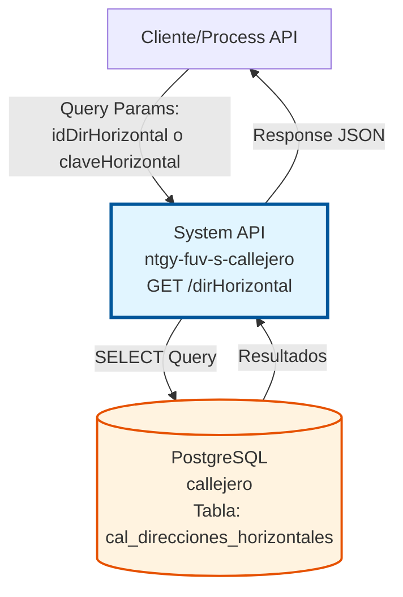
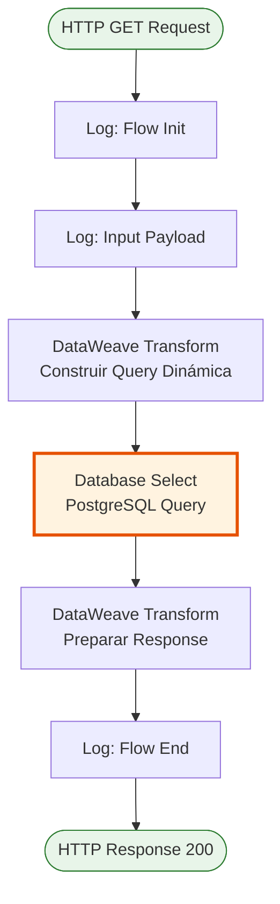
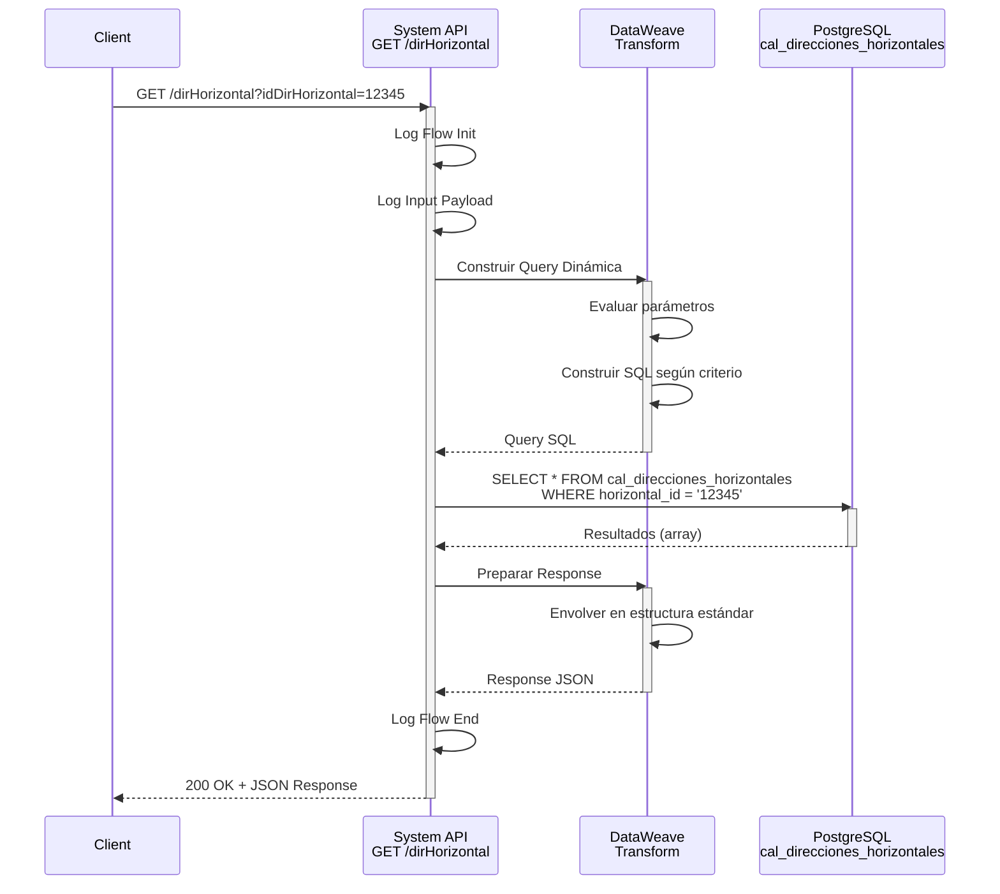
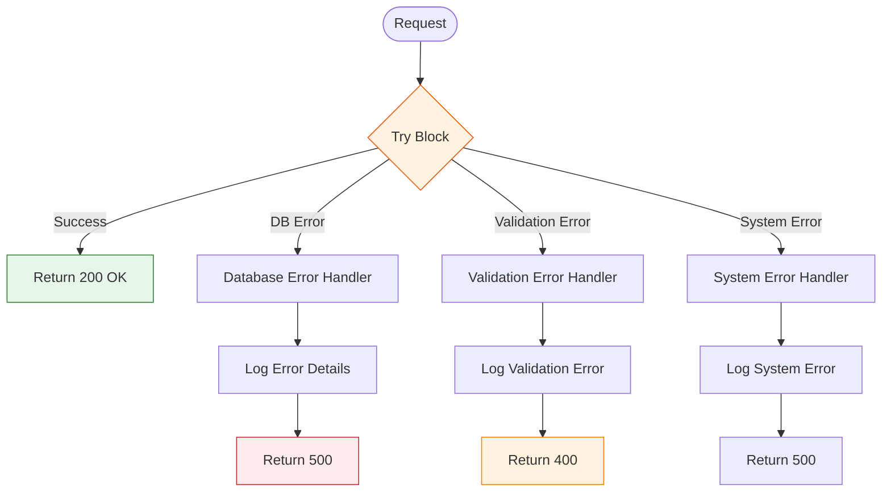

# GET /dirHorizontal

## 📌 Descripción General

### Propósito del Endpoint

Este endpoint recupera información de direcciones horizontales del sistema de callejero español almacenado en PostgreSQL. Permite consultar direcciones horizontales mediante dos criterios alternativos: por ID de dirección horizontal o por clave horizontal.

El endpoint soporta:
- **Consulta por ID**: Recupera una dirección horizontal específica usando `idDirHorizontal`
- **Consulta por Clave**: Recupera una dirección horizontal específica usando `claveHorizontal`
- **Respuesta Estructurada**: Retorna información completa de la dirección incluyendo vía, número y portal

### Tipo de API

**Capa:** System API (API-Led Connectivity)

**Función:** Integración directa con PostgreSQL para consulta de direcciones horizontales del callejero español.

### Patrón de Integración

**Tipo:** Request-Reply Síncrono con SQL Query

**Descripción:** El endpoint recibe parámetros de consulta (ID o clave), construye dinámicamente una query SQL según el parámetro proporcionado, ejecuta la consulta en PostgreSQL y retorna los resultados en formato JSON estructurado.

### Arquitectura API-Led Connectivity



---

## 💼 Propósito del Negocio

### Casos de Uso Principales

1. **Consulta de Dirección Horizontal por ID**
   - Un sistema necesita obtener los detalles completos de una dirección horizontal conociendo su ID
   - Se recupera información de vía, número y portal asociados
   - Permite validar y completar datos de direcciones en procesos de alta de clientes

2. **Consulta de Dirección Horizontal por Clave**
   - Un sistema necesita buscar una dirección horizontal usando su clave única
   - Facilita la búsqueda cuando se conoce la clave pero no el ID
   - Útil para procesos de migración o sincronización de datos

3. **Validación de Direcciones en Formularios**
   - Validar que una dirección horizontal existe en el sistema
   - Autocompletar información de direcciones en formularios web o móviles
   - Asegurar consistencia de datos de direcciones en toda la organización

### Contexto Empresarial

- **Dominio:** Gestión de Callejero y Direcciones
- **Sector:** Energía - Utilities
- **División:** Naturgy España
- **Proceso de Negocio:** Validación y gestión de direcciones postales españolas
- **Sistema Backend:** PostgreSQL (Base de datos de callejero)

### Stakeholders

- **Equipos de Atención al Cliente**: Necesitan validar direcciones durante alta de clientes
- **Sistemas de Facturación**: Requieren direcciones precisas para envío de facturas
- **Equipos de Field Service**: Necesitan direcciones exactas para instalaciones y mantenimiento
- **Desarrolladores de Process APIs**: Consumen este endpoint para validación de direcciones

### Valor de Negocio

- **Precisión de Datos**: Asegura que las direcciones horizontales sean válidas y estén normalizadas
- **Eficiencia Operativa**: Reduce errores en procesos que dependen de direcciones correctas
- **Experiencia del Cliente**: Mejora la experiencia al validar direcciones en tiempo real
- **Integridad Referencial**: Mantiene consistencia entre direcciones y vías del callejero

### Consumidores Potenciales

Este endpoint puede ser consumido por:
- Process APIs de gestión de clientes
- Process APIs de facturación y cobros
- Process APIs de field service
- Experience APIs de portales web y aplicaciones móviles
- Sistemas de integración middleware

---

## 🔧 Especificación Técnica

### URLs por Ambiente

| Ambiente | URL Base | URL Completa |
|----------|----------|--------------|
| **Local** | `http://localhost:8081` | `http://localhost:8081/dirHorizontal?idDirHorizontal={id}` |
| **Development** | `https://ntgy-fuv-s-callejero-dev.us-e2.cloudhub.io` | `https://ntgy-fuv-s-callejero-dev.us-e2.cloudhub.io/dirHorizontal?idDirHorizontal={id}` |
| **UAT** | `https://ntgy-fuv-s-callejero-uat.us-e2.cloudhub.io` | `https://ntgy-fuv-s-callejero-uat.us-e2.cloudhub.io/dirHorizontal?idDirHorizontal={id}` |
| **Production** | `https://ntgy-fuv-s-callejero-pro.us-e2.cloudhub.io` | `https://ntgy-fuv-s-callejero-pro.us-e2.cloudhub.io/dirHorizontal?idDirHorizontal={id}` |

### Método HTTP

```
GET /dirHorizontal
```

### Parámetros de Entrada

#### Headers HTTP

| Header | Tipo | Requerido | Descripción | Ejemplo |
|--------|------|-----------|-------------|---------|
| `Accept` | string | ❌ No | Tipo de contenido esperado en response | `application/json` |

#### Query Parameters

| Parámetro | Tipo | Requerido | Descripción | Ejemplo |
|-----------|------|-----------|-------------|---------|
| `idDirHorizontal` | string | ⚠️ Condicional* | ID único de la dirección horizontal | `"12345"` |
| `claveHorizontal` | string | ⚠️ Condicional* | Clave única de la dirección horizontal | `"CLAVE_001"` |

**\*Nota:** Se debe proporcionar **uno** de los dos parámetros (`idDirHorizontal` o `claveHorizontal`). Si se proporciona `idDirHorizontal`, se usa ese criterio; de lo contrario, se usa `claveHorizontal`.

### Respuestas

#### Respuesta Exitosa (200 OK)

```json
{
  "result": {
    "codResult": "0000",
    "msgResult": "Ejecutado Correctamente"
  },
  "values": [
    {
      "horizontal_id": "12345",
      "clave": "CLAVE_001",
      "id_via": "5678",
      "numero": "42",
      "portal": "A"
    }
  ]
}
```

#### Respuesta Sin Resultados (200 OK)

```json
{
  "result": {
    "codResult": "0000",
    "msgResult": "Ejecutado Correctamente"
  },
  "values": []
}
```

#### Respuesta de Error Técnico (500)

```json
{
  "result": {
    "codResult": "0001",
    "msgResult": "Error interno del servidor"
  }
}
```

### Estructura de Datos de Respuesta

| Campo | Tipo | Descripción |
|-------|------|-------------|
| `result.codResult` | string | Código de resultado ("0000" = éxito) |
| `result.msgResult` | string | Mensaje descriptivo del resultado |
| `values` | array | Array de direcciones horizontales encontradas |
| `values[].horizontal_id` | string | ID único de la dirección horizontal |
| `values[].clave` | string | Clave única de la dirección horizontal |
| `values[].id_via` | string | ID de la vía asociada |
| `values[].numero` | string | Número de la dirección |
| `values[].portal` | string | Portal de la dirección |

### Autenticación y Autorización

- **Tipo:** Client ID & Client Secret (Anypoint Platform)
- **Autorización PostgreSQL:** El usuario de base de datos debe tener permisos para:
  - Ejecutar SELECT en tabla `cal_direcciones_horizontales`
  - Acceso de lectura al schema `public`

### Timeouts

| Tipo | Valor | Descripción |
|------|-------|-------------|
| **Request Timeout** | 30 segundos | Tiempo máximo de espera para la respuesta |
| **Connection Timeout** | 10 segundos | Tiempo máximo para establecer conexión con PostgreSQL |
| **Query Timeout** | 20 segundos | Tiempo máximo de ejecución de la query SQL |

---

## 🏗️ Implementación Técnica

### Arquitectura del Flow



### Componentes del Flow

#### 1. Logger - Flow Init
```xml
<logger level="INFO" message="dirHorizontal flow init get" />
```
- Registra el inicio del flow
- Nivel INFO para trazabilidad

#### 2. Logger - Input Payload
```xml
<logger level="INFO" message="Input payload: #[payload]" />
```
- Registra el payload de entrada
- Útil para debugging y auditoría

#### 3. DataWeave Transform - Construcción de Query
```dataweave
%dw 2.0
output application/json
var idDirHorizontal = attributes.queryParams.idDirHorizontal
var claveHorizontal = attributes.queryParams.claveHorizontal

---
queryStatement: if (idDirHorizontal != null) 
    "select * from cal_direcciones_horizontales where horizontal_id = '" ++ idDirHorizontal ++ "'"
    else
    "select * from cal_direcciones_horizontales where clave = '" ++ claveHorizontal ++ "'"
```

**Lógica:**
- Extrae parámetros de query (`idDirHorizontal` y `claveHorizontal`)
- Construye query SQL dinámicamente según el parámetro proporcionado
- Si `idDirHorizontal` está presente, busca por `horizontal_id`
- Si no, busca por `clave`
- Almacena la query en variable `query`

#### 4. Database Select
```xml
<db:select config-ref="RDS_CALLEJERO">
    <db:sql><![CDATA[#[vars.query.queryStatement]]]></db:sql>
</db:select>
```

**Configuración:**
- **Config:** `RDS_CALLEJERO` (PostgreSQL connection)
- **Query:** Dinámica según parámetro de entrada
- **Tabla:** `cal_direcciones_horizontales`
- **Operación:** SELECT

**Queries Posibles:**
```sql
-- Por ID
SELECT * FROM cal_direcciones_horizontales WHERE horizontal_id = '12345'

-- Por Clave
SELECT * FROM cal_direcciones_horizontales WHERE clave = 'CLAVE_001'
```

#### 5. DataWeave Transform - Response
```dataweave
%dw 2.0
output application/json
---
{
    "result": {
        "codResult": "0000",
        "msgResult": "Ejecutado Correctamente"
    },
    "values": payload
}
```

**Transformación:**
- Envuelve los resultados de la query en estructura estándar
- Añade código y mensaje de resultado
- Retorna array de direcciones horizontales en `values`

#### 6. Logger - Flow End
```xml
<logger level="INFO" message="userPortal flow end" />
```
- Registra el fin del flow
- Confirma ejecución exitosa

### Diagrama de Secuencia



### Manejo de Errores



### Configuración de Base de Datos

**Connection Config:** `RDS_CALLEJERO`

```xml
<db:config name="RDS_CALLEJERO">
    <db:generic-connection 
        url="jdbc:postgresql://${bbdd.host}:${bbdd.port}/${bbdd.database}"
        driverClassName="org.postgresql.Driver"
        user="${bbdd.user}"
        password="${secure::bbdd.password}">
        <db:pooling-profile />
    </db:generic-connection>
</db:config>
```

**Propiedades:**
- **Host:** `${bbdd.host}` (configurable por ambiente)
- **Port:** `${bbdd.port}` (default: 5432)
- **Database:** `${bbdd.database}` (nombre: callejero)
- **User:** `${bbdd.user}`
- **Password:** `${secure::bbdd.password}` (encriptado)
- **Connection Pooling:** Habilitado

### Tabla de Base de Datos

**Tabla:** `cal_direcciones_horizontales`

| Columna | Tipo | Descripción |
|---------|------|-------------|
| `horizontal_id` | VARCHAR | ID único de la dirección horizontal (PK) |
| `clave` | VARCHAR | Clave única de la dirección horizontal |
| `id_via` | VARCHAR | ID de la vía asociada (FK) |
| `numero` | VARCHAR | Número de la dirección |
| `portal` | VARCHAR | Portal de la dirección |

**Índices:**
- Primary Key en `horizontal_id`
- Índice en `clave` para búsquedas rápidas
- Foreign Key en `id_via` referenciando tabla de vías

---

## 💻 Ejemplos de Uso

### Ejemplo 1: Consulta por ID de Dirección Horizontal

#### Request con curl

```bash
curl -X GET "http://localhost:8081/dirHorizontal?idDirHorizontal=12345" \
  -H "Accept: application/json"
```

#### Response Exitoso

```json
{
  "result": {
    "codResult": "0000",
    "msgResult": "Ejecutado Correctamente"
  },
  "values": [
    {
      "horizontal_id": "12345",
      "clave": "CLAVE_001",
      "id_via": "5678",
      "numero": "42",
      "portal": "A"
    }
  ]
}
```

### Ejemplo 2: Consulta por Clave Horizontal

#### Request con curl

```bash
curl -X GET "http://localhost:8081/dirHorizontal?claveHorizontal=CLAVE_001" \
  -H "Accept: application/json"
```

#### Response Exitoso

```json
{
  "result": {
    "codResult": "0000",
    "msgResult": "Ejecutado Correctamente"
  },
  "values": [
    {
      "horizontal_id": "12345",
      "clave": "CLAVE_001",
      "id_via": "5678",
      "numero": "42",
      "portal": "A"
    }
  ]
}
```

### Ejemplo 3: Dirección Horizontal No Encontrada

#### Request con curl

```bash
curl -X GET "http://localhost:8081/dirHorizontal?idDirHorizontal=99999" \
  -H "Accept: application/json"
```

#### Response (Sin Resultados)

```json
{
  "result": {
    "codResult": "0000",
    "msgResult": "Ejecutado Correctamente"
  },
  "values": []
}
```

### Ejemplo 4: Request desde JavaScript (Fetch API)

```javascript
// Consulta por ID
const idDirHorizontal = '12345';

fetch(`https://ntgy-fuv-s-callejero-dev.us-e2.cloudhub.io/dirHorizontal?idDirHorizontal=${idDirHorizontal}`, {
  method: 'GET',
  headers: {
    'Accept': 'application/json'
  }
})
  .then(response => response.json())
  .then(data => {
    if (data.result.codResult === '0000' && data.values.length > 0) {
      console.log('Dirección horizontal encontrada:', data.values[0]);
      console.log('Número:', data.values[0].numero);
      console.log('Portal:', data.values[0].portal);
    } else {
      console.log('Dirección horizontal no encontrada');
    }
  })
  .catch(error => console.error('Error:', error));
```

### Ejemplo 5: Request desde Python

```python
import requests

# Consulta por clave
url = "https://ntgy-fuv-s-callejero-dev.us-e2.cloudhub.io/dirHorizontal"
params = {
    "claveHorizontal": "CLAVE_001"
}
headers = {
    "Accept": "application/json"
}

response = requests.get(url, params=params, headers=headers)

if response.status_code == 200:
    data = response.json()
    if data['result']['codResult'] == '0000' and len(data['values']) > 0:
        direccion = data['values'][0]
        print(f"Dirección encontrada:")
        print(f"  ID: {direccion['horizontal_id']}")
        print(f"  Clave: {direccion['clave']}")
        print(f"  ID Vía: {direccion['id_via']}")
        print(f"  Número: {direccion['numero']}")
        print(f"  Portal: {direccion['portal']}")
    else:
        print("Dirección horizontal no encontrada")
else:
    print(f"Error: {response.status_code}")
```

### Ejemplo 6: Integración en Process API

```dataweave
%dw 2.0
output application/json

// Llamada al System API desde un Process API
var direccionHorizontalResponse = Mule::lookup(
    'get-direccion-horizontal-flow',
    {
        queryParams: {
            idDirHorizontal: payload.direccionId
        }
    }
)

---
{
    clienteId: payload.clienteId,
    direccion: {
        horizontal: direccionHorizontalResponse.values[0],
        completa: direccionHorizontalResponse.values[0].numero 
                  ++ " " ++ direccionHorizontalResponse.values[0].portal
    }
}