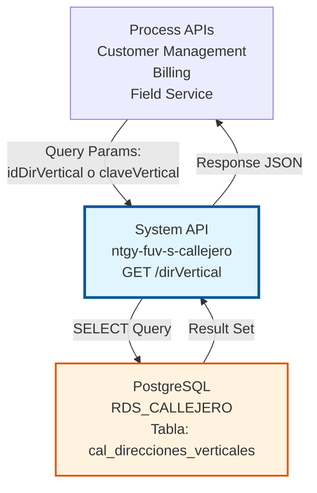
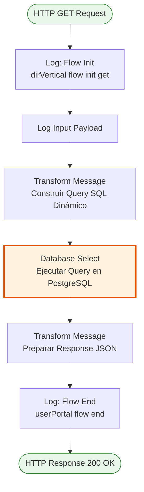
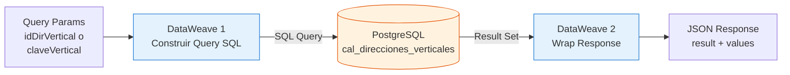
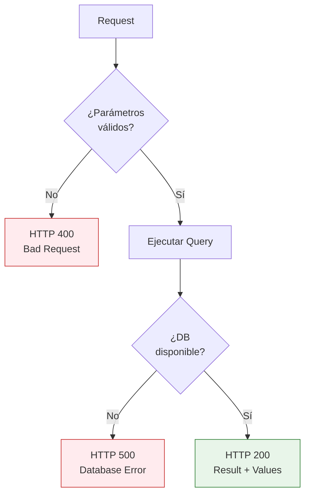

# GET /dirVertical

## 📌 Descripción General

### Propósito del Endpoint

Este endpoint recupera información detallada de direcciones verticales del callejero español desde la base de datos PostgreSQL. Permite consultar direcciones verticales (escalera, piso, puerta) mediante dos criterios de búsqueda: por ID de dirección vertical o por clave única.

El endpoint soporta:
- **Consulta por ID**: Búsqueda directa mediante `idDirVertical`
- **Consulta por Clave**: Búsqueda mediante `claveVertical` (identificador único alternativo)
- **Respuesta Estructurada**: Retorna datos completos de la dirección vertical incluyendo relaciones con direcciones horizontales

### Tipo de API

**Capa:** System API (API-Led Connectivity)

**Función:** Integración directa con PostgreSQL para consulta de direcciones verticales del callejero español.

### Patrón de Integración

**Tipo:** Request-Reply Síncrono con SQL Query

**Descripción:** Recibe parámetros de consulta (idDirVertical o claveVertical), construye dinámicamente la query SQL mediante DataWeave, ejecuta SELECT en PostgreSQL y retorna los resultados en formato JSON estructurado.

### Arquitectura API-Led Connectivity



---

## 💼 Propósito del Negocio

### Casos de Uso Principales

1. **Validación de Direcciones en Alta de Cliente**
   - Verificar que la dirección vertical (escalera, piso, puerta) existe en el callejero
   - Obtener datos normalizados para completar formularios
   - Asegurar consistencia de datos en el sistema

2. **Consulta de Información Completa de Dirección**
   - Recuperar todos los detalles de una dirección vertical específica
   - Obtener relaciones con direcciones horizontales
   - Acceder a datos adicionales (extra_data) si existen

3. **Integración con Procesos de Facturación**
   - Validar direcciones de envío de facturas
   - Verificar direcciones de instalaciones
   - Mantener consistencia en direcciones de clientes

### Contexto Empresarial

- **Dominio:** Gestión de Callejero y Direcciones
- **Sector:** Energía - Utilities
- **División:** Naturgy España
- **Proceso de Negocio:** Validación y normalización de direcciones postales españolas
- **Estándar:** Direcciones según nomenclatura oficial española (INE, Correos)

### Stakeholders

- **Equipos de Atención al Cliente**: Necesitan validar direcciones durante alta de clientes
- **Sistemas de Facturación**: Requieren direcciones normalizadas para envío de facturas
- **Equipos de Field Service**: Necesitan direcciones precisas para instalaciones y mantenimiento
- **Administradores de Base de Datos**: Mantienen la integridad del callejero

### Valor de Negocio

- **Precisión de Datos**: Garantiza direcciones correctas y normalizadas en todos los sistemas
- **Eficiencia Operativa**: Reduce errores en procesos de alta y facturación
- **Experiencia del Cliente**: Mejora la calidad de datos en interacciones con clientes
- **Cumplimiento Normativo**: Asegura uso de direcciones según estándares españoles

### Consumidores Potenciales

Este endpoint puede ser consumido por:
- Process APIs de gestión de clientes
- Process APIs de facturación y cobros
- Process APIs de field service
- Experience APIs de portales web y móviles
- Sistemas de integración middleware

---

## 🔧 Especificación Técnica

### URLs por Ambiente

| Ambiente | URL Base | URL Completa |
|----------|----------|--------------|
| **Local** | `http://localhost:8081` | `http://localhost:8081/api/dirVertical?idDirVertical=:id` |
| **Development** | `https://ntgy-fuv-s-callejero-dev.us-e2.cloudhub.io` | `https://ntgy-fuv-s-callejero-dev.us-e2.cloudhub.io/api/dirVertical?idDirVertical=:id` |
| **UAT** | `https://ntgy-fuv-s-callejero-uat.us-e2.cloudhub.io` | `https://ntgy-fuv-s-callejero-uat.us-e2.cloudhub.io/api/dirVertical?idDirVertical=:id` |
| **Production** | `https://ntgy-fuv-s-callejero-pro.us-e2.cloudhub.io` | `https://ntgy-fuv-s-callejero-pro.us-e2.cloudhub.io/api/dirVertical?idDirVertical=:id` |

### Método HTTP

```
GET /api/dirVertical
```

### Parámetros de Entrada

#### Headers HTTP

| Header | Tipo | Requerido | Descripción | Ejemplo |
|--------|------|-----------|-------------|---------|
| `Accept` | string | ❌ No | Tipo de contenido esperado en response | `application/json` |

#### Query Parameters

| Parámetro | Tipo | Requerido | Descripción | Ejemplo |
|-----------|------|-----------|-------------|---------|
| `idDirVertical` | string | ⚠️ Condicional* | ID único de la dirección vertical | `"12345"` |
| `claveVertical` | string | ⚠️ Condicional* | Clave única alternativa de la dirección vertical | `"CLV-001"` |

**\*Nota:** Se debe proporcionar **uno** de los dos parámetros (idDirVertical o claveVertical), no ambos.

### Respuestas

#### Respuesta Exitosa (200 OK)

```json
{
  "result": {
    "codResult": "0000",
    "msgResult": "Ejecutado Correctamente"
  },
  "values": [
    {
      "vertical_id": "12345",
      "horizontal_id": "67890",
      "clave": "CLV-001",
      "escalera": "A",
      "piso": "3",
      "puerta": "B",
      "extra_data": "{\"observaciones\": \"Dirección principal\"}"
    }
  ]
}
```

#### Respuesta Sin Resultados (200 OK)

```json
{
  "result": {
    "codResult": "0000",
    "msgResult": "Ejecutado Correctamente"
  },
  "values": []
}
```

#### Respuesta de Error Técnico (500)

```json
{
  "result": {
    "codResult": "0001",
    "msgResult": "Error interno del servidor"
  }
}
```

### Estructura de Datos de Respuesta

| Campo | Tipo | Descripción |
|-------|------|-------------|
| `result.codResult` | string | Código de resultado ("0000" = éxito) |
| `result.msgResult` | string | Mensaje descriptivo del resultado |
| `values` | array | Array de direcciones verticales encontradas |
| `values[].vertical_id` | string | ID único de la dirección vertical |
| `values[].horizontal_id` | string | ID de la dirección horizontal asociada |
| `values[].clave` | string | Clave única de la dirección vertical |
| `values[].escalera` | string/null | Identificador de escalera |
| `values[].piso` | string/null | Número de piso |
| `values[].puerta` | string/null | Identificador de puerta |
| `values[].extra_data` | string/null | Datos adicionales en formato JSON |

### Autenticación y Autorización

- **Tipo:** Client ID & Client Secret (Anypoint Platform)
- **Autorización PostgreSQL:** El usuario de base de datos debe tener permisos para:
  - Ejecutar SELECT en tabla `cal_direcciones_verticales`
  - Acceso de lectura al schema `public`

### Timeouts

| Tipo | Valor | Descripción |
|------|-------|-------------|
| **Request Timeout** | 30 segundos | Tiempo máximo de espera para la respuesta |
| **Connection Timeout** | 10 segundos | Tiempo máximo para establecer conexión con PostgreSQL |
| **Query Timeout** | 20 segundos | Tiempo máximo de ejecución de la query SQL |

---

## 🏗️ Implementación Técnica

### Arquitectura del Flow



### Componentes del Flow

#### 1. Logger - Flow Init (Línea 8)
```xml
<logger level="INFO" message="dirVertical flow init get" />
```
- Registra inicio del flow
- Nivel INFO para trazabilidad

#### 2. Logger - Input Payload (Línea 9)
```xml
<logger level="INFO" message="Input payload: #[payload]" />
```
- Registra payload de entrada para debugging

#### 3. Transform Message - Construcción de Query (Líneas 10-24)
```dataweave
%dw 2.0
output application/json
var idDirVertical = attributes.queryParams.idDirVertical
var claveVertical = attributes.queryParams.claveVertical

---
queryStatement: if (idDirVertical != null) 
    "select * from cal_direcciones_verticales where vertical_id = '" ++ idDirVertical ++ "'"
    else
    "select * from cal_direcciones_verticales where clave = '" ++ claveVertical ++ "'"
```

**Lógica:**
- Extrae parámetros de query (`idDirVertical` o `claveVertical`)
- Construye query SQL dinámicamente según parámetro proporcionado
- Si `idDirVertical` existe → busca por `vertical_id`
- Si no → busca por `clave`

#### 4. Database Select (Líneas 25-27)
```xml
<db:select config-ref="RDS_CALLEJERO">
    <db:sql><![CDATA[#[vars.query.queryStatement]]]></db:sql>
</db:select>
```

**Configuración:**
- Connector: Database Connector v1.14.12
- Config: `RDS_CALLEJERO`
- Query: Dinámico desde variable `vars.query.queryStatement`

#### 5. Transform Message - Response (Líneas 28-38)
```dataweave
%dw 2.0
output application/json
---
{
    "result": {
        "codResult": "0000",
        "msgResult": "Ejecutado Correctamente"
    },
    "values": payload
}
```

**Transformación:**
- Envuelve resultado de BD en estructura estándar
- `result`: Metadatos de ejecución
- `values`: Array de registros encontrados

#### 6. Logger - Flow End (Línea 39)
```xml
<logger level="INFO" message="userPortal flow end" />
```
- Registra fin exitoso del flow

### Query SQL Ejecutada

**Por ID de Dirección Vertical:**
```sql
SELECT * FROM cal_direcciones_verticales 
WHERE vertical_id = '[idDirVertical]'
```

**Por Clave Vertical:**
```sql
SELECT * FROM cal_direcciones_verticales 
WHERE clave = '[claveVertical]'
```

### Tabla PostgreSQL: cal_direcciones_verticales

| Columna | Tipo | Descripción |
|---------|------|-------------|
| `vertical_id` | VARCHAR | ID único de la dirección vertical (PK) |
| `horizontal_id` | VARCHAR | ID de la dirección horizontal asociada (FK) |
| `clave` | VARCHAR | Clave única alternativa |
| `escalera` | VARCHAR | Identificador de escalera (nullable) |
| `piso` | VARCHAR | Número de piso (nullable) |
| `puerta` | VARCHAR | Identificador de puerta (nullable) |
| `extra_data` | TEXT | Datos adicionales en formato JSON (nullable) |

### Diagrama de Transformación de Datos



### Manejo de Errores



### Configuración de Base de Datos

**Connection String:**
```
jdbc:postgresql://${bbdd.host}:${bbdd.port}/${bbdd.database}
```

**Propiedades:**
- `bbdd.host`: Host del servidor PostgreSQL
- `bbdd.port`: Puerto (default: 5432)
- `bbdd.database`: Nombre de la base de datos (callejero)
- `bbdd.user`: Usuario de conexión
- `bbdd.password`: Password encriptado (secure properties)

**Connection Pooling:**
- Habilitado mediante `<db:pooling-profile />`
- Reutilización de conexiones para mejor performance

---

## 💻 Ejemplos de Uso

### Ejemplo 1: Consulta por ID de Dirección Vertical

#### Request con curl

```bash
curl -X GET "http://localhost:8081/api/dirVertical?idDirVertical=12345" \
  -H "Accept: application/json"
```

#### Response Exitoso

```json
{
  "result": {
    "codResult": "0000",
    "msgResult": "Ejecutado Correctamente"
  },
  "values": [
    {
      "vertical_id": "12345",
      "horizontal_id": "67890",
      "clave": "CLV-001",
      "escalera": "A",
      "piso": "3",
      "puerta": "B",
      "extra_data": null
    }
  ]
}
```

### Ejemplo 2: Consulta por Clave Vertical

#### Request con curl

```bash
curl -X GET "http://localhost:8081/api/dirVertical?claveVertical=CLV-001" \
  -H "Accept: application/json"
```

#### Response Exitoso

```json
{
  "result": {
    "codResult": "0000",
    "msgResult": "Ejecutado Correctamente"
  },
  "values": [
    {
      "vertical_id": "12345",
      "horizontal_id": "67890",
      "clave": "CLV-001",
      "escalera": "A",
      "piso": "3",
      "puerta": "B",
      "extra_data": "{\"observaciones\": \"Dirección principal\"}"
    }
  ]
}
```

### Ejemplo 3: Dirección Vertical Sin Escalera/Piso/Puerta

#### Request con curl

```bash
curl -X GET "http://localhost:8081/api/dirVertical?idDirVertical=99999" \
  -H "Accept: application/json"
```

#### Response Exitoso

```json
{
  "result": {
    "codResult": "0000",
    "msgResult": "Ejecutado Correctamente"
  },
  "values": [
    {
      "vertical_id": "99999",
      "horizontal_id": "11111",
      "clave": "CLV-999",
      "escalera": null,
      "piso": null,
      "puerta": null,
      "extra_data": null
    }
  ]
}
```

### Ejemplo 4: Dirección Vertical No Encontrada

#### Request con curl

```bash
curl -X GET "http://localhost:8081/api/dirVertical?idDirVertical=NOEXISTE" \
  -H "Accept: application/json"
```

#### Response (Sin Resultados)

```json
{
  "result": {
    "codResult": "0000",
    "msgResult": "Ejecutado Correctamente"
  },
  "values": []
}
```

### Ejemplo 5: Integración desde JavaScript

```javascript
async function getDirVertical(idDirVertical) {
  const url = `https://ntgy-fuv-s-callejero-dev.us-e2.cloudhub.io/api/dirVertical?idDirVertical=${idDirVertical}`;
  
  try {
    const response = await fetch(url, {
      method: 'GET',
      headers: {
        'Accept': 'application/json'
      }
    });
    
    const data = await response.json();
    
    if (data.result.codResult === "0000" && data.values.length > 0) {
      console.log('Dirección vertical encontrada:', data.values[0]);
      return data.values[0];
    } else {
      console.log('Dirección vertical no encontrada');
      return null;
    }
  } catch (error) {
    console.error('Error al consultar dirección vertical:', error);
    throw error;
  }
}

// Uso
getDirVertical('12345')
  .then(dirVertical => {
    if (dirVertical) {
      console.log(`Escalera: ${dirVertical.escalera}, Piso: ${dirVertical.piso}, Puerta: ${dirVertical.puerta}`);
    }
  });
```

### Ejemplo 6: Integración desde Python

```python
import requests

def get_dir_vertical(id_dir_vertical=None, clave_vertical=None):
    """
    Consulta una dirección vertical por ID o clave
    """
    base_url = "https://ntgy-fuv-s-callejero-dev.us-e2.cloudhub.io/api/dirVertical"
    
    params = {}
    if id_dir_vertical:
        params['idDirVertical'] = id_dir_vertical
    elif clave_vertical:
        params['claveVertical'] = clave_vertical
    else:
        raise ValueError("Debe proporcionar idDirVertical o claveVertical")
    
    headers = {
        'Accept': 'application/json'
    }
    
    try:
        response = requests.get(base_url, params=params, headers=headers)
        response.raise_for_status()
        
        data = response.json()
        
        if data['result']['codResult'] == '0000' and len(data['values']) > 0:
            return data['values'][0]
        else:
            return None
            
    except requests.exceptions.RequestException as e:
        print(f"Error al consultar dirección vertical: {e}")
        raise

# Uso
dir_vertical = get_dir_vertical(id_dir_vertical='12345')
if dir_vertical:
    print(f"Escalera: {dir_vertical['escalera']}, Piso: {dir_vertical['piso']}, Puerta: {dir_vertical['puerta']}")