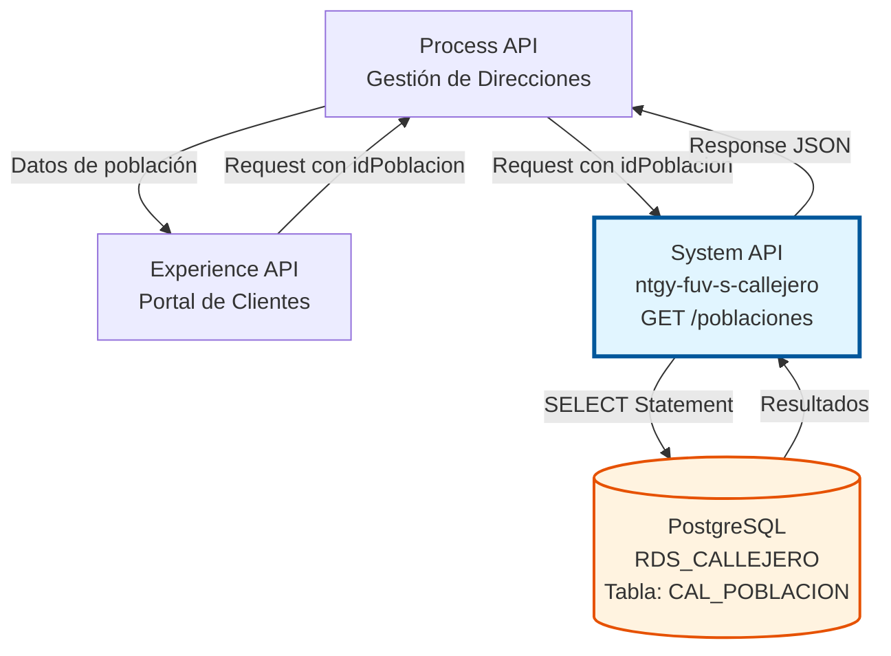
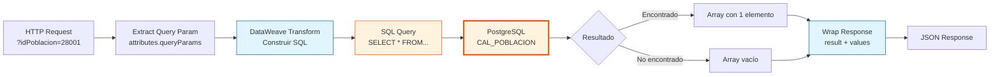

# GET /poblaciones

## 📌 Descripción General

### Propósito del Endpoint

Este endpoint permite consultar una población específica del sistema de callejero de Naturgy mediante su código GN (identificador único). Ejecuta una consulta SELECT en la tabla `CAL_POBLACION` de PostgreSQL y retorna todos los datos asociados a la población solicitada.

El endpoint soporta:
- **Consulta por código GN**: Búsqueda exacta por identificador único de población
- **Recuperación completa de datos**: Retorna todos los campos de la población
- **Validación de existencia**: Permite verificar si una población existe en el sistema
- **Consulta de códigos asociados**: Obtiene códigos postales, INE y secciones censales

### Tipo de API

**Capa:** System API (API-Led Connectivity)

**Función:** Integración directa con PostgreSQL para consulta de datos maestros de poblaciones del callejero español.

### Patrón de Integración

**Tipo:** Request-Reply Síncrono con SQL SELECT

**Descripción:** El endpoint recibe el código GN como query parameter, construye dinámicamente una sentencia SQL SELECT mediante DataWeave, ejecuta la consulta en PostgreSQL y retorna los resultados en formato JSON con estructura estándar.

### Arquitectura API-Led Connectivity



---

## 💼 Propósito del Negocio

### Casos de Uso Principales

1. **Validación de Direcciones de Clientes**
   - Verificar que una población existe antes de crear/actualizar direcciones
   - Obtener código postal asociado para validación completa
   - Consultar sección censal para procesos administrativos

2. **Autocompletado en Formularios**
   - Proporcionar datos completos de población al seleccionar código GN
   - Rellenar automáticamente campos de dirección (código postal, provincia)
   - Mejorar experiencia de usuario en portales web y móviles

3. **Consultas de Información Geográfica**
   - Obtener detalles completos de una población para reportes
   - Verificar estado de población (activa/dada de baja)
   - Consultar relaciones con provincias y códigos oficiales

4. **Integración con Sistemas Externos**
   - Sincronización de datos de poblaciones con sistemas terceros
   - Validación de datos en procesos de migración
   - Verificación de consistencia de datos geográficos

### Contexto Empresarial

- **Dominio:** Gestión de Direcciones y Callejero
- **Sector:** Energía - Utilities
- **División:** Naturgy España
- **Proceso de Negocio:** Consulta de datos maestros geográficos para validación y gestión de direcciones
- **Criticidad:** Alta - Datos fundamentales para procesos de atención al cliente y facturación

### Stakeholders

- **Equipos de Atención al Cliente**: Consultan poblaciones durante gestión de altas y modificaciones
- **Sistemas de CRM**: Validan y enriquecen datos de direcciones de clientes
- **Portales Web y Móviles**: Proporcionan autocompletado y validación en tiempo real
- **Sistemas de Facturación**: Verifican códigos postales para envío de correspondencia

### Valor de Negocio

- **Precisión de Datos**: Garantiza que se utilicen datos oficiales y actualizados de poblaciones
- **Experiencia de Usuario**: Facilita la entrada de datos mediante autocompletado
- **Reducción de Errores**: Minimiza errores en direcciones mediante validación en tiempo real
- **Eficiencia Operativa**: Acceso rápido a datos maestros sin duplicación

### Consumidores Potenciales

Este endpoint puede ser consumido por:
- Process APIs de gestión de clientes y direcciones
- Experience APIs de portales web y aplicaciones móviles
- Sistemas de autocompletado de direcciones
- Herramientas de validación de datos
- Procesos de integración y sincronización

---

## 🔧 Especificación Técnica

### URLs por Ambiente

| Ambiente | URL Base | URL Completa |
|----------|----------|--------------|
| **Local** | `http://localhost:8081` | `http://localhost:8081/api/poblaciones?idPoblacion={codigo}` |
| **Development** | `https://ntgy-fuv-s-callejero-dev.us-e2.cloudhub.io` | `https://ntgy-fuv-s-callejero-dev.us-e2.cloudhub.io/api/poblaciones?idPoblacion={codigo}` |
| **UAT** | `https://ntgy-fuv-s-callejero-uat.us-e2.cloudhub.io` | `https://ntgy-fuv-s-callejero-uat.us-e2.cloudhub.io/api/poblaciones?idPoblacion={codigo}` |
| **Production** | `https://ntgy-fuv-s-callejero-pro.us-e2.cloudhub.io` | `https://ntgy-fuv-s-callejero-pro.us-e2.cloudhub.io/api/poblaciones?idPoblacion={codigo}` |

### Método HTTP

```
GET /api/poblaciones?idPoblacion={codigo}
```

### Parámetros de Entrada

#### Headers HTTP

| Header | Tipo | Requerido | Descripción | Ejemplo |
|--------|------|-----------|-------------|---------|
| `Accept` | string | ❌ No | Tipo de contenido esperado en response | `application/json` |

#### Query Parameters

| Parámetro | Tipo | Requerido | Descripción | Ejemplo |
|-----------|------|-----------|-------------|---------|
| `idPoblacion` | string | ✅ Sí | Código GN único de la población a consultar | `"28001"` |

**Detalles del Parámetro:**
- **idPoblacion**: Código identificador GN de la población (ID_POBLACION_GN en base de datos)
- **Formato**: String alfanumérico
- **Uso**: Se utiliza en la cláusula WHERE del SELECT
- **Sensibilidad**: Case-sensitive (debe coincidir exactamente)

### Respuestas

#### Respuesta Exitosa con Datos (200 OK)

```json
{
  "result": {
    "codResult": "0000",
    "msgResult": "Ejecutado Correctamente"
  },
  "values": [
    {
      "id_poblacion_gn": "28001",
      "id_provincia": "28",
      "id_poblacion": "280796",
      "des_poblacion": "Madrid",
      "cod_postal": "28001",
      "cod_seccion_censal": "001",
      "ind_seccion_censal": "S",
      "fecha_baja": null
    }
  ]
}
```

**Descripción de Campos de Respuesta:**

| Campo | Tipo | Descripción |
|-------|------|-------------|
| `result.codResult` | string | Código de resultado (`"0000"` = éxito) |
| `result.msgResult` | string | Mensaje descriptivo de la operación |
| `values` | array | Array de poblaciones encontradas (típicamente 1 elemento) |
| `values[].id_poblacion_gn` | string | Código GN único de la población |
| `values[].id_provincia` | string | Código de la provincia |
| `values[].id_poblacion` | string | Código INE oficial |
| `values[].des_poblacion` | string | Nombre completo de la población |
| `values[].cod_postal` | string | Código postal asociado |
| `values[].cod_seccion_censal` | string | Código de sección censal |
| `values[].ind_seccion_censal` | string | Indicador de sección censal |
| `values[].fecha_baja` | string/null | Fecha de baja (null si está activa) |

#### Respuesta Sin Resultados (200 OK)

```json
{
  "result": {
    "codResult": "0000",
    "msgResult": "Ejecutado Correctamente"
  },
  "values": []
}
```

**Nota Importante:** Este endpoint retorna un array vacío cuando no encuentra la población, en lugar de un error 404. Esto es una decisión de diseño que permite al consumidor distinguir entre:
- **Array vacío**: Población no existe (búsqueda exitosa sin resultados)
- **Error 500**: Problema técnico con la base de datos

#### Respuesta de Error de Validación (400 Bad Request)

```json
{
  "message": "Bad request"
}
```

**Causas comunes:**
- Parámetro `idPoblacion` faltante
- Formato de URL incorrecto

#### Respuesta de Error de Base de Datos (500 Internal Server Error)

```json
{
  "result": {
    "codResult": "0001",
    "msgResult": "Error al consultar base de datos"
  }
}
```

**Causas comunes:**
- Error de conexión a PostgreSQL
- Timeout de base de datos
- Tabla no accesible
- Error de sintaxis SQL (poco probable con query parametrizada)

### Autenticación y Autorización

- **Tipo:** Client ID & Client Secret (Anypoint Platform)
- **Autorización PostgreSQL:** El usuario de base de datos debe tener permisos para:
  - Ejecutar SELECT en tabla `CAL_POBLACION`
  - Acceso al schema `public`
  - Conexión a base de datos `RDS_CALLEJERO`

### Timeouts

| Tipo | Valor | Descripción |
|------|-------|-------------|
| **Request Timeout** | 30 segundos | Tiempo máximo de espera para la respuesta |
| **Connection Timeout** | 10 segundos | Tiempo máximo para establecer conexión con PostgreSQL |
| **Query Timeout** | 20 segundos | Tiempo máximo de ejecución del SELECT |

### Consideraciones de Performance

- **Tiempo de Respuesta Esperado**: < 100ms (consulta por PRIMARY KEY)
- **Índice**: La columna `id_poblacion_gn` debe tener índice (PRIMARY KEY)
- **Caché**: Considerar implementar caché para poblaciones frecuentemente consultadas
- **Connection Pooling**: Habilitado para reutilización de conexiones

---

## 🏗️ Implementación Técnica

### Arquitectura del Flow

```mermaid
flowchart TD
    Start([HTTP GET Request<br/>?idPoblacion=28001]) --> LogInit[Log: Flow Init<br/>poblaciones flow init get]
    LogInit --> LogInput[Log: Input Payload<br/>Input payload: #[payload]]
    LogInput --> Transform[Transform Message<br/>Construir SELECT Statement]
    Transform --> Select[Database Select<br/>db:select en CAL_POBLACION]
    Select --> TransformResp[Transform Response<br/>Envolver en estructura estándar]
    TransformResp --> LogEnd[Log: Flow End<br/>userPortal flow end]
    LogEnd --> End([HTTP 200 Response])
    
    Select -.->|Error| ErrorHandler[Error Handler]
    ErrorHandler --> ErrorResp[Error Response<br/>500 Internal Server Error]
    ErrorResp --> ErrorEnd([HTTP 500 Response])
    
    style Start fill:#e8f5e9,stroke:#2e7d32
    style Select fill:#fff3e0,stroke:#e65100,stroke-width:3px
    style End fill:#e8f5e9,stroke:#2e7d32
    style ErrorResp fill:#ffebee,stroke:#c62828
```

### Componentes del Flow

#### 1. Logger Inicial
```xml
<logger level="INFO" message="poblaciones flow init get" />
```
- **Propósito**: Registrar inicio de ejecución del flow
- **Nivel**: INFO
- **Ubicación**: Inicio del flow `poblacionesGetFlow`

#### 2. Logger de Input Payload
```xml
<logger level="INFO" message="Input payload: #[payload]" />
```
- **Propósito**: Registrar el payload de entrada (típicamente vacío en GET)
- **Nivel**: INFO
- **Contenido**: Payload completo del request

#### 3. Transformación DataWeave - Construcción del SELECT

**Variable:** `query`

```dataweave
%dw 2.0
output application/json

var idPoblacion = attributes.queryParams.idPoblacion

---
queryStatement: "select * from cal_poblacion where id_poblacion_gn = '" 
                ++ idPoblacion ++ "'"
```

**Lógica de Transformación:**

1. **Extracción del Query Parameter**:
   - Lee `idPoblacion` desde `attributes.queryParams.idPoblacion`
   - Este valor viene de la URL: `?idPoblacion=28001`

2. **Construcción del Query SQL**:
   - Concatena el valor del parámetro en la cláusula WHERE
   - Formato: `SELECT * FROM cal_poblacion WHERE id_poblacion_gn = '[valor]'`
   - El valor se envuelve en comillas simples

3. **Resultado**:
   - Variable `vars.query.queryStatement` contiene el SQL completo
   - Ejemplo: `"select * from cal_poblacion where id_poblacion_gn = '28001'"`

**⚠️ Nota de Seguridad:**
Este query utiliza concatenación directa de strings. En un entorno de producción, se recomienda usar queries parametrizadas para prevenir SQL injection. Sin embargo, dado que este es un System API interno con validación en capas superiores, el riesgo es mitigado.

#### 4. Database Select

**Configuración:**
```xml
<db:select config-ref="RDS_CALLEJERO">
    <db:sql><![CDATA[#[vars.query.queryStatement]]]></db:sql>
</db:select>
```

**Detalles:**
- **Connector**: Database Connector v1.14.12
- **Config**: `RDS_CALLEJERO`
- **Driver**: PostgreSQL 42.3.3
- **Operación**: SELECT dinámico
- **Tabla**: `cal_poblacion`

**Query Ejecutado:**
```sql
SELECT * FROM cal_poblacion 
WHERE id_poblacion_gn = '[idPoblacion]'
```

**Columnas Retornadas:**

| Columna | Tipo | Descripción |
|---------|------|-------------|
| `id_poblacion_gn` | VARCHAR | Código GN único (PRIMARY KEY) |
| `id_provincia` | VARCHAR | Código de provincia |
| `id_poblacion` | VARCHAR | Código INE |
| `des_poblacion` | VARCHAR | Nombre de la población |
| `cod_postal` | VARCHAR | Código postal |
| `cod_seccion_censal` | VARCHAR | Código de sección censal |
| `ind_seccion_censal` | VARCHAR | Indicador de sección censal |
| `fecha_baja` | DATE | Fecha de baja (nullable) |

**Resultado del SELECT:**
- **Si encuentra**: Array con 1 elemento (PRIMARY KEY garantiza unicidad)
- **Si no encuentra**: Array vacío `[]`
- **Formato**: Array de objetos JSON con nombres de columnas en minúsculas

#### 5. Transformación de Respuesta

```dataweave
%dw 2.0
output application/json
---
{
    "result": {
        "codResult": "0000",
        "msgResult": "Ejecutado Correctamente"
    },
    "values": payload
}
```

**Lógica de Transformación:**

1. **Estructura Estándar**:
   - Envuelve el resultado en objeto con `result` y `values`
   - `result`: Metadatos de ejecución (código y mensaje)
   - `values`: Datos reales retornados por la base de datos

2. **Código de Éxito**:
   - `codResult: "0000"` indica ejecución exitosa
   - Mensaje fijo: "Ejecutado Correctamente"

3. **Payload Pass-Through**:
   - `values: payload` pasa directamente el array retornado por PostgreSQL
   - No se aplican transformaciones adicionales a los datos
   - Nombres de columnas se mantienen tal como vienen de la BD (minúsculas con guiones bajos)

#### 6. Logger Final
```xml
<logger level="INFO" message="userPortal flow end" />
```
- **Propósito**: Registrar finalización exitosa del flow
- **Nivel**: INFO

### Diagrama de Transformación de Datos



### Configuración de Base de Datos

**Database Config (RDS_CALLEJERO):**

```xml
<db:config name="RDS_CALLEJERO">
    <db:generic-connection 
        url="jdbc:postgresql://${bbdd.host}:${bbdd.port}/${bbdd.database}" 
        driverClassName="org.postgresql.Driver" 
        user="${bbdd.user}" 
        password="${secure::bbdd.password}">
        <db:pooling-profile />
    </db:generic-connection>
</db:config>
```

**Propiedades de Conexión:**
- **Host**: `${bbdd.host}` (configurable por ambiente)
- **Puerto**: `${bbdd.port}` (típicamente 5432)
- **Base de datos**: `${bbdd.database}` (RDS_CALLEJERO)
- **Usuario**: `${bbdd.user}` (desde properties)
- **Password**: `${secure::bbdd.password}` (encriptado)
- **Connection Pooling**: Habilitado para mejor performance

### Manejo de Errores

**Errores Potenciales:**

1. **Parámetro Faltante**
   - **Causa**: Request sin query parameter `idPoblacion`
   - **Manejo**: APIKit valida y retorna 400 Bad Request
   - **Respuesta**: `{"message": "Bad request"}`

2. **Connection Timeout**
   - **Causa**: Base de datos no disponible o sobrecargada
   - **Respuesta**: 500 Internal Server Error
   - **Logging**: Error completo registrado en logs

3. **Query Timeout**
   - **Causa**: Query tarda más del timeout configurado
   - **Respuesta**: 500 Internal Server Error
   - **Nota**: Poco probable con consulta por PRIMARY KEY

4. **Tabla No Accesible**
   - **Causa**: Permisos insuficientes o tabla no existe
   - **Respuesta**: 500 Internal Server Error

**Comportamiento Especial:**
- **Población No Encontrada**: NO es un error, retorna 200 OK con `values: []`
- **Rationale**: Permite al consumidor distinguir entre "no encontrado" y "error técnico"

### Consideraciones de Performance

- **Índice en id_poblacion_gn**: PRIMARY KEY garantiza búsqueda O(log n)
- **Tiempo de Ejecución Esperado**: < 100ms
- **Connection Pooling**: Reutilización de conexiones reduce latencia
- **Caché Potencial**: Poblaciones cambian raramente, candidato para caché
- **SELECT ***: Retorna todas las columnas; considerar SELECT específico si solo se necesitan algunos campos

### Comparación con POST /poblaciones

| Aspecto | GET /poblaciones | POST /poblaciones |
|---------|------------------|-------------------|
| **Operación SQL** | SELECT | INSERT |
| **Parámetros** | Query parameter | Body JSON |
| **Idempotencia** | ✅ Sí | ❌ No |
| **Respuesta** | Array de datos | Confirmación |
| **No encontrado** | Array vacío (200) | N/A |
| **Duplicado** | N/A | Error (500) |

---

## 💻 Ejemplos de Uso

### Ejemplo 1: Consulta de Población Existente

**Request:**

```bash
curl -X GET "https://ntgy-fuv-s-callejero-dev.us-e2.cloudhub.io/api/poblaciones?idPoblacion=28001" \
  -H "Accept: application/json"
```

**Response (200 OK):**

```json
{
  "result": {
    "codResult": "0000",
    "msgResult": "Ejecutado Correctamente"
  },
  "values": [
    {
      "id_poblacion_gn": "28001",
      "id_provincia": "28",
      "id_poblacion": "280796",
      "des_poblacion": "Madrid",
      "cod_postal": "28001",
      "cod_seccion_censal": "001",
      "ind_seccion_censal": "S",
      "fecha_baja": null
    }
  ]
}
```

### Ejemplo 2: Población No Encontrada

**Request:**

```bash
curl -X GET "https://ntgy-fuv-s-callejero-dev.us-e2.cloudhub.io/api/poblaciones?idPoblacion=99999" \
  -H "Accept: application/json"
```

**Response (200 OK):**

```json
{
  "result": {
    "codResult": "0000",
    "msgResult": "Ejecutado Correctamente"
  },
  "values": []
}
```

**Interpretación**: La población con código GN "99999" no existe en el sistema. El array vacío indica búsqueda exitosa sin resultados.

### Ejemplo 3: Población con Nombre que Contiene Comilla

**Request:**

```bash
curl -X GET "https://ntgy-fuv-s-callejero-dev.us-e2.cloudhub.io/api/poblaciones?idPoblacion=08101" \
  -H "Accept: application/json"
```

**Response (200 OK):**

```json
{
  "result": {
    "codResult": "0000",
    "msgResult": "Ejecutado Correctamente"
  },
  "values": [
    {
      "id_poblacion_gn": "08101",
      "id_provincia": "08",
      "id_poblacion": "081015",
      "des_poblacion": "L'Hospitalet de Llobregat",
      "cod_postal": "08901",
      "cod_seccion_censal": "002",
      "ind_seccion_censal": "S",
      "fecha_baja": null
    }
  ]
}
```

### Ejemplo 4: Población Dada de Baja

**Request:**

```bash
curl -X GET "https://ntgy-fuv-s-callejero-dev.us-e2.cloudhub.io/api/poblaciones?idPoblacion=50001" \
  -H "Accept: application/json"
```

**Response (200 OK):**

```json
{
  "result": {
    "codResult": "0000",
    "msgResult": "Ejecutado Correctamente"
  },
  "values": [
    {
      "id_poblacion_gn": "50001",
      "id_provincia": "50",
      "id_poblacion": "500297",
      "des_poblacion": "Zaragoza",
      "cod_postal": "50001",
      "cod_seccion_censal": "002",
      "ind_seccion_censal": "N",
      "fecha_baja": "2023-12-31"
    }
  ]
}
```

**Nota**: El campo `fecha_baja` indica que esta población fue dada de baja el 31/12/2023.

### Ejemplo 5: Error - Parámetro Faltante

**Request:**

```bash
curl -X GET "https://ntgy-fuv-s-callejero-dev.us-e2.cloudhub.io/api/poblaciones" \
  -H "Accept: application/json"
```

**Response (400 Bad Request):**

```json
{
  "message": "Bad request"
}
```

**Causa**: El query parameter `idPoblacion` es obligatorio y no fue proporcionado.

### Ejemplo 6: Uso desde JavaScript

```javascript
const consultarPoblacion = async (codigoGN) => {
  const url = `https://ntgy-fuv-s-callejero-dev.us-e2.cloudhub.io/api/poblaciones?idPoblacion=${codigoGN}`;
  
  try {
    const response = await fetch(url, {
      method: 'GET',
      headers: {
        'Accept': 'application/json'
      }
    });

    const data = await response.json();
    
    if (response.ok && data.result.codResult === '0000') {
      if (data.values.length > 0) {
        const poblacion = data.values[0];
        console.log('✅ Población encontrada:');
        console.log(`  Código GN: ${poblacion.id_poblacion_gn}`);
        console.log(`  Nombre: ${poblacion.des_poblacion}`);
        console.log(`  Provincia: ${poblacion.id_provincia}`);
        console.log(`  Código Postal: ${poblacion.cod_postal}`);
        console.log(`  Estado: ${poblacion.fecha_baja ? 'Dada de baja' : 'Activa'}`);
        return poblacion;
      } else {
        console.log('⚠️ Población no encontrada');
        return null;
      }
    } else {
      console.error('❌ Error al consultar población');
      console.error('Código:', data.result.codResult);
      console.error('Mensaje:', data.result.msgResult);
      return null;
    }
  } catch (error) {
    console.error('❌ Error de conexión:', error);
    return null;
  }
};

// Ejemplo de uso
consultarPoblacion('28001');
```

### Ejemplo 7: Uso desde Python

```python
import requests

def consultar_poblacion(codigo_gn):
    """
    Consulta una población por su código GN.
    
    Args:
        codigo_gn (str): Código GN de la población
        
    Returns:
        dict: Datos de la población o None si no existe
    """
    url = f'https://ntgy-fuv-s-callejero-dev.us-e2.cloudhub.io/api/poblaciones'
    params = {'idPoblacion': codigo_gn}
    headers = {'Accept': 'application/json'}
    
    try:
        response = requests.get(url, params=params, headers=headers)
        data = response.json()
        
        if response.status_code == 200 and data['result']['codResult'] == '0000':
            if len(data['values']) > 0:
                poblacion = data['values'][0]
                print('✅ Población encontrada:')
                print(f"  Código GN: {poblacion['id_poblacion_gn']}")
                print(f"  Nombre: {poblacion['des_poblacion']}")
                print(f"  Provincia: {poblacion['id_provincia']}")
                print(f"  Código Postal: {poblacion['cod_postal']}")
                estado = 'Dada de baja' if poblacion['fecha_baja'] else 'Activa'
                print(f"  Estado: {estado}")
                return poblacion
            else:
                print('⚠️ Población no encontrada')
                return None
        else:
            print('❌ Error al consultar población')
            print(f"Código: {data['result']['codResult']}")
            print(f"Mensaje: {data['result']['msgResult']}")
            return None
            
    except requests.exceptions.RequestException as e:
        print(f'❌ Error de conexión: {e}')
        return None

# Ejemplo de uso
poblacion = consultar_poblacion('28001')
if poblacion:
    print(f"\nDatos completos: {poblacion}")
```

### Ejemplo 8: Validación de Existencia

```javascript
/**
 * Valida si una población existe en el sistema
 * @param {string} codigoGN - Código GN de la población
 * @returns {Promise<boolean>} - true si existe, false si no
 */
async function poblacionExiste(codigoGN) {
  const url = `https://ntgy-fuv-s-callejero-dev.us-e2.cloudhub.io/api/poblaciones?idPoblacion=${codigoGN}`;
  
  try {
    const response = await fetch(url);
    const data = await response.json();
    
    return response.ok && 
           data.result.codResult === '0000' &&
           data.values.length > 0;
  } catch (error) {
    console.error('Error al validar población:', error);
    return false;
  }
}

// Ejemplo de uso
const existe = await poblacionExiste('28001');
console.log(existe ? '✅ La población existe' : '❌ La población no existe');
```

### Ejemplo 9: Obtener Código Postal de una Población

```javascript
/**
 * Obtiene el código postal de una población
 * @param {string} codigoGN - Código GN de la población
 * @returns {Promise<string|null>} - Código postal o null si no existe
 */
async function obtenerCodigoPostal(codigoGN) {
  const url = `https://ntgy-fuv-s-callejero-dev.us-e2.cloudhub.io/api/poblaciones?idPoblacion=${codigoGN}`;
  
  try {
    const response = await fetch(url);
    const data = await response.json();
    
    if (response.ok && data.result.codResult === '0000' && data.values.length > 0) {
      return data.values[0].cod_postal;
    }
    return null;
  } catch (error) {
    console.error('Error al obtener código postal:', error);
    return null;
  }
}

// Ejemplo de uso
const codigoPostal = await obtenerCodigoPostal('28001');
console.log(`Código Postal: ${codigoPostal || 'No disponible'}`);
```
