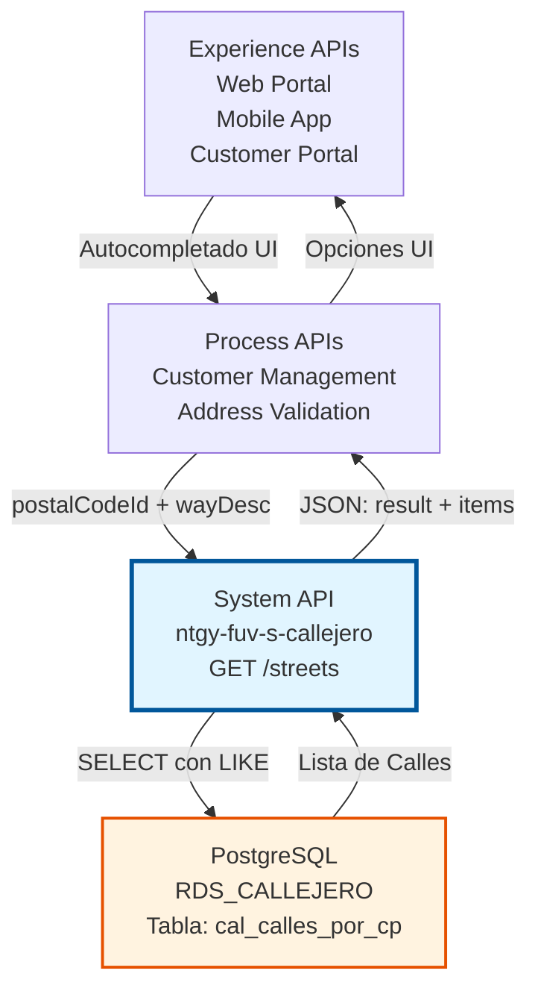
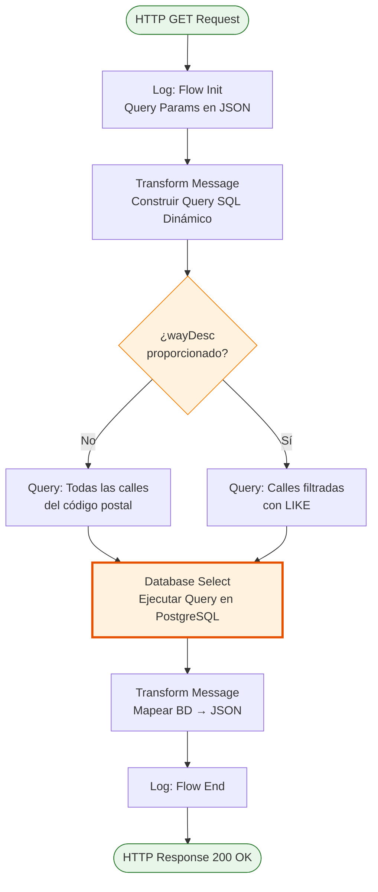
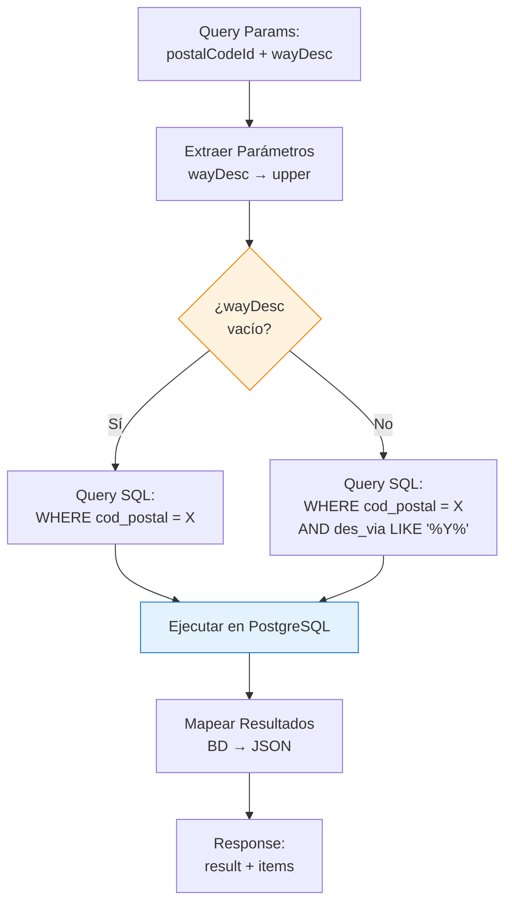
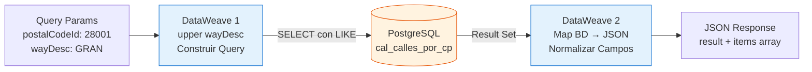
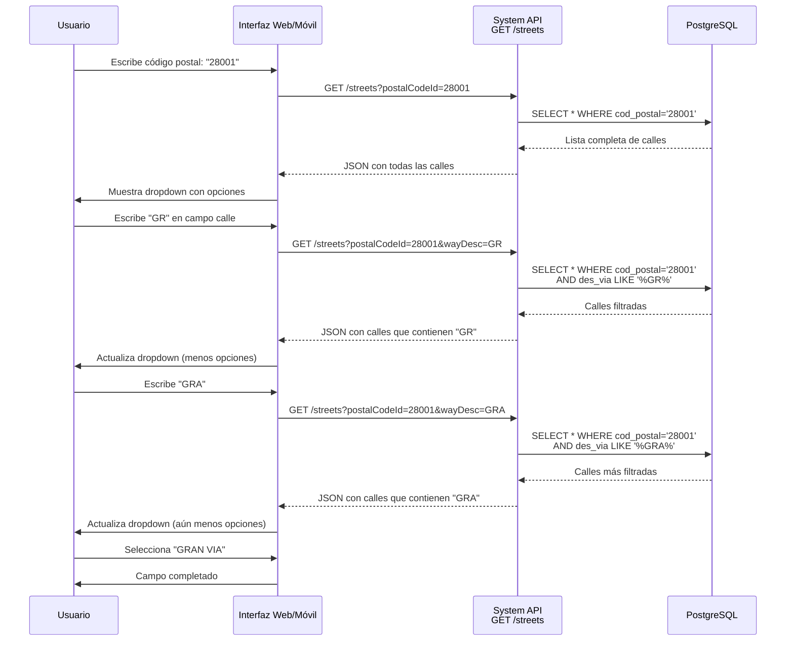

# GET /streets

## 📌 Descripción General

### Propósito del Endpoint

Este endpoint recupera información de calles del callejero español desde PostgreSQL, permitiendo búsquedas por código postal con funcionalidad opcional de autocompletado. Es especialmente útil para implementar campos de búsqueda incremental en formularios de direcciones.

El endpoint soporta:
- **Consulta por Código Postal**: Retorna todas las calles de un código postal específico
- **Autocompletado Inteligente**: Filtrado incremental mediante parámetro `wayDesc` (case-insensitive)
- **Búsqueda Parcial**: Utiliza LIKE con wildcards para coincidencias parciales
- **Respuesta Estructurada**: Retorna información completa de cada calle (ID, descripción, tipo de vía)

### Tipo de API

**Capa:** System API (API-Led Connectivity)

**Función:** Integración directa con PostgreSQL para consulta optimizada de calles del callejero español con soporte de autocompletado.

### Patrón de Integración

**Tipo:** Request-Reply Síncrono con SQL Query Dinámico

**Descripción:** Recibe código postal obligatorio y descripción de vía opcional, construye query SQL dinámicamente con filtro LIKE condicional, ejecuta SELECT en PostgreSQL y retorna lista de calles en formato JSON normalizado.

### Arquitectura API-Led Connectivity



---

## 💼 Propósito del Negocio

### Casos de Uso Principales

1. **Autocompletado de Direcciones en Formularios**
   - Usuario escribe código postal y primeras letras de la calle
   - Sistema muestra sugerencias en tiempo real
   - Mejora experiencia de usuario y reduce errores de entrada
   - Acelera proceso de alta de clientes

2. **Validación de Direcciones en Alta de Cliente**
   - Verificar que la calle existe en el código postal especificado
   - Obtener nombre normalizado de la calle
   - Asegurar consistencia de datos en el sistema
   - Prevenir errores de facturación y entregas

3. **Búsqueda de Calles para Instalaciones**
   - Equipos de field service buscan calles para planificar instalaciones
   - Obtener información completa de tipo de vía
   - Validar direcciones de puntos de suministro
   - Mantener inventario preciso de ubicaciones

4. **Integración con Portales de Autoservicio**
   - Portales web y móviles ofrecen autocompletado de direcciones
   - Mejora conversión en formularios de alta
   - Reduce abandono por dificultad en entrada de datos
   - Proporciona experiencia moderna y fluida

### Contexto Empresarial

- **Dominio:** Gestión de Callejero y Direcciones
- **Sector:** Energía - Utilities
- **División:** Naturgy España
- **Proceso de Negocio:** Validación y autocompletado de direcciones postales españolas
- **Estándar:** Direcciones según nomenclatura oficial española (INE, Correos)

### Stakeholders

- **Desarrolladores de UX/UI**: Implementan funcionalidad de autocompletado en interfaces
- **Equipos de Atención al Cliente**: Utilizan búsqueda rápida durante atención telefónica
- **Product Owners de Portales**: Requieren experiencia de usuario optimizada
- **Equipos de Field Service**: Necesitan búsqueda rápida de direcciones para instalaciones

### Valor de Negocio

- **Experiencia del Usuario**: Autocompletado mejora significativamente la UX en formularios
- **Reducción de Errores**: Selección de lista reduce errores tipográficos en direcciones
- **Eficiencia Operativa**: Acelera procesos de alta y consulta de clientes
- **Conversión Mejorada**: Formularios más fáciles aumentan tasa de completitud
- **Calidad de Datos**: Garantiza uso de nombres de calles normalizados

### Consumidores Potenciales

Este endpoint puede ser consumido por:
- Experience APIs de portales web de autoservicio
- Experience APIs de aplicaciones móviles
- Process APIs de gestión de clientes
- Process APIs de validación de direcciones
- Sistemas de call center y CRM
- Herramientas de administración de callejero

---

## 🔧 Especificación Técnica

### URLs por Ambiente

| Ambiente | URL Base | URL Completa |
|----------|----------|--------------|
| **Local** | `http://localhost:8081` | `http://localhost:8081/api/streets?postalCodeId=28001` |
| **Development** | `https://ntgy-fuv-s-callejero-dev.us-e2.cloudhub.io` | `https://ntgy-fuv-s-callejero-dev.us-e2.cloudhub.io/api/streets?postalCodeId=28001` |
| **UAT** | `https://ntgy-fuv-s-callejero-uat.us-e2.cloudhub.io` | `https://ntgy-fuv-s-callejero-uat.us-e2.cloudhub.io/api/streets?postalCodeId=28001` |
| **Production** | `https://ntgy-fuv-s-callejero-pro.us-e2.cloudhub.io` | `https://ntgy-fuv-s-callejero-pro.us-e2.cloudhub.io/api/streets?postalCodeId=28001` |

### Método HTTP

```
GET /api/streets
```

### Parámetros de Entrada

#### Headers HTTP

| Header | Tipo | Requerido | Descripción | Ejemplo |
|--------|------|-----------|-------------|---------|
| `Accept` | string | ❌ No | Tipo de contenido esperado en response | `application/json` |

#### Query Parameters

| Parámetro | Tipo | Requerido | Descripción | Ejemplo |
|-----------|------|-----------|-------------|---------|
| `postalCodeId` | string | ✅ Sí | Código postal español (5 dígitos) | `"28001"` |
| `wayDesc` | string | ❌ No | Descripción parcial de vía para autocompletado (case-insensitive) | `"GRAN"` |

**Notas sobre `wayDesc`:**
- Se convierte automáticamente a mayúsculas en el backend
- Búsqueda con LIKE y wildcards: `%wayDesc%`
- Permite coincidencias parciales en cualquier posición
- Si se omite, retorna todas las calles del código postal

### Respuestas

#### Respuesta Exitosa (200 OK)

```json
{
  "result": {
    "codResult": "0000",
    "msgResult": "No hay error"
  },
  "items": [
    {
      "streetId": "12345",
      "streetDescription": "GRAN VIA",
      "streetTypeId": "1",
      "streetTypeName": "CALLE",
      "postalCodeId": "28001"
    },
    {
      "streetId": "12346",
      "streetDescription": "GRAN VIA DE SAN FRANCISCO",
      "streetTypeId": "1",
      "streetTypeName": "CALLE",
      "postalCodeId": "28001"
    }
  ]
}
```

#### Respuesta Sin Resultados (200 OK)

```json
{
  "result": {
    "codResult": "0000",
    "msgResult": "No hay error"
  },
  "items": []
}
```

#### Respuesta de Error de Validación (400)

```json
{
  "result": {
    "codResult": "0002",
    "msgResult": "Parámetro postalCodeId es obligatorio"
  }
}
```

#### Respuesta de Error Técnico (500)

```json
{
  "result": {
    "codResult": "0001",
    "msgResult": "Error interno del servidor"
  }
}
```

### Estructura de Datos de Respuesta

| Campo | Tipo | Descripción |
|-------|------|-------------|
| `result.codResult` | string | Código de resultado ("0000" = éxito) |
| `result.msgResult` | string | Mensaje descriptivo del resultado |
| `items` | array | Array de calles encontradas |
| `items[].streetId` | string | ID único de la calle |
| `items[].streetDescription` | string | Nombre completo de la calle |
| `items[].streetTypeId` | string | ID del tipo de vía (1=Calle, 2=Avenida, etc.) |
| `items[].streetTypeName` | string | Nombre del tipo de vía |
| `items[].postalCodeId` | string | Código postal de la calle |

### Autenticación y Autorización

- **Tipo:** Client ID & Client Secret (Anypoint Platform)
- **Autorización PostgreSQL:** El usuario de base de datos debe tener permisos para:
  - Ejecutar SELECT en tabla/vista `cal_calles_por_cp`
  - Acceso de lectura al schema `public`

### Timeouts

| Tipo | Valor | Descripción |
|------|-------|-------------|
| **Request Timeout** | 30 segundos | Tiempo máximo de espera para la respuesta |
| **Connection Timeout** | 10 segundos | Tiempo máximo para establecer conexión con PostgreSQL |
| **Query Timeout** | 20 segundos | Tiempo máximo de ejecución de la query SQL |

### Performance y Optimización

- **Índices Recomendados:**
  - Índice en `cod_postal` para búsquedas rápidas
  - Índice compuesto en `(cod_postal, des_via)` para autocompletado
- **Límite de Resultados:** Considerar LIMIT en queries para códigos postales con muchas calles
- **Caché:** Candidato ideal para caché (datos relativamente estáticos)

---

## 🏗️ Implementación Técnica

### Arquitectura del Flow



### Componentes del Flow

#### 1. Logger - Flow Init (Línea 10)
```xml
<logger level="INFO" message="#[%dw 2.0
output application/json
---
attributes.queryParams]" />
```
- Registra query parameters recibidos en formato JSON
- Útil para debugging y trazabilidad

#### 2. Transform Message - Construcción de Query (Líneas 11-22)
```dataweave
%dw 2.0
output application/json
var codPostal = attributes.queryParams.postalCodeId
var wayDesc = upper((attributes.queryParams.wayDesc default "") as String)

---
if (wayDesc == "")
    queryStatement: "select * from cal_calles_por_cp where cod_postal = '" ++ codPostal ++ "'"
else
    queryStatement: "select * from cal_calles_por_cp where cod_postal = '" ++ codPostal ++ "' and des_via like '%" ++ wayDesc ++ "%'"
```

**Lógica Clave:**
- Extrae `postalCodeId` de query params
- Extrae `wayDesc` con valor default vacío
- Convierte `wayDesc` a mayúsculas con `upper()` para búsqueda case-insensitive
- **Decisión condicional:**
  - Si `wayDesc` está vacío → Query sin filtro (todas las calles)
  - Si `wayDesc` tiene valor → Query con filtro LIKE para autocompletado

**Búsqueda Case-Insensitive:**
- Usuario puede escribir "gran", "GRAN" o "Gran"
- Todos se convierten a "GRAN" para búsqueda consistente
- Asume que `des_via` en BD está en mayúsculas

#### 3. Database Select (Líneas 23-25)
```xml
<db:select config-ref="RDS_CALLEJERO">
    <db:sql><![CDATA[#[vars.query.queryStatement]]]></db:sql>
</db:select>
```

**Configuración:**
- Connector: Database Connector v1.14.12
- Config: `RDS_CALLEJERO`
- Query: Dinámico desde variable `vars.query.queryStatement`

#### 4. Transform Message - Response (Líneas 26-42)
```dataweave
%dw 2.0
output application/json
---
{
    result: {	 
        codResult: "0000",
        msgResult: "No hay error"
    },
    items: payload map (payload01, indexOfPayload01) -> {		
        streetId: payload01.id_via,
        streetDescription: payload01.des_via default "",
        streetTypeId: payload01.id_tipo_via,
        streetTypeName: payload01.des_tipo_via default "",
        postalCodeId: payload01.cod_postal
    }
}
```

**Transformación:**
- Envuelve resultado en estructura estándar con `result` + `items`
- Mapea cada registro de BD a objeto JSON normalizado
- Maneja valores default para campos opcionales (`des_via`, `des_tipo_via`)
- Renombra campos de BD a nombres más descriptivos en inglés

**Mapeo de Campos:**
| Campo BD | Campo JSON | Descripción |
|----------|------------|-------------|
| `id_via` | `streetId` | ID de la calle |
| `des_via` | `streetDescription` | Descripción de la calle |
| `id_tipo_via` | `streetTypeId` | ID del tipo de vía |
| `des_tipo_via` | `streetTypeName` | Nombre del tipo de vía |
| `cod_postal` | `postalCodeId` | Código postal |

#### 5. Logger - Flow End (Línea 43)
```xml
<logger level="INFO" message="userPortal flow end" />
```
- Registra fin exitoso del flow

### Queries SQL Ejecutadas

**Variante 1: Sin Filtro de Autocompletado**
```sql
SELECT * FROM cal_calles_por_cp 
WHERE cod_postal = '28001'
```
- Retorna todas las calles del código postal
- Usado cuando `wayDesc` no se proporciona

**Variante 2: Con Filtro de Autocompletado**
```sql
SELECT * FROM cal_calles_por_cp 
WHERE cod_postal = '28001' 
AND des_via LIKE '%GRAN%'
```
- Retorna solo calles que contienen "GRAN" en su descripción
- Wildcards `%` permiten coincidencias en cualquier posición
- Usado cuando `wayDesc` se proporciona

### Tabla PostgreSQL: cal_calles_por_cp

| Columna | Tipo | Descripción |
|---------|------|-------------|
| `id_via` | VARCHAR | ID único de la calle (PK) |
| `des_via` | VARCHAR | Descripción/nombre de la calle |
| `id_tipo_via` | VARCHAR | ID del tipo de vía |
| `des_tipo_via` | VARCHAR | Nombre del tipo de vía (Calle, Avenida, etc.) |
| `cod_postal` | VARCHAR | Código postal (5 dígitos) |

**Nota:** Esta tabla/vista está optimizada para búsquedas por código postal, probablemente con índices apropiados.

### Diagrama de Lógica Condicional



### Diagrama de Transformación de Datos



### Flujo de Autocompletado



### Manejo de Errores

```mermaid
flowchart TD
    Start[Request] --> ValidateCP{¿postalCodeId<br/>presente?}
    ValidateCP -->|No| Error400[HTTP 400<br/>Bad Request]
    ValidateCP -->|Sí| Execute[Ejecutar Query]
    Execute --> DBCheck{¿DB<br/>disponible?}
    DBCheck -->|No| Error500[HTTP 500<br/>Database Error]
    DBCheck -->|Sí| CheckResults{¿Resultados<br/>encontrados?}
    CheckResults -->|No| Success200Empty[HTTP 200<br/>items: []]
    CheckResults -->|Sí| Success200Data[HTTP 200<br/>items: [...]]
    
    style Error400 fill:#ffebee,stroke:#c62828
    style Error500 fill:#ffebee,stroke:#c62828
    style Success200Empty fill:#fff3e0,stroke:#f57c00
    style Success200Data fill:#e8f5e9,stroke:#2e7d32
```

### Configuración de Base de Datos

**Connection String:**
```
jdbc:postgresql://${bbdd.host}:${bbdd.port}/${bbdd.database}
```

**Propiedades:**
- `bbdd.host`: Host del servidor PostgreSQL
- `bbdd.port`: Puerto (default: 5432)
- `bbdd.database`: Nombre de la base de datos (callejero)
- `bbdd.user`: Usuario de conexión
- `bbdd.password`: Password encriptado (secure properties)

**Connection Pooling:**
- Habilitado mediante `<db:pooling-profile />`
- Reutilización de conexiones para mejor performance
- Crítico para endpoints de alta frecuencia como autocompletado

---

## 💻 Ejemplos de Uso

### Ejemplo 1: Consulta Todas las Calles de un Código Postal

#### Request con curl

```bash
curl -X GET "http://localhost:8081/api/streets?postalCodeId=28001" \
  -H "Accept: application/json"
```

#### Response Exitoso

```json
{
  "result": {
    "codResult": "0000",
    "msgResult": "No hay error"
  },
  "items": [
    {
      "streetId": "10001",
      "streetDescription": "ALCALA",
      "streetTypeId": "1",
      "streetTypeName": "CALLE",
      "postalCodeId": "28001"
    },
    {
      "streetId": "10002",
      "streetDescription": "GRAN VIA",
      "streetTypeId": "1",
      "streetTypeName": "CALLE",
      "postalCodeId": "28001"
    },
    {
      "streetId": "10003",
      "streetDescription": "MAYOR",
      "streetTypeId": "2",
      "streetTypeName": "PLAZA",
      "postalCodeId": "28001"
    }
  ]
}
```

### Ejemplo 2: Autocompletado con "GRAN"

#### Request con curl

```bash
curl -X GET "http://localhost:8081/api/streets?postalCodeId=28001&wayDesc=GRAN" \
  -H "Accept: application/json"
```

#### Response Exitoso (Filtrado)

```json
{
  "result": {
    "codResult": "0000",
    "msgResult": "No hay error"
  },
  "items": [
    {
      "streetId": "10002",
      "streetDescription": "GRAN VIA",
      "streetTypeId": "1",
      "streetTypeName": "CALLE",
      "postalCodeId": "28001"
    },
    {
      "streetId": "10015",
      "streetDescription": "GRAN VIA DE SAN FRANCISCO",
      "streetTypeId": "1",
      "streetTypeName": "CALLE",
      "postalCodeId": "28001"
    }
  ]
}
```

### Ejemplo 3: Autocompletado Case-Insensitive

#### Request con curl (minúsculas)

```bash
curl -X GET "http://localhost:8081/api/streets?postalCodeId=28001&wayDesc=mayor" \
  -H "Accept: application/json"
```

#### Response Exitoso

```json
{
  "result": {
    "codResult": "0000",
    "msgResult": "No hay error"
  },
  "items": [
    {
      "streetId": "10003",
      "streetDescription": "MAYOR",
      "streetTypeId": "2",
      "streetTypeName": "PLAZA",
      "postalCodeId": "28001"
    }
  ]
}
```

**Nota:** "mayor" se convierte a "MAYOR" automáticamente en el backend.

### Ejemplo 4: Sin Resultados

#### Request con curl

```bash
curl -X GET "http://localhost:8081/api/streets?postalCodeId=28001&wayDesc=NOEXISTE" \
  -H "Accept: application/json"
```

#### Response (Sin Resultados)

```json
{
  "result": {
    "codResult": "0000",
    "msgResult": "No hay error"
  },
  "items": []
}
```

### Ejemplo 5: Integración JavaScript - Autocompletado en Tiempo Real

```javascript
// Función de autocompletado con debounce
let debounceTimer;

async function searchStreets(postalCode, searchTerm) {
  const url = new URL('https://ntgy-fuv-s-callejero-dev.us-e2.cloudhub.io/api/streets');
  url.searchParams.append('postalCodeId', postalCode);
  
  if (searchTerm && searchTerm.trim() !== '') {
    url.searchParams.append('wayDesc', searchTerm);
  }
  
  try {
    const response = await fetch(url, {
      method: 'GET',
      headers: {
        'Accept': 'application/json'
      }
    });
    
    const data = await response.json();
    
    if (data.result.codResult === "0000") {
      return data.items;
    } else {
      console.error('Error en búsqueda:', data.result.msgResult);
      return [];
    }
  } catch (error) {
    console.error('Error de conexión:', error);
    return [];
  }
}

// Implementación de autocompletado con debounce
function setupAutocomplete(inputElement, postalCodeElement, resultsElement) {
  inputElement.addEventListener('input', function() {
    clearTimeout(debounceTimer);
    
    const postalCode = postalCodeElement.value;
    const searchTerm = this.value;
    
    if (!postalCode) {
      resultsElement.innerHTML = '<div class="error">Ingrese código postal primero</div>';
      return;
    }
    
    // Debounce: esperar 300ms después de que el usuario deje de escribir
    debounceTimer = setTimeout(async () => {
      resultsElement.innerHTML = '<div class="loading">Buscando...</div>';
      
      const streets = await searchStreets(postalCode, searchTerm);
      
      if (streets.length === 0) {
        resultsElement.innerHTML = '<div class="no-results">No se encontraron calles</div>';
      } else {
        resultsElement.innerHTML = streets.map(street => `
          <div class="street-option" data-street-id="${street.streetId}">
            <strong>${street.streetDescription}</strong>
            <span class="street-type">${street.streetTypeName}</span>
          </div>
        `).join('');
        
        // Agregar event listeners a las opciones
        resultsElement.querySelectorAll('.street-option').forEach(option => {
          option.addEventListener('click', function() {
            const streetDesc = this.querySelector('strong').textContent;
            inputElement.value = streetDesc;
            resultsElement.innerHTML = '';
          });
        });
      }
    }, 300);
  });
}

// Uso
const streetInput = document.getElementById('street-input');
const postalCodeInput = document.getElementById('postal-code-input');
const resultsDiv = document.getElementById('autocomplete-results');

setupAutocomplete(streetInput, postalCodeInput, resultsDiv);
```

### Ejemplo 6: Integración Python - Búsqueda de Calles

```python
import requests
from typing import List, Dict, Optional

class StreetSearchClient:
    """Cliente para búsqueda de calles en el callejero"""
    
    def __init__(self, base_url: str):
        self.base_url = base_url.rstrip('/')
        self.endpoint = f"{self.base_url}/api/streets"
    
    def search_streets(self, postal_code: str, search_term: Optional[str] = None) -> List[Dict]:
        """
        Busca calles por código postal con filtro opcional
        
        Args:
            postal_code: Código postal español (5 dígitos)
            search_term: Término de búsqueda para filtrar calles (opcional)
            
        Returns:
            Lista de diccionarios con información de calles
        """
        params = {'postalCodeId': postal_code}
        
        if search_term:
            params['wayDesc'] = search_term
        
        headers = {'Accept': 'application/json'}
        
        try:
            response = requests.get(self.endpoint, params=params, headers=headers)
            response.raise_for_status()
            
            data = response.json()
            
            if data['result']['codResult'] == '0000':
                return data['items']
            else:
                print(f"Error: {data['result']['msgResult']}")
                return []
                
        except requests.exceptions.RequestException as e:
            print(f"Error al buscar calles: {e}")
            raise

# Uso
client = StreetSearchClient('https://ntgy-fuv-s-callejero-dev.us-e2.cloudhub.io')

# Buscar todas las calles de un código postal
all_streets = client.search_streets('28001')
print(f"Total de calles en 28001: {len(all_streets)}")

# Buscar con filtro
filtered_streets = client.search_streets('28001', 'GRAN')
print(f"Calles que contienen 'GRAN': {len(filtered_streets)}")

for street in filtered_streets:
    print(f"  - {street['streetDescription']} ({street['streetTypeName']})")
```

### Ejemplo 7: React Component - Autocompletado

```jsx
import React, { useState, useEffect, useCallback } from 'react';
import debounce from 'lodash/debounce';

const StreetAutocomplete = ({ postalCode, onStreetSelect }) => {
  const [searchTerm, setSearchTerm] = useState('');
  const [streets, setStreets] = useState([]);
  const [loading, setLoading] = useState(false);
  const [error, setError] = useState(null);

  const searchStreets = async (postal, term) => {
    if (!postal) {
      setError('Código postal requerido');
      return;
    }

    setLoading(true);
    setError(null);

    const url = new URL('https://ntgy-fuv-s-callejero-dev.us-e2.cloudhub.io/api/streets');
    url.searchParams.append('postalCodeId', postal);
    
    if (term && term.trim() !== '') {
      url.searchParams.append('wayDesc', term);
    }

    try {
      const response = await fetch(url, {
        method: 'GET',
        headers: { 'Accept': 'application/json' }
      });

      const data = await response.json();

      if (data.result.codResult === '0000') {
        setStreets(data.items);
      } else {
        setError(data.result.msgResult);
        setStreets([]);
      }
    } catch (err) {
      setError('Error al buscar calles');
      setStreets([]);
    } finally {
      setLoading(false);
    }
  };

  // Debounce search function
  const debouncedSearch = useCallback(
    debounce((postal, term) => searchStreets(postal, term), 300),
    []
  );

  useEffect(() => {
    if (postalCode) {
      debouncedSearch(postalCode, searchTerm);
    }
  }, [postalCode, searchTerm, debouncedSearch]);

  const handleSelect = (street) => {
    setSearchTerm(street.streetDescription);
    setStreets([]);
    onStreetSelect(street);
  };

  return (
    <div className="street-autocomplete">
      <input
        type="text"
        value={searchTerm}
        onChange={(e) => setSearchTerm(e.target.value)}
        placeholder="Escribe el nombre de la calle..."
        className="street-input"
      />
      
      {loading && <div className="loading">Buscando...</div>}
      {error && <div className="error">{error}</div>}
      
      {streets.length > 0 && (
        <ul className="street-list">
          {streets.map((street) => (
            <li
              key={street.streetId}
              onClick={() => handleSelect(street)}
              className="street-item"
            >
              <strong>{street.streetDescription}</strong>
              <span className="street-type">{street.streetTypeName}</span>
            </li>
          ))}
        </ul>
      )}
      
      {!loading && streets.length === 0 && searchTerm && (
        <div className="no-results">No se encontraron calles</div>
      )}
    </div>
  );
};

export default StreetAutocomplete;
```

### Ejemplo 8: Vue.js Component - Autocompletado

```vue
<template>
  <div class="street-autocomplete">
    <input
      v-model="searchTerm"
      @input="onInput"
      type="text"
      placeholder="Escribe el nombre de la calle..."
      class="street-input"
    />
    
    <div v-if="loading" class="loading">Buscando...</div>
    <div v-if="error" class="error">{{ error }}</div>
    
    <ul v-if="streets.length > 0" class="street-list">
      <li
        v-for="street in streets"
        :key="street.streetId"
        @click="selectStreet(street)"
        class="street-item"
      >
        <strong>{{ street.streetDescription }}</strong>
        <span class="street-type">{{ street.streetTypeName }}</span>
      </li>
    </ul>
    
    <div v-if="!loading && streets.length === 0 && searchTerm" class="no-results">
      No se encontraron calles
    </div>
  </div>
</template>

<script>
import { ref, watch } from 'vue';
import { debounce } from 'lodash';

export default {
  name: 'StreetAutocomplete',
  props: {
    postalCode: {
      type: String,
      required: true
    }
  },
  emits: ['street-selected'],
  setup(props, { emit }) {
    const searchTerm = ref('');
    const streets = ref([]);
    const loading = ref(false);
    const error = ref(null);

    const searchStreets = async (postal, term) => {
      if (!postal) {
        error.value = 'Código postal requerido';
        return;
      }

      loading.value = true;
      error.value = null;

      const url = new URL('https://ntgy-fuv-s-callejero-dev.us-e2.cloudhub.io/api/streets');
      url.searchParams.append('postalCodeId', postal);
      
      if (term && term.trim() !== '') {
        url.searchParams.append('wayDesc', term);
      }

      try {
        const response = await fetch(url, {
          method: 'GET',
          headers: { 'Accept': 'application/json' }
        });

        const data = await response.json();

        if (data.result.codResult === '0000') {
          streets.value = data.items;
        } else {
          error.value = data.result.msgResult;
          streets.value = [];
        }
      } catch (err) {
        error.value = 'Error al buscar calles';
        streets.value = [];
      } finally {
        loading.value = false;
      }
    };

    const debouncedSearch = debounce((postal, term) => {
      searchStreets(postal, term);
    }, 300);

    const onInput = () => {
      debouncedSearch(props.postalCode, searchTerm.value);
    };

    const selectStreet = (street) => {
      searchTerm.value = street.streetDescription;
      streets.value = [];
      emit('street-selected', street);
    };

    watch(() => props.postalCode, (newPostalCode) => {
      if (newPostalCode) {
        searchStreets(newPostalCode, searchTerm.value);
      }
    });

    return {
      searchTerm,
      streets,
      loading,
      error,
      onInput,
      selectStreet
    };
  }
};
</script>

<style scoped>
.street-autocomplete {
  position: relative;
}

.street-input {
  width: 100%;
  padding: 10px;
  border: 1px solid #ccc;
  border-radius: 4px;
}

.street-list {
  position: absolute;
  top: 100%;
  left: 0;
  right: 0;
  max-height: 300px;
  overflow-y: auto;
  background: white;
  border: 1px solid #ccc;
  border-top: none;
  list-style: none;
  margin: 0;
  padding: 0;
  z-index: 1000;
}

.street-item {
  padding: 10px;
  cursor: pointer;
  border-bottom: 1px solid #eee;
}

.street-item:hover {
  background-color: #f5f5f5;
}

.street-type {
  margin-left: 10px;
  color: #666;
  font-size: 0.9em;
}

.loading, .error, .no-results {
  padding: 10px;
  text-align: center;
}

.error {
  color: #d32f2f;
}

.no-results {
  color: #666;
}
</style>
```
