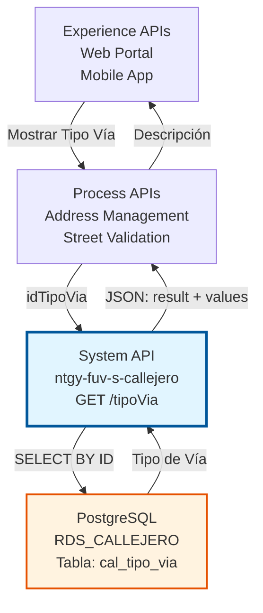
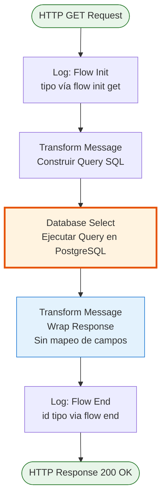
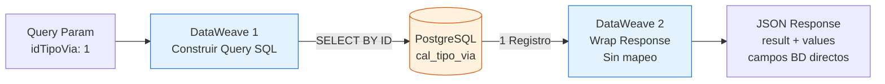
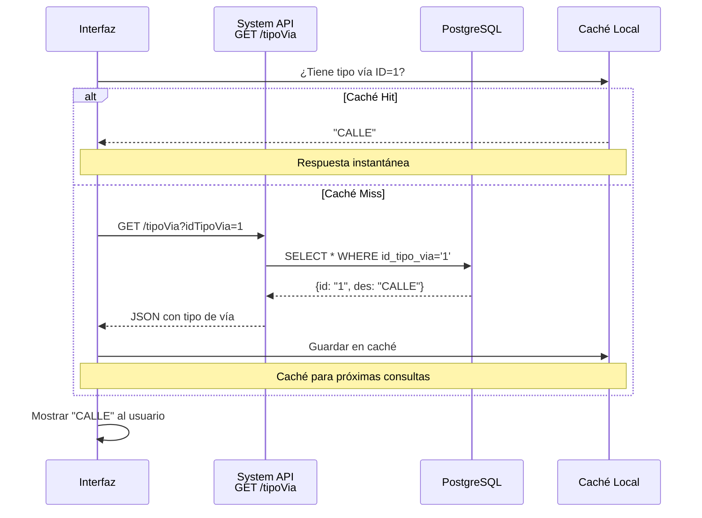
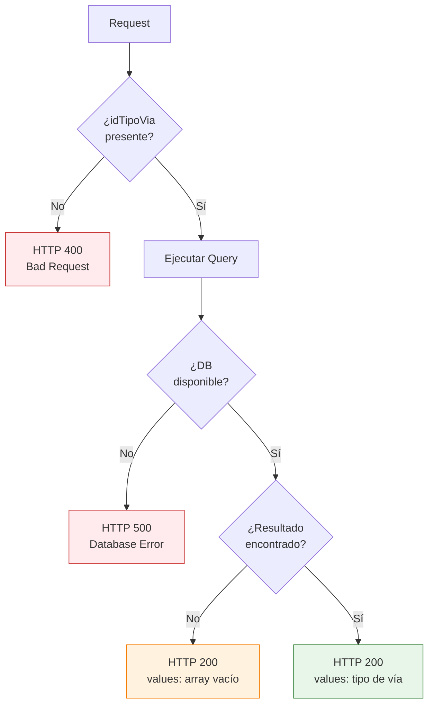

# GET /tipoVia

## 📌 Descripción General

### Propósito del Endpoint

Este endpoint recupera información de tipos de vía del callejero español desde PostgreSQL, funcionando como un servicio de lookup/catálogo. Permite consultar la descripción oficial de un tipo de vía específico mediante su identificador, retornando la nomenclatura estándar española (Calle, Avenida, Plaza, Paseo, etc.).

El endpoint soporta:
- **Consulta por ID de Tipo de Vía**: Búsqueda directa mediante identificador único
- **Catálogo de Referencia**: Acceso a nomenclatura oficial de tipos de vía
- **Respuesta Simple**: Retorna información directa de la tabla sin transformaciones complejas
- **Datos Estáticos**: Información de catálogo que cambia raramente

### Tipo de API

**Capa:** System API (API-Led Connectivity)

**Función:** Integración directa con PostgreSQL para consulta de catálogo de tipos de vía del callejero español.

### Patrón de Integración

**Tipo:** Request-Reply Síncrono con SQL Query Simple

**Descripción:** Recibe ID de tipo de vía, construye query SQL simple por clave primaria, ejecuta SELECT en PostgreSQL y retorna información del tipo de vía en formato JSON sin transformaciones de campos.

### Arquitectura API-Led Connectivity



---

## 💼 Propósito del Negocio

### Casos de Uso Principales

1. **Obtener Descripción de Tipo de Vía**
   - Sistema tiene ID de tipo de vía almacenado
   - Necesita mostrar descripción legible al usuario
   - Consulta catálogo para obtener nombre oficial
   - Muestra "Calle", "Avenida", "Plaza", etc.

2. **Normalización de Nomenclatura de Calles**
   - Sistemas legacy tienen abreviaturas inconsistentes (C/, Av., Pza.)
   - Consultan catálogo oficial para normalizar
   - Obtienen nomenclatura estándar completa
   - Mantienen consistencia en base de datos

3. **Validación de Tipos de Vía en Formularios**
   - Formularios de direcciones requieren tipo de vía
   - Validan que el ID proporcionado existe en catálogo
   - Muestran descripción oficial al usuario
   - Previenen errores de entrada de datos

4. **Complementar Información de Calles**
   - Endpoint /streets retorna streetTypeId
   - Sistemas consultan /tipoVia para obtener descripción
   - Enriquecen información de direcciones
   - Proporcionan contexto completo al usuario

### Contexto Empresarial

- **Dominio:** Gestión de Callejero y Direcciones
- **Sector:** Energía - Utilities
- **División:** Naturgy España
- **Proceso de Negocio:** Normalización y estandarización de direcciones postales españolas
- **Estándar:** Tipos de vía según nomenclatura oficial española (INE, Correos)

### Stakeholders

- **Desarrolladores de UI**: Necesitan mostrar tipos de vía legibles
- **Administradores de Datos**: Mantienen catálogo de tipos de vía
- **Equipos de Integración**: Normalizan datos de sistemas legacy
- **Equipos de Calidad de Datos**: Validan consistencia de nomenclatura

### Valor de Negocio

- **Normalización**: Garantiza uso de nomenclatura oficial en todas las direcciones
- **Consistencia**: Mantiene estándares uniformes en todos los sistemas
- **Calidad de Datos**: Previene abreviaturas y nomenclatura incorrecta
- **Experiencia del Usuario**: Muestra nombres de tipos de vía claros y oficiales
- **Cumplimiento Normativo**: Asegura uso de nomenclatura según estándares españoles

### Consumidores Potenciales

Este endpoint puede ser consumido por:
- Process APIs de gestión de direcciones
- Process APIs de validación de calles
- Experience APIs que muestran información de direcciones
- Sistemas de normalización de datos
- Herramientas de administración de callejero
- Servicios de enriquecimiento de datos

---

## 🔧 Especificación Técnica

### URLs por Ambiente

| Ambiente | URL Base | URL Completa |
|----------|----------|--------------|
| **Local** | `http://localhost:8081` | `http://localhost:8081/api/tipoVia?idTipoVia=1` |
| **Development** | `https://ntgy-fuv-s-callejero-dev.us-e2.cloudhub.io` | `https://ntgy-fuv-s-callejero-dev.us-e2.cloudhub.io/api/tipoVia?idTipoVia=1` |
| **UAT** | `https://ntgy-fuv-s-callejero-uat.us-e2.cloudhub.io` | `https://ntgy-fuv-s-callejero-uat.us-e2.cloudhub.io/api/tipoVia?idTipoVia=1` |
| **Production** | `https://ntgy-fuv-s-callejero-pro.us-e2.cloudhub.io` | `https://ntgy-fuv-s-callejero-pro.us-e2.cloudhub.io/api/tipoVia?idTipoVia=1` |

### Método HTTP

```
GET /api/tipoVia
```

### Parámetros de Entrada

#### Headers HTTP

| Header | Tipo | Requerido | Descripción | Ejemplo |
|--------|------|-----------|-------------|---------|
| `Accept` | string | ❌ No | Tipo de contenido esperado en response | `application/json` |

#### Query Parameters

| Parámetro | Tipo | Requerido | Descripción | Ejemplo |
|-----------|------|-----------|-------------|---------|
| `idTipoVia` | string | ✅ Sí | ID único del tipo de vía | `"1"` |

**Notas:**
- ID corresponde al catálogo oficial de tipos de vía
- Típicamente retorna 1 resultado (búsqueda por clave primaria)
- IDs comunes: 1=Calle, 2=Avenida, 3=Plaza, etc.

### Respuestas

#### Respuesta Exitosa (200 OK)

```json
{
  "result": {
    "codResult": "0000",
    "msgResult": "Ejecutado Correctamente"
  },
  "values": [
    {
      "id_tipo_via": "1",
      "des_tipo_via": "CALLE"
    }
  ]
}
```

#### Respuesta Sin Resultados (200 OK)

```json
{
  "result": {
    "codResult": "0000",
    "msgResult": "Ejecutado Correctamente"
  },
  "values": []
}
```

#### Respuesta de Error de Validación (400)

```json
{
  "result": {
    "codResult": "0002",
    "msgResult": "Parámetro idTipoVia es obligatorio"
  }
}
```

#### Respuesta de Error Técnico (500)

```json
{
  "result": {
    "codResult": "0001",
    "msgResult": "Error interno del servidor"
  }
}
```

### Estructura de Datos de Respuesta

| Campo | Tipo | Descripción |
|-------|------|-------------|
| `result.codResult` | string | Código de resultado ("0000" = éxito) |
| `result.msgResult` | string | Mensaje descriptivo del resultado |
| `values` | array | Array con información del tipo de vía (típicamente 1 elemento) |
| `values[].id_tipo_via` | string | ID único del tipo de vía |
| `values[].des_tipo_via` | string | Descripción oficial del tipo de vía |

**Nota:** Los campos se retornan con nombres de BD (no se mapean a inglés como en otros endpoints).

### Tipos de Vía Comunes en España

| ID | Descripción | Uso |
|----|-------------|-----|
| `1` | CALLE | Tipo más común de vía urbana |
| `2` | AVENIDA | Vía ancha, generalmente con árboles |
| `3` | PLAZA | Espacio público abierto |
| `4` | PASEO | Vía amplia para pasear |
| `5` | CAMINO | Vía rural o de acceso |
| `6` | CARRETERA | Vía interurbana |
| `7` | TRAVESIA | Vía que atraviesa una población |
| `8` | RONDA | Vía circular o perimetral |
| `9` | GLORIETA | Intersección circular |
| `10` | PARQUE | Zona verde pública |

**Nota:** Los IDs específicos pueden variar según el catálogo oficial utilizado.

### Autenticación y Autorización

- **Tipo:** Client ID & Client Secret (Anypoint Platform)
- **Autorización PostgreSQL:** El usuario de base de datos debe tener permisos para:
  - Ejecutar SELECT en tabla `cal_tipo_via`
  - Acceso de lectura al schema `public`

### Timeouts

| Tipo | Valor | Descripción |
|------|-------|-------------|
| **Request Timeout** | 30 segundos | Tiempo máximo de espera para la respuesta |
| **Connection Timeout** | 10 segundos | Tiempo máximo para establecer conexión con PostgreSQL |
| **Query Timeout** | 20 segundos | Tiempo máximo de ejecución de la query SQL |

### Performance y Optimización

- **Índice:** Clave primaria en `id_tipo_via` para búsquedas instantáneas
- **Caché:** Candidato IDEAL para caché (datos muy estáticos)
- **Volumen:** Catálogo pequeño (~10-50 tipos de vía)
- **Frecuencia de Cambio:** Muy baja (catálogo oficial raramente cambia)

---

## 🏗️ Implementación Técnica

### Arquitectura del Flow



### Componentes del Flow

#### 1. Logger - Flow Init (Línea 10)
```xml
<logger level="INFO" message="tipo vía flow init get" />
```
- Registra inicio del flow
- Nivel INFO para trazabilidad

#### 2. Transform Message - Construcción de Query (Líneas 11-17)
```dataweave
%dw 2.0
output application/json
var idTipoVia = attributes.queryParams.idTipoVia
---
queryStatement: "select * from cal_tipo_via where id_tipo_via = '" ++ idTipoVia ++ "'"
```

**Lógica:**
- Extrae `idTipoVia` de query params
- Construye query SQL simple por clave primaria
- Búsqueda exacta por ID
- No hay lógica condicional (query siempre igual)

#### 3. Database Select (Líneas 18-20)
```xml
<db:select config-ref="RDS_CALLEJERO">
    <db:sql><![CDATA[#[vars.query.queryStatement]]]></db:sql>
</db:select>
```

**Configuración:**
- Connector: Database Connector v1.14.12
- Config: `RDS_CALLEJERO`
- Query: Dinámico desde variable `vars.query.queryStatement`

#### 4. Transform Message - Response (Líneas 21-32)
```dataweave
%dw 2.0
output application/json
---
{
    "result": {
        "codResult": "0000",
        "msgResult": "Ejecutado Correctamente"
    },
    "values": payload
}
```

**Transformación:**
- Envuelve resultado en estructura estándar con `result` + `values`
- **NO mapea campos** - retorna nombres de BD directamente
- **NO ordena resultados** - no es necesario (1 resultado típicamente)
- Estructura más simple que otros endpoints

**Diferencias con Otros Endpoints:**
- `/streets` y `/towns`: Mapean campos a inglés (streetId, townName, etc.)
- `/tipoVia`: Mantiene nombres de BD (id_tipo_via, des_tipo_via)
- Rationale: Endpoint de lookup simple, menos transformación

#### 5. Logger - Flow End (Línea 33)
```xml
<logger level="INFO" message="id tipo via flow end" />
```
- Registra fin exitoso del flow

### Query SQL Ejecutada

```sql
SELECT * FROM cal_tipo_via 
WHERE id_tipo_via = '1'
```

**Características:**
- Query simple por clave primaria
- Búsqueda exacta (no LIKE)
- Retorna todos los campos de la tabla
- Típicamente 1 resultado (o 0 si no existe)

### Tabla PostgreSQL: cal_tipo_via

| Columna | Tipo | Descripción |
|---------|------|-------------|
| `id_tipo_via` | VARCHAR | ID único del tipo de vía (PK) |
| `des_tipo_via` | VARCHAR | Descripción oficial del tipo de vía |

**Nota:** Tabla de catálogo simple con 2 campos principales.

### Diagrama de Transformación de Datos



### Flujo de Lookup de Tipo de Vía



### Manejo de Errores



### Comparación con Otros Endpoints del Callejero

| Aspecto | GET /tipoVia | GET /towns | GET /streets |
|---------|--------------|------------|--------------|
| **Tipo** | Lookup/Catálogo | Búsqueda | Búsqueda + Filtro |
| **Parámetros** | idTipoVia | postalCodeId | postalCodeId + wayDesc |
| **Query** | BY ID (PK) | BY código postal | BY CP + LIKE |
| **Ordenamiento** | No | Sí (orderBy) | No |
| **Mapeo Campos** | No (BD directo) | Sí (inglés) | Sí (inglés) |
| **Volumen** | 1 resultado | 1-3 resultados | 10-100+ resultados |
| **Caché** | Ideal (muy estático) | Recomendado | Menos efectivo |
| **Uso** | Lookup descriptivo | Selección | Autocompletado |

### Configuración de Base de Datos

**Connection String:**
```
jdbc:postgresql://${bbdd.host}:${bbdd.port}/${bbdd.database}
```

**Propiedades:**
- `bbdd.host`: Host del servidor PostgreSQL
- `bbdd.port`: Puerto (default: 5432)
- `bbdd.database`: Nombre de la base de datos (callejero)
- `bbdd.user`: Usuario de conexión
- `bbdd.password`: Password encriptado (secure properties)

**Connection Pooling:**
- Habilitado mediante `<db:pooling-profile />`
- Reutilización de conexiones para mejor performance

---

## 💻 Ejemplos de Uso

### Ejemplo 1: Consulta Tipo "Calle"

#### Request con curl

```bash
curl -X GET "http://localhost:8081/api/tipoVia?idTipoVia=1" \
  -H "Accept: application/json"
```

#### Response Exitoso

```json
{
  "result": {
    "codResult": "0000",
    "msgResult": "Ejecutado Correctamente"
  },
  "values": [
    {
      "id_tipo_via": "1",
      "des_tipo_via": "CALLE"
    }
  ]
}
```

### Ejemplo 2: Consulta Tipo "Avenida"

#### Request con curl

```bash
curl -X GET "http://localhost:8081/api/tipoVia?idTipoVia=2" \
  -H "Accept: application/json"
```

#### Response Exitoso

```json
{
  "result": {
    "codResult": "0000",
    "msgResult": "Ejecutado Correctamente"
  },
  "values": [
    {
      "id_tipo_via": "2",
      "des_tipo_via": "AVENIDA"
    }
  ]
}
```

### Ejemplo 3: Tipo de Vía No Encontrado

#### Request con curl

```bash
curl -X GET "http://localhost:8081/api/tipoVia?idTipoVia=999" \
  -H "Accept: application/json"
```

#### Response (Sin Resultados)

```json
{
  "result": {
    "codResult": "0000",
    "msgResult": "Ejecutado Correctamente"
  },
  "values": []
}
```

### Ejemplo 4: Integración JavaScript - Caché de Tipos de Vía

```javascript
// Cliente con caché local para tipos de vía
class TipoViaClient {
  constructor(baseUrl) {
    this.baseUrl = baseUrl;
    this.cache = new Map();
  }

  async getTipoVia(idTipoVia) {
    // Verificar caché primero
    if (this.cache.has(idTipoVia)) {
      console.log(`Caché hit para tipo vía ${idTipoVia}`);
      return this.cache.get(idTipoVia);
    }

    // Si no está en caché, consultar API
    const url = `${this.baseUrl}/api/tipoVia?idTipoVia=${idTipoVia}`;

    try {
      const response = await fetch(url, {
        method: 'GET',
        headers: { 'Accept': 'application/json' }
      });

      const data = await response.json();

      if (data.result.codResult === '0000' && data.values.length > 0) {
        const tipoVia = data.values[0];
        
        // Guardar en caché
        this.cache.set(idTipoVia, tipoVia);
        
        return tipoVia;
      } else {
        return null;
      }
    } catch (error) {
      console.error('Error al obtener tipo de vía:', error);
      return null;
    }
  }

  async getDescripcion(idTipoVia) {
    const tipoVia = await this.getTipoVia(idTipoVia);
    return tipoVia ? tipoVia.des_tipo_via : 'Desconocido';
  }

  // Precargar tipos de vía comunes
  async preloadCommonTypes() {
    const commonIds = ['1', '2', '3', '4', '5'];
    
    await Promise.all(
      commonIds.map(id => this.getTipoVia(id))
    );
    
    console.log(`Precargados ${this.cache.size} tipos de vía en caché`);
  }

  clearCache() {
    this.cache.clear();
  }
}

// Uso
const tipoViaClient = new TipoViaClient('https://ntgy-fuv-s-callejero-dev.us-e2.cloudhub.io');

// Precargar tipos comunes al iniciar la aplicación
await tipoViaClient.preloadCommonTypes();

// Uso posterior (desde caché)
const descripcion = await tipoViaClient.getDescripcion('1');
console.log(descripcion); // "CALLE"
```

### Ejemplo 5: Integración Python - Enriquecimiento de Datos

```python
import requests
from typing import Dict, Optional
from functools import lru_cache

class TipoViaClient:
    """Cliente para consulta de tipos de vía con caché"""
    
    def __init__(self, base_url: str):
        self.base_url = base_url.rstrip('/')
        self.endpoint = f"{self.base_url}/api/tipoVia"
    
    @lru_cache(maxsize=128)
    def get_tipo_via(self, id_tipo_via: str) -> Optional[Dict]:
        """
        Obtiene información de un tipo de vía (con caché)
        
        Args:
            id_tipo_via: ID del tipo de vía
            
        Returns:
            Diccionario con información del tipo de vía o None
        """
        params = {'idTipoVia': id_tipo_via}
        headers = {'Accept': 'application/json'}
        
        try:
            response = requests.get(self.endpoint, params=params, headers=headers)
            response.raise_for_status()
            
            data = response.json()
            
            if data['result']['codResult'] == '0000' and len(data['values']) > 0:
                return data['values'][0]
            else:
                return None
                
        except requests.exceptions.RequestException as e:
            print(f"Error al obtener tipo de vía: {e}")
            return None
    
    def get_descripcion(self, id_tipo_via: str) -> str:
        """
        Obtiene solo la descripción del tipo de vía
        
        Args:
            id_tipo_via: ID del tipo de vía
            
        Returns:
            Descripción del tipo de vía o "Desconocido"
        """
        tipo_via = self.get_tipo_via(id_tipo_via)
        return tipo_via['des_tipo_via'] if tipo_via else 'Desconocido'
    
    def enrich_street_data(self, street_data: Dict) -> Dict:
        """
        Enriquece datos de calle con descripción de tipo de vía
        
        Args:
            street_data: Diccionario con datos de calle (debe incluir streetTypeId)
            
        Returns:
            Diccionario enriquecido con streetTypeName
        """
        if 'streetTypeId' in street_data:
            street_data['streetTypeName'] = self.get_descripcion(
                street_data['streetTypeId']
            )
        
        return street_data

# Uso
client = TipoViaClient('https://ntgy-fuv-s-callejero-dev.us-e2.cloudhub.io')

# Consulta simple
tipo_via = client.get_tipo_via('1')
print(f"Tipo de vía: {tipo_via['des_tipo_via']}")  # "CALLE"

# Enriquecer datos de calle
street = {
    'streetId': '12345',
    'streetDescription': 'GRAN VIA',
    'streetTypeId': '1'
}

enriched_street = client.enrich_street_data(street)
print(enriched_street)
# {
#     'streetId': '12345',
#     'streetDescription': 'GRAN VIA',
#     'streetTypeId': '1',
#     'streetTypeName': 'CALLE'
# }
```

### Ejemplo 6: React Hook - useTipoVia

```jsx
import { useState, useEffect } from 'react';

// Hook personalizado para obtener tipo de vía
function useTipoVia(idTipoVia) {
  const [tipoVia, setTipoVia] = useState(null);
  const [loading, setLoading] = useState(false);
  const [error, setError] = useState(null);

  useEffect(() => {
    if (!idTipoVia) {
      setTipoVia(null);
      return;
    }

    // Verificar caché del navegador primero
    const cacheKey = `tipoVia_${idTipoVia}`;
    const cached = sessionStorage.getItem(cacheKey);
    
    if (cached) {
      setTipoVia(JSON.parse(cached));
      return;
    }

    // Si no está en caché, consultar API
    const fetchTipoVia = async () => {
      setLoading(true);
      setError(null);

      const url = `https://ntgy-fuv-s-callejero-dev.us-e2.cloudhub.io/api/tipoVia?idTipoVia=${idTipoVia}`;

      try {
        const response = await fetch(url, {
          method: 'GET',
          headers: { 'Accept': 'application/json' }
        });

        const data = await response.json();

        if (data.result.codResult === '0000' && data.values.length > 0) {
          const tipo = data.values[0];
          setTipoVia(tipo);
          
          // Guardar en caché del navegador
          sessionStorage.setItem(cacheKey, JSON.stringify(tipo));
        } else {
          setTipoVia(null);
        }
      } catch (err) {
        setError('Error al cargar tipo de vía');
        setTipoVia(null);
      } finally {
        setLoading(false);
      }
    };

    fetchTipoVia();
  }, [idTipoVia]);

  return { tipoVia, loading, error };
}

// Componente que usa el hook
function StreetDisplay({ street }) {
  const { tipoVia, loading } = useTipoVia(street.streetTypeId);

  if (loading) {
    return <span>Cargando...</span>;
  }

  return (
    <div className="street-display">
      {tipoVia && <span className="street-type">{tipoVia.des_tipo_via}</span>}
      <span className="street-name">{street.streetDescription}</span>
    </div>
  );
}

// Ejemplo de uso
function AddressCard({ address }) {
  return (
    <div className="address-card">
      <h3>Dirección</h3>
      <StreetDisplay street={address.street} />
      <p>{address.town}, {address.province}</p>
      <p>CP: {address.postalCode}</p>
    </div>
  );
}

export { useTipoVia, StreetDisplay };
```

### Ejemplo 7: Servicio de Caché Centralizado

```javascript
// Servicio singleton para gestionar caché de tipos de vía
class TipoViaCacheService {
  constructor() {
    if (TipoViaCacheService.instance) {
      return TipoViaCacheService.instance;
    }
    
    this.cache = new Map();
    this.baseUrl = 'https://ntgy-fuv-s-callejero-dev.us-e2.cloudhub.io';
    this.loading = new Map(); // Para evitar requests duplicados
    
    TipoViaCacheService.instance = this;
  }

  async get(idTipoVia) {
    // Verificar caché
    if (this.cache.has(idTipoVia)) {
      return this.cache.get(idTipoVia);
    }

    // Verificar si ya hay un request en progreso
    if (this.loading.has(idTipoVia)) {
      return this.loading.get(idTipoVia);
    }

    // Crear promise para el request
    const promise = this.fetchTipoVia(idTipoVia);
    this.loading.set(idTipoVia, promise);

    try {
      const result = await promise;
      this.cache.set(idTipoVia, result);
      return result;
    } finally {
      this.loading.delete(idTipoVia);
    }
  }

  async fetchTipoVia(idTipoVia) {
    const url = `${this.baseUrl}/api/tipoVia?idTipoVia=${idTipoVia}`;

    const response = await fetch(url, {
      method: 'GET',
      headers: { 'Accept': 'application/json' }
    });

    const data = await response.json();

    if (data.result.codResult === '0000' && data.values.length > 0) {
      return data.values[0];
    }

    return null;
  }

  async preloadAll() {
    // Precargar todos los tipos de vía comunes
    const commonIds = ['1', '2', '3', '4', '5', '6', '7', '8', '9', '10'];
    
    await Promise.all(
      commonIds.map(id => this.get(id))
    );

    console.log(`Caché inicializado con ${this.cache.size} tipos de vía`);
  }

  clear() {
    this.cache.clear();
    this.loading.clear();
  }

  getStats() {
    return {
      cached: this.cache.size,
      loading: this.loading.size
    };
  }
}

// Exportar instancia singleton
const tipoViaCacheService = new TipoViaCacheService();

// Inicializar caché al cargar la aplicación
tipoViaCacheService.preloadAll();

export default tipoViaCacheService;
```

### Ejemplo 8: Batch Lookup de Tipos de Vía

```python
import requests
from typing import List, Dict
from concurrent.futures import ThreadPoolExecutor, as_completed

class TipoViaBatchClient:
    """Cliente para consultas batch de tipos de vía"""
    
    def __init__(self, base_url: str, max_workers: int = 5):
        self.base_url = base_url.rstrip('/')
        self.endpoint = f"{self.base_url}/api/tipoVia"
        self.max_workers = max_workers
        self.cache = {}
    
    def get_tipo_via(self, id_tipo_via: str) -> Dict:
        """Obtiene un tipo de vía individual"""
        if id_tipo_via in self.cache:
            return self.cache[id_tipo_via]
        
        params = {'idTipoVia': id_tipo_via}
        headers = {'Accept': 'application/json'}
        
        try:
            response = requests.get(self.endpoint, params=params, headers=headers)
            response.raise_for_status()
            
            data = response.json()
            
            if data['result']['codResult'] == '0000' and len(data['values']) > 0:
                tipo_via = data['values'][0]
                self.cache[id_tipo_via] = tipo_via
                return tipo_via
            else:
                return None
                
        except requests.exceptions.RequestException as e:
            print(f"Error al obtener tipo de vía {id_tipo_via}: {e}")
            return None
    
    def get_tipos_via_batch(self, ids: List[str]) -> Dict[str, Dict]:
        """
        Obtiene múltiples tipos de vía en paralelo
        
        Args:
            ids: Lista de IDs de tipos de vía
            
        Returns:
            Diccionario con ID como clave y datos del tipo de vía como valor
        """
        results = {}
        
        # Filtrar IDs que ya están en caché
        ids_to_fetch = [id for id in ids if id not in self.cache]
        
        # Agregar resultados de caché
        for id in ids:
            if id in self.cache:
                results[id] = self.cache[id]
        
        # Fetch en paralelo los que no están en caché
        if ids_to_fetch:
            with ThreadPoolExecutor(max_workers=self.max_workers) as executor:
                future_to_id = {
                    executor.submit(self.get_tipo_via, id): id 
                    for id in ids_to_fetch
                }
                
                for future in as_completed(future_to_id):
                    id = future_to_id[future]
                    try:
                        tipo_via = future.result()
                        if tipo_via:
                            results[id] = tipo_via
                    except Exception as e:
                        print(f"Error procesando tipo vía {id}: {e}")
        
        return results
    
    def enrich_streets_batch(self, streets: List[Dict]) -> List[Dict]:
        """
        Enriquece una lista de calles con descripciones de tipos de vía
        
        Args:
            streets: Lista de diccionarios con datos de calles
            
        Returns:
            Lista de calles enriquecidas
        """
        # Extraer IDs únicos de tipos de vía
        tipo_via_ids = list(set(
            street.get('streetTypeId') 
            for street in streets 
            if street.get('streetTypeId')
        ))
        
        # Obtener todos los tipos de vía en batch
        tipos_via = self.get_tipos_via_batch(tipo_via_ids)
        
        # Enriquecer cada calle
        enriched_streets = []
        for street in streets:
            enriched_street = street.copy()
            tipo_via_id = street.get('streetTypeId')
            
            if tipo_via_id and tipo_via_id in tipos_via:
                enriched_street['streetTypeName'] = tipos_via[tipo_via_id]['des_tipo_via']
            
            enriched_streets.append(enriched_street)
        
        return enriched_streets

# Uso
client = TipoViaBatchClient('https://ntgy-fuv-s-callejero-dev.us-e2.cloudhub.io')

# Enriquecer lista de calles
streets = [
    {'streetId': '1', 'streetDescription': 'GRAN VIA', 'streetTypeId': '1'},
    {'streetId': '2', 'streetDescription': 'PASEO DE LA CASTELLANA', 'streetTypeId': '4'},
    {'streetId': '3', 'streetDescription': 'PLAZA MAYOR', 'streetTypeId': '3'},
]

enriched_streets = client.enrich_streets_batch(streets)

for street in enriched_streets:
    print(f"{street['streetTypeName']} {street['streetDescription']}")
# Output:
# CALLE GRAN VIA
# PASEO PASEO DE LA CASTELLANA
# PLAZA PLAZA MAYOR
```
