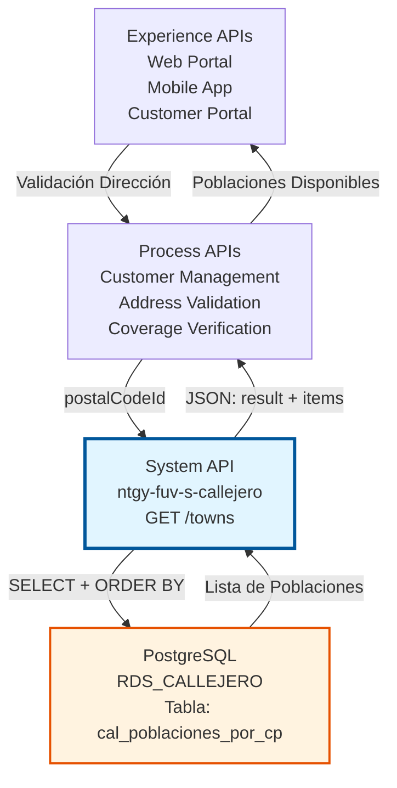
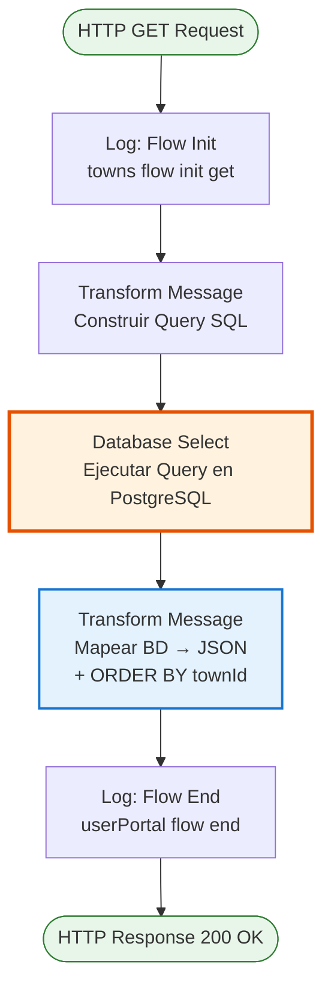
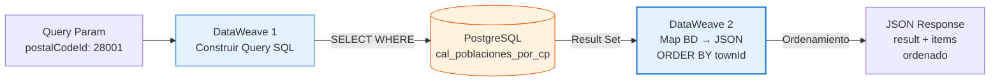
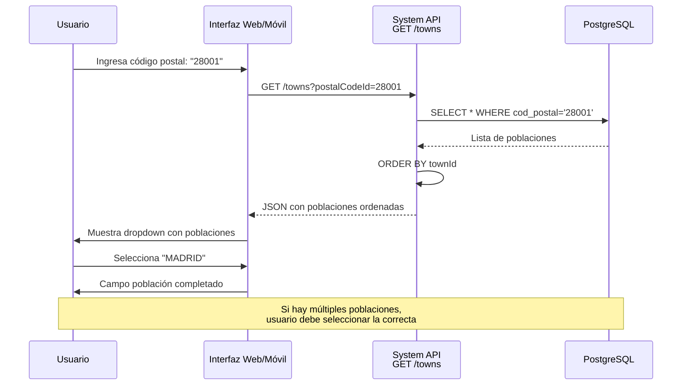

# GET /towns

## 📌 Descripción General

### Propósito del Endpoint

Este endpoint recupera información de poblaciones (municipios) del callejero español desde PostgreSQL, permitiendo consultas por código postal. Retorna todas las poblaciones asociadas a un código postal específico, incluyendo información completa de la provincia a la que pertenecen.

El endpoint soporta:
- **Consulta por Código Postal**: Retorna todas las poblaciones de un código postal específico
- **Información de Provincia**: Incluye ID y nombre de la provincia para cada población
- **Ordenamiento Automático**: Resultados ordenados por ID de población para consistencia
- **Respuesta Estructurada**: Retorna información completa de cada población en formato JSON normalizado

### Tipo de API

**Capa:** System API (API-Led Connectivity)

**Función:** Integración directa con PostgreSQL para consulta de poblaciones del callejero español con información geográfica completa.

### Patrón de Integración

**Tipo:** Request-Reply Síncrono con SQL Query

**Descripción:** Recibe código postal obligatorio, construye query SQL simple, ejecuta SELECT en PostgreSQL, ordena resultados por ID de población y retorna lista de poblaciones en formato JSON normalizado con información de provincia.

### Arquitectura API-Led Connectivity



---

## 💼 Propósito del Negocio

### Casos de Uso Principales

1. **Validación de Código Postal en Formularios**
   - Usuario ingresa código postal en formulario de dirección
   - Sistema verifica que el código postal existe y retorna poblaciones disponibles
   - Usuario selecciona población correcta de la lista
   - Previene errores de entrada de datos

2. **Selección de Población en Alta de Cliente**
   - Durante proceso de alta, cliente proporciona código postal
   - Sistema muestra poblaciones disponibles para ese código postal
   - Cliente selecciona su población específica
   - Asegura datos de dirección completos y correctos

3. **Verificación de Cobertura Geográfica**
   - Sistemas de negocio verifican si hay cobertura en una población
   - Consultan poblaciones por código postal
   - Validan contra catálogo de cobertura de servicios
   - Determinan disponibilidad de gas/electricidad

4. **Normalización de Direcciones**
   - Sistemas legacy tienen direcciones con nombres de población inconsistentes
   - Consultan población oficial por código postal
   - Normalizan datos según callejero oficial
   - Mantienen consistencia en base de datos

### Contexto Empresarial

- **Dominio:** Gestión de Callejero y Direcciones
- **Sector:** Energía - Utilities
- **División:** Naturgy España
- **Proceso de Negocio:** Validación y normalización de direcciones postales españolas
- **Estándar:** Poblaciones según nomenclatura oficial española (INE, Correos)

### Stakeholders

- **Equipos de Atención al Cliente**: Validan direcciones durante alta de clientes
- **Sistemas de Cobertura**: Verifican disponibilidad de servicios por población
- **Equipos de Facturación**: Requieren direcciones completas y normalizadas
- **Administradores de Datos**: Mantienen calidad de datos de direcciones

### Valor de Negocio

- **Calidad de Datos**: Garantiza poblaciones correctas y normalizadas en direcciones
- **Prevención de Errores**: Selección de lista reduce errores de entrada manual
- **Eficiencia Operativa**: Acelera procesos de validación de direcciones
- **Cobertura de Servicios**: Facilita verificación de disponibilidad de servicios
- **Cumplimiento Normativo**: Asegura uso de poblaciones según estándares oficiales

### Consumidores Potenciales

Este endpoint puede ser consumido por:
- Process APIs de gestión de clientes
- Process APIs de validación de direcciones
- Process APIs de verificación de cobertura
- Experience APIs de portales web y móviles
- Sistemas de facturación y cobros
- Herramientas de administración de callejero

---

## 🔧 Especificación Técnica

### URLs por Ambiente

| Ambiente | URL Base | URL Completa |
|----------|----------|--------------|
| **Local** | `http://localhost:8081` | `http://localhost:8081/api/towns?postalCodeId=28001` |
| **Development** | `https://ntgy-fuv-s-callejero-dev.us-e2.cloudhub.io` | `https://ntgy-fuv-s-callejero-dev.us-e2.cloudhub.io/api/towns?postalCodeId=28001` |
| **UAT** | `https://ntgy-fuv-s-callejero-uat.us-e2.cloudhub.io` | `https://ntgy-fuv-s-callejero-uat.us-e2.cloudhub.io/api/towns?postalCodeId=28001` |
| **Production** | `https://ntgy-fuv-s-callejero-pro.us-e2.cloudhub.io` | `https://ntgy-fuv-s-callejero-pro.us-e2.cloudhub.io/api/towns?postalCodeId=28001` |

### Método HTTP

```
GET /api/towns
```

### Parámetros de Entrada

#### Headers HTTP

| Header | Tipo | Requerido | Descripción | Ejemplo |
|--------|------|-----------|-------------|---------|
| `Accept` | string | ❌ No | Tipo de contenido esperado en response | `application/json` |

#### Query Parameters

| Parámetro | Tipo | Requerido | Descripción | Ejemplo |
|-----------|------|-----------|-------------|---------|
| `postalCodeId` | string | ✅ Sí | Código postal español (5 dígitos) | `"28001"` |

**Notas:**
- No hay parámetros adicionales de filtrado
- Retorna todas las poblaciones del código postal
- Resultados ordenados automáticamente por townId

### Respuestas

#### Respuesta Exitosa (200 OK)

```json
{
  "result": {
    "codResult": "0000",
    "msgResult": "No hay error"
  },
  "items": [
    {
      "townId": "28079",
      "townName": "MADRID",
      "provinceId": "28",
      "provinceDesc": "MADRID"
    }
  ]
}
```

#### Respuesta con Múltiples Poblaciones (200 OK)

```json
{
  "result": {
    "codResult": "0000",
    "msgResult": "No hay error"
  },
  "items": [
    {
      "townId": "08001",
      "townName": "BARCELONA",
      "provinceId": "08",
      "provinceDesc": "BARCELONA"
    },
    {
      "townId": "08015",
      "townName": "HOSPITALET DE LLOBREGAT",
      "provinceId": "08",
      "provinceDesc": "BARCELONA"
    }
  ]
}
```

#### Respuesta Sin Resultados (200 OK)

```json
{
  "result": {
    "codResult": "0000",
    "msgResult": "No hay error"
  },
  "items": []
}
```

#### Respuesta de Error de Validación (400)

```json
{
  "result": {
    "codResult": "0002",
    "msgResult": "Parámetro postalCodeId es obligatorio"
  }
}
```

#### Respuesta de Error Técnico (500)

```json
{
  "result": {
    "codResult": "0001",
    "msgResult": "Error interno del servidor"
  }
}
```

### Estructura de Datos de Respuesta

| Campo | Tipo | Descripción |
|-------|------|-------------|
| `result.codResult` | string | Código de resultado ("0000" = éxito) |
| `result.msgResult` | string | Mensaje descriptivo del resultado |
| `items` | array | Array de poblaciones encontradas (ordenado por townId) |
| `items[].townId` | string | ID único de la población (código INE) |
| `items[].townName` | string | Nombre oficial de la población |
| `items[].provinceId` | string | ID de la provincia (2 dígitos) |
| `items[].provinceDesc` | string | Nombre oficial de la provincia |

### Autenticación y Autorización

- **Tipo:** Client ID & Client Secret (Anypoint Platform)
- **Autorización PostgreSQL:** El usuario de base de datos debe tener permisos para:
  - Ejecutar SELECT en tabla/vista `cal_poblaciones_por_cp`
  - Acceso de lectura al schema `public`

### Timeouts

| Tipo | Valor | Descripción |
|------|-------|-------------|
| **Request Timeout** | 30 segundos | Tiempo máximo de espera para la respuesta |
| **Connection Timeout** | 10 segundos | Tiempo máximo para establecer conexión con PostgreSQL |
| **Query Timeout** | 20 segundos | Tiempo máximo de ejecución de la query SQL |

### Performance y Optimización

- **Índices Recomendados:**
  - Índice en `cod_postal` para búsquedas rápidas
  - Índice en `id_poblacion` para ordenamiento eficiente
- **Ordenamiento:** Realizado en DataWeave (no en SQL)
- **Caché:** Candidato ideal para caché (datos estáticos)
- **Volumen:** Típicamente 1-3 poblaciones por código postal

---

## 🏗️ Implementación Técnica

### Arquitectura del Flow



### Componentes del Flow

#### 1. Logger - Flow Init (Línea 10)
```xml
<logger level="INFO" message="towns flow init get" />
```
- Registra inicio del flow
- Nivel INFO para trazabilidad

#### 2. Transform Message - Construcción de Query (Líneas 11-17)
```dataweave
%dw 2.0
output application/json
var codPostal = attributes.queryParams.postalCodeId
---
queryStatement: "select * from cal_poblaciones_por_cp where cod_postal = '" ++ codPostal ++ "'"
```

**Lógica:**
- Extrae `postalCodeId` de query params
- Construye query SQL simple sin filtros adicionales
- Busca todas las poblaciones del código postal
- No hay lógica condicional (a diferencia de /streets)

#### 3. Database Select (Líneas 18-20)
```xml
<db:select config-ref="RDS_CALLEJERO">
    <db:sql><![CDATA[#[vars.query.queryStatement]]]></db:sql>
</db:select>
```

**Configuración:**
- Connector: Database Connector v1.14.12
- Config: `RDS_CALLEJERO`
- Query: Dinámico desde variable `vars.query.queryStatement`

#### 4. Transform Message - Response con Ordenamiento (Líneas 21-36)
```dataweave
%dw 2.0
output application/json
---
{
    result: {	 
        codResult: "0000",
        msgResult: "No hay error"
    },
    items: 
        (payload map (payload01, indexOfPayload01) -> {		
            townId: payload01.id_poblacion,
            townName: payload01.des_poblacion default "",
            provinceId: payload01.id_provincia,
            provinceDesc: payload01.des_provincia
        })
        orderBy $.townId
}
```

**Transformación Clave:**
- Envuelve resultado en estructura estándar con `result` + `items`
- Mapea cada registro de BD a objeto JSON normalizado
- Maneja valores default para `des_poblacion`
- **IMPORTANTE:** `orderBy $.townId` ordena resultados por ID de población
- Renombra campos de BD a nombres más descriptivos en inglés

**Mapeo de Campos:**
| Campo BD | Campo JSON | Descripción |
|----------|------------|-------------|
| `id_poblacion` | `townId` | ID de la población (código INE) |
| `des_poblacion` | `townName` | Nombre de la población |
| `id_provincia` | `provinceId` | ID de la provincia |
| `des_provincia` | `provinceDesc` | Nombre de la provincia |

**Ordenamiento:**
- Se realiza en DataWeave, no en SQL
- Garantiza orden consistente en respuesta
- Ordenado por `townId` (ascendente)

#### 5. Logger - Flow End (Línea 37)
```xml
<logger level="INFO" message="userPortal flow end" />
```
- Registra fin exitoso del flow

### Query SQL Ejecutada

```sql
SELECT * FROM cal_poblaciones_por_cp 
WHERE cod_postal = '28001'
```

**Características:**
- Query simple sin JOINs
- Un solo filtro: código postal
- Retorna todos los campos de la tabla
- Ordenamiento realizado en DataWeave (no en SQL)

### Tabla PostgreSQL: cal_poblaciones_por_cp

| Columna | Tipo | Descripción |
|---------|------|-------------|
| `id_poblacion` | VARCHAR | ID único de la población - código INE (PK) |
| `des_poblacion` | VARCHAR | Nombre oficial de la población |
| `id_provincia` | VARCHAR | ID de la provincia (2 dígitos) |
| `des_provincia` | VARCHAR | Nombre oficial de la provincia |
| `cod_postal` | VARCHAR | Código postal (5 dígitos) |

**Nota:** Esta tabla/vista está optimizada para búsquedas por código postal, probablemente con índice en `cod_postal`.

### Diagrama de Transformación de Datos



### Flujo de Selección de Población



### Manejo de Errores

```mermaid
flowchart TD
    Start[Request] --> ValidateCP{¿postalCodeId<br/>presente?}
    ValidateCP -->|No| Error400[HTTP 400<br/>Bad Request]
    ValidateCP -->|Sí| Execute[Ejecutar Query]
    Execute --> DBCheck{¿DB<br/>disponible?}
    DBCheck -->|No| Error500[HTTP 500<br/>Database Error]
    DBCheck -->|Sí| CheckResults{¿Resultados<br/>encontrados?}
    CheckResults -->|No| Success200Empty[HTTP 200<br/>items: []]
    CheckResults -->|Sí| OrderResults[Ordenar por townId]
    OrderResults --> Success200Data[HTTP 200<br/>items: [...]]
    
    style Error400 fill:#ffebee,stroke:#c62828
    style Error500 fill:#ffebee,stroke:#c62828
    style Success200Empty fill:#fff3e0,stroke:#f57c00
    style OrderResults fill:#e3f2fd,stroke:#1976d2
    style Success200Data fill:#e8f5e9,stroke:#2e7d32
```

### Comparación con GET /streets

| Aspecto | GET /towns | GET /streets |
|---------|------------|--------------|
| **Parámetros** | Solo postalCodeId | postalCodeId + wayDesc (opcional) |
| **Filtrado** | Sin filtros adicionales | Filtro LIKE para autocompletado |
| **Query SQL** | Simple, un WHERE | Condicional, con/sin LIKE |
| **Ordenamiento** | orderBy $.townId en DataWeave | Sin ordenamiento explícito |
| **Información Extra** | Incluye provincia | Incluye tipo de vía |
| **Volumen Típico** | 1-3 resultados | 10-100+ resultados |
| **Uso Principal** | Selección de población | Autocompletado de calle |

### Configuración de Base de Datos

**Connection String:**
```
jdbc:postgresql://${bbdd.host}:${bbdd.port}/${bbdd.database}
```

**Propiedades:**
- `bbdd.host`: Host del servidor PostgreSQL
- `bbdd.port`: Puerto (default: 5432)
- `bbdd.database`: Nombre de la base de datos (callejero)
- `bbdd.user`: Usuario de conexión
- `bbdd.password`: Password encriptado (secure properties)

**Connection Pooling:**
- Habilitado mediante `<db:pooling-profile />`
- Reutilización de conexiones para mejor performance

---

## 💻 Ejemplos de Uso

### Ejemplo 1: Consulta Población de Madrid

#### Request con curl

```bash
curl -X GET "http://localhost:8081/api/towns?postalCodeId=28001" \
  -H "Accept: application/json"
```

#### Response Exitoso

```json
{
  "result": {
    "codResult": "0000",
    "msgResult": "No hay error"
  },
  "items": [
    {
      "townId": "28079",
      "townName": "MADRID",
      "provinceId": "28",
      "provinceDesc": "MADRID"
    }
  ]
}
```

### Ejemplo 2: Código Postal con Múltiples Poblaciones

#### Request con curl

```bash
curl -X GET "http://localhost:8081/api/towns?postalCodeId=08001" \
  -H "Accept: application/json"
```

#### Response Exitoso (Múltiples Poblaciones)

```json
{
  "result": {
    "codResult": "0000",
    "msgResult": "No hay error"
  },
  "items": [
    {
      "townId": "08001",
      "townName": "BARCELONA",
      "provinceId": "08",
      "provinceDesc": "BARCELONA"
    },
    {
      "townId": "08015",
      "townName": "HOSPITALET DE LLOBREGAT",
      "provinceId": "08",
      "provinceDesc": "BARCELONA"
    },
    {
      "townId": "08019",
      "townName": "SANT ADRIA DE BESOS",
      "provinceId": "08",
      "provinceDesc": "BARCELONA"
    }
  ]
}
```

**Nota:** Resultados ordenados por `townId` automáticamente.

### Ejemplo 3: Código Postal No Encontrado

#### Request con curl

```bash
curl -X GET "http://localhost:8081/api/towns?postalCodeId=99999" \
  -H "Accept: application/json"
```

#### Response (Sin Resultados)

```json
{
  "result": {
    "codResult": "0000",
    "msgResult": "No hay error"
  },
  "items": []
}
```

### Ejemplo 4: Integración JavaScript - Selector de Población

```javascript
async function getTowns(postalCode) {
  const url = `https://ntgy-fuv-s-callejero-dev.us-e2.cloudhub.io/api/towns?postalCodeId=${postalCode}`;
  
  try {
    const response = await fetch(url, {
      method: 'GET',
      headers: {
        'Accept': 'application/json'
      }
    });
    
    const data = await response.json();
    
    if (data.result.codResult === "0000") {
      return data.items;
    } else {
      console.error('Error al obtener poblaciones:', data.result.msgResult);
      return [];
    }
  } catch (error) {
    console.error('Error de conexión:', error);
    return [];
  }
}

// Función para poblar selector de población
async function populateTownSelector(postalCode, selectElement) {
  // Limpiar opciones existentes
  selectElement.innerHTML = '<option value="">Seleccione población...</option>';
  
  // Mostrar loading
  selectElement.disabled = true;
  
  try {
    const towns = await getTowns(postalCode);
    
    if (towns.length === 0) {
      selectElement.innerHTML = '<option value="">No hay poblaciones para este código postal</option>';
      return;
    }
    
    // Poblar selector con poblaciones
    towns.forEach(town => {
      const option = document.createElement('option');
      option.value = town.townId;
      option.textContent = `${town.townName} (${town.provinceDesc})`;
      option.dataset.townName = town.townName;
      option.dataset.provinceId = town.provinceId;
      option.dataset.provinceDesc = town.provinceDesc;
      selectElement.appendChild(option);
    });
    
    // Si solo hay una población, seleccionarla automáticamente
    if (towns.length === 1) {
      selectElement.selectedIndex = 1;
      selectElement.dispatchEvent(new Event('change'));
    }
  } catch (error) {
    selectElement.innerHTML = '<option value="">Error al cargar poblaciones</option>';
  } finally {
    selectElement.disabled = false;
  }
}

// Uso
const postalCodeInput = document.getElementById('postal-code');
const townSelect = document.getElementById('town-select');

postalCodeInput.addEventListener('blur', function() {
  const postalCode = this.value.trim();
  if (postalCode.length === 5) {
    populateTownSelector(postalCode, townSelect);
  }
});
```

### Ejemplo 5: Integración Python - Validación de Código Postal

```python
import requests
from typing import List, Dict, Optional

class TownSearchClient:
    """Cliente para búsqueda de poblaciones por código postal"""
    
    def __init__(self, base_url: str):
        self.base_url = base_url.rstrip('/')
        self.endpoint = f"{self.base_url}/api/towns"
    
    def get_towns(self, postal_code: str) -> List[Dict]:
        """
        Obtiene poblaciones por código postal
        
        Args:
            postal_code: Código postal español (5 dígitos)
            
        Returns:
            Lista de diccionarios con información de poblaciones
        """
        params = {'postalCodeId': postal_code}
        headers = {'Accept': 'application/json'}
        
        try:
            response = requests.get(self.endpoint, params=params, headers=headers)
            response.raise_for_status()
            
            data = response.json()
            
            if data['result']['codResult'] == '0000':
                return data['items']
            else:
                print(f"Error: {data['result']['msgResult']}")
                return []
                
        except requests.exceptions.RequestException as e:
            print(f"Error al buscar poblaciones: {e}")
            raise
    
    def validate_postal_code(self, postal_code: str) -> bool:
        """
        Valida si un código postal existe
        
        Args:
            postal_code: Código postal a validar
            
        Returns:
            True si el código postal existe, False en caso contrario
        """
        towns = self.get_towns(postal_code)
        return len(towns) > 0
    
    def get_town_info(self, postal_code: str, town_id: str) -> Optional[Dict]:
        """
        Obtiene información de una población específica
        
        Args:
            postal_code: Código postal
            town_id: ID de la población
            
        Returns:
            Diccionario con información de la población o None si no se encuentra
        """
        towns = self.get_towns(postal_code)
        
        for town in towns:
            if town['townId'] == town_id:
                return town
        
        return None

# Uso
client = TownSearchClient('https://ntgy-fuv-s-callejero-dev.us-e2.cloudhub.io')

# Validar código postal
postal_code = '28001'
if client.validate_postal_code(postal_code):
    print(f"Código postal {postal_code} es válido")
    
    # Obtener poblaciones
    towns = client.get_towns(postal_code)
    print(f"Poblaciones encontradas: {len(towns)}")
    
    for town in towns:
        print(f"  - {town['townName']} ({town['provinceDesc']})")
else:
    print(f"Código postal {postal_code} no encontrado")
```

### Ejemplo 6: React Component - Selector de Población

```jsx
import React, { useState, useEffect } from 'react';

const TownSelector = ({ postalCode, onTownSelect }) => {
  const [towns, setTowns] = useState([]);
  const [loading, setLoading] = useState(false);
  const [error, setError] = useState(null);
  const [selectedTown, setSelectedTown] = useState('');

  useEffect(() => {
    if (postalCode && postalCode.length === 5) {
      fetchTowns(postalCode);
    } else {
      setTowns([]);
      setSelectedTown('');
    }
  }, [postalCode]);

  const fetchTowns = async (postal) => {
    setLoading(true);
    setError(null);

    const url = `https://ntgy-fuv-s-callejero-dev.us-e2.cloudhub.io/api/towns?postalCodeId=${postal}`;

    try {
      const response = await fetch(url, {
        method: 'GET',
        headers: { 'Accept': 'application/json' }
      });

      const data = await response.json();

      if (data.result.codResult === '0000') {
        setTowns(data.items);
        
        // Si solo hay una población, seleccionarla automáticamente
        if (data.items.length === 1) {
          const town = data.items[0];
          setSelectedTown(town.townId);
          onTownSelect(town);
        }
      } else {
        setError(data.result.msgResult);
        setTowns([]);
      }
    } catch (err) {
      setError('Error al cargar poblaciones');
      setTowns([]);
    } finally {
      setLoading(false);
    }
  };

  const handleTownChange = (e) => {
    const townId = e.target.value;
    setSelectedTown(townId);
    
    const town = towns.find(t => t.townId === townId);
    if (town) {
      onTownSelect(town);
    }
  };

  if (!postalCode || postalCode.length !== 5) {
    return (
      <div className="town-selector">
        <label>Población</label>
        <select disabled>
          <option>Ingrese código postal primero</option>
        </select>
      </div>
    );
  }

  return (
    <div className="town-selector">
      <label>Población *</label>
      
      {loading && <div className="loading">Cargando poblaciones...</div>}
      
      {error && <div className="error">{error}</div>}
      
      {!loading && !error && (
        <select 
          value={selectedTown} 
          onChange={handleTownChange}
          required
        >
          <option value="">Seleccione población...</option>
          {towns.map(town => (
            <option key={town.townId} value={town.townId}>
              {town.townName} ({town.provinceDesc})
            </option>
          ))}
        </select>
      )}
      
      {!loading && towns.length === 0 && !error && (
        <div className="no-results">
          No hay poblaciones para este código postal
        </div>
      )}
    </div>
  );
};

export default TownSelector;
```

### Ejemplo 7: Vue.js Component - Selector de Población

```vue
<template>
  <div class="town-selector">
    <label>Población *</label>
    
    <div v-if="loading" class="loading">Cargando poblaciones...</div>
    
    <div v-if="error" class="error">{{ error }}</div>
    
    <select 
      v-if="!loading && !error"
      v-model="selectedTown"
      @change="handleTownChange"
      required
    >
      <option value="">Seleccione población...</option>
      <option 
        v-for="town in towns" 
        :key="town.townId" 
        :value="town.townId"
      >
        {{ town.townName }} ({{ town.provinceDesc }})
      </option>
    </select>
    
    <div v-if="!loading && towns.length === 0 && !error" class="no-results">
      No hay poblaciones para este código postal
    </div>
  </div>
</template>

<script>
import { ref, watch } from 'vue';

export default {
  name: 'TownSelector',
  props: {
    postalCode: {
      type: String,
      required: true
    }
  },
  emits: ['town-selected'],
  setup(props, { emit }) {
    const towns = ref([]);
    const loading = ref(false);
    const error = ref(null);
    const selectedTown = ref('');

    const fetchTowns = async (postal) => {
      if (!postal || postal.length !== 5) {
        towns.value = [];
        selectedTown.value = '';
        return;
      }

      loading.value = true;
      error.value = null;

      const url = `https://ntgy-fuv-s-callejero-dev.us-e2.cloudhub.io/api/towns?postalCodeId=${postal}`;

      try {
        const response = await fetch(url, {
          method: 'GET',
          headers: { 'Accept': 'application/json' }
        });

        const data = await response.json();

        if (data.result.codResult === '0000') {
          towns.value = data.items;
          
          // Si solo hay una población, seleccionarla automáticamente
          if (data.items.length === 1) {
            const town = data.items[0];
            selectedTown.value = town.townId;
            emit('town-selected', town);
          }
        } else {
          error.value = data.result.msgResult;
          towns.value = [];
        }
      } catch (err) {
        error.value = 'Error al cargar poblaciones';
        towns.value = [];
      } finally {
        loading.value = false;
      }
    };

    const handleTownChange = () => {
      const town = towns.value.find(t => t.townId === selectedTown.value);
      if (town) {
        emit('town-selected', town);
      }
    };

    watch(() => props.postalCode, (newPostalCode) => {
      fetchTowns(newPostalCode);
    }, { immediate: true });

    return {
      towns,
      loading,
      error,
      selectedTown,
      handleTownChange
    };
  }
};
</script>

<style scoped>
.town-selector {
  margin-bottom: 1rem;
}

label {
  display: block;
  margin-bottom: 0.5rem;
  font-weight: bold;
}

select {
  width: 100%;
  padding: 0.5rem;
  border: 1px solid #ccc;
  border-radius: 4px;
  font-size: 1rem;
}

.loading, .error, .no-results {
  padding: 0.5rem;
  border-radius: 4px;
}

.loading {
  background-color: #e3f2fd;
  color: #1976d2;
}

.error {
  background-color: #ffebee;
  color: #c62828;
}

.no-results {
  background-color: #fff3e0;
  color: #f57c00;
}
</style>
```

### Ejemplo 8: Formulario Completo de Dirección

```javascript
// Ejemplo de formulario completo que integra código postal, población y calle
class AddressForm {
  constructor(formElement) {
    this.form = formElement;
    this.postalCodeInput = formElement.querySelector('#postal-code');
    this.townSelect = formElement.querySelector('#town-select');
    this.streetInput = formElement.querySelector('#street-input');
    
    this.setupEventListeners();
  }
  
  setupEventListeners() {
    // Cuando cambia el código postal, cargar poblaciones
    this.postalCodeInput.addEventListener('blur', async () => {
      const postalCode = this.postalCodeInput.value.trim();
      if (postalCode.length === 5) {
        await this.loadTowns(postalCode);
      }
    });
    
    // Cuando se selecciona población, habilitar campo de calle
    this.townSelect.addEventListener('change', () => {
      const townSelected = this.townSelect.value !== '';
      this.streetInput.disabled = !townSelected;
      
      if (townSelected) {
        this.streetInput.focus();
      }
    });
  }
  
  async loadTowns(postalCode) {
    try {
      const response = await fetch(
        `https://ntgy-fuv-s-callejero-dev.us-e2.cloudhub.io/api/towns?postalCodeId=${postalCode}`
      );
      
      const data = await response.json();
      
      if (data.result.codResult === '0000') {
        this.populateTownSelect(data.items);
      } else {
        this.showError('No se encontraron poblaciones para este código postal');
      }
    } catch (error) {
      this.showError('Error al cargar poblaciones');
    }
  }
  
  populateTownSelect(towns) {
    this.townSelect.innerHTML = '<option value="">Seleccione población...</option>';
    
    towns.forEach(town => {
      const option = document.createElement('option');
      option.value = town.townId;
      option.textContent = `${town.townName} (${town.provinceDesc})`;
      option.dataset.townName = town.townName;
      option.dataset.provinceId = town.provinceId;
      this.townSelect.appendChild(option);
    });
    
    this.townSelect.disabled = false;
    
    // Si solo hay una población, seleccionarla automáticamente
    if (towns.length === 1) {
      this.townSelect.selectedIndex = 1;
      this.townSelect.dispatchEvent(new Event('change'));
    }
  }
  
  showError(message) {
    // Implementar visualización de error
    console.error(message);
  }
  
  getFormData() {
    const selectedOption = this.townSelect.options[this.townSelect.selectedIndex];
    
    return {
      postalCode: this.postalCodeInput.value,
      townId: this.townSelect.value,
      townName: selectedOption?.dataset.townName || '',
      provinceId: selectedOption?.dataset.provinceId || '',
      street: this.streetInput.value
    };
  }
}

// Uso
const addressForm = new AddressForm(document.getElementById('address-form'));
```
