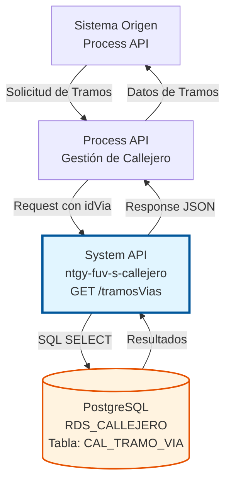
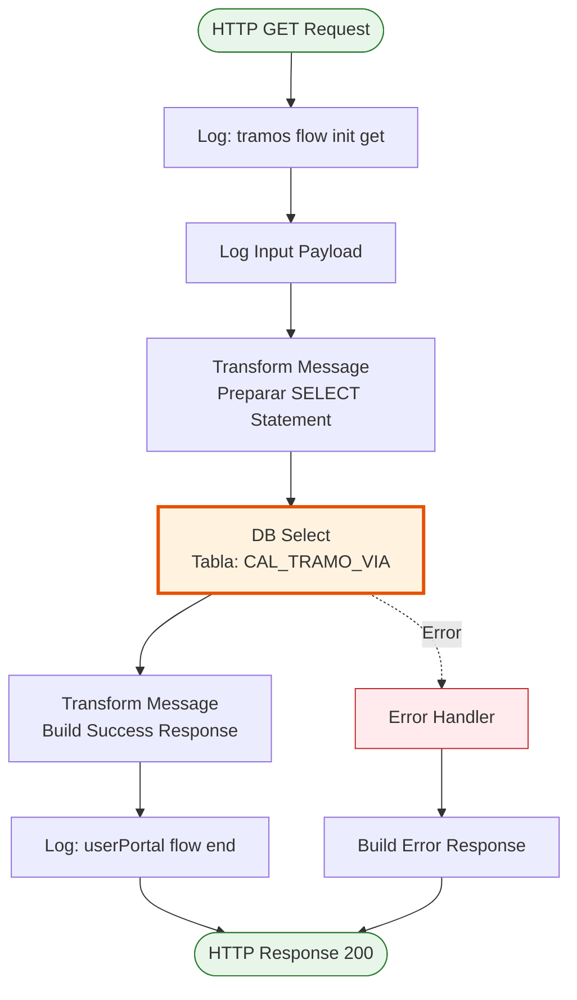
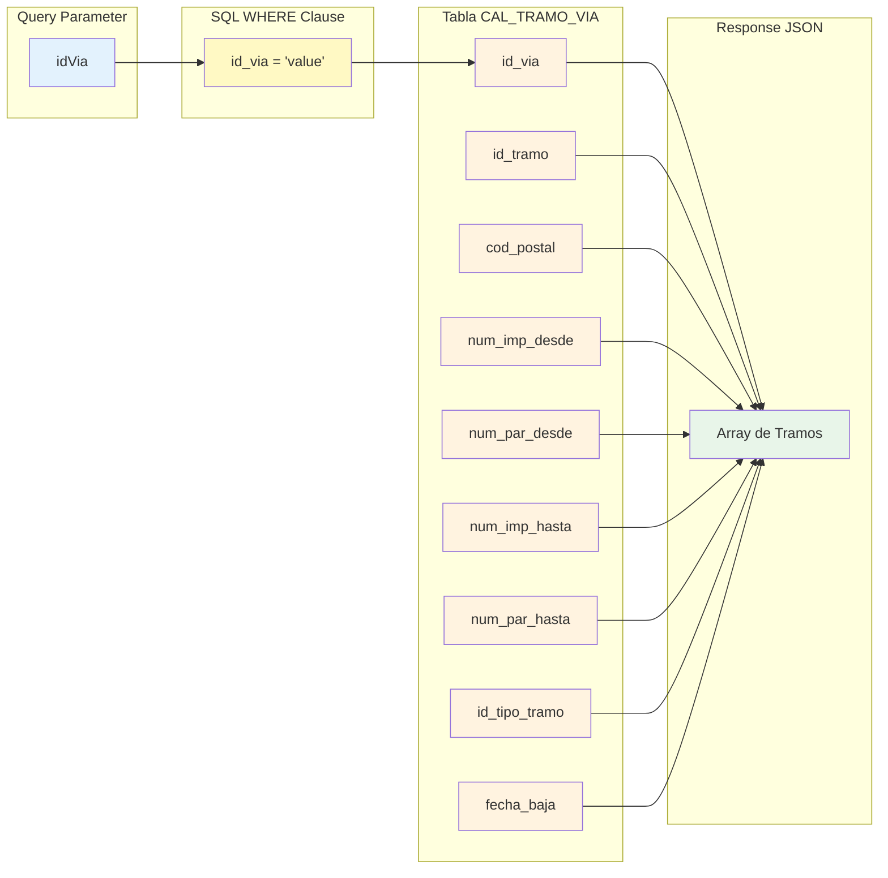

# GET /tramosVias

## 📌 Descripción General

### Propósito del Endpoint

Este endpoint permite recuperar tramos de vía de la base de datos PostgreSQL del callejero español, filtrando por el identificador de vía. Retorna todos los tramos asociados a una vía específica, incluyendo su numeración, código postal y estado.

El endpoint soporta:
- **Consulta por ID de Vía**: Recupera todos los tramos de una vía específica
- **Información Completa**: Retorna numeración par/impar, código postal y tipo de tramo
- **Estado de Tramos**: Incluye información de fecha de baja si existe
- **Múltiples Resultados**: Puede retornar varios tramos para una misma vía

### Tipo de API

**Capa:** System API (API-Led Connectivity)

**Función:** Integración directa con PostgreSQL para consulta de tramos de vías del callejero español.

### Patrón de Integración

**Tipo:** Request-Reply Síncrono con SQL SELECT

**Descripción:** Recibe el ID de vía como query parameter, construye una consulta SQL SELECT, ejecuta la query en la tabla CAL_TRAMO_VIA y retorna los resultados en formato JSON.

### Arquitectura API-Led Connectivity



---

## 💼 Propósito del Negocio

### Casos de Uso Principales

1. **Consulta de Tramos de una Vía**
   - Obtener todos los tramos que componen una calle específica
   - Visualizar la división de una vía en secciones
   - Identificar códigos postales asociados a cada tramo

2. **Validación de Direcciones**
   - Verificar en qué tramo se encuentra un número de portal específico
   - Validar que un número existe dentro de los rangos definidos
   - Determinar el código postal correcto según el número de portal

3. **Gestión de Callejero**
   - Listar todos los tramos de una vía para mantenimiento
   - Identificar tramos dados de baja
   - Analizar la estructura de numeración de una calle

### Contexto Empresarial

- **Dominio:** Gestión de Callejero y Direcciones
- **Sector:** Energía - Utilities
- **División:** Naturgy España
- **Proceso de Negocio:** Consulta y validación de direcciones del callejero español
- **Criticidad:** Alta - Esencial para validación de direcciones en tiempo real

### Stakeholders

- **Equipos de Atención al Cliente**: Validan direcciones durante interacciones con clientes
- **Sistemas de Autoservicio**: Proporcionan autocompletado de direcciones
- **Departamento de Facturación**: Verifican direcciones para envío de facturas
- **Servicios de Campo**: Consultan direcciones para planificar visitas

### Valor de Negocio

- **Validación en Tiempo Real**: Permite verificar direcciones instantáneamente
- **Precisión en Datos**: Asegura que las direcciones sean válidas y completas
- **Experiencia de Usuario**: Facilita el ingreso correcto de direcciones
- **Eficiencia Operativa**: Reduce errores y devoluciones de correo

### Consumidores Potenciales

Este endpoint puede ser consumido por:
- Process APIs de gestión de clientes
- Process APIs de validación de direcciones
- Experience APIs de portales web y móviles
- Sistemas de autocompletado de direcciones

---

## 🔧 Especificación Técnica

### URLs por Ambiente

| Ambiente | URL Base | URL Completa |
|----------|----------|--------------|
| **Local** | `http://localhost:8081` | `http://localhost:8081/api/tramosVias?idVia={id}` |
| **Development** | `https://ntgy-fuv-s-callejero-dev.us-e2.cloudhub.io` | `https://ntgy-fuv-s-callejero-dev.us-e2.cloudhub.io/api/tramosVias?idVia={id}` |
| **UAT** | `https://ntgy-fuv-s-callejero-uat.us-e2.cloudhub.io` | `https://ntgy-fuv-s-callejero-uat.us-e2.cloudhub.io/api/tramosVias?idVia={id}` |
| **Production** | `https://ntgy-fuv-s-callejero-pro.us-e2.cloudhub.io` | `https://ntgy-fuv-s-callejero-pro.us-e2.cloudhub.io/api/tramosVias?idVia={id}` |

### Método HTTP

```
GET /api/tramosVias?idVia={id}
```

### Parámetros de Entrada

#### Headers HTTP

| Header | Tipo | Requerido | Descripción | Ejemplo |
|--------|------|-----------|-------------|---------|
| `Accept` | string | ❌ No | Tipo de contenido esperado en response | `application/json` |

#### Query Parameters

| Parámetro | Tipo | Requerido | Descripción | Ejemplo |
|-----------|------|-----------|-------------|---------|
| `idVia` | string | ✅ Sí | Identificador único de la vía | `"12345"` |

**Nota:** Aunque el RAML menciona `idPoblacion`, el código real utiliza `idVia` como parámetro de consulta.

### Respuestas

#### Respuesta Exitosa (200 OK)

```json
{
  "result": {
    "codResult": "0000",
    "msgResult": "Ejecutado Correctamente"
  },
  "values": [
    {
      "id_via": 12345,
      "id_tramo": 1,
      "cod_postal": "28001",
      "num_imp_desde": "1",
      "num_par_desde": "2",
      "num_imp_hasta": "99",
      "num_par_hasta": "100",
      "id_tipo_tramo": "U",
      "fecha_baja": null
    },
    {
      "id_via": 12345,
      "id_tramo": 2,
      "cod_postal": "28002",
      "num_imp_desde": "101",
      "num_par_desde": "102",
      "num_imp_hasta": "199",
      "num_par_hasta": "200",
      "id_tipo_tramo": "U",
      "fecha_baja": null
    }
  ]
}
```

#### Respuesta Sin Resultados (200 OK)

```json
{
  "result": {
    "codResult": "0000",
    "msgResult": "Ejecutado Correctamente"
  },
  "values": []
}
```

#### Respuesta de Error Técnico (500)

```json
{
  "result": {
    "codResult": "0001",
    "msgResult": "Error al consultar la base de datos"
  }
}
```

### Autenticación y Autorización

- **Tipo:** Client ID & Client Secret (Anypoint Platform)
- **Autorización PostgreSQL:** El usuario de base de datos debe tener permisos para:
  - Ejecutar SELECT en tabla `CAL_TRAMO_VIA`
  - Acceso al schema `public`

### Timeouts

| Tipo | Valor | Descripción |
|------|-------|-------------|
| **Request Timeout** | 30 segundos | Tiempo máximo de espera para la respuesta |
| **Connection Timeout** | 10 segundos | Tiempo máximo para establecer conexión con PostgreSQL |

---

## 🏗️ Implementación Técnica

### Arquitectura del Flow



### Componentes del Flow

#### 1. Logger Inicial (Flow Init)
```xml
<logger level="INFO" message="tramos flow init get" />
```
- Registra el inicio del flow
- Facilita troubleshooting y auditoría

#### 2. Logger de Input
```xml
<logger level="INFO" message="Input payload: #[payload]" />
```
- Registra el payload recibido (query parameters)
- Útil para debugging

#### 3. Transformación DataWeave (Preparación SELECT)

**Ubicación en código:** Líneas 16-24 del archivo XML

```dataweave
%dw 2.0
output application/json
var idVia = attributes.queryParams.idVia
---
queryStatement: "select * from cal_tramo_via where id_via = '" ++ idVia ++ "'"
```

**Lógica:**
- Extrae el parámetro `idVia` de los query parameters
- Construye dinámicamente el SELECT statement
- Filtra por `id_via` en la tabla

#### 4. Database Select

**Ubicación en código:** Líneas 25-27 del archivo XML

```xml
<db:select config-ref="RDS_CALLEJERO">
    <db:sql><![CDATA[#[vars.query.queryStatement]]]></db:sql>
</db:select>
```

**Configuración:**
- **Config:** `RDS_CALLEJERO`
- **Operación:** SELECT
- **Tabla:** `cal_tramo_via`

**Query SQL Generado (ejemplo):**
```sql
SELECT * FROM cal_tramo_via WHERE id_via = '12345'
```

#### 5. Transformación de Respuesta

**Ubicación en código:** Líneas 28-39 del archivo XML

```dataweave
%dw 2.0
output application/json
---
{
  "result": {
    "codResult": "0000",
    "msgResult": "Ejecutado Correctamente"
  },
  "values": payload
}
```

**Lógica:**
- Envuelve los resultados de la query en estructura estándar
- Incluye código y mensaje de resultado
- El array `values` contiene todos los tramos encontrados

### Estructura de Datos



### Tabla de Base de Datos

**Tabla:** `public.cal_tramo_via`

| Columna | Tipo | Descripción |
|---------|------|-------------|
| `id_via` | INTEGER | Identificador de la vía (filtro de búsqueda) |
| `id_tramo` | INTEGER | Identificador del tramo |
| `cod_postal` | VARCHAR | Código postal del tramo |
| `num_imp_desde` | VARCHAR | Número inicial lado impar |
| `num_par_desde` | VARCHAR | Número inicial lado par |
| `num_imp_hasta` | VARCHAR | Número final lado impar |
| `num_par_hasta` | VARCHAR | Número final lado par |
| `id_tipo_tramo` | VARCHAR | Tipo de tramo |
| `fecha_baja` | DATE | Fecha de baja del tramo (nullable) |

### Manejo de Errores

**Errores Comunes:**

1. **Parámetro idVia Faltante**
   - Validado por APIKit según RAML
   - Retorna 400 Bad Request

2. **ID de Vía No Existe**
   - La query retorna array vacío
   - Response 200 OK con `values: []`

3. **Error de Conexión a Base de Datos**
   - Timeout o base de datos no disponible
   - Retorna 503 Service Unavailable

---

## 💻 Ejemplos de Uso

### Ejemplo 1: Consultar Tramos de una Vía

**Request:**

```bash
curl -X GET "http://localhost:8081/api/tramosVias?idVia=12345" \
  -H "Accept: application/json"
```

**Response (200 OK):**

```json
{
  "result": {
    "codResult": "0000",
    "msgResult": "Ejecutado Correctamente"
  },
  "values": [
    {
      "id_via": 12345,
      "id_tramo": 1,
      "cod_postal": "28001",
      "num_imp_desde": "1",
      "num_par_desde": "2",
      "num_imp_hasta": "99",
      "num_par_hasta": "100",
      "id_tipo_tramo": "U",
      "fecha_baja": null
    },
    {
      "id_via": 12345,
      "id_tramo": 2,
      "cod_postal": "28002",
      "num_imp_desde": "101",
      "num_par_desde": "102",
      "num_imp_hasta": "199",
      "num_par_hasta": "200",
      "id_tipo_tramo": "U",
      "fecha_baja": null
    }
  ]
}
```

### Ejemplo 2: Vía Sin Tramos

**Request:**

```bash
curl -X GET "http://localhost:8081/api/tramosVias?idVia=99999" \
  -H "Accept: application/json"
```

**Response (200 OK):**

```json
{
  "result": {
    "codResult": "0000",
    "msgResult": "Ejecutado Correctamente"
  },
  "values": []
}
```

### Ejemplo 3: Error - Parámetro Faltante

**Request:**

```bash
curl -X GET "http://localhost:8081/api/tramosVias" \
  -H "Accept: application/json"
```

**Response (400 Bad Request):**

```json
{
  "error": "Required query parameter 'idVia' is missing"
}
```

### Ejemplo 4: Uso desde JavaScript

```javascript
const getTramosVia = async (idVia) => {
  try {
    const response = await fetch(
      `http://localhost:8081/api/tramosVias?idVia=${idVia}`,
      {
        method: 'GET',
        headers: {
          'Accept': 'application/json'
        }
      }
    );

    const result = await response.json();
    
    if (result.result.codResult === "0000") {
      console.log(`Encontrados ${result.values.length} tramos`);
      return result.values;
    } else {
      console.error('Error al consultar tramos:', result.result.msgResult);
      throw new Error(result.result.msgResult);
    }
  } catch (error) {
    console.error('Error en la petición:', error);
    throw error;
  }
};

// Uso
getTramosVia(12345).then(tramos => {
  tramos.forEach(tramo => {
    console.log(`Tramo ${tramo.id_tramo}: CP ${tramo.cod_postal}`);
    console.log(`  Impar: ${tramo.num_imp_desde} - ${tramo.num_imp_hasta}`);
    console.log(`  Par: ${tramo.num_par_desde} - ${tramo.num_par_hasta}`);
  });
});
```

### Ejemplo 5: Validar Número de Portal

```javascript
const validarNumeroPortal = async (idVia, numeroPortal) => {
  const tramos = await getTramosVia(idVia);
  
  const esImpar = numeroPortal % 2 !== 0;
  
  const tramoValido = tramos.find(tramo => {
    if (esImpar) {
      const desde = parseInt(tramo.num_imp_desde);
      const hasta = parseInt(tramo.num_imp_hasta);
      return numeroPortal >= desde && numeroPortal <= hasta;
    } else {
      const desde = parseInt(tramo.num_par_desde);
      const hasta = parseInt(tramo.num_par_hasta);
      return numeroPortal >= desde && numeroPortal <= hasta;
    }
  });
  
  if (tramoValido) {
    return {
      valido: true,
      codigoPostal: tramoValido.cod_postal,
      tramo: tramoValido.id_tramo
    };
  } else {
    return {
      valido: false,
      mensaje: 'Número de portal no encontrado en ningún tramo'
    };
  }
};

// Uso
validarNumeroPortal(12345, 45).then(resultado => {
  if (resultado.valido) {
    console.log(`Dirección válida - CP: ${resultado.codigoPostal}`);
  } else {
    console.log(resultado.mensaje);
  }
});
```
