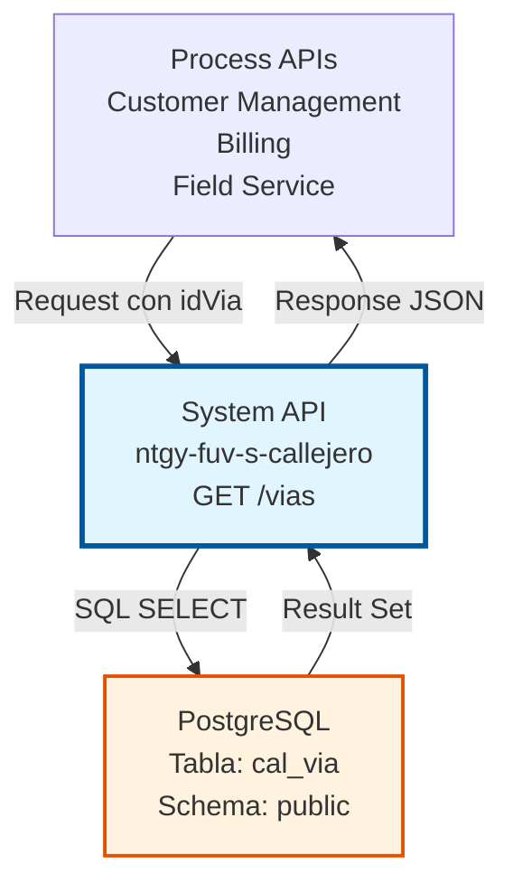
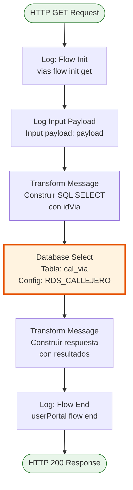
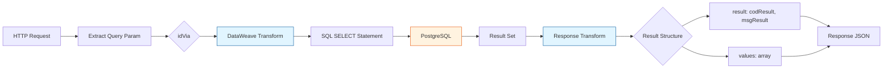

# GET /vias

## 📌 Descripción General

### Propósito del Endpoint

Este endpoint permite consultar la información completa de una vía específica del callejero español mediante su identificador único. Realiza una consulta directa a la base de datos PostgreSQL y retorna todos los atributos de la vía solicitada.

El endpoint soporta:
- **Consulta por ID**: Recupera una vía específica usando su código único (id_via)
- **Información Completa**: Retorna todos los campos de la vía incluyendo tipo, código postal, población, etc.
- **Respuesta Estructurada**: Formato JSON estandarizado con código de resultado y datos

### Tipo de API

**Capa:** System API (API-Led Connectivity)

**Función:** Integración directa con PostgreSQL para consulta de datos de callejero español.

### Patrón de Integración

**Tipo:** Request-Reply Síncrono con SQL SELECT

**Descripción:** Recibe el identificador de la vía como query parameter, construye dinámicamente la sentencia SQL SELECT, ejecuta la consulta en PostgreSQL y retorna los resultados en formato JSON estructurado.

### Arquitectura API-Led Connectivity



---

## 💼 Propósito del Negocio

### Casos de Uso Principales

1. **Consulta de Detalles de Vía**
   - Obtener información completa de una vía específica
   - Validar existencia de una vía en el sistema
   - Verificar datos actualizados de una dirección

2. **Validación de Direcciones**
   - Confirmar que una vía existe antes de crear una dirección
   - Obtener código postal asociado a una vía
   - Verificar tipo de vía y tramificación postal

3. **Soporte a Procesos de Negocio**
   - Consulta de vías durante alta de clientes
   - Validación de direcciones en procesos de instalación
   - Verificación de datos para facturación y envíos

### Contexto Empresarial

- **Dominio:** Gestión de Callejero y Direcciones
- **Sector:** Energía - Utilities
- **División:** Naturgy España - FUV (Fuerza de Ventas)
- **Proceso de Negocio:** Consulta de Datos Maestros de Direcciones
- **Criticidad:** Alta - Impacta en validación de direcciones de clientes

### Stakeholders

- **Equipos de Atención al Cliente**: Consultan vías para validar direcciones durante interacciones
- **Equipos de Field Service**: Verifican direcciones antes de programar instalaciones
- **Desarrolladores de Process APIs**: Consumen este endpoint para operaciones de negocio
- **Sistemas de Validación**: Utilizan el endpoint para verificar existencia de vías

### Valor de Negocio

- **Acceso Rápido**: Consulta eficiente de información de vías por ID
- **Datos Precisos**: Información actualizada directamente desde la fuente de verdad
- **Validación Confiable**: Permite verificar existencia y detalles de vías
- **Integración Simple**: Endpoint RESTful fácil de consumir

### Consumidores Potenciales

Este endpoint puede ser consumido por:
- Process APIs de gestión de clientes
- Process APIs de validación de direcciones
- Process APIs de field service
- Sistemas de autocompletado de direcciones
- Aplicaciones de validación de datos

---

## 🔧 Especificación Técnica

### URLs por Ambiente

| Ambiente | URL Base | URL Completa |
|----------|----------|--------------|
| **Local** | `http://localhost:8081` | `http://localhost:8081/vias?idVia={id}` |
| **Development** | `https://ntgy-fuv-s-callejero-dev.cloudhub.io` | `https://ntgy-fuv-s-callejero-dev.cloudhub.io/vias?idVia={id}` |
| **UAT** | `https://ntgy-fuv-s-callejero-uat.cloudhub.io` | `https://ntgy-fuv-s-callejero-uat.cloudhub.io/vias?idVia={id}` |
| **Production** | `https://ntgy-fuv-s-callejero.cloudhub.io` | `https://ntgy-fuv-s-callejero.cloudhub.io/vias?idVia={id}` |

### Método HTTP

```
GET /vias?idVia={id}
```

### Parámetros de Entrada

#### Headers HTTP

| Header | Tipo | Requerido | Descripción | Ejemplo |
|--------|------|-----------|-------------|---------|
| `Accept` | string | ❌ No | Tipo de contenido esperado en response | `application/json` |

#### Query Parameters

| Parámetro | Tipo | Requerido | Descripción | Ejemplo |
|-----------|------|-----------|-------------|---------|
| `idVia` | string | ✅ Sí | Identificador único de la vía (código GN) | `"280790001"` |

**Descripción del Parámetro:**
- **idVia**: Código único de la vía en el sistema GN (Naturgy). Este identificador corresponde al campo `id_via` en la tabla `cal_via` de PostgreSQL.

### Respuestas

#### Respuesta Exitosa con Datos (200 OK)

```json
{
  "result": {
    "codResult": "0000",
    "msgResult": "Ejecutado Correctamente"
  },
  "values": [
    {
      "id_via": "280790001",
      "des_via": "Gran Vía",
      "id_tipo_via": "CL",
      "cod_postal": "28013",
      "ind_tramos": "N",
      "cod_ine_via": "280790001",
      "id_poblacion_gn": "28079",
      "id_poblacion": "28079",
      "cod_seccion_censal": "001",
      "ind_seccion_censal": "S",
      "fecha_baja": null
    }
  ]
}
```

#### Respuesta Exitosa sin Datos (200 OK)

```json
{
  "result": {
    "codResult": "0000",
    "msgResult": "Ejecutado Correctamente"
  },
  "values": []
}
```

**Nota:** Cuando no se encuentra la vía, el endpoint retorna un array vacío en `values`, no un error 404.

#### Respuesta de Error de Validación (400)

```json
{
  "result": {
    "codResult": "0002",
    "msgResult": "Parámetro idVia requerido"
  }
}
```

#### Respuesta de Error de Base de Datos (500)

```json
{
  "result": {
    "codResult": "0001",
    "msgResult": "Error al consultar base de datos"
  }
}
```

### Estructura de Datos de Respuesta

#### Objeto Via (en array values)

| Campo | Tipo | Descripción | Ejemplo |
|-------|------|-------------|---------|
| `id_via` | string | Código único de la vía (GN) | `"280790001"` |
| `des_via` | string | Nombre descriptivo de la vía | `"Gran Vía"` |
| `id_tipo_via` | string/null | Código del tipo de vía (CL, AV, PZ, etc.) | `"CL"` |
| `cod_postal` | string | Código postal de 5 dígitos | `"28013"` |
| `ind_tramos` | string | Indicador de tramificación postal (S/N) | `"N"` |
| `cod_ine_via` | string | Código INE de la vía | `"280790001"` |
| `id_poblacion_gn` | string | Código GN de la población | `"28079"` |
| `id_poblacion` | string | Código INE de la población | `"28079"` |
| `cod_seccion_censal` | string | Código de sección censal | `"001"` |
| `ind_seccion_censal` | string | Indicador de sección censal (S/N) | `"S"` |
| `fecha_baja` | string/null | Fecha de baja (YYYYMMDD) o null | `null` |

### Autenticación y Autorización

- **Tipo:** Client ID & Client Secret (Anypoint Platform)
- **Autorización PostgreSQL:** El usuario de base de datos debe tener permisos para:
  - Ejecutar SELECT en tabla `public.cal_via`
  - Acceso de lectura al schema `public`

### Timeouts

| Tipo | Valor | Descripción |
|------|-------|-------------|
| **Request Timeout** | 30 segundos | Tiempo máximo de espera para la respuesta |
| **Connection Timeout** | 10 segundos | Tiempo máximo para establecer conexión con PostgreSQL |
| **Database Query Timeout** | 20 segundos | Tiempo máximo de ejecución del SELECT |

---

## 🏗️ Implementación Técnica

### Arquitectura del Flow



### Componentes del Flow

#### 1. Logger - Flow Init
```xml
<logger level="INFO" doc:name="Flow init" 
        message="vias flow init get" />
```
- **Propósito:** Registra el inicio del flow
- **Nivel:** INFO
- **Ubicación:** Línea 2 del flow `viasGetFlow`

#### 2. Logger - Input Payload
```xml
<logger level="INFO" doc:name="Log input payload" 
        message="Input payload: #[payload]" />
```
- **Propósito:** Registra el payload de entrada para auditoría
- **Nivel:** INFO
- **Ubicación:** Línea 3 del flow

#### 3. Transform Message - Construcción de SQL SELECT

**Ubicación:** Líneas 4-11 del flow

**Lógica de Transformación:**

```dataweave
%dw 2.0
output application/json
var idVia = attributes.queryParams.idVia
---
queryStatement: "select * from cal_via where id_via = '" ++ idVia ++ "'"
```

**Proceso:**
1. Extrae el parámetro `idVia` de los query parameters del request
2. Construye dinámicamente la sentencia SQL SELECT
3. Concatena el valor de `idVia` en la cláusula WHERE
4. Almacena el query en la variable `vars.query.queryStatement`

**Query SQL Generado:**
```sql
SELECT * FROM cal_via WHERE id_via = '{idVia}'
```

#### 4. Database Select

```xml
<db:select doc:name="Select" config-ref="RDS_CALLEJERO">
    <db:sql><![CDATA[#[vars.query.queryStatement]]]></db:sql>
</db:select>
```

**Configuración:**
- **Connector:** Database Connector v1.14.12
- **Config:** RDS_CALLEJERO (PostgreSQL)
- **Operación:** SELECT
- **Tabla:** `public.cal_via`
- **Filtro:** `WHERE id_via = '{idVia}'`

**Campos Retornados:**
- Todos los campos de la tabla `cal_via` (SELECT *)
- El resultado es un array de objetos (puede estar vacío si no se encuentra)

#### 5. Transform Message - Respuesta Estructurada

**Ubicación:** Líneas 15-25 del flow

```dataweave
%dw 2.0
output application/json
---
{
    "result": {
        "codResult": "0000",
        "msgResult": "Ejecutado Correctamente"
    },
    "values": payload
}
```

**Proceso:**
1. Envuelve el resultado de la consulta en una estructura estandarizada
2. Incluye código de resultado `0000` (éxito)
3. Incluye mensaje descriptivo
4. El array `values` contiene los registros encontrados (puede estar vacío)

#### 6. Logger - Flow End
```xml
<logger level="INFO" doc:name="Flow end" 
        message="userPortal flow end" />
```
- **Propósito:** Registra el fin exitoso del flow
- **Nivel:** INFO

### Diagrama de Transformación de Datos



### Manejo de Errores

El flow implementa manejo de errores a través de:

1. **Validación de Parámetros:** APIKit valida la presencia del query parameter
2. **Errores de Base de Datos:** Capturados por el Database Connector
3. **Logging:** Todos los pasos registran información para troubleshooting
4. **Respuesta Vacía:** Si no se encuentra la vía, retorna array vacío (no error)

**Códigos de Resultado:**

| Código | Descripción | Causa |
|--------|-------------|-------|
| `0000` | Éxito | Consulta ejecutada correctamente (con o sin resultados) |
| `0001` | Error de BD | Conexión perdida, timeout, error de sintaxis SQL |
| `0002` | Error de Validación | Parámetro idVia faltante o inválido |

### Configuración de Base de Datos

**Connection String:**
```
jdbc:postgresql://${bbdd.host}:${bbdd.port}/${bbdd.database}
```

**Propiedades:**
- `bbdd.host`: Host del servidor PostgreSQL
- `bbdd.port`: Puerto (default: 5432)
- `bbdd.database`: Nombre de la base de datos (callejero)
- `bbdd.user`: Usuario de conexión
- `bbdd.password`: Password encriptado (secure properties)

**Connection Pooling:** Habilitado para optimizar performance de consultas

### Consideraciones de Seguridad

⚠️ **Nota Técnica:** El código actual construye el SQL mediante concatenación de strings:
```dataweave
queryStatement: "select * from cal_via where id_via = '" ++ idVia ++ "'"
```

**Implicaciones:**
- Esta implementación podría ser vulnerable a SQL injection si no se valida el input
- Se recomienda validar que `idVia` contenga solo caracteres alfanuméricos
- En futuras versiones, considerar usar prepared statements o parametrización

---

## 💻 Ejemplos de Uso

### Ejemplo 1: Consulta de Vía Existente

**Request:**

```bash
curl -X GET "https://ntgy-fuv-s-callejero-dev.cloudhub.io/vias?idVia=280790001" \
  -H "Accept: application/json" \
  -H "client_id: your-client-id" \
  -H "client_secret: your-client-secret"
```

**Response (200 OK):**

```json
{
  "result": {
    "codResult": "0000",
    "msgResult": "Ejecutado Correctamente"
  },
  "values": [
    {
      "id_via": "280790001",
      "des_via": "Gran Vía",
      "id_tipo_via": "CL",
      "cod_postal": "28013",
      "ind_tramos": "N",
      "cod_ine_via": "280790001",
      "id_poblacion_gn": "28079",
      "id_poblacion": "28079",
      "cod_seccion_censal": "001",
      "ind_seccion_censal": "S",
      "fecha_baja": null
    }
  ]
}
```

### Ejemplo 2: Consulta de Vía No Existente

**Request:**

```bash
curl -X GET "https://ntgy-fuv-s-callejero-dev.cloudhub.io/vias?idVia=999999999" \
  -H "Accept: application/json" \
  -H "client_id: your-client-id" \
  -H "client_secret: your-client-secret"
```

**Response (200 OK):**

```json
{
  "result": {
    "codResult": "0000",
    "msgResult": "Ejecutado Correctamente"
  },
  "values": []
}
```

**Nota:** El endpoint retorna éxito con array vacío, no un error 404.

### Ejemplo 3: Consulta de Vía con Fecha de Baja

**Request:**

```bash
curl -X GET "https://ntgy-fuv-s-callejero-dev.cloudhub.io/vias?idVia=280790002" \
  -H "Accept: application/json" \
  -H "client_id: your-client-id" \
  -H "client_secret: your-client-secret"
```

**Response (200 OK):**

```json
{
  "result": {
    "codResult": "0000",
    "msgResult": "Ejecutado Correctamente"
  },
  "values": [
    {
      "id_via": "280790002",
      "des_via": "Calle Antigua",
      "id_tipo_via": "CL",
      "cod_postal": "28013",
      "ind_tramos": "N",
      "cod_ine_via": "280790002",
      "id_poblacion_gn": "28079",
      "id_poblacion": "28079",
      "cod_seccion_censal": "001",
      "ind_seccion_censal": "S",
      "fecha_baja": "20231231"
    }
  ]
}
```

### Ejemplo 4: Error - Parámetro Faltante

**Request:**

```bash
curl -X GET "https://ntgy-fuv-s-callejero-dev.cloudhub.io/vias" \
  -H "Accept: application/json" \
  -H "client_id: your-client-id" \
  -H "client_secret: your-client-secret"
```

**Response (400 Bad Request):**

```json
{
  "result": {
    "codResult": "0002",
    "msgResult": "Parámetro idVia requerido"
  }
}
```

### Ejemplo 5: Código JavaScript (Node.js)

```javascript
const axios = require('axios');

async function getVia(idVia) {
  try {
    const response = await axios.get(
      'https://ntgy-fuv-s-callejero-dev.cloudhub.io/vias',
      {
        params: {
          idVia: idVia
        },
        headers: {
          'Accept': 'application/json',
          'client_id': 'your-client-id',
          'client_secret': 'your-client-secret'
        }
      }
    );
    
    if (response.data.values.length > 0) {
      console.log('Vía encontrada:', response.data.values[0]);
      return response.data.values[0];
    } else {
      console.log('Vía no encontrada');
      return null;
    }
  } catch (error) {
    console.error('Error al consultar vía:', error.response?.data || error.message);
    throw error;
  }
}

// Uso
getVia('280790001')
  .then(via => {
    if (via) {
      console.log(`Nombre: ${via.des_via}`);
      console.log(`Código Postal: ${via.cod_postal}`);
    }
  });
```

### Ejemplo 6: Código Python

```python
import requests

def get_via(id_via):
    """
    Consulta una vía por su ID
    
    Args:
        id_via (str): Identificador único de la vía
        
    Returns:
        dict: Datos de la vía o None si no existe
    """
    url = "https://ntgy-fuv-s-callejero-dev.cloudhub.io/vias"
    
    headers = {
        "Accept": "application/json",
        "client_id": "your-client-id",
        "client_secret": "your-client-secret"
    }
    
    params = {
        "idVia": id_via
    }
    
    try:
        response = requests.get(url, headers=headers, params=params)
        response.raise_for_status()
        
        data = response.json()
        
        if data['values']:
            via = data['values'][0]
            print(f"Vía encontrada: {via['des_via']}")
            return via
        else:
            print("Vía no encontrada")
            return None
            
    except requests.exceptions.RequestException as e:
        print(f"Error al consultar vía: {e}")
        if hasattr(e.response, 'text'):
            print(f"Detalle: {e.response.text}")
        raise

# Uso
if __name__ == "__main__":
    via = get_via("280790001")
    if via:
        print(f"Nombre: {via['des_via']}")
        print(f"Código Postal: {via['cod_postal']}")
        print(f"Tipo: {via['id_tipo_via']}")
```

### Ejemplo 7: Validación de Existencia de Vía

```javascript
async function viaExists(idVia) {
  try {
    const response = await axios.get(
      'https://ntgy-fuv-s-callejero-dev.cloudhub.io/vias',
      {
        params: { idVia },
        headers: {
          'client_id': 'your-client-id',
          'client_secret': 'your-client-secret'
        }
      }
    );
    
    return response.data.values.length > 0;
  } catch (error) {
    console.error('Error validando vía:', error);
    return false;
  }
}

// Uso en validación de formulario
async function validateAddress(idVia) {
  const exists = await viaExists(idVia);
  
  if (!exists) {
    throw new Error('La vía especificada no existe en el callejero');
  }
  
  return true;
}
```

### Ejemplo 8: Obtener Código Postal de una Vía

```python
def get_postal_code_from_via(id_via):
    """
    Obtiene el código postal asociado a una vía
    
    Args:
        id_via (str): ID de la vía
        
    Returns:
        str: Código postal o None si no se encuentra
    """
    via = get_via(id_via)
    
    if via:
        return via['cod_postal']
    
    return None

# Uso
codigo_postal = get_postal_code_from_via("280790001")
if codigo_postal:
    print(f"Código Postal: {codigo_postal}")