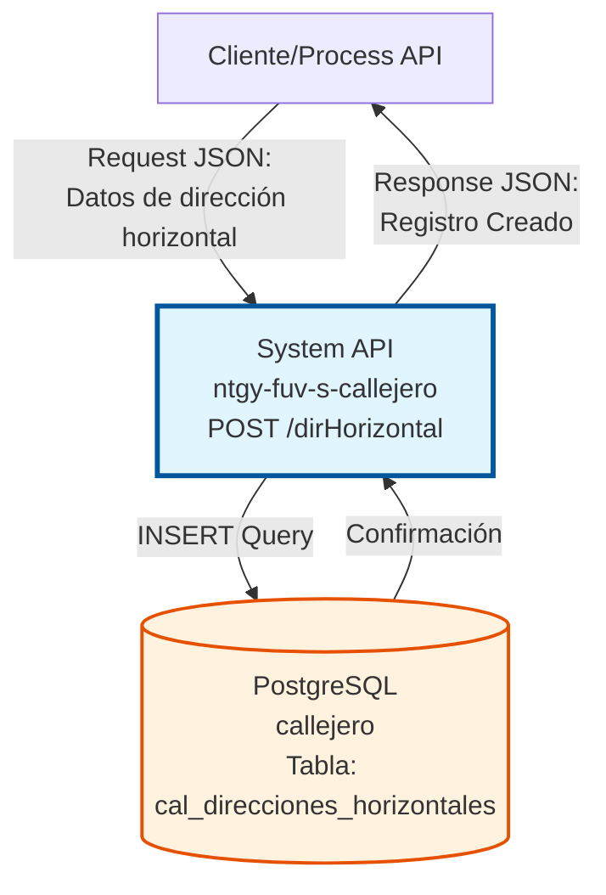
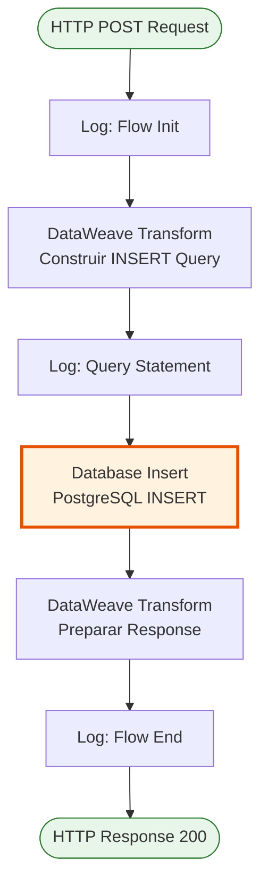
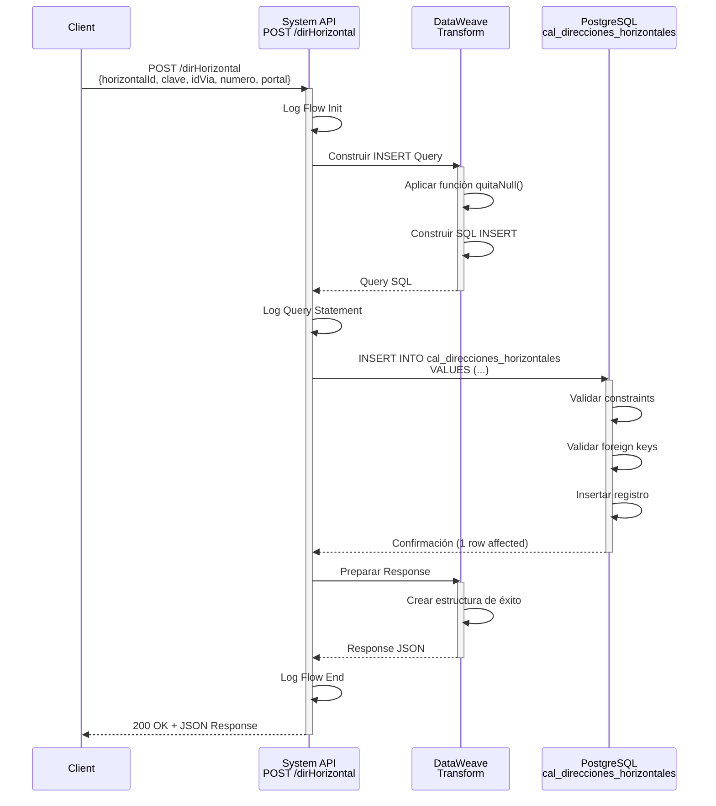
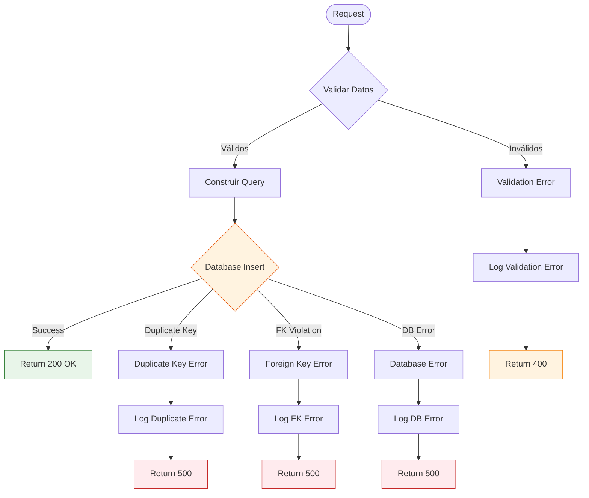
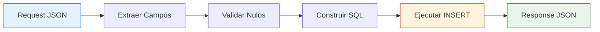

# POST /dirHorizontal

## 📌 Descripción General

### Propósito del Endpoint

Este endpoint inserta una nueva dirección horizontal en el sistema de callejero español almacenado en PostgreSQL. Permite crear registros de direcciones horizontales con información completa de identificación, clave, vía asociada, número y portal.

El endpoint soporta:
- **Creación de Dirección Horizontal**: Inserta un nuevo registro con todos los datos requeridos
- **Validación de Datos**: Maneja valores nulos mediante función personalizada
- **Respuesta Estándar**: Retorna confirmación de creación exitosa

### Tipo de API

**Capa:** System API (API-Led Connectivity)

**Función:** Integración directa con PostgreSQL para inserción de direcciones horizontales en el callejero español.

### Patrón de Integración

**Tipo:** Request-Reply Síncrono con SQL Insert

**Descripción:** El endpoint recibe datos de la dirección horizontal en formato JSON, transforma los datos mediante DataWeave aplicando validación de nulos, construye una sentencia INSERT SQL dinámica y ejecuta la inserción en PostgreSQL, retornando confirmación de éxito.

### Arquitectura API-Led Connectivity



---

## 💼 Propósito del Negocio

### Casos de Uso Principales

1. **Alta de Nueva Dirección Horizontal**
   - Un sistema necesita registrar una nueva dirección horizontal en el callejero
   - Se crea el registro con ID único, clave, vía, número y portal
   - Permite expandir el catálogo de direcciones disponibles

2. **Migración de Datos de Direcciones**
   - Durante procesos de migración, se insertan direcciones horizontales desde sistemas legacy
   - Facilita la consolidación de datos de callejero de múltiples fuentes
   - Asegura integridad referencial con vías existentes

3. **Actualización del Callejero**
   - Cuando se construyen nuevos edificios o se reorganizan direcciones
   - Permite mantener el callejero actualizado con nuevas direcciones
   - Soporta procesos de normalización de direcciones

### Contexto Empresarial

- **Dominio:** Gestión de Callejero y Direcciones
- **Sector:** Energía - Utilities
- **División:** Naturgy España
- **Proceso de Negocio:** Mantenimiento y actualización del callejero español
- **Sistema Backend:** PostgreSQL (Base de datos de callejero)

### Stakeholders

- **Administradores de Datos**: Responsables de mantener el callejero actualizado
- **Equipos de Migración**: Necesitan cargar direcciones desde sistemas legacy
- **Sistemas de Integración**: Sincronizan direcciones desde fuentes externas
- **Equipos de Calidad de Datos**: Validan y normalizan direcciones

### Valor de Negocio

- **Actualización del Callejero**: Mantiene el catálogo de direcciones actualizado
- **Integridad de Datos**: Asegura que las direcciones horizontales tengan estructura válida
- **Trazabilidad**: Registra nuevas direcciones con identificadores únicos
- **Escalabilidad**: Permite crecimiento del catálogo de direcciones

### Consumidores Potenciales

Este endpoint puede ser consumido por:
- Process APIs de gestión de callejero
- Sistemas de migración de datos
- Process APIs de integración con sistemas externos
- Herramientas de administración de datos
- Sistemas de sincronización batch

---

## 🔧 Especificación Técnica

### URLs por Ambiente

| Ambiente | URL Base | URL Completa |
|----------|----------|--------------|
| **Local** | `http://localhost:8081` | `http://localhost:8081/dirHorizontal` |
| **Development** | `https://ntgy-fuv-s-callejero-dev.us-e2.cloudhub.io` | `https://ntgy-fuv-s-callejero-dev.us-e2.cloudhub.io/dirHorizontal` |
| **UAT** | `https://ntgy-fuv-s-callejero-uat.us-e2.cloudhub.io` | `https://ntgy-fuv-s-callejero-uat.us-e2.cloudhub.io/dirHorizontal` |
| **Production** | `https://ntgy-fuv-s-callejero-pro.us-e2.cloudhub.io` | `https://ntgy-fuv-s-callejero-pro.us-e2.cloudhub.io/dirHorizontal` |

### Método HTTP

```
POST /dirHorizontal
```

### Parámetros de Entrada

#### Headers HTTP

| Header | Tipo | Requerido | Descripción | Ejemplo |
|--------|------|-----------|-------------|---------|
| `Content-Type` | string | ✅ Sí | Tipo de contenido del request | `application/json` |
| `Accept` | string | ❌ No | Tipo de contenido esperado en response | `application/json` |

#### Body Parameters

**Estructura del Request Body:**

```json
{
  "horizontalId": "string",
  "clave": "string",
  "idVia": "string",
  "numero": "string",
  "portal": "string"
}
```

**Descripción de Campos:**

| Campo | Tipo | Requerido | Descripción | Ejemplo |
|-------|------|-----------|-------------|---------|
| `horizontalId` | string | ✅ Sí | ID único de la dirección horizontal | `"12345"` |
| `clave` | string | ✅ Sí | Clave única de la dirección horizontal | `"CLAVE_001"` |
| `idVia` | string | ❌ No | ID de la vía asociada | `"5678"` |
| `numero` | string | ❌ No | Número de la dirección | `"42"` |
| `portal` | string | ❌ No | Portal de la dirección | `"A"` |

**Notas:**
- Los campos opcionales (`idVia`, `numero`, `portal`) se insertan como `null` si no se proporcionan o están vacíos
- `horizontalId` y `clave` son obligatorios y deben ser únicos en la tabla

### Respuestas

#### Respuesta Exitosa (200 OK)

```json
{
  "result": {
    "codResult": "0000",
    "msgResult": "Registro Creado Correctamente"
  }
}
```

#### Respuesta de Error - Clave Duplicada (500)

```json
{
  "result": {
    "codResult": "0001",
    "msgResult": "Error: duplicate key value violates unique constraint"
  }
}
```

#### Respuesta de Error - Violación de Integridad Referencial (500)

```json
{
  "result": {
    "codResult": "0001",
    "msgResult": "Error: foreign key constraint violation"
  }
}
```

#### Respuesta de Error Técnico (500)

```json
{
  "result": {
    "codResult": "0001",
    "msgResult": "Error interno del servidor"
  }
}
```

### Autenticación y Autorización

- **Tipo:** Client ID & Client Secret (Anypoint Platform)
- **Autorización PostgreSQL:** El usuario de base de datos debe tener permisos para:
  - Ejecutar INSERT en tabla `cal_direcciones_horizontales`
  - Acceso de escritura al schema `public`
  - Validación de foreign keys en tabla de vías

### Timeouts

| Tipo | Valor | Descripción |
|------|-------|-------------|
| **Request Timeout** | 30 segundos | Tiempo máximo de espera para la respuesta |
| **Connection Timeout** | 10 segundos | Tiempo máximo para establecer conexión con PostgreSQL |
| **Query Timeout** | 20 segundos | Tiempo máximo de ejecución de la query INSERT |

---

## 🏗️ Implementación Técnica

### Arquitectura del Flow



### Componentes del Flow

#### 1. Logger - Flow Init
```xml
<logger level="INFO" message="dirHorizontal flow init post" />
```
- Registra el inicio del flow POST
- Nivel INFO para trazabilidad

#### 2. DataWeave Transform - Construcción de INSERT Query
```dataweave
%dw 2.0
output application/json
fun quitaNull(entrada) = (if (entrada == null or entrada == "") "null" else "'" ++ entrada ++ "'")
---
{
    "queryStatement": "INSERT INTO public.cal_direcciones_horizontales (horizontal_id, clave, id_via, numero, portal) VALUES ('"
    ++ payload.horizontalId 
    ++ "','" ++ payload.clave 
    ++ "'," ++ quitaNull(payload.idVia)
    ++ "," ++ quitaNull(payload.numero)
    ++ "," ++ quitaNull(payload.portal)
    ++ ")"
}
```

**Lógica:**
- Define función `quitaNull()` para manejar valores nulos o vacíos
- Si el valor es `null` o cadena vacía, retorna `null` (sin comillas)
- Si el valor existe, lo envuelve en comillas simples
- Construye sentencia INSERT SQL dinámica con todos los campos
- Almacena la query en variable `insert`

**Función quitaNull():**
```dataweave
fun quitaNull(entrada) = (
    if (entrada == null or entrada == "") 
        "null" 
    else 
        "'" ++ entrada ++ "'"
)
```

#### 3. Logger - Query Statement
```xml
<logger level="INFO" message="#[vars.insert.queryStatement]" />
```
- Registra la query SQL que se va a ejecutar
- Útil para debugging y auditoría
- Permite verificar la construcción correcta de la query

#### 4. Database Insert
```xml
<db:insert config-ref="RDS_CALLEJERO">
    <db:sql><![CDATA[#[vars.insert.queryStatement]]]></db:sql>
</db:insert>
```

**Configuración:**
- **Config:** `RDS_CALLEJERO` (PostgreSQL connection)
- **Query:** Dinámica construida en DataWeave
- **Tabla:** `cal_direcciones_horizontales`
- **Operación:** INSERT

**Ejemplo de Query Generada:**
```sql
INSERT INTO public.cal_direcciones_horizontales 
(horizontal_id, clave, id_via, numero, portal) 
VALUES ('12345', 'CLAVE_001', '5678', '42', 'A')
```

**Ejemplo con Valores Nulos:**
```sql
INSERT INTO public.cal_direcciones_horizontales 
(horizontal_id, clave, id_via, numero, portal) 
VALUES ('12345', 'CLAVE_001', null, null, null)
```

#### 5. DataWeave Transform - Response
```dataweave
%dw 2.0
output application/json
---
{
    "result": {
        "codResult": "0000",
        "msgResult": "Registro Creado Correctamente"
    }
}
```

**Transformación:**
- Crea respuesta estándar de éxito
- Código "0000" indica operación exitosa
- Mensaje descriptivo de confirmación

#### 6. Logger - Flow End
```xml
<logger level="INFO" message="userPortal flow end" />
```
- Registra el fin del flow
- Confirma ejecución exitosa

### Diagrama de Secuencia



### Manejo de Errores



### Configuración de Base de Datos

**Connection Config:** `RDS_CALLEJERO`

```xml
<db:config name="RDS_CALLEJERO">
    <db:generic-connection 
        url="jdbc:postgresql://${bbdd.host}:${bbdd.port}/${bbdd.database}"
        driverClassName="org.postgresql.Driver"
        user="${bbdd.user}"
        password="${secure::bbdd.password}">
        <db:pooling-profile />
    </db:generic-connection>
</db:config>
```

**Propiedades:**
- **Host:** `${bbdd.host}` (configurable por ambiente)
- **Port:** `${bbdd.port}` (default: 5432)
- **Database:** `${bbdd.database}` (nombre: callejero)
- **User:** `${bbdd.user}`
- **Password:** `${secure::bbdd.password}` (encriptado)
- **Connection Pooling:** Habilitado

### Tabla de Base de Datos

**Tabla:** `cal_direcciones_horizontales`

| Columna | Tipo | Constraints | Descripción |
|---------|------|-------------|-------------|
| `horizontal_id` | VARCHAR | PRIMARY KEY, NOT NULL | ID único de la dirección horizontal |
| `clave` | VARCHAR | UNIQUE, NOT NULL | Clave única de la dirección horizontal |
| `id_via` | VARCHAR | FOREIGN KEY, NULL | ID de la vía asociada (referencia a tabla vías) |
| `numero` | VARCHAR | NULL | Número de la dirección |
| `portal` | VARCHAR | NULL | Portal de la dirección |

**Constraints:**
- **Primary Key:** `horizontal_id` debe ser único
- **Unique:** `clave` debe ser única
- **Foreign Key:** `id_via` debe existir en tabla de vías (si no es null)
- **Not Null:** `horizontal_id` y `clave` son obligatorios

### Transformación de Datos



**Mapeo de Campos:**

| Campo JSON | Campo SQL | Transformación |
|------------|-----------|----------------|
| `horizontalId` | `horizontal_id` | Directo (obligatorio) |
| `clave` | `clave` | Directo (obligatorio) |
| `idVia` | `id_via` | quitaNull() - null si vacío |
| `numero` | `numero` | quitaNull() - null si vacío |
| `portal` | `portal` | quitaNull() - null si vacío |

---

## 💻 Ejemplos de Uso

### Ejemplo 1: Inserción Completa con Todos los Campos

#### Request con curl

```bash
curl -X POST "http://localhost:8081/dirHorizontal" \
  -H "Content-Type: application/json" \
  -H "Accept: application/json" \
  -d '{
    "horizontalId": "12345",
    "clave": "CLAVE_001",
    "idVia": "5678",
    "numero": "42",
    "portal": "A"
  }'
```

#### Response Exitoso

```json
{
  "result": {
    "codResult": "0000",
    "msgResult": "Registro Creado Correctamente"
  }
}
```

### Ejemplo 2: Inserción con Campos Opcionales Nulos

#### Request con curl

```bash
curl -X POST "http://localhost:8081/dirHorizontal" \
  -H "Content-Type: application/json" \
  -H "Accept: application/json" \
  -d '{
    "horizontalId": "67890",
    "clave": "CLAVE_002"
  }'
```

#### Response Exitoso

```json
{
  "result": {
    "codResult": "0000",
    "msgResult": "Registro Creado Correctamente"
  }
}
```

**Nota:** Los campos `idVia`, `numero` y `portal` se insertan como `null`.

### Ejemplo 3: Error - Clave Duplicada

#### Request con curl

```bash
curl -X POST "http://localhost:8081/dirHorizontal" \
  -H "Content-Type: application/json" \
  -H "Accept: application/json" \
  -d '{
    "horizontalId": "99999",
    "clave": "CLAVE_001"
  }'
```

#### Response de Error

```json
{
  "result": {
    "codResult": "0001",
    "msgResult": "Error: duplicate key value violates unique constraint \"cal_direcciones_horizontales_clave_key\""
  }
}
```

### Ejemplo 4: Request desde JavaScript (Fetch API)

```javascript
const nuevaDireccion = {
  horizontalId: '12345',
  clave: 'CLAVE_001',
  idVia: '5678',
  numero: '42',
  portal: 'A'
};

fetch('https://ntgy-fuv-s-callejero-dev.us-e2.cloudhub.io/dirHorizontal', {
  method: 'POST',
  headers: {
    'Content-Type': 'application/json',
    'Accept': 'application/json'
  },
  body: JSON.stringify(nuevaDireccion)
})
  .then(response => response.json())
  .then(data => {
    if (data.result.codResult === '0000') {
      console.log('Dirección horizontal creada exitosamente');
      console.log('Mensaje:', data.result.msgResult);
    } else {
      console.error('Error al crear dirección:', data.result.msgResult);
    }
  })
  .catch(error => console.error('Error:', error));
```

### Ejemplo 5: Request desde Python

```python
import requests
import json

url = "https://ntgy-fuv-s-callejero-dev.us-e2.cloudhub.io/dirHorizontal"

nueva_direccion = {
    "horizontalId": "12345",
    "clave": "CLAVE_001",
    "idVia": "5678",
    "numero": "42",
    "portal": "A"
}

headers = {
    "Content-Type": "application/json",
    "Accept": "application/json"
}

response = requests.post(url, json=nueva_direccion, headers=headers)

if response.status_code == 200:
    data = response.json()
    if data['result']['codResult'] == '0000':
        print("Dirección horizontal creada exitosamente")
        print(f"Mensaje: {data['result']['msgResult']}")
    else:
        print(f"Error: {data['result']['msgResult']}")
else:
    print(f"Error HTTP: {response.status_code}")
```

### Ejemplo 6: Inserción Batch desde Process API

```dataweave
%dw 2.0
output application/json

// Procesar múltiples direcciones horizontales
var direccionesHorizontales = payload.direcciones map (direccion) -> {
    horizontalId: direccion.id,
    clave: direccion.clave,
    idVia: direccion.viaId,
    numero: direccion.num,
    portal: direccion.port
}

---
{
    direccionesCreadas: direccionesHorizontales map (dir) -> (
        // Llamada al System API para cada dirección
        Mule::lookup('post-direccion-horizontal-flow', dir)
    )
}
```

### Ejemplo 7: Validación Previa a Inserción

```javascript
// Validar datos antes de enviar
function validarDireccionHorizontal(direccion) {
  const errores = [];
  
  if (!direccion.horizontalId || direccion.horizontalId.trim() === '') {
    errores.push('horizontalId es obligatorio');
  }
  
  if (!direccion.clave || direccion.clave.trim() === '') {
    errores.push('clave es obligatoria');
  }
  
  if (direccion.horizontalId && direccion.horizontalId.length > 50) {
    errores.push('horizontalId no puede exceder 50 caracteres');
  }
  
  return errores;
}

// Uso
const nuevaDireccion = {
  horizontalId: '12345',
  clave: 'CLAVE_001',
  idVia: '5678',
  numero: '42',
  portal: 'A'
};

const errores = validarDireccionHorizontal(nuevaDireccion);

if (errores.length === 0) {
  // Proceder con la inserción
  fetch('https://ntgy-fuv-s-callejero-dev.us-e2.cloudhub.io/dirHorizontal', {
    method: 'POST',
    headers: {
      'Content-Type': 'application/json'
    },
    body: JSON.stringify(nuevaDireccion)
  })
  .then(response => response.json())
  .then(data => console.log('Éxito:', data))
  .catch(error => console.error('Error:', error));
} else {
  console.error('Errores de validación:', errores);
}
```
