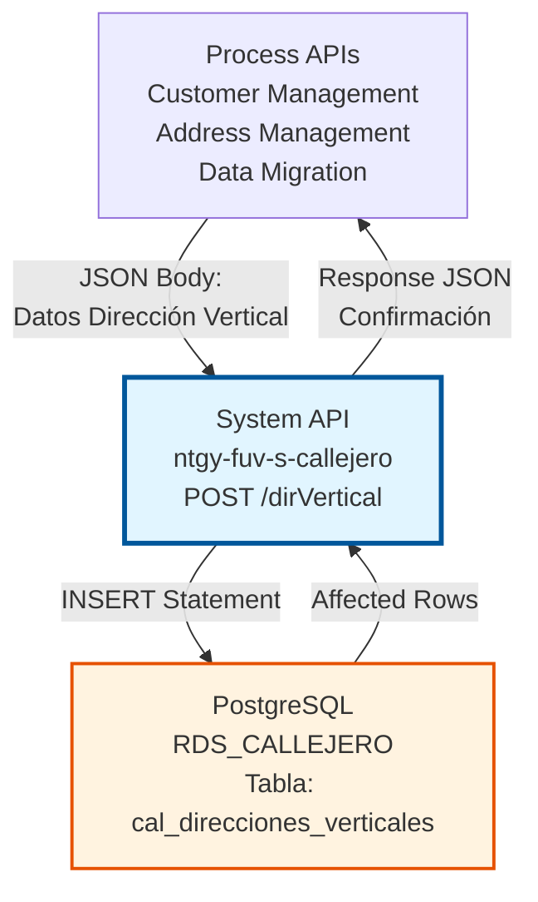
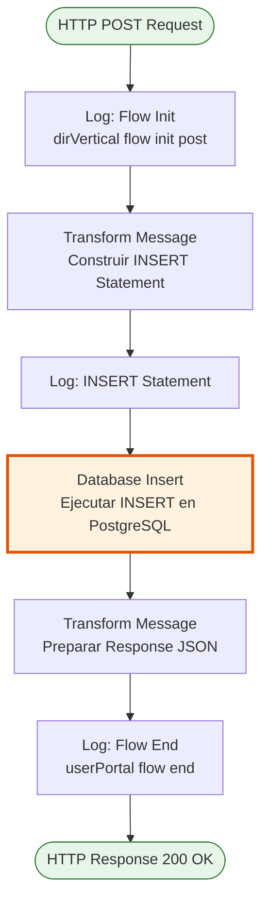
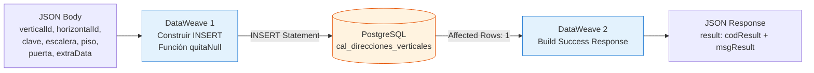
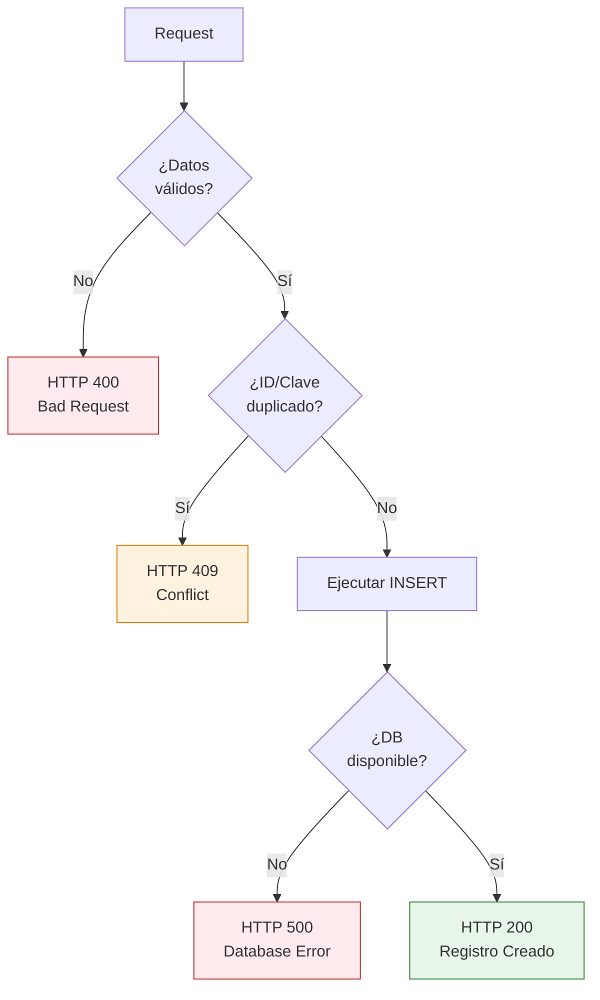

# POST /dirVertical

## 📌 Descripción General

### Propósito del Endpoint

Este endpoint inserta nuevas direcciones verticales en el callejero español almacenado en PostgreSQL. Permite crear registros de direcciones verticales (escalera, piso, puerta) asociadas a direcciones horizontales existentes, manteniendo la estructura jerárquica del callejero.

El endpoint soporta:
- **Inserción de Dirección Vertical Completa**: Crea registro con todos los campos (vertical_id, horizontal_id, clave, escalera, piso, puerta)
- **Campos Opcionales**: Permite valores null en escalera, piso, puerta y extra_data
- **Validación de Datos**: Maneja correctamente valores nulos mediante función DataWeave personalizada
- **Respuesta Estándar**: Retorna confirmación de creación exitosa

### Tipo de API

**Capa:** System API (API-Led Connectivity)

**Función:** Integración directa con PostgreSQL para inserción de direcciones verticales del callejero español.

### Patrón de Integración

**Tipo:** Request-Reply Síncrono con SQL Insert

**Descripción:** Recibe datos de la dirección vertical en formato JSON, transforma los datos mediante DataWeave (manejando valores nulos), construye dinámicamente el INSERT statement y ejecuta la inserción en PostgreSQL, retornando confirmación de éxito.

### Arquitectura API-Led Connectivity



---

## 💼 Propósito del Negocio

### Casos de Uso Principales

1. **Alta de Nuevas Direcciones en el Sistema**
   - Registrar nuevas direcciones verticales durante alta de clientes
   - Crear direcciones para nuevas construcciones o urbanizaciones
   - Mantener actualizado el callejero con nuevas direcciones

2. **Migración de Datos de Direcciones**
   - Importar direcciones desde sistemas legacy
   - Sincronizar datos con fuentes oficiales (INE, Correos)
   - Consolidar información de múltiples fuentes

3. **Gestión de Direcciones de Instalaciones**
   - Registrar direcciones de nuevos puntos de suministro
   - Crear direcciones para instalaciones de gas/electricidad
   - Mantener inventario de direcciones de servicio

### Contexto Empresarial

- **Dominio:** Gestión de Callejero y Direcciones
- **Sector:** Energía - Utilities
- **División:** Naturgy España
- **Proceso de Negocio:** Mantenimiento y actualización del callejero español
- **Estándar:** Direcciones según nomenclatura oficial española (INE, Correos)

### Stakeholders

- **Equipos de Atención al Cliente**: Crean direcciones durante alta de clientes
- **Administradores de Datos**: Mantienen y actualizan el callejero
- **Equipos de Field Service**: Registran direcciones de nuevas instalaciones
- **Sistemas de Migración**: Importan datos desde sistemas legacy

### Valor de Negocio

- **Completitud de Datos**: Asegura que todas las direcciones estén registradas en el sistema
- **Calidad de Información**: Mantiene estructura normalizada de direcciones
- **Eficiencia Operativa**: Facilita procesos de alta y gestión de clientes
- **Cumplimiento Normativo**: Garantiza uso de direcciones según estándares españoles

### Consumidores Potenciales

Este endpoint puede ser consumido por:
- Process APIs de gestión de clientes
- Process APIs de gestión de direcciones
- Sistemas de migración de datos
- Process APIs de field service
- Herramientas de administración de callejero

---

## 🔧 Especificación Técnica

### URLs por Ambiente

| Ambiente | URL Base | URL Completa |
|----------|----------|--------------|
| **Local** | `http://localhost:8081` | `http://localhost:8081/api/dirVertical` |
| **Development** | `https://ntgy-fuv-s-callejero-dev.us-e2.cloudhub.io` | `https://ntgy-fuv-s-callejero-dev.us-e2.cloudhub.io/api/dirVertical` |
| **UAT** | `https://ntgy-fuv-s-callejero-uat.us-e2.cloudhub.io` | `https://ntgy-fuv-s-callejero-uat.us-e2.cloudhub.io/api/dirVertical` |
| **Production** | `https://ntgy-fuv-s-callejero-pro.us-e2.cloudhub.io` | `https://ntgy-fuv-s-callejero-pro.us-e2.cloudhub.io/api/dirVertical` |

### Método HTTP

```
POST /api/dirVertical
```

### Parámetros de Entrada

#### Headers HTTP

| Header | Tipo | Requerido | Descripción | Ejemplo |
|--------|------|-----------|-------------|---------|
| `Content-Type` | string | ✅ Sí | Tipo de contenido del request | `application/json` |
| `Accept` | string | ❌ No | Tipo de contenido esperado en response | `application/json` |

#### Body Parameters

**Estructura JSON del Request:**

```json
{
  "verticalId": "string",
  "horizontalId": "string",
  "clave": "string",
  "escalera": "string",
  "piso": "string",
  "puerta": "string",
  "extraData": "string"
}
```

**Descripción de Campos:**

| Campo | Tipo | Requerido | Descripción | Ejemplo |
|-------|------|-----------|-------------|---------|
| `verticalId` | string | ✅ Sí | ID único de la dirección vertical | `"12345"` |
| `horizontalId` | string | ✅ Sí | ID de la dirección horizontal asociada | `"67890"` |
| `clave` | string | ✅ Sí | Clave única de la dirección vertical | `"CLV-001"` |
| `escalera` | string | ❌ No | Identificador de escalera (puede ser null) | `"A"` |
| `piso` | string | ❌ No | Número de piso (puede ser null) | `"3"` |
| `puerta` | string | ❌ No | Identificador de puerta (puede ser null) | `"B"` |
| `extraData` | string | ❌ No | Datos adicionales en formato JSON (puede ser null) | `"{\"obs\":\"Principal\"}"` |

### Respuestas

#### Respuesta Exitosa (200 OK)

```json
{
  "result": {
    "codResult": "0000",
    "msgResult": "Registro Creado Correctamente"
  }
}
```

#### Respuesta de Error de Validación (400)

```json
{
  "result": {
    "codResult": "0002",
    "msgResult": "Datos de entrada inválidos"
  }
}
```

#### Respuesta de Error de Duplicado (409)

```json
{
  "result": {
    "codResult": "0003",
    "msgResult": "La dirección vertical ya existe"
  }
}
```

#### Respuesta de Error Técnico (500)

```json
{
  "result": {
    "codResult": "0001",
    "msgResult": "Error interno del servidor"
  }
}
```

### Autenticación y Autorización

- **Tipo:** Client ID & Client Secret (Anypoint Platform)
- **Autorización PostgreSQL:** El usuario de base de datos debe tener permisos para:
  - Ejecutar INSERT en tabla `cal_direcciones_verticales`
  - Acceso de escritura al schema `public`

### Timeouts

| Tipo | Valor | Descripción |
|------|-------|-------------|
| **Request Timeout** | 30 segundos | Tiempo máximo de espera para la respuesta |
| **Connection Timeout** | 10 segundos | Tiempo máximo para establecer conexión con PostgreSQL |
| **Query Timeout** | 20 segundos | Tiempo máximo de ejecución del INSERT |

---

## 🏗️ Implementación Técnica

### Arquitectura del Flow



### Componentes del Flow

#### 1. Logger - Flow Init (Línea 42)
```xml
<logger level="INFO" message="dirVertical flow init post" />
```
- Registra inicio del flow POST
- Nivel INFO para trazabilidad

#### 2. Transform Message - Construcción de INSERT (Líneas 43-60)
```dataweave
%dw 2.0
output application/json
fun quitaNull(entrada) = (if (entrada == null or entrada == "") "null" else "'" ++ entrada ++ "'")
---
{
    "queryStatement": "INSERT INTO public.cal_direcciones_verticales (vertical_id, horizontal_id, clave, escalera, piso, puerta, extra_data) VALUES ('"
    ++ payload.verticalId 
    ++ "','" ++ payload.horizontalId 
    ++ "','" ++ payload.clave 
    ++ "'," ++ quitaNull(payload.escalera)
    ++ "," ++ quitaNull(payload.piso)
    ++ "," ++ quitaNull(payload.puerta)
    ++ "," ++ quitaNull(payload.extraData)    
    ++ ")"
}
```

**Lógica:**
- Define función `quitaNull()` para manejar valores nulos
- Si el valor es null o vacío → retorna `"null"` (sin comillas)
- Si el valor existe → retorna `'valor'` (con comillas simples)
- Construye INSERT statement dinámicamente
- Campos obligatorios: verticalId, horizontalId, clave (siempre con comillas)
- Campos opcionales: escalera, piso, puerta, extraData (manejados por quitaNull)

#### 3. Logger - SQL Statement (Línea 61)
```xml
<logger level="INFO" message="#[vars.insert.queryStatement]" />
```
- Registra el INSERT statement completo para debugging
- Útil para troubleshooting de queries

#### 4. Database Insert (Líneas 62-64)
```xml
<db:insert config-ref="RDS_CALLEJERO">
    <db:sql><![CDATA[#[vars.insert.queryStatement]]]></db:sql>
</db:insert>
```

**Configuración:**
- Connector: Database Connector v1.14.12
- Config: `RDS_CALLEJERO`
- Query: Dinámico desde variable `vars.insert.queryStatement`

#### 5. Transform Message - Response (Líneas 65-75)
```dataweave
%dw 2.0
output application/json
---
{
    "result": {
        "codResult": "0000",
        "msgResult": "Registro Creado Correctamente"
    }	
}
```

**Transformación:**
- Retorna estructura estándar de éxito
- `codResult`: "0000" indica éxito
- `msgResult`: Mensaje descriptivo de confirmación

#### 6. Logger - Flow End (Línea 76)
```xml
<logger level="INFO" message="userPortal flow end" />
```
- Registra fin exitoso del flow

### Query SQL Ejecutada

**Ejemplo con todos los campos:**
```sql
INSERT INTO public.cal_direcciones_verticales 
(vertical_id, horizontal_id, clave, escalera, piso, puerta, extra_data) 
VALUES ('12345', '67890', 'CLV-001', 'A', '3', 'B', '{"obs":"Principal"}')
```

**Ejemplo con campos opcionales null:**
```sql
INSERT INTO public.cal_direcciones_verticales 
(vertical_id, horizontal_id, clave, escalera, piso, puerta, extra_data) 
VALUES ('12345', '67890', 'CLV-001', null, null, null, null)
```

### Función DataWeave: quitaNull

```dataweave
fun quitaNull(entrada) = (
    if (entrada == null or entrada == "") 
        "null" 
    else 
        "'" ++ entrada ++ "'"
)
```

**Propósito:**
- Maneja correctamente valores nulos en SQL
- Evita errores de sintaxis SQL con valores vacíos
- Permite campos opcionales en la inserción

**Comportamiento:**
- Input: `null` → Output: `null` (sin comillas)
- Input: `""` → Output: `null` (sin comillas)
- Input: `"A"` → Output: `'A'` (con comillas)

### Tabla PostgreSQL: cal_direcciones_verticales

| Columna | Tipo | Nullable | Descripción |
|---------|------|----------|-------------|
| `vertical_id` | VARCHAR | NO | ID único de la dirección vertical (PK) |
| `horizontal_id` | VARCHAR | NO | ID de la dirección horizontal asociada (FK) |
| `clave` | VARCHAR | NO | Clave única alternativa |
| `escalera` | VARCHAR | SÍ | Identificador de escalera |
| `piso` | VARCHAR | SÍ | Número de piso |
| `puerta` | VARCHAR | SÍ | Identificador de puerta |
| `extra_data` | TEXT | SÍ | Datos adicionales en formato JSON |

### Diagrama de Transformación de Datos



### Manejo de Errores



### Validaciones Implementadas

1. **Campos Obligatorios:**
   - `verticalId`: Debe existir y no ser vacío
   - `horizontalId`: Debe existir y no ser vacío
   - `clave`: Debe existir y no ser vacío

2. **Campos Opcionales:**
   - `escalera`, `piso`, `puerta`, `extraData`: Pueden ser null o vacíos

3. **Integridad Referencial:**
   - `horizontal_id` debe existir en tabla `cal_direcciones_horizontales` (FK)

4. **Unicidad:**
   - `vertical_id` debe ser único (PK)
   - `clave` debe ser única

### Configuración de Base de Datos

**Connection String:**
```
jdbc:postgresql://${bbdd.host}:${bbdd.port}/${bbdd.database}
```

**Propiedades:**
- `bbdd.host`: Host del servidor PostgreSQL
- `bbdd.port`: Puerto (default: 5432)
- `bbdd.database`: Nombre de la base de datos (callejero)
- `bbdd.user`: Usuario de conexión
- `bbdd.password`: Password encriptado (secure properties)

**Connection Pooling:**
- Habilitado mediante `<db:pooling-profile />`
- Reutilización de conexiones para mejor performance

---

## 💻 Ejemplos de Uso

### Ejemplo 1: Inserción Completa con Todos los Campos

#### Request con curl

```bash
curl -X POST "http://localhost:8081/api/dirVertical" \
  -H "Content-Type: application/json" \
  -H "Accept: application/json" \
  -d '{
    "verticalId": "12345",
    "horizontalId": "67890",
    "clave": "CLV-001",
    "escalera": "A",
    "piso": "3",
    "puerta": "B",
    "extraData": "{\"observaciones\": \"Dirección principal\"}"
  }'
```

#### Response Exitoso

```json
{
  "result": {
    "codResult": "0000",
    "msgResult": "Registro Creado Correctamente"
  }
}
```

### Ejemplo 2: Inserción con Campos Opcionales Null

#### Request con curl

```bash
curl -X POST "http://localhost:8081/api/dirVertical" \
  -H "Content-Type: application/json" \
  -H "Accept: application/json" \
  -d '{
    "verticalId": "99999",
    "horizontalId": "11111",
    "clave": "CLV-999",
    "escalera": null,
    "piso": null,
    "puerta": null,
    "extraData": null
  }'
```

#### Response Exitoso

```json
{
  "result": {
    "codResult": "0000",
    "msgResult": "Registro Creado Correctamente"
  }
}
```

### Ejemplo 3: Inserción Solo con Campos Obligatorios

#### Request con curl

```bash
curl -X POST "http://localhost:8081/api/dirVertical" \
  -H "Content-Type: application/json" \
  -H "Accept: application/json" \
  -d '{
    "verticalId": "54321",
    "horizontalId": "98765",
    "clave": "CLV-ABC"
  }'
```

#### Response Exitoso

```json
{
  "result": {
    "codResult": "0000",
    "msgResult": "Registro Creado Correctamente"
  }
}
```

### Ejemplo 4: Error por ID Duplicado

#### Request con curl

```bash
curl -X POST "http://localhost:8081/api/dirVertical" \
  -H "Content-Type: application/json" \
  -H "Accept: application/json" \
  -d '{
    "verticalId": "12345",
    "horizontalId": "67890",
    "clave": "CLV-DUPLICADO"
  }'
```

#### Response de Error

```json
{
  "result": {
    "codResult": "0003",
    "msgResult": "ERROR: duplicate key value violates unique constraint"
  }
}
```

### Ejemplo 5: Integración desde JavaScript

```javascript
async function createDirVertical(dirVerticalData) {
  const url = 'https://ntgy-fuv-s-callejero-dev.us-e2.cloudhub.io/api/dirVertical';
  
  const requestBody = {
    verticalId: dirVerticalData.verticalId,
    horizontalId: dirVerticalData.horizontalId,
    clave: dirVerticalData.clave,
    escalera: dirVerticalData.escalera || null,
    piso: dirVerticalData.piso || null,
    puerta: dirVerticalData.puerta || null,
    extraData: dirVerticalData.extraData || null
  };
  
  try {
    const response = await fetch(url, {
      method: 'POST',
      headers: {
        'Content-Type': 'application/json',
        'Accept': 'application/json'
      },
      body: JSON.stringify(requestBody)
    });
    
    const data = await response.json();
    
    if (data.result.codResult === "0000") {
      console.log('Dirección vertical creada exitosamente');
      return { success: true, data };
    } else {
      console.error('Error al crear dirección vertical:', data.result.msgResult);
      return { success: false, error: data.result.msgResult };
    }
  } catch (error) {
    console.error('Error de conexión:', error);
    throw error;
  }
}

// Uso
const nuevaDireccion = {
  verticalId: '12345',
  horizontalId: '67890',
  clave: 'CLV-001',
  escalera: 'A',
  piso: '3',
  puerta: 'B'
};

createDirVertical(nuevaDireccion)
  .then(result => {
    if (result.success) {
      console.log('Dirección creada correctamente');
    }
  });
```

### Ejemplo 6: Integración desde Python

```python
import requests
import json

def create_dir_vertical(vertical_id, horizontal_id, clave, 
                       escalera=None, piso=None, puerta=None, extra_data=None):
    """
    Crea una nueva dirección vertical en el callejero
    """
    base_url = "https://ntgy-fuv-s-callejero-dev.us-e2.cloudhub.io/api/dirVertical"
    
    payload = {
        "verticalId": vertical_id,
        "horizontalId": horizontal_id,
        "clave": clave,
        "escalera": escalera,
        "piso": piso,
        "puerta": puerta,
        "extraData": extra_data
    }
    
    headers = {
        'Content-Type': 'application/json',
        'Accept': 'application/json'
    }
    
    try:
        response = requests.post(base_url, json=payload, headers=headers)
        response.raise_for_status()
        
        data = response.json()
        
        if data['result']['codResult'] == '0000':
            print(f"Dirección vertical creada: {vertical_id}")
            return True
        else:
            print(f"Error: {data['result']['msgResult']}")
            return False
            
    except requests.exceptions.RequestException as e:
        print(f"Error al crear dirección vertical: {e}")
        raise

# Uso
success = create_dir_vertical(
    vertical_id='12345',
    horizontal_id='67890',
    clave='CLV-001',
    escalera='A',
    piso='3',
    puerta='B',
    extra_data='{"observaciones": "Dirección principal"}'
)

if success:
    print("Dirección vertical registrada exitosamente")
```

### Ejemplo 7: Batch Insert desde Python

```python
import requests
import json

def batch_create_direcciones_verticales(direcciones):
    """
    Crea múltiples direcciones verticales en lote
    """
    base_url = "https://ntgy-fuv-s-callejero-dev.us-e2.cloudhub.io/api/dirVertical"
    
    results = {
        'success': [],
        'failed': []
    }
    
    for direccion in direcciones:
        try:
            response = requests.post(base_url, json=direccion, headers={
                'Content-Type': 'application/json',
                'Accept': 'application/json'
            })
            
            data = response.json()
            
            if data['result']['codResult'] == '0000':
                results['success'].append(direccion['verticalId'])
            else:
                results['failed'].append({
                    'id': direccion['verticalId'],
                    'error': data['result']['msgResult']
                })
                
        except Exception as e:
            results['failed'].append({
                'id': direccion.get('verticalId', 'unknown'),
                'error': str(e)
            })
    
    return results

# Uso
direcciones = [
    {
        "verticalId": "12345",
        "horizontalId": "67890",
        "clave": "CLV-001",
        "escalera": "A",
        "piso": "1",
        "puerta": "A"
    },
    {
        "verticalId": "12346",
        "horizontalId": "67890",
        "clave": "CLV-002",
        "escalera": "A",
        "piso": "2",
        "puerta": "B"
    }
]

results = batch_create_direcciones_verticales(direcciones)
print(f"Creadas: {len(results['success'])}, Fallidas: {len(results['failed'])}")
```
