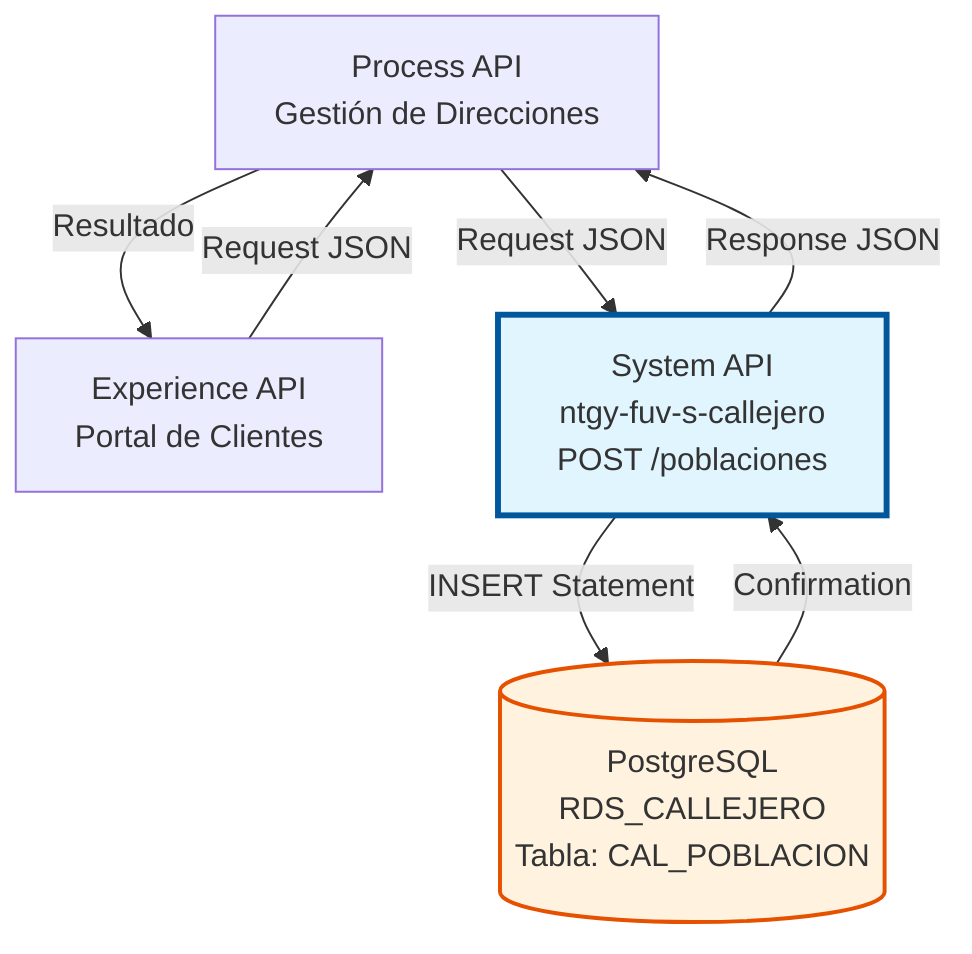
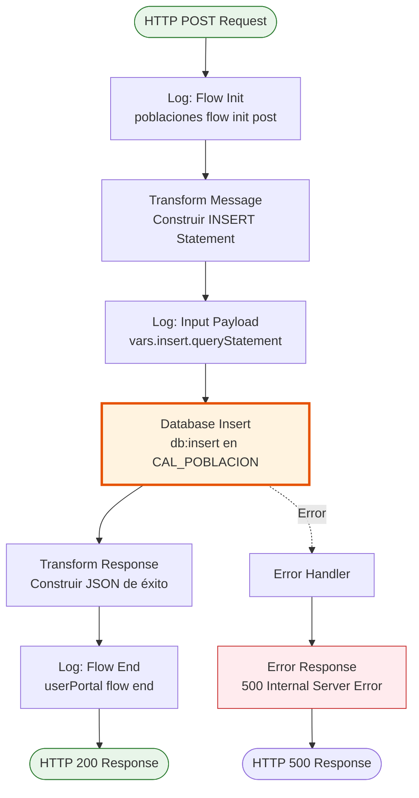
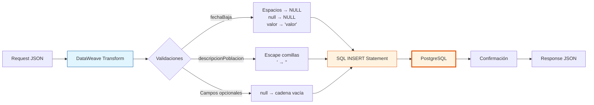

# POST /poblaciones

## 📌 Descripción General

### Propósito del Endpoint

Este endpoint permite crear una nueva población en el sistema de callejero de Naturgy, insertando un registro completo en la tabla `CAL_POBLACION` de PostgreSQL. Es fundamental para mantener actualizado el catálogo de poblaciones españolas utilizado en procesos de validación de direcciones, gestión de clientes y facturación.

El endpoint soporta:
- **Creación de poblaciones**: Inserta nuevas poblaciones con todos sus atributos identificativos
- **Gestión de códigos oficiales**: Almacena códigos GN, INE y postales para identificación única
- **Control de secciones censales**: Registra información de secciones censales cuando aplica
- **Gestión de bajas**: Permite registrar fechas de baja para poblaciones inactivas

### Tipo de API

**Capa:** System API (API-Led Connectivity)

**Función:** Integración directa con PostgreSQL para gestión de datos maestros de poblaciones del callejero español.

### Patrón de Integración

**Tipo:** Request-Reply Síncrono con SQL INSERT

**Descripción:** El endpoint recibe los datos de la población en formato JSON, aplica transformaciones DataWeave para construir la sentencia SQL INSERT con validaciones y escapes necesarios, ejecuta la inserción en PostgreSQL y retorna una respuesta de confirmación.

### Arquitectura API-Led Connectivity



---

## 💼 Propósito del Negocio

### Casos de Uso Principales

1. **Alta de Nuevas Poblaciones**
   - Cuando se incorporan nuevas poblaciones al catálogo oficial español
   - Permite mantener sincronizado el sistema con el INE (Instituto Nacional de Estadística)
   - Garantiza que los sistemas de Naturgy tengan acceso a poblaciones actualizadas

2. **Migración de Datos de Callejero**
   - Durante procesos de migración desde sistemas legacy
   - Carga inicial de catálogos de poblaciones
   - Sincronización con fuentes externas de datos geográficos

3. **Actualización de Catálogos Geográficos**
   - Incorporación de cambios administrativos (nuevos municipios, segregaciones)
   - Actualización de códigos postales
   - Gestión de secciones censales

### Contexto Empresarial

- **Dominio:** Gestión de Direcciones y Callejero
- **Sector:** Energía - Utilities
- **División:** Naturgy España
- **Proceso de Negocio:** Mantenimiento de datos maestros geográficos para validación de direcciones de clientes
- **Criticidad:** Alta - Los datos de poblaciones son fundamentales para procesos de alta de clientes y facturación

### Stakeholders

- **Equipos de Datos Maestros**: Responsables de mantener actualizado el catálogo de poblaciones
- **Sistemas de CRM**: Requieren datos precisos de poblaciones para validación de direcciones de clientes
- **Sistemas de Facturación**: Necesitan códigos postales correctos para envío de facturas
- **Equipos de Atención al Cliente**: Utilizan el catálogo para asistir en procesos de alta y modificación de datos

### Valor de Negocio

- **Precisión en Direcciones**: Garantiza que las direcciones de clientes sean válidas y completas
- **Reducción de Errores**: Minimiza errores en procesos de alta de clientes y envío de correspondencia
- **Cumplimiento Normativo**: Mantiene alineación con estándares oficiales del INE
- **Eficiencia Operativa**: Centraliza la gestión de poblaciones en un único sistema

### Consumidores Potenciales

Este endpoint puede ser consumido por:
- Process APIs de gestión de clientes y direcciones
- Sistemas de migración y carga masiva de datos
- Herramientas de administración de datos maestros
- Procesos batch de sincronización con fuentes externas

---

## 🔧 Especificación Técnica

### URLs por Ambiente

| Ambiente | URL Base | URL Completa |
|----------|----------|--------------|
| **Local** | `http://localhost:8081` | `http://localhost:8081/api/poblaciones` |
| **Development** | `https://ntgy-fuv-s-callejero-dev.us-e2.cloudhub.io` | `https://ntgy-fuv-s-callejero-dev.us-e2.cloudhub.io/api/poblaciones` |
| **UAT** | `https://ntgy-fuv-s-callejero-uat.us-e2.cloudhub.io` | `https://ntgy-fuv-s-callejero-uat.us-e2.cloudhub.io/api/poblaciones` |
| **Production** | `https://ntgy-fuv-s-callejero-pro.us-e2.cloudhub.io` | `https://ntgy-fuv-s-callejero-pro.us-e2.cloudhub.io/api/poblaciones` |

### Método HTTP

```
POST /api/poblaciones
```

### Parámetros de Entrada

#### Headers HTTP

| Header | Tipo | Requerido | Descripción | Ejemplo |
|--------|------|-----------|-------------|---------|
| `Content-Type` | string | ✅ Sí | Tipo de contenido del request | `application/json` |
| `Accept` | string | ❌ No | Tipo de contenido esperado en response | `application/json` |

#### Body Parameters

**Estructura del Request Body:**

| Campo | Tipo | Requerido | Descripción | Ejemplo |
|-------|------|-----------|-------------|---------|
| `codigoGN` | string | ✅ Sí | Código identificador GN de la población | `"28001"` |
| `identificadorProvincia` | string | ✅ Sí | Código de la provincia a la que pertenece | `"28"` |
| `codigoINE` | string | ✅ Sí | Código INE oficial de la población | `"280796"` |
| `descripcionPoblacion` | string | ✅ Sí | Nombre completo de la población | `"Madrid"` |
| `codigoPostal` | string | ❌ No | Código postal asociado | `"28001"` |
| `codigoSeccionCensal` | string | ❌ No | Código de sección censal | `"001"` |
| `indicadorSeccionCensal` | string | ❌ No | Indicador de sección censal | `"S"` |
| `fechaBaja` | string | ❌ No | Fecha de baja (formato YYYYMMDD o espacios) | `"20231231"` o `"        "` |

**Validaciones Especiales:**
- `descripcionPoblacion`: Las comillas simples se escapan automáticamente (duplicación)
- `fechaBaja`: Los espacios en blanco se convierten a NULL en la base de datos
- Campos opcionales: Los valores null se convierten a cadena vacía

### Respuestas

#### Respuesta Exitosa (200 OK)

```json
{
  "result": {
    "codResult": "0000",
    "msgResult": "Registro Creado Correctamente"
  }
}
```

**Descripción de Campos:**
- `codResult`: Código de resultado (`"0000"` indica éxito)
- `msgResult`: Mensaje descriptivo de la operación

#### Respuesta de Error de Validación (400 Bad Request)

```json
{
  "message": "Bad request"
}
```

**Causas comunes:**
- Campos requeridos faltantes
- Formato JSON inválido
- Content-Type incorrecto

#### Respuesta de Error de Base de Datos (500 Internal Server Error)

```json
{
  "result": {
    "codResult": "0001",
    "msgResult": "Error al insertar registro en base de datos"
  }
}
```

**Causas comunes:**
- Violación de constraint de clave primaria (población ya existe)
- Violación de foreign key (provincia no existe)
- Error de conexión a base de datos
- Timeout de base de datos

### Autenticación y Autorización

- **Tipo:** Client ID & Client Secret (Anypoint Platform)
- **Autorización PostgreSQL:** El usuario de base de datos debe tener permisos para:
  - Ejecutar INSERT en tabla `CAL_POBLACION`
  - Acceso al schema `public`
  - Conexión a base de datos `RDS_CALLEJERO`

### Timeouts

| Tipo | Valor | Descripción |
|------|-------|-------------|
| **Request Timeout** | 30 segundos | Tiempo máximo de espera para la respuesta |
| **Connection Timeout** | 10 segundos | Tiempo máximo para establecer conexión con PostgreSQL |
| **Query Timeout** | 20 segundos | Tiempo máximo de ejecución del INSERT |

---

## 🏗️ Implementación Técnica

### Arquitectura del Flow



### Componentes del Flow

#### 1. Logger Inicial
```xml
<logger level="INFO" message="poblaciones flow init post" />
```
- **Propósito**: Registrar inicio de ejecución del flow
- **Nivel**: INFO
- **Ubicación**: Línea 52 del flow `poblacionesPostFlow`

#### 2. Transformación DataWeave - Construcción del INSERT

**Ubicación**: Variable `insert` (líneas 54-82)

```dataweave
%dw 2.0
output application/json

var fechaBaja = 
    if (payload.fechaBaja == '        ') "null" 
    else
        if (payload.fechaBaja == null) "null" 
        else "'" ++ payload.fechaBaja ++ "'"

fun quitaNull(campoEntrada) = 
    if (campoEntrada == null) "" else campoEntrada

var nombreDenominacion = 
    if (payload.descripcionPoblacion == null) null
    else payload.descripcionPoblacion replace "'" with "''"

---
{
    "queryStatement": "INSERT INTO CAL_POBLACION (
        ID_POBLACION_GN, 
        ID_PROVINCIA, 
        ID_POBLACION, 
        DES_POBLACION, 
        COD_POSTAL, 
        COD_SECCION_CENSAL, 
        IND_SECCION_CENSAL, 
        FECHA_BAJA
    ) VALUES ('"
    ++ payload.codigoGN 
    ++ "','" ++ payload.identificadorProvincia 
    ++ "','" ++ payload.codigoINE 
    ++ "','" ++ nombreDenominacion
    ++ "','" ++ quitaNull(payload.codigoPostal)
    ++ "','" ++ quitaNull(payload.codigoSeccionCensal)
    ++ "','" ++ quitaNull(payload.indicadorSeccionCensal) 
    ++ "'," ++ fechaBaja
    ++ ")"
}
```

**Lógica de Transformación:**

1. **Manejo de fechaBaja**:
   - Si es cadena de 8 espacios → NULL (sin comillas)
   - Si es null → NULL (sin comillas)
   - Si tiene valor → Se envuelve en comillas simples

2. **Función quitaNull**:
   - Convierte valores null a cadena vacía
   - Aplicada a campos opcionales: codigoPostal, codigoSeccionCensal, indicadorSeccionCensal

3. **Escape de comillas en descripcionPoblacion**:
   - Reemplaza `'` por `''` (duplicación)
   - Previene errores de sintaxis SQL
   - Ejemplo: `"L'Hospitalet"` → `"L''Hospitalet"`

#### 3. Logger de Input
```xml
<logger level="INFO" message="#[vars.insert.queryStatement]" />
```
- **Propósito**: Registrar la sentencia SQL que se ejecutará
- **Nivel**: INFO
- **Contenido**: Query completo con valores interpolados
- **Ubicación**: Línea 83

#### 4. Database Insert

**Configuración:**
```xml
<db:insert config-ref="RDS_CALLEJERO">
    <db:sql><![CDATA[#[vars.insert.queryStatement]]]></db:sql>
</db:insert>
```

**Detalles:**
- **Connector**: Database Connector v1.14.12
- **Config**: `RDS_CALLEJERO`
- **Driver**: PostgreSQL 42.3.3
- **Operación**: INSERT dinámico
- **Tabla**: `CAL_POBLACION`
- **Ubicación**: Líneas 84-86

**Estructura de la Tabla CAL_POBLACION:**

| Columna | Tipo | Constraint | Descripción |
|---------|------|------------|-------------|
| `ID_POBLACION_GN` | VARCHAR | PRIMARY KEY | Código GN único de población |
| `ID_PROVINCIA` | VARCHAR | FOREIGN KEY | Referencia a tabla de provincias |
| `ID_POBLACION` | VARCHAR | NOT NULL | Código INE de la población |
| `DES_POBLACION` | VARCHAR | NOT NULL | Nombre de la población |
| `COD_POSTAL` | VARCHAR | NULLABLE | Código postal |
| `COD_SECCION_CENSAL` | VARCHAR | NULLABLE | Código de sección censal |
| `IND_SECCION_CENSAL` | VARCHAR | NULLABLE | Indicador de sección censal |
| `FECHA_BAJA` | DATE | NULLABLE | Fecha de baja de la población |

#### 5. Transformación de Respuesta

**Ubicación**: Líneas 87-97

```dataweave
%dw 2.0
output application/json
---
{
    "result": {
        "codResult": "0000",
        "msgResult": "Registro Creado Correctamente"
    }
}
```

**Respuesta Estándar:**
- Código de éxito: `"0000"`
- Mensaje fijo de confirmación
- Formato JSON consistente

#### 6. Logger Final
```xml
<logger level="INFO" message="userPortal flow end" />
```
- **Propósito**: Registrar finalización exitosa del flow
- **Nivel**: INFO
- **Ubicación**: Línea 98

### Diagrama de Transformación de Datos



### Configuración de Base de Datos

**Database Config (RDS_CALLEJERO):**

```xml
<db:config name="RDS_CALLEJERO">
    <db:generic-connection 
        url="jdbc:postgresql://${bbdd.host}:${bbdd.port}/${bbdd.database}" 
        driverClassName="org.postgresql.Driver" 
        user="${bbdd.user}" 
        password="${secure::bbdd.password}">
        <db:pooling-profile />
    </db:generic-connection>
</db:config>
```

**Propiedades de Conexión:**
- **Host**: `${bbdd.host}` (configurable por ambiente)
- **Puerto**: `${bbdd.port}` (típicamente 5432)
- **Base de datos**: `${bbdd.database}` (RDS_CALLEJERO)
- **Usuario**: `${bbdd.user}` (desde properties)
- **Password**: `${secure::bbdd.password}` (encriptado)
- **Connection Pooling**: Habilitado

### Manejo de Errores

**Errores Potenciales:**

1. **Duplicate Key (Primary Key Violation)**
   - **Causa**: Ya existe una población con el mismo `ID_POBLACION_GN`
   - **Código PostgreSQL**: 23505
   - **Respuesta**: 500 Internal Server Error

2. **Foreign Key Violation**
   - **Causa**: `ID_PROVINCIA` no existe en tabla de provincias
   - **Código PostgreSQL**: 23503
   - **Respuesta**: 500 Internal Server Error

3. **Connection Timeout**
   - **Causa**: Base de datos no disponible o sobrecargada
   - **Respuesta**: 500 Internal Server Error

4. **Validation Error**
   - **Causa**: Campos requeridos faltantes o formato inválido
   - **Respuesta**: 400 Bad Request (manejado por APIKit)

### Consideraciones de Performance

- **Tiempo de Ejecución Esperado**: < 200ms
- **Connection Pooling**: Reutilización de conexiones para mejor performance
- **Índices**: La tabla debe tener índice en `ID_POBLACION_GN` (PRIMARY KEY)
- **Transaccionalidad**: Cada INSERT es una transacción atómica

---

## 💻 Ejemplos de Uso

### Ejemplo 1: Creación de Población Completa

**Request:**

```bash
curl -X POST "https://ntgy-fuv-s-callejero-dev.us-e2.cloudhub.io/api/poblaciones" \
  -H "Content-Type: application/json" \
  -H "Accept: application/json" \
  -d '{
    "codigoGN": "28001",
    "identificadorProvincia": "28",
    "codigoINE": "280796",
    "descripcionPoblacion": "Madrid",
    "codigoPostal": "28001",
    "codigoSeccionCensal": "001",
    "indicadorSeccionCensal": "S",
    "fechaBaja": null
  }'
```

**Response (200 OK):**

```json
{
  "result": {
    "codResult": "0000",
    "msgResult": "Registro Creado Correctamente"
  }
}
```

### Ejemplo 2: Población con Nombre que Contiene Comilla

**Request:**

```bash
curl -X POST "https://ntgy-fuv-s-callejero-dev.us-e2.cloudhub.io/api/poblaciones" \
  -H "Content-Type: application/json" \
  -d '{
    "codigoGN": "08101",
    "identificadorProvincia": "08",
    "codigoINE": "081015",
    "descripcionPoblacion": "L'\''Hospitalet de Llobregat",
    "codigoPostal": "08901",
    "codigoSeccionCensal": null,
    "indicadorSeccionCensal": null,
    "fechaBaja": null
  }'
```

**SQL Generado Internamente:**
```sql
INSERT INTO CAL_POBLACION (...) 
VALUES ('08101','08','081015','L''Hospitalet de Llobregat','08901','','',null)
```

**Response (200 OK):**

```json
{
  "result": {
    "codResult": "0000",
    "msgResult": "Registro Creado Correctamente"
  }
}
```

### Ejemplo 3: Población con Fecha de Baja

**Request:**

```bash
curl -X POST "https://ntgy-fuv-s-callejero-dev.us-e2.cloudhub.io/api/poblaciones" \
  -H "Content-Type: application/json" \
  -d '{
    "codigoGN": "50001",
    "identificadorProvincia": "50",
    "codigoINE": "500297",
    "descripcionPoblacion": "Zaragoza",
    "codigoPostal": "50001",
    "codigoSeccionCensal": "002",
    "indicadorSeccionCensal": "N",
    "fechaBaja": "20231231"
  }'
```

**Response (200 OK):**

```json
{
  "result": {
    "codResult": "0000",
    "msgResult": "Registro Creado Correctamente"
  }
}
```

### Ejemplo 4: Población Mínima (Solo Campos Requeridos)

**Request:**

```bash
curl -X POST "https://ntgy-fuv-s-callejero-dev.us-e2.cloudhub.io/api/poblaciones" \
  -H "Content-Type: application/json" \
  -d '{
    "codigoGN": "41001",
    "identificadorProvincia": "41",
    "codigoINE": "410910",
    "descripcionPoblacion": "Sevilla"
  }'
```

**Response (200 OK):**

```json
{
  "result": {
    "codResult": "0000",
    "msgResult": "Registro Creado Correctamente"
  }
}
```

### Ejemplo 5: Error - Población Duplicada

**Request:**

```bash
curl -X POST "https://ntgy-fuv-s-callejero-dev.us-e2.cloudhub.io/api/poblaciones" \
  -H "Content-Type: application/json" \
  -d '{
    "codigoGN": "28001",
    "identificadorProvincia": "28",
    "codigoINE": "280796",
    "descripcionPoblacion": "Madrid"
  }'
```

**Response (500 Internal Server Error):**

```json
{
  "result": {
    "codResult": "0001",
    "msgResult": "Error al insertar registro en base de datos"
  }
}
```

**Causa**: Ya existe una población con `ID_POBLACION_GN = "28001"`

### Ejemplo 6: Error - Campos Requeridos Faltantes

**Request:**

```bash
curl -X POST "https://ntgy-fuv-s-callejero-dev.us-e2.cloudhub.io/api/poblaciones" \
  -H "Content-Type: application/json" \
  -d '{
    "codigoGN": "46001",
    "identificadorProvincia": "46"
  }'
```

**Response (400 Bad Request):**

```json
{
  "message": "Bad request"
}
```

**Causa**: Faltan campos requeridos (`codigoINE`, `descripcionPoblacion`)

### Ejemplo 7: Uso desde JavaScript

```javascript
const crearPoblacion = async () => {
  const url = 'https://ntgy-fuv-s-callejero-dev.us-e2.cloudhub.io/api/poblaciones';
  
  const poblacion = {
    codigoGN: '03001',
    identificadorProvincia: '03',
    codigoINE: '030140',
    descripcionPoblacion: 'Alicante',
    codigoPostal: '03001',
    codigoSeccionCensal: '001',
    indicadorSeccionCensal: 'S',
    fechaBaja: null
  };

  try {
    const response = await fetch(url, {
      method: 'POST',
      headers: {
        'Content-Type': 'application/json',
        'Accept': 'application/json'
      },
      body: JSON.stringify(poblacion)
    });

    const data = await response.json();
    
    if (response.ok && data.result.codResult === '0000') {
      console.log('✅ Población creada exitosamente');
      console.log('Mensaje:', data.result.msgResult);
    } else {
      console.error('❌ Error al crear población');
      console.error('Código:', data.result.codResult);
      console.error('Mensaje:', data.result.msgResult);
    }
  } catch (error) {
    console.error('❌ Error de conexión:', error);
  }
};

crearPoblacion();
```

### Ejemplo 8: Uso desde Python

```python
import requests
import json

def crear_poblacion():
    url = 'https://ntgy-fuv-s-callejero-dev.us-e2.cloudhub.io/api/poblaciones'
    
    poblacion = {
        'codigoGN': '46001',
        'identificadorProvincia': '46',
        'codigoINE': '460259',
        'descripcionPoblacion': 'Valencia',
        'codigoPostal': '46001',
        'codigoSeccionCensal': '001',
        'indicadorSeccionCensal': 'S',
        'fechaBaja': None
    }
    
    headers = {
        'Content-Type': 'application/json',
        'Accept': 'application/json'
    }
    
    try:
        response = requests.post(url, json=poblacion, headers=headers)
        data = response.json()
        
        if response.status_code == 200 and data['result']['codResult'] == '0000':
            print('✅ Población creada exitosamente')
            print(f"Mensaje: {data['result']['msgResult']}")
        else:
            print('❌ Error al crear población')
            print(f"Código: {data['result']['codResult']}")
            print(f"Mensaje: {data['result']['msgResult']}")
            
    except requests.exceptions.RequestException as e:
        print(f'❌ Error de conexión: {e}')

crear_poblacion()