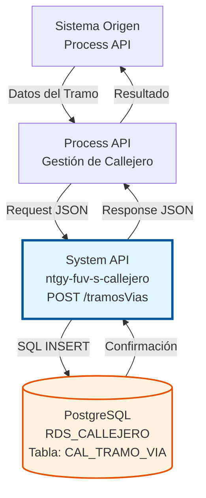
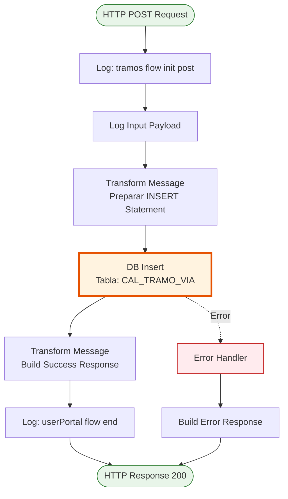
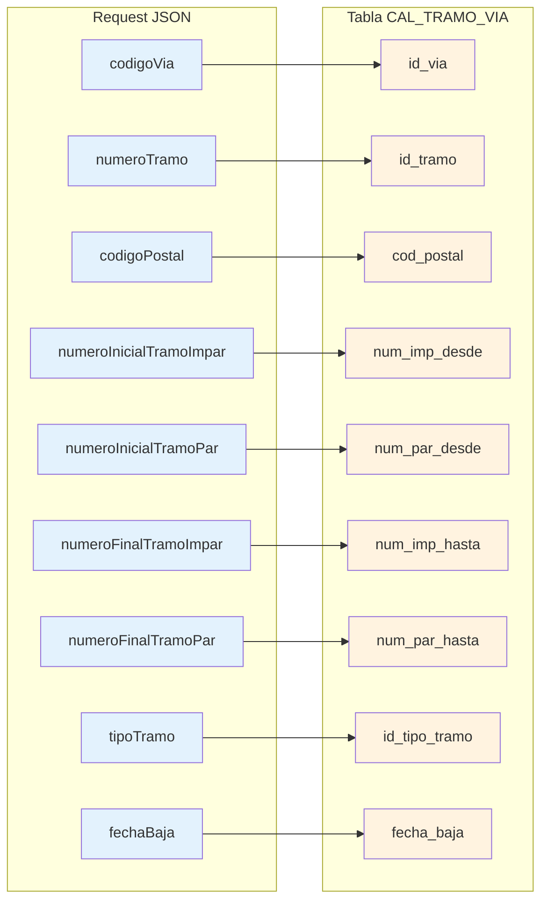

# POST /tramosVias

## 📌 Descripción General

### Propósito del Endpoint

Este endpoint permite insertar un nuevo tramo de vía en la base de datos PostgreSQL del callejero español. Un tramo de vía representa una sección específica de una calle con numeración par e impar definida, asociada a un código postal.

El endpoint soporta:
- **Inserción de Tramos**: Crea nuevos registros de tramos de vía con numeración completa
- **Gestión de Códigos Postales**: Asocia tramos a códigos postales específicos
- **Numeración Par/Impar**: Define rangos de numeración para ambos lados de la vía
- **Tipos de Tramo**: Clasifica tramos según su tipo (urbano, rural, etc.)
- **Gestión de Bajas**: Permite registrar fecha de baja opcional

### Tipo de API

**Capa:** System API (API-Led Connectivity)

**Función:** Integración directa con PostgreSQL para gestión de tramos de vías del callejero español.

### Patrón de Integración

**Tipo:** Request-Reply Síncrono con SQL INSERT

**Descripción:** Recibe datos del tramo de vía en formato JSON, transforma los campos al formato de base de datos, ejecuta un INSERT en la tabla CAL_TRAMO_VIA y retorna confirmación de creación.

### Arquitectura API-Led Connectivity



---

## 💼 Propósito del Negocio

### Casos de Uso Principales

1. **Alta de Nuevos Tramos de Vía**
   - Cuando se urbaniza una nueva zona y se crean secciones de calles
   - Permite definir la numeración específica de cada tramo
   - Asocia el tramo a un código postal determinado

2. **Gestión de Códigos Postales**
   - Asigna códigos postales a secciones específicas de vías
   - Facilita la validación de direcciones completas
   - Mejora la precisión en entregas y servicios

3. **Definición de Numeración**
   - Establece rangos de numeración par e impar para cada tramo
   - Permite validar números de portal en direcciones
   - Soporta esquemas de numeración complejos

### Contexto Empresarial

- **Dominio:** Gestión de Callejero y Direcciones
- **Sector:** Energía - Utilities
- **División:** Naturgy España
- **Proceso de Negocio:** Mantenimiento del callejero español para validación de direcciones
- **Criticidad:** Alta - Fundamental para procesos de alta de clientes y facturación

### Stakeholders

- **Equipos de Atención al Cliente**: Necesitan validar direcciones durante altas de clientes
- **Departamento de Facturación**: Requiere direcciones precisas para envío de facturas
- **Servicios de Campo**: Utilizan direcciones para instalaciones y mantenimiento
- **Administradores de Datos**: Mantienen actualizado el callejero español

### Valor de Negocio

- **Precisión en Direcciones**: Reduce errores en direcciones de clientes
- **Validación Automática**: Permite autocompletar y validar direcciones en tiempo real
- **Eficiencia Operativa**: Minimiza devoluciones de correo y visitas fallidas
- **Cumplimiento Normativo**: Mantiene direcciones según estándares postales españoles

### Consumidores Potenciales

Este endpoint puede ser consumido por:
- Process APIs de gestión de clientes
- Process APIs de facturación y cobros
- Sistemas de gestión de servicios de campo
- Herramientas de administración de datos maestros

---

## 🔧 Especificación Técnica

### URLs por Ambiente

| Ambiente | URL Base | URL Completa |
|----------|----------|--------------|
| **Local** | `http://localhost:8081` | `http://localhost:8081/api/tramosVias` |
| **Development** | `https://ntgy-fuv-s-callejero-dev.us-e2.cloudhub.io` | `https://ntgy-fuv-s-callejero-dev.us-e2.cloudhub.io/api/tramosVias` |
| **UAT** | `https://ntgy-fuv-s-callejero-uat.us-e2.cloudhub.io` | `https://ntgy-fuv-s-callejero-uat.us-e2.cloudhub.io/api/tramosVias` |
| **Production** | `https://ntgy-fuv-s-callejero-pro.us-e2.cloudhub.io` | `https://ntgy-fuv-s-callejero-pro.us-e2.cloudhub.io/api/tramosVias` |

### Método HTTP

```
POST /api/tramosVias
```

### Parámetros de Entrada

#### Headers HTTP

| Header | Tipo | Requerido | Descripción | Ejemplo |
|--------|------|-----------|-------------|---------|
| `Content-Type` | string | ✅ Sí | Tipo de contenido del request | `application/json` |
| `Accept` | string | ❌ No | Tipo de contenido esperado en response | `application/json` |

#### Body Parameters

| Campo | Tipo | Requerido | Descripción | Ejemplo |
|-------|------|-----------|-------------|---------|
| `codigoVia` | integer | ✅ Sí | Identificador único de la vía | `12345` |
| `numeroTramo` | integer | ✅ Sí | Número identificador del tramo | `1` |
| `codigoPostal` | string | ✅ Sí | Código postal asociado al tramo | `"28001"` |
| `numeroInicialTramoImpar` | string | ✅ Sí | Número inicial del lado impar | `"1"` |
| `numeroInicialTramoPar` | string | ✅ Sí | Número inicial del lado par | `"2"` |
| `numeroFinalTramoImpar` | string | ✅ Sí | Número final del lado impar | `"99"` |
| `numeroFinalTramoPar` | string | ✅ Sí | Número final del lado par | `"100"` |
| `tipoTramo` | string | ✅ Sí | Tipo de tramo (urbano, rural, etc.) | `"U"` |
| `fechaBaja` | string | ❌ No | Fecha de baja del tramo (formato: YYYYMMDD) | `"20261231"` o `null` |

**Estructura JSON del Body:**

```json
{
  "codigoVia": 12345,
  "numeroTramo": 1,
  "codigoPostal": "28001",
  "numeroInicialTramoImpar": "1",
  "numeroInicialTramoPar": "2",
  "numeroFinalTramoImpar": "99",
  "numeroFinalTramoPar": "100",
  "tipoTramo": "U",
  "fechaBaja": null
}
```

### Respuestas

#### Respuesta Exitosa (200 OK)

```json
{
  "result": {
    "codResult": "0000",
    "msgResult": "Registro Creado Correctamente"
  }
}
```

#### Respuesta de Error Técnico (500)

```json
{
  "result": {
    "codResult": "0001",
    "msgResult": "Error al insertar el registro en la base de datos"
  }
}
```

### Autenticación y Autorización

- **Tipo:** Client ID & Client Secret (Anypoint Platform)
- **Autorización PostgreSQL:** El usuario de base de datos debe tener permisos para:
  - Ejecutar INSERT en tabla `CAL_TRAMO_VIA`
  - Acceso al schema `public`

### Timeouts

| Tipo | Valor | Descripción |
|------|-------|-------------|
| **Request Timeout** | 30 segundos | Tiempo máximo de espera para la respuesta |
| **Connection Timeout** | 10 segundos | Tiempo máximo para establecer conexión con PostgreSQL |

---

## 🏗️ Implementación Técnica

### Arquitectura del Flow



### Componentes del Flow

#### 1. Logger Inicial (Flow Init)
```xml
<logger level="INFO" message="tramos flow init post" />
```
- Registra el inicio del flow
- Facilita troubleshooting y auditoría

#### 2. Logger de Input
```xml
<logger level="INFO" message="Input payload: #[payload]" />
```
- Registra el payload recibido
- Útil para debugging y análisis

#### 3. Transformación DataWeave (Preparación INSERT)

**Ubicación en código:** Líneas 48-73 del archivo XML

```dataweave
%dw 2.0
output application/json
var fechaBaja = 
    if (payload.fechaBaja == '        ') "null" 
    else
        if (payload.fechaBaja == null) "null" 
        else "'" ++ payload.fechaBaja ++ "'"
---
{
  "queryStatement": "INSERT INTO public.cal_tramo_via (id_via, id_tramo, cod_postal, num_imp_desde, num_par_desde, num_imp_hasta, num_par_hasta, id_tipo_tramo, fecha_baja) VALUES ("
  ++ payload.codigoVia 
  ++ "," ++ payload.numeroTramo 
  ++ ",'" ++ payload.codigoPostal 
  ++ "','" ++ payload.numeroInicialTramoImpar 
  ++ "','" ++ payload.numeroInicialTramoPar 
  ++ "','" ++ payload.numeroFinalTramoImpar
  ++ "','" ++ payload.numeroFinalTramoPar 
  ++ "','" ++ payload.tipoTramo 
  ++ "'," ++ fechaBaja
  ++ ")"
}
```

**Lógica Especial:**
- Manejo de `fechaBaja` con tres casos:
  - Si es string vacío (`'        '`) → `null`
  - Si es `null` → `null`
  - Si tiene valor → se incluye con comillas simples
- Construcción dinámica del INSERT statement
- Mapeo de campos JSON a columnas de base de datos

#### 4. Database Insert

**Ubicación en código:** Líneas 75-77 del archivo XML

```xml
<db:insert config-ref="RDS_CALLEJERO">
    <db:sql><![CDATA[#[vars.insert.queryStatement]]]></db:sql>
</db:insert>
```

**Configuración:**
- **Config:** `RDS_CALLEJERO`
- **Operación:** INSERT
- **Tabla:** `public.cal_tramo_via`

**Query SQL Generado (ejemplo):**
```sql
INSERT INTO public.cal_tramo_via 
  (id_via, id_tramo, cod_postal, num_imp_desde, num_par_desde, 
   num_imp_hasta, num_par_hasta, id_tipo_tramo, fecha_baja) 
VALUES 
  (12345, 1, '28001', '1', '2', '99', '100', 'U', null)
```

#### 5. Transformación de Respuesta

**Ubicación en código:** Líneas 78-88 del archivo XML

```dataweave
%dw 2.0
output application/json
---
{
  "result": {
    "codResult": "0000",
    "msgResult": "Registro Creado Correctamente"
  }	
}
```

### Mapeo de Campos



### Tabla de Base de Datos

**Tabla:** `public.cal_tramo_via`

| Columna | Tipo | Nullable | Descripción |
|---------|------|----------|-------------|
| `id_via` | INTEGER | NO | Identificador de la vía (PK compuesta) |
| `id_tramo` | INTEGER | NO | Identificador del tramo (PK compuesta) |
| `cod_postal` | VARCHAR | NO | Código postal del tramo |
| `num_imp_desde` | VARCHAR | NO | Número inicial lado impar |
| `num_par_desde` | VARCHAR | NO | Número inicial lado par |
| `num_imp_hasta` | VARCHAR | NO | Número final lado impar |
| `num_par_hasta` | VARCHAR | NO | Número final lado par |
| `id_tipo_tramo` | VARCHAR | NO | Tipo de tramo |
| `fecha_baja` | DATE | SÍ | Fecha de baja del tramo |

**Clave Primaria:** (`id_via`, `id_tramo`)

### Manejo de Errores

**Errores Comunes:**

1. **Violación de Clave Primaria**
   - Ocurre si ya existe un tramo con el mismo `id_via` + `id_tramo`
   - PostgreSQL retorna error de constraint violation
   - Se debe retornar error 409 Conflict

2. **Campos Requeridos Faltantes**
   - Validado por APIKit según RAML
   - Retorna 400 Bad Request

3. **Error de Conexión a Base de Datos**
   - Timeout o base de datos no disponible
   - Retorna 503 Service Unavailable

---

## 💻 Ejemplos de Uso

### Ejemplo 1: Insertar Tramo Urbano Activo

**Request:**

```bash
curl -X POST "http://localhost:8081/api/tramosVias" \
  -H "Content-Type: application/json" \
  -d '{
    "codigoVia": 12345,
    "numeroTramo": 1,
    "codigoPostal": "28001",
    "numeroInicialTramoImpar": "1",
    "numeroInicialTramoPar": "2",
    "numeroFinalTramoImpar": "99",
    "numeroFinalTramoPar": "100",
    "tipoTramo": "U",
    "fechaBaja": null
  }'
```

**Response (200 OK):**

```json
{
  "result": {
    "codResult": "0000",
    "msgResult": "Registro Creado Correctamente"
  }
}
```

### Ejemplo 2: Insertar Tramo con Fecha de Baja

**Request:**

```bash
curl -X POST "http://localhost:8081/api/tramosVias" \
  -H "Content-Type: application/json" \
  -d '{
    "codigoVia": 67890,
    "numeroTramo": 2,
    "codigoPostal": "08001",
    "numeroInicialTramoImpar": "101",
    "numeroInicialTramoPar": "102",
    "numeroFinalTramoImpar": "199",
    "numeroFinalTramoPar": "200",
    "tipoTramo": "R",
    "fechaBaja": "20261231"
  }'
```

**Response (200 OK):**

```json
{
  "result": {
    "codResult": "0000",
    "msgResult": "Registro Creado Correctamente"
  }
}
```

### Ejemplo 3: Error - Tramo Duplicado

**Request:**

```bash
curl -X POST "http://localhost:8081/api/tramosVias" \
  -H "Content-Type: application/json" \
  -d '{
    "codigoVia": 12345,
    "numeroTramo": 1,
    "codigoPostal": "28001",
    "numeroInicialTramoImpar": "1",
    "numeroInicialTramoPar": "2",
    "numeroFinalTramoImpar": "99",
    "numeroFinalTramoPar": "100",
    "tipoTramo": "U",
    "fechaBaja": null
  }'
```

**Response (500 Internal Server Error):**

```json
{
  "result": {
    "codResult": "0001",
    "msgResult": "Error al insertar el registro: duplicate key value violates unique constraint"
  }
}
```

### Ejemplo 4: Uso desde JavaScript

```javascript
const insertTramoVia = async (tramoData) => {
  try {
    const response = await fetch('http://localhost:8081/api/tramosVias', {
      method: 'POST',
      headers: {
        'Content-Type': 'application/json'
      },
      body: JSON.stringify({
        codigoVia: tramoData.codigoVia,
        numeroTramo: tramoData.numeroTramo,
        codigoPostal: tramoData.codigoPostal,
        numeroInicialTramoImpar: tramoData.numeroInicialTramoImpar,
        numeroInicialTramoPar: tramoData.numeroInicialTramoPar,
        numeroFinalTramoImpar: tramoData.numeroFinalTramoImpar,
        numeroFinalTramoPar: tramoData.numeroFinalTramoPar,
        tipoTramo: tramoData.tipoTramo,
        fechaBaja: tramoData.fechaBaja || null
      })
    });

    const result = await response.json();
    
    if (result.result.codResult === "0000") {
      console.log('Tramo creado exitosamente');
      return result;
    } else {
      console.error('Error al crear tramo:', result.result.msgResult);
      throw new Error(result.result.msgResult);
    }
  } catch (error) {
    console.error('Error en la petición:', error);
    throw error;
  }
};

// Uso
const nuevoTramo = {
  codigoVia: 12345,
  numeroTramo: 1,
  codigoPostal: "28001",
  numeroInicialTramoImpar: "1",
  numeroInicialTramoPar: "2",
  numeroFinalTramoImpar: "99",
  numeroFinalTramoPar: "100",
  tipoTramo: "U",
  fechaBaja: null
};

insertTramoVia(nuevoTramo);