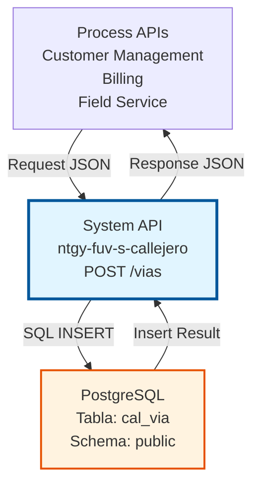
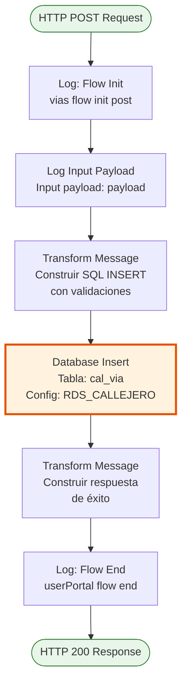
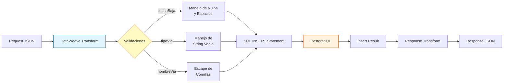

# POST /vias

## 📌 Descripción General

### Propósito del Endpoint

Este endpoint permite insertar una nueva vía (calle, avenida, plaza, etc.) en el sistema de callejero español. Realiza la inserción directa en la base de datos PostgreSQL con validación de datos y manejo especial de valores nulos y caracteres especiales.

El endpoint soporta:
- **Inserción de Vías**: Crea un nuevo registro de vía con todos sus atributos
- **Validación de Datos**: Maneja valores vacíos, espacios en blanco y caracteres especiales
- **Escape de Caracteres**: Previene errores SQL escapando comillas simples en nombres de vías
- **Manejo de Nulos**: Convierte valores vacíos o espacios en NULL para campos opcionales

### Tipo de API

**Capa:** System API (API-Led Connectivity)

**Función:** Integración directa con PostgreSQL para gestión de datos de callejero español.

### Patrón de Integración

**Tipo:** Request-Reply Síncrono con SQL INSERT

**Descripción:** Recibe los datos de la vía en formato JSON, aplica transformaciones DataWeave para construir dinámicamente la sentencia SQL INSERT con validaciones, ejecuta la inserción en PostgreSQL y retorna una respuesta estandarizada de éxito o error.

### Arquitectura API-Led Connectivity



---

## 💼 Propósito del Negocio

### Casos de Uso Principales

1. **Alta de Nueva Vía en el Sistema**
   - Cuando se identifica una nueva calle que no existe en el callejero
   - Permite mantener actualizado el catálogo de direcciones
   - Facilita la validación de direcciones en procesos de alta de clientes

2. **Sincronización con Fuentes Oficiales**
   - Actualización del callejero desde fuentes oficiales (INE, Correos)
   - Mantiene la consistencia con nomenclatura postal española
   - Asegura códigos postales correctos

3. **Soporte a Procesos de Negocio**
   - Habilita la validación de direcciones en formularios
   - Permite autocompletado de direcciones en portales web y móvil
   - Reduce errores en procesos de instalación y facturación

### Contexto Empresarial

- **Dominio:** Gestión de Callejero y Direcciones
- **Sector:** Energía - Utilities
- **División:** Naturgy España - FUV (Fuerza de Ventas)
- **Proceso de Negocio:** Mantenimiento de Datos Maestros de Direcciones
- **Criticidad:** Alta - Impacta en validación de direcciones de clientes

### Stakeholders

- **Equipos de Atención al Cliente**: Necesitan datos precisos para validar direcciones durante alta de clientes
- **Equipos de Field Service**: Requieren direcciones correctas para instalaciones y mantenimiento
- **Administradores de Datos Maestros**: Responsables de mantener el callejero actualizado
- **Desarrolladores de Process APIs**: Consumen este endpoint para operaciones de negocio

### Valor de Negocio

- **Calidad de Datos**: Mantiene un catálogo único y consistente de vías españolas
- **Eficiencia Operativa**: Reduce errores en procesos que dependen de direcciones correctas
- **Experiencia del Cliente**: Mejora la validación de direcciones en canales digitales
- **Cumplimiento Normativo**: Asegura adherencia a estándares postales españoles

### Consumidores Potenciales

Este endpoint puede ser consumido por:
- Process APIs de gestión de clientes
- Process APIs de facturación y cobros
- Process APIs de field service
- Flujos de sincronización de datos maestros
- Sistemas de integración middleware

---

## 🔧 Especificación Técnica

### URLs por Ambiente

| Ambiente | URL Base | URL Completa |
|----------|----------|--------------|
| **Local** | `http://localhost:8081` | `http://localhost:8081/vias` |
| **Development** | `https://ntgy-fuv-s-callejero-dev.cloudhub.io` | `https://ntgy-fuv-s-callejero-dev.cloudhub.io/vias` |
| **UAT** | `https://ntgy-fuv-s-callejero-uat.cloudhub.io` | `https://ntgy-fuv-s-callejero-uat.cloudhub.io/vias` |
| **Production** | `https://ntgy-fuv-s-callejero.cloudhub.io` | `https://ntgy-fuv-s-callejero.cloudhub.io/vias` |

### Método HTTP

```
POST /vias
```

### Parámetros de Entrada

#### Headers HTTP

| Header | Tipo | Requerido | Descripción | Ejemplo |
|--------|------|-----------|-------------|---------|
| `Content-Type` | string | ✅ Sí | Tipo de contenido del request | `application/json` |
| `Accept` | string | ❌ No | Tipo de contenido esperado en response | `application/json` |

#### Body Parameters

| Campo | Tipo | Requerido | Descripción | Ejemplo |
|-------|------|-----------|-------------|---------|
| `codigoViaGN` | string | ✅ Sí | Código único de la vía en el sistema GN | `"123456"` |
| `nombreVia` | string | ✅ Sí | Nombre de la vía (calle, avenida, etc.) | `"Gran Vía"` |
| `tipoVia` | string | ❌ No | Código del tipo de vía (CL, AV, PZ, etc.) | `"CL"` |
| `codigoPostal` | string | ✅ Sí | Código postal de 5 dígitos | `"28013"` |
| `viaTramificadaPostales` | string | ✅ Sí | Indicador si la vía tiene tramos postales | `"S"` o `"N"` |
| `codigoINEVia` | string | ✅ Sí | Código INE de la vía | `"280790001"` |
| `codigoGNPoblacion` | string | ✅ Sí | Código GN de la población | `"28079"` |
| `codigoINEPoblacion` | string | ✅ Sí | Código INE de la población | `"28079"` |
| `codigoSeccionCensal` | string | ✅ Sí | Código de sección censal | `"001"` |
| `indicadorSeccionCensal` | string | ✅ Sí | Indicador de sección censal | `"S"` o `"N"` |
| `fechaBaja` | string | ❌ No | Fecha de baja de la vía (formato: YYYYMMDD) | `"20231231"` o `null` |

**Estructura del Request:**

```json
{
  "codigoViaGN": "123456",
  "nombreVia": "Gran Vía",
  "tipoVia": "CL",
  "codigoPostal": "28013",
  "viaTramificadaPostales": "N",
  "codigoINEVia": "280790001",
  "codigoGNPoblacion": "28079",
  "codigoINEPoblacion": "28079",
  "codigoSeccionCensal": "001",
  "indicadorSeccionCensal": "S",
  "fechaBaja": null
}
```

### Respuestas

#### Respuesta Exitosa (200 OK)

```json
{
  "result": {
    "codResult": "0000",
    "msgResult": "Registro Creado Correctamente"
  }
}
```

#### Respuesta de Error de Base de Datos (500)

```json
{
  "result": {
    "codResult": "0001",
    "msgResult": "Error al insertar registro en base de datos"
  }
}
```

#### Respuesta de Error de Validación (400)

```json
{
  "result": {
    "codResult": "0002",
    "msgResult": "Datos de entrada inválidos"
  }
}
```

### Autenticación y Autorización

- **Tipo:** Client ID & Client Secret (Anypoint Platform)
- **Autorización PostgreSQL:** El usuario de base de datos debe tener permisos para:
  - Ejecutar INSERT en tabla `public.cal_via`
  - Acceso de escritura al schema `public`

### Timeouts

| Tipo | Valor | Descripción |
|------|-------|-------------|
| **Request Timeout** | 30 segundos | Tiempo máximo de espera para la respuesta |
| **Connection Timeout** | 10 segundos | Tiempo máximo para establecer conexión con PostgreSQL |
| **Database Query Timeout** | 20 segundos | Tiempo máximo de ejecución del INSERT |

---

## 🏗️ Implementación Técnica

### Arquitectura del Flow



### Componentes del Flow

#### 1. Logger - Flow Init
```xml
<logger level="INFO" doc:name="Flow init" 
        message="vias flow init post" />
```
- **Propósito:** Registra el inicio del flow
- **Nivel:** INFO
- **Ubicación:** Línea 2 del flow `viasPostFlow`

#### 2. Logger - Input Payload
```xml
<logger level="INFO" doc:name="Log input payload" 
        message="Input payload: #[payload]" />
```
- **Propósito:** Registra el payload de entrada para auditoría
- **Nivel:** INFO
- **Ubicación:** Línea 3 del flow

#### 3. Transform Message - Construcción de SQL INSERT

**Ubicación:** Líneas 4-38 del flow

**Lógica de Transformación:**

```dataweave
%dw 2.0
output application/json

var fechaBaja = 
    if (payload.fechaBaja == '        ') "null" 
    else
        if (payload.fechaBaja == null) "null" 
        else "'" ++ payload.fechaBaja ++ "'"
        
var tipoVia =
    if (payload.tipoVia == "") "null"
    else "'" ++ payload.tipoVia ++ "'"
    
var nombreViaEscaped = if (payload.nombreVia == null) null
    else payload.nombreVia replace "'" with "''"

---
{
    "queryStatement": "INSERT INTO public.cal_via (...) VALUES (...)"
}
```

**Validaciones Implementadas:**

1. **fechaBaja:**
   - Si es 8 espacios en blanco → convierte a `null`
   - Si es `null` → mantiene como `null`
   - Si tiene valor → lo envuelve en comillas simples

2. **tipoVia:**
   - Si es string vacío → convierte a `null`
   - Si tiene valor → lo envuelve en comillas simples

3. **nombreVia:**
   - Escapa comillas simples (`'` → `''`) para prevenir errores SQL
   - Maneja valores `null` correctamente

#### 4. Database Insert

```xml
<db:insert doc:name="Insert" config-ref="RDS_CALLEJERO">
    <db:sql><![CDATA[#[vars.insert.queryStatement]]]></db:sql>
</db:insert>
```

**Configuración:**
- **Connector:** Database Connector v1.14.12
- **Config:** RDS_CALLEJERO (PostgreSQL)
- **Operación:** INSERT
- **Tabla:** `public.cal_via`

**Campos Insertados:**
1. `id_via` - Código GN de la vía
2. `des_via` - Nombre de la vía (escapado)
3. `id_tipo_via` - Tipo de vía (nullable)
4. `cod_postal` - Código postal
5. `ind_tramos` - Indicador de tramificación
6. `cod_ine_via` - Código INE de la vía
7. `id_poblacion_gn` - Código GN de población
8. `id_poblacion` - Código INE de población
9. `cod_seccion_censal` - Código de sección censal
10. `ind_seccion_censal` - Indicador de sección censal
11. `fecha_baja` - Fecha de baja (nullable)

#### 5. Transform Message - Respuesta de Éxito

**Ubicación:** Líneas 41-49 del flow

```dataweave
%dw 2.0
output application/json
---
{
    "result": {
        "codResult": "0000",
        "msgResult": "Registro Creado Correctamente"
    }
}
```

#### 6. Logger - Flow End
```xml
<logger level="INFO" doc:name="Flow end" 
        message="userPortal flow end" />
```
- **Propósito:** Registra el fin exitoso del flow
- **Nivel:** INFO

### Diagrama de Transformación de Datos



### Manejo de Errores

El flow implementa manejo de errores a través de:

1. **Validación de Entrada:** APIKit valida el schema del request
2. **Errores de Base de Datos:** Capturados por el Database Connector
3. **Logging:** Todos los pasos registran información para troubleshooting

**Códigos de Error:**

| Código | Descripción | Causa |
|--------|-------------|-------|
| `0000` | Éxito | Registro insertado correctamente |
| `0001` | Error de BD | Violación de constraint, conexión perdida, etc. |
| `0002` | Error de Validación | Datos de entrada inválidos |

### Configuración de Base de Datos

**Connection String:**
```
jdbc:postgresql://${bbdd.host}:${bbdd.port}/${bbdd.database}
```

**Propiedades:**
- `bbdd.host`: Host del servidor PostgreSQL
- `bbdd.port`: Puerto (default: 5432)
- `bbdd.database`: Nombre de la base de datos (callejero)
- `bbdd.user`: Usuario de conexión
- `bbdd.password`: Password encriptado (secure properties)

**Connection Pooling:** Habilitado para optimizar performance

---

## 💻 Ejemplos de Uso

### Ejemplo 1: Inserción de Vía Completa

**Request:**

```bash
curl -X POST "https://ntgy-fuv-s-callejero-dev.cloudhub.io/vias" \
  -H "Content-Type: application/json" \
  -H "client_id: your-client-id" \
  -H "client_secret: your-client-secret" \
  -d '{
    "codigoViaGN": "280790001",
    "nombreVia": "Gran Vía",
    "tipoVia": "CL",
    "codigoPostal": "28013",
    "viaTramificadaPostales": "N",
    "codigoINEVia": "280790001",
    "codigoGNPoblacion": "28079",
    "codigoINEPoblacion": "28079",
    "codigoSeccionCensal": "001",
    "indicadorSeccionCensal": "S",
    "fechaBaja": null
  }'
```

**Response (200 OK):**

```json
{
  "result": {
    "codResult": "0000",
    "msgResult": "Registro Creado Correctamente"
  }
}
```

### Ejemplo 2: Inserción de Vía con Nombre que Contiene Comillas

**Request:**

```bash
curl -X POST "https://ntgy-fuv-s-callejero-dev.cloudhub.io/vias" \
  -H "Content-Type: application/json" \
  -H "client_id: your-client-id" \
  -H "client_secret: your-client-secret" \
  -d '{
    "codigoViaGN": "280790002",
    "nombreVia": "Calle de l'\''Almirall",
    "tipoVia": "CL",
    "codigoPostal": "28013",
    "viaTramificadaPostales": "N",
    "codigoINEVia": "280790002",
    "codigoGNPoblacion": "28079",
    "codigoINEPoblacion": "28079",
    "codigoSeccionCensal": "001",
    "indicadorSeccionCensal": "S",
    "fechaBaja": null
  }'
```

**Response (200 OK):**

```json
{
  "result": {
    "codResult": "0000",
    "msgResult": "Registro Creado Correctamente"
  }
}
```

**Nota:** El sistema escapa automáticamente las comillas simples en el nombre de la vía.

### Ejemplo 3: Inserción de Vía sin Tipo de Vía

**Request:**

```bash
curl -X POST "https://ntgy-fuv-s-callejero-dev.cloudhub.io/vias" \
  -H "Content-Type: application/json" \
  -H "client_id: your-client-id" \
  -H "client_secret: your-client-secret" \
  -d '{
    "codigoViaGN": "280790003",
    "nombreVia": "Plaza Mayor",
    "tipoVia": "",
    "codigoPostal": "28012",
    "viaTramificadaPostales": "N",
    "codigoINEVia": "280790003",
    "codigoGNPoblacion": "28079",
    "codigoINEPoblacion": "28079",
    "codigoSeccionCensal": "002",
    "indicadorSeccionCensal": "S",
    "fechaBaja": null
  }'
```

**Response (200 OK):**

```json
{
  "result": {
    "codResult": "0000",
    "msgResult": "Registro Creado Correctamente"
  }
}
```

**Nota:** El campo `tipoVia` vacío se convierte automáticamente a `null` en la base de datos.

### Ejemplo 4: Error - Código de Vía Duplicado

**Request:**

```bash
curl -X POST "https://ntgy-fuv-s-callejero-dev.cloudhub.io/vias" \
  -H "Content-Type: application/json" \
  -H "client_id: your-client-id" \
  -H "client_secret: your-client-secret" \
  -d '{
    "codigoViaGN": "280790001",
    "nombreVia": "Calle Duplicada",
    "tipoVia": "CL",
    "codigoPostal": "28013",
    "viaTramificadaPostales": "N",
    "codigoINEVia": "280790001",
    "codigoGNPoblacion": "28079",
    "codigoINEPoblacion": "28079",
    "codigoSeccionCensal": "001",
    "indicadorSeccionCensal": "S",
    "fechaBaja": null
  }'
```

**Response (500 Internal Server Error):**

```json
{
  "result": {
    "codResult": "0001",
    "msgResult": "Error al insertar registro: violación de constraint de clave primaria"
  }
}
```

### Ejemplo 5: Código JavaScript (Node.js)

```javascript
const axios = require('axios');

async function insertVia() {
  try {
    const response = await axios.post(
      'https://ntgy-fuv-s-callejero-dev.cloudhub.io/vias',
      {
        codigoViaGN: '280790004',
        nombreVia: 'Avenida de América',
        tipoVia: 'AV',
        codigoPostal: '28028',
        viaTramificadaPostales: 'S',
        codigoINEVia: '280790004',
        codigoGNPoblacion: '28079',
        codigoINEPoblacion: '28079',
        codigoSeccionCensal: '003',
        indicadorSeccionCensal: 'S',
        fechaBaja: null
      },
      {
        headers: {
          'Content-Type': 'application/json',
          'client_id': 'your-client-id',
          'client_secret': 'your-client-secret'
        }
      }
    );
    
    console.log('Vía insertada:', response.data);
    return response.data;
  } catch (error) {
    console.error('Error al insertar vía:', error.response?.data || error.message);
    throw error;
  }
}

insertVia();
```

### Ejemplo 6: Código Python

```python
import requests
import json

def insert_via():
    url = "https://ntgy-fuv-s-callejero-dev.cloudhub.io/vias"
    
    headers = {
        "Content-Type": "application/json",
        "client_id": "your-client-id",
        "client_secret": "your-client-secret"
    }
    
    payload = {
        "codigoViaGN": "280790005",
        "nombreVia": "Paseo de la Castellana",
        "tipoVia": "PS",
        "codigoPostal": "28046",
        "viaTramificadaPostales": "S",
        "codigoINEVia": "280790005",
        "codigoGNPoblacion": "28079",
        "codigoINEPoblacion": "28079",
        "codigoSeccionCensal": "004",
        "indicadorSeccionCensal": "S",
        "fechaBaja": None
    }
    
    try:
        response = requests.post(url, headers=headers, json=payload)
        response.raise_for_status()
        print("Vía insertada:", response.json())
        return response.json()
    except requests.exceptions.RequestException as e:
        print(f"Error al insertar vía: {e}")
        if hasattr(e.response, 'text'):
            print(f"Detalle: {e.response.text}")
        raise

if __name__ == "__main__":
    insert_via()