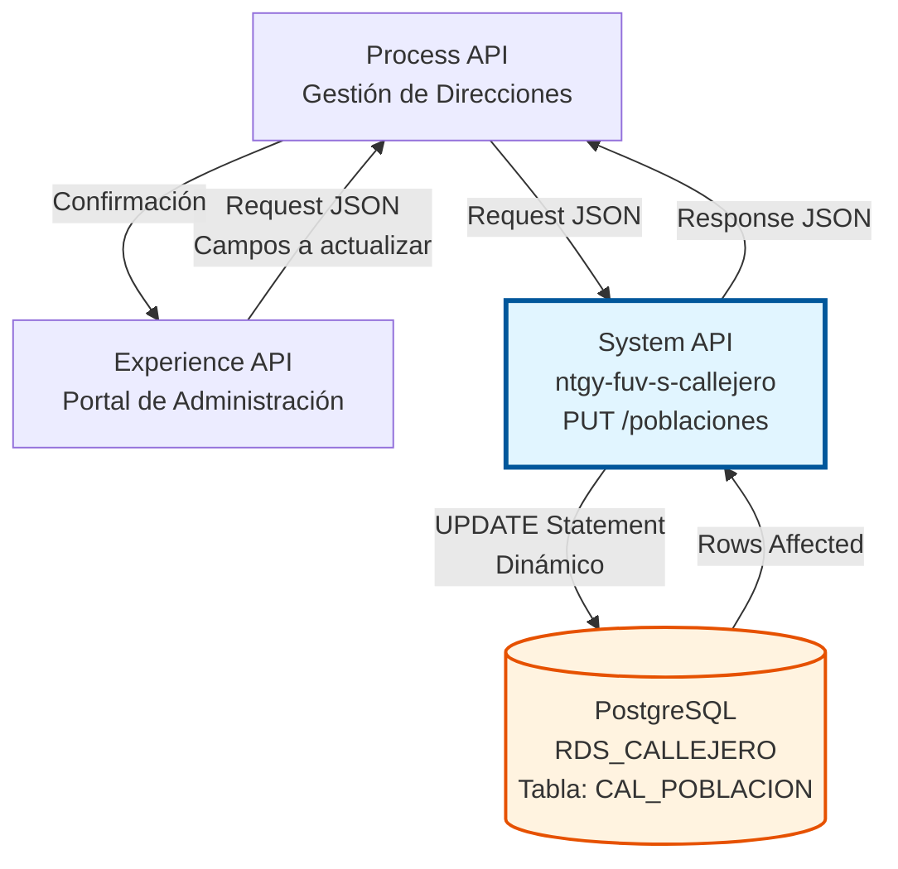
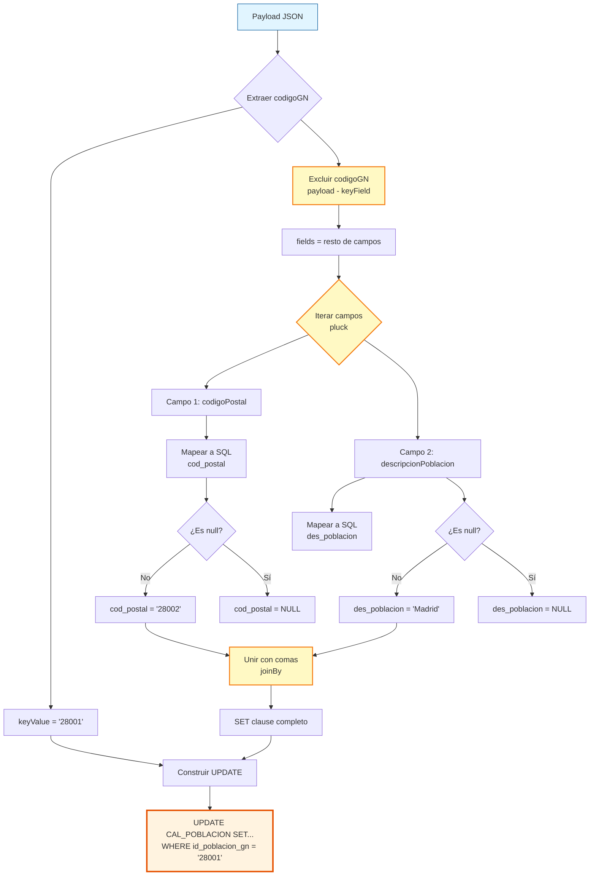
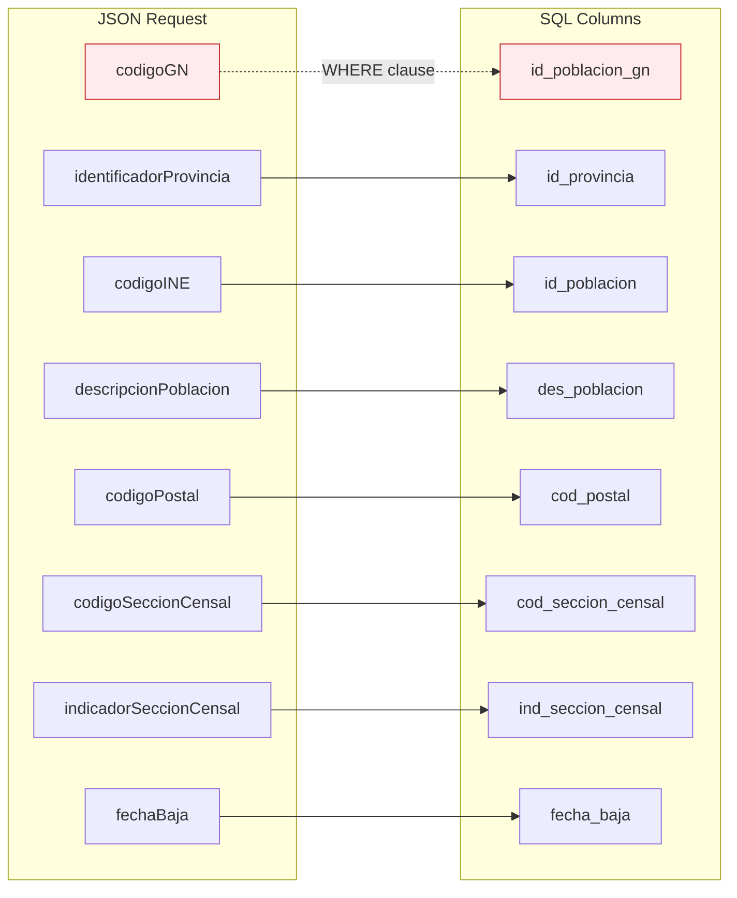

# PUT /poblaciones

## 📌 Descripción General

### Propósito del Endpoint

Este endpoint permite actualizar una población existente en el sistema de callejero de Naturgy mediante su código GN. Utiliza una implementación **avanzada con DataWeave** que genera dinámicamente la sentencia SQL UPDATE, permitiendo actualizaciones parciales donde solo se modifican los campos enviados en el request.

El endpoint soporta:
- **Actualización parcial**: Solo actualiza los campos presentes en el payload
- **Actualización completa**: Permite actualizar todos los campos de una vez
- **Actualización de un solo campo**: Eficiente para cambios específicos
- **Manejo inteligente de NULL**: Convierte valores null a SQL NULL para limpiar campos
- **Mapeo automático**: Traduce nombres de campos JSON a nombres de columnas SQL

### Tipo de API

**Capa:** System API (API-Led Connectivity)

**Función:** Integración directa con PostgreSQL para actualización de datos maestros de poblaciones del callejero español mediante UPDATE dinámico.

### Patrón de Integración

**Tipo:** Request-Reply Síncrono con SQL UPDATE Dinámico

**Descripción:** El endpoint recibe los datos a actualizar en formato JSON, aplica una transformación DataWeave avanzada que genera dinámicamente la sentencia UPDATE (incluyendo solo los campos presentes), ejecuta la actualización en PostgreSQL y retorna una respuesta de confirmación.

### Arquitectura API-Led Connectivity



---

## 💼 Propósito del Negocio

### Casos de Uso Principales

1. **Corrección de Datos de Poblaciones**
   - Actualizar códigos postales incorrectos
   - Corregir nombres de poblaciones con errores tipográficos
   - Ajustar códigos de secciones censales
   - Mantener datos sincronizados con fuentes oficiales

2. **Gestión de Bajas de Poblaciones**
   - Registrar fecha de baja cuando una población se desactiva
   - Actualizar estado de poblaciones fusionadas o segregadas
   - Mantener histórico de cambios administrativos

3. **Actualización Masiva Selectiva**
   - Actualizar solo campos específicos sin afectar otros datos
   - Procesos batch que actualizan campos particulares
   - Sincronización parcial con sistemas externos

4. **Mantenimiento de Catálogo**
   - Actualización periódica de datos del INE
   - Corrección de inconsistencias detectadas
   - Enriquecimiento de datos existentes

### Contexto Empresarial

- **Dominio:** Gestión de Direcciones y Callejero
- **Sector:** Energía - Utilities
- **División:** Naturgy España
- **Proceso de Negocio:** Mantenimiento y actualización de datos maestros geográficos
- **Criticidad:** Alta - Datos fundamentales para validación de direcciones y facturación

### Stakeholders

- **Equipos de Datos Maestros**: Responsables de mantener la calidad de datos de poblaciones
- **Sistemas de Sincronización**: Procesos automáticos que actualizan datos desde fuentes oficiales
- **Equipos de Calidad de Datos**: Detectan y corrigen inconsistencias
- **Administradores de Sistema**: Gestionan cambios administrativos en poblaciones

### Valor de Negocio

- **Flexibilidad**: Permite actualizaciones parciales sin necesidad de enviar todos los campos
- **Eficiencia**: Reduce payload y procesamiento al actualizar solo lo necesario
- **Precisión**: Mantiene datos actualizados y correctos
- **Trazabilidad**: Permite actualizar campos específicos de forma controlada

### Consumidores Potenciales

Este endpoint puede ser consumido por:
- Process APIs de gestión de datos maestros
- Sistemas de sincronización con INE y fuentes oficiales
- Herramientas de administración de callejero
- Procesos batch de corrección de datos
- Interfaces de administración web

---

## 🔧 Especificación Técnica

### URLs por Ambiente

| Ambiente | URL Base | URL Completa |
|----------|----------|--------------|
| **Local** | `http://localhost:8081` | `http://localhost:8081/api/poblaciones` |
| **Development** | `https://ntgy-fuv-s-callejero-dev.us-e2.cloudhub.io` | `https://ntgy-fuv-s-callejero-dev.us-e2.cloudhub.io/api/poblaciones` |
| **UAT** | `https://ntgy-fuv-s-callejero-uat.us-e2.cloudhub.io` | `https://ntgy-fuv-s-callejero-uat.us-e2.cloudhub.io/api/poblaciones` |
| **Production** | `https://ntgy-fuv-s-callejero-pro.us-e2.cloudhub.io` | `https://ntgy-fuv-s-callejero-pro.us-e2.cloudhub.io/api/poblaciones` |

### Método HTTP

```
PUT /api/poblaciones
```

### Parámetros de Entrada

#### Headers HTTP

| Header | Tipo | Requerido | Descripción | Ejemplo |
|--------|------|-----------|-------------|---------|
| `Content-Type` | string | ✅ Sí | Tipo de contenido del request | `application/json` |
| `Accept` | string | ❌ No | Tipo de contenido esperado en response | `application/json` |

#### Body Parameters

**⚠️ IMPORTANTE: Actualización Parcial**

Este endpoint soporta **actualización parcial**. Solo es necesario enviar:
- El campo identificador (`codigoGN`) - **OBLIGATORIO**
- Los campos que se desean actualizar - **OPCIONALES**

No es necesario enviar todos los campos. Solo se actualizarán los campos presentes en el payload.

**Estructura del Request Body:**

| Campo | Tipo | Requerido | Descripción | Ejemplo |
|-------|------|-----------|-------------|---------|
| `codigoGN` | string | ✅ Sí | Código GN único de la población a actualizar (identificador) | `"28001"` |
| `identificadorProvincia` | string | ❌ No | Nuevo código de provincia | `"28"` |
| `codigoINE` | string | ❌ No | Nuevo código INE | `"280796"` |
| `descripcionPoblacion` | string | ❌ No | Nuevo nombre de la población | `"Madrid"` |
| `codigoPostal` | string | ❌ No | Nuevo código postal | `"28002"` |
| `codigoSeccionCensal` | string | ❌ No | Nuevo código de sección censal | `"002"` |
| `indicadorSeccionCensal` | string | ❌ No | Nuevo indicador de sección censal | `"N"` |
| `fechaBaja` | string/null | ❌ No | Nueva fecha de baja (null para limpiar) | `"20231231"` o `null` |

**Mapeo de Campos JSON → SQL:**

| Campo JSON | Columna SQL | Descripción |
|------------|-------------|-------------|
| `codigoGN` | `id_poblacion_gn` | Identificador único (usado en WHERE) |
| `identificadorProvincia` | `id_provincia` | Código de provincia |
| `codigoINE` | `id_poblacion` | Código INE oficial |
| `descripcionPoblacion` | `des_poblacion` | Nombre de la población |
| `codigoPostal` | `cod_postal` | Código postal |
| `codigoSeccionCensal` | `cod_seccion_censal` | Código de sección censal |
| `indicadorSeccionCensal` | `ind_seccion_censal` | Indicador de sección |
| `fechaBaja` | `fecha_baja` | Fecha de baja |

**Validaciones Especiales:**
- `codigoGN`: Se excluye automáticamente del SET clause (solo se usa en WHERE)
- Valores `null`: Se convierten a SQL NULL (sin comillas)
- Campos ausentes: No se incluyen en el UPDATE (no se modifican)

### Respuestas

#### Respuesta Exitosa (200 OK)

```json
{
  "result": {
    "codResult": "0000",
    "msgResult": "Registro Modificado Correctamente"
  }
}
```

**Descripción de Campos:**
- `codResult`: Código de resultado (`"0000"` indica éxito)
- `msgResult`: Mensaje descriptivo de la operación

**Nota:** La respuesta es la misma independientemente de cuántos campos se actualizaron.

#### Respuesta de Error de Validación (400 Bad Request)

```json
{
  "message": "Bad request"
}
```

**Causas comunes:**
- Campo `codigoGN` faltante
- Formato JSON inválido
- Content-Type incorrecto

#### Respuesta de Error de Base de Datos (500 Internal Server Error)

```json
{
  "result": {
    "codResult": "0001",
    "msgResult": "Error al actualizar registro en base de datos"
  }
}
```

**Causas comunes:**
- Población con `codigoGN` especificado no existe
- Violación de foreign key (provincia no existe)
- Error de conexión a base de datos
- Timeout de base de datos

### Autenticación y Autorización

- **Tipo:** Client ID & Client Secret (Anypoint Platform)
- **Autorización PostgreSQL:** El usuario de base de datos debe tener permisos para:
  - Ejecutar UPDATE en tabla `CAL_POBLACION`
  - Acceso al schema `public`
  - Conexión a base de datos `RDS_CALLEJERO`

### Timeouts

| Tipo | Valor | Descripción |
|------|-------|-------------|
| **Request Timeout** | 30 segundos | Tiempo máximo de espera para la respuesta |
| **Connection Timeout** | 10 segundos | Tiempo máximo para establecer conexión con PostgreSQL |
| **Query Timeout** | 20 segundos | Tiempo máximo de ejecución del UPDATE |

---

## 🏗️ Implementación Técnica

### Arquitectura del Flow

```mermaid
flowchart TD
    Start([HTTP PUT Request<br/>Body JSON]) --> LogInit[Log: Flow Init<br/>poblaciones flow init put]
    LogInit --> LogInput[Log: Input Payload<br/>Input payload: #[payload]]
    LogInput --> Transform[Transform Message<br/>Generar UPDATE dinámico]
    Transform --> Update[Database Update<br/>db:update en CAL_POBLACION]
    Update --> TransformResp[Transform Response<br/>Construir JSON de éxito]
    TransformResp --> LogEnd[Log: Flow End<br/>userPortal flow end]
    LogEnd --> End([HTTP 200 Response])
    
    Update -.->|Error| ErrorHandler[Error Handler]
    ErrorHandler --> ErrorResp[Error Response<br/>500 Internal Server Error]
    ErrorResp --> ErrorEnd([HTTP 500 Response])
    
    style Start fill:#e8f5e9,stroke:#2e7d32
    style Transform fill:#fff9c4,stroke:#f57f17,stroke-width:3px
    style Update fill:#fff3e0,stroke:#e65100,stroke-width:3px
    style End fill:#e8f5e9,stroke:#2e7d32
    style ErrorResp fill:#ffebee,stroke:#c62828
```

### Componentes del Flow

#### 1. Logger Inicial
```xml
<logger level="INFO" message="poblaciones flow init put" />
```
- **Propósito**: Registrar inicio de ejecución del flow
- **Nivel**: INFO

#### 2. Logger de Input Payload
```xml
<logger level="INFO" message="Input payload: #[payload]" />
```
- **Propósito**: Registrar el payload JSON recibido
- **Nivel**: INFO
- **Contenido**: Body completo del request

#### 3. Transformación DataWeave - Generación Dinámica de UPDATE

**⭐ COMPONENTE MÁS SOFISTICADO DEL ENDPOINT**

**Variable:** `queryJson`

```dataweave
%dw 2.0
output application/json

var mapping = {
    "codigoGN": "id_poblacion_gn",
    "identificadorProvincia": "id_provincia",
    "codigoINE": "id_poblacion",
    "descripcionPoblacion": "des_poblacion",
    "codigoPostal": "cod_postal",
    "codigoSeccionCensal": "cod_seccion_censal",
    "indicadorSeccionCensal": "ind_seccion_censal",
    "fechaBaja": "fecha_baja"
}

fun generateUpdateStatement(payload, keyField) = do {
    var keyValue = payload[keyField]
    var fields = payload - keyField
    var setClause = fields pluck ((value, fieldName) -> 
        (mapping[fieldName] default fieldName) ++ " = " ++ 
        if (value == null) "NULL" else "'" ++ value ++ "'"
    ) joinBy ", "
    ---
    "update CAL_POBLACION set " ++ setClause ++ 
    " where " ++ (mapping[keyField] default keyField) ++ 
    " = '" ++ keyValue ++ "'"
}

---
{
    updateStatement: generateUpdateStatement(payload, "codigoGN")
}
```

### 🎯 Análisis Detallado de la Función `generateUpdateStatement`

Esta función es el corazón del endpoint y merece un análisis profundo:

#### **Paso 1: Extracción del Valor Clave**
```dataweave
var keyValue = payload[keyField]
```
- Extrae el valor del campo identificador (`codigoGN`)
- Este valor se usará en la cláusula WHERE
- Ejemplo: `keyValue = "28001"`

#### **Paso 2: Exclusión del Campo Clave**
```dataweave
var fields = payload - keyField
```
- **Operador `-`**: Elimina el campo clave del payload
- **Rationale**: El campo clave NO debe estar en el SET clause
- **Resultado**: Solo campos a actualizar
- **Ejemplo**:
  ```
  Payload original: {codigoGN: "28001", codigoPostal: "28002"}
  Después de -: {codigoPostal: "28002"}
  ```

#### **Paso 3: Construcción del SET Clause**
```dataweave
var setClause = fields pluck ((value, fieldName) -> 
    (mapping[fieldName] default fieldName) ++ " = " ++ 
    if (value == null) "NULL" else "'" ++ value ++ "'"
) joinBy ", "
```

**Desglose línea por línea:**

1. **`fields pluck`**: Itera sobre cada campo a actualizar
   - `value`: Valor del campo
   - `fieldName`: Nombre del campo JSON

2. **`mapping[fieldName] default fieldName`**: Mapeo inteligente
   - Busca el nombre SQL en el diccionario `mapping`
   - Si no existe, usa el nombre JSON original
   - Ejemplo: `"codigoPostal"` → `"cod_postal"`

3. **`if (value == null) "NULL" else "'" ++ value ++ "'"`**: Manejo de NULL
   - Si el valor es `null` → SQL NULL (sin comillas)
   - Si tiene valor → Envuelve en comillas simples
   - Ejemplo: `null` → `NULL`, `"28002"` → `'28002'`

4. **`joinBy ", "`**: Une todos los pares campo=valor
   - Resultado: `"cod_postal = '28002', des_poblacion = 'Madrid'"`

#### **Paso 4: Construcción de la Sentencia Completa**
```dataweave
"update CAL_POBLACION set " ++ setClause ++ 
" where " ++ (mapping[keyField] default keyField) ++ 
" = '" ++ keyValue ++ "'"
```

**Componentes:**
- `"update CAL_POBLACION set "`: Inicio del UPDATE
- `setClause`: Campos a actualizar (generados dinámicamente)
- `" where "`: Cláusula WHERE
- `mapping[keyField]`: Nombre SQL del campo clave (`id_poblacion_gn`)
- `keyValue`: Valor del identificador

**Ejemplo de SQL Generado:**
```sql
UPDATE CAL_POBLACION 
SET cod_postal = '28002', des_poblacion = 'Madrid' 
WHERE id_poblacion_gn = '28001'
```

### Diagrama de Transformación Dinámica



#### 4. Database Update

**Configuración:**
```xml
<db:update config-ref="RDS_CALLEJERO">
    <db:sql><![CDATA[#[vars.queryJson.updateStatement]]]></db:sql>
</db:update>
```

**Detalles:**
- **Connector**: Database Connector v1.14.12
- **Config**: `RDS_CALLEJERO`
- **Driver**: PostgreSQL 42.3.3
- **Operación**: UPDATE dinámico
- **Tabla**: `CAL_POBLACION`

**Ejemplos de SQL Ejecutado:**

**Actualización completa:**
```sql
UPDATE CAL_POBLACION 
SET id_provincia = '28', 
    id_poblacion = '280796', 
    des_poblacion = 'Madrid', 
    cod_postal = '28002', 
    cod_seccion_censal = '002', 
    ind_seccion_censal = 'N', 
    fecha_baja = NULL 
WHERE id_poblacion_gn = '28001'
```

**Actualización parcial (solo código postal):**
```sql
UPDATE CAL_POBLACION 
SET cod_postal = '28002' 
WHERE id_poblacion_gn = '28001'
```

**Actualización con NULL (dar de baja):**
```sql
UPDATE CAL_POBLACION 
SET fecha_baja = '20231231' 
WHERE id_poblacion_gn = '28001'
```

**Resultado del UPDATE:**
- **Si encuentra**: Actualiza el registro y retorna número de filas afectadas (1)
- **Si no encuentra**: No actualiza nada, retorna 0 filas afectadas (pero no es error)
- **Transaccionalidad**: Operación atómica

#### 5. Transformación de Respuesta

```dataweave
%dw 2.0
output application/json
---
{
    "result": {
        "codResult": "0000",
        "msgResult": "Registro Modificado Correctamente"
    }
}
```

**Respuesta Estándar:**
- Código de éxito: `"0000"`
- Mensaje fijo de confirmación
- Formato JSON consistente
- No indica cuántos campos se actualizaron

#### 6. Logger Final
```xml
<logger level="INFO" message="userPortal flow end" />
```
- **Propósito**: Registrar finalización exitosa del flow
- **Nivel**: INFO

### Mapeo Completo de Campos



### Configuración de Base de Datos

**Database Config (RDS_CALLEJERO):**

```xml
<db:config name="RDS_CALLEJERO">
    <db:generic-connection 
        url="jdbc:postgresql://${bbdd.host}:${bbdd.port}/${bbdd.database}" 
        driverClassName="org.postgresql.Driver" 
        user="${bbdd.user}" 
        password="${secure::bbdd.password}">
        <db:pooling-profile />
    </db:generic-connection>
</db:config>
```

**Propiedades de Conexión:**
- **Host**: `${bbdd.host}` (configurable por ambiente)
- **Puerto**: `${bbdd.port}` (típicamente 5432)
- **Base de datos**: `${bbdd.database}` (RDS_CALLEJERO)
- **Usuario**: `${bbdd.user}` (desde properties)
- **Password**: `${secure::bbdd.password}` (encriptado)
- **Connection Pooling**: Habilitado

### Manejo de Errores

**Errores Potenciales:**

1. **Campo Clave Faltante**
   - **Causa**: Request sin `codigoGN`
   - **Manejo**: APIKit valida y retorna 400 Bad Request
   - **Respuesta**: `{"message": "Bad request"}`

2. **Población No Existe**
   - **Causa**: `codigoGN` especificado no existe en la tabla
   - **Comportamiento**: UPDATE ejecuta pero afecta 0 filas
   - **Respuesta**: 200 OK (no se detecta como error)
   - **Nota**: El consumidor debe validar existencia previamente con GET

3. **Foreign Key Violation**
   - **Causa**: `identificadorProvincia` no existe en tabla de provincias
   - **Respuesta**: 500 Internal Server Error

4. **Connection Timeout**
   - **Causa**: Base de datos no disponible o sobrecargada
   - **Respuesta**: 500 Internal Server Error

5. **Validation Error**
   - **Causa**: Formato JSON inválido o Content-Type incorrecto
   - **Respuesta**: 400 Bad Request (manejado por APIKit)

### Consideraciones de Performance

- **Tiempo de Ejecución Esperado**: < 150ms
- **Índice en id_poblacion_gn**: PRIMARY KEY garantiza búsqueda rápida en WHERE
- **Connection Pooling**: Reutilización de conexiones reduce latencia
- **UPDATE Selectivo**: Solo actualiza campos necesarios, más eficiente
- **Transaccionalidad**: Cada UPDATE es una transacción atómica

### Comparación con Otros Endpoints

| Aspecto | POST | GET | PUT |
|---------|------|-----|-----|
| **Operación SQL** | INSERT | SELECT | UPDATE |
| **Parámetros** | Body JSON | Query param | Body JSON |
| **Complejidad DataWeave** | Media | Baja | **⭐ Alta** |
| **Actualización** | N/A | N/A | **Parcial** |
| **Campo clave** | Incluido en INSERT | En WHERE | En WHERE (excluido de SET) |
| **Manejo NULL** | Conversión especial | N/A | SQL NULL |
| **Idempotencia** | ❌ No | ✅ Sí | ✅ Sí |
| **Flexibilidad** | Baja | N/A | **⭐ Alta** |
| **Generación Dinámica** | No | No | **⭐ Sí** |

---

## 💻 Ejemplos de Uso

### Ejemplo 1: Actualización Completa (Todos los Campos)

**Request:**

```bash
curl -X PUT "https://ntgy-fuv-s-callejero-dev.us-e2.cloudhub.io/api/poblaciones" \
  -H "Content-Type: application/json" \
  -H "Accept: application/json" \
  -d '{
    "codigoGN": "28001",
    "identificadorProvincia": "28",
    "codigoINE": "280796",
    "descripcionPoblacion": "Madrid",
    "codigoPostal": "28002",
    "codigoSeccionCensal": "002",
    "indicadorSeccionCensal": "N",
    "fechaBaja": null
  }'
```

**SQL Generado:**
```sql
UPDATE CAL_POBLACION 
SET id_provincia = '28', 
    id_poblacion = '280796', 
    des_poblacion = 'Madrid', 
    cod_postal = '28002', 
    cod_seccion_censal = '002', 
    ind_seccion_censal = 'N', 
    fecha_baja = NULL 
WHERE id_poblacion_gn = '28001'
```

**Response (200 OK):**

```json
{
  "result": {
    "codResult": "0000",
    "msgResult": "Registro Modificado Correctamente"
  }
}
```

### Ejemplo 2: Actualización Parcial (Solo Código Postal)

**Request:**

```bash
curl -X PUT "https://ntgy-fuv-s-callejero-dev.us-e2.cloudhub.io/api/poblaciones" \
  -H "Content-Type: application/json" \
  -d '{
    "codigoGN": "28001",
    "codigoPostal": "28003"
  }'
```

**SQL Generado:**
```sql
UPDATE CAL_POBLACION 
SET cod_postal = '28003' 
WHERE id_poblacion_gn = '28001'
```

**Response (200 OK):**

```json
{
  "result": {
    "codResult": "0000",
    "msgResult": "Registro Modificado Correctamente"
  }
}
```

**Nota:** Solo se actualiza el código postal. Todos los demás campos permanecen sin cambios.

### Ejemplo 3: Actualización de Múltiples Campos Selectivos

**Request:**

```bash
curl -X PUT "https://ntgy-fuv-s-callejero-dev.us-e2.cloudhub.io/api/poblaciones" \
  -H "Content-Type: application/json" \
  -d '{
    "codigoGN": "08101",
    "descripcionPoblacion": "L'\''Hospitalet de Llobregat",
    "codigoPostal": "08902",
    "codigoSeccionCensal": "003"
  }'
```

**SQL Generado:**
```sql
UPDATE CAL_POBLACION 
SET des_poblacion = 'L'Hospitalet de Llobregat', 
    cod_postal = '08902', 
    cod_seccion_censal = '003' 
WHERE id_poblacion_gn = '08101'
```

**Response (200 OK):**

```json
{
  "result": {
    "codResult": "0000",
    "msgResult": "Registro Modificado Correctamente"
  }
}
```

### Ejemplo 4: Dar de Baja una Población (Actualizar fechaBaja)

**Request:**

```bash
curl -X PUT "https://ntgy-fuv-s-callejero-dev.us-e2.cloudhub.io/api/poblaciones" \
  -H "Content-Type: application/json" \
  -d '{
    "codigoGN": "50001",
    "fechaBaja": "20231231"
  }'
```

**SQL Generado:**
```sql
UPDATE CAL_POBLACION 
SET fecha_baja = '20231231' 
WHERE id_poblacion_gn = '50001'
```

**Response (200 OK):**

```json
{
  "result": {
    "codResult": "0000",
    "msgResult": "Registro Modificado Correctamente"
  }
}
```

### Ejemplo 5: Limpiar Fecha de Baja (Reactivar Población)

**Request:**

```bash
curl -X PUT "https://ntgy-fuv-s-callejero-dev.us-e2.cloudhub.io/api/poblaciones" \
  -H "Content-Type: application/json" \
  -d '{
    "codigoGN": "50001",
    "fechaBaja": null
  }'
```

**SQL Generado:**
```sql
UPDATE CAL_POBLACION 
SET fecha_baja = NULL 
WHERE id_poblacion_gn = '50001'
```

**Response (200 OK):**

```json
{
  "result": {
    "codResult": "0000",
    "msgResult": "Registro Modificado Correctamente"
  }
}
```

**Nota:** Enviar `null` convierte el campo a SQL NULL, limpiando la fecha de baja.

### Ejemplo 6: Error - Campo Clave Faltante

**Request:**

```bash
curl -X PUT "https://ntgy-fuv-s-callejero-dev.us-e2.cloudhub.io/api/poblaciones" \
  -H "Content-Type: application/json" \
  -d '{
    "codigoPostal": "28003"
  }'
```

**Response (400 Bad Request):**

```json
{
  "message": "Bad request"
}
```

**Causa**: El campo obligatorio `codigoGN` no fue proporcionado.

### Ejemplo 7: Población No Existe (Sin Error)

**Request:**

```bash
curl -X PUT "https://ntgy-fuv-s-callejero-dev.us-e2.cloudhub.io/api/poblaciones" \
  -H "Content-Type: application/json" \
  -d '{
    "codigoGN": "99999",
    "codigoPostal": "99999"
  }'
```

**Response (200 OK):**

```json
{
  "result": {
    "codResult": "0000",
    "msgResult": "Registro Modificado Correctamente"
  }
}
```

**Nota Importante:** El endpoint retorna éxito aunque la población no exista (0 filas afectadas). Es responsabilidad del consumidor validar existencia previamente con GET.

### Ejemplo 8: Uso desde JavaScript

```javascript
/**
 * Actualiza una población existente
 * @param {string} codigoGN - Código GN de la población
 * @param {Object} campos - Campos a actualizar
 * @returns {Promise<boolean>} - true si se actualizó, false si hubo error
 */
const actualizarPoblacion = async (codigoGN, campos) => {
  const url = 'https://ntgy-fuv-s-callejero-dev.us-e2.cloudhub.io/api/poblaciones';
  
  const payload = {
    codigoGN,
    ...campos
  };

  try {
    const response = await fetch(url, {
      method: 'PUT',
      headers: {
        'Content-Type': 'application/json',
        'Accept': 'application/json'
      },
      body: JSON.stringify(payload)
    });

    const data = await response.json();
    
    if (response.ok && data.result.codResult === '0000') {
      console.log('✅ Población actualizada exitosamente');
      console.log('Mensaje:', data.result.msgResult);
      return true;
    } else {
      console.error('❌ Error al actualizar población');
      console.error('Código:', data.result.codResult);
      console.error('Mensaje:', data.result.msgResult);
      return false;
    }
  } catch (error) {
    console.error('❌ Error de conexión:', error);
    return false;
  }
};

// Ejemplo 1: Actualizar solo código postal
await actualizarPoblacion('28001', {
  codigoPostal: '28003'
});

// Ejemplo 2: Actualizar múltiples campos
await actualizarPoblacion('08101', {
  descripcionPoblacion: "L'Hospitalet de Llobregat",
  codigoPostal: '08902',
  codigoSeccionCensal: '003'
});

// Ejemplo 3: Dar de baja
await actualizarPoblacion('50001', {
  fechaBaja: '20231231'
});
```

### Ejemplo 9: Uso desde Python

```python
import requests

def actualizar_poblacion(codigo_gn, **campos):
    """
    Actualiza una población existente.
    
    Args:
        codigo_gn (str): Código GN de la población
        **campos: Campos a actualizar (keyword arguments)
        
    Returns:
        bool: True si se actualizó, False si hubo error
    """
    url = 'https://ntgy-fuv-s-callejero-dev.us-e2.cloudhub.io/api/poblaciones'
    
    payload = {
        'codigoGN': codigo_gn,
        **campos
    }
    
    headers = {
        'Content-Type': 'application/json',
        'Accept': 'application/json'
    }
    
    try:
        response = requests.put(url, json=payload, headers=headers)
        data = response.json()
        
        if response.status_code == 200 and data['result']['codResult'] == '0000':
            print('✅ Población actualizada exitosamente')
            print(f"Mensaje: {data['result']['msgResult']}")
            return True
        else:
            print('❌ Error al actualizar población')
            print(f"Código: {data['result']['codResult']}")
            print(f"Mensaje: {data['result']['msgResult']}")
            return False
            
    except requests.exceptions.RequestException as e:
        print(f'❌ Error de conexión: {e}')
        return False

# Ejemplo 1: Actualizar solo código postal
actualizar_poblacion('28001', codigoPostal='28003')

# Ejemplo 2: Actualizar múltiples campos
actualizar_poblacion(
    '08101',
    descripcionPoblacion="L'Hospitalet de Llobregat",
    codigoPostal='08902',
    codigoSeccionCensal='003'
)

# Ejemplo 3: Dar de baja
actualizar_poblacion('50001', fechaBaja='20231231')

# Ejemplo 4: Reactivar (limpiar fecha de baja)
actualizar_poblacion('50001', fechaBaja=None)
```

### Ejemplo 10: Actualización Batch con Validación Previa

```javascript
/**
 * Actualiza múltiples poblaciones con validación previa
 * @param {Array} actualizaciones - Array de {codigoGN, campos}
 * @returns {Promise<Object>} - Resultado del batch
 */
const actualizarPoblacionesBatch = async (actualizaciones) => {
  const resultados = {
    exitosos: 0,
    fallidos: 0,
    noExisten: 0,
    detalles: []
  };

  for (const {codigoGN, campos} of actualizaciones) {
    // 1. Validar que existe
    const existe = await poblacionExiste(codigoGN);
    
    if (!existe) {
      resultados.noExisten++;
      resultados.detalles.push({
        codigoGN,
        estado: 'NO_EXISTE',
        mensaje: 'Población no encontrada'
      });
      continue;
    }

    // 2. Actualizar
    const actualizado = await actualizarPoblacion(codigoGN, campos);
    
    if (actualizado) {
      resultados.exitosos++;
      resultados.detalles.push({
        codigoGN,
        estado: 'ACTUALIZADO',
        campos: Object.keys(campos)
      });
    } else {
      resultados.fallidos++;
      resultados.detalles.push({
        codigoGN,
        estado: 'ERROR',
        mensaje: 'Error al actualizar'
      });
    }
  }

  return resultados;
};

// Ejemplo de uso
const actualizaciones = [
  { codigoGN: '28001', campos: { codigoPostal: '28003' } },
  { codigoGN: '08101', campos: { codigoPostal: '08902' } },
  { codigoGN: '50001', campos: { fechaBaja: '20231231' } }
];

const resultado = await actualizarPoblacionesBatch(actualizaciones);
console.log(`✅ Exitosos: ${resultado.exitosos}`);
console.log(`❌ Fallidos: ${resultado.fallidos}`);
console.log(`⚠️ No existen: ${resultado.noExisten}`);
```

### Ejemplo 11: Comparación de Operaciones CRUD

```javascript
// POST - Crear nueva población
await fetch(url, {
  method: 'POST',
  body: JSON.stringify({
    codigoGN: '28001',
    identificadorProvincia: '28',
    codigoINE: '280796',
    descripcionPoblacion: 'Madrid',
    codigoPostal: '28001'
    // Todos los campos requeridos
  })
});

// GET - Consultar población
await fetch(`${url}?idPoblacion=28001`, {
  method: 'GET'
});

// PUT - Actualizar población (parcial)
await fetch(url, {
  method: 'PUT',
  body: JSON.stringify({
    codigoGN: '28001',
    codigoPostal: '28003'
    // Solo campos a actualizar
  })
});

// DELETE - Eliminar población (si existe endpoint)
await fetch(url, {
  method: 'DELETE',
  body: JSON.stringify({
    codigoGN: '28001'
  })
});
```
