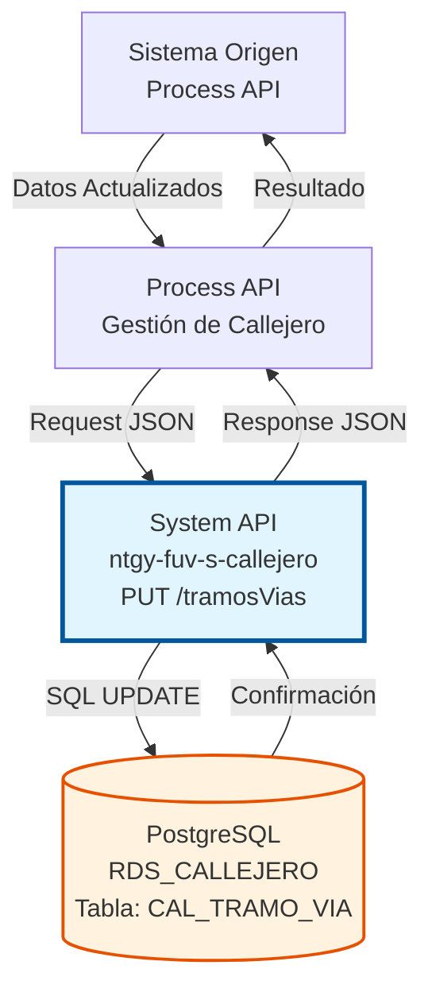
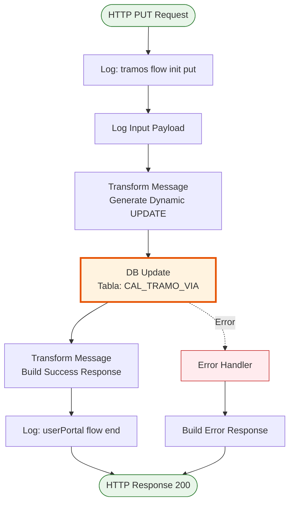
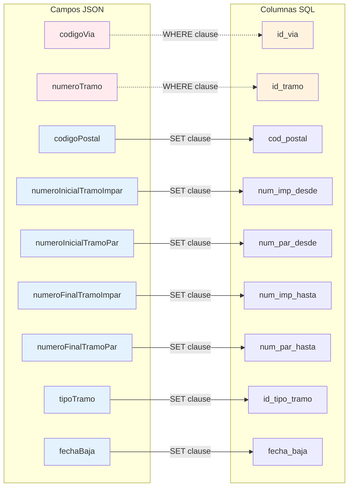

# PUT /tramosVias

## 📌 Descripción General

### Propósito del Endpoint

Este endpoint permite actualizar un tramo de vía existente en la base de datos PostgreSQL del callejero español. Utiliza una clave compuesta (`codigoVia` + `numeroTramo`) para identificar el registro a modificar y permite actualizar cualquier campo excepto las claves primarias.

El endpoint soporta:
- **Actualización Dinámica**: Modifica solo los campos proporcionados en el request
- **Clave Compuesta**: Identifica tramos por `codigoVia` + `numeroTramo`
- **Mapeo Automático**: Convierte nombres de campos JSON a columnas de base de datos
- **Actualización Parcial**: No requiere enviar todos los campos, solo los que se desean modificar
- **Gestión de Nulos**: Maneja correctamente valores null en campos opcionales

### Tipo de API

**Capa:** System API (API-Led Connectivity)

**Función:** Integración directa con PostgreSQL para actualización de tramos de vías del callejero español.

### Patrón de Integración

**Tipo:** Request-Reply Síncrono con SQL UPDATE

**Descripción:** Recibe datos del tramo de vía en formato JSON, genera dinámicamente un UPDATE statement con mapeo de campos, ejecuta la actualización en la tabla CAL_TRAMO_VIA y retorna confirmación.

### Arquitectura API-Led Connectivity



---

## 💼 Propósito del Negocio

### Casos de Uso Principales

1. **Actualización de Códigos Postales**
   - Modificar el código postal de un tramo cuando cambian las asignaciones postales
   - Corregir errores en códigos postales asignados
   - Actualizar tras reorganizaciones territoriales

2. **Modificación de Numeración**
   - Ajustar rangos de numeración par/impar cuando se renumeran calles
   - Corregir errores en rangos de numeración
   - Actualizar tras cambios urbanísticos

3. **Gestión de Estado de Tramos**
   - Marcar tramos como dados de baja (fecha_baja)
   - Reactivar tramos previamente dados de baja
   - Cambiar tipo de tramo (urbano/rural)

### Contexto Empresarial

- **Dominio:** Gestión de Callejero y Direcciones
- **Sector:** Energía - Utilities
- **División:** Naturgy España
- **Proceso de Negocio:** Mantenimiento y actualización del callejero español
- **Criticidad:** Alta - Mantiene la precisión del callejero

### Stakeholders

- **Administradores de Datos**: Mantienen actualizado el callejero
- **Equipos de Atención al Cliente**: Requieren datos precisos para validación
- **Departamento de Facturación**: Necesita direcciones correctas
- **Servicios de Campo**: Dependen de direcciones actualizadas

### Valor de Negocio

- **Precisión de Datos**: Mantiene el callejero actualizado y preciso
- **Flexibilidad**: Permite actualizaciones parciales sin afectar otros campos
- **Trazabilidad**: Registra cambios en el estado de tramos
- **Eficiencia**: Actualización dinámica sin necesidad de enviar todos los campos

### Consumidores Potenciales

Este endpoint puede ser consumido por:
- Process APIs de administración de datos maestros
- Herramientas de mantenimiento de callejero
- Sistemas de sincronización con fuentes oficiales
- Aplicaciones de gestión de datos geográficos

---

## 🔧 Especificación Técnica

### URLs por Ambiente

| Ambiente | URL Base | URL Completa |
|----------|----------|--------------|
| **Local** | `http://localhost:8081` | `http://localhost:8081/api/tramosVias` |
| **Development** | `https://ntgy-fuv-s-callejero-dev.us-e2.cloudhub.io` | `https://ntgy-fuv-s-callejero-dev.us-e2.cloudhub.io/api/tramosVias` |
| **UAT** | `https://ntgy-fuv-s-callejero-uat.us-e2.cloudhub.io` | `https://ntgy-fuv-s-callejero-uat.us-e2.cloudhub.io/api/tramosVias` |
| **Production** | `https://ntgy-fuv-s-callejero-pro.us-e2.cloudhub.io` | `https://ntgy-fuv-s-callejero-pro.us-e2.cloudhub.io/api/tramosVias` |

### Método HTTP

```
PUT /api/tramosVias
```

### Parámetros de Entrada

#### Headers HTTP

| Header | Tipo | Requerido | Descripción | Ejemplo |
|--------|------|-----------|-------------|---------|
| `Content-Type` | string | ✅ Sí | Tipo de contenido del request | `application/json` |
| `Accept` | string | ❌ No | Tipo de contenido esperado en response | `application/json` |

#### Body Parameters

| Campo | Tipo | Requerido | Descripción | Ejemplo |
|-------|------|-----------|-------------|---------|
| `codigoVia` | integer | ✅ Sí | Identificador de la vía (PK) | `12345` |
| `numeroTramo` | integer | ✅ Sí | Número del tramo (PK) | `1` |
| `codigoPostal` | string | ❌ No | Código postal a actualizar | `"28001"` |
| `numeroInicialTramoImpar` | string | ❌ No | Número inicial lado impar | `"1"` |
| `numeroInicialTramoPar` | string | ❌ No | Número inicial lado par | `"2"` |
| `numeroFinalTramoImpar` | string | ❌ No | Número final lado impar | `"99"` |
| `numeroFinalTramoPar` | string | ❌ No | Número final lado par | `"100"` |
| `tipoTramo` | string | ❌ No | Tipo de tramo | `"U"` |
| `fechaBaja` | string | ❌ No | Fecha de baja (YYYYMMDD o null) | `"20261231"` |

**Nota:** Solo se requieren `codigoVia` y `numeroTramo` (claves primarias). Los demás campos son opcionales y solo se actualizarán si se incluyen en el request.

**Estructura JSON del Body:**

```json
{
  "codigoVia": 12345,
  "numeroTramo": 1,
  "codigoPostal": "28002",
  "numeroFinalTramoImpar": "199",
  "numeroFinalTramoPar": "200"
}
```

### Respuestas

#### Respuesta Exitosa (200 OK)

```json
{
  "result": {
    "codResult": "0000",
    "msgResult": "Registro Modificado Correctamente"
  }
}
```

#### Respuesta de Error - Registro No Encontrado (200 OK)

```json
{
  "result": {
    "codResult": "0002",
    "msgResult": "No se encontró el registro a actualizar"
  }
}
```

#### Respuesta de Error Técnico (500)

```json
{
  "result": {
    "codResult": "0001",
    "msgResult": "Error al actualizar el registro en la base de datos"
  }
}
```

### Autenticación y Autorización

- **Tipo:** Client ID & Client Secret (Anypoint Platform)
- **Autorización PostgreSQL:** El usuario de base de datos debe tener permisos para:
  - Ejecutar UPDATE en tabla `CAL_TRAMO_VIA`
  - Acceso al schema `public`

### Timeouts

| Tipo | Valor | Descripción |
|------|-------|-------------|
| **Request Timeout** | 30 segundos | Tiempo máximo de espera para la respuesta |
| **Connection Timeout** | 10 segundos | Tiempo máximo para establecer conexión con PostgreSQL |

---

## 🏗️ Implementación Técnica

### Arquitectura del Flow



### Componentes del Flow

#### 1. Logger Inicial (Flow Init)
```xml
<logger level="INFO" message="tramos flow init put" />
```

#### 2. Logger de Input
```xml
<logger level="INFO" message="Input payload: #[payload]" />
```

#### 3. Transformación DataWeave (Generación Dinámica de UPDATE)

**Ubicación en código:** Líneas 96-122 del archivo XML

```dataweave
%dw 2.0
output application/json

var mapping = {
  "codigoVia": "id_via",
  "numeroTramo": "id_tramo",
  "codigoPostal": "cod_postal",
  "numeroInicialTramoImpar": "num_imp_desde",
  "numeroInicialTramoPar": "num_par_desde",
  "numeroFinalTramoImpar": "num_imp_hasta",
  "numeroFinalTramoPar": "num_par_hasta",
  "tipoTramo": "id_tipo_tramo",
  "fechaBaja": "fecha_baja"
}

fun generateUpdateStatement(payload, keyField1, keyField2) = do {
    var keyValue1 = payload[keyField1]
    var keyValue2 = payload[keyField2]    
    var fields = payload - keyField1 - keyField2
    var setClause = fields pluck ((value, fieldName) -> 
        (mapping[fieldName] default fieldName) ++ " = " ++ 
        if (value == null) "NULL" else "'" ++ value ++ "'"
    ) joinBy ", "
    ---
    "update CAL_TRAMO_VIA set " ++ setClause ++ 
    " where " ++ (mapping[keyField1] default keyField1) ++ " = '" ++ keyValue1 ++ "' and " ++ 
    (mapping[keyField2] default keyField2) ++ " = '" ++ keyValue2 ++ "'"
}

---
{
    updateStatement: generateUpdateStatement(payload, "codigoVia", "numeroTramo")
}
```

**Lógica Especial:**
- **Mapeo de Campos**: Convierte nombres JSON a nombres de columnas SQL
- **Actualización Dinámica**: Solo incluye campos presentes en el payload
- **Exclusión de Claves**: Excluye `codigoVia` y `numeroTramo` del SET clause
- **Manejo de Nulos**: Convierte `null` a `NULL` SQL
- **Clave Compuesta**: Usa ambas claves en la cláusula WHERE

#### 4. Database Update

**Ubicación en código:** Líneas 124-126 del archivo XML

```xml
<db:update config-ref="RDS_CALLEJERO">
    <db:sql><![CDATA[#[vars.queryJson.updateStatement]]]></db:sql>
</db:update>
```

**Query SQL Generado (ejemplo):**
```sql
UPDATE CAL_TRAMO_VIA 
SET cod_postal = '28002', 
    num_imp_hasta = '199', 
    num_par_hasta = '200' 
WHERE id_via = '12345' AND id_tramo = '1'
```

#### 5. Transformación de Respuesta

**Ubicación en código:** Líneas 127-137 del archivo XML

```dataweave
%dw 2.0
output application/json
---
{
  "result": {
    "codResult": "0000",
    "msgResult": "Registro Modificado Correctamente"
  }	
}
```

### Mapeo de Campos JSON a SQL



### Tabla de Base de Datos

**Tabla:** `public.CAL_TRAMO_VIA`

| Columna | Tipo | Actualizable | Descripción |
|---------|------|--------------|-------------|
| `id_via` | INTEGER | ❌ NO (PK) | Identificador de la vía |
| `id_tramo` | INTEGER | ❌ NO (PK) | Identificador del tramo |
| `cod_postal` | VARCHAR | ✅ SÍ | Código postal del tramo |
| `num_imp_desde` | VARCHAR | ✅ SÍ | Número inicial lado impar |
| `num_par_desde` | VARCHAR | ✅ SÍ | Número inicial lado par |
| `num_imp_hasta` | VARCHAR | ✅ SÍ | Número final lado impar |
| `num_par_hasta` | VARCHAR | ✅ SÍ | Número final lado par |
| `id_tipo_tramo` | VARCHAR | ✅ SÍ | Tipo de tramo |
| `fecha_baja` | DATE | ✅ SÍ | Fecha de baja del tramo |

**Clave Primaria:** (`id_via`, `id_tramo`)

### Manejo de Errores

**Errores Comunes:**

1. **Registro No Encontrado**
   - La combinación `codigoVia` + `numeroTramo` no existe
   - UPDATE afecta 0 filas
   - Retorna 200 OK con mensaje informativo

2. **Campos Requeridos Faltantes**
   - Faltan `codigoVia` o `numeroTramo`
   - Validado por APIKit según RAML
   - Retorna 400 Bad Request

3. **Error de Conexión a Base de Datos**
   - Timeout o base de datos no disponible
   - Retorna 503 Service Unavailable

---

## 💻 Ejemplos de Uso

### Ejemplo 1: Actualizar Código Postal

**Request:**

```bash
curl -X PUT "http://localhost:8081/api/tramosVias" \
  -H "Content-Type: application/json" \
  -d '{
    "codigoVia": 12345,
    "numeroTramo": 1,
    "codigoPostal": "28002"
  }'
```

**Response (200 OK):**

```json
{
  "result": {
    "codResult": "0000",
    "msgResult": "Registro Modificado Correctamente"
  }
}
```

### Ejemplo 2: Actualizar Rangos de Numeración

**Request:**

```bash
curl -X PUT "http://localhost:8081/api/tramosVias" \
  -H "Content-Type: application/json" \
  -d '{
    "codigoVia": 12345,
    "numeroTramo": 1,
    "numeroFinalTramoImpar": "199",
    "numeroFinalTramoPar": "200"
  }'
```

**Response (200 OK):**

```json
{
  "result": {
    "codResult": "0000",
    "msgResult": "Registro Modificado Correctamente"
  }
}
```

### Ejemplo 3: Marcar Tramo como Dado de Baja

**Request:**

```bash
curl -X PUT "http://localhost:8081/api/tramosVias" \
  -H "Content-Type: application/json" \
  -d '{
    "codigoVia": 12345,
    "numeroTramo": 1,
    "fechaBaja": "20261231"
  }'
```

**Response (200 OK):**

```json
{
  "result": {
    "codResult": "0000",
    "msgResult": "Registro Modificado Correctamente"
  }
}
```

### Ejemplo 4: Error - Tramo No Encontrado

**Request:**

```bash
curl -X PUT "http://localhost:8081/api/tramosVias" \
  -H "Content-Type: application/json" \
  -d '{
    "codigoVia": 99999,
    "numeroTramo": 99,
    "codigoPostal": "28001"
  }'
```

**Response (200 OK):**

```json
{
  "result": {
    "codResult": "0002",
    "msgResult": "No se encontró el registro a actualizar"
  }
}
```

### Ejemplo 5: Uso desde JavaScript

```javascript
const updateTramoVia = async (codigoVia, numeroTramo, cambios) => {
  try {
    const payload = {
      codigoVia,
      numeroTramo,
      ...cambios
    };

    const response = await fetch('http://localhost:8081/api/tramosVias', {
      method: 'PUT',
      headers: {
        'Content-Type': 'application/json'
      },
      body: JSON.stringify(payload)
    });

    const result = await response.json();
    
    if (result.result.codResult === "0000") {
      console.log('Tramo actualizado exitosamente');
      return result;
    } else if (result.result.codResult === "0002") {
      console.warn('Tramo no encontrado');
      return null;
    } else {
      console.error('Error al actualizar tramo:', result.result.msgResult);
      throw new Error(result.result.msgResult);
    }
  } catch (error) {
    console.error('Error en la petición:', error);
    throw error;
  }
};

// Uso: Actualizar código postal
updateTramoVia(12345, 1, {
  codigoPostal: "28002"
});

// Uso: Actualizar múltiples campos
updateTramoVia(12345, 1, {
  codigoPostal: "28002",
  numeroFinalTramoImpar: "199",
  numeroFinalTramoPar: "200"
});

// Uso: Dar de baja un tramo
updateTramoVia(12345, 1, {
  fechaBaja: "20261231"
});
```

### Ejemplo 6: Actualización Masiva con Validación

```javascript
const actualizarTramosMasivo = async (actualizaciones) => {
  const resultados = {
    exitosos: [],
    fallidos: [],
    noEncontrados: []
  };

  for (const actualizacion of actualizaciones) {
    try {
      const resultado = await updateTramoVia(
        actualizacion.codigoVia,
        actualizacion.numeroTramo,
        actualizacion.cambios
      );

      if (resultado) {
        resultados.exitosos.push(actualizacion);
      } else {
        resultados.noEncontrados.push(actualizacion);
      }
    } catch (error) {
      resultados.fallidos.push({
        ...actualizacion,
        error: error.message
      });
    }
  }

  return resultados;
};

// Uso
const actualizaciones = [
  {
    codigoVia: 12345,
    numeroTramo: 1,
    cambios: { codigoPostal: "28002" }
  },
  {
    codigoVia: 12345,
    numeroTramo: 2,
    cambios: { codigoPostal: "28003" }
  }
];

actualizarTramosMasivo(actualizaciones).then(resultados => {
  console.log(`Exitosos: ${resultados.exitosos.length}`);
  console.log(`No encontrados: ${resultados.noEncontrados.length}`);
  console.log(`Fallidos: ${resultados.fallidos.length}`);
});
```
