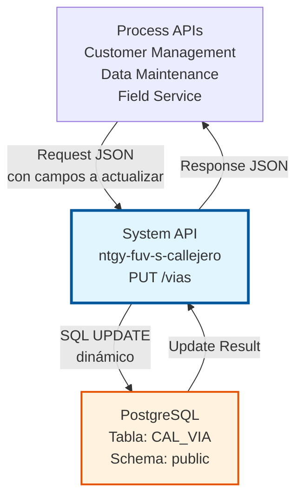
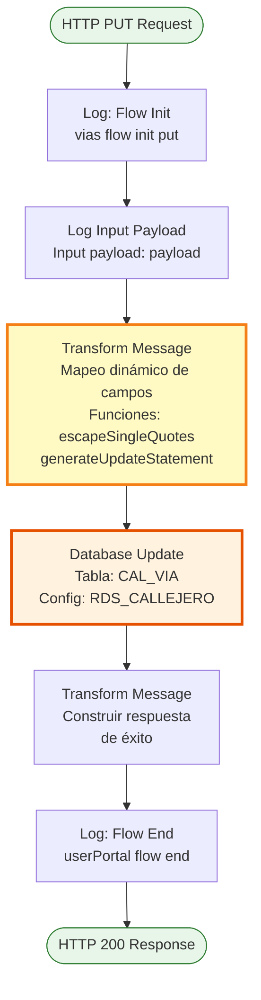
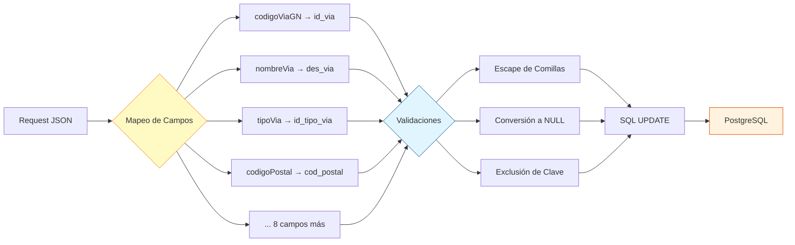

# PUT /vias

## 📌 Descripción General

### Propósito del Endpoint

Este endpoint permite actualizar la información de una vía existente en el sistema de callejero español. Implementa un sistema avanzado de actualización dinámica con mapeo automático de campos, escape de caracteres especiales y manejo inteligente de valores nulos.

El endpoint soporta:
- **Actualización Completa**: Modifica todos los campos de una vía
- **Actualización Parcial**: Actualiza solo los campos proporcionados en el request
- **Mapeo Dinámico**: Convierte automáticamente nombres de campos JSON a columnas SQL
- **Escape de Caracteres**: Previene errores SQL escapando comillas simples
- **Manejo de NULL**: Convierte valores vacíos y null a NULL SQL correctamente

### Tipo de API

**Capa:** System API (API-Led Connectivity)

**Función:** Integración directa con PostgreSQL para actualización de datos de callejero español.

### Patrón de Integración

**Tipo:** Request-Reply Síncrono con SQL UPDATE Dinámico

**Descripción:** Recibe los datos de la vía en formato JSON, aplica transformaciones DataWeave avanzadas para construir dinámicamente la sentencia SQL UPDATE con mapeo de campos, validaciones y escape de caracteres, ejecuta la actualización en PostgreSQL y retorna una respuesta estandarizada de éxito o error.

### Arquitectura API-Led Connectivity



---

## 💼 Propósito del Negocio

### Casos de Uso Principales

1. **Corrección de Datos de Vías**
   - Corregir errores en nombres de vías
   - Actualizar códigos postales modificados
   - Ajustar tipos de vía según nomenclatura oficial

2. **Actualización de Información Administrativa**
   - Modificar códigos INE actualizados
   - Actualizar secciones censales
   - Cambiar indicadores de tramificación

3. **Gestión de Ciclo de Vida de Vías**
   - Marcar vías como dadas de baja (fecha_baja)
   - Actualizar referencias a vías sustitutas
   - Mantener histórico de cambios

### Contexto Empresarial

- **Dominio:** Gestión de Callejero y Direcciones
- **Sector:** Energía - Utilities
- **División:** Naturgy España - FUV (Fuerza de Ventas)
- **Proceso de Negocio:** Mantenimiento de Datos Maestros de Direcciones
- **Criticidad:** Alta - Impacta en calidad de datos de direcciones

### Stakeholders

- **Administradores de Datos Maestros**: Responsables de mantener el callejero actualizado
- **Equipos de Calidad de Datos**: Corrigen inconsistencias y errores
- **Sistemas de Sincronización**: Actualizan datos desde fuentes oficiales (INE, Correos)
- **Equipos de Atención al Cliente**: Solicitan correcciones de datos incorrectos

### Valor de Negocio

- **Calidad de Datos**: Mantiene información precisa y actualizada del callejero
- **Flexibilidad**: Permite actualizaciones completas o parciales según necesidad
- **Trazabilidad**: Facilita el mantenimiento histórico de cambios
- **Eficiencia**: Actualización dinámica sin necesidad de especificar todos los campos

### Consumidores Potenciales

Este endpoint puede ser consumido por:
- Process APIs de mantenimiento de datos maestros
- Sistemas de sincronización con fuentes oficiales
- Herramientas de administración de callejero
- Procesos batch de actualización masiva
- Interfaces de corrección manual de datos

---

## 🔧 Especificación Técnica

### URLs por Ambiente

| Ambiente | URL Base | URL Completa |
|----------|----------|--------------|
| **Local** | `http://localhost:8081` | `http://localhost:8081/vias` |
| **Development** | `https://ntgy-fuv-s-callejero-dev.cloudhub.io` | `https://ntgy-fuv-s-callejero-dev.cloudhub.io/vias` |
| **UAT** | `https://ntgy-fuv-s-callejero-uat.cloudhub.io` | `https://ntgy-fuv-s-callejero-uat.cloudhub.io/vias` |
| **Production** | `https://ntgy-fuv-s-callejero.cloudhub.io` | `https://ntgy-fuv-s-callejero.cloudhub.io/vias` |

### Método HTTP

```
PUT /vias
```

### Parámetros de Entrada

#### Headers HTTP

| Header | Tipo | Requerido | Descripción | Ejemplo |
|--------|------|-----------|-------------|---------|
| `Content-Type` | string | ✅ Sí | Tipo de contenido del request | `application/json` |
| `Accept` | string | ❌ No | Tipo de contenido esperado en response | `application/json` |

#### Body Parameters

| Campo | Tipo | Requerido | Descripción | Ejemplo |
|-------|------|-----------|-------------|---------|
| `codigoViaGN` | string | ✅ Sí | Código único de la vía (campo clave) | `"280790001"` |
| `nombreVia` | string | ❌ No | Nombre de la vía | `"Gran Vía"` |
| `tipoVia` | string | ❌ No | Código del tipo de vía | `"CL"` |
| `codigoPostal` | string | ❌ No | Código postal de 5 dígitos | `"28013"` |
| `viaTramificada` | string | ❌ No | Indicador de tramificación postal | `"S"` o `"N"` |
| `codigoINEVia` | string | ❌ No | Código INE de la vía | `"280790001"` |
| `codigoGNPoblacion` | string | ❌ No | Código GN de la población | `"28079"` |
| `codigoINEPoblacion` | string | ❌ No | Código INE de la población | `"28079"` |
| `codigoSeccionCensal` | string | ❌ No | Código de sección censal | `"001"` |
| `indicadorSeccionCensal` | string | ❌ No | Indicador de sección censal | `"S"` o `"N"` |
| `fechaBaja` | string | ❌ No | Fecha de baja (YYYYMMDD) o null | `"20231231"` |
| `codigoGNActivo` | string | ❌ No | Código de vía sustituta | `"280790002"` |

**Notas Importantes:**
- **codigoViaGN** es obligatorio y se usa como clave para identificar la vía a actualizar
- Todos los demás campos son opcionales - solo se actualizan los campos presentes en el request
- Valores `null` o `""` (string vacío) se convierten a NULL en la base de datos
- El sistema escapa automáticamente comillas simples en valores string

**Mapeo de Campos JSON → SQL:**

| Campo JSON | Columna SQL | Descripción |
|------------|-------------|-------------|
| `codigoViaGN` | `id_via` | Identificador único (clave) |
| `nombreVia` | `des_via` | Nombre descriptivo |
| `tipoVia` | `id_tipo_via` | Tipo de vía |
| `codigoPostal` | `cod_postal` | Código postal |
| `viaTramificada` | `ind_tramos` | Indicador de tramos |
| `codigoINEVia` | `cod_ine_via` | Código INE |
| `codigoGNPoblacion` | `id_poblacion_gn` | Población GN |
| `codigoINEPoblacion` | `id_poblacion` | Población INE |
| `codigoSeccionCensal` | `cod_seccion_censal` | Sección censal |
| `indicadorSeccionCensal` | `ind_seccion_censal` | Indicador sección |
| `fechaBaja` | `fecha_baja` | Fecha de baja |
| `codigoGNActivo` | `id_via_sust` | Vía sustituta |

**Estructura del Request (Actualización Completa):**

```json
{
  "codigoViaGN": "280790001",
  "nombreVia": "Gran Vía Actualizada",
  "tipoVia": "CL",
  "codigoPostal": "28013",
  "viaTramificada": "N",
  "codigoINEVia": "280790001",
  "codigoGNPoblacion": "28079",
  "codigoINEPoblacion": "28079",
  "codigoSeccionCensal": "001",
  "indicadorSeccionCensal": "S",
  "fechaBaja": null,
  "codigoGNActivo": null
}
```

**Estructura del Request (Actualización Parcial):**

```json
{
  "codigoViaGN": "280790001",
  "nombreVia": "Gran Vía Corregida",
  "codigoPostal": "28014"
}
```

### Respuestas

#### Respuesta Exitosa (200 OK)

```json
{
  "result": {
    "codResult": "0000",
    "msgResult": "Registro Modificado Correctamente"
  }
}
```

#### Respuesta de Error - Vía No Encontrada (200 OK)

```json
{
  "result": {
    "codResult": "0000",
    "msgResult": "Registro Modificado Correctamente"
  }
}
```

**Nota:** El endpoint retorna éxito incluso si no se encuentra la vía (0 filas actualizadas). Para verificar si la vía existe, usar GET /vias primero.

#### Respuesta de Error de Validación (400)

```json
{
  "result": {
    "codResult": "0002",
    "msgResult": "Campo codigoViaGN requerido"
  }
}
```

#### Respuesta de Error de Base de Datos (500)

```json
{
  "result": {
    "codResult": "0001",
    "msgResult": "Error al actualizar registro en base de datos"
  }
}
```

### Autenticación y Autorización

- **Tipo:** Client ID & Client Secret (Anypoint Platform)
- **Autorización PostgreSQL:** El usuario de base de datos debe tener permisos para:
  - Ejecutar UPDATE en tabla `CAL_VIA`
  - Acceso de escritura al schema `public`

### Timeouts

| Tipo | Valor | Descripción |
|------|-------|-------------|
| **Request Timeout** | 30 segundos | Tiempo máximo de espera para la respuesta |
| **Connection Timeout** | 10 segundos | Tiempo máximo para establecer conexión con PostgreSQL |
| **Database Query Timeout** | 20 segundos | Tiempo máximo de ejecución del UPDATE |

---

## 🏗️ Implementación Técnica

### Arquitectura del Flow



### Componentes del Flow

#### 1. Logger - Flow Init
```xml
<logger level="INFO" doc:name="Flow init" 
        message="vias flow init put" />
```
- **Propósito:** Registra el inicio del flow
- **Nivel:** INFO
- **Ubicación:** Línea 2 del flow `viasPutFlow`

#### 2. Logger - Input Payload
```xml
<logger level="INFO" doc:name="Log input payload" 
        message="Input payload: #[payload]" />
```
- **Propósito:** Registra el payload de entrada para auditoría
- **Nivel:** INFO
- **Ubicación:** Línea 3 del flow

#### 3. Transform Message - Construcción Dinámica de SQL UPDATE

**Ubicación:** Líneas 4-42 del flow

**Esta es la transformación más avanzada del proyecto, implementando:**

##### A. Mapeo de Campos JSON → SQL

```dataweave
var mapping = {
    "codigoViaGN": "id_via",
    "nombreVia": "des_via",
    "tipoVia": "id_tipo_via",
    "codigoPostal": "cod_postal",
    "viaTramificada": "ind_tramos",
    "codigoINEVia": "cod_ine_via",
    "codigoGNPoblacion": "id_poblacion_gn",
    "codigoINEPoblacion": "id_poblacion",
    "codigoSeccionCensal": "cod_seccion_censal",
    "indicadorSeccionCensal": "ind_seccion_censal",
    "fechaBaja": "fecha_baja",
    "codigoGNActivo": "id_via_sust"
}
```

**Propósito:** Define la correspondencia entre nombres de campos JSON y columnas SQL.

##### B. Función de Escape de Comillas

```dataweave
fun escapeSingleQuotes(value) = 
    if (value is String) value replace "'" with "''" else value
```

**Propósito:** 
- Previene errores de sintaxis SQL
- Previene SQL injection
- Duplica comillas simples (`'` → `''`) en valores string
- Deja valores no-string sin modificar

**Ejemplo:**
- Input: `"Calle de l'Almirall"`
- Output: `"Calle de l''Almirall"`

##### C. Función de Generación de UPDATE Dinámico

```dataweave
fun generateUpdateStatement(payload, keyField) = do {
    var keyValue = escapeSingleQuotes(payload[keyField])
    var fields = payload - keyField
    var setClause = fields pluck ((value, fieldName) -> 
        (mapping[fieldName] default fieldName) ++ " = " ++ 
        if (value == null or value == "") "NULL"
        else "'" ++ escapeSingleQuotes(value) ++ "'"
    ) joinBy ", "
    ---
    "update CAL_VIA set " ++ setClause ++ 
    " where " ++ (mapping[keyField] default keyField) ++ 
    " = '" ++ keyValue ++ "'"
}
```

**Proceso Paso a Paso:**

1. **Extraer valor de la clave:**
   ```dataweave
   var keyValue = escapeSingleQuotes(payload[keyField])
   ```
   - Obtiene el valor de `codigoViaGN`
   - Aplica escape de comillas

2. **Excluir campo clave del SET:**
   ```dataweave
   var fields = payload - keyField
   ```
   - Remueve `codigoViaGN` del payload
   - Solo los campos restantes se actualizarán

3. **Construir cláusula SET:**
   ```dataweave
   var setClause = fields pluck ((value, fieldName) -> 
       (mapping[fieldName] default fieldName) ++ " = " ++ 
       if (value == null or value == "") "NULL"
       else "'" ++ escapeSingleQuotes(value) ++ "'"
   ) joinBy ", "
   ```
   - Itera sobre cada campo del payload
   - Mapea nombre JSON a columna SQL
   - Convierte `null` y `""` a `NULL` SQL
   - Escapa comillas en valores string
   - Une todos con comas

4. **Construir UPDATE completo:**
   ```dataweave
   "update CAL_VIA set " ++ setClause ++ 
   " where " ++ (mapping[keyField] default keyField) ++ 
   " = '" ++ keyValue ++ "'"
   ```

**Ejemplo de SQL Generado:**

**Input:**
```json
{
  "codigoViaGN": "280790001",
  "nombreVia": "Gran Vía",
  "codigoPostal": "28014"
}
```

**Output:**
```sql
UPDATE CAL_VIA SET 
  des_via = 'Gran Vía', 
  cod_postal = '28014' 
WHERE id_via = '280790001'
```

#### 4. Database Update

```xml
<db:update doc:name="Update" config-ref="RDS_CALLEJERO">
    <db:sql><![CDATA[#[vars.queryJson.updateStatement]]]></db:sql>
</db:update>
```

**Configuración:**
- **Connector:** Database Connector v1.14.12
- **Config:** RDS_CALLEJERO (PostgreSQL)
- **Operación:** UPDATE
- **Tabla:** `CAL_VIA`
- **SQL:** Dinámico (generado por DataWeave)

**Resultado:**
- Retorna número de filas actualizadas
- 0 si no se encuentra la vía
- 1 si se actualiza correctamente

#### 5. Transform Message - Respuesta de Éxito

**Ubicación:** Líneas 46-54 del flow

```dataweave
%dw 2.0
output application/json
---
{
    "result": {
        "codResult": "0000",
        "msgResult": "Registro Modificado Correctamente"
    }
}
```

**Propósito:** Construye respuesta estandarizada de éxito.

#### 6. Logger - Flow End
```xml
<logger level="INFO" doc:name="Flow end" 
        message="userPortal flow end" />
```
- **Propósito:** Registra el fin exitoso del flow
- **Nivel:** INFO

### Diagrama de Mapeo de Campos



### Manejo de Errores

El flow implementa manejo de errores a través de:

1. **Validación de Entrada:** APIKit valida el schema del request
2. **Errores de Base de Datos:** Capturados por el Database Connector
3. **Logging:** Todos los pasos registran información para troubleshooting
4. **Actualización Silenciosa:** Si no se encuentra la vía, retorna éxito (0 filas actualizadas)

**Códigos de Error:**

| Código | Descripción | Causa |
|--------|-------------|-------|
| `0000` | Éxito | Registro actualizado correctamente (o no encontrado) |
| `0001` | Error de BD | Violación de constraint, conexión perdida, etc. |
| `0002` | Error de Validación | Campo codigoViaGN faltante o inválido |

### Configuración de Base de Datos

**Connection String:**
```
jdbc:postgresql://${bbdd.host}:${bbdd.port}/${bbdd.database}
```

**Propiedades:**
- `bbdd.host`: Host del servidor PostgreSQL
- `bbdd.port`: Puerto (default: 5432)
- `bbdd.database`: Nombre de la base de datos (callejero)
- `bbdd.user`: Usuario de conexión
- `bbdd.password`: Password encriptado (secure properties)

**Connection Pooling:** Habilitado para optimizar performance

---

## 💻 Ejemplos de Uso

### Ejemplo 1: Actualización Completa de Vía

**Request:**

```bash
curl -X PUT "https://ntgy-fuv-s-callejero-dev.cloudhub.io/vias" \
  -H "Content-Type: application/json" \
  -H "client_id: your-client-id" \
  -H "client_secret: your-client-secret" \
  -d '{
    "codigoViaGN": "280790001",
    "nombreVia": "Gran Vía Actualizada",
    "tipoVia": "CL",
    "codigoPostal": "28013",
    "viaTramificada": "N",
    "codigoINEVia": "280790001",
    "codigoGNPoblacion": "28079",
    "codigoINEPoblacion": "28079",
    "codigoSeccionCensal": "001",
    "indicadorSeccionCensal": "S",
    "fechaBaja": null,
    "codigoGNActivo": null
  }'
```

**Response (200 OK):**

```json
{
  "result": {
    "codResult": "0000",
    "msgResult": "Registro Modificado Correctamente"
  }
}
```

### Ejemplo 2: Actualización Parcial (Solo Nombre y Código Postal)

**Request:**

```bash
curl -X PUT "https://ntgy-fuv-s-callejero-dev.cloudhub.io/vias" \
  -H "Content-Type: application/json" \
  -H "client_id: your-client-id" \
  -H "client_secret: your-client-secret" \
  -d '{
    "codigoViaGN": "280790001",
    "nombreVia": "Gran Vía Corregida",
    "codigoPostal": "28014"
  }'
```

**SQL Generado:**
```sql
UPDATE CAL_VIA SET 
  des_via = 'Gran Vía Corregida', 
  cod_postal = '28014' 
WHERE id_via = '280790001'
```

**Response (200 OK):**

```json
{
  "result": {
    "codResult": "0000",
    "msgResult": "Registro Modificado Correctamente"
  }
}
```

### Ejemplo 3: Actualización con Nombre que Contiene Comillas

**Request:**

```bash
curl -X PUT "https://ntgy-fuv-s-callejero-dev.cloudhub.io/vias" \
  -H "Content-Type: application/json" \
  -H "client_id: your-client-id" \
  -H "client_secret: your-client-secret" \
  -d '{
    "codigoViaGN": "280790002",
    "nombreVia": "Calle de l'\''Almirall"
  }'
```

**SQL Generado (con escape automático):**
```sql
UPDATE CAL_VIA SET 
  des_via = 'Calle de l''Almirall' 
WHERE id_via = '280790002'
```

**Response (200 OK):**

```json
{
  "result": {
    "codResult": "0000",
    "msgResult": "Registro Modificado Correctamente"
  }
}
```

### Ejemplo 4: Marcar Vía como Dada de Baja

**Request:**

```bash
curl -X PUT "https://ntgy-fuv-s-callejero-dev.cloudhub.io/vias" \
  -H "Content-Type: application/json" \
  -H "client_id: your-client-id" \
  -H "client_secret: your-client-secret" \
  -d '{
    "codigoViaGN": "280790003",
    "fechaBaja": "20231231",
    "codigoGNActivo": "280790004"
  }'
```

**SQL Generado:**
```sql
UPDATE CAL_VIA SET 
  fecha_baja = '20231231', 
  id_via_sust = '280790004' 
WHERE id_via = '280790003'
```

**Response (200 OK):**

```json
{
  "result": {
    "codResult": "0000",
    "msgResult": "Registro Modificado Correctamente"
  }
}
```

### Ejemplo 5: Limpiar Fecha de Baja (Reactivar Vía)

**Request:**

```bash
curl -X PUT "https://ntgy-fuv-s-callejero-dev.cloudhub.io/vias" \
  -H "Content-Type: application/json" \
  -H "client_id: your-client-id" \
  -H "client_secret: your-client-secret" \
  -d '{
    "codigoViaGN": "280790003",
    "fechaBaja": null,
    "codigoGNActivo": null
  }'
```

**SQL Generado:**
```sql
UPDATE CAL_VIA SET 
  fecha_baja = NULL, 
  id_via_sust = NULL 
WHERE id_via = '280790003'
```

**Response (200 OK):**

```json
{
  "result": {
    "codResult": "0000",
    "msgResult": "Registro Modificado Correctamente"
  }
}
```

### Ejemplo 6: Código JavaScript (Node.js) - Actualización Completa

```javascript
const axios = require('axios');

async function updateVia(viaData) {
  try {
    const response = await axios.put(
      'https://ntgy-fuv-s-callejero-dev.cloudhub.io/vias',
      viaData,
      {
        headers: {
          'Content-Type': 'application/json',
          'client_id': 'your-client-id',
          'client_secret': 'your-client-secret'
        }
      }
    );
    
    console.log('Vía actualizada:', response.data);
    return response.data;
  } catch (error) {
    console.error('Error al actualizar vía:', error.response?.data || error.message);
    throw error;
  }
}

// Uso - Actualización completa
const viaCompleta = {
  codigoViaGN: '280790001',
  nombreVia: 'Gran Vía Actualizada',
  tipoVia: 'CL',
  codigoPostal: '28013',
  viaTramificada: 'N',
  codigoINEVia: '280790001',
  codigoGNPoblacion: '28079',
  codigoINEPoblacion: '28079',
  codigoSeccionCensal: '001',
  indicadorSeccionCensal: 'S',
  fechaBaja: null,
  codigoGNActivo: null
};

updateVia(viaCompleta);
```

### Ejemplo 7: Código JavaScript - Actualización Parcial

```javascript
async function updateViaParcial(codigoViaGN, cambios) {
  const payload = {
    codigoViaGN: codigoViaGN,
    ...cambios
  };
  
  try {
    const response = await axios.put(
      'https://ntgy-fuv-s-callejero-dev.cloudhub.io/vias',
      payload,
      {
        headers: {
          'Content-Type': 'application/json',
          'client_id': 'your-client-id',
          'client_secret': 'your-client-secret'
        }
      }
    );
    
    console.log('Vía actualizada parcialmente:', response.data);
    return response.data;
  } catch (error) {
    console.error('Error:', error.response?.data || error.message);
    throw error;
  }
}

// Uso - Solo actualizar nombre y código postal
updateViaParcial('280790001', {
  nombreVia: 'Gran Vía Corregida',
  codigoPostal: '28014'
});
```

### Ejemplo 8: Código Python

```python
import requests
import json

def update_via(via_data):
    """
    Actualiza una vía en el callejero
    
    Args:
        via_data (dict): Datos de la vía a actualizar (debe incluir codigoViaGN)
        
    Returns:
        dict: Respuesta del servidor
    """
    url = "https://ntgy-fuv-s-callejero-dev.cloudhub.io/vias"
    
    headers = {
        "Content-Type": "application/json",
        "client_id": "your-client-id",
        "client_secret": "your-client-secret"
    }
    
    try:
        response = requests.put(url, headers=headers, json=via_data)
        response.raise_for_status()
        print("Vía actualizada:", response.json())
        return response.json()
    except requests.exceptions.RequestException as e:
        print(f"Error al actualizar vía: {e}")
        if hasattr(e.response, 'text'):
            print(f"Detalle: {e.response.text}")
        raise

# Uso - Actualización completa
via_completa = {
    "codigoViaGN": "280790001",
    "nombreVia": "Gran Vía Actualizada",
    "tipoVia": "CL",
    "codigoPostal": "28013",
    "viaTramificada": "N",
    "codigoINEVia": "280790001",
    "codigoGNPoblacion": "28079",
    "codigoINEPoblacion": "28079",
    "codigoSeccionCensal": "001",
    "indicadorSeccionCensal": "S",
    "fechaBaja": None,
    "codigoGNActivo": None
}

update_via(via_completa)

# Uso - Actualización parcial
via_parcial = {
    "codigoViaGN": "280790001",
    "nombreVia": "Gran Vía Corregida",
    "codigoPostal": "28014"
}

update_via(via_parcial)
```

### Ejemplo 9: Función Helper para Actualización Parcial en Python

```python
def update_via_fields(codigo_via_gn, **campos):
    """
    Actualiza campos específicos de una vía
    
    Args:
        codigo_via_gn (str): Código de la vía
        **campos: Campos a actualizar como keyword arguments
        
    Returns:
        dict: Respuesta del servidor
    """
    payload = {
        "codigoViaGN": codigo_via_gn,
        **campos
    }
    
    return update_via(payload)

# Uso
update_via_fields(
    "280790001",
    nombreVia="Gran Vía Corregida",
    codigoPostal="28014"
)

# Marcar como dada de baja
update_via_fields(
    "280790003",
    fechaBaja="20231231",
    codigoGNActivo="280790004"
)
```
