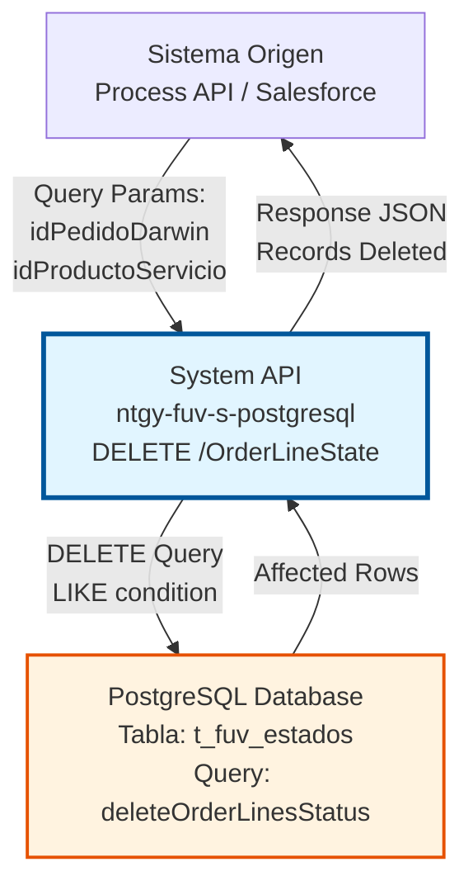
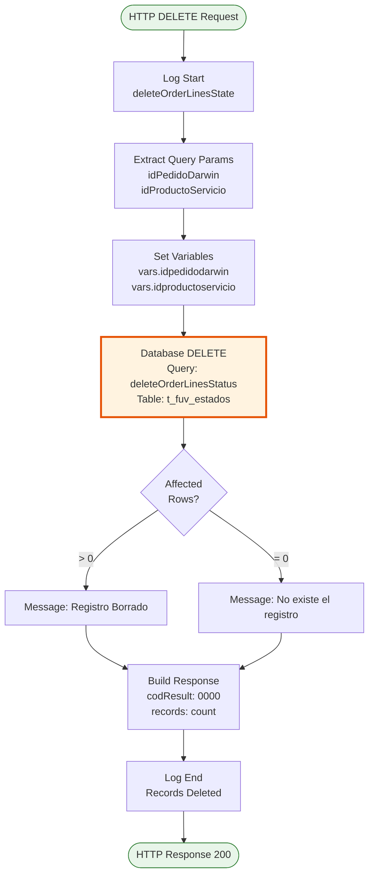
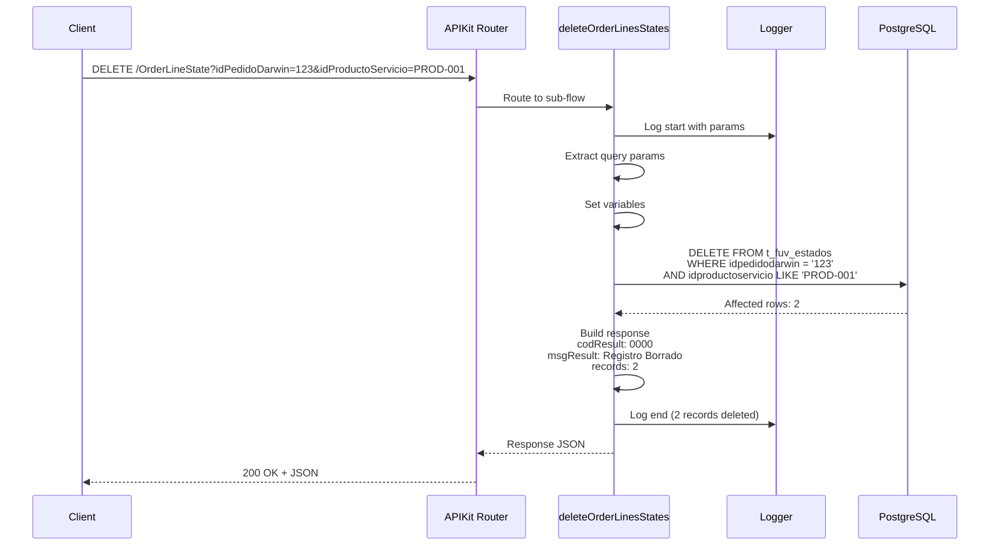

# DELETE /OrderLineState

## 📌 Descripción General

### Propósito del Endpoint

Este endpoint elimina registros de estados de líneas de pedido Darwin de la tabla de control `t_fuv_estados`. Permite la limpieza de datos históricos y la gestión del ciclo de vida de estados de pedidos completados o cancelados.

El endpoint soporta:
- **Eliminación por ID de Pedido**: Elimina todos los estados asociados a un pedido Darwin específico
- **Eliminación Selectiva por Producto**: Permite filtrar por ID de producto/servicio usando LIKE
- **Eliminación Masiva**: Por defecto elimina todas las líneas del pedido (wildcard '%')
- **Operación Física**: Realiza un DELETE físico en la base de datos (no lógico)

### Tipo de API

**Capa:** System API (API-Led Connectivity)

**Función:** Integración directa con PostgreSQL para eliminación de registros de control de estados de líneas de pedido.

### Patrón de Integración

**Tipo:** Request-Reply Síncrono con SQL DELETE

**Descripción:** Recibe parámetros de query (idPedidoDarwin, idProductoServicio), construye y ejecuta una query DELETE con condición LIKE, y retorna el número de registros eliminados.

### Arquitectura API-Led Connectivity



---

## 💼 Propósito del Negocio

### Casos de Uso Principales

1. **Limpieza de Estados Completados**
   - Eliminar estados de pedidos que ya han sido procesados exitosamente
   - Mantener la tabla de control limpia y optimizada
   - Reducir el volumen de datos históricos innecesarios

2. **Cancelación de Pedidos**
   - Eliminar estados de pedidos cancelados que no requieren seguimiento
   - Limpiar registros de pedidos que no se completaron
   - Gestionar el ciclo de vida de pedidos fallidos

3. **Mantenimiento de Datos**
   - Purgar datos obsoletos según políticas de retención
   - Optimizar el rendimiento de consultas en la tabla de estados
   - Gestionar el crecimiento de la base de datos

### Contexto Empresarial

- **Dominio:** Gestión de Estados de Pedidos
- **Sector:** Energía - Utilities
- **División:** Naturgy - FUV (Facturación Única Virtual)
- **Proceso de Negocio:** Control y seguimiento de estados de líneas de pedido Darwin
- **Módulo:** Sistema de Control de Estados

### Stakeholders

- **Administradores de Datos**: Necesitan limpiar datos históricos y mantener la base de datos optimizada
- **Desarrolladores de Process APIs**: Requieren eliminar estados después de procesar pedidos
- **Equipo de Operaciones**: Necesitan gestionar el ciclo de vida de pedidos y estados
- **Equipo de Soporte**: Requieren eliminar estados de pedidos de prueba o erróneos

### Valor de Negocio

- **Optimización de Almacenamiento**: Reduce el volumen de datos almacenados eliminando registros innecesarios
- **Mejora de Rendimiento**: Mantiene la tabla de estados optimizada para consultas rápidas
- **Gestión del Ciclo de Vida**: Permite completar el ciclo de vida de pedidos eliminando sus estados
- **Cumplimiento de Políticas**: Facilita el cumplimiento de políticas de retención de datos
- **Mantenimiento Proactivo**: Previene problemas de rendimiento por acumulación de datos

### Consumidores Potenciales

Este endpoint puede ser consumido por:
- Process APIs de gestión de pedidos
- Flujos de limpieza y mantenimiento de datos
- Procesos batch de purga de datos históricos
- Sistemas de gestión del ciclo de vida de pedidos
- Herramientas de administración de datos

---

## 🔧 Especificación Técnica

### URLs por Ambiente

| Ambiente | URL Base | URL Completa |
|----------|----------|--------------|
| **Local** | `http://localhost:8081` | `http://localhost:8081/api/OrderLineState?idPedidoDarwin={id}&idProductoServicio={productId}` |
| **Development** | `https://ntgy-fuv-s-postgresql-dev.us-e2.cloudhub.io` | `https://ntgy-fuv-s-postgresql-dev.us-e2.cloudhub.io/api/OrderLineState?idPedidoDarwin={id}&idProductoServicio={productId}` |
| **UAT** | `https://ntgy-fuv-s-postgresql-uat.us-e2.cloudhub.io` | `https://ntgy-fuv-s-postgresql-uat.us-e2.cloudhub.io/api/OrderLineState?idPedidoDarwin={id}&idProductoServicio={productId}` |
| **Production** | `https://ntgy-fuv-s-postgresql-pro.us-e2.cloudhub.io` | `https://ntgy-fuv-s-postgresql-pro.us-e2.cloudhub.io/api/OrderLineState?idPedidoDarwin={id}&idProductoServicio={productId}` |

### Método HTTP

```
DELETE /api/OrderLineState
```

### Parámetros de Entrada

#### Headers HTTP

| Header | Tipo | Requerido | Descripción | Ejemplo |
|--------|------|-----------|-------------|---------|
| `Content-Type` | string | ✅ Sí | Tipo de contenido del request | `application/json` |
| `Accept` | string | ❌ No | Tipo de contenido esperado en response | `application/json` |

#### Query Parameters

| Parámetro | Tipo | Requerido | Descripción | Ejemplo |
|-----------|------|-----------|-------------|---------|
| `idPedidoDarwin` | string | ✅ Sí | ID del pedido Darwin cuyos estados se eliminarán | `"12345678"` |
| `idProductoServicio` | string | ❌ No | ID del producto/servicio para filtrar (soporta LIKE). Si no se proporciona, se usa '%' (todos) | `"PROD-001"` o `"%"` |

**Nota Importante sobre idProductoServicio:**
- Si se omite, el sistema usa automáticamente `'%'` como wildcard
- Esto elimina TODAS las líneas de estado del pedido, independientemente del producto
- Para eliminar solo un producto específico, proporcionar el ID exacto

### Respuestas

#### Respuesta Exitosa - Registros Eliminados (200 OK)

```json
{
  "result": {
    "codResult": "0000",
    "msgResult": "Registro Borrado"
  },
  "records": 3
}
```

**Campos de la respuesta:**
- `result.codResult`: Código de resultado (`"0000"` = éxito)
- `result.msgResult`: Mensaje descriptivo del resultado
- `records`: Número de registros eliminados (puede ser 0 si no existe)

#### Respuesta Exitosa - Sin Registros (200 OK)

```json
{
  "result": {
    "codResult": "0000",
    "msgResult": "No existe el registro"
  },
  "records": 0
}
```

**Nota:** Retorna código 0000 incluso si no se eliminó ningún registro (operación exitosa sin datos).

#### Respuesta de Error Técnico (500)

```json
{
  "result": {
    "codResult": "0001",
    "msgResult": "Error interno del servidor: [detalle del error]"
  }
}
```

### Autenticación y Autorización

- **Tipo:** Client ID & Client Secret (Anypoint Platform)
- **Autorización PostgreSQL:** El usuario de base de datos debe tener permisos para:
  - Ejecutar DELETE en tabla `t_fuv_estados`
  - Acceso al schema `fuv`
  - Permisos de escritura en la base de datos

### Timeouts

| Tipo | Valor | Descripción |
|------|-------|-------------|
| **Request Timeout** | 30 segundos | Tiempo máximo de espera para la respuesta |
| **Connection Timeout** | 10 segundos | Tiempo máximo para establecer conexión con PostgreSQL |
| **Query Timeout** | 30 segundos | Tiempo máximo de ejecución de la query DELETE |

---

## 🏗️ Implementación Técnica

### Arquitectura del Flow



### Componentes del Flow

#### 1. Flow Principal (APIKit Router)
**Ubicación:** `s-postgresql-OrderLineStates.xml` (líneas 354-356)

```xml
<flow name="delete:\OrderLineState\(id):s-postgresql-config">
    <flow-ref name="s-postgresql-deleteOrderLinesStates"/>
</flow>
```

**Función:** Recibe la petición DELETE y delega al sub-flow de implementación.

#### 2. Sub-flow de Implementación
**Ubicación:** `s-postgresql-OrderLineStates.xml` (líneas 354-392)

**Nombre:** `s-postgresql-deleteOrderLinesStates`

**Componentes:**

1. **Logger Inicial** (línea 355)
   - Registra inicio de operación con query params
   - Usa función `normalizeJSON` para sanitizar datos sensibles

2. **Transform - Variables** (líneas 356-369)
   - Extrae `idPedidoDarwin` de query params (requerido)
   - Extrae `idProductoServicio` de query params (opcional, default: "")
   - Almacena en variables para uso en la query

3. **Database Delete** (líneas 370-376)
   - Ejecuta query `deleteOrderLinesStatus`
   - Usa parámetros: `idpedidodarwin`, `idproductoservicio`
   - Retorna número de filas afectadas

4. **Transform - Response** (líneas 377-390)
   - Construye respuesta JSON estándar
   - Mensaje condicional según registros eliminados
   - Incluye contador de registros eliminados

5. **Logger Final** (línea 391)
   - Registra fin de operación con número de registros eliminados

### Query SQL

**Nombre:** `deleteOrderLinesStatus`

**Ubicación:** `s-postgresql-global-config.yaml` (línea 64)

```sql
delete from t_fuv_estados 
where idpedidodarwin = :idpedidodarwin 
and idproductoservicio like :idproductoservicio
```

**Características:**
- **Condición Exacta:** `idpedidodarwin = :idpedidodarwin` (match exacto)
- **Condición LIKE:** `idproductoservicio like :idproductoservicio` (permite wildcards)
- **Wildcard por Defecto:** Si no se proporciona idProductoServicio, se usa '%'
- **Eliminación Física:** DELETE real, no soft delete

### Tabla de Base de Datos

**Nombre:** `t_fuv_estados`

**Schema:** `fuv`

**Campos Principales:**
- `idpedidodarwin` (string): ID del pedido Darwin
- `idproductoservicio` (string): ID del producto/servicio
- `estadotrans` (string): Estado de la transacción
- `send_status` (string): Estado de envío
- `create_date` (timestamp): Fecha de creación
- `send_date` (timestamp): Fecha de envío
- `send_retry` (integer): Número de reintentos
- `origen` (string): Sistema origen
- `datos` (jsonb): Datos adicionales en formato JSON

### Transformaciones DataWeave

#### Extracción de Parámetros (líneas 356-369)

```dataweave
%dw 2.0
output application/java
---
{
  idproductoservicio: attributes.queryParams.idProductoServicio default "",
  idpedidodarwin: attributes.queryParams.idPedidoDarwin
}
```

**Función:** Extrae parámetros de query y aplica defaults.

#### Construcción de Respuesta (líneas 377-390)

```dataweave
%dw 2.0
output application/json
---
{
  "result": {
    "codResult": "0000",
    "msgResult": if(payload as String == "0") 
                   "No existe el registro" 
                 else 
                   "Registro Borrado"
  },
  "records": payload
}
```

**Función:** Construye respuesta JSON con mensaje condicional según registros eliminados.

### Manejo de Errores

#### Estrategia de Error Handling

El endpoint NO tiene error handlers explícitos en el sub-flow, por lo que:

1. **Errores de Base de Datos:**
   - Se propagan al error handler global
   - Retornan 500 Internal Server Error
   - Se registran en logs con stack trace completo

2. **Parámetros Faltantes:**
   - Si falta `idPedidoDarwin`: Error de validación (400)
   - Si falta `idProductoServicio`: Se usa default "" (se convierte en '%')

3. **Registro No Encontrado:**
   - NO se considera error
   - Retorna 200 OK con `records: 0`
   - Mensaje: "No existe el registro"

### Diagrama de Secuencia Completo



### Configuración de Base de Datos

**Config Reference:** `Database_Config`

**Propiedades:**
- **Driver:** PostgreSQL JDBC 42.3.3
- **Connection Pooling:** Habilitado
- **Max Pool Size:** Configurado por ambiente
- **Connection Timeout:** 10 segundos
- **Query Timeout:** 30 segundos

---

## 💻 Ejemplos de Uso

### Ejemplo 1: Eliminar Todas las Líneas de un Pedido

**Request:**

```bash
curl -X DELETE "https://ntgy-fuv-s-postgresql-dev.us-e2.cloudhub.io/api/OrderLineState?idPedidoDarwin=12345678" \
  -H "Content-Type: application/json" \
  -H "Accept: application/json" \
  -H "client_id: your-client-id" \
  -H "client_secret: your-client-secret"
```

**Response (200 OK):**

```json
{
  "result": {
    "codResult": "0000",
    "msgResult": "Registro Borrado"
  },
  "records": 5
}
```

**Explicación:** Elimina TODAS las líneas de estado del pedido 12345678 (usa wildcard '%' por defecto).

---

### Ejemplo 2: Eliminar Línea Específica por Producto

**Request:**

```bash
curl -X DELETE "https://ntgy-fuv-s-postgresql-dev.us-e2.cloudhub.io/api/OrderLineState?idPedidoDarwin=12345678&idProductoServicio=PROD-001" \
  -H "Content-Type: application/json" \
  -H "Accept: application/json" \
  -H "client_id: your-client-id" \
  -H "client_secret: your-client-secret"
```

**Response (200 OK):**

```json
{
  "result": {
    "codResult": "0000",
    "msgResult": "Registro Borrado"
  },
  "records": 1
}
```

**Explicación:** Elimina solo la línea de estado del producto PROD-001 del pedido 12345678.

---

### Ejemplo 3: Pedido No Encontrado

**Request:**

```bash
curl -X DELETE "https://ntgy-fuv-s-postgresql-dev.us-e2.cloudhub.io/api/OrderLineState?idPedidoDarwin=99999999" \
  -H "Content-Type: application/json" \
  -H "Accept: application/json" \
  -H "client_id: your-client-id" \
  -H "client_secret: your-client-secret"
```

**Response (200 OK):**

```json
{
  "result": {
    "codResult": "0000",
    "msgResult": "No existe el registro"
  },
  "records": 0
}
```

**Explicación:** El pedido no existe, pero la operación es exitosa (no se considera error).

---

### Ejemplo 4: Error de Base de Datos

**Request:**

```bash
curl -X DELETE "https://ntgy-fuv-s-postgresql-dev.us-e2.cloudhub.io/api/OrderLineState?idPedidoDarwin=12345678" \
  -H "Content-Type: application/json" \
  -H "Accept: application/json" \
  -H "client_id: your-client-id" \
  -H "client_secret: your-client-secret"
```

**Response (500 Internal Server Error):**

```json
{
  "result": {
    "codResult": "0001",
    "msgResult": "Error interno del servidor: Connection timeout"
  }
}
```

**Explicación:** Error de conexión con la base de datos o timeout en la query.

---

### Ejemplo 5: Usando Wildcard Explícito

**Request:**

```bash
curl -X DELETE "https://ntgy-fuv-s-postgresql-dev.us-e2.cloudhub.io/api/OrderLineState?idPedidoDarwin=12345678&idProductoServicio=%25" \
  -H "Content-Type: application/json" \
  -H "Accept: application/json" \
  -H "client_id: your-client-id" \
  -H "client_secret: your-client-secret"
```

**Nota:** `%25` es el encoding URL de `%` (wildcard).

**Response (200 OK):**

```json
{
  "result": {
    "codResult": "0000",
    "msgResult": "Registro Borrado"
  },
  "records": 5
}
```

**Explicación:** Equivalente al Ejemplo 1, elimina todas las líneas del pedido.

---

### Ejemplo 6: JavaScript/Node.js

```javascript
const axios = require('axios');

async function deleteOrderLineState(idPedidoDarwin, idProductoServicio = null) {
  try {
    const params = { idPedidoDarwin };
    if (idProductoServicio) {
      params.idProductoServicio = idProductoServicio;
    }

    const response = await axios.delete(
      'https://ntgy-fuv-s-postgresql-dev.us-e2.cloudhub.io/api/OrderLineState',
      {
        params: params,
        headers: {
          'Content-Type': 'application/json',
          'Accept': 'application/json',
          'client_id': 'your-client-id',
          'client_secret': 'your-client-secret'
        }
      }
    );

    console.log('Registros eliminados:', response.data.records);
    console.log('Mensaje:', response.data.result.msgResult);
    return response.data;
  } catch (error) {
    console.error('Error al eliminar:', error.response?.data || error.message);
    throw error;
  }
}

// Uso: Eliminar todas las líneas del pedido
deleteOrderLineState('12345678');

// Uso: Eliminar línea específica
deleteOrderLineState('12345678', 'PROD-001');
```

---

### Ejemplo 7: Python

```python
import requests

def delete_order_line_state(id_pedido_darwin, id_producto_servicio=None):
    """
    Elimina estados de líneas de pedido Darwin
    
    Args:
        id_pedido_darwin: ID del pedido Darwin
        id_producto_servicio: ID del producto/servicio (opcional)
    
    Returns:
        dict: Respuesta del API con número de registros eliminados
    """
    url = "https://ntgy-fuv-s-postgresql-dev.us-e2.cloudhub.io/api/OrderLineState"
    
    params = {"idPedidoDarwin": id_pedido_darwin}
    if id_producto_servicio:
        params["idProductoServicio"] = id_producto_servicio
    
    headers = {
        "Content-Type": "application/json",
        "Accept": "application/json",
        "client_id": "your-client-id",
        "client_secret": "your-client-secret"
    }
    
    try:
        response = requests.delete(url, params=params, headers=headers)
        response.raise_for_status()
        
        data = response.json()
        print(f"Registros eliminados: {data['records']}")
        print(f"Mensaje: {data['result']['msgResult']}")
        return data
    except requests.exceptions.RequestException as e:
        print(f"Error al eliminar: {e}")
        raise

# Uso: Eliminar todas las líneas del pedido
delete_order_line_state("12345678")

# Uso: Eliminar línea específica
delete_order_line_state("12345678", "PROD-001")
```

---

### Consideraciones de Uso

1. **Eliminación Masiva por Defecto:**
   - Si no se proporciona `idProductoServicio`, se eliminan TODAS las líneas del pedido
   - Usar con precaución en producción

2. **Operación Irreversible:**
   - El DELETE es físico, no hay soft delete
   - Los datos eliminados NO se pueden recuperar
   - Considerar backup antes de eliminaciones masivas

3. **Performance:**
   - La query usa LIKE, puede ser más lenta que igualdad exacta
   - Para grandes volúmenes, considerar eliminación por lotes

4. **Idempotencia:**
   - Llamadas múltiples con los mismos parámetros son seguras
   - La segunda llamada retornará `records: 0`

5. **Logging:**
   - Todas las eliminaciones se registran en logs
   - Incluye parámetros y número de registros eliminados
   - Útil para auditoría y troubleshooting