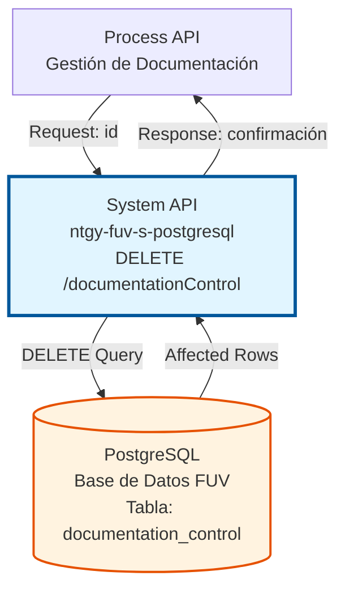
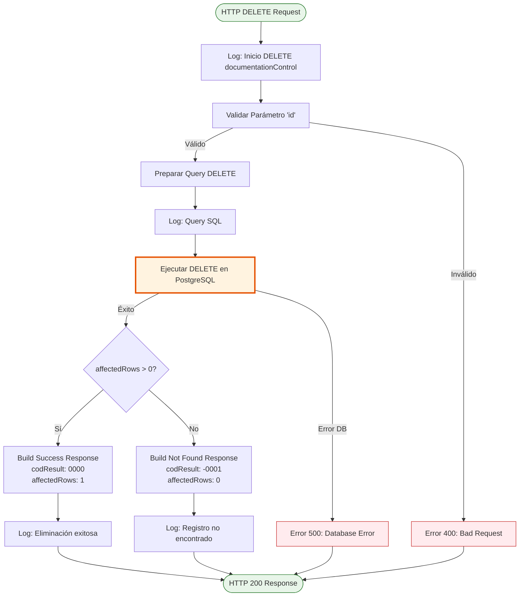
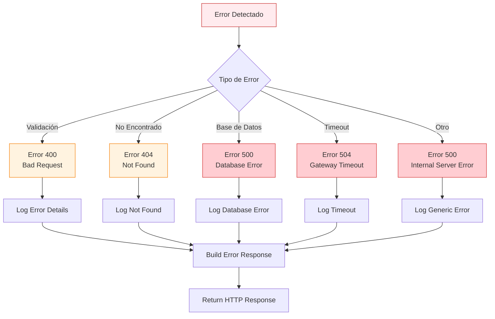

# DELETE /documentationControl

## 📌 Descripción General

### Propósito del Endpoint

Elimina registros de control de documentación de la tabla `t_fuv_documentation_control` en la base de datos PostgreSQL del sistema FUV (Facturación Única Virtual). Este endpoint permite eliminar documentos asociados a un pedido específico, con opción de filtrar por nombre de documento.

El endpoint soporta:
- **Eliminación por pedido**: Elimina todos los documentos de un pedido específico
- **Eliminación selectiva**: Opcionalmente elimina solo un documento específico del pedido
- **Eliminación física**: Elimina permanentemente los registros de la base de datos
- **Confirmación de operación**: Retorna el número de filas afectadas para confirmar la eliminación
- **Gestión del ciclo de vida**: Permite mantener la tabla limpia eliminando registros obsoletos

### Tipo de API

**Capa:** System API (API-Led Connectivity)

**Función:** Integración directa con PostgreSQL para operaciones de eliminación de datos de control de documentación.

### Patrón de Integración

**Tipo:** Request-Reply Síncrono con SQL DELETE

**Descripción:** Recibe el ID del registro a eliminar, ejecuta una operación DELETE en PostgreSQL, y retorna confirmación de la eliminación con el número de filas afectadas.

### Arquitectura API-Led Connectivity



---

## 💼 Propósito del Negocio

### Casos de Uso Principales

1. **Limpieza de Registros Completados**
   - Eliminar registros de documentación que han sido procesados exitosamente
   - Mantener la tabla de control limpia y eficiente
   - Reducir el volumen de datos históricos innecesarios

2. **Eliminación de Registros Erróneos**
   - Remover registros de prueba creados durante desarrollo
   - Eliminar registros duplicados o incorrectos
   - Corregir errores de carga de datos

3. **Mantenimiento del Sistema**
   - Gestión del ciclo de vida de documentos
   - Limpieza periódica de registros antiguos
   - Optimización del rendimiento de la base de datos

### Contexto Empresarial

- **Dominio:** Gestión de Documentación
- **Sector:** Energía - Utilities
- **División:** Naturgy España - FUV (Facturación Única Virtual)
- **Proceso de Negocio:** Control y seguimiento del procesamiento de documentación de pedidos
- **Sistema:** PostgreSQL Database

### Stakeholders

- **Administradores del Sistema**: Necesitan mantener la base de datos limpia y eficiente
- **Desarrolladores**: Requieren eliminar datos de prueba y registros erróneos
- **Operaciones**: Necesitan gestionar el ciclo de vida de los documentos procesados

### Valor de Negocio

- **Optimización de Recursos**: Mantiene la base de datos limpia reduciendo el volumen de datos innecesarios
- **Mejora de Performance**: Eliminar registros obsoletos mejora el rendimiento de las consultas
- **Gestión de Datos**: Permite un control efectivo del ciclo de vida de la documentación
- **Mantenibilidad**: Facilita el mantenimiento y la administración del sistema

### Consumidores Potenciales

Este endpoint puede ser consumido por:
- Process APIs de gestión de documentación
- Procesos batch de limpieza automática
- Herramientas de administración del sistema
- Scripts de mantenimiento programado

---

## 🔧 Especificación Técnica

### URLs por Ambiente

| Ambiente | URL Base | URL Completa |
|----------|----------|--------------|
| **Local** | `http://localhost:8081` | `http://localhost:8081/api/documentationControl?idPedido={idPedido}` |
| **Development** | `https://ntgy-fuv-s-postgresql-dev.us-e2.cloudhub.io` | `https://ntgy-fuv-s-postgresql-dev.us-e2.cloudhub.io/api/documentationControl?idPedido={idPedido}` |
| **UAT** | `https://ntgy-fuv-s-postgresql-uat.us-e2.cloudhub.io` | `https://ntgy-fuv-s-postgresql-uat.us-e2.cloudhub.io/api/documentationControl?idPedido={idPedido}` |
| **Production** | `https://ntgy-fuv-s-postgresql-pro.us-e2.cloudhub.io` | `https://ntgy-fuv-s-postgresql-pro.us-e2.cloudhub.io/api/documentationControl?idPedido={idPedido}` |

### Método HTTP

```
DELETE /api/documentationControl
```

### Parámetros de Entrada

#### Headers HTTP

| Header | Tipo | Requerido | Descripción | Ejemplo |
|--------|------|-----------|-------------|---------|
| `Content-Type` | string | ❌ No | Tipo de contenido del request | `application/json` |
| `Accept` | string | ❌ No | Tipo de contenido esperado en response | `application/json` |

#### Query Parameters

| Parámetro | Tipo | Requerido | Descripción | Ejemplo |
|-----------|------|-----------|-------------|---------|
| `idPedido` | string | ✅ Sí | Identificador único del pedido del Frontal de Ventas. Se usa para filtrar los documentos a eliminar por CONTRACT_ID. | `"ORD-2024-001234"` |
| `nombreDocumento` | string | ❌ No | Nombre del documento específico a eliminar (opcional). Si se proporciona, solo elimina ese documento del pedido. Si no se proporciona, elimina todos los documentos del pedido. | `"contrato_principal.pdf"` |

### Respuestas

#### Respuesta Exitosa (200 OK)

```json
{
  "result": {
    "codResult": "0000",
    "msgResult": "No hay error"
  }
}
```

**Descripción de campos:**
- `codResult`: Código de resultado ("0000" = éxito, "-0001" = error)
- `msgResult`: Mensaje descriptivo del resultado
  - "No hay error": Eliminación exitosa (uno o más registros eliminados)
  - "El registro que intenta borrar no existe": No se encontraron registros

**Nota:** El número de filas afectadas no se retorna en el response, pero se usa internamente para determinar el codResult.

#### Respuesta de Registro No Encontrado (200 OK con codResult = "-0001")

```json
{
  "result": {
    "codResult": "-0001",
    "msgResult": "El registro que intenta borrar no existe"
  }
}
```

#### Respuesta de Error de Validación (400 Bad Request)

```json
{
  "error": {
    "code": "400",
    "message": "Parámetro 'id' es obligatorio",
    "timestamp": "2024-06-15T15:30:00Z"
  }
}
```

#### Respuesta de Error Técnico (500 Internal Server Error)

```json
{
  "error": {
    "code": "500",
    "message": "Error interno del servidor",
    "details": "Error al ejecutar operación DELETE en base de datos",
    "timestamp": "2024-06-15T15:30:00Z"
  }
}
```

### Códigos de Estado HTTP

| Código | Descripción | Cuándo se usa |
|--------|-------------|---------------|
| **200** | OK | Operación procesada exitosamente. Verificar `codResult` en el response: "0000" = eliminación exitosa, "-0001" = registro no encontrado |
| **500** | Internal Server Error | Error de base de datos o error interno del servidor |

**Nota:** Este endpoint siempre retorna 200 OK. El resultado de la operación se indica mediante el campo `codResult` en el response body.

### Autenticación y Autorización

- **Tipo:** Client ID & Client Secret (Anypoint Platform)
- **Autorización PostgreSQL:** El usuario de base de datos debe tener permisos para:
  - Ejecutar operaciones DELETE en la tabla `t_fuv_documentation_control`
  - Acceso de escritura al schema `public`

### Timeouts

| Tipo | Valor | Descripción |
|------|-------|-------------|
| **Request Timeout** | 30 segundos | Tiempo máximo de espera para la respuesta |
| **Connection Timeout** | 10 segundos | Tiempo máximo para establecer conexión con PostgreSQL |
| **Query Timeout** | 30 segundos | Tiempo máximo de ejecución del DELETE |

---

## 🏗️ Implementación Técnica

### Arquitectura del Flow



### Query SQL Ejecutada

```sql
DELETE FROM T_FUV_DOCUMENTATION_CONTROL 
WHERE CONTRACT_ID = :idPedido
[AND DOCUMENT_NAME = :nombreDocumento]
```

**Parámetros:**
- `:idPedido` - Identificador del pedido (CONTRACT_ID) (tipo: string)
- `:nombreDocumento` - Nombre del documento (opcional) (tipo: string)

**Características:**
- Eliminación física (no soft delete)
- Query dinámica: incluye filtro por nombreDocumento solo si se proporciona
- Sin cláusula RETURNING (no retorna datos del registro eliminado)
- Operación atómica y transaccional
- Puede eliminar múltiples registros si no se especifica nombreDocumento

### Tabla PostgreSQL: t_fuv_documentation_control

**Schema:** `public`

**Estructura de la tabla:**

| Campo | Tipo | Descripción |
|-------|------|-------------|
| `t_fuv_documentation_control_id` | SERIAL PRIMARY KEY | Identificador único autogenerado |
| `contract_id` | VARCHAR | ID del pedido asociado (idPedido) |
| `document_name` | VARCHAR | Nombre del documento |
| `document_status` | VARCHAR | Estado del documento (PENDIENTE, PROCESADO, ERROR, ENVIADO) |
| `attempts_number` | INTEGER | Número de intentos de procesamiento |
| `create_date` | TIMESTAMP | Fecha de creación del registro |
| `update_date` | TIMESTAMP | Fecha de última actualización |
| `update_user` | VARCHAR | Usuario que actualizó el registro |
| `update_program` | VARCHAR | Programa que actualizó el registro |
| `num_documento` | VARCHAR | Número de documento del cliente (NIF/NIE/CIF) |
| `cabecera_contrato` | TEXT | Cabecera del contrato (JSON) |
| `tipo_documental` | VARCHAR | Tipo de documento (CONTRATO, ANEXO, CERTIFICADO) |
| `envio_distribuidora` | CHAR(1) | Indicador de envío a distribuidora (Y/N) |
| `lineas_contrato` | TEXT | Líneas del contrato (JSON) |
| `destino` | VARCHAR | Sistema destino (SIEBEL, SAP, etc.) |
| `document_id` | VARCHAR | ID del documento en SharePoint/AWS |

### Diagrama de Secuencia

```mermaid
sequenceDiagram
    participant Client as Process API
    participant API as System API<br/>DELETE /documentationControl
    participant DB as PostgreSQL<br/>fua.documentation_control
    
    Client->>API: DELETE /documentationControl?idPedido=ORD-2024-001234
    activate API
    
    API->>API: Log: Inicio operación
    API->>API: Validar parámetro 'idPedido'
    API->>API: Extraer nombreDocumento (opcional)
    
    alt Parámetros válidos
        API->>API: Construir query DELETE dinámica
        
        alt Con nombreDocumento
            API->>DB: DELETE FROM T_FUV_DOCUMENTATION_CONTROL<br/>WHERE CONTRACT_ID = 'ORD-2024-001234'<br/>AND DOCUMENT_NAME = 'contrato.pdf'
        else Sin nombreDocumento
            API->>DB: DELETE FROM T_FUV_DOCUMENTATION_CONTROL<br/>WHERE CONTRACT_ID = 'ORD-2024-001234'
        end
        
        activate DB
        
        alt Registro(s) existe(n)
            DB-->>API: affectedRows > 0
            deactivate DB
            API->>API: Build Success Response<br/>(codResult: 0000)
            API->>API: Log: Eliminación exitosa
            API-->>Client: 200 OK<br/>{codResult: "0000", msgResult: "No hay error"}
        else Registro no existe
            DB-->>API: affectedRows = 0
            deactivate DB
            API->>API: Build Not Found Response<br/>(codResult: -0001)
            API->>API: Log: Registro no encontrado
            API-->>Client: 200 OK<br/>{codResult: "-0001", msgResult: "El registro que intenta borrar no existe"}
        end
    else Parámetro inválido
        API->>API: Log: Error de validación
        API-->>Client: 400 Bad Request<br/>{error: "Parámetro 'idPedido' requerido"}
    end
    
    deactivate API
```

### Manejo de Errores



### Configuración del Conector PostgreSQL

```xml
<db:config name="Database_Config">
    <db:generic-connection 
        url="${dbFUV.url}" 
        driverClassName="org.postgresql.Driver"
        user="${dbFUV.user}" 
        password="${secure::dbFUV.password}">
        <db:pooling-profile 
            maxPoolSize="20" 
            minPoolSize="5" 
            acquireIncrement="1" 
            maxWait="30000" 
            maxWaitUnit="SECONDS"/>
    </db:generic-connection>
</db:config>
```

### Propiedades de Configuración

**Archivo:** `s-postgresql-{env}-config.yaml`

```yaml
dbFUV:
  url: "jdbc:postgresql://${db.host}:${db.port}/${db.name}"
  user: "${db.user}"
  password: "![encrypted_password]"
  
db:
  host: "postgresql-fuv.example.com"
  port: "5432"
  name: "fuv_database"
  user: "fuv_app_user"
```

---

## 💻 Ejemplos de Uso

### Ejemplo 1: Eliminación de Todos los Documentos de un Pedido

**Request:**

```bash
curl -X DELETE "https://ntgy-fuv-s-postgresql-dev.us-e2.cloudhub.io/api/documentationControl?idPedido=ORD-2024-001234" \
  -H "Accept: application/json" \
  -H "client_id: your-client-id" \
  -H "client_secret: your-client-secret"
```

**Response (200 OK):**

```json
{
  "result": {
    "codResult": "0000",
    "msgResult": "No hay error"
  }
}
```

**Nota:** Este ejemplo elimina TODOS los documentos asociados al pedido ORD-2024-001234.

---

### Ejemplo 2: Eliminación de un Documento Específico

**Request:**

```bash
curl -X DELETE "https://ntgy-fuv-s-postgresql-dev.us-e2.cloudhub.io/api/documentationControl?idPedido=ORD-2024-001234&nombreDocumento=contrato_principal.pdf" \
  -H "Accept: application/json" \
  -H "client_id: your-client-id" \
  -H "client_secret: your-client-secret"
```

**Response (200 OK):**

```json
{
  "result": {
    "codResult": "0000",
    "msgResult": "No hay error"
  }
}
```

**Nota:** Este ejemplo elimina SOLO el documento "contrato_principal.pdf" del pedido ORD-2024-001234.

---

### Ejemplo 3: Registro No Encontrado

**Request:**

```bash
curl -X DELETE "https://ntgy-fuv-s-postgresql-dev.us-e2.cloudhub.io/api/documentationControl?idPedido=ORD-9999-NOEXISTE" \
  -H "Accept: application/json" \
  -H "client_id: your-client-id" \
  -H "client_secret: your-client-secret"
```

**Response (200 OK con codResult = "-0001"):**

```json
{
  "result": {
    "codResult": "-0001",
    "msgResult": "El registro que intenta borrar no existe"
  }
}
```

---

### Ejemplo 4: Error de Validación (Parámetro Faltante)

**Request:**

```bash
curl -X DELETE "https://ntgy-fuv-s-postgresql-dev.us-e2.cloudhub.io/api/documentationControl" \
  -H "Accept: application/json" \
  -H "client_id: your-client-id" \
  -H "client_secret: your-client-secret"
```

**Response (400 Bad Request):**

```json
{
  "error": {
    "code": "400",
    "message": "Parámetro 'idPedido' es obligatorio",
    "timestamp": "2024-06-15T15:30:00Z"
  }
